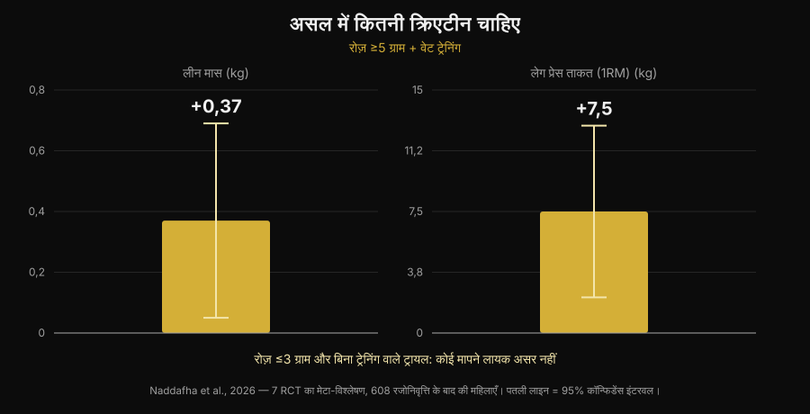
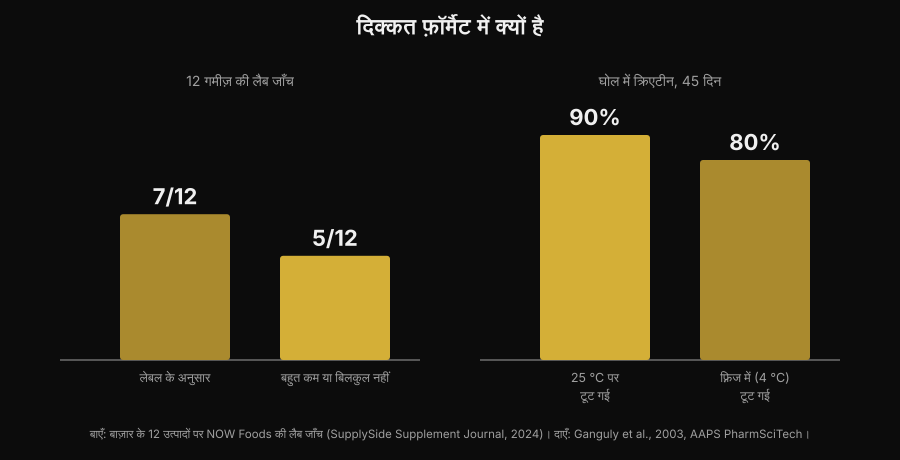

# क्रिएटिन गमीज़ काम करती हैं या पाउडर बेहतर है?

[Giammaria Loi](/autore/giammaria-loi) द्वारा · 5 नवंबर 2026 को अपडेट किया गया

गिलास की तली में जमा रह जाने वाला पाउडर घोलने के बजाय दो गमी चबा लेना। वादा आसान है, और "creatine gummies" की सर्च 279% बढ़ चुकी है। लेकिन असली सवाल यह नहीं है कि क्रिएटिन काम करता है या नहीं — वह फ़ाइल रिसर्च ने तीस साल पहले बंद कर दी। सवाल यह है कि उन गमीज़ के अंदर लेबल पर लिखा क्रिएटिन वाकई है या नहीं। इस पर आँकड़े मौजूद हैं, और वे भरोसा नहीं जगाते।

## संक्षेप में

- **गमीज़ पर एक स्टडी मौजूद है, और नतीजा सकारात्मक है।** दस हफ़्ते, रोज़ 5 g क्रिएटिन मोनोहाइड्रेट गमी के रूप में: 32 महिला बीच वॉलीबॉल खिलाड़ियों में वर्टिकल जंप और दिशा बदलने की रफ़्तार कंट्रोल ग्रुप से बेहतर हुई।
- **पर उस स्टडी में 5 g असली थे।** सबसे नई मेटा-एनालिसिस में रोज़ ≥5 g के साथ वेट ट्रेनिंग पर लीन मास +0,37 kg और लेग प्रेस +7,5 kg मिला, और रोज़ ≤3 g वाली बिना-ट्रेनिंग ट्रायल्स में कोई मापने योग्य असर नहीं।
- **कई गमीज़ में वह नहीं होता जो वे दावा करती हैं।** बाज़ार के 12 प्रोडक्ट पर हुए एक लैब टेस्ट में 5 में क्रिएटिन बहुत कम या बिल्कुल नहीं था — और उन पाँचों में क्रिएटिनिन मिला।
- **क्रिएटिनिन ख़तरनाक नहीं है, बेकार है।** यह क्रिएटिन के टूटने का उत्पाद है: डिब्बे में इसका मिलना बताता है कि क्रिएटिन आपके ख़रीदने से पहले ही जा चुका था।
- **वजह केमिस्ट्री में है।** सूखा पाउडर क्रिएटिन स्थिर रहता है, घोल में नहीं। कमरे के तापमान वाले पानी में 45 दिन में 90% टूट जाता है।

## गमीज़ हर जगह क्यों दिख रही हैं

वजह वैज्ञानिक नहीं, व्यावहारिक है। क्रिएटिन पाउडर की तीन दिक्कतें हैं: नापना पड़ता है, घोलना पड़ता है, और पानी ठंडा हो तो तली में दानेदार रह जाता है। गमी एक झटके में तीनों हल कर देती है, बैग में चली जाती है, और सप्लीमेंट की जगह कैंडी जैसी लगती है। विटामिन D और ओमेगा-3 को चबाने वाले फ़ॉर्मैट की तरफ़ इसी तंत्र ने धकेला था।

नतीजा सर्च में दिखता है: "creatine gummies" आज हर महीने लगभग 165 000 सर्च वाली क्वेरी है, ग्रोथ 279%, और Google के टॉप नतीजे लगभग पूरे उन साइटों की रैंकिंग हैं जो यही प्रोडक्ट बेचती हैं। उनमें से कोई भी पेज वे दो आँकड़े नहीं देता जो मायने रखते हैं: कितना क्रिएटिन चाहिए, और प्रोडक्ट में वाकई कितना है।

## अच्छी ख़बर: गमीज़ पर स्टडी है

कुछ समय पहले तक "काम करती हैं?" पूछने वाले को तुलना से जवाब मिलता था: अंदर क्रिएटिन मोनोहाइड्रेट है, क्रिएटिन मोनोहाइड्रेट काम करता है, इसलिए ये काम करती हैं। अब एक स्टडी है जिसने इसी फ़ॉर्मैट को जाँचा।

बत्तीस महिला बीच वॉलीबॉल खिलाड़ियों — कॉलेज स्तर और प्रोफ़ेशनल — को दस हफ़्ते के लिए रोज़ 5 g क्रिएटिन मोनोहाइड्रेट गमी या कंट्रोल ग्रुप में रखा गया। क्रिएटिन ग्रुप में काउंटरमूवमेंट वर्टिकल जंप (p < 0,001) और दिशा बदलने की रफ़्तार (p = 0,009) सुधरी, जबकि कंट्रोल ग्रुप में सुधार नहीं हुआ या गिरावट आई; फ़ैट मास और बॉडी फ़ैट प्रतिशत में भी क्रिएटिन के पक्ष में फ़र्क़ दिखा। लीन मास, स्केलेटल मसल मास और रिएक्शन टाइम में कोई फ़र्क़ नहीं (Pereira et al., 2026)।

यह नतीजा पाउडर क्रिएटिन की पूरी रिसर्च से मेल खाता है और एक सीधी बात कहता है: **गमी अणु को ख़राब नहीं करती**। अगर क्रिएटिन अंदर है और सही मात्रा में है, तो वाहक दिक्कत नहीं है। इससे पूरा सवाल दो शर्तों पर आ जाता है: है या नहीं, और काफ़ी है या नहीं।

## खुराक ही पूरा खेल है

याद रखने वाला नंबर है रोज़ 5 g। यह International Society of Sports Nutrition के आधिकारिक पोज़िशन स्टैंड में दी गई मेंटेनेंस खुराक है, और गमीज़ वाली स्टडी में इस्तेमाल हुई खुराक भी बिल्कुल यही थी। लोडिंग फ़ेज़ (रोज़ शरीर के वज़न का लगभग 0,3 g प्रति किलो, 5–7 दिन) भंडार तेज़ी से भरता है, पर ज़रूरी नहीं है: रोज़ 3–5 g से कुछ हफ़्तों में उसी जगह पहुँच जाते हैं (Kreider et al., 2017)।

इस सीमा से नीचे बात बदल जाती है। सात रैंडमाइज़्ड ट्रायल और 608 पोस्टमेनोपॉज़ल महिलाओं पर हुई एक सिस्टेमैटिक रिव्यू और मेटा-एनालिसिस में साफ़ फ़ायदे मिले जब क्रिएटिन रोज़ 5 g से ऊपर था और रेज़िस्टेंस ट्रेनिंग के साथ था: लीन मास +0,37 kg (95% CI +0,05 से +0,69) और लेग प्रेस +7,5 kg (95% CI +2,2 से +12,8)। जिन ट्रायल्स में रोज़ ≤3 g बिना ट्रेनिंग था, वहाँ कोई मापने योग्य असर नहीं (Naddafha et al., 2026)।

*Nurvan ग्राफ़, Naddafha et al., 2026 (J Int Soc Sports Nutr) के डेटा पर। मान मूल ऐब्स्ट्रैक्ट से लिए गए हैं, आकृतियों से पढ़े नहीं गए।*

यही परिमाण एक ट्रिपल-ब्लाइंड ट्रायल में भी लौटता है, जिसमें बीस वीगन वयस्क शामिल थे: चार हफ़्ते रोज़ 0,1 g प्रति किलो — 70 kg के व्यक्ति के लिए लगभग 7 g — से स्केलेटल मसल मास 0,3 kg बढ़ा और जंप सुधरा, किडनी मार्कर में कोई बदलाव नहीं (López-Moreno et al., 2026)।

अब व्यावहारिक हिसाब, और यही वजह है कि गमीज़ को ध्यान से देखना चाहिए। एक गमी पर घोषित मात्रा के हिसाब से, 5 g तक पहुँचने के लिए रोज़ कितनी गमी चाहिए:

| प्रति गमी घोषित क्रिएटिन | 5 g के लिए रोज़ कितनी गमी |
|---|---|
| 0,5 g | 10 |
| 0,75 g | 7 |
| 1 g | 5 |
| 1,25 g | 4 |
| 1,5 g | 4 (3,3 ऊपर की ओर पूर्णांकित) |
| 2 g | 3 (2,5 ऊपर की ओर पूर्णांकित) |

*Nurvan की गणना: 5 ÷ प्रति गमी घोषित ग्राम, ऊपर की ओर पूर्णांकित। प्रति गमी ग्राम आपके हाथ में जो प्रोडक्ट है, उसके लेबल पर पढ़ें।*

बात नंबर की नहीं है, बात यह है कि डिब्बे के सामने लिखी "सुझाई गई मात्रा" लगभग कभी 5 g नहीं होती। अगर कोई प्रोडक्ट "रोज़ 2 गमी" कहता है और हर गमी 1 g घोषित करती है, तो आप रोज़ 2 g ले रहे हैं: वही दायरा जिसमें मेटा-एनालिसिस को कोई मापने योग्य असर नहीं मिला।

## असली दिक्कत: अंदर वाकई क्या है

यहाँ वह हिस्सा आता है जो एफ़िलिएट रैंकिंग नहीं बतातीं। एक इंडस्ट्रियल लैब ने Amazon और निर्माताओं की साइटों से 12 क्रिएटिन गमीज़ ख़रीदीं और उनका विश्लेषण किया। सात प्रोडक्ट लेबल के दावे पर खरे उतरे, कुछ अच्छे मार्जिन के साथ। बाक़ी पाँच में क्रिएटिन बहुत कम या बिल्कुल नहीं था। और उन पाँचों में **क्रिएटिनिन** मिला, थोड़ी से लेकर ठीक-ठाक मात्रा तक (NOW Foods टेस्ट, SupplySide Supplement Journal, 2024 द्वारा रिपोर्ट किया गया)।

*Nurvan ग्राफ़। बायाँ पैनल: बाज़ार के 12 प्रोडक्ट पर लैब टेस्ट (NOW Foods, SupplySide Supplement Journal, 2024 द्वारा रिपोर्ट)। दायाँ पैनल: Ganguly et al., 2003, AAPS PharmSciTech।*

क्रिएटिनिन क्रिएटिन के टूटने का अंतिम उत्पाद है। यह ज़हर नहीं है — आपका शरीर रोज़ इसे बनाता और बाहर निकालता है — लेकिन इसका कोई एर्गोजेनिक असर नहीं है। किसी सप्लीमेंट में इसका मिलना एक ही बात कहता है: वह क्रिएटिन आपके मुँह तक पहुँचने से पहले टूट चुका था, और आप एक कैंडी के पैसे दे रहे हैं।

गमीज़ के साथ ही ऐसा क्यों? वजह रासायनिक है, व्यापारिक नहीं। सूखे पाउडर में क्रिएटिन मोनोहाइड्रेट बहुत स्थिर है, घोल में नहीं। एक स्टेबिलिटी स्टडी ने क्रिएटिन फ़ॉर्मुलेशन pH 6,2 वाले पानी में घोले और 45 दिन तक मात्रा मापी: कमरे के तापमान पर 90% क्रिएटिन टूट गया, फ़्रिज में 80% (Ganguly et al., 2003)। गमी एक जेल है जो गर्म अवस्था में बनती है, जिसमें पानी होता है, स्वाद के लिए अक्सर अम्लीय की जाती है, और फिर महीनों कमरे के तापमान पर शेल्फ़ पर रहती है: ये ठीक वही हालात हैं जो यह रूपांतरण तेज़ करते हैं। इसका मतलब यह नहीं कि सारी गमीज़ बेकार हैं — बारह में सात ठीक थीं — बल्कि यह कि यह फ़ॉर्मैट पाउडर के डिब्बे से स्वभाव से ही नाज़ुक है, और लैब विश्लेषण के बिना आपके पास यह जानने का कोई तरीक़ा नहीं कि आप किस आधे हिस्से में पहुँचे।

## रिसर्च असल में क्या कहती है

| प्रचलित दावा | नतीजा | स्रोत |
|---|---|---|
| "गमीज़ काम नहीं करतीं, क्रिएटिन ख़राब हो जाता है" | स्पष्टीकरण ज़रूरी: एक स्टडी में उन्होंने काम किया | Pereira et al., 2026 |
| "लेबल पर लिखी गमीज़ ले लेना काफ़ी है" | ग़लत साबित: मायने 5 g तक पहुँचना रखता है | Naddafha et al., 2026; Kreider et al., 2017 |
| "अगर क्रिएटिन लिखा है, तो अंदर क्रिएटिन है" | ग़लत साबित: 12 में से 5 प्रोडक्ट में कम या बिल्कुल नहीं | NOW Foods टेस्ट, 2024 |
| "गमीज़ का क्रिएटिनिन किडनी को नुक़सान करता है" | ग़लत साबित: वह निष्क्रिय है, दिक्कत छूटी हुई खुराक है | Kreider et al., 2017; López-Moreno et al., 2026 |
| "लोडिंग फ़ेज़ करना ही पड़ता है" | स्पष्टीकरण ज़रूरी: यह तेज़ करता है, अनिवार्य नहीं | Kreider et al., 2017 |
| "ज़्यादा घुलनशील रूप ज़्यादा असरदार हैं" | मनुष्यों में सिद्ध नहीं | Alraddadi et al., 2018 |

आख़िरी पंक्ति पर एक पल रुकना ठीक है, क्योंकि यही तर्क लगभग हर वैकल्पिक रूप के साथ आता है। यह सच है कि क्रिएटिन हाइड्रोक्लोराइड मोनोहाइड्रेट से ज़्यादा घुलनशील है, और चूहों पर हुई एक फ़ार्माकोकाइनेटिक स्टडी ने मॉडलिंग के साथ हाइड्रोक्लोराइड रूप की मौखिक जैवउपलब्धता मोनोहाइड्रेट से ऊँची आँकी (Alraddadi et al., 2018)। पर वह जानवरों पर मॉडल है: किसी भी मानव ट्रायल ने यह नहीं दिखाया कि इससे ज़्यादा ताक़त या ज़्यादा मास मिलता है, और मोनोहाइड्रेट ही वह रूप बना हुआ है जिस पर लगभग पूरी रिसर्च टिकी है, लंबी अवधि की सुरक्षा वाली रिसर्च भी (Kerksick et al., 2026)। वही सिद्धांत गमी पर लागू होता है: वह एक वाहक है, फ़ायदा नहीं।

## इसे कैसे लागू करें

1. **ग्राम से शुरू करें, कैंडी की गिनती से नहीं।** पढ़ें कि एक गमी कितने ग्राम क्रिएटिन मोनोहाइड्रेट घोषित करती है और रोज़ 5 g तक पहुँचने का हिसाब लगाएँ। अगर पैकेज प्रति गमी नहीं बताता, सिर्फ़ प्रति "सर्विंग" बताता है, तो यही एक संकेत है।
2. **जो प्रोडक्ट "मोनोहाइड्रेट" नहीं लिखते, उन पर शक करें।** स्टडीज़ में यही रूप इस्तेमाल हुआ है, गमीज़ वाली स्टडी में भी। सामान्य नाम या "प्रोप्राइटरी" रूपों के पीछे वैसा सबूत आधार नहीं है।
3. **थर्ड-पार्टी सर्टिफ़िकेशन खोजें।** Informed Sport, NSF Certified for Sport और इसी तरह के प्रोग्राम बैच की जाँच करवाते हैं। गमीज़ के लिए यह पाउडर से भी ज़्यादा मायने रखता है, ठीक इसलिए कि यह फ़ॉर्मैट कम स्थिर है।
4. **प्रति ग्राम लागत निकालें।** क़ीमत को डिब्बे के कुल क्रिएटिन ग्राम से भाग दें, गमीज़ की संख्या से नहीं। पाउडर के डिब्बे से तुलना आम तौर पर यहीं ख़त्म हो जाती है।
5. **शुगर भी देखें।** रोज़ पाँच गमी का मतलब रोज़ पाँच मिठाइयाँ: न्यूट्रिशन लेबल पर शुगर की पंक्ति देखें और उसे दिन के हिसाब में जोड़ें।
6. **समय इतना मायने नहीं रखता जितनी नियमितता।** भंडार भरने का काम रोज़ लेने से होता है, सही विंडो पकड़ने से नहीं: इस पर मैंने [सप्लीमेंट कब लें](/hi/blog/supplements-kab-lein-samay) लेख में विस्तार से लिखा है।

**Nurvan आज़माएँ — सप्लीमेंट और वज़न एक साथ ट्रैक**

Nurvan के सप्लीमेंट सेक्शन में आप दर्ज करते हैं कि आप क्या लेते हैं और कब, और वह आपकी सेशन के वज़न, रेप्स और RIR के इतिहास के साथ-साथ दिखता है। इसलिए अगर आप क्रिएटिन का फ़ॉर्मैट या ब्रांड बदलें, तो आप देख सकते हैं कि अगले हफ़्तों में जिम के नंबरों पर क्या हुआ, किसी एहसास पर भरोसा करने के बजाय। उसी प्रोफ़ाइल में आपके अपलोड किए टेस्ट भी मिलते हैं। [Nurvan आज़माएँ](https://nurvan.app)

## अक्सर पूछे जाने वाले सवाल

**क्या क्रिएटिन गमीज़ वाकई काम करती हैं?**
काम कर सकती हैं, दो शर्तों पर। उपलब्ध स्टडी में, गमी रूप में रोज़ 5 g के दस हफ़्तों ने बीच वॉलीबॉल खिलाड़ियों में वर्टिकल जंप और दिशा बदलने की रफ़्तार सुधारी (Pereira et al., 2026)। शर्तें ये हैं कि प्रोडक्ट में घोषित क्रिएटिन वाकई हो, और आप रोज़ लगभग 5 g तक पहुँचें।

**दिन में कितनी क्रिएटिन गमीज़ लेनी चाहिए?**
यह इस पर निर्भर करता है कि हर गमी कितने ग्राम घोषित करती है: लक्ष्य रोज़ लगभग 5 g क्रिएटिन मोनोहाइड्रेट है। प्रति गमी 1 g हो तो 5 गमी, 0,5 g हो तो 10। पैकेज पर छपी "सुझाई गई सर्विंग" अक्सर 5 g से नीचे रह जाती है।

**कुछ गमीज़ में मिला क्रिएटिनिन ख़तरनाक है?**
नहीं। क्रिएटिनिन क्रिएटिन के टूटने का उत्पाद है और शरीर इसे सामान्य रूप से बनाता और निकालता है; स्टडीज़ में क्रिएटिन ने किडनी मार्कर नहीं बदले (Kreider et al., 2017; López-Moreno et al., 2026)। दिक्कत विषाक्तता की नहीं, असर की है: जहाँ क्रिएटिनिन है, वहाँ क्रिएटिन कम है। अगर आपके टेस्ट के मान रेंज से बाहर हैं या किडनी की कोई ज्ञात बीमारी है, तो करने वाली बात अपने डॉक्टर से बात करना है, ख़ुद सप्लीमेंट चुनना नहीं।

**गमीज़ बेहतर या पाउडर?**
अणु के स्तर पर कोई सिद्ध फ़र्क़ नहीं है। पाउडर के तीन ठोस फ़ायदे हैं: लंबे समय तक स्थिर रहता है, प्रति ग्राम बहुत सस्ता पड़ता है, और आपको ठीक 5 g नापने देता है। गमी सिर्फ़ सुविधा में जीतती है। सबूत और क़ीमत के अनुपात में क्रिएटिन और बाक़ी सप्लीमेंट कहाँ खड़े हैं, इस पर मैंने [ताक़त के सप्लीमेंट की टियर लिस्ट](/hi/blog/strength-supplements-tier-list-hindi) बनाई है।

## यह भी पढ़ें

- [ताक़त के सप्लीमेंट की टियर लिस्ट: रिसर्च क्या कहती है](/hi/blog/strength-supplements-tier-list-hindi) — बाक़ी सबके मुक़ाबले क्रिएटिन कहाँ खड़ा है, सबूतों के साथ।
- [क्या क्रिएटिन से बाल झड़ते हैं?](/hi/blog/creatine-and-hair-fall) — क्रिएटिन पर दूसरा सबसे ज़्यादा खोजा जाने वाला सवाल, और वह स्टडी जिससे शक पैदा हुआ।
- [सप्लीमेंट कब लें: समय मायने रखता है?](/hi/blog/supplements-kab-lein-samay) — नियमितता लेने के समय से ज़्यादा भारी क्यों पड़ती है।

## स्रोत

- Pereira F, Forbes SC, Romano V, Christopher P, Santana JC, Antonio J, 2026. Effects of Creatine Monohydrate Gummies on Performance and Body Composition in Female Beach Volleyball Athletes. *Journal of Functional Morphology and Kinesiology* 11(1):105. PMID 41900512. [DOI](https://doi.org/10.3390/jfmk11010105)
- Naddafha S, Antonio J, Kreider RB, Stout JR, 2026. Creatine monohydrate for lean mass, strength, and bone density in postmenopausal women: a systematic review and meta-analysis. *Journal of the International Society of Sports Nutrition* 23(1):2668435. PMID 42141930. [DOI](https://doi.org/10.1080/15502783.2026.2668435)
- Kreider RB, Kalman DS, Antonio J, Ziegenfuss TN, Wildman R, Collins R, Candow DG, Kleiner SM, Almada AL, Lopez HL, 2017. International Society of Sports Nutrition position stand: safety and efficacy of creatine supplementation in exercise, sport, and medicine. *Journal of the International Society of Sports Nutrition* 14:18. PMID 28615996. [DOI](https://doi.org/10.1186/s12970-017-0173-z)
- Kerksick C, Gonzalez D, Stout J, Forbes S, Candow D, Ziegenfuss T, Marshall R, Schwesig R, Kreider R, 2026. The emerging and evolving evidence supporting creatine as an ergogenic aid: history and applications. *Journal of the International Society of Sports Nutrition* 23(1):2646627. PMID 41870601. [DOI](https://doi.org/10.1080/15502783.2026.2646627)
- López-Moreno M, Muñoz A, Aguilar-Navarro M, Gutiérrez-Hellín J, Franco-Andrés A, López-López P, Crespo-Cañizares A, Marrero-Fernández P, Forbes SC, 2026. Does creatine supplementation improve strength and power in physically active individuals on a vegan diet? A randomized, triple-blind, placebo-controlled trial. *European Journal of Applied Physiology* 126(10):5521-5532. PMID 42390589. [DOI](https://doi.org/10.1007/s00421-026-06323-5)
- Ganguly S, Jayappa S, Dash AK, 2003. Evaluation of the stability of creatine in solution prepared from effervescent creatine formulations. *AAPS PharmSciTech* 4(2):E25. PMID 12916907. [DOI](https://doi.org/10.1208/pt040225)
- Alraddadi EA, Lillico R, Vennerstrom JL, Lakowski TM, Miller DW, 2018. Absolute Oral Bioavailability of Creatine Monohydrate in Rats: Debunking a Myth. *Pharmaceutics* 10(1):31. PMID 29518030. [DOI](https://doi.org/10.3390/pharmaceutics10010031)

ग्रंथसूची के संदर्भ PubMed के ज़रिए निकाले गए। 12 गमीज़ पर लैब डेटा: NOW Foods टेस्ट, *SupplySide Supplement Journal*, 2024 द्वारा रिपोर्ट किया गया — [लेख](https://www.supplysidesj.com/supplement-regulations/now-tests-creatine-gummies-finding-almost-half-to-be-severely-understrength-)। विषय 5 नवंबर 2026 की ट्रेंड सर्च से चुना गया: "creatine gummies" सप्लीमेंट सेक्टर में सबसे तेज़ बढ़ती क्वेरीज़ में है, और उस पर काबिज़ पेज लगभग सभी उन्हीं के हैं जो यह प्रोडक्ट बेचते हैं।

---

Giammaria Loi, Nurvan के संस्थापक हैं। वे 2012 से वेट ट्रेनिंग करते हैं, 2013 से FIPE-सर्टिफ़ाइड पर्सनल ट्रेनर और कोच के रूप में काम करते हैं, और 2018 से राष्ट्रीय स्तर पर पावरलिफ़्टिंग में प्रतिस्पर्धा करते हैं।
उनके नाम से छपा हर लेख रिसर्च से शुरू होता है और वहाँ पहुँचता है जो जिम में वाकई काम करता है।

> नोट: यह जानकारी देने वाली सामग्री है, यह डॉक्टर या विशेषज्ञ की सलाह की जगह नहीं लेती।
