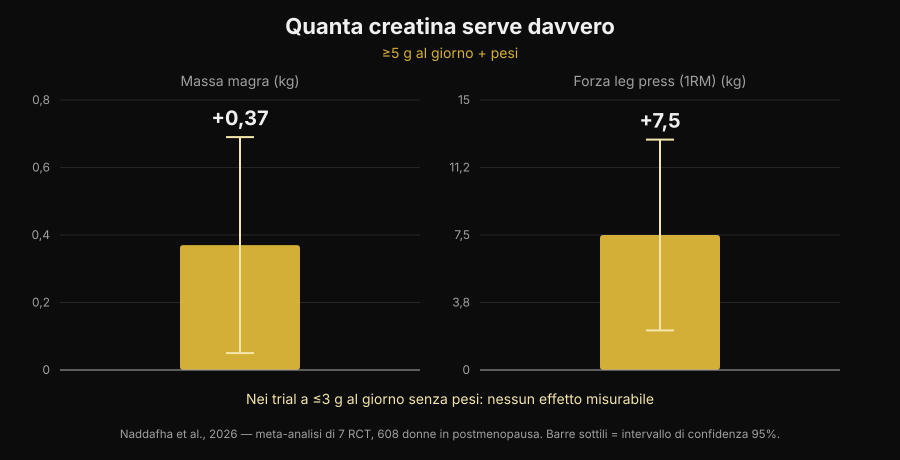
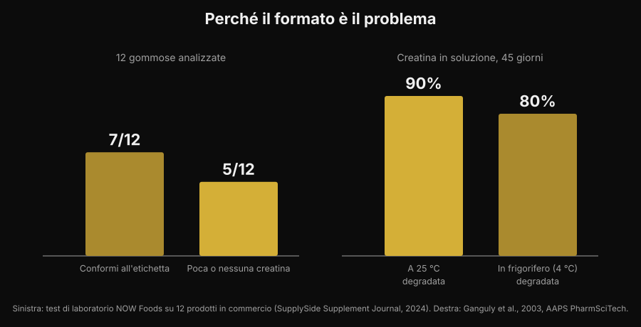

# Creatina in gommose: funzionano come la polvere?

Di [Giammaria Loi](/autore/giammaria-loi) · aggiornato il 5 novembre 2026

Masticare due caramelle invece di sciogliere una polvere che resta sul fondo del bicchiere: è una promessa comoda, e le ricerche su "creatine gummies" sono cresciute del 279%. La domanda vera però non è se la creatina funzioni — su quello la letteratura è chiusa da trent'anni — ma se dentro quelle gommose ci sia davvero la creatina che c'è scritta sull'etichetta. Su questo i numeri esistono, e non sono rassicuranti.

## In breve

- **Uno studio sulle gommose esiste, ed è positivo.** Dieci settimane, 5 g al giorno di creatina monoidrato in forma di gommosa: in 32 atlete di beach volley il salto verticale e il cambio di direzione sono migliorati rispetto al controllo.
- **Ma quello studio usava 5 g veri.** La meta-analisi più recente trova +0,37 kg di massa magra e +7,5 kg di leg press con ≥5 g al giorno abbinati ai pesi, e nessun effetto misurabile nei trial a ≤3 g al giorno senza allenamento.
- **Molte gommose non contengono quello che dichiarano.** In un test di laboratorio su 12 prodotti in commercio, 5 avevano poca o nessuna creatina — e tutte e 5 contenevano creatinina.
- **La creatinina non è pericolosa, è inutile.** È il prodotto di degradazione della creatina: trovarla nel barattolo significa che la creatina se n'è andata prima che tu la comprassi.
- **La chimica spiega perché.** La creatina in polvere asciutta è stabile; in soluzione no. In acqua a temperatura ambiente il 90% si degrada in 45 giorni.

## Perché le gommose sono ovunque

Il motivo non è scientifico, è logistico. La polvere di creatina ha tre difetti pratici: va dosata, va sciolta, e se l'acqua è fredda resta granulosa sul fondo. La gommosa elimina tutti e tre i problemi in un colpo solo, si porta in borsa e assomiglia a una caramella invece che a un integratore. È lo stesso meccanismo che ha spostato vitamina D e omega-3 verso il formato masticabile.

Il risultato lo si vede nelle ricerche: "creatine gummies" è oggi una query da circa 165.000 ricerche mensili con una crescita del 279%, e le prime posizioni su Google sono quasi tutte classifiche di siti che vendono il prodotto. Quasi nessuna di quelle pagine riporta i due dati che contano: quanta creatina serve, e quanta ce n'è davvero nel prodotto.

## La notizia buona: uno studio sulle gommose c'è

Fino a poco tempo fa chi chiedeva "funzionano?" riceveva una risposta per analogia: dentro c'è creatina monoidrato, la creatina monoidrato funziona, quindi funzionano. Ora esiste uno studio che ha testato proprio il formato.

Trentadue atlete di beach volley, universitarie e professioniste, sono state assegnate a creatina monoidrato in gommose a 5 g al giorno oppure a un gruppo di controllo, per dieci settimane. Il gruppo creatina ha migliorato il salto verticale con contromovimento (p < 0,001) e la velocità nei cambi di direzione (p = 0,009), mentre il controllo non è migliorato o è peggiorato; sono comparse differenze favorevoli anche su massa grassa e percentuale di grasso. Nessuna differenza, invece, su massa magra, massa muscolare scheletrica e tempo di reazione (Pereira et al., 2026).

È un risultato coerente con tutta la letteratura sulla creatina in polvere, e dice una cosa semplice: **la gommosa non rovina la molecola**. Se la creatina c'è ed è nella quantità giusta, il veicolo non è il problema. Il che sposta tutta la questione sulle due parole in corsivo: se c'è, e se è abbastanza.

## La dose è tutta la partita

Il numero che serve ricordare è 5 g al giorno. È la dose di mantenimento indicata dalla posizione ufficiale dell'International Society of Sports Nutrition, ed è esattamente quella usata nello studio sulle gommose. La fase di carico (circa 0,3 g per kg di peso al giorno per 5-7 giorni) riempie i depositi più in fretta, ma non è obbligatoria: si arriva allo stesso punto anche con 3-5 g al giorno in qualche settimana (Kreider et al., 2017).

Sotto quella soglia le cose cambiano. Una revisione sistematica con meta-analisi su sette studi randomizzati e 608 donne in postmenopausa ha trovato benefici chiari quando la creatina superava i 5 g al giorno ed era abbinata all'allenamento contro resistenza: massa magra +0,37 kg (IC 95% da +0,05 a +0,69) e leg press +7,5 kg (IC 95% da +2,2 a +12,8). Nei trial che usavano ≤3 g al giorno senza allenamento, nessun effetto misurabile (Naddafha et al., 2026).

*Grafico Nurvan sui dati di Naddafha et al., 2026 (J Int Soc Sports Nutr). Valori presi dall'abstract originale, non letti da figure.*

Lo stesso ordine di grandezza torna in un trial triplo cieco su venti adulti vegani: quattro settimane a 0,1 g per kg al giorno — circa 7 g per una persona di 70 kg — hanno aumentato la massa muscolare scheletrica di 0,3 kg e migliorato il salto, senza alterazioni dei marcatori renali (López-Moreno et al., 2026).

Ora il conto pratico, che è il motivo per cui le gommose vanno guardate con attenzione. Ecco quante gommose servono al giorno per arrivare a 5 g, in base a quanto dichiara la singola gommosa:

| Creatina dichiarata per gommosa | Gommose al giorno per 5 g |
|---|---|
| 0,5 g | 10 |
| 0,75 g | 7 |
| 1 g | 5 |
| 1,25 g | 4 |
| 1,5 g | 4 (3,3 arrotondato) |
| 2 g | 3 (2,5 arrotondato) |

*Calcolo Nurvan: 5 ÷ grammi dichiarati per gommosa, arrotondato per eccesso. I grammi per gommosa vanno letti sull'etichetta del prodotto che hai in mano.*

Il punto non è il numero in sé, è che la porzione dichiarata sul fronte della confezione quasi mai coincide con 5 g. Se un prodotto suggerisce "2 gommose al giorno" e ogni gommosa dichiara 1 g, stai assumendo 2 g: la fascia che nella meta-analisi non ha prodotto effetti misurabili.

## Il problema vero: cosa c'è davvero dentro

Qui arriviamo alla parte che le classifiche di affiliazione non raccontano. Un laboratorio industriale ha comprato 12 gommose di creatina su Amazon e sui siti dei produttori e le ha analizzate. Sette prodotti rispettavano la dichiarazione in etichetta, con margini anche generosi. Gli altri cinque contenevano poca o nessuna creatina. E in tutti e cinque è stata trovata **creatinina**, in quantità da piccole a rilevanti (test NOW Foods riportato da SupplySide Supplement Journal, 2024).

*Grafico Nurvan. Pannello sinistro: test di laboratorio su 12 prodotti in commercio (NOW Foods, riportato da SupplySide Supplement Journal, 2024). Pannello destro: Ganguly et al., 2003, AAPS PharmSciTech.*

La creatinina è il prodotto finale della degradazione della creatina. Non è un veleno — il tuo corpo ne produce e ne elimina ogni giorno — ma non ha nessuna attività ergogenica. Trovarla in un integratore significa una cosa sola: quella creatina si è degradata prima di arrivarti in bocca, e stai pagando una caramella.

Perché proprio le gommose? Per un motivo chimico, non commerciale. La creatina monoidrato in polvere asciutta è molto stabile; in soluzione no. Uno studio di stabilità ha sciolto formulazioni di creatina in acqua a pH 6,2 e ha misurato il contenuto per 45 giorni: a temperatura ambiente si è degradato il 90% della creatina, in frigorifero l'80% (Ganguly et al., 2003). Una gommosa è un gel che nasce caldo, contiene acqua ed è spesso acidificato per il gusto, e poi resta mesi sullo scaffale a temperatura ambiente: sono esattamente le condizioni che accelerano la conversione. Non vuol dire che tutte le gommose siano inutili — sette su dodici erano a posto — ma che il formato è intrinsecamente più fragile del barattolo di polvere, e che senza un'analisi di laboratorio non hai modo di sapere in quale metà sei finito.

## Cosa dice davvero la ricerca

| Affermazione diffusa | Verdetto | Fonte |
|---|---|---|
| "Le gommose non funzionano, la creatina si rovina" | Da precisare: in uno studio hanno funzionato | Pereira et al., 2026 |
| "Basta prendere le gommose indicate in etichetta" | Smentito: conta arrivare a 5 g | Naddafha et al., 2026; Kreider et al., 2017 |
| "Se c'è scritto creatina, dentro c'è creatina" | Smentito: 5 prodotti su 12 ne avevano poca o nessuna | Test NOW Foods, 2024 |
| "La creatinina nelle gommose fa male ai reni" | Smentito: è inerte, il problema è la dose mancante | Kreider et al., 2017; López-Moreno et al., 2026 |
| "Serve per forza la fase di carico" | Da precisare: accelera, non è obbligatoria | Kreider et al., 2017 |
| "Le forme più solubili sono più efficaci" | Non dimostrato nell'uomo | Alraddadi et al., 2018 |

Sull'ultima riga vale la pena fermarsi un attimo, perché è l'argomento che accompagna quasi tutte le forme alternative. È vero che la creatina cloridrato è più solubile del monoidrato, e uno studio di farmacocinetica nel ratto, con modellazione, ha stimato una biodisponibilità orale più alta per la forma cloridrato rispetto al monoidrato (Alraddadi et al., 2018). Ma è un modello su animali: nessun trial sull'uomo ha mostrato che questo si traduca in più forza o più massa, e il monoidrato resta la forma su cui poggia praticamente tutta la letteratura, inclusa quella sulla sicurezza a lungo termine (Kerksick et al., 2026). Lo stesso principio vale per la gommosa: è un veicolo, non un vantaggio.

## Come applicarlo

1. **Parti dai grammi, non dalle caramelle.** Leggi quanti grammi di creatina monoidrato dichiara la singola gommosa e fai il conto per arrivare a 5 g al giorno. Se la confezione non lo dichiara per unità ma solo per "porzione", è già un segnale.
2. **Diffida dei prodotti che non dicono "monoidrato".** È la forma usata negli studi, gommose comprese. Le diciture generiche o le forme "proprietarie" non hanno la stessa base di evidenze.
3. **Cerca una certificazione di parte terza.** Informed Sport, NSF Certified for Sport e analoghi fanno analizzare i lotti. Per le gommose conta più che per la polvere, proprio perché il formato è più instabile.
4. **Fai il conto del costo per grammo.** Dividi il prezzo per i grammi totali di creatina della confezione, non per il numero di gommose. Il confronto con il barattolo di polvere di solito finisce lì.
5. **Guarda anche gli zuccheri.** Cinque gommose al giorno sono cinque dolcetti al giorno: controlla la riga degli zuccheri sull'etichetta nutrizionale e mettila nel conto della giornata.
6. **L'orario non conta quanto la costanza.** Quello che riempie i depositi è assumerla tutti i giorni, non prenderla nella finestra giusta: ne ho scritto in dettaglio nell'articolo su [quando prendere gli integratori](/blog/quando-prendere-gli-integratori-orario).

**Prova Nurvan — l'integrazione tracciata insieme ai carichi**

In Nurvan registri cosa assumi e quando nella sezione integrazione, e lo vedi accanto allo storico di carichi, ripetizioni e RIR delle tue sedute. Così, se cambi formato o marca di creatina, puoi guardare cosa è successo ai numeri in palestra nelle settimane successive invece di fidarti di una sensazione. Nello stesso profilo trovi anche gli esami che hai caricato. [Prova Nurvan](https://nurvan.app)

## Domande frequenti

**Le gommose di creatina funzionano davvero?**
Possono funzionare, a due condizioni. Nello studio disponibile, dieci settimane a 5 g al giorno in forma di gommosa hanno migliorato salto verticale e cambi di direzione in atlete di beach volley (Pereira et al., 2026). Le condizioni sono che il prodotto contenga davvero la creatina dichiarata e che tu arrivi a circa 5 g al giorno.

**Quante gommose di creatina devo prendere al giorno?**
Dipende da quanti grammi dichiara ciascuna: l'obiettivo è circa 5 g al giorno di creatina monoidrato. Con 1 g per gommosa sono 5 gommose, con 0,5 g sono 10. La "porzione consigliata" stampata sulla confezione spesso resta sotto i 5 g.

**La creatinina trovata in alcune gommose è pericolosa?**
No. La creatinina è il prodotto di degradazione della creatina e il corpo la produce ed elimina normalmente; negli studi la creatina non ha alterato i marcatori renali (Kreider et al., 2017; López-Moreno et al., 2026). Il problema non è la tossicità ma l'efficacia: dove c'è creatinina, manca creatina. Se hai valori degli esami fuori range o una patologia renale nota, la cosa da fare è parlarne con il tuo medico, non scegliere un integratore da solo.

**Meglio gommose o polvere?**
Sulla molecola non c'è differenza dimostrata. La polvere ha tre vantaggi concreti: è stabile a lungo, costa molto meno al grammo e ti fa dosare i 5 g esatti. La gommosa vince solo sulla comodità. Su come si collocano creatina e altri integratori per rapporto evidenze/prezzo ho fatto una [tier list degli integratori per la forza](/blog/classifica-integratori-forza-tier-list).

## Leggi anche

- [Tier list integratori forza: cosa dice la ricerca](/blog/classifica-integratori-forza-tier-list) — dove sta la creatina rispetto a tutto il resto, evidenze alla mano.
- [La creatina fa cadere i capelli?](/blog/creatina-caduta-capelli) — l'altra domanda più cercata sulla creatina, con lo studio che ha fatto nascere il dubbio.
- [Quando prendere gli integratori: conta l'ora?](/blog/quando-prendere-gli-integratori-orario) — perché la costanza pesa più del momento di assunzione.

## Fonti

- Pereira F, Forbes SC, Romano V, Christopher P, Santana JC, Antonio J, 2026. Effects of Creatine Monohydrate Gummies on Performance and Body Composition in Female Beach Volleyball Athletes. *Journal of Functional Morphology and Kinesiology* 11(1):105. PMID 41900512. [DOI](https://doi.org/10.3390/jfmk11010105)
- Naddafha S, Antonio J, Kreider RB, Stout JR, 2026. Creatine monohydrate for lean mass, strength, and bone density in postmenopausal women: a systematic review and meta-analysis. *Journal of the International Society of Sports Nutrition* 23(1):2668435. PMID 42141930. [DOI](https://doi.org/10.1080/15502783.2026.2668435)
- Kreider RB, Kalman DS, Antonio J, Ziegenfuss TN, Wildman R, Collins R, Candow DG, Kleiner SM, Almada AL, Lopez HL, 2017. International Society of Sports Nutrition position stand: safety and efficacy of creatine supplementation in exercise, sport, and medicine. *Journal of the International Society of Sports Nutrition* 14:18. PMID 28615996. [DOI](https://doi.org/10.1186/s12970-017-0173-z)
- Kerksick C, Gonzalez D, Stout J, Forbes S, Candow D, Ziegenfuss T, Marshall R, Schwesig R, Kreider R, 2026. The emerging and evolving evidence supporting creatine as an ergogenic aid: history and applications. *Journal of the International Society of Sports Nutrition* 23(1):2646627. PMID 41870601. [DOI](https://doi.org/10.1080/15502783.2026.2646627)
- López-Moreno M, Muñoz A, Aguilar-Navarro M, Gutiérrez-Hellín J, Franco-Andrés A, López-López P, Crespo-Cañizares A, Marrero-Fernández P, Forbes SC, 2026. Does creatine supplementation improve strength and power in physically active individuals on a vegan diet? A randomized, triple-blind, placebo-controlled trial. *European Journal of Applied Physiology* 126(10):5521-5532. PMID 42390589. [DOI](https://doi.org/10.1007/s00421-026-06323-5)
- Ganguly S, Jayappa S, Dash AK, 2003. Evaluation of the stability of creatine in solution prepared from effervescent creatine formulations. *AAPS PharmSciTech* 4(2):E25. PMID 12916907. [DOI](https://doi.org/10.1208/pt040225)
- Alraddadi EA, Lillico R, Vennerstrom JL, Lakowski TM, Miller DW, 2018. Absolute Oral Bioavailability of Creatine Monohydrate in Rats: Debunking a Myth. *Pharmaceutics* 10(1):31. PMID 29518030. [DOI](https://doi.org/10.3390/pharmaceutics10010031)

Riferimenti bibliografici recuperati tramite PubMed. Dato di laboratorio sulle 12 gommose: test NOW Foods riportato da *SupplySide Supplement Journal*, 2024 — [articolo](https://www.supplysidesj.com/supplement-regulations/now-tests-creatine-gummies-finding-almost-half-to-be-severely-understrength-). Tema scelto con la ricerca di tendenza del 5 novembre 2026: "creatine gummies" è fra le query in più forte crescita del settore integratori e le pagine che la occupano sono quasi tutte di chi vende il prodotto.

---

Giammaria Loi è il fondatore di Nurvan. Si allena con i pesi dal 2012, lavora come personal trainer e coach certificato FIPE dal 2013 e gareggia nel powerlifting a livello nazionale dal 2018. Ogni articolo che firma parte dagli studi scientifici e arriva a ciò che funziona davvero in palestra.

> Nota: contenuto informativo, non sostituisce il parere di un medico o professionista.
