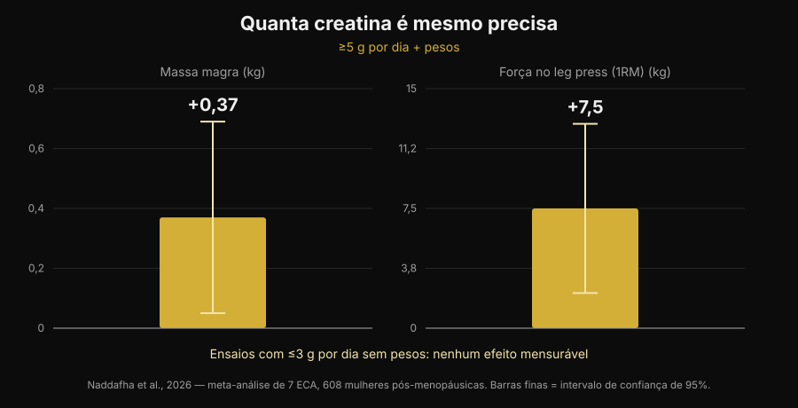
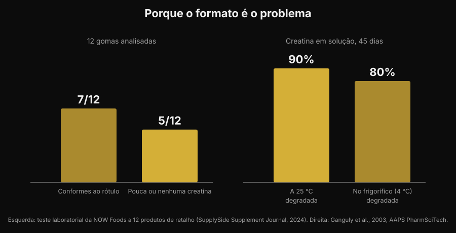

# Gomas de creatina: funcionam como o pó?

Por [Giammaria Loi](/autore/giammaria-loi) · atualizado a 5 de novembro de 2026

Mastigar duas gomas em vez de dissolver um pó que fica no fundo do copo: é uma promessa cómoda, e as pesquisas por "creatine gummies" cresceram 279%. Mas a pergunta a sério não é se a creatina funciona — nisso a literatura está fechada há trinta anos — e sim se dentro daquelas gomas está mesmo a creatina que o rótulo anuncia. Sobre isto há números, e não são tranquilizadores.

## Em resumo

- **Existe um estudo sobre gomas, e é positivo.** Dez semanas, 5 g por dia de creatina monohidratada em goma: em 32 atletas de voleibol de praia o salto vertical e a mudança de direção melhoraram em relação ao controlo.
- **Mas esse estudo usou 5 g a sério.** A meta-análise mais recente encontra +0,37 kg de massa magra e +7,5 kg de leg press com ≥5 g por dia em conjunto com os pesos, e nenhum efeito mensurável nos ensaios com ≤3 g por dia sem treino.
- **Muitas gomas não contêm o que declaram.** Num teste de laboratório a 12 produtos à venda, 5 tinham pouca ou nenhuma creatina — e todos os 5 continham creatinina.
- **A creatinina não é perigosa, é inútil.** É o produto de degradação da creatina: encontrá-la no frasco quer dizer que a creatina se foi antes de a comprares.
- **A química explica porquê.** A creatina em pó seco é estável; em solução não. Em água à temperatura ambiente 90% degrada-se em 45 dias.

## Porque é que as gomas estão em todo o lado

O motivo não é científico, é logístico. O pó de creatina tem três defeitos práticos: tem de ser dosado, tem de dissolver, e se a água está fria fica granuloso no fundo. A goma resolve os três problemas de uma vez, vai no saco de treino e parece um rebuçado em vez de um suplemento. É o mesmo mecanismo que empurrou a vitamina D e os ómega-3 para o formato mastigável.

O resultado vê-se nas pesquisas: "creatine gummies" é hoje uma consulta de cerca de 165.000 pesquisas por mês, com um crescimento de 279%, e os primeiros lugares do Google são quase todos rankings de sites que vendem o produto. Quase nenhuma dessas páginas mostra os dois dados que contam: quanta creatina é necessária, e quanta existe de facto no produto.

## A boa notícia: há um estudo sobre gomas

Até há pouco tempo, quem perguntava "funcionam?" recebia uma resposta por analogia: lá dentro há creatina monohidratada, a creatina monohidratada funciona, logo funcionam. Agora existe um estudo que testou exatamente este formato.

Trinta e duas atletas de voleibol de praia, universitárias e profissionais, foram distribuídas por creatina monohidratada em gomas a 5 g por dia ou por um grupo de controlo, durante dez semanas. O grupo da creatina melhorou o salto com contramovimento (p < 0,001) e a velocidade nas mudanças de direção (p = 0,009), enquanto o controlo não melhorou ou piorou; apareceram também diferenças favoráveis na massa gorda e na percentagem de gordura. Nenhuma diferença, em contrapartida, na massa magra, na massa muscular esquelética e no tempo de reação (Pereira et al., 2026).

É um resultado coerente com toda a literatura sobre creatina em pó, e diz uma coisa simples: **a goma não estraga a molécula**. Se a creatina está lá e na quantidade certa, o veículo não é o problema. O que empurra tudo para as duas condições: se está lá, e se é suficiente.

## A dose é o jogo todo

O número a guardar é 5 g por dia. É a dose de manutenção indicada pela posição oficial da International Society of Sports Nutrition, e é exatamente a usada no estudo sobre as gomas. A fase de carga (cerca de 0,3 g por kg de peso por dia durante 5-7 dias) enche os depósitos mais depressa, mas não é obrigatória: chegas ao mesmo ponto com 3-5 g por dia em algumas semanas (Kreider et al., 2017).

Abaixo desse limiar as coisas mudam. Uma revisão sistemática com meta-análise de sete ensaios randomizados e 608 mulheres na pós-menopausa encontrou benefícios claros quando a creatina passava os 5 g por dia e era combinada com treino de resistência: massa magra +0,37 kg (IC 95% de +0,05 a +0,69) e leg press +7,5 kg (IC 95% de +2,2 a +12,8). Nos ensaios que usavam ≤3 g por dia sem treino, nenhum efeito mensurável (Naddafha et al., 2026).

*Gráfico Nurvan com os dados de Naddafha et al., 2026 (J Int Soc Sports Nutr). Valores retirados do resumo original, não lidos a partir de figuras.*

A mesma ordem de grandeza volta num ensaio triplamente cego com vinte adultos veganos: quatro semanas a 0,1 g por kg por dia — cerca de 7 g para uma pessoa de 70 kg — aumentaram a massa muscular esquelética em 0,3 kg e melhoraram o salto, sem alterações nos marcadores renais (López-Moreno et al., 2026).

Agora a conta prática, que é a razão pela qual as gomas merecem atenção. Eis quantas gomas são precisas por dia para chegar a 5 g, em função do que declara cada goma:

| Creatina declarada por goma | Gomas por dia para 5 g |
|---|---|
| 0,5 g | 10 |
| 0,75 g | 7 |
| 1 g | 5 |
| 1,25 g | 4 |
| 1,5 g | 4 (3,3 arredondado) |
| 2 g | 3 (2,5 arredondado) |

*Cálculo Nurvan: 5 ÷ gramas declarados por goma, arredondado para cima. Os gramas por goma leem-se no rótulo do produto que tens na mão.*

O problema não é o número em si, é que a porção sugerida na frente da embalagem quase nunca dá 5 g. Se um produto recomenda "2 gomas por dia" e cada goma declara 1 g, estás a tomar 2 g: a faixa que na meta-análise não produziu efeitos mensuráveis.

## O problema a sério: o que está lá dentro

Chegamos à parte que os rankings de afiliados não contam. Um laboratório industrial comprou 12 gomas de creatina na Amazon e nos sites dos fabricantes e analisou-as. Sete produtos cumpriam a declaração do rótulo, alguns com margens generosas. Os outros cinco tinham pouca ou nenhuma creatina. E em todos os cinco foi encontrada **creatinina**, em quantidades de pequenas a relevantes (teste NOW Foods, relatado pelo SupplySide Supplement Journal, 2024).

*Gráfico Nurvan. Painel esquerdo: teste de laboratório a 12 produtos à venda (NOW Foods, relatado pelo SupplySide Supplement Journal, 2024). Painel direito: Ganguly et al., 2003, AAPS PharmSciTech.*

A creatinina é o produto final da degradação da creatina. Não é um veneno — o teu corpo produz e elimina creatinina todos os dias — mas não tem nenhuma atividade ergogénica. Encontrá-la num suplemento quer dizer uma coisa só: aquela creatina degradou-se antes de te chegar à boca, e estás a pagar um doce.

Porque é que acontece justamente nas gomas? Por um motivo químico, não comercial. A creatina monohidratada em pó seco é muito estável; em solução não. Um estudo de estabilidade dissolveu formulações de creatina em água a pH 6,2 e mediu o teor durante 45 dias: à temperatura ambiente degradou-se 90% da creatina, no frigorífico 80% (Ganguly et al., 2003). Uma goma é um gel que nasce quente, contém água e é muitas vezes acidificado para o sabor, e depois fica meses na prateleira à temperatura ambiente: são exatamente as condições que aceleram a conversão. Não quer dizer que todas as gomas sejam inúteis — sete em doze estavam bem — mas que o formato é por natureza mais frágil do que o frasco de pó, e que sem uma análise de laboratório não tens como saber em que metade caíste.

## O que a investigação diz de facto

| Afirmação comum | Veredicto | Fonte |
|---|---|---|
| "As gomas não funcionam, a creatina estraga-se" | A precisar: num estudo funcionaram | Pereira et al., 2026 |
| "Basta tomar as gomas indicadas no rótulo" | Desmentido: o que conta é chegar a 5 g | Naddafha et al., 2026; Kreider et al., 2017 |
| "Se diz creatina, lá dentro há creatina" | Desmentido: 5 produtos de 12 tinham pouca ou nenhuma | Teste NOW Foods, 2024 |
| "A creatinina das gomas faz mal aos rins" | Desmentido: é inerte, o problema é a dose que falta | Kreider et al., 2017; López-Moreno et al., 2026 |
| "A fase de carga é obrigatória" | A precisar: acelera, não é obrigatória | Kreider et al., 2017 |
| "As formas mais solúveis são mais eficazes" | Não demonstrado no ser humano | Alraddadi et al., 2018 |

Vale a pena parar na última linha, porque é o argumento que acompanha quase todas as formas alternativas. É verdade que o cloridrato de creatina é mais solúvel do que o monohidrato, e um estudo de farmacocinética no rato, com modelação, estimou uma biodisponibilidade oral mais alta para a forma cloridrato do que para o monohidrato (Alraddadi et al., 2018). Mas é um modelo animal: nenhum ensaio em humanos mostrou que isso se traduza em mais força ou mais massa, e o monohidrato continua a ser a forma em que assenta praticamente toda a literatura, incluindo a da segurança a longo prazo (Kerksick et al., 2026). O mesmo princípio vale para a goma: é um veículo, não uma vantagem.

## Como aplicar

1. **Começa pelos gramas, não pelos doces.** Lê quantos gramas de creatina monohidratada declara cada goma e faz a conta para chegar a 5 g por dia. Se a embalagem não declara por unidade mas só por "porção", já é um sinal.
2. **Desconfia dos produtos que não dizem "monohidratada".** É a forma usada nos estudos, gomas incluídas. As designações genéricas ou as formas "proprietárias" não têm a mesma base de evidência.
3. **Procura uma certificação de terceiros.** Informed Sport, NSF Certified for Sport e equivalentes mandam analisar os lotes. Nas gomas conta mais do que no pó, precisamente porque o formato é mais instável.
4. **Faz a conta do custo por grama.** Divide o preço pelos gramas totais de creatina da embalagem, não pelo número de gomas. A comparação com o frasco de pó costuma acabar aí.
5. **Olha também para os açúcares.** Cinco gomas por dia são cinco doces por dia: vê a linha dos açúcares no rótulo nutricional e mete-a na conta do dia.
6. **A hora conta menos do que a constância.** O que enche os depósitos é tomá-la todos os dias, não acertar na janela certa: escrevi sobre isso em detalhe no artigo sobre [quando tomar os suplementos](/pt/blog/quando-tomar-os-suplementos-horario).

**Experimenta a Nurvan — a suplementação registada ao lado das cargas**

Na Nurvan registas o que tomas e quando na secção de suplementação, e vês isso ao lado do histórico de cargas, repetições e RIR dos teus treinos. Assim, se mudares de formato ou de marca de creatina, podes olhar para o que aconteceu aos números no ginásio nas semanas seguintes em vez de confiar numa sensação. No mesmo perfil encontras também as análises que carregaste. [Experimenta a Nurvan](https://nurvan.app)

## Perguntas frequentes

**As gomas de creatina funcionam mesmo?**
Podem funcionar, com duas condições. No estudo disponível, dez semanas a 5 g por dia em forma de goma melhoraram o salto vertical e as mudanças de direção em atletas de voleibol de praia (Pereira et al., 2026). As condições são que o produto contenha de facto a creatina declarada e que chegues a cerca de 5 g por dia.

**Quantas gomas de creatina devo tomar por dia?**
Depende de quantos gramas cada uma declara: o objetivo é cerca de 5 g por dia de creatina monohidratada. Com 1 g por goma são 5 gomas, com 0,5 g são 10. A "porção recomendada" impressa na embalagem fica muitas vezes abaixo dos 5 g.

**A creatinina encontrada em algumas gomas é perigosa?**
Não. A creatinina é o produto de degradação da creatina e o corpo produz e elimina creatinina normalmente; nos estudos a creatina não alterou os marcadores renais (Kreider et al., 2017; López-Moreno et al., 2026). O problema não é a toxicidade, é a eficácia: onde há creatinina, falta creatina. Se tens valores de análises fora do intervalo ou uma doença renal conhecida, o que deves fazer é falar com o teu médico, não escolher um suplemento sozinho.

**Melhor gomas ou pó?**
Na molécula não há diferença demonstrada. O pó tem três vantagens concretas: é estável durante muito tempo, custa bastante menos por grama e deixa-te dosear os 5 g exatos. A goma só ganha na comodidade. Sobre como se posicionam a creatina e outros suplementos na relação evidência/preço, fiz uma [tier list dos suplementos para a força](/pt/blog/ranking-suplementos-forca-tier-list).

## Leia também

- [Tier list suplementos força: o que diz a investigação](/pt/blog/ranking-suplementos-forca-tier-list) — onde está a creatina em relação a tudo o resto, com a evidência na mão.
- [A creatina faz cair o cabelo?](/pt/blog/creatina-queda-cabelo) — a outra pergunta mais procurada sobre creatina, com o estudo que fez nascer a dúvida.
- [Quando tomar os suplementos: a hora conta?](/pt/blog/quando-tomar-os-suplementos-horario) — porque a constância pesa mais do que o momento da toma.

## Fontes

- Pereira F, Forbes SC, Romano V, Christopher P, Santana JC, Antonio J, 2026. Effects of Creatine Monohydrate Gummies on Performance and Body Composition in Female Beach Volleyball Athletes. *Journal of Functional Morphology and Kinesiology* 11(1):105. PMID 41900512. [DOI](https://doi.org/10.3390/jfmk11010105)
- Naddafha S, Antonio J, Kreider RB, Stout JR, 2026. Creatine monohydrate for lean mass, strength, and bone density in postmenopausal women: a systematic review and meta-analysis. *Journal of the International Society of Sports Nutrition* 23(1):2668435. PMID 42141930. [DOI](https://doi.org/10.1080/15502783.2026.2668435)
- Kreider RB, Kalman DS, Antonio J, Ziegenfuss TN, Wildman R, Collins R, Candow DG, Kleiner SM, Almada AL, Lopez HL, 2017. International Society of Sports Nutrition position stand: safety and efficacy of creatine supplementation in exercise, sport, and medicine. *Journal of the International Society of Sports Nutrition* 14:18. PMID 28615996. [DOI](https://doi.org/10.1186/s12970-017-0173-z)
- Kerksick C, Gonzalez D, Stout J, Forbes S, Candow D, Ziegenfuss T, Marshall R, Schwesig R, Kreider R, 2026. The emerging and evolving evidence supporting creatine as an ergogenic aid: history and applications. *Journal of the International Society of Sports Nutrition* 23(1):2646627. PMID 41870601. [DOI](https://doi.org/10.1080/15502783.2026.2646627)
- López-Moreno M, Muñoz A, Aguilar-Navarro M, Gutiérrez-Hellín J, Franco-Andrés A, López-López P, Crespo-Cañizares A, Marrero-Fernández P, Forbes SC, 2026. Does creatine supplementation improve strength and power in physically active individuals on a vegan diet? A randomized, triple-blind, placebo-controlled trial. *European Journal of Applied Physiology* 126(10):5521-5532. PMID 42390589. [DOI](https://doi.org/10.1007/s00421-026-06323-5)
- Ganguly S, Jayappa S, Dash AK, 2003. Evaluation of the stability of creatine in solution prepared from effervescent creatine formulations. *AAPS PharmSciTech* 4(2):E25. PMID 12916907. [DOI](https://doi.org/10.1208/pt040225)
- Alraddadi EA, Lillico R, Vennerstrom JL, Lakowski TM, Miller DW, 2018. Absolute Oral Bioavailability of Creatine Monohydrate in Rats: Debunking a Myth. *Pharmaceutics* 10(1):31. PMID 29518030. [DOI](https://doi.org/10.3390/pharmaceutics10010031)

Referências bibliográficas recuperadas através da PubMed. Dado de laboratório sobre as 12 gomas: teste NOW Foods relatado pelo *SupplySide Supplement Journal*, 2024 — [artigo](https://www.supplysidesj.com/supplement-regulations/now-tests-creatine-gummies-finding-almost-half-to-be-severely-understrength-). Tema escolhido com a pesquisa de tendências de 5 de novembro de 2026: "creatine gummies" está entre as consultas de maior crescimento no setor dos suplementos e as páginas que a ocupam são quase todas de quem vende o produto.

---

Giammaria Loi é o fundador da Nurvan. Treina com pesos desde 2012, trabalha como personal trainer e coach certificado FIPE desde 2013 e compete em powerlifting a nível nacional desde 2018.
Cada artigo que assina parte dos estudos científicos e chega ao que funciona de verdade no ginásio.

> Nota: conteúdo informativo, não substitui a opinião de um médico ou profissional de saúde.
