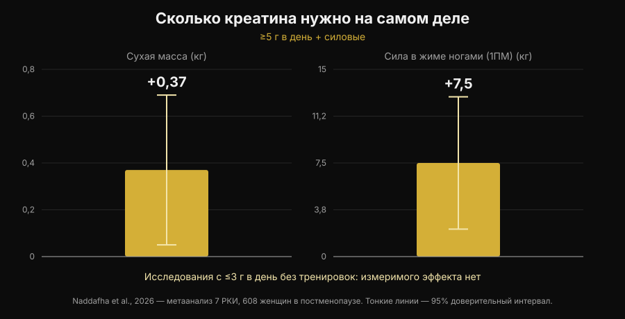
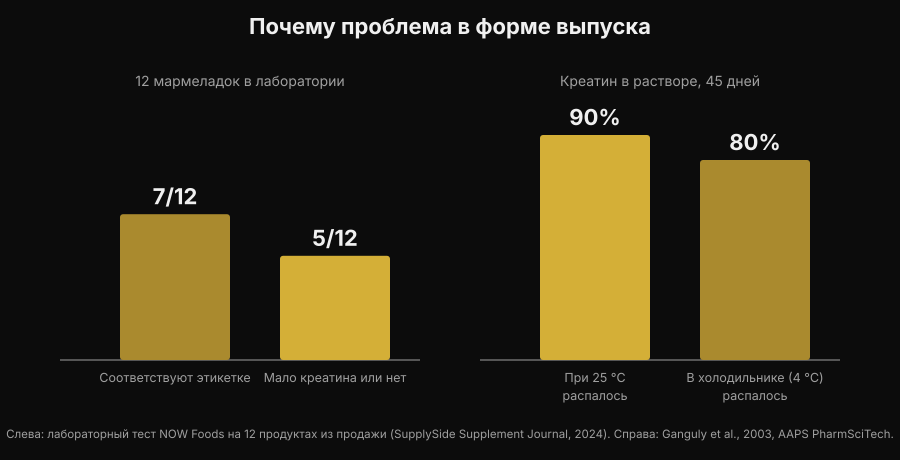

# Жевательный креатин: работает как порошок?

Автор: [Giammaria Loi](/autore/giammaria-loi) · обновлено 5 ноября 2026 года

Разжевать две мармеладки вместо того, чтобы размешивать порошок, который всё равно останется на дне стакана: обещание удобное, и запросы "creatine gummies" выросли на 279%. Но настоящий вопрос не в том, работает ли креатин — здесь литература закрыта тридцать лет назад, — а в том, есть ли внутри этих мармеладок тот креатин, который написан на этикетке. По этому пункту цифры есть, и они не успокаивают.

## Коротко

- **Исследование по мармеладкам существует, и оно положительное.** Десять недель, 5 г в день креатина моногидрата в форме мармеладки: у 32 спортсменок по пляжному волейболу вертикальный прыжок и смена направления улучшились по сравнению с контролем.
- **Но в этом исследовании были настоящие 5 г.** Самый свежий метаанализ показывает +0,37 кг сухой массы и +7,5 кг в жиме ногами при ≥5 г в день вместе с силовыми, и никакого измеримого эффекта в исследованиях с ≤3 г в день без тренировок.
- **Многие мармеладки не содержат того, что заявлено.** В лабораторной проверке 12 продуктов из продажи в 5 креатина было мало или не было совсем — и во всех пяти нашли креатинин.
- **Креатинин не опасен, он бесполезен.** Это продукт распада креатина: если он в банке, значит креатин ушёл ещё до того, как ты её купил.
- **Химия объясняет причину.** Сухой креатин в порошке стабилен, в растворе — нет. В воде при комнатной температуре 90% распадается за 45 дней.

## Почему мармеладки сейчас везде

Причина не научная, а бытовая. У порошкового креатина три практических минуса: его надо отмерять, надо растворять, а в холодной воде он остаётся крупинками на дне. Мармеладка снимает все три проблемы сразу, кладётся в сумку и выглядит как конфета, а не как добавка. Тот же механизм раньше увёл витамин D и омега-3 в жевательный формат.

Результат виден в поиске: "creatine gummies" — это сегодня примерно 165 000 запросов в месяц и рост на 279%, а первые места в Google почти целиком заняты подборками сайтов, которые продают этот продукт. Почти ни на одной из этих страниц нет двух цифр, которые решают дело: сколько креатина нужно и сколько его реально внутри.

## Хорошая новость: исследование по мармеладкам есть

Ещё недавно на вопрос "работает ли?" отвечали по аналогии: внутри креатин моногидрат, креатин моногидрат работает, значит работает и это. Теперь есть исследование, которое проверило именно такой формат.

Тридцать две спортсменки по пляжному волейболу, студентки и профессионалки, десять недель получали либо креатин моногидрат в мармеладках по 5 г в день, либо попадали в контрольную группу. Группа креатина улучшила прыжок с контрдвижением (p < 0,001) и скорость смены направления (p = 0,009), тогда как контроль не улучшился или ухудшился; появились благоприятные различия и по жировой массе и проценту жира. Разницы не было по сухой массе, скелетной мышечной массе и времени реакции (Pereira et al., 2026).

Результат согласуется со всей литературой по порошковому креатину и говорит простую вещь: **мармеладка не портит молекулу**. Если креатин есть и его достаточно, носитель — не проблема. А значит, всё сводится к двум условиям: есть ли он там, и хватает ли его.

## Доза решает всё

Цифра, которую нужно запомнить, — 5 г в день. Это поддерживающая доза из официальной позиции International Society of Sports Nutrition, и именно её использовали в исследовании по мармеладкам. Фаза загрузки (около 0,3 г на кг веса в день в течение 5-7 дней) наполняет депо быстрее, но она не обязательна: к той же точке приходишь и на 3-5 г в день за несколько недель (Kreider et al., 2017).

Ниже этого порога картина меняется. Систематический обзор с метаанализом по семи рандомизированным исследованиям и 608 женщинам в постменопаузе нашёл отчётливую пользу, когда креатина было больше 5 г в день и он сочетался с силовой тренировкой: сухая масса +0,37 кг (95% ДИ от +0,05 до +0,69) и жим ногами +7,5 кг (95% ДИ от +2,2 до +12,8). В исследованиях с ≤3 г в день без тренировок — никакого измеримого эффекта (Naddafha et al., 2026).

*График Nurvan по данным Naddafha et al., 2026 (J Int Soc Sports Nutr). Значения взяты из оригинального абстракта, а не считаны с рисунков.*

Тот же порядок величин повторяется в тройном слепом исследовании на двадцати взрослых на веганском питании: четыре недели по 0,1 г на кг в день — около 7 г для человека весом 70 кг — увеличили скелетную мышечную массу на 0,3 кг и улучшили прыжок, без изменений почечных маркеров (López-Moreno et al., 2026).

Теперь практический расчёт — именно из-за него на мармеладки стоит смотреть внимательно. Вот сколько мармеладок в день нужно, чтобы выйти на 5 г, в зависимости от того, сколько заявлено на одну:

| Заявлено креатина на мармеладку | Мармеладок в день для 5 г |
|---|---|
| 0,5 г | 10 |
| 0,75 г | 7 |
| 1 г | 5 |
| 1,25 г | 4 |
| 1,5 г | 4 (3,3 с округлением) |
| 2 г | 3 (2,5 с округлением) |

*Расчёт Nurvan: 5 ÷ заявленные граммы на мармеладку, с округлением вверх. Граммы на мармеладку нужно читать на этикетке того продукта, который у тебя в руках.*

Дело не в самой цифре, а в том, что порция, указанная на лицевой стороне упаковки, почти никогда не даёт 5 г. Если продукт предлагает "2 мармеладки в день" и каждая заявляет 1 г, ты получаешь 2 г — тот самый диапазон, который в метаанализе не дал измеримых эффектов.

## Главная проблема: что внутри на самом деле

Здесь начинается часть, которую партнёрские подборки не рассказывают. Промышленная лаборатория купила 12 креатиновых мармеладок на Amazon и на сайтах производителей и проанализировала их. Семь продуктов соответствовали заявленному на этикетке, местами с большим запасом. Остальные пять содержали мало креатина или не содержали его вовсе. И во всех пяти нашли **креатинин**, в количествах от небольших до значимых (тест NOW Foods, о котором сообщил SupplySide Supplement Journal, 2024).

*График Nurvan. Левая панель: лабораторная проверка 12 продуктов из продажи (NOW Foods, о чём сообщил SupplySide Supplement Journal, 2024). Правая панель: Ganguly et al., 2003, AAPS PharmSciTech.*

Креатинин — конечный продукт распада креатина. Это не яд: твой организм каждый день его образует и выводит, — но никакой эргогенной активности у него нет. Если он нашёлся в добавке, это значит одно: тот креатин распался раньше, чем попал тебе в рот, и ты платишь за конфету.

Почему именно мармеладки? По химической причине, а не коммерческой. Сухой креатин моногидрат в порошке очень стабилен, в растворе — нет. В исследовании стабильности формы креатина растворяли в воде при pH 6,2 и измеряли содержание 45 дней: при комнатной температуре распалось 90% креатина, в холодильнике — 80% (Ganguly et al., 2003). Мармеладка — это гель, который рождается горячим, содержит воду и часто подкисляется для вкуса, а потом месяцами стоит на полке при комнатной температуре: ровно те условия, которые ускоряют превращение. Это не значит, что все мармеладки бесполезны — семь из двенадцати были в порядке, — но формат по своей природе более хрупкий, чем банка порошка, и без лабораторного анализа ты никак не узнаешь, в какую половину попал.

## Что на самом деле говорят исследования

| Распространённое утверждение | Вердикт | Источник |
|---|---|---|
| "Мармеладки не работают, креатин в них портится" | Требует уточнения: в одном исследовании сработали | Pereira et al., 2026 |
| "Достаточно принимать столько, сколько сказано на этикетке" | Опровергнуто: важно выйти на 5 г | Naddafha et al., 2026; Kreider et al., 2017 |
| "Если написано креатин, значит креатин внутри есть" | Опровергнуто: в 5 продуктах из 12 его мало или нет | Тест NOW Foods, 2024 |
| "Креатинин в мармеладках вредит почкам" | Опровергнуто: он инертен, проблема в недостающей дозе | Kreider et al., 2017; López-Moreno et al., 2026 |
| "Фаза загрузки обязательна" | Требует уточнения: она ускоряет, но не обязательна | Kreider et al., 2017 |
| "Более растворимые формы эффективнее" | У людей не доказано | Alraddadi et al., 2018 |

На последней строке стоит задержаться, потому что это аргумент, который сопровождает почти все альтернативные формы. Да, креатин гидрохлорид растворимее моногидрата, и фармакокинетическое исследование на крысах с моделированием оценило пероральную биодоступность гидрохлоридной формы выше, чем у моногидрата (Alraddadi et al., 2018). Но это модель на животных: ни одно исследование на людях не показало, что из этого получается больше силы или больше массы, а моногидрат остаётся формой, на которой держится практически вся литература, включая данные о долгосрочной безопасности (Kerksick et al., 2026). Для мармеладки действует тот же принцип: это носитель, а не преимущество.

## Как применить

1. **Считай граммы, а не конфеты.** Посмотри, сколько граммов креатина моногидрата заявлено на одну мармеладку, и посчитай, сколько нужно до 5 г в день. Если упаковка указывает это не на штуку, а только на "порцию", это уже сигнал.
2. **Насторожись, если не написано "моногидрат".** Это та форма, которую использовали в исследованиях, включая исследование с мармеладками. Общие формулировки и "запатентованные" формы такой доказательной базы не имеют.
3. **Ищи сертификацию независимой стороны.** Informed Sport, NSF Certified for Sport и аналоги проверяют партии в лаборатории. Для мармеладок это важнее, чем для порошка, именно потому что формат менее стабилен.
4. **Посчитай цену за грамм.** Раздели цену на общее количество граммов креатина в упаковке, а не на число мармеладок. Сравнение с банкой порошка обычно на этом и заканчивается.
5. **Смотри и на сахар.** Пять мармеладок в день — это пять конфет в день: проверь строку сахаров в составе и внеси их в дневной расчёт.
6. **Время приёма важно меньше, чем регулярность.** Депо наполняет ежедневный приём, а не попадание в нужное окно: подробно я разобрал это в статье о том, [когда принимать добавки](/ru/blog/kogda-prinimat-dobavki-vremya).

**Попробовать Nurvan — добавки в одном месте с рабочими весами**

В Nurvan ты записываешь, что принимаешь и когда, в разделе добавок, и видишь это рядом с историей рабочих весов, повторений и RIR по твоим тренировкам. Так, если ты меняешь формат или марку креатина, можно посмотреть, что произошло с цифрами в зале в следующие недели, вместо того чтобы доверять ощущению. В том же профиле лежат и загруженные тобой анализы. [Попробовать Nurvan](https://nurvan.app)

## Частые вопросы

**Жевательный креатин действительно работает?**
Он может работать при двух условиях. В доступном исследовании десять недель по 5 г в день в форме мармеладки улучшили вертикальный прыжок и смену направления у спортсменок по пляжному волейболу (Pereira et al., 2026). Условия такие: продукт действительно содержит заявленный креатин, и ты выходишь примерно на 5 г в день.

**Сколько жевательного креатина нужно в день?**
Зависит от того, сколько граммов заявлено на одну штуку: цель — около 5 г креатина моногидрата в день. При 1 г на мармеладку это 5 штук, при 0,5 г — 10. "Рекомендуемая порция" на упаковке часто остаётся ниже 5 г.

**Креатинин, найденный в некоторых мармеладках, опасен?**
Нет. Креатинин — продукт распада креатина, организм образует и выводит его в обычном режиме; в исследованиях креатин не менял почечные маркеры (Kreider et al., 2017; López-Moreno et al., 2026). Проблема не в токсичности, а в эффективности: где есть креатинин, там не хватает креатина. Если у тебя показатели анализов вне нормы или известное заболевание почек, стоит обсудить это с врачом, а не выбирать добавку самостоятельно.

**Что лучше: мармеладки или порошок?**
По самой молекуле доказанной разницы нет. У порошка три конкретных плюса: он долго стабилен, стоит намного меньше за грамм и позволяет отмерить ровно 5 г. Мармеладка выигрывает только в удобстве. Как креатин и другие добавки располагаются по соотношению доказательств и цены, я разобрал в [тир-листе добавок для силы](/ru/blog/reyting-sportivnykh-dobavok-dlya-sily).

## Читайте также

- [Тир-лист добавок для силы: что говорят исследования](/ru/blog/reyting-sportivnykh-dobavok-dlya-sily) — где стоит креатин относительно всего остального, с доказательствами на руках.
- [Выпадают ли волосы от креатина?](/ru/blog/kreatin-vypadenie-volos) — второй самый частый вопрос о креатине и исследование, из которого вырос этот страх.
- [Когда принимать добавки: важно ли время?](/ru/blog/kogda-prinimat-dobavki-vremya) — почему регулярность весит больше, чем момент приёма.

## Источники

- Pereira F, Forbes SC, Romano V, Christopher P, Santana JC, Antonio J, 2026. Effects of Creatine Monohydrate Gummies on Performance and Body Composition in Female Beach Volleyball Athletes. *Journal of Functional Morphology and Kinesiology* 11(1):105. PMID 41900512. [DOI](https://doi.org/10.3390/jfmk11010105)
- Naddafha S, Antonio J, Kreider RB, Stout JR, 2026. Creatine monohydrate for lean mass, strength, and bone density in postmenopausal women: a systematic review and meta-analysis. *Journal of the International Society of Sports Nutrition* 23(1):2668435. PMID 42141930. [DOI](https://doi.org/10.1080/15502783.2026.2668435)
- Kreider RB, Kalman DS, Antonio J, Ziegenfuss TN, Wildman R, Collins R, Candow DG, Kleiner SM, Almada AL, Lopez HL, 2017. International Society of Sports Nutrition position stand: safety and efficacy of creatine supplementation in exercise, sport, and medicine. *Journal of the International Society of Sports Nutrition* 14:18. PMID 28615996. [DOI](https://doi.org/10.1186/s12970-017-0173-z)
- Kerksick C, Gonzalez D, Stout J, Forbes S, Candow D, Ziegenfuss T, Marshall R, Schwesig R, Kreider R, 2026. The emerging and evolving evidence supporting creatine as an ergogenic aid: history and applications. *Journal of the International Society of Sports Nutrition* 23(1):2646627. PMID 41870601. [DOI](https://doi.org/10.1080/15502783.2026.2646627)
- López-Moreno M, Muñoz A, Aguilar-Navarro M, Gutiérrez-Hellín J, Franco-Andrés A, López-López P, Crespo-Cañizares A, Marrero-Fernández P, Forbes SC, 2026. Does creatine supplementation improve strength and power in physically active individuals on a vegan diet? A randomized, triple-blind, placebo-controlled trial. *European Journal of Applied Physiology* 126(10):5521-5532. PMID 42390589. [DOI](https://doi.org/10.1007/s00421-026-06323-5)
- Ganguly S, Jayappa S, Dash AK, 2003. Evaluation of the stability of creatine in solution prepared from effervescent creatine formulations. *AAPS PharmSciTech* 4(2):E25. PMID 12916907. [DOI](https://doi.org/10.1208/pt040225)
- Alraddadi EA, Lillico R, Vennerstrom JL, Lakowski TM, Miller DW, 2018. Absolute Oral Bioavailability of Creatine Monohydrate in Rats: Debunking a Myth. *Pharmaceutics* 10(1):31. PMID 29518030. [DOI](https://doi.org/10.3390/pharmaceutics10010031)

Библиографические ссылки получены через PubMed. Лабораторные данные по 12 мармеладкам: тест NOW Foods, о котором сообщил *SupplySide Supplement Journal*, 2024 — [статья](https://www.supplysidesj.com/supplement-regulations/now-tests-creatine-gummies-finding-almost-half-to-be-severely-understrength-). Тема выбрана по трендовому поиску от 5 ноября 2026 года: "creatine gummies" входит в число самых быстрорастущих запросов в сегменте добавок, а страницы, которые его занимают, почти все принадлежат тем, кто продаёт этот продукт.

---

Giammaria Loi — основатель Nurvan. Тренируется с весами с 2012 года, работает персональным тренером и коучем с сертификацией FIPE с 2013 года и выступает в пауэрлифтинге на национальном уровне с 2018 года.
Каждая статья под его именем начинается с научных исследований и заканчивается тем, что действительно работает в зале.

> Примечание: материал носит информационный характер и не заменяет консультацию врача или специалиста.
