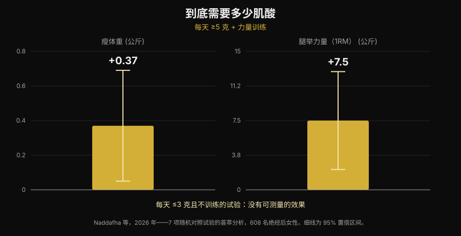
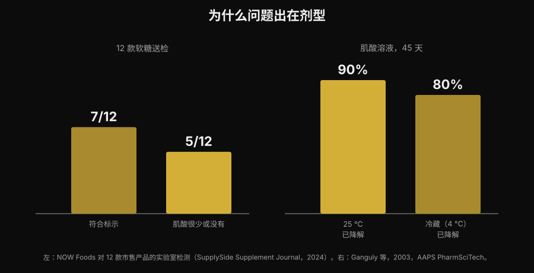

# 肌酸软糖有用吗？和肌酸粉比效果如何

作者 [Giammaria Loi](/autore/giammaria-loi) · 更新于 2026 年 11 月 5 日

嚼两颗软糖，就不用再对着杯底那层化不开的粉。这个卖点很方便，"creatine gummies" 的搜索量也涨了 279%。但真正的问题不是肌酸有没有用——这件事文献三十年前就讲完了——而是那些软糖里到底有没有标签上写的那么多肌酸。这方面有数据，而且数据不好看。

## 要点速览

- **针对软糖的研究确实有，结果也是正面的。** 十周，每天 5 g 一水肌酸软糖：32 名沙滩排球女运动员的垂直跳和变向速度比对照组有改善。
- **但那项研究用的是实打实的 5 g。** 最新的荟萃分析发现，每天 ≥5 g 配合力量训练，瘦体重 +0.37 kg、腿举 +7.5 kg；每天 ≤3 g 且不训练的试验里，没有可测量的效果。
- **很多软糖里并没有它声称的东西。** 一次实验室检测买了 12 款在售产品，其中 5 款肌酸很少甚至为零——而且这 5 款里都检出了肌酸酐。
- **肌酸酐不危险，只是没用。** 它是肌酸的降解产物：在罐子里看到它，说明肌酸在你买到之前就已经跑掉了。
- **化学解释了原因。** 干粉状态的肌酸很稳定，溶液里不稳定。常温水中 45 天会降解 90%。

## 软糖为什么突然到处都是

原因不是科学，是方便。肌酸粉有三个现实缺点：要称量、要溶解，水一凉就沉在杯底结成颗粒。软糖一次解决这三件事，能塞进包里，而且看起来像糖而不像补剂。维生素 D 和鱼油走向咀嚼形式，靠的是同一个机制。

结果就写在搜索量里："creatine gummies" 现在每月约 165,000 次搜索，增长 279%，而 Google 首页几乎全是卖这个产品的网站排行榜。那些页面里几乎没有一个给出两个关键数字：到底需要多少肌酸，以及产品里真的有多少。

## 好消息：已经有一项软糖研究

以前你问"有用吗"，得到的是类推式的回答：里面是一水肌酸，一水肌酸有用，所以软糖有用。现在有一项研究直接测了这个形式。

32 名沙滩排球女运动员（大学生和职业选手）被分到每天 5 g 一水肌酸软糖组或对照组，持续十周。肌酸组的反向纵跳（p < 0.001）和变向速度（p = 0.009）都有改善，对照组没有改善甚至变差；脂肪量和体脂率也出现了有利差异。而瘦体重、骨骼肌质量和反应时间没有差异（Pereira et al., 2026）。

这个结果和所有肌酸粉文献一致，它说明一件简单的事：**软糖不会破坏这个分子**。只要肌酸在里面、而且量够，载体不是问题。于是全部问题都落到两个条件上：在不在，够不够。

## 剂量就是全部

要记住的数字是每天 5 g。这是国际运动营养学会（International Society of Sports Nutrition）官方立场声明给出的维持剂量，也正是那项软糖研究用的剂量。负荷期（每天每公斤体重约 0.3 g，持续 5–7 天）能更快填满储备，但不是必须的：每天 3–5 g 吃几周也能到同一个位置（Kreider et al., 2017）。

低于这个门槛，情况就变了。一项纳入 7 项随机试验、608 名绝经后女性的系统综述加荟萃分析发现，当肌酸每天超过 5 g 并配合抗阻训练时，获益很明确：瘦体重 +0.37 kg（95% CI +0.05 到 +0.69），腿举 +7.5 kg（95% CI +2.2 到 +12.8）。而在每天 ≤3 g 且不训练的试验里，没有可测量的效果（Naddafha et al., 2026）。

*Nurvan 图表，数据来自 Naddafha et al., 2026（J Int Soc Sports Nutr）。数值取自原始摘要，不是从图里读出来的。*

同一个数量级也出现在一项针对 20 名素食成年人的三盲试验里：四周，每天每公斤体重 0.1 g——70 kg 的人约 7 g——骨骼肌质量增加 0.3 kg，跳跃表现改善，肾功能指标没有变化（López-Moreno et al., 2026）。

下面是实际的算账，这也是软糖要仔细看的原因。按单颗软糖标注的含量，每天得吃多少颗才能到 5 g：

| 单颗软糖标注的肌酸 | 每天到 5 g 需要几颗 |
|---|---|
| 0.5 g | 10 |
| 0.75 g | 7 |
| 1 g | 5 |
| 1.25 g | 4 |
| 1.5 g | 4（3.3 向上取整） |
| 2 g | 3（2.5 向上取整） |

*Nurvan 计算：5 ÷ 单颗标注克数，向上取整。单颗克数要看你手里那盒产品的标签。*

重点不是这个数字本身，而是包装正面写的建议份量几乎从不等于 5 g。如果产品写"每天 2 颗"，每颗标注 1 g，你每天只吃了 2 g：正好落在荟萃分析里没有产生可测效果的区间。

## 真正的问题：里面到底有什么

这里就到了联盟营销排行榜不会讲的部分。一家工业实验室在 Amazon 和厂商官网买了 12 款肌酸软糖做分析。7 款符合标签声称，有些余量还很足。另外 5 款肌酸很少甚至没有。而且这 5 款里全都检出了**肌酸酐**，量从少到可观（NOW Foods 检测，由 SupplySide Supplement Journal 报道，2024）。

*Nurvan 图表。左图：12 款在售产品的实验室检测（NOW Foods，由 SupplySide Supplement Journal 报道，2024）。右图：Ganguly et al., 2003, AAPS PharmSciTech。*

肌酸酐是肌酸降解的终产物。它不是毒——你的身体每天都在生成和排出它——但它没有任何运动增能作用。在补剂里发现它只说明一件事：那些肌酸在进你嘴之前就已经降解，你买的是一颗糖。

为什么偏偏是软糖？是化学原因，不是商业原因。干粉状态的一水肌酸非常稳定，溶液里不稳定。一项稳定性研究把肌酸配方溶在 pH 6.2 的水里，连续 45 天测含量：常温下 90% 的肌酸降解了，冷藏下 80%（Ganguly et al., 2003）。软糖是热态成型的凝胶，含水，而且为了口味常常加酸，之后还要在常温货架上放好几个月：这正是加速转化的条件。这不代表所有软糖都没用——12 款里有 7 款是合格的——而是说这个形式天生比粉末罐子脆弱，而且没有实验室检测，你没办法知道自己买到的是哪一半。

## 研究到底怎么说

| 常见说法 | 判定 | 来源 |
|---|---|---|
| "软糖没用，肌酸会坏掉" | 需要澄清：在一项研究里它们有效 | Pereira et al., 2026 |
| "按标签写的颗数吃就够了" | 被推翻：关键是吃到 5 g | Naddafha et al., 2026; Kreider et al., 2017 |
| "写了肌酸，里面就有肌酸" | 被推翻：12 款里有 5 款很少或没有 | NOW Foods 检测, 2024 |
| "软糖里的肌酸酐伤肾" | 被推翻：它是惰性的，问题是缺的那部分剂量 | Kreider et al., 2017; López-Moreno et al., 2026 |
| "一定要做负荷期" | 需要澄清：能加速，但不是必须 | Kreider et al., 2017 |
| "溶解性更好的形式更有效" | 未在人体中得到证实 | Alraddadi et al., 2018 |

最后一行值得停一下，因为这是几乎所有替代形式都会用的说法。盐酸肌酸确实比一水肌酸更易溶，一项大鼠药代动力学研究配合建模，估算盐酸形式的口服生物利用度高于一水形式（Alraddadi et al., 2018）。但那是动物模型：没有任何人体试验显示这能转化成更多力量或更多肌肉，而一水肌酸仍然是几乎全部文献——包括长期安全性文献——所依托的形式（Kerksick et al., 2026）。同样的道理适用于软糖：它是载体，不是优势。

## 怎么落地执行

1. **从克数出发，不要从颗数出发。** 看清单颗软糖标注了多少克一水肌酸，再算每天到 5 g 要几颗。如果包装只给"每份"而不给每颗，这本身就是个信号。
2. **不写"一水"（monohydrate）的产品要警惕。** 一水肌酸才是研究里用的形式，软糖研究也一样。笼统的写法或"专利配方"没有同样的证据基础。
3. **找第三方认证。** Informed Sport、NSF Certified for Sport 这类认证会把批次送去检测。软糖比粉末更需要这一步，正因为这个形式更不稳定。
4. **算每克的价格。** 用价格除以整盒的肌酸总克数，不是除以软糖颗数。和粉末罐子的比较通常到这里就结束了。
5. **也看糖。** 一天 5 颗软糖就是一天 5 颗糖：看一下营养标签上糖的那一行，把它算进全天。
6. **时间点没有坚持重要。** 填满储备靠的是每天都吃，不是卡在某个窗口：我在[补剂什么时间吃](/zh/blog/buji-shenme-shijian-chi)这篇文章里写得更细。

**试试 Nurvan —— 补剂和训练负荷记在一起**

在 Nurvan 的补剂板块里记下你吃了什么、什么时候吃，旁边就是你每次训练的负荷、次数和 RIR 历史。这样换肌酸的形式或品牌时，你可以看接下来几周健身房里的数字发生了什么，而不是靠感觉判断。同一个档案里也能看到你上传的化验单。[试用 Nurvan](https://nurvan.app)

## 常见问题

**肌酸软糖真的有用吗？**
可能有用，但有两个条件。在目前这项研究里，十周每天 5 g 软糖形式的肌酸改善了沙滩排球女运动员的垂直跳和变向速度（Pereira et al., 2026）。条件是产品里真的含有标签上写的肌酸，而且你每天要吃到大约 5 g。

**一天要吃几颗肌酸软糖？**
取决于每颗标注多少克：目标是每天大约 5 g 一水肌酸。每颗 1 g 就是 5 颗，每颗 0.5 g 就是 10 颗。包装上印的"建议份量"往往不到 5 g。

**有些软糖里检出的肌酸酐危险吗？**
不危险。肌酸酐是肌酸的降解产物，身体本来就在正常生成和排出它；研究里肌酸没有改变肾功能指标（Kreider et al., 2017；López-Moreno et al., 2026）。问题不在毒性，而在效果：有肌酸酐的地方，就缺了肌酸。如果你的化验值超出参考范围，或已知有肾脏疾病，该做的是和你的医生谈，而不是自己挑补剂。

**软糖好还是肌酸粉好？**
在分子层面没有证明出差别。粉末有三个实在的优势：长期稳定、每克便宜得多、能让你称出准确的 5 g。软糖只赢在方便。关于肌酸和其他补剂在"证据/价格"上怎么排，我做过一份[力量补剂等级榜](/zh/blog/liliang-buji-dengji-bang)。

## 延伸阅读

- [力量补剂等级榜：研究怎么说](/zh/blog/liliang-buji-dengji-bang) —— 拿证据说话，肌酸在所有补剂里站在哪个位置。
- [吃肌酸会掉头发吗？](/zh/blog/creatine-hair-loss-zh) —— 关于肌酸第二热门的疑问，以及那项让它流传开来的研究。
- [补剂什么时间吃：时间点重要吗？](/zh/blog/buji-shenme-shijian-chi) —— 为什么坚持比服用时机更重要。

## 参考文献

- Pereira F, Forbes SC, Romano V, Christopher P, Santana JC, Antonio J, 2026. Effects of Creatine Monohydrate Gummies on Performance and Body Composition in Female Beach Volleyball Athletes. *Journal of Functional Morphology and Kinesiology* 11(1):105. PMID 41900512. [DOI](https://doi.org/10.3390/jfmk11010105)
- Naddafha S, Antonio J, Kreider RB, Stout JR, 2026. Creatine monohydrate for lean mass, strength, and bone density in postmenopausal women: a systematic review and meta-analysis. *Journal of the International Society of Sports Nutrition* 23(1):2668435. PMID 42141930. [DOI](https://doi.org/10.1080/15502783.2026.2668435)
- Kreider RB, Kalman DS, Antonio J, Ziegenfuss TN, Wildman R, Collins R, Candow DG, Kleiner SM, Almada AL, Lopez HL, 2017. International Society of Sports Nutrition position stand: safety and efficacy of creatine supplementation in exercise, sport, and medicine. *Journal of the International Society of Sports Nutrition* 14:18. PMID 28615996. [DOI](https://doi.org/10.1186/s12970-017-0173-z)
- Kerksick C, Gonzalez D, Stout J, Forbes S, Candow D, Ziegenfuss T, Marshall R, Schwesig R, Kreider R, 2026. The emerging and evolving evidence supporting creatine as an ergogenic aid: history and applications. *Journal of the International Society of Sports Nutrition* 23(1):2646627. PMID 41870601. [DOI](https://doi.org/10.1080/15502783.2026.2646627)
- López-Moreno M, Muñoz A, Aguilar-Navarro M, Gutiérrez-Hellín J, Franco-Andrés A, López-López P, Crespo-Cañizares A, Marrero-Fernández P, Forbes SC, 2026. Does creatine supplementation improve strength and power in physically active individuals on a vegan diet? A randomized, triple-blind, placebo-controlled trial. *European Journal of Applied Physiology* 126(10):5521-5532. PMID 42390589. [DOI](https://doi.org/10.1007/s00421-026-06323-5)
- Ganguly S, Jayappa S, Dash AK, 2003. Evaluation of the stability of creatine in solution prepared from effervescent creatine formulations. *AAPS PharmSciTech* 4(2):E25. PMID 12916907. [DOI](https://doi.org/10.1208/pt040225)
- Alraddadi EA, Lillico R, Vennerstrom JL, Lakowski TM, Miller DW, 2018. Absolute Oral Bioavailability of Creatine Monohydrate in Rats: Debunking a Myth. *Pharmaceutics* 10(1):31. PMID 29518030. [DOI](https://doi.org/10.3390/pharmaceutics10010031)

文献通过 PubMed 检索获得。12 款软糖的实验室数据：NOW Foods 检测，由 *SupplySide Supplement Journal* 报道，2024 —— [原文](https://www.supplysidesj.com/supplement-regulations/now-tests-creatine-gummies-finding-almost-half-to-be-severely-understrength-)。选题来自 2026 年 11 月 5 日的趋势检索："creatine gummies" 是补剂行业增长最快的搜索词之一，而占据它的页面几乎全来自卖这个产品的人。

---

Giammaria Loi 是 Nurvan 的创始人。他从 2012 年开始练力量，2013 年起担任 FIPE 认证的私人教练和教练员，2018 年起在全国级别参加力量举比赛。
他署名的每篇文章都从研究出发，最后落到健身房里真正有用的东西上。

> 说明：本文为科普性内容，不能替代医生或专业人士的意见。
