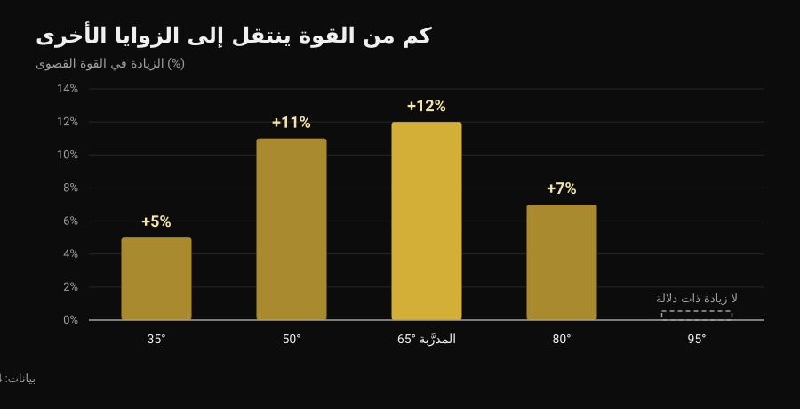
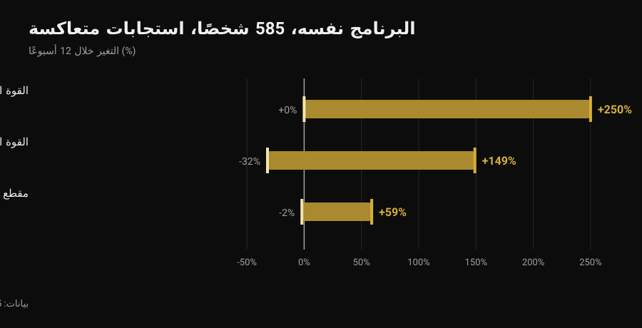

# الفرونت ليفر: كم تمرينًا تمهيديًا تحتاج؟

بقلم [Giammaria Loi](/autore/giammaria-loi) · حُدّث في 6 نوفمبر 2026

تاك، تاك متقدم، ساق واحدة، ستراد، نصف ممدود: قوائم التمارين التمهيدية للفرونت ليفر تدور منذ سنوات وكأنها سلّم بعدد درجات ثابت، واحد للجميع. والسؤال دائمًا هو نفسه: كم تمرينًا عليّ إنهاؤه قبل الوضعية الكاملة؟ أدبيات التمرين الثابت لا تعطيك رقمًا، لكنها تعطيك شيئًا أنفع: كم من القوة التي تبنيها في وضعية معيّنة تبقى معك فعلًا في الوضعية التالية. وهذا الرقم يغيّر طريقة بناء السلّم كلها.

## باختصار

- لا توجد دراسة تحدّد عدد التمارين التمهيدية: لا ثلاث ولا أربع ولا ست مراحل إلزامية، لأي شخص.
- القوة الثابتة مرتبطة إلى حد كبير بالوضعية: عند التدريب على زاوية واحدة ترتفع القوة كثيرًا عندها (+12%) وتقل كلما ابتعدت، حتى تتوقف تمامًا على بُعد 30 درجة (Lanza et al., 2019).
- لذلك التمارين التمهيدية مفيدة، لكن ليس كقائمة تُشطب: فائدتها أنها تغطي الوضعيات التي تريد أن تكون قويًا فيها.
- عدد المراحل فردي لأن الاستجابة للتدريب فردية: البرنامج نفسه، 585 شخصًا، ومكاسب قوة من 0 إلى +250% خلال 12 أسبوعًا (Hubal et al., 2005).
- يمكنك التقدّم بجعل الوضعية أصعب أو بإضافة ثوانٍ: في القوة والكتلة يتعادل الطريقان (Chaves et al., 2024).

## ما الذي يتغيّر فعلًا من تمرين تمهيدي إلى آخر

في الفرونت ليفر يكون الجسم أفقيًا معلّقًا على العقلة: الكتفان هما نقطة الارتكاز، ووزن الجسم يشدّ إلى الأسفل كل ما هو أمامهما. الجهد المطلوب لا يعتمد على وزنك بل على بُعد مركز ثقلك عن كتفيك. سحب الركبتين إلى الصدر يقصّر هذه المسافة؛ مدّ ساق واحدة يطيلها؛ فتح الساقين في وضع الستراد يقصّرها قليلًا من جديد. أي أن التمارين التمهيدية هي التمرين نفسه بشدّات مختلفة: ما يعادل الأقراص على البار.

لكن هناك فارقًا مهمًا عن البار. تغيير الرافعة لا يغيّر الحِمل فقط: يغيّر أيضًا زوايا المفاصل والوضعية التي تنتج فيها القوة. وهنا بالضبط للأبحاث ما تقوله.

## ماذا تقول الأبحاث فعلًا

### الادعاء 1 — "قبل الوضعية الكاملة عليك إنهاء كذا تمرينًا تمهيديًا"
**مغلوط.**

لم تختبر أي دراسة عددًا من المراحل، لأن ما يُنتج التكيّف ليس رقمًا بل الحِمل المتدرّج. والحِمل يمكن إضافته بأكثر من طريقة. درّب Chaves وزملاؤه (2024) 39 شخصًا غير مدرَّب لمدة 10 أسابيع بتصميم يقارن ساقًا بساق: ساق تتقدّم بزيادة الوزن، والأخرى بزيادة التكرارات. ارتفع الحد الأقصى في تمرين مدّ الركبة من 52.9 إلى 69.1 كجم مع الوزن، ومن 51.7 إلى 66.8 كجم مع التكرارات؛ ومقطع العضلة المتّسعة الوحشية من 21.3 إلى 23.5 سم² مقابل 21.1 إلى 23.4 سم². لا فرق بين الطريقتين.

بترجمة ذلك إلى الفرونت ليفر: الانتقال إلى وضعية أصعب وإضافة ثوانٍ إلى وضعية تتقنها أصلًا طريقتان مشروعتان للتقدّم. وعدد التمارين التمهيدية التي تمرّ بها نتيجة لجرعة الحِمل، لا قاعدة.

### الادعاء 2 — "القوة المكتسبة في التاك تنتقل إلى الوضعية الكاملة"
**مغلوط، جزئيًا على الأقل.**

هذه أهم دراسة لمن يتدرّب على الثبات. طلب Lanza وBalshaw وFolland (2019) من 13 شخصًا أداء 14 حصة ثابتة خلال 4 أسابيع عند زاوية ركبة واحدة (65 درجة)، وقارنوهم بـ 9 أشخاص ضابطين، ثم قاسوا القوة عند خمس زوايا مختلفة.

*رسم Nurvan بناءً على بيانات Lanza et al., 2019 (Eur J Appl Physiol). القيم كما وردت في الملخص الأصلي؛ 13 شخصًا تدرّبوا عند 65 درجة، 9 ضابطين، 14 حصة خلال 4 أسابيع. عند 95 درجة لم تُسجَّل أي زيادة ذات دلالة.*

نمت القوة أساسًا حيث جرى التدريب، وأقل فأقل كلما ابتعدنا: لا شيء قابل للقياس على بُعد 30 درجة من زاوية العمل. لا تبالغ في المقارنة — تلك الدراسة تقيس مدّ الركبة لا الكتف تحت العقلة — لكن المبدأ ينطبق على كل تمرين ثابت: الانتقال موجود، وهو جزئي، ويتناقص مع البُعد عن الوضعية المدرَّبة. وللسبب نفسه [الرفعة الميتة بإيقاع حتى الركبة](/ar/blog/alrafaa-almayit-bialiiqae-hataa-alrukba) لا تدرّب الحركة كاملة.

لهذا تبقى التمارين التمهيدية منطقية رغم أن أي رقم ليس إلزاميًا: إذا بقيت في التاك وحده، فمعظم ما تبنيه يبقى في التاك.

### الادعاء 3 — "العدد يعتمد على بنيتك الجسدية"
**يحتاج إلى تدقيق.**

أن يكون المسار فرديًا أمر صحيح، وأقوى دليل لا يتعلق بالروافع بل بالاستجابة للتدريب. درّب Hubal وزملاؤه (2005) 585 شخصًا بالبرنامج نفسه تمامًا لمدة 12 أسبوعًا وقاسوا عضلات ثني المرفق قبل وبعد.

*رسم Nurvan بناءً على بيانات Hubal et al., 2005 (Med Sci Sports Exerc). المديات من الأدنى إلى الأعلى كما وردت في الملخص الأصلي؛ 585 مشاركًا، 342 امرأة و243 رجلًا، 12 أسبوعًا من تدريب تدريجي لذراع واحدة.*

البرنامج نفسه والمدة نفسها: بعضهم ضاعف قوته، وبعضهم لم يتحرك. أمام أرقام كهذه، التنبؤ بعدد المراحل التي يحتاجها شخص بعينه خارج المتناول ببساطة.

ما يحتاج إلى تدقيق هو عبارة "بنيتك الجسدية". أن الرافعة مهمة فهذه هندسة لا رأي: عند قوة متساوية، الجذع والساقان الطويلان يعنيان ذراع رافعة أطول. لكن لا توجد دراسة قاست إلى أي حد تتنبأ القياسات الجسدية وحدها بعدد التمارين التمهيدية اللازمة. إنه تفسير معقول، لا معطى.

### الادعاء 4 — "التمارين الثابتة لا تبني قوة حقيقية"
**مغلوط.**

جمعت المراجعة المنهجية لـ Oranchuk وزملائه (2019) 26 عملًا بحثيًا عن تدريب ثابت لا يقل عن 3 أسابيع: تحسّن جوهري في الضخامة والقوة القصوى، عند كل الشدّات المدروسة. تفصيلان مهمان في الكاليسثينكس: التدريب عند أطوال عضلية أكبر أنتج ضخامة أكثر (0.86-1.69% أسبوعيًا مقابل 0.08-0.83% عند الأطوال القصيرة) وانتقالًا أفضل إلى الأداء الديناميكي؛ أما تحسين بنية الوتر ووظيفته فيتطلب شدّات عالية، عند 70% أو أكثر.

### الادعاء 5 — "وزن الجسم لا يبني قوة مثل الأثقال"
**مغلوط.**

قسّم Kotarsky وزملاؤه (2018) 23 رجلًا مدرَّبًا إلى مجموعتين لمدة 4 أسابيع بثلاث حصص أسبوعيًا: مجموعة تتقدّم عبر تنويعات أصعب من تمرين الضغط، وأخرى عبر البنش برس. ارتفع الحد الأقصى في البنش لدى المجموعتين دون فرق بينهما. أما ما تحسّن أكثر لدى مجموعة الضغط فهو سلّم تمارين الضغط نفسه: خصوصية مرة أخرى، في الاتجاه الذي جرى التدريب عليه.

### الادعاء 6 — "انتقل إلى التالي عندما تثبت 10-15 ثانية"
**غير قابل للتحقق.**

لا توجد دراسة اختبرت عتبة زمنية بالثواني كمعيار لتغيير الوضعية في الكاليسثينكس. العتبة المتداولة في الفيديوهات عُرف مفيد، لا معطى. ما تقدّمه الأدبيات هو معايير التمارين الثابتة، وهي أساس أفضل للقرار.

## كم تثبت، وبأي شدة

لخّص Lum وBarbosa (2019) معايير التدريب الثابت لهدفين مختلفين. العمود الثالث ترجمتي أنا لتلك الأرقام إلى الفرونت ليفر: الترجمة مني، وليست في الدراسة.

| الهدف | معايير المراجعة | كيف يُترجم ذلك إلى ثبات |
|---|---|---|
| الضخامة | 70-75% من الانقباض الأقصى، ثبات 3-30 ثانية، أكثر من 80-150 ثانية إجمالًا في الحصة، لأكثر من 36 حصة | وضعية تستطيع الثبات فيها 10-20 ثانية، تُكرَّر حتى تبلغ نحو دقيقتين من الثبات الإجمالي |
| القوة القصوى | 80-100% من الانقباض الأقصى، ثبات 1-5 ثوانٍ، 30-90 ثانية إجمالًا في الحصة، على عدة زوايا أو على الزاوية المستهدفة | وضعية تسقط فيها خلال 5-8 ثوانٍ، ثبات قصير جدًا وراحة طويلة، 30-90 ثانية إجمالًا |

*جدول Nurvan: العمودان 1 و2 من المعايير التي ذكرها Lum وBarbosa، 2019 (Int J Sports Med)؛ العمود 3 تطبيق من عندنا على الفرونت ليفر، لم يُقَس في الدراسة.*

بهذه القراءة يتحوّل سؤال "كم تمرينًا تمهيديًا" إلى سؤال آخر: كم وضعية أحتاج لتغطية العمل الثقيل القصير جدًا والعمل الأطول معًا؟ عادةً تكفي اثنتان.

## كيف تطبّقها

1. **اختر وضعيتين، لا ست.** واحدة تسقط فيها خلال 5-8 ثوانٍ (هذا عمل القوة) وأخرى تثبت فيها 10-20 ثانية والظهر ما زال مستويًا (هذا حجم العمل). قد تكونان التاك والتاك المتقدم، أو التاك المتقدم وساقًا واحدة: الأمر يعتمد على مستواك فقط.
2. **غيّر متغيرًا واحدًا في كل مرة.** إما الوضعية وإما الثواني. إذا حرّكتهما معًا فلن تعرف ما الذي نجح، وفي تسع حالات من عشر سترتفع بسرعة أكبر من اللازم.
3. **اعمل قريبًا من الهدف أيضًا.** بما أن الانتقال بين الوضعيات جزئي، ضع كل أسبوع بضع ثوانٍ في أصعب وضعية تستطيع الثبات فيها، ولو كان ذلك نزولًا متحكَّمًا من العقلة فقط.
4. **احسب الثواني الإجمالية، لا المجموعات.** ثلاثون إلى تسعين ثانية إجمالًا لعمل القوة، ونحو 150 لعمل الحجم: هذه هي الوحدة التي تستخدمها الأدبيات.
5. **أعد اختبار الوضعية المستهدفة كل 3-4 أسابيع،** لا في كل حصة. الاختبار يستهلك تدريبًا.
6. **إذا ظهر ألم في المرفق أو الكتف فتوقّف واعرضه على مختص.** الفرونت ليفر يحمّل وتر العضلة ذات الرأسين والكفة المدوّرة في وضع ممدود؛ والألم ليس درجة في السلّم.

> ### جرّب Nurvan — لكل وضعية سجلّها الخاص
>
> في Nurvan كل تنويعة من الفرونت ليفر تمرين مستقل: الثبات والثواني وRIR تبقى منفصلة بين التاك والتاك المتقدم والستراد، فترى أي وضعية تتقدّم فعلًا وأيها متوقفة منذ ثلاثة أسابيع. مجموعات الإحماء تُقترح تلقائيًا، والسجلّ يخبرك إن كنت تضيف ثوانٍ أم مجموعات فقط. [جرّب Nurvan](https://nurvan.app)

## أسئلة شائعة

**كم تمرينًا تمهيديًا يلزم فعلًا للفرونت ليفر؟**
لا يوجد رقم صالح للجميع، ولم تختبر أي دراسة رقمًا. تحتاج وضعيات كافية لتدريب الثبات القصير الصعب جدًا والثبات الأطول معًا، وقريبة بعضها من بعض بما يكفي للتقدّم دون قفزات: عمليًا وضعيتان في كل مرحلة، تتغيّران كلما تحسّنت.

**كم يستغرق الوصول إلى الفرونت ليفر الكامل؟**
لم تقِس ذلك أي دراسة، فأي "ستة أشهر" تقرأها على الإنترنت هي حكاية فردية. ما تقوله البيانات أن التباين الفردي في الاستجابة للتدريب هائل (Hubal et al., 2005)، لذا مقارنة مدّتك بمدّة غيرك لا تفيد.

**الأفضل ثبات طويل أم نزول سلبي من العقلة؟**
لكل منهما دور. الثبات الطويل في وضعية محتمَلة يعطي حجم عمل؛ والنزول السلبي والثبات القصير جدًا في وضعية شبه مستحيلة يعطيان الشدة العالية التي تحتاجها القوة والأوتار (Oranchuk et al., 2019). والبرنامج العاقل يضم الاثنين.

**هل عليّ إضافة تمارين بالأثقال؟**
ليس إلزاميًا: التدرّج بوزن الجسم يبني قوة بقدر ما يبنيه البار في التمارين المقابلة (Kotarsky et al., 2018). تبقى الأثقال مريحة لضبط الحِمل بدقة، وهو ما تفعله الروافع بخشونة أكبر.

## اقرأ أيضًا

- [الرفعة الميتة بإيقاع حتى الركبة: هل تنفع؟](/ar/blog/alrafaa-almayit-bialiiqae-hataa-alrukba) — حالة أخرى لا يدرّب فيها جزءٌ من الحركة الحركةَ كلها.
- [القوة والعضلات والكارديو معًا: هل يمكن؟](/ar/blog/tadrib-alquwa-walazalat-walkardio-maan) — كيف تجمع أهدافًا مختلفة في أسبوع واحد دون أن تُلغي بعضها.
- [برنامج تدريب بالذكاء الاصطناعي: ماذا تقول الدراسات](/ar/blog/barnamij-tadrib-bialdhakaa-alistinaei) — إلى أي حد تثق بنموذج ليكتب تدرّجك.

## المصادر

- Lanza MB, Balshaw TG, Folland JP, 2019. Is the joint-angle specificity of isometric resistance training real? And if so, does it have a neural basis? *European Journal of Applied Physiology* 119(11-12):2465-2476. PMID 31522276. [DOI](https://doi.org/10.1007/s00421-019-04229-z)
- Oranchuk DJ, Storey AG, Nelson AR, Cronin JB, 2019. Isometric training and long-term adaptations: Effects of muscle length, intensity, and intent: A systematic review. *Scandinavian Journal of Medicine & Science in Sports* 29(4):484-503. PMID 30580468. [DOI](https://doi.org/10.1111/sms.13375)
- Lum D, Barbosa TM, 2019. Brief Review: Effects of Isometric Strength Training on Strength and Dynamic Performance. *International Journal of Sports Medicine* 40(6):363-375. PMID 30943568. [DOI](https://doi.org/10.1055/a-0863-4539)
- Hubal MJ, Gordish-Dressman H, Thompson PD, et al., 2005. Variability in muscle size and strength gain after unilateral resistance training. *Medicine and Science in Sports and Exercise* 37(6):964-72. PMID 15947721. [PubMed](https://pubmed.ncbi.nlm.nih.gov/15947721/)
- Kotarsky CJ, Christensen BK, Miller JS, Hackney KJ, 2018. Effect of Progressive Calisthenic Push-up Training on Muscle Strength and Thickness. *Journal of Strength and Conditioning Research* 32(3):651-659. PMID 29466268. [DOI](https://doi.org/10.1519/JSC.0000000000002345)
- Chaves TS, Scarpelli MC, Bergamasco JGA, et al., 2024. Effects of Resistance Training Overload Progression Protocols on Strength and Muscle Mass. *International Journal of Sports Medicine* 45(7):504-510. PMID 38286426. [DOI](https://doi.org/10.1055/a-2256-5857)

المراجع مستخرجة عبر PubMed. نقطة الانطلاق: منشور لـ[Alessandro Mainente](https://www.instagram.com/p/DdqOETQjpuD/) بتاريخ 24 سبتمبر 2026. استُخدم المنشور فقط لتحديد الموضوع والادعاءات الواجب التحقق منها: لم يُعَد استخدام أي نص أو صورة أو بنية منه.

---

Giammaria Loi هو مؤسس Nurvan. يتدرّب بالأثقال منذ 2012، ويعمل مدربًا شخصيًا معتمدًا من FIPE منذ 2013، وينافس في رفع القوة على المستوى الوطني منذ 2018. كل مقال يوقّعه ينطلق من الدراسات العلمية وينتهي عند ما ينفع فعلًا في الصالة.

> ملاحظة: محتوى تثقيفي، لا يغني عن رأي طبيب أو مختص.
