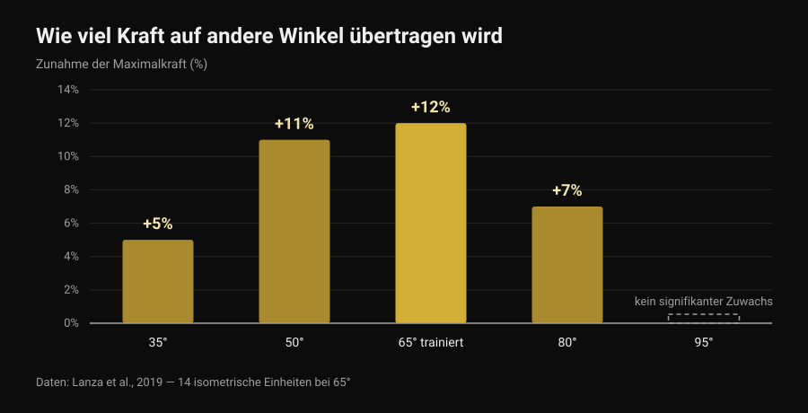
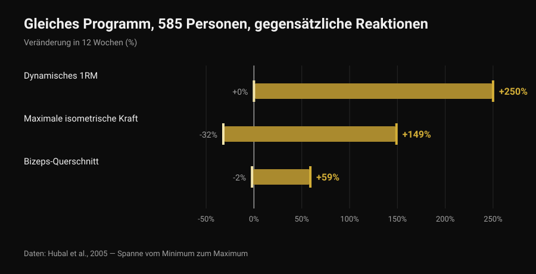

# Front Lever: Wie viele Vorstufen braucht man?

Von [Giammaria Loi](/autore/giammaria-loi) · aktualisiert am 6. November 2026

Tuck, Advanced Tuck, ein Bein, Straddle, Half Lay: Listen mit Front-Lever-Vorstufen kursieren seit Jahren, als wären sie eine Leiter mit einer festen Zahl an Sprossen, für alle gleich. Die Frage ist immer dieselbe: Wie viele muss ich abhaken, bevor der volle Front Lever kommt? Die Forschung zum isometrischen Training nennt keine Zahl, liefert aber etwas Nützlicheres: wie viel von der Kraft, die man in einer Position aufbaut, in der nächsten tatsächlich übrig bleibt. Und dieser Wert verändert, wie man die Leiter baut.

## Kurz gefasst

- Keine Studie schreibt eine Zahl an Vorstufen vor: Es gibt keine verpflichtenden drei, vier oder sechs Schritte, für niemanden.
- Isometrische Kraft ist weitgehend positionsspezifisch: Trainiert man nur einen Winkel, steigt die Kraft dort stark (+12 %) und mit zunehmendem Abstand immer weniger, bis bei 30 Grad Abstand gar nichts mehr ankommt (Lanza et al., 2019).
- Vorstufen sind also sinnvoll, aber nicht als Sammlung zum Abhaken: Sie decken die Positionen ab, in denen man stark sein will.
- Die Zahl der Schritte ist individuell, weil es die Trainingsantwort ist: gleiches Programm, 585 Personen, Kraftzuwächse von 0 bis +250 % in 12 Wochen (Hubal et al., 2005).
- Man kann über eine schwerere Position oder über mehr Sekunden steigern: Für Kraft und Masse sind beide Wege gleichwertig (Chaves et al., 2024).

## Was sich von einer Vorstufe zur nächsten wirklich ändert

Im Front Lever ist der Körper waagerecht und hängt an der Stange: Die Schultern sind der Drehpunkt, und das Körpergewicht zieht alles nach unten, was vor ihnen liegt. Der Aufwand hängt nicht davon ab, wie viel man wiegt, sondern davon, wie weit der Körperschwerpunkt von den Schultern entfernt ist. Die Knie zur Brust zu ziehen verkürzt diesen Abstand; ein Bein zu strecken verlängert ihn; die Beine im Straddle zu öffnen verkürzt ihn wieder etwas. Vorstufen sind also dieselbe Übung in unterschiedlicher Intensität — das Gegenstück zu Scheiben auf der Hantel.

Es gibt aber einen wichtigen Unterschied zur Hantel. Mit dem Hebel ändert sich nicht nur die Last, sondern auch der Gelenkwinkel und die Position, in der Kraft produziert wird. Genau hier hat die Forschung etwas zu sagen.

## Was die Forschung wirklich sagt

### Behauptung 1 — "Vor dem vollen Front Lever musst du X Vorstufen abschließen"
**Widerlegt.**

Keine Studie hat je eine Zahl an Schritten geprüft, denn nicht eine Zahl erzeugt die Anpassung, sondern progressive Überlastung. Und Überlastung lässt sich auf mehrere Arten hinzufügen. Chaves und Kollegen (2024) trainierten 39 untrainierte Personen 10 Wochen lang im Bein-gegen-Bein-Design: ein Bein steigerte die Last, das andere die Wiederholungen. Das 1RM in der Beinstreckung stieg von 52,9 auf 69,1 kg über die Last und von 51,7 auf 66,8 kg über die Wiederholungen; der Querschnitt des Vastus lateralis von 21,3 auf 23,5 cm² gegenüber 21,1 auf 23,4 cm². Kein Unterschied zwischen den Methoden.

Übertragen auf den Front Lever: in eine schwerere Position zu wechseln und der beherrschten Position Sekunden hinzuzufügen sind beides legitime Wege. Wie viele Vorstufen man durchläuft, folgt aus der Dosierung — es ist keine Regel.

### Behauptung 2 — "Die Kraft aus dem Tuck überträgt sich auf den vollen Front Lever"
**Widerlegt, zumindest teilweise.**

Das ist die interessanteste Studie für alle, die Haltearbeit trainieren. Lanza, Balshaw und Folland (2019) ließen 13 Personen in 4 Wochen 14 isometrische Einheiten bei einem einzigen Kniewinkel (65 Grad) absolvieren, verglichen sie mit 9 Kontrollpersonen und maßen anschließend die Kraft bei fünf verschiedenen Winkeln.

*Nurvan-Grafik nach Daten von Lanza et al., 2019 (Eur J Appl Physiol). Werte wie im Originalabstract berichtet; 13 bei 65 Grad trainierte Personen, 9 Kontrollen, 14 Einheiten in 4 Wochen. Bei 95 Grad wurde kein signifikanter Zuwachs berichtet.*

Die Kraft wuchs vor allem dort, wo trainiert wurde, und mit wachsendem Abstand immer weniger: 30 Grad jenseits des Arbeitswinkels war nichts mehr messbar. Den Vergleich nicht überdehnen — gemessen wurde Kniestreckung, nicht die Schulter unter einer Stange — aber das Prinzip gilt für jede Isometrie: Transfer existiert, er ist teilweise, und er nimmt mit dem Abstand zur trainierten Position ab. Aus demselben Grund trainiert [Tempo-Kreuzheben bis zum Knie](/de/blog/tempo-kreuzheben-bis-zum-knie) nicht die gesamte Bewegung.

Deshalb sind Vorstufen sinnvoll, obwohl keine Zahl verpflichtend ist: Wer nur im Tuck bleibt, behält das meiste davon im Tuck.

### Behauptung 3 — "Wie viele man braucht, hängt vom Körperbau ab"
**Zu präzisieren.**

Dass der Weg individuell ist, stimmt, und der solideste Befund betrifft nicht die Hebel, sondern die Trainingsantwort. Hubal und Kollegen (2005) trainierten 585 Personen 12 Wochen lang mit exakt demselben Programm und maßen die Ellenbogenbeuger vorher und nachher.

*Nurvan-Grafik nach Daten von Hubal et al., 2005 (Med Sci Sports Exerc). Spannen von Minimum bis Maximum wie im Originalabstract berichtet; 585 Personen, 342 Frauen und 243 Männer, 12 Wochen progressives Training eines Arms.*

Gleiches Programm, gleiche Dauer: Manche verdoppelten ihre Kraft, andere bewegten sich nicht. Bei solchen Zahlen ist es schlicht unmöglich vorherzusagen, wie viele Schritte eine bestimmte Person braucht.

Zu präzisieren ist der "Körperbau". Dass der Hebel zählt, ist Geometrie, keine Meinung: Bei gleicher Kraft bedeuten ein langer Rumpf und lange Beine einen längeren Hebelarm. Aber keine Studie hat gemessen, wie gut Anthropometrie allein die nötige Zahl an Vorstufen vorhersagt. Das ist eine plausible Erklärung, kein Befund.

### Behauptung 4 — "Isometrie baut keine echte Kraft auf"
**Widerlegt.**

Die systematische Übersicht von Oranchuk und Kollegen (2019) fasste 26 Arbeiten zu isometrischem Training über mindestens 3 Wochen zusammen: substanzielle Verbesserungen von Hypertrophie und Maximalkraft, bei allen untersuchten Intensitäten. Zwei Details zählen für Calisthenics: Training bei größeren Muskellängen erzeugte mehr Hypertrophie (0,86-1,69 % pro Woche gegenüber 0,08-0,83 % bei kurzen Längen) und besseren Transfer auf dynamische Leistungen; für Struktur und Funktion der Sehne braucht es dagegen hohe Intensitäten ab 70 %.

### Behauptung 5 — "Eigengewicht macht nicht so stark wie Hanteln"
**Widerlegt.**

Kotarsky und Kollegen (2018) teilten 23 trainierte Männer für 4 Wochen in zwei Gruppen, drei Einheiten pro Woche: eine steigerte über immer schwerere Liegestützvarianten, die andere über Bankdrücken. Das Bankdrück-1RM stieg in beiden Gruppen, ohne Unterschied zwischen ihnen. Deutlich stärker verbesserte sich die Liegestützgruppe nur in der Liegestützprogression selbst: wieder Spezifität, in der trainierten Richtung.

### Behauptung 6 — "Wechsle, sobald du 10-15 Sekunden hältst"
**Nicht überprüfbar.**

Keine Studie hat eine Sekundenschwelle als Kriterium für den Positionswechsel im Calisthenics getestet. Die Schwelle aus den Videos ist eine nützliche Konvention, kein Befund. Was die Literatur bietet, sind die Parameter der Isometrie — eine bessere Entscheidungsgrundlage.

## Wie lange halten und wie hart

Lum und Barbosa (2019) haben die Parameter isometrischen Trainings für zwei Ziele zusammengefasst. Die dritte Spalte ist meine Übertragung dieser Zahlen auf den Front Lever: Sie stammt von mir, nicht aus der Studie.

| Ziel | Parameter aus der Übersicht | Was das für einen Halt bedeutet |
|---|---|---|
| Hypertrophie | 70-75 % der Maximalkontraktion, Haltezeiten von 3-30 s, mehr als 80-150 s gesamt pro Einheit, über mehr als 36 Einheiten | Eine Position, die du 10-20 Sekunden hältst, wiederholt bis zu rund zwei Minuten Gesamthaltezeit |
| Maximalkraft | 80-100 % der Maximalkontraktion, Haltezeiten von 1-5 s, 30-90 s gesamt pro Einheit, über mehrere Winkel oder am Zielwinkel | Eine Position, in der du nach 5-8 Sekunden abbrichst, sehr kurze Halte und viel Pause, 30-90 Sekunden gesamt |

*Nurvan-Tabelle: Spalten 1 und 2 nach den von Lum und Barbosa, 2019 (Int J Sports Med) berichteten Parametern; Spalte 3 ist unsere eigene Anwendung auf den Front Lever, in der Studie nicht gemessen.*

So gelesen wird aus "wie viele Vorstufen" eine andere Frage: Wie viele Positionen brauche ich, um sowohl die sehr schwere, sehr kurze Arbeit als auch die längere abzudecken? Meist reichen zwei.

## Wie man es einsetzt

1. **Wähle zwei Positionen, nicht sechs.** Eine, in der du nach 5-8 Sekunden abbrichst (deine Kraftarbeit), und eine, die du 10-20 Sekunden mit flachem Rücken hältst (dein Volumen). Tuck und Advanced Tuck oder Advanced Tuck und ein Bein — das hängt nur davon ab, wo du stehst.
2. **Ändere nur eine Variable.** Entweder die Position oder die Sekunden. Bewegst du beides, weißt du nicht, was gewirkt hat, und in neun von zehn Fällen steigerst du zu schnell.
3. **Arbeite auch nahe am Ziel.** Wegen des nur teilweisen Transfers solltest du jede Woche ein paar Sekunden in der schwersten Position unterbringen, die du halten kannst, und sei es nur ein kontrolliertes Absenken von der Stange.
4. **Zähle Gesamtsekunden, nicht Sätze.** Dreißig bis neunzig Sekunden gesamt für die Kraftarbeit, rund 150 für das Volumen: Das ist die Einheit der Literatur.
5. **Teste die Zielposition alle 3-4 Wochen,** nicht in jeder Einheit. Testen kostet Training.
6. **Bei Schmerzen in Ellenbogen oder Schulter aufhören und abklären lassen.** Der Front Lever belastet Bizepssehne und Rotatorenmanschette in gedehnter Position; Schmerz ist keine Sprosse der Leiter.

> ### Nurvan testen — jede Position hat ihren eigenen Verlauf
>
> In Nurvan ist jede Front-Lever-Variante eine eigene Übung: Halte, Sekunden und RIR bleiben zwischen Tuck, Advanced Tuck und Straddle getrennt, so siehst du, welche Position wirklich vorangeht und welche seit drei Wochen steht. Aufwärmsätze werden automatisch vorgeschlagen, und der Verlauf zeigt, ob du Sekunden hinzufügst oder nur Sätze. [Nurvan testen](https://nurvan.app)

## Häufige Fragen

**Wie viele Vorstufen braucht man wirklich für den Front Lever?**
Es gibt keine für alle gültige Zahl, und keine Studie hat je eine geprüft. Du brauchst genug Positionen, um sowohl kurze, sehr schwere Halte als auch längere zu trainieren, und sie müssen nah genug beieinanderliegen, um ohne Sprünge zu steigern: praktisch zwei Positionen gleichzeitig, die sich mit dem Fortschritt verschieben.

**Wie lange dauert es bis zum vollen Front Lever?**
Keine Studie hat das gemessen, jedes "sechs Monate" aus dem Netz ist eine Anekdote. Belegt ist, dass die individuelle Variabilität der Trainingsantwort enorm ist (Hubal et al., 2005) — der Vergleich mit anderen sagt deshalb nichts aus.

**Besser lange Halte oder Negative von der Stange?**
Sie leisten Unterschiedliches. Lange Halte in einer machbaren Position liefern Volumen; Negative und sehr kurze Halte in einer fast unmöglichen Position liefern die hohe Intensität, die Kraft und Sehnen brauchen (Oranchuk et al., 2019). Ein sinnvolles Programm enthält beides.

**Muss ich zusätzlich mit Gewichten arbeiten?**
Nicht zwingend: Eigengewichtsprogression baut auf den entsprechenden Übungen genauso viel Kraft auf wie die Hantel (Kotarsky et al., 2018). Gewichte bleiben praktisch, um fein zu dosieren — mit Hebeln geht das nur grob.

## Weiterlesen

- [Tempo-Kreuzheben bis zum Knie: bringt das etwas?](/de/blog/tempo-kreuzheben-bis-zum-knie) — ein weiterer Fall, in dem ein Teil der Bewegung nicht die ganze Bewegung trainiert.
- [Kraft, Muskeln und Ausdauer gleichzeitig trainieren](/de/blog/kraft-muskeln-und-ausdauer-gleichzeitig-trainieren) — verschiedene Ziele in eine Woche packen, ohne sie gegeneinander auszuspielen.
- [Trainingsplan mit KI: was die Studien sagen](/de/blog/trainingsplan-mit-ki-studien) — wie weit man einem Modell die eigene Progression anvertrauen kann.

## Quellen

- Lanza MB, Balshaw TG, Folland JP, 2019. Is the joint-angle specificity of isometric resistance training real? And if so, does it have a neural basis? *European Journal of Applied Physiology* 119(11-12):2465-2476. PMID 31522276. [DOI](https://doi.org/10.1007/s00421-019-04229-z)
- Oranchuk DJ, Storey AG, Nelson AR, Cronin JB, 2019. Isometric training and long-term adaptations: Effects of muscle length, intensity, and intent: A systematic review. *Scandinavian Journal of Medicine & Science in Sports* 29(4):484-503. PMID 30580468. [DOI](https://doi.org/10.1111/sms.13375)
- Lum D, Barbosa TM, 2019. Brief Review: Effects of Isometric Strength Training on Strength and Dynamic Performance. *International Journal of Sports Medicine* 40(6):363-375. PMID 30943568. [DOI](https://doi.org/10.1055/a-0863-4539)
- Hubal MJ, Gordish-Dressman H, Thompson PD, et al., 2005. Variability in muscle size and strength gain after unilateral resistance training. *Medicine and Science in Sports and Exercise* 37(6):964-72. PMID 15947721. [PubMed](https://pubmed.ncbi.nlm.nih.gov/15947721/)
- Kotarsky CJ, Christensen BK, Miller JS, Hackney KJ, 2018. Effect of Progressive Calisthenic Push-up Training on Muscle Strength and Thickness. *Journal of Strength and Conditioning Research* 32(3):651-659. PMID 29466268. [DOI](https://doi.org/10.1519/JSC.0000000000002345)
- Chaves TS, Scarpelli MC, Bergamasco JGA, et al., 2024. Effects of Resistance Training Overload Progression Protocols on Strength and Muscle Mass. *International Journal of Sports Medicine* 45(7):504-510. PMID 38286426. [DOI](https://doi.org/10.1055/a-2256-5857)

Literatur über PubMed recherchiert. Ausgangspunkt: ein Beitrag von [Alessandro Mainente](https://www.instagram.com/p/DdqOETQjpuD/) vom 24. September 2026. Der Beitrag diente nur dazu, Thema und zu prüfende Behauptungen zu finden: Es wurden weder Text noch Bild noch Struktur übernommen.

---

Giammaria Loi ist der Gründer von Nurvan. Er trainiert seit 2012 mit Gewichten, arbeitet seit 2013 als FIPE-zertifizierter Personal Trainer und Coach und startet seit 2018 bei nationalen Powerlifting-Wettkämpfen. Jeder Artikel beginnt bei den Studien und endet bei dem, was im Training wirklich funktioniert.

> Hinweis: informativer Inhalt, er ersetzt nicht den Rat einer Ärztin, eines Arztes oder einer Fachperson.
