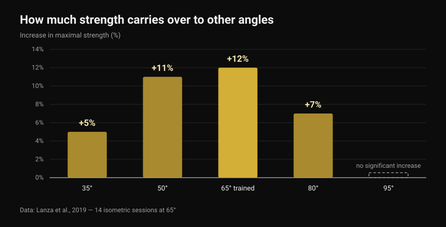
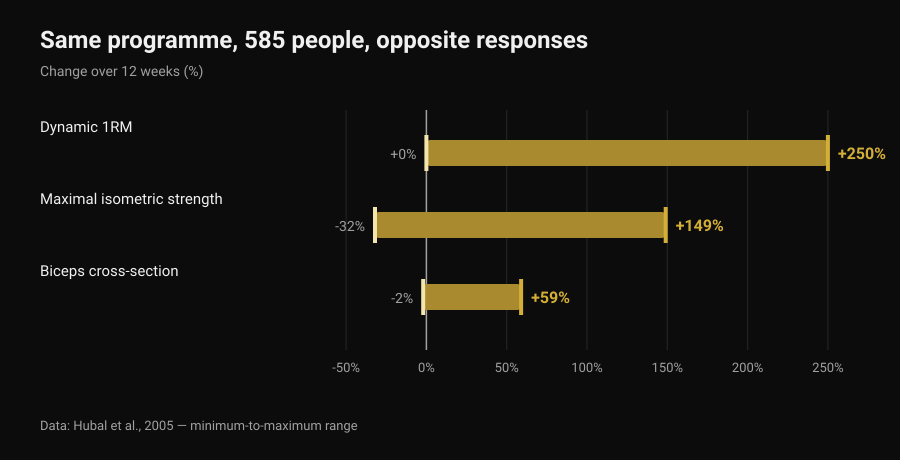

# Front Lever: How Many Progressions Do You Need?

By [Giammaria Loi](/autore/giammaria-loi) · updated 6 November 2026

Tuck, advanced tuck, one leg, straddle, half lay: front lever progression lists have been circulating for years as if they were a ladder with a fixed number of rungs, identical for everyone. The question is always the same — how many do I have to tick off before the full? Isometric training research won't give you a number, but it gives you something more useful: how much of the strength you build in one position you actually keep in the next one. That figure changes how you build the ladder.

## In short

- No study prescribes a number of progressions. There is no mandatory three, four or six steps, for anyone.
- Isometric strength is largely position-specific: train one angle and strength rises sharply there (+12%), less and less as you move away, and not at all 30 degrees past it (Lanza et al., 2019).
- So progressions do matter — not as a checklist, but as a way of covering the positions you want to be strong in.
- How many steps you need is individual because the response to training is: same programme, 585 people, strength gains from 0 to +250% in 12 weeks (Hubal et al., 2005).
- You can progress by making the position harder or by adding seconds: for strength and size the two routes tie (Chaves et al., 2024).

## What actually changes from one progression to the next

In a front lever the body is horizontal and hanging from the bar: the shoulders are the pivot, and bodyweight pulls down on everything in front of them. The effort doesn't depend on how much you weigh but on how far your centre of mass sits from your shoulders. Pulling the knees to the chest shortens that distance; extending one leg lengthens it; opening the legs into a straddle shortens it again. Progressions, in other words, are the same exercise at different intensities — the bodyweight equivalent of plates on a bar.

But there is one key difference from a barbell. Changing leverage doesn't only change the load: it also changes joint angles and the position in which you produce force. And that is where the research has something to say.

## What the research actually says

### Claim 1 — "You must complete X progressions before the full"
**Busted.**

No study has ever tested a number of steps, because a number is not what drives the adaptation — progressive overload is. And overload can be added in more than one way. Chaves and colleagues (2024) trained 39 untrained people for 10 weeks with a within-subject design: one leg progressed by adding load, the other by adding repetitions. Leg extension 1RM rose from 52.9 to 69.1 kg with load and from 51.7 to 66.8 kg with reps; vastus lateralis cross-section went from 21.3 to 23.5 cm² against 21.1 to 23.4 cm². No difference between methods.

Translated to the front lever: moving to a harder position and adding seconds to the position you already own are both legitimate ways to progress. How many progressions you pass through is a consequence of how you dosed the load, not a rule.

### Claim 2 — "The strength you build in tuck carries over to the full"
**Busted, at least partly.**

This is the most interesting study for anyone training holds. Lanza, Balshaw and Folland (2019) had 13 people perform 14 isometric sessions over 4 weeks at a single knee angle (65 degrees), compared them with 9 controls, then measured strength at five different angles.

*Nurvan chart on data from Lanza et al., 2019 (Eur J Appl Physiol). Values as reported in the original abstract; 13 subjects trained at 65 degrees, 9 controls, 14 sessions over 4 weeks. No significant increase was reported at 95 degrees.*

Strength grew mostly where it was trained and less and less further away: nothing measurable already 30 degrees past the working angle. Don't stretch the parallel too far — that study measured knee extension, not a shoulder under a bar — but the principle holds for every isometric: carry-over exists, it is partial, and it shrinks with distance from the trained position. It is the same reason [a tempo deadlift to the knee](/en/blog/tempo-to-knee-deadlift-does-it-work) doesn't train the whole lift.

That is why progressions are worth having even though no number is mandatory: stay in tuck only, and most of what you build stays in tuck.

### Claim 3 — "How many you need depends on how you're built"
**Needs nuance.**

That the path is individual is true, and the strongest evidence is not about leverage but about the response to training. Hubal and colleagues (2005) trained 585 people on the exact same programme for 12 weeks and measured the elbow flexors before and after.

*Nurvan chart on data from Hubal et al., 2005 (Med Sci Sports Exerc). Minimum-to-maximum ranges as reported in the original abstract; 585 subjects, 342 women and 243 men, 12 weeks of progressive single-arm training.*

Same programme, same duration: some people doubled their strength, others didn't move. With numbers like these, predicting how many steps a specific person needs is simply out of reach.

The part that needs nuance is "how you're built". That leverage matters is geometry, not opinion: at equal strength, a long torso and long legs mean a longer lever arm. But no study has measured how much anthropometry on its own predicts the number of progressions you need. It is a reasonable explanation, not a finding.

### Claim 4 — "Isometrics don't build real strength"
**Busted.**

The systematic review by Oranchuk and colleagues (2019) pooled 26 research outputs on isometric training lasting at least 3 weeks: substantial improvements in hypertrophy and maximal force, at every intensity studied. Two details matter for calisthenics: training at longer muscle lengths produced more hypertrophy (0.86-1.69% per week against 0.08-0.83% at short lengths) and better transfer to dynamic performance; improving tendon structure and function, on the other hand, requires high intensities, at or above 70%.

### Claim 5 — "Bodyweight doesn't build strength like weights do"
**Busted.**

Kotarsky and colleagues (2018) split 23 trained men into two groups for 4 weeks, three sessions per week: one progressed through harder push-up variations, the other through the bench press. Bench press 1RM rose in both groups, with no difference between them. What the push-up group did improve more was the push-up progression itself: specificity again, in the direction trained.

### Claim 6 — "Move on once you can hold it for 10-15 seconds"
**Unverifiable.**

No study has tested a seconds threshold as a criterion for changing position in calisthenics. The threshold that circulates in videos is a useful convention, not data. What the literature does offer is isometric parameters, and that is a better basis for the decision.

## How long to hold, and how hard

Lum and Barbosa (2019) summarised isometric training parameters for two different goals. The third column is my translation of those numbers into front lever work: the translation is mine, it is not in the study.

| Goal | Parameters from the review | What that looks like in a hold |
|---|---|---|
| Hypertrophy | 70-75% of maximal contraction, holds of 3-30 s, more than 80-150 s total per session, for more than 36 sessions | A position you can hold for 10-20 seconds, repeated until you reach roughly two minutes of total hold time |
| Maximal strength | 80-100% of maximal contraction, holds of 1-5 s, 30-90 s total per session, across several angles or at the target angle | A position where you fail at 5-8 seconds, very short holds and long rests, for 30-90 seconds in total |

*Nurvan table: columns 1 and 2 from the parameters reported by Lum and Barbosa, 2019 (Int J Sports Med); column 3 is our own application to the front lever, not measured in the study.*

Read that way, "how many progressions" turns into a different question: how many positions do I need to cover both the very heavy, very short work and the longer work? Usually two will do.

## How to use it

1. **Pick two positions, not six.** One where you fail at 5-8 seconds (that's your strength work) and one you can hold for 10-20 seconds with a flat back (that's your volume). Tuck and advanced tuck, or advanced tuck and one leg — it depends only on where you are.
2. **Change one variable at a time.** Either the position or the seconds. Move both and you won't know what worked, and nine times out of ten you'll climb too fast.
3. **Work close to the target too.** Given the partial carry-over between positions, put a few seconds every week into the hardest position you can hold, even if it's only a controlled lower from the bar.
4. **Count total seconds, not sets.** Thirty to ninety seconds in total for strength work, around 150 for volume work: that's the unit the literature uses.
5. **Retest the target position every 3-4 weeks,** not every session. Testing eats training.
6. **If the elbow or shoulder starts to hurt, stop and get it looked at.** The front lever loads the biceps tendon and the rotator cuff in a lengthened position; pain is not a rung on the ladder.

> ### Try Nurvan — every position gets its own history
>
> In Nurvan each front lever variation is its own exercise: holds, seconds and RIR stay separate across tuck, advanced tuck and straddle, so you can see which position is actually progressing and which has been stuck for three weeks. Warm-up sets are proposed automatically, and the history tells you whether you're adding seconds or just adding sets. [Try Nurvan](https://nurvan.app)

## Frequently asked questions

**How many progressions do you really need for a front lever?**
There is no number that works for everyone, and no study has ever tested one. You need enough positions to train both short, very hard holds and longer ones, and close enough together to progress without jumps: in practice, two positions at a time, which change as you improve.

**How long does it take to reach a full front lever?**
No study has measured it, so any "six months" you read online is an anecdote. What the data do say is that individual variability in training response is enormous (Hubal et al., 2005), so comparing your timeline with someone else's is not informative.

**Long holds or negatives from the bar?**
They do different jobs. Long holds in a sustainable position give you volume; negatives and very short holds in an almost impossible position give you the high intensity that strength and tendons need (Oranchuk et al., 2019). A sensible programme has both.

**Do I need to add weights as well?**
Not necessarily: bodyweight progression builds as much strength as a barbell on the matching exercises (Kotarsky et al., 2018). Weights stay convenient for fine-tuning load, which leverage does only in coarse steps.

## Read next

- [Tempo to knee deadlift: does it actually work?](/en/blog/tempo-to-knee-deadlift-does-it-work) — another case where training part of a movement doesn't train the whole movement.
- [Strength, muscle and cardio together: can it work?](/en/blog/training-strength-muscle-and-cardio-together) — fitting different goals into one week without cancelling them out.
- [AI-generated workout plans: what the research says](/en/blog/ai-generated-workout-plans-research) — how far you can trust a model to write your progression.

## Sources

- Lanza MB, Balshaw TG, Folland JP, 2019. Is the joint-angle specificity of isometric resistance training real? And if so, does it have a neural basis? *European Journal of Applied Physiology* 119(11-12):2465-2476. PMID 31522276. [DOI](https://doi.org/10.1007/s00421-019-04229-z)
- Oranchuk DJ, Storey AG, Nelson AR, Cronin JB, 2019. Isometric training and long-term adaptations: Effects of muscle length, intensity, and intent: A systematic review. *Scandinavian Journal of Medicine & Science in Sports* 29(4):484-503. PMID 30580468. [DOI](https://doi.org/10.1111/sms.13375)
- Lum D, Barbosa TM, 2019. Brief Review: Effects of Isometric Strength Training on Strength and Dynamic Performance. *International Journal of Sports Medicine* 40(6):363-375. PMID 30943568. [DOI](https://doi.org/10.1055/a-0863-4539)
- Hubal MJ, Gordish-Dressman H, Thompson PD, et al., 2005. Variability in muscle size and strength gain after unilateral resistance training. *Medicine and Science in Sports and Exercise* 37(6):964-72. PMID 15947721. [PubMed](https://pubmed.ncbi.nlm.nih.gov/15947721/)
- Kotarsky CJ, Christensen BK, Miller JS, Hackney KJ, 2018. Effect of Progressive Calisthenic Push-up Training on Muscle Strength and Thickness. *Journal of Strength and Conditioning Research* 32(3):651-659. PMID 29466268. [DOI](https://doi.org/10.1519/JSC.0000000000002345)
- Chaves TS, Scarpelli MC, Bergamasco JGA, et al., 2024. Effects of Resistance Training Overload Progression Protocols on Strength and Muscle Mass. *International Journal of Sports Medicine* 45(7):504-510. PMID 38286426. [DOI](https://doi.org/10.1055/a-2256-5857)

References retrieved via PubMed. Starting point: a post by [Alessandro Mainente](https://www.instagram.com/p/DdqOETQjpuD/) from 24 September 2026. The post was used only to identify the topic and the claims to check: no text, image or structure was reused.

---

Giammaria Loi is the founder of Nurvan. He has been lifting since 2012, has worked as a FIPE-certified personal trainer and coach since 2013, and has competed in powerlifting at national level since 2018. Every article he writes starts from the research and ends with what actually works in the gym.

> Note: informational content; it does not replace the advice of a doctor or qualified professional.
