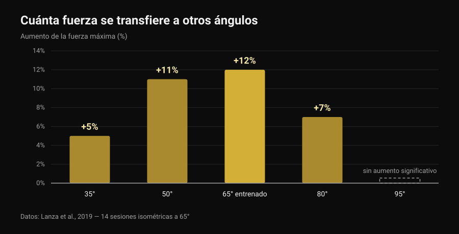
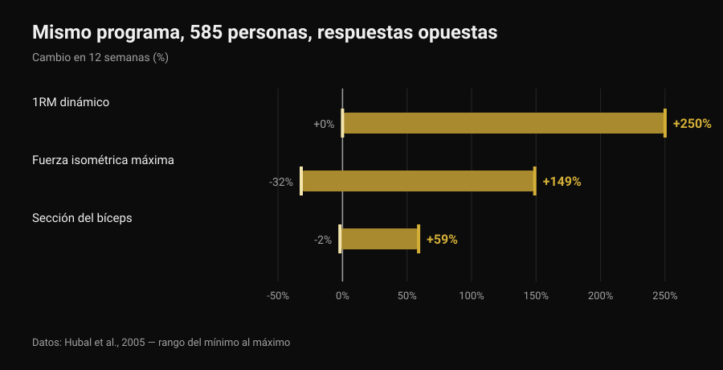

# Front lever: ¿cuántas progresiones hacen falta?

Por [Giammaria Loi](/autore/giammaria-loi) · actualizado el 6 de noviembre de 2026

Tuck, advanced tuck, una pierna, straddle, half lay: las listas de progresiones del front lever circulan desde hace años como si fueran una escalera con un número fijo de peldaños, igual para todo el mundo. La pregunta siempre es la misma: ¿cuántas tengo que completar antes del full? La literatura sobre entrenamiento isométrico no te da un número, pero te da algo más útil: cuánta de la fuerza que construyes en una posición conservas realmente en la siguiente. Ese dato cambia la forma de montar la escalera.

## En resumen

- Ningún estudio prescribe un número de progresiones: no existen tres, cuatro ni seis pasos obligatorios, para nadie.
- La fuerza isométrica es en buena parte específica de la posición: al entrenar un solo ángulo la fuerza sube mucho ahí (+12%) y cada vez menos al alejarse, hasta no subir nada a 30 grados de distancia (Lanza et al., 2019).
- Por eso las progresiones sirven, pero no como colección que tachar: sirven para cubrir las posiciones en las que quieres ser fuerte.
- El número de pasos es individual porque lo es la respuesta al entrenamiento: mismo programa, 585 personas, ganancias de fuerza de 0 a +250% en 12 semanas (Hubal et al., 2005).
- Puedes progresar haciendo la posición más difícil o sumando segundos: en fuerza y en masa las dos vías empatan (Chaves et al., 2024).

## Qué cambia de verdad de una progresión a otra

En el front lever el cuerpo está horizontal y colgado de la barra: los hombros hacen de pivote y el peso corporal tira hacia abajo de todo lo que queda por delante de ellos. El esfuerzo no depende de cuánto pesas, sino de a qué distancia está tu centro de masas de los hombros. Llevar las rodillas al pecho acorta esa distancia; estirar una pierna la alarga; abrir las piernas en straddle vuelve a acortarla un poco. Las progresiones, dicho de otro modo, son el mismo ejercicio a intensidades distintas: el equivalente de los discos en la barra.

Pero hay una diferencia importante respecto a la barra. Al cambiar la palanca no cambias solo la carga: cambias también el ángulo de las articulaciones y la posición en la que produces fuerza. Y ahí es donde la investigación tiene algo que decir.

## Qué dice realmente la investigación

### Afirmación 1 — "Antes del full tienes que completar X progresiones"
**Falso.**

Ningún estudio ha probado nunca un número de pasos, porque no es un número lo que produce la adaptación: es la sobrecarga progresiva. Y la sobrecarga se puede añadir de varias formas. Chaves y colaboradores (2024) entrenaron durante 10 semanas a 39 personas no entrenadas con un diseño de piernas separadas: una pierna progresaba subiendo la carga, la otra subiendo las repeticiones. El 1RM en extensión de rodilla pasó de 52,9 a 69,1 kg con la carga y de 51,7 a 66,8 kg con las repeticiones; la sección del vasto lateral pasó de 21,3 a 23,5 cm² frente a 21,1 a 23,4 cm². Ninguna diferencia entre métodos.

Traducido al front lever: pasar a una posición más difícil y sumar segundos a la que ya dominas son dos maneras legítimas de progresar. Cuántas progresiones atraviesas es una consecuencia de cómo dosificaste la carga, no una regla.

### Afirmación 2 — "La fuerza del tuck se transfiere al full"
**Falso, al menos en parte.**

Es el estudio más interesante para quien entrena isometrías. Lanza, Balshaw y Folland (2019) hicieron que 13 personas realizaran 14 sesiones isométricas en 4 semanas a un solo ángulo de rodilla (65 grados), las compararon con 9 controles y luego midieron la fuerza en cinco ángulos distintos.

*Gráfico de Nurvan sobre datos de Lanza et al., 2019 (Eur J Appl Physiol). Valores tal como aparecen en el resumen original; 13 sujetos entrenados a 65 grados, 9 controles, 14 sesiones en 4 semanas. A 95 grados no se informó de ningún aumento significativo.*

La fuerza creció sobre todo donde se entrenó y cada vez menos al alejarse: nada medible ya a 30 grados más allá del ángulo de trabajo. Cuidado con exagerar el paralelismo — ese estudio mide la extensión de rodilla, no el hombro bajo una barra — pero el principio vale para toda isometría: la transferencia existe, es parcial y se reduce con la distancia a la posición entrenada. Es el mismo motivo por el que [el peso muerto a tempo hasta la rodilla](/es/blog/peso-muerto-a-tempo-hasta-la-rodilla) no entrena el levantamiento entero.

Por eso las progresiones tienen sentido aunque ningún número sea obligatorio: si te quedas solo en tuck, casi todo lo que construyes se queda en tuck.

### Afirmación 3 — "Cuántas hacen falta depende de cómo estés hecho"
**Matizable.**

Que el camino sea individual es cierto, y el dato más sólido no va de palancas sino de respuesta al entrenamiento. Hubal y colaboradores (2005) entrenaron a 585 personas con exactamente el mismo programa durante 12 semanas y midieron los flexores del codo antes y después.

*Gráfico de Nurvan sobre datos de Hubal et al., 2005 (Med Sci Sports Exerc). Intervalos de mínimo a máximo tal como aparecen en el resumen original; 585 sujetos, 342 mujeres y 243 hombres, 12 semanas de entrenamiento progresivo de un solo brazo.*

Mismo programa, misma duración: unos duplicaron su fuerza, otros no se movieron. Con números así, predecir cuántos pasos necesita una persona concreta queda simplemente fuera de alcance.

Lo matizable es el "cómo estés hecho". Que la palanca cuente es geometría, no opinión: a igual fuerza, un tronco y unas piernas largas significan un brazo de palanca más largo. Pero ningún estudio ha medido cuánto predice la antropometría por sí sola el número de progresiones necesarias. Es una explicación razonable, no un dato.

### Afirmación 4 — "Las isometrías no construyen fuerza de verdad"
**Falso.**

La revisión sistemática de Oranchuk y colaboradores (2019) reunió 26 trabajos sobre entrenamiento isométrico de al menos 3 semanas: mejoras sustanciales de hipertrofia y fuerza máxima, en todas las intensidades estudiadas. Dos detalles importan en calistenia: entrenar a longitudes musculares mayores produjo más hipertrofia (0,86-1,69% por semana frente a 0,08-0,83% en longitudes cortas) y mejor transferencia al rendimiento dinámico; para mejorar la estructura y la función del tendón, en cambio, hacen falta intensidades altas, iguales o superiores al 70%.

### Afirmación 5 — "El peso corporal no da fuerza como las pesas"
**Falso.**

Kotarsky y colaboradores (2018) dividieron a 23 hombres entrenados en dos grupos durante 4 semanas, tres sesiones por semana: uno progresaba con variantes cada vez más difíciles de flexiones, el otro con press de banca. El 1RM de banca subió en ambos grupos, sin diferencias entre ellos. Donde sí mejoró más el grupo de flexiones fue en la propia escala de flexiones: de nuevo especificidad, en la dirección entrenada.

### Afirmación 6 — "Pasa a la siguiente cuando aguantes 10-15 segundos"
**No verificable.**

No existe ningún estudio que haya probado un umbral de segundos como criterio para cambiar de posición en calistenia. El umbral que circula en los vídeos es una convención útil, no un dato. Lo que sí ofrece la literatura son los parámetros de las isometrías, y es una base mejor para decidir.

## Cuánto aguantar y a qué intensidad

Lum y Barbosa (2019) resumieron los parámetros del entrenamiento isométrico para dos objetivos distintos. La tercera columna es mi traducción de esos números al front lever: la traducción es mía, no está en el estudio.

| Objetivo | Parámetros de la revisión | Cómo se traduce en una tenida |
|---|---|---|
| Hipertrofia | 70-75% de la contracción máxima, tenidas de 3-30 s, más de 80-150 s totales por sesión, durante más de 36 sesiones | Una posición que aguantes 10-20 segundos, repetida hasta llegar a unos dos minutos de tenida total |
| Fuerza máxima | 80-100% de la contracción máxima, tenidas de 1-5 s, 30-90 s totales por sesión, en varios ángulos o en el ángulo objetivo | Una posición en la que fallas a los 5-8 segundos, tenidas muy breves y mucho descanso, 30-90 segundos en total |

*Tabla de Nurvan: columnas 1 y 2 con los parámetros publicados por Lum y Barbosa, 2019 (Int J Sports Med); la columna 3 es una aplicación nuestra al front lever, no medida en el estudio.*

Leída así, la pregunta "cuántas progresiones" se convierte en otra: ¿cuántas posiciones necesito para cubrir tanto el trabajo pesado y brevísimo como el más largo? Normalmente con dos basta.

## Cómo aplicarlo

1. **Elige dos posiciones, no seis.** Una en la que falles a los 5-8 segundos (es tu trabajo de fuerza) y otra que aguantes 10-20 segundos con la espalda todavía plana (es tu volumen). Pueden ser tuck y advanced tuck, o advanced tuck y una pierna: depende solo de dónde estés.
2. **Cambia una variable cada vez.** O la posición o los segundos. Si mueves las dos a la vez no sabrás qué funcionó, y nueve de cada diez veces subirás demasiado rápido.
3. **Trabaja también cerca del objetivo.** Dada la transferencia parcial entre posiciones, mete cada semana algunos segundos en la posición más difícil que aguantes, aunque sea solo una bajada controlada desde la barra.
4. **Cuenta los segundos totales, no las series.** Treinta a noventa segundos en total para el trabajo de fuerza, unos 150 para el de volumen: es la unidad que usa la literatura.
5. **Vuelve a probar la posición objetivo cada 3-4 semanas,** no cada entrenamiento. Testear consume entrenamiento.
6. **Si aparece dolor en codo u hombro, para y hazlo mirar.** El front lever carga el tendón del bíceps y el manguito rotador en posición alargada; el dolor no es un peldaño de la progresión.

> ### Prueba Nurvan — cada posición tiene su propio historial
>
> En Nurvan cada variante del front lever es un ejercicio aparte: tenidas, segundos y RIR se mantienen separados entre tuck, advanced tuck y straddle, así ves qué posición progresa de verdad y cuál lleva tres semanas parada. Las series de calentamiento se proponen de forma automática y el historial te dice si estás sumando segundos o solo series. [Prueba Nurvan](https://nurvan.app)

## Preguntas frecuentes

**¿Cuántas progresiones hacen falta de verdad para el front lever?**
No existe un número válido para todos y ningún estudio ha probado uno. Hacen falta suficientes posiciones para entrenar tanto tenidas cortas y muy difíciles como tenidas más largas, y lo bastante cercanas entre sí para progresar sin saltos: en la práctica, dos posiciones cada vez, que van cambiando a medida que mejoras.

**¿Cuánto se tarda en llegar al full front lever?**
Ningún estudio lo ha medido, así que cualquier "seis meses" que leas por ahí es una anécdota. Lo que sí dicen los datos es que la variabilidad individual de la respuesta al entrenamiento es enorme (Hubal et al., 2005), así que comparar tus tiempos con los de otro no informa de nada.

**¿Mejor tenidas largas o negativas desde la barra?**
Sirven para cosas distintas. Las tenidas largas en una posición sostenible dan volumen; las negativas y las tenidas brevísimas en una posición casi imposible dan la intensidad alta que necesitan la fuerza y los tendones (Oranchuk et al., 2019). Un programa sensato tiene las dos.

**¿Hace falta añadir también pesas?**
No es obligatorio: la progresión con peso corporal construye tanta fuerza como la barra en los ejercicios correspondientes (Kotarsky et al., 2018). Las pesas siguen siendo cómodas para dosificar la carga con finura, algo que con las palancas es más tosco.

## Lee también

- [Peso muerto a tempo hasta la rodilla: ¿sirve?](/es/blog/peso-muerto-a-tempo-hasta-la-rodilla) — otro caso en el que entrenar un trozo del movimiento no entrena todo el movimiento.
- [Fuerza, músculo y cardio a la vez: ¿se puede?](/es/blog/entrenar-fuerza-musculo-y-cardio-a-la-vez) — cómo encajar objetivos distintos en la misma semana sin anularlos.
- [Rutina de entrenamiento con IA: qué dicen los estudios](/es/blog/rutina-de-entrenamiento-con-ia) — hasta qué punto fiarse de un modelo para escribir tu progresión.

## Fuentes

- Lanza MB, Balshaw TG, Folland JP, 2019. Is the joint-angle specificity of isometric resistance training real? And if so, does it have a neural basis? *European Journal of Applied Physiology* 119(11-12):2465-2476. PMID 31522276. [DOI](https://doi.org/10.1007/s00421-019-04229-z)
- Oranchuk DJ, Storey AG, Nelson AR, Cronin JB, 2019. Isometric training and long-term adaptations: Effects of muscle length, intensity, and intent: A systematic review. *Scandinavian Journal of Medicine & Science in Sports* 29(4):484-503. PMID 30580468. [DOI](https://doi.org/10.1111/sms.13375)
- Lum D, Barbosa TM, 2019. Brief Review: Effects of Isometric Strength Training on Strength and Dynamic Performance. *International Journal of Sports Medicine* 40(6):363-375. PMID 30943568. [DOI](https://doi.org/10.1055/a-0863-4539)
- Hubal MJ, Gordish-Dressman H, Thompson PD, et al., 2005. Variability in muscle size and strength gain after unilateral resistance training. *Medicine and Science in Sports and Exercise* 37(6):964-72. PMID 15947721. [PubMed](https://pubmed.ncbi.nlm.nih.gov/15947721/)
- Kotarsky CJ, Christensen BK, Miller JS, Hackney KJ, 2018. Effect of Progressive Calisthenic Push-up Training on Muscle Strength and Thickness. *Journal of Strength and Conditioning Research* 32(3):651-659. PMID 29466268. [DOI](https://doi.org/10.1519/JSC.0000000000002345)
- Chaves TS, Scarpelli MC, Bergamasco JGA, et al., 2024. Effects of Resistance Training Overload Progression Protocols on Strength and Muscle Mass. *International Journal of Sports Medicine* 45(7):504-510. PMID 38286426. [DOI](https://doi.org/10.1055/a-2256-5857)

Referencias recuperadas a través de PubMed. Punto de partida: una publicación de [Alessandro Mainente](https://www.instagram.com/p/DdqOETQjpuD/) del 24 de septiembre de 2026. El contenido de la publicación se usó solo para identificar el tema y las afirmaciones que verificar: no se ha reutilizado ningún texto, imagen ni estructura.

---

Giammaria Loi es el fundador de Nurvan. Entrena con pesas desde 2012, trabaja como entrenador personal certificado FIPE desde 2013 y compite en powerlifting a nivel nacional desde 2018. Cada artículo que firma parte de los estudios científicos y llega a lo que funciona de verdad en el gimnasio.

> Nota: contenido informativo, no sustituye la opinión de un médico o profesional.
