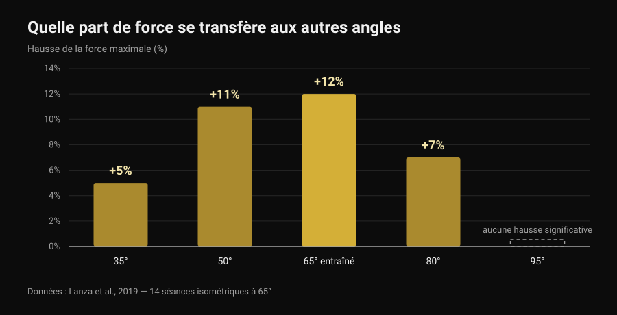
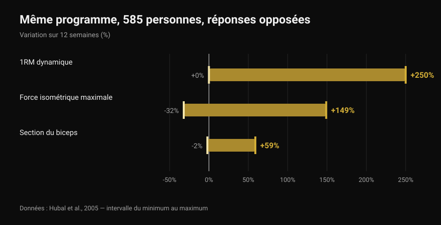

# Front lever : combien de progressions faut-il ?

Par [Giammaria Loi](/autore/giammaria-loi) · mis à jour le 6 novembre 2026

Tuck, advanced tuck, une jambe, straddle, half lay : les listes de progressions du front lever circulent depuis des années comme s'il s'agissait d'une échelle avec un nombre fixe de barreaux, la même pour tout le monde. La question revient toujours : combien dois-je en valider avant le full ? La littérature sur l'entraînement isométrique ne donne pas de chiffre, mais quelque chose de plus utile : la part de force construite dans une position que l'on retrouve vraiment dans la suivante. Et ce chiffre change la façon de construire l'échelle.

## L'essentiel

- Aucune étude ne prescrit un nombre de progressions : il n'existe pas trois, quatre ou six étapes obligatoires, pour personne.
- La force isométrique est en grande partie spécifique à la position : en n'entraînant qu'un angle, la force progresse beaucoup là (+12 %) et de moins en moins en s'éloignant, jusqu'à ne plus progresser à 30 degrés de distance (Lanza et al., 2019).
- Les progressions servent donc, mais pas comme une collection à cocher : elles servent à couvrir les positions où l'on veut être fort.
- Le nombre d'étapes est individuel parce que la réponse à l'entraînement l'est : même programme, 585 personnes, des gains de force de 0 à +250 % en 12 semaines (Hubal et al., 2005).
- On peut progresser en durcissant la position ou en ajoutant des secondes : pour la force et la masse, les deux voies se valent (Chaves et al., 2024).

## Ce qui change vraiment d'une progression à l'autre

Dans le front lever le corps est horizontal et suspendu à la barre : les épaules servent de pivot et le poids du corps tire vers le bas tout ce qui se trouve devant elles. L'effort ne dépend pas de votre poids, mais de la distance entre votre centre de masse et vos épaules. Ramener les genoux à la poitrine raccourcit cette distance ; tendre une jambe l'allonge ; écarter les jambes en straddle la raccourcit de nouveau un peu. Les progressions, autrement dit, sont le même exercice à des intensités différentes : l'équivalent des disques sur une barre.

Mais il y a une différence importante avec la barre. Changer de bras de levier ne change pas seulement la charge : cela change aussi l'angle des articulations et la position dans laquelle on produit la force. Et c'est là que la recherche a quelque chose à dire.

## Ce que dit vraiment la recherche

### Affirmation 1 — « Avant le full, il faut valider X progressions »
**Faux.**

Aucune étude n'a jamais testé un nombre d'étapes, parce que ce n'est pas un chiffre qui produit l'adaptation : c'est la surcharge progressive. Et la surcharge s'ajoute de plusieurs façons. Chaves et ses collègues (2024) ont entraîné pendant 10 semaines 39 personnes non entraînées avec un protocole jambe contre jambe : une jambe progressait en augmentant la charge, l'autre en augmentant les répétitions. Le 1RM au leg extension est passé de 52,9 à 69,1 kg avec la charge et de 51,7 à 66,8 kg avec les répétitions ; la section du vaste latéral de 21,3 à 23,5 cm² contre 21,1 à 23,4 cm². Aucune différence entre les deux méthodes.

Traduit dans le front lever : passer à une position plus difficile et ajouter des secondes à celle que l'on maîtrise déjà sont deux façons légitimes de progresser. Le nombre de progressions traversées est une conséquence du dosage, pas une règle.

### Affirmation 2 — « La force du tuck se transfère au full »
**Faux, au moins en partie.**

C'est l'étude la plus intéressante pour qui travaille les isométries. Lanza, Balshaw et Folland (2019) ont fait réaliser à 13 personnes 14 séances isométriques en 4 semaines à un seul angle de genou (65 degrés), les ont comparées à 9 témoins, puis ont mesuré la force à cinq angles différents.

*Graphique Nurvan d'après les données de Lanza et al., 2019 (Eur J Appl Physiol). Valeurs telles que rapportées dans le résumé original ; 13 sujets entraînés à 65 degrés, 9 témoins, 14 séances en 4 semaines. Aucune hausse significative n'a été rapportée à 95 degrés.*

La force a surtout augmenté là où elle a été entraînée, de moins en moins en s'éloignant : plus rien de mesurable dès 30 degrés au-delà de l'angle de travail. Attention à ne pas forcer le parallèle — cette étude mesure l'extension du genou, pas l'épaule sous une barre — mais le principe vaut pour toutes les isométries : le transfert existe, il est partiel, et il diminue avec la distance à la position entraînée. C'est la même raison pour laquelle [le soulevé de terre tempo jusqu'au genou](/fr/blog/souleve-de-terre-tempo-jusquau-genou) n'entraîne pas le mouvement entier.

Voilà pourquoi les progressions ont du sens même si aucun nombre n'est obligatoire : si vous restez en tuck, l'essentiel de ce que vous construisez reste en tuck.

### Affirmation 3 — « Le nombre dépend de votre morphologie »
**À nuancer.**

Que le parcours soit individuel est vrai, et la donnée la plus solide ne concerne pas les leviers mais la réponse à l'entraînement. Hubal et ses collègues (2005) ont entraîné 585 personnes avec exactement le même programme pendant 12 semaines et mesuré les fléchisseurs du coude avant et après.

*Graphique Nurvan d'après les données de Hubal et al., 2005 (Med Sci Sports Exerc). Intervalles du minimum au maximum tels que rapportés dans le résumé original ; 585 sujets, 342 femmes et 243 hommes, 12 semaines d'entraînement progressif d'un seul bras.*

Même programme, même durée : certains ont doublé leur force, d'autres n'ont pas bougé. Avec de tels écarts, prévoir combien d'étapes il faut à une personne précise est tout simplement hors de portée.

Ce qu'il faut nuancer, c'est la « morphologie ». Que le levier compte relève de la géométrie, pas de l'opinion : à force égale, un tronc et des jambes longs signifient un bras de levier plus long. Mais aucune étude n'a mesuré ce que l'anthropométrie prédit à elle seule du nombre de progressions nécessaires. C'est une explication raisonnable, pas une donnée.

### Affirmation 4 — « Les isométries ne construisent pas de vraie force »
**Faux.**

La revue systématique d'Oranchuk et ses collègues (2019) a réuni 26 travaux sur des entraînements isométriques d'au moins 3 semaines : des progrès substantiels d'hypertrophie et de force maximale, à toutes les intensités étudiées. Deux détails comptent en street workout : s'entraîner à des longueurs musculaires plus grandes a produit plus d'hypertrophie (0,86-1,69 % par semaine contre 0,08-0,83 % à longueurs courtes) et un meilleur transfert vers les performances dynamiques ; améliorer la structure et la fonction du tendon demande en revanche des intensités élevées, égales ou supérieures à 70 %.

### Affirmation 5 — « Le poids de corps ne donne pas la force des charges »
**Faux.**

Kotarsky et ses collègues (2018) ont réparti 23 hommes entraînés en deux groupes pendant 4 semaines, trois séances par semaine : l'un progressait avec des variantes de pompes de plus en plus dures, l'autre au développé couché. Le 1RM au développé a augmenté dans les deux groupes, sans différence entre eux. Là où le groupe pompes a davantage progressé, c'est sur l'échelle des pompes elle-même : encore la spécificité, dans la direction travaillée.

### Affirmation 6 — « Passe à la suivante quand tu tiens 10-15 secondes »
**Invérifiable.**

Aucune étude n'a testé un seuil en secondes comme critère de changement de position en street workout. Le seuil qui circule dans les vidéos est une convention utile, pas une donnée. Ce que la littérature propose, ce sont les paramètres des isométries, et c'est une meilleure base de décision.

## Combien de temps tenir, et à quelle intensité

Lum et Barbosa (2019) ont résumé les paramètres de l'entraînement isométrique pour deux objectifs différents. La troisième colonne est ma traduction de ces chiffres dans le front lever : elle est de moi, elle n'est pas dans l'étude.

| Objectif | Paramètres de la revue | Ce que cela donne sur un maintien |
|---|---|---|
| Hypertrophie | 70-75 % de la contraction maximale, maintiens de 3-30 s, plus de 80-150 s au total par séance, pendant plus de 36 séances | Une position tenue 10-20 secondes, répétée jusqu'à environ deux minutes de maintien cumulé |
| Force maximale | 80-100 % de la contraction maximale, maintiens de 1-5 s, 30-90 s au total par séance, sur plusieurs angles ou sur l'angle cible | Une position où l'on lâche en 5-8 secondes, maintiens très courts et longues récupérations, 30-90 secondes au total |

*Tableau Nurvan : colonnes 1 et 2 d'après les paramètres rapportés par Lum et Barbosa, 2019 (Int J Sports Med) ; la colonne 3 est notre application au front lever, non mesurée dans l'étude.*

Lue ainsi, la question « combien de progressions » en devient une autre : combien de positions me faut-il pour couvrir à la fois le travail très lourd et très court et le travail plus long ? Deux suffisent en général.

## Comment l'appliquer

1. **Choisissez deux positions, pas six.** Une où vous lâchez en 5-8 secondes (c'est votre travail de force) et une que vous tenez 10-20 secondes dos encore plat (c'est votre volume). Tuck et advanced tuck, ou advanced tuck et une jambe : tout dépend d'où vous en êtes.
2. **Changez une variable à la fois.** Soit la position, soit les secondes. En bougeant les deux, vous ne saurez pas ce qui a marché, et neuf fois sur dix vous monterez trop vite.
3. **Travaillez aussi près de la cible.** Vu le transfert partiel entre positions, placez chaque semaine quelques secondes dans la position la plus dure que vous tenez, même seulement en descente contrôlée depuis la barre.
4. **Comptez les secondes totales, pas les séries.** Trente à quatre-vingt-dix secondes au total pour le travail de force, environ 150 pour le volume : c'est l'unité qu'utilise la littérature.
5. **Retestez la position cible toutes les 3-4 semaines,** pas à chaque séance. Tester consomme de l'entraînement.
6. **Si une douleur apparaît au coude ou à l'épaule, arrêtez et faites examiner.** Le front lever sollicite le tendon du biceps et la coiffe des rotateurs en position allongée ; la douleur n'est pas un barreau de l'échelle.

> ### Essayez Nurvan — chaque position a son propre historique
>
> Dans Nurvan, chaque variante du front lever est un exercice à part : maintiens, secondes et RIR restent séparés entre tuck, advanced tuck et straddle, et vous voyez quelle position progresse vraiment et laquelle stagne depuis trois semaines. Les séries d'échauffement sont proposées automatiquement, et l'historique vous dit si vous ajoutez des secondes ou seulement des séries. [Essayez Nurvan](https://nurvan.app)

## Questions fréquentes

**Combien de progressions faut-il vraiment pour le front lever ?**
Il n'existe pas de nombre valable pour tous et aucune étude n'en a testé un. Il faut assez de positions pour travailler à la fois des maintiens courts et très durs et des maintiens plus longs, et assez proches les unes des autres pour progresser sans sauts : en pratique, deux positions à la fois, qui changent à mesure que vous progressez.

**Combien de temps pour arriver au full front lever ?**
Aucune étude ne l'a mesuré, donc tout « six mois » lu en ligne est une anecdote. Ce que disent les données, c'est que la variabilité individuelle de la réponse à l'entraînement est énorme (Hubal et al., 2005) : comparer ses délais à ceux d'un autre n'apprend rien.

**Maintiens longs ou négatives depuis la barre ?**
Ils servent à des choses différentes. Les maintiens longs dans une position tenable donnent du volume ; les négatives et les maintiens très courts dans une position presque impossible donnent l'intensité élevée dont la force et les tendons ont besoin (Oranchuk et al., 2019). Un programme sensé contient les deux.

**Faut-il ajouter des charges ?**
Ce n'est pas obligatoire : la progression au poids de corps construit autant de force que la barre sur les exercices correspondants (Kotarsky et al., 2018). Les charges restent pratiques pour doser finement, ce que les leviers font de façon plus grossière.

## À lire aussi

- [Soulevé de terre tempo jusqu'au genou : utile ?](/fr/blog/souleve-de-terre-tempo-jusquau-genou) — un autre cas où entraîner un morceau du mouvement n'entraîne pas tout le mouvement.
- [Force, muscle et cardio ensemble : possible ?](/fr/blog/entrainer-force-muscle-et-cardio-ensemble) — faire tenir des objectifs différents dans la même semaine sans les annuler.
- [Programme d'entraînement généré par IA : ce que disent les études](/fr/blog/programme-entrainement-genere-par-ia) — jusqu'où faire confiance à un modèle pour écrire votre progression.

## Sources

- Lanza MB, Balshaw TG, Folland JP, 2019. Is the joint-angle specificity of isometric resistance training real? And if so, does it have a neural basis? *European Journal of Applied Physiology* 119(11-12):2465-2476. PMID 31522276. [DOI](https://doi.org/10.1007/s00421-019-04229-z)
- Oranchuk DJ, Storey AG, Nelson AR, Cronin JB, 2019. Isometric training and long-term adaptations: Effects of muscle length, intensity, and intent: A systematic review. *Scandinavian Journal of Medicine & Science in Sports* 29(4):484-503. PMID 30580468. [DOI](https://doi.org/10.1111/sms.13375)
- Lum D, Barbosa TM, 2019. Brief Review: Effects of Isometric Strength Training on Strength and Dynamic Performance. *International Journal of Sports Medicine* 40(6):363-375. PMID 30943568. [DOI](https://doi.org/10.1055/a-0863-4539)
- Hubal MJ, Gordish-Dressman H, Thompson PD, et al., 2005. Variability in muscle size and strength gain after unilateral resistance training. *Medicine and Science in Sports and Exercise* 37(6):964-72. PMID 15947721. [PubMed](https://pubmed.ncbi.nlm.nih.gov/15947721/)
- Kotarsky CJ, Christensen BK, Miller JS, Hackney KJ, 2018. Effect of Progressive Calisthenic Push-up Training on Muscle Strength and Thickness. *Journal of Strength and Conditioning Research* 32(3):651-659. PMID 29466268. [DOI](https://doi.org/10.1519/JSC.0000000000002345)
- Chaves TS, Scarpelli MC, Bergamasco JGA, et al., 2024. Effects of Resistance Training Overload Progression Protocols on Strength and Muscle Mass. *International Journal of Sports Medicine* 45(7):504-510. PMID 38286426. [DOI](https://doi.org/10.1055/a-2256-5857)

Références récupérées via PubMed. Point de départ : une publication d'[Alessandro Mainente](https://www.instagram.com/p/DdqOETQjpuD/) du 24 septembre 2026. Son contenu a servi uniquement à repérer le sujet et les affirmations à vérifier : aucun texte, image ou structure n'a été repris.

---

Giammaria Loi est le fondateur de Nurvan. Il s'entraîne avec des charges depuis 2012, travaille comme coach et préparateur certifié FIPE depuis 2013 et participe à des compétitions nationales de powerlifting depuis 2018. Chacun de ses articles part des études scientifiques et arrive à ce qui fonctionne vraiment en salle.

> Note : contenu informatif, il ne remplace pas l'avis d'un médecin ou d'un professionnel.
