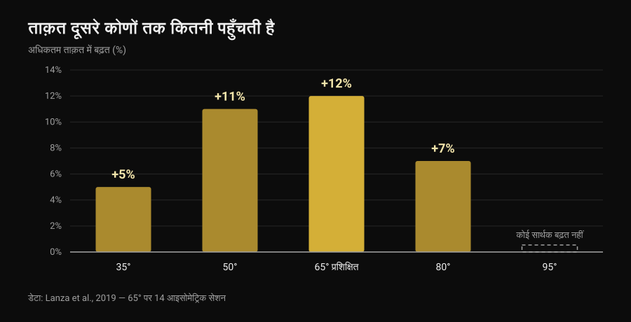
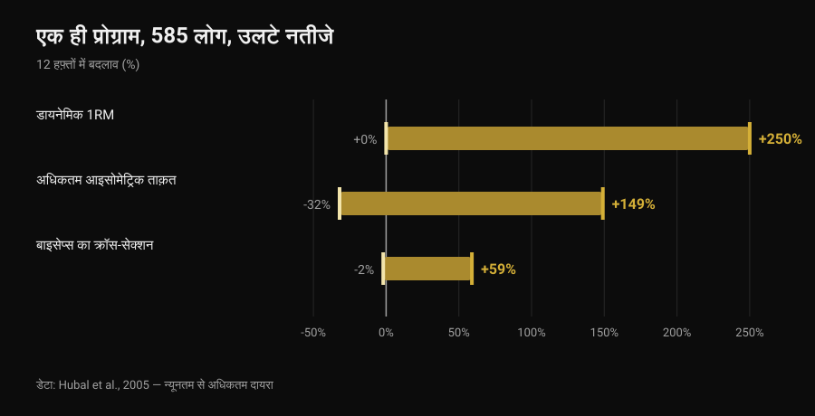

# फ्रंट लीवर: कितनी प्रोग्रेशन चाहिए होती हैं?

लेखक [Giammaria Loi](/autore/giammaria-loi) · 6 नवंबर 2026 को अपडेट

टक, एडवांस्ड टक, एक टाँग, स्ट्रैडल, हाफ़ ले: फ्रंट लीवर की प्रोग्रेशन लिस्टें सालों से ऐसे घूम रही हैं जैसे यह एक तय सीढ़ियों वाली सीढ़ी हो, सबके लिए एक जैसी। सवाल भी हमेशा वही रहता है — फ़ुल तक पहुँचने से पहले कितने स्टेप पूरे करने हैं? आइसोमेट्रिक ट्रेनिंग की रिसर्च कोई संख्या नहीं देती, लेकिन उससे ज़्यादा काम की चीज़ देती है: एक पोज़िशन में बनाई ताक़त का कितना हिस्सा अगली पोज़िशन में सच में बचता है। और यही आँकड़ा तय करता है कि सीढ़ी कैसे बनाई जाए।

## संक्षेप में

- कोई भी स्टडी प्रोग्रेशन की संख्या तय नहीं करती: तीन, चार या छह अनिवार्य स्टेप किसी के लिए भी नहीं हैं।
- आइसोमेट्रिक ताक़त काफ़ी हद तक पोज़िशन से बँधी होती है: एक ही कोण पर ट्रेनिंग करने से ताक़त वहीं सबसे ज़्यादा बढ़ती है (+12%) और दूर जाते-जाते घटती जाती है, 30 डिग्री दूर तो बिल्कुल नहीं बढ़ती (Lanza et al., 2019)।
- इसलिए प्रोग्रेशन ज़रूरी हैं, पर टिक लगाने की लिस्ट की तरह नहीं: वे उन पोज़िशनों को कवर करती हैं जिनमें आप मज़बूत बनना चाहते हैं।
- स्टेप की संख्या व्यक्तिगत है क्योंकि ट्रेनिंग का रिस्पॉन्स ही व्यक्तिगत है: एक ही प्रोग्राम, 585 लोग, 12 हफ़्तों में ताक़त में 0 से +250% तक का फ़र्क़ (Hubal et al., 2005)।
- पोज़िशन कठिन करके या सेकंड बढ़ाकर — दोनों तरह से बढ़ा जा सकता है: ताक़त और साइज़ पर दोनों रास्ते बराबर रहे (Chaves et al., 2024)।

## एक प्रोग्रेशन से दूसरी में असल में बदलता क्या है

फ्रंट लीवर में शरीर बार से लटका हुआ क्षैतिज रहता है: कंधे धुरी का काम करते हैं और शरीर का वज़न उनके आगे की हर चीज़ को नीचे खींचता है। मेहनत इस बात पर नहीं कि आपका वज़न कितना है, बल्कि इस पर कि आपका सेंटर ऑफ़ मास कंधों से कितनी दूर है। घुटनों को छाती तक लाने से यह दूरी घटती है; एक टाँग सीधी करने से बढ़ती है; स्ट्रैडल में टाँगें खोलने से फिर थोड़ी घट जाती है। यानी प्रोग्रेशन वही एक्सरसाइज़ हैं, बस अलग-अलग तीव्रता पर — बार पर चढ़ी प्लेटों जैसा।

लेकिन बारबेल से एक अहम फ़र्क़ है। लीवरेज बदलने पर सिर्फ़ लोड नहीं बदलता: जोड़ों के कोण और वह पोज़िशन भी बदलती है जिसमें आप फ़ोर्स लगाते हैं। और यहीं रिसर्च के पास कहने को कुछ है।

## रिसर्च असल में क्या कहती है

### दावा 1 — "फ़ुल से पहले X प्रोग्रेशन पूरी करनी ही होंगी"
**ग़लत।**

किसी स्टडी ने कभी स्टेप की संख्या जाँची ही नहीं, क्योंकि अनुकूलन संख्या से नहीं, प्रोग्रेसिव ओवरलोड से आता है। और ओवरलोड एक से ज़्यादा तरीक़ों से जोड़ा जा सकता है। Chaves और साथियों (2024) ने 39 अप्रशिक्षित लोगों को 10 हफ़्ते तक एक टाँग बनाम दूसरी टाँग डिज़ाइन में ट्रेन किया: एक टाँग वज़न बढ़ाकर आगे बढ़ी, दूसरी रेप्स बढ़ाकर। लेग एक्सटेंशन का 1RM वज़न वाले तरीक़े से 52.9 से 69.1 किलो और रेप्स वाले से 51.7 से 66.8 किलो हुआ; वेस्टस लेटरालिस का क्रॉस-सेक्शन 21.3 से 23.5 वर्ग सेमी बनाम 21.1 से 23.4 वर्ग सेमी। दोनों तरीक़ों में कोई अंतर नहीं।

फ्रंट लीवर की भाषा में: कठिन पोज़िशन पर जाना और जिस पोज़िशन में आप पहले से सहज हैं उसमें सेकंड जोड़ना — दोनों जायज़ तरीक़े हैं। आप कितनी प्रोग्रेशन से गुज़रते हैं, यह लोड की डोज़ का नतीजा है, नियम नहीं।

### दावा 2 — "टक में बनी ताक़त फ़ुल में काम आती है"
**ग़लत, कम से कम आंशिक रूप से।**

होल्ड ट्रेन करने वालों के लिए यह सबसे दिलचस्प स्टडी है। Lanza, Balshaw और Folland (2019) ने 13 लोगों से 4 हफ़्तों में 14 आइसोमेट्रिक सेशन कराए, घुटने का कोण सिर्फ़ एक (65 डिग्री), 9 कंट्रोल से तुलना की और फिर पाँच अलग-अलग कोणों पर ताक़त नापी।

*Nurvan चार्ट, डेटा Lanza et al., 2019 (Eur J Appl Physiol) से। मान मूल एब्स्ट्रैक्ट के अनुसार; 65 डिग्री पर ट्रेन हुए 13 लोग, 9 कंट्रोल, 4 हफ़्तों में 14 सेशन। 95 डिग्री पर कोई सार्थक बढ़त दर्ज नहीं हुई।*

ताक़त मुख्य रूप से वहीं बढ़ी जहाँ ट्रेन किया गया और दूर जाते-जाते कम होती गई: काम वाले कोण से 30 डिग्री आगे कुछ भी मापने लायक़ नहीं बचा। तुलना को ज़्यादा मत खींचिए — वह स्टडी घुटने का एक्सटेंशन नापती है, बार के नीचे कंधा नहीं — लेकिन सिद्धांत हर आइसोमेट्रिक पर लागू होता है: ट्रांसफ़र होता है, आंशिक होता है, और ट्रेन की गई पोज़िशन से दूरी के साथ घटता है। इसी वजह से [घुटने तक टेम्पो डेडलिफ़्ट](/hi/blog/tempo-deadlift-ghutne-tak) पूरी लिफ़्ट को ट्रेन नहीं करती।

इसीलिए कोई संख्या अनिवार्य न होने के बावजूद प्रोग्रेशन का मतलब है: अगर आप सिर्फ़ टक में रहेंगे, तो बनाई हुई ज़्यादातर ताक़त टक में ही रह जाएगी।

### दावा 3 — "कितनी चाहिए, यह आपकी बनावट पर निर्भर है"
**इसमें सुधार चाहिए।**

रास्ता व्यक्तिगत होता है, यह सच है, और सबसे ठोस आँकड़ा लीवर का नहीं बल्कि ट्रेनिंग रिस्पॉन्स का है। Hubal और साथियों (2005) ने 585 लोगों को बिल्कुल एक ही प्रोग्राम पर 12 हफ़्ते ट्रेन किया और पहले-बाद में एल्बो फ़्लेक्सर नापे।

*Nurvan चार्ट, डेटा Hubal et al., 2005 (Med Sci Sports Exerc) से। न्यूनतम से अधिकतम दायरे मूल एब्स्ट्रैक्ट के अनुसार; 585 प्रतिभागी, 342 महिलाएँ और 243 पुरुष, एक बाँह की 12 हफ़्ते की प्रोग्रेसिव ट्रेनिंग।*

एक ही प्रोग्राम, एक ही अवधि: किसी की ताक़त दोगुनी हो गई, कोई हिला तक नहीं। ऐसे आँकड़ों के साथ यह बताना कि किसी ख़ास व्यक्ति को कितने स्टेप चाहिए, बस मुमकिन नहीं।

जिसमें सुधार चाहिए वह है "बनावट"। लीवर मायने रखता है, यह ज्यामिति है, राय नहीं: बराबर ताक़त पर लंबा धड़ और लंबी टाँगें यानी लंबा लीवर आर्म। लेकिन किसी स्टडी ने यह नहीं नापा कि अकेले शरीर के नाप से ज़रूरी प्रोग्रेशन की संख्या कितनी पक्की तरह बताई जा सकती है। यह एक वाजिब व्याख्या है, आँकड़ा नहीं।

### दावा 4 — "आइसोमेट्रिक से असली ताक़त नहीं बनती"
**ग़लत।**

Oranchuk और साथियों (2019) की सिस्टेमैटिक रिव्यू ने कम से कम 3 हफ़्ते की आइसोमेट्रिक ट्रेनिंग पर 26 अध्ययन जुटाए: हर जाँची गई तीव्रता पर हाइपरट्रॉफ़ी और अधिकतम ताक़त में ठोस सुधार। कैलिस्थेनिक्स के लिए दो बातें अहम हैं: ज़्यादा मांसपेशीय लंबाई पर ट्रेनिंग से ज़्यादा हाइपरट्रॉफ़ी मिली (प्रति हफ़्ता 0.86-1.69% बनाम छोटी लंबाई पर 0.08-0.83%) और डायनेमिक प्रदर्शन में बेहतर ट्रांसफ़र; जबकि टेंडन की संरचना और कार्य सुधारने के लिए 70% या उससे ऊपर की ऊँची तीव्रता चाहिए।

### दावा 5 — "बॉडीवेट से वज़न जैसी ताक़त नहीं बनती"
**ग़लत।**

Kotarsky और साथियों (2018) ने 23 ट्रेन्ड पुरुषों को 4 हफ़्ते, हफ़्ते में तीन सेशन, दो समूहों में बाँटा: एक कठिन होते पुश-अप वेरिएशन से आगे बढ़ा, दूसरा बेंच प्रेस से। बेंच का 1RM दोनों समूहों में बढ़ा, आपस में कोई अंतर नहीं। पुश-अप वाले समूह ने ज़्यादा सुधार सिर्फ़ पुश-अप प्रोग्रेशन में दिखाया: फिर वही विशिष्टता, उसी दिशा में जिसमें ट्रेन किया गया।

### दावा 6 — "10-15 सेकंड होल्ड हो जाए तो अगली पर बढ़ो"
**जाँचा नहीं जा सकता।**

कैलिस्थेनिक्स में पोज़िशन बदलने के मानदंड के रूप में सेकंड की किसी सीमा को किसी स्टडी ने परखा ही नहीं है। वीडियो में घूमती सीमा एक काम की परंपरा है, आँकड़ा नहीं। साहित्य जो देता है वह आइसोमेट्रिक के पैरामीटर हैं, और फ़ैसले के लिए वही बेहतर आधार हैं।

## कितनी देर होल्ड करें और कितनी तीव्रता पर

Lum और Barbosa (2019) ने दो अलग लक्ष्यों के लिए आइसोमेट्रिक ट्रेनिंग के पैरामीटर समेटे। तीसरा कॉलम उन आँकड़ों का फ्रंट लीवर में मेरा अनुवाद है: अनुवाद मेरा है, स्टडी में नहीं।

| लक्ष्य | रिव्यू के पैरामीटर | होल्ड में इसका मतलब |
|---|---|---|
| हाइपरट्रॉफ़ी | अधिकतम संकुचन का 70-75%, 3-30 सेकंड के होल्ड, प्रति सेशन कुल 80-150 सेकंड से ज़्यादा, 36 से अधिक सेशन तक | ऐसी पोज़िशन जो आप 10-20 सेकंड रोक सकें, कुल लगभग दो मिनट होल्ड तक दोहराई गई |
| अधिकतम ताक़त | अधिकतम संकुचन का 80-100%, 1-5 सेकंड के होल्ड, प्रति सेशन कुल 30-90 सेकंड, कई कोणों पर या लक्ष्य कोण पर | ऐसी पोज़िशन जिसमें 5-8 सेकंड में हाथ छूट जाए, बहुत छोटे होल्ड और लंबा आराम, कुल 30-90 सेकंड |

*Nurvan तालिका: कॉलम 1 और 2 में Lum और Barbosa, 2019 (Int J Sports Med) के बताए पैरामीटर; कॉलम 3 फ्रंट लीवर पर हमारा अपना अनुप्रयोग है, स्टडी में मापा नहीं गया।*

इस तरह पढ़ें तो "कितनी प्रोग्रेशन" सवाल बदल जाता है: बहुत भारी-बहुत छोटे काम और लंबे काम, दोनों को कवर करने के लिए मुझे कितनी पोज़िशन चाहिए? आम तौर पर दो काफ़ी हैं।

## इसे कैसे लागू करें

1. **दो पोज़िशन चुनें, छह नहीं।** एक जिसमें 5-8 सेकंड में हाथ छूट जाए (यह आपका ताक़त का काम है) और एक जिसे पीठ सीधी रखते हुए 10-20 सेकंड रोक सकें (यह आपका वॉल्यूम है)। टक और एडवांस्ड टक, या एडवांस्ड टक और एक टाँग — यह सिर्फ़ आपके स्तर पर निर्भर है।
2. **एक बार में एक ही चीज़ बदलें।** या तो पोज़िशन या सेकंड। दोनों साथ बदलेंगे तो पता नहीं चलेगा कि काम किसने किया, और दस में नौ बार आप बहुत तेज़ चढ़ जाएँगे।
3. **लक्ष्य के पास भी काम करें।** पोज़िशनों के बीच ट्रांसफ़र आंशिक है, इसलिए हर हफ़्ते सबसे कठिन पोज़िशन में कुछ सेकंड ज़रूर डालें जिसे आप रोक पाते हैं, चाहे वह बार से नियंत्रित उतरना ही क्यों न हो।
4. **कुल सेकंड गिनें, सेट नहीं।** ताक़त वाले काम के लिए कुल तीस से नब्बे सेकंड, वॉल्यूम के लिए क़रीब 150: साहित्य यही इकाई इस्तेमाल करता है।
5. **लक्ष्य पोज़िशन हर 3-4 हफ़्ते में जाँचें,** हर सेशन में नहीं। टेस्ट ख़ुद ट्रेनिंग खा जाता है।
6. **कोहनी या कंधे में दर्द हो तो रुकें और दिखाएँ।** फ्रंट लीवर बाइसेप्स टेंडन और रोटेटर कफ़ पर खिंची हुई स्थिति में भार डालता है; दर्द प्रोग्रेशन की सीढ़ी नहीं है।

> ### Nurvan आज़माएँ — हर पोज़िशन का अपना रिकॉर्ड
>
> Nurvan में फ्रंट लीवर का हर वेरिएशन अलग एक्सरसाइज़ है: टक, एडवांस्ड टक और स्ट्रैडल के होल्ड, सेकंड और RIR अलग-अलग रहते हैं, तो दिखता है कि कौन-सी पोज़िशन सच में बढ़ रही है और कौन तीन हफ़्ते से अटकी है। वॉर्म-अप सेट अपने आप सुझाए जाते हैं और हिस्ट्री बताती है कि आप सेकंड जोड़ रहे हैं या सिर्फ़ सेट। [Nurvan आज़माएँ](https://nurvan.app)

## अक्सर पूछे जाने वाले सवाल

**फ्रंट लीवर के लिए सच में कितनी प्रोग्रेशन चाहिए?**
सबके लिए एक जैसी कोई संख्या नहीं है और किसी स्टडी ने कोई संख्या जाँची भी नहीं। इतनी पोज़िशन चाहिए कि छोटे-बहुत कठिन होल्ड और लंबे होल्ड दोनों ट्रेन हो सकें, और वे आपस में इतनी पास हों कि बिना छलाँग के आगे बढ़ा जा सके: व्यवहार में एक समय पर दो पोज़िशन, जो सुधार के साथ बदलती रहती हैं।

**फ़ुल फ्रंट लीवर तक पहुँचने में कितना समय लगता है?**
किसी स्टडी ने यह नापा नहीं, इसलिए ऑनलाइन पढ़ा कोई भी "छह महीने" एक किस्सा भर है। डेटा जो कहता है वह यह है कि ट्रेनिंग रिस्पॉन्स में व्यक्तिगत फ़र्क़ बहुत बड़ा है (Hubal et al., 2005), इसलिए अपना समय किसी और से मिलाना बेकार है।

**लंबे होल्ड बेहतर या बार से नेगेटिव?**
दोनों का काम अलग है। सह सकने वाली पोज़िशन में लंबे होल्ड वॉल्यूम देते हैं; लगभग नामुमकिन पोज़िशन में नेगेटिव और बहुत छोटे होल्ड वह ऊँची तीव्रता देते हैं जो ताक़त और टेंडन को चाहिए (Oranchuk et al., 2019)। समझदार प्रोग्राम में दोनों होते हैं।

**क्या वज़न वाली एक्सरसाइज़ भी जोड़नी होंगी?**
ज़रूरी नहीं: संबंधित एक्सरसाइज़ों में बॉडीवेट प्रोग्रेशन बारबेल जितनी ही ताक़त बनाती है (Kotarsky et al., 2018)। वज़न की सुविधा यह है कि लोड बारीकी से सेट हो जाता है, जो लीवरेज से मोटे-मोटे क़दमों में ही होता है।

## यह भी पढ़ें

- [घुटने तक टेम्पो डेडलिफ़्ट: क्या फ़ायदा है?](/hi/blog/tempo-deadlift-ghutne-tak) — एक और मामला जहाँ मूवमेंट का हिस्सा ट्रेन करना पूरा मूवमेंट ट्रेन करना नहीं है।
- [ताक़त, मसल और कार्डियो एक साथ: हो सकता है?](/hi/blog/strength-muscle-cardio-ek-saath-training) — अलग-अलग लक्ष्य एक ही हफ़्ते में कैसे बिठाएँ बिना एक-दूसरे को काटे।
- [AI से बना वर्कआउट प्लान: स्टडीज़ क्या कहती हैं](/hi/blog/ai-se-banaya-workout-plan) — अपनी प्रोग्रेशन लिखने के लिए किसी मॉडल पर कितना भरोसा करें।

## स्रोत

- Lanza MB, Balshaw TG, Folland JP, 2019. Is the joint-angle specificity of isometric resistance training real? And if so, does it have a neural basis? *European Journal of Applied Physiology* 119(11-12):2465-2476. PMID 31522276. [DOI](https://doi.org/10.1007/s00421-019-04229-z)
- Oranchuk DJ, Storey AG, Nelson AR, Cronin JB, 2019. Isometric training and long-term adaptations: Effects of muscle length, intensity, and intent: A systematic review. *Scandinavian Journal of Medicine & Science in Sports* 29(4):484-503. PMID 30580468. [DOI](https://doi.org/10.1111/sms.13375)
- Lum D, Barbosa TM, 2019. Brief Review: Effects of Isometric Strength Training on Strength and Dynamic Performance. *International Journal of Sports Medicine* 40(6):363-375. PMID 30943568. [DOI](https://doi.org/10.1055/a-0863-4539)
- Hubal MJ, Gordish-Dressman H, Thompson PD, et al., 2005. Variability in muscle size and strength gain after unilateral resistance training. *Medicine and Science in Sports and Exercise* 37(6):964-72. PMID 15947721. [PubMed](https://pubmed.ncbi.nlm.nih.gov/15947721/)
- Kotarsky CJ, Christensen BK, Miller JS, Hackney KJ, 2018. Effect of Progressive Calisthenic Push-up Training on Muscle Strength and Thickness. *Journal of Strength and Conditioning Research* 32(3):651-659. PMID 29466268. [DOI](https://doi.org/10.1519/JSC.0000000000002345)
- Chaves TS, Scarpelli MC, Bergamasco JGA, et al., 2024. Effects of Resistance Training Overload Progression Protocols on Strength and Muscle Mass. *International Journal of Sports Medicine* 45(7):504-510. PMID 38286426. [DOI](https://doi.org/10.1055/a-2256-5857)

संदर्भ PubMed से लिए गए। शुरुआती बिंदु: [Alessandro Mainente](https://www.instagram.com/p/DdqOETQjpuD/) की 24 सितंबर 2026 की पोस्ट। पोस्ट का इस्तेमाल सिर्फ़ विषय और जाँचने लायक़ दावे तय करने के लिए हुआ: उसका कोई टेक्स्ट, चित्र या ढाँचा दोबारा इस्तेमाल नहीं किया गया।

---

Giammaria Loi, Nurvan के संस्थापक हैं। वे 2012 से वेट ट्रेनिंग करते हैं, 2013 से FIPE प्रमाणित पर्सनल ट्रेनर और कोच हैं और 2018 से राष्ट्रीय स्तर पर पावरलिफ़्टिंग में हिस्सा लेते हैं। उनका हर लेख वैज्ञानिक अध्ययनों से शुरू होकर वहीं पहुँचता है जो जिम में सच में काम करता है।

> नोट: यह जानकारी भर है, यह किसी डॉक्टर या विशेषज्ञ की सलाह की जगह नहीं लेती।
