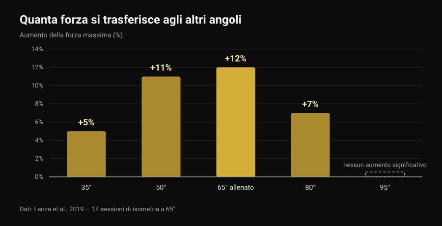
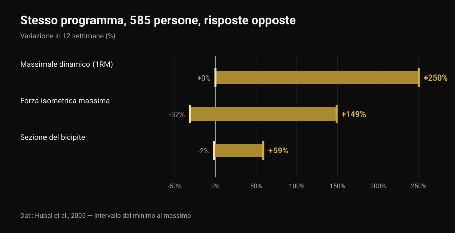

# Quante propedeutiche servono per il front lever

Di [Giammaria Loi](/autore/giammaria-loi) · aggiornato il 6 novembre 2026

Tuck, advanced tuck, una gamba, straddle, half lay: le liste di propedeutiche del front lever circolano da anni come se fossero una scala con un numero fisso di gradini, uguale per tutti. La domanda che arriva sempre è la stessa: quante ne devo completare prima del full? La letteratura sull'allenamento isometrico non ti dà un numero, ma ti dà qualcosa di più utile: quanta della forza che costruisci in una posizione ti ritrovi davvero nella posizione successiva. E quel dato cambia il modo di costruire la scala.

## In breve

- Nessuno studio prescrive un numero di propedeutiche: non esistono tre, quattro o sei passaggi obbligatori, per nessuno.
- La forza isometrica è in buona parte specifica della posizione: allenando un solo angolo la forza cresce molto lì (+12%) e sempre meno allontanandosi, fino a non crescere più a 30 gradi di distanza (Lanza et al., 2019).
- Quindi le propedeutiche servono, ma non come collezione da spuntare: servono a coprire le posizioni in cui vuoi essere forte.
- Il numero di passaggi è individuale perché lo è la risposta all'allenamento: stesso programma, 585 persone, guadagni di forza da 0 a +250% in 12 settimane (Hubal et al., 2005).
- Puoi progredire rendendo la posizione più dura oppure aggiungendo secondi: sulla forza e sulla massa le due strade pareggiano (Chaves et al., 2024).

## Cosa cambia davvero da una propedeutica all'altra

Nel front lever il corpo è orizzontale e appeso alla sbarra: le spalle fanno da perno e il peso del corpo tira verso il basso tutto quello che sta davanti a loro. La fatica richiesta non dipende da quanto pesi, ma da quanto è lontano il tuo centro di massa dalle spalle. Piegare le ginocchia al petto accorcia quella distanza; stenderne una la allunga; aprire le gambe a compasso la accorcia di nuovo un po'. Le propedeutiche, in altre parole, sono lo stesso esercizio a intensità diverse: il corrispettivo dei dischi sul bilanciere.

Ma c'è una differenza importante rispetto al bilanciere. Cambiando leva non cambi solo il carico: cambi anche l'angolo delle articolazioni e la posizione in cui produci forza. Ed è qui che la ricerca ha qualcosa da dire.

## Cosa dice davvero la ricerca

### Affermazione 1 — "Prima del full devi completare X propedeutiche"
**Smentito.**

Nessuno studio ha mai testato un numero di passaggi, perché non è un numero a produrre l'adattamento: è il sovraccarico progressivo. E il sovraccarico si può aggiungere in più modi. Chaves e colleghi (2024) hanno allenato per 10 settimane 39 persone non allenate con un disegno a gambe separate: una gamba progrediva aumentando il carico, l'altra aumentando le ripetizioni. Il massimale alla leg extension è salito da 52,9 a 69,1 kg con il carico e da 51,7 a 66,8 kg con le ripetizioni; la sezione del vasto laterale è cresciuta da 21,3 a 23,5 cm² contro 21,1 a 23,4 cm². Nessuna differenza fra i due metodi.

Tradotto nel front lever: passare a una posizione più difficile e aggiungere secondi alla posizione che hai già sono due modi legittimi di progredire. Quante propedeutiche attraversi è una conseguenza di come hai dosato il carico, non una regola.

### Affermazione 2 — "La forza che costruisci in tuck si trasferisce al full"
**Smentito, almeno in parte.**

È lo studio più interessante per chi allena isometrie. Lanza, Balshaw e Folland (2019) hanno fatto svolgere a 13 persone 14 sessioni di isometria in 4 settimane a un solo angolo di ginocchio (65 gradi), confrontandole con 9 controlli, e poi hanno misurato la forza a cinque angoli diversi.

*Grafico Nurvan sui dati di Lanza et al., 2019 (Eur J Appl Physiol). Valori riportati nell'abstract originale; 13 soggetti allenati a 65 gradi, 9 controlli, 14 sessioni in 4 settimane. A 95 gradi non è stato riportato alcun aumento significativo.*

La forza è cresciuta soprattutto dove è stata allenata e sempre meno allontanandosi: niente di misurabile già a 30 gradi oltre l'angolo di lavoro. Attenzione a non esagerare il parallelo — quello studio misura l'estensione del ginocchio, non la spalla sotto una sbarra — ma il principio vale per tutte le isometrie: il trasferimento esiste, è parziale, e si riduce con la distanza dalla posizione allenata. Lo stesso motivo per cui [lo stacco a tempo fino al ginocchio](/blog/stacco-a-tempo-fino-al-ginocchio) non allena l'intera alzata.

Ecco perché le propedeutiche hanno senso anche se nessun numero è obbligatorio: se resti solo in tuck, la maggior parte di quello che costruisci resta in tuck.

### Affermazione 3 — "Quante ne servono dipende da come sei fatto"
**Da precisare.**

Che il percorso sia individuale è vero, e il dato più solido non riguarda le leve ma la risposta all'allenamento. Hubal e colleghi (2005) hanno allenato 585 persone con lo stesso identico programma per 12 settimane e hanno misurato i flessori del gomito prima e dopo.

*Grafico Nurvan sui dati di Hubal et al., 2005 (Med Sci Sports Exerc). Intervalli minimo-massimo riportati nell'abstract originale; 585 soggetti, 342 donne e 243 uomini, 12 settimane di allenamento progressivo di un solo braccio.*

Stesso programma, stessa durata: qualcuno ha raddoppiato la forza, qualcun altro non si è mosso. Con numeri così, prevedere quanti passaggi servono a una persona specifica è semplicemente fuori portata.

Il pezzo da precisare è il "come sei fatto". Che la leva conti è geometria, non opinione: a parità di forza, un busto e gambe lunghi significano un braccio di leva più lungo. Ma nessuno studio ha misurato quanto l'antropometria da sola predica il numero di propedeutiche necessarie. È una spiegazione ragionevole, non un dato.

### Affermazione 4 — "Le isometrie non costruiscono forza vera"
**Smentito.**

La revisione sistematica di Oranchuk e colleghi (2019) ha raccolto 26 lavori su allenamenti isometrici di almeno 3 settimane: miglioramenti sostanziali di ipertrofia e forza massima, a tutte le intensità studiate. Due dettagli contano per chi fa calisthenics: allenare a lunghezze muscolari maggiori ha prodotto più ipertrofia (0,86-1,69% a settimana contro 0,08-0,83% a lunghezze corte) e un trasferimento migliore alle prestazioni dinamiche; per migliorare struttura e funzione del tendine servono invece intensità alte, pari o superiori al 70%.

### Affermazione 5 — "Il corpo libero non costruisce forza come i pesi"
**Smentito.**

Kotarsky e colleghi (2018) hanno diviso 23 uomini allenati in due gruppi per 4 settimane, 3 sedute a settimana: uno progrediva con varianti sempre più difficili di piegamenti, l'altro con la panca piana. Il massimale di panca è salito in entrambi i gruppi, senza differenze fra loro. A migliorare di più nella scala dei piegamenti è stato però il gruppo che li allenava: di nuovo specificità, nella direzione in cui si è lavorato.

### Affermazione 6 — "Passa alla propedeutica dopo quando tieni 10-15 secondi"
**Non verificabile.**

Non esiste uno studio che abbia testato una soglia di secondi come criterio per cambiare posizione nel calisthenics. La soglia che circola nei video è una convenzione utile, non un dato. Quello che la letteratura offre sono i parametri delle isometrie, ed è una base migliore su cui decidere.

## Quanto tenere, e a che intensità

Lum e Barbosa (2019) hanno riassunto i parametri dell'allenamento isometrico per due obiettivi diversi. Nella terza colonna traduco io quei numeri nel front lever: la traduzione è mia, non è nello studio.

| Obiettivo | Parametri dello studio | Come si traduce in una tenuta |
|---|---|---|
| Ipertrofia | 70-75% della contrazione massima, tenute di 3-30 s, oltre 80-150 s totali a sessione, per più di 36 sessioni | Una posizione che riesci a tenere 10-20 secondi, ripetuta finché arrivi a circa due minuti di tenuta totale |
| Forza massima | 80-100% della contrazione massima, tenute di 1-5 s, 30-90 s totali a sessione, su più angoli o sull'angolo bersaglio | Una posizione in cui cedi in 5-8 secondi, tenute brevissime e molto riposo, per 30-90 secondi totali |

*Tabella Nurvan: colonne 1 e 2 dai parametri riportati da Lum e Barbosa, 2019 (Int J Sports Med); colonna 3 è un'applicazione nostra al front lever, non misurata nello studio.*

Letta così, la domanda "quante propedeutiche" diventa un'altra: quante posizioni mi servono per coprire sia il lavoro pesante e brevissimo sia quello più lungo? Di solito due bastano.

## Come applicarlo

1. **Scegli due posizioni, non sei.** Una in cui cedi in 5-8 secondi (è il tuo lavoro di forza) e una che tieni 10-20 secondi con la schiena ancora piatta (è il tuo volume). Possono essere tuck e advanced tuck, o advanced tuck e una gamba: dipende solo da dove sei.
2. **Cambia una variabile alla volta.** O la posizione o i secondi. Se le muovi insieme non saprai cosa ha funzionato, e nel 90% dei casi salirai troppo in fretta.
3. **Lavora anche vicino al bersaglio.** Visto il trasferimento parziale fra posizioni, inserisci ogni settimana qualche secondo nella posizione più vicina al full che riesci a tenere, anche solo in discesa controllata dalla sbarra.
4. **Conta i secondi totali, non le serie.** Trenta-novanta secondi complessivi per il lavoro di forza, un centinaio e mezzo per quello di volume: è l'unità di misura che la letteratura usa.
5. **Ricontrolla la posizione bersaglio ogni 3-4 settimane,** non ogni allenamento. Il test consuma allenamento.
6. **Se compare dolore a gomito o spalla, fermati e falla vedere.** Il front lever carica tendini del bicipite e cuffia in posizione allungata; il dolore non è un gradino della progressione.

> ### Prova Nurvan — ogni posizione ha il suo storico
>
> In Nurvan ogni variante del front lever è un esercizio a sé: tenute, secondi e RIR restano separati fra tuck, advanced tuck e straddle, così vedi quale posizione sta progredendo davvero e quale è ferma da tre settimane. Le serie di riscaldamento vengono proposte in automatico e lo storico ti dice se stai aggiungendo secondi o solo serie. [Prova Nurvan](https://nurvan.app)

## Domande frequenti

**Quante propedeutiche servono davvero per il front lever?**
Non esiste un numero valido per tutti e nessuno studio ne ha mai testato uno. Servono abbastanza posizioni da permetterti di allenare sia tenute brevi e molto difficili sia tenute più lunghe, e abbastanza vicine fra loro da poter progredire senza salti: in pratica due posizioni alla volta, che cambiano man mano che migliori.

**Quanto tempo ci vuole per arrivare al full front lever?**
Nessuno studio lo ha misurato, quindi qualsiasi "6 mesi" letto online è un aneddoto. Quello che si può dire con i dati è che la variabilità individuale della risposta all'allenamento è enorme (Hubal et al., 2005), quindi confrontare i propri tempi con quelli di qualcun altro non è informativo.

**Meglio tenute lunghe o negative dalla sbarra?**
Servono a cose diverse. Le tenute lunghe in una posizione sostenibile danno volume; le negative e le tenute brevissime in una posizione quasi impossibile danno l'intensità alta che serve a forza e tendini (Oranchuk et al., 2019). In un programma sensato ci sono entrambe.

**Devo aggiungere anche esercizi con i pesi?**
Non è obbligatorio: la progressione a corpo libero costruisce forza quanto il bilanciere sugli esercizi corrispondenti (Kotarsky et al., 2018). I pesi restano comodi per dosare il carico in modo fine, cosa che con le leve è più grossolana.

## Leggi anche

- [Stacco a tempo fino al ginocchio: serve davvero?](/blog/stacco-a-tempo-fino-al-ginocchio) — un altro caso in cui allenare un pezzo del movimento non allena tutto il movimento.
- [Forza, muscoli e cardio insieme: si può?](/blog/allenare-forza-muscoli-cardio-insieme) — come incastrare obiettivi diversi nella stessa settimana senza annullarli.
- [Scheda di allenamento con l'AI: cosa dicono gli studi](/blog/scheda-allenamento-ai-studi) — quanto è affidabile farsi scrivere una progressione da un modello.

## Fonti

- Lanza MB, Balshaw TG, Folland JP, 2019. Is the joint-angle specificity of isometric resistance training real? And if so, does it have a neural basis? *European Journal of Applied Physiology* 119(11-12):2465-2476. PMID 31522276. [DOI](https://doi.org/10.1007/s00421-019-04229-z)
- Oranchuk DJ, Storey AG, Nelson AR, Cronin JB, 2019. Isometric training and long-term adaptations: Effects of muscle length, intensity, and intent: A systematic review. *Scandinavian Journal of Medicine & Science in Sports* 29(4):484-503. PMID 30580468. [DOI](https://doi.org/10.1111/sms.13375)
- Lum D, Barbosa TM, 2019. Brief Review: Effects of Isometric Strength Training on Strength and Dynamic Performance. *International Journal of Sports Medicine* 40(6):363-375. PMID 30943568. [DOI](https://doi.org/10.1055/a-0863-4539)
- Hubal MJ, Gordish-Dressman H, Thompson PD, et al., 2005. Variability in muscle size and strength gain after unilateral resistance training. *Medicine and Science in Sports and Exercise* 37(6):964-72. PMID 15947721. [PubMed](https://pubmed.ncbi.nlm.nih.gov/15947721/)
- Kotarsky CJ, Christensen BK, Miller JS, Hackney KJ, 2018. Effect of Progressive Calisthenic Push-up Training on Muscle Strength and Thickness. *Journal of Strength and Conditioning Research* 32(3):651-659. PMID 29466268. [DOI](https://doi.org/10.1519/JSC.0000000000002345)
- Chaves TS, Scarpelli MC, Bergamasco JGA, et al., 2024. Effects of Resistance Training Overload Progression Protocols on Strength and Muscle Mass. *International Journal of Sports Medicine* 45(7):504-510. PMID 38286426. [DOI](https://doi.org/10.1055/a-2256-5857)

Riferimenti bibliografici recuperati tramite PubMed. Spunto: post di [Alessandro Mainente](https://www.instagram.com/p/DdqOETQjpuD/) del 24 settembre 2026. Il contenuto del post è stato usato solo per individuare il tema e le affermazioni da verificare: nessun testo, immagine o struttura è stato ripreso.

---

Giammaria Loi è il fondatore di Nurvan. Si allena con i pesi dal 2012, lavora come personal trainer e coach certificato FIPE dal 2013 e gareggia nel powerlifting a livello nazionale dal 2018. Ogni articolo che firma parte dagli studi scientifici e arriva a ciò che funziona davvero in palestra.

> Nota: contenuto informativo, non sostituisce il parere di un medico o professionista.
