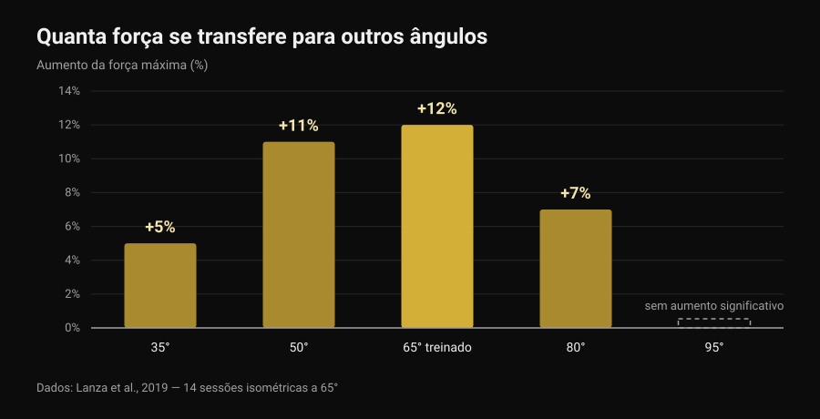
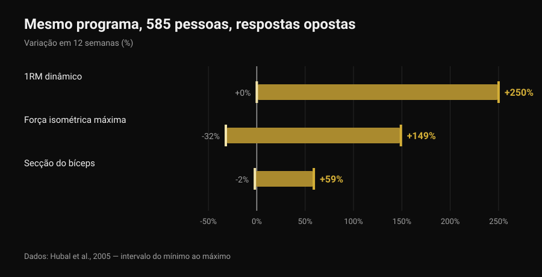

# Front lever: quantas progressões são precisas?

Por [Giammaria Loi](/autore/giammaria-loi) · atualizado a 6 de novembro de 2026

Tuck, advanced tuck, uma perna, straddle, half lay: as listas de progressões do front lever circulam há anos como se fossem uma escada com um número fixo de degraus, igual para toda a gente. A pergunta é sempre a mesma: quantas tenho de completar antes do full? A literatura sobre treino isométrico não dá um número, mas dá algo mais útil: quanta da força construída numa posição fica mesmo na posição seguinte. E esse dado muda a forma de montar a escada.

## Em resumo

- Nenhum estudo prescreve um número de progressões: não existem três, quatro ou seis passos obrigatórios, para ninguém.
- A força isométrica é em grande parte específica da posição: treinando um só ângulo, a força sobe muito aí (+12%) e cada vez menos à medida que nos afastamos, até não subir nada a 30 graus de distância (Lanza et al., 2019).
- As progressões servem, portanto, mas não como coleção a riscar: servem para cobrir as posições em que queres ser forte.
- O número de passos é individual porque a resposta ao treino também é: mesmo programa, 585 pessoas, ganhos de força de 0 a +250% em 12 semanas (Hubal et al., 2005).
- Podes progredir tornando a posição mais difícil ou somando segundos: na força e na massa os dois caminhos empatam (Chaves et al., 2024).

## O que muda realmente de uma progressão para outra

No front lever o corpo está na horizontal e pendurado na barra: os ombros funcionam como eixo e o peso do corpo puxa para baixo tudo o que está à frente deles. O esforço não depende de quanto pesas, mas da distância a que está o teu centro de massa dos ombros. Levar os joelhos ao peito encurta essa distância; esticar uma perna alonga-a; abrir as pernas em straddle volta a encurtá-la um pouco. As progressões, dito de outro modo, são o mesmo exercício em intensidades diferentes: o equivalente aos discos na barra.

Mas há uma diferença importante em relação à barra. Ao mudar a alavanca não mudas só a carga: mudas também o ângulo das articulações e a posição em que produzes força. E é aí que a investigação tem algo a dizer.

## O que a investigação diz mesmo

### Afirmação 1 — "Antes do full tens de completar X progressões"
**Desmentido.**

Nenhum estudo testou um número de passos, porque não é um número que produz a adaptação: é a sobrecarga progressiva. E a sobrecarga pode ser acrescentada de várias maneiras. Chaves e colegas (2024) treinaram 39 pessoas não treinadas durante 10 semanas com um desenho de pernas separadas: uma perna progredia aumentando a carga, a outra aumentando as repetições. O 1RM na extensão de joelho passou de 52,9 para 69,1 kg com a carga e de 51,7 para 66,8 kg com as repetições; a secção do vasto lateral passou de 21,3 para 23,5 cm² contra 21,1 para 23,4 cm². Nenhuma diferença entre métodos.

Traduzido para o front lever: passar a uma posição mais difícil e somar segundos à posição que já dominas são duas formas legítimas de progredir. Quantas progressões atravessas é consequência da dosagem, não uma regra.

### Afirmação 2 — "A força do tuck transfere-se para o full"
**Desmentido, pelo menos em parte.**

É o estudo mais interessante para quem treina isometrias. Lanza, Balshaw e Folland (2019) fizeram 13 pessoas realizar 14 sessões isométricas em 4 semanas num único ângulo de joelho (65 graus), compararam-nas com 9 controlos e depois mediram a força em cinco ângulos diferentes.

*Gráfico Nurvan sobre dados de Lanza et al., 2019 (Eur J Appl Physiol). Valores tal como reportados no resumo original; 13 sujeitos treinados a 65 graus, 9 controlos, 14 sessões em 4 semanas. A 95 graus não foi reportado qualquer aumento significativo.*

A força cresceu sobretudo onde foi treinada e cada vez menos à medida que nos afastamos: nada mensurável já a 30 graus além do ângulo de trabalho. Cuidado com o paralelo — aquele estudo mede extensão de joelho, não o ombro sob uma barra — mas o princípio vale para todas as isometrias: a transferência existe, é parcial e diminui com a distância à posição treinada. É o mesmo motivo pelo qual [o levantamento terra com tempo até ao joelho](/pt/blog/levantamento-terra-com-tempo-ate-o-joelho) não treina o levantamento inteiro.

É por isso que as progressões fazem sentido mesmo sem nenhum número obrigatório: se ficares só no tuck, quase tudo o que construíres fica no tuck.

### Afirmação 3 — "Quantas são precisas depende de como és feito"
**A precisar.**

Que o percurso seja individual é verdade, e o dado mais sólido não é sobre alavancas mas sobre resposta ao treino. Hubal e colegas (2005) treinaram 585 pessoas exatamente com o mesmo programa durante 12 semanas e mediram os flexores do cotovelo antes e depois.

*Gráfico Nurvan sobre dados de Hubal et al., 2005 (Med Sci Sports Exerc). Intervalos do mínimo ao máximo tal como reportados no resumo original; 585 sujeitos, 342 mulheres e 243 homens, 12 semanas de treino progressivo de um só braço.*

Mesmo programa, mesma duração: uns duplicaram a força, outros não se mexeram. Com números assim, prever quantos passos uma pessoa concreta precisa está simplesmente fora de alcance.

O que é preciso precisar é o "como és feito". Que a alavanca conta é geometria, não opinião: com a mesma força, um tronco e pernas longos significam um braço de alavanca maior. Mas nenhum estudo mediu quanto a antropometria sozinha prevê o número de progressões necessárias. É uma explicação razoável, não um dado.

### Afirmação 4 — "As isometrias não constroem força a sério"
**Desmentido.**

A revisão sistemática de Oranchuk e colegas (2019) reuniu 26 trabalhos sobre treino isométrico de pelo menos 3 semanas: melhorias substanciais de hipertrofia e força máxima, em todas as intensidades estudadas. Dois detalhes importam na calistenia: treinar a comprimentos musculares maiores produziu mais hipertrofia (0,86-1,69% por semana contra 0,08-0,83% a comprimentos curtos) e melhor transferência para o desempenho dinâmico; já melhorar a estrutura e a função do tendão exige intensidades altas, iguais ou superiores a 70%.

### Afirmação 5 — "O peso do corpo não dá força como os pesos"
**Desmentido.**

Kotarsky e colegas (2018) dividiram 23 homens treinados em dois grupos durante 4 semanas, três sessões por semana: um progredia com variantes cada vez mais difíceis de flexões, o outro com supino. O 1RM de supino subiu nos dois grupos, sem diferenças entre eles. Onde o grupo das flexões melhorou mais foi na própria escala de flexões: outra vez especificidade, na direção treinada.

### Afirmação 6 — "Passa à seguinte quando aguentares 10-15 segundos"
**Não verificável.**

Não existe nenhum estudo que tenha testado um limiar de segundos como critério para mudar de posição na calistenia. O limiar que circula nos vídeos é uma convenção útil, não um dado. O que a literatura oferece são os parâmetros das isometrias, e é uma base melhor para decidir.

## Quanto aguentar e a que intensidade

Lum e Barbosa (2019) resumiram os parâmetros do treino isométrico para dois objetivos diferentes. A terceira coluna é a minha tradução desses números para o front lever: a tradução é minha, não está no estudo.

| Objetivo | Parâmetros da revisão | Como se traduz numa suspensão |
|---|---|---|
| Hipertrofia | 70-75% da contração máxima, suspensões de 3-30 s, mais de 80-150 s totais por sessão, durante mais de 36 sessões | Uma posição que aguentes 10-20 segundos, repetida até chegares a cerca de dois minutos de tempo total |
| Força máxima | 80-100% da contração máxima, suspensões de 1-5 s, 30-90 s totais por sessão, em vários ângulos ou no ângulo alvo | Uma posição em que falhas aos 5-8 segundos, suspensões muito curtas e muito descanso, 30-90 segundos no total |

*Tabela Nurvan: colunas 1 e 2 com os parâmetros reportados por Lum e Barbosa, 2019 (Int J Sports Med); a coluna 3 é uma aplicação nossa ao front lever, não medida no estudo.*

Lida assim, a pergunta "quantas progressões" torna-se outra: quantas posições preciso para cobrir tanto o trabalho pesado e curtíssimo como o mais longo? Normalmente duas chegam.

## Como aplicar

1. **Escolhe duas posições, não seis.** Uma em que falhes aos 5-8 segundos (é o teu trabalho de força) e outra que aguentes 10-20 segundos com as costas ainda planas (é o teu volume). Podem ser tuck e advanced tuck, ou advanced tuck e uma perna: depende só de onde estás.
2. **Muda uma variável de cada vez.** Ou a posição ou os segundos. Se mexeres nas duas não saberás o que resultou, e nove em cada dez vezes subirás demasiado depressa.
3. **Trabalha também perto do alvo.** Dada a transferência parcial entre posições, mete todas as semanas alguns segundos na posição mais difícil que aguentes, nem que seja só uma descida controlada a partir da barra.
4. **Conta os segundos totais, não as séries.** Trinta a noventa segundos no total para o trabalho de força, cerca de 150 para o de volume: é a unidade que a literatura usa.
5. **Volta a testar a posição alvo a cada 3-4 semanas,** não todos os treinos. Testar consome treino.
6. **Se aparecer dor no cotovelo ou no ombro, para e manda ver.** O front lever carrega o tendão do bíceps e a coifa dos rotadores em posição alongada; a dor não é um degrau da progressão.

> ### Experimenta o Nurvan — cada posição tem o seu histórico
>
> No Nurvan cada variante do front lever é um exercício à parte: suspensões, segundos e RIR ficam separados entre tuck, advanced tuck e straddle, por isso vês que posição está mesmo a progredir e qual está parada há três semanas. As séries de aquecimento são propostas automaticamente e o histórico diz-te se estás a somar segundos ou apenas séries. [Experimenta o Nurvan](https://nurvan.app)

## Perguntas frequentes

**Quantas progressões são mesmo precisas para o front lever?**
Não existe um número válido para todos e nenhum estudo testou um. São precisas posições suficientes para treinar tanto suspensões curtas e muito difíceis como mais longas, e suficientemente próximas entre si para progredir sem saltos: na prática, duas posições de cada vez, que vão mudando à medida que melhoras.

**Quanto tempo demora chegar ao full front lever?**
Nenhum estudo mediu isso, por isso qualquer "seis meses" lido online é uma anedota. O que os dados dizem é que a variabilidade individual da resposta ao treino é enorme (Hubal et al., 2005), por isso comparar os teus tempos com os de outra pessoa não informa nada.

**Melhor suspensões longas ou negativas a partir da barra?**
Servem para coisas diferentes. As suspensões longas numa posição sustentável dão volume; as negativas e as suspensões curtíssimas numa posição quase impossível dão a intensidade alta de que a força e os tendões precisam (Oranchuk et al., 2019). Um programa sensato tem as duas.

**Tenho de acrescentar pesos?**
Não é obrigatório: a progressão com peso do corpo constrói tanta força como a barra nos exercícios correspondentes (Kotarsky et al., 2018). Os pesos continuam cómodos para dosear a carga com precisão, coisa que com as alavancas é mais grosseira.

## Leia também

- [Levantamento terra com tempo até ao joelho: serve?](/pt/blog/levantamento-terra-com-tempo-ate-o-joelho) — outro caso em que treinar um pedaço do movimento não treina o movimento todo.
- [Força, músculo e cardio juntos: dá?](/pt/blog/treinar-forca-musculo-e-cardio-juntos) — como encaixar objetivos diferentes na mesma semana sem os anular.
- [Treino gerado por IA: o que dizem os estudos](/pt/blog/treino-gerado-por-ia-estudos) — até que ponto confiar num modelo para escrever a tua progressão.

## Fontes

- Lanza MB, Balshaw TG, Folland JP, 2019. Is the joint-angle specificity of isometric resistance training real? And if so, does it have a neural basis? *European Journal of Applied Physiology* 119(11-12):2465-2476. PMID 31522276. [DOI](https://doi.org/10.1007/s00421-019-04229-z)
- Oranchuk DJ, Storey AG, Nelson AR, Cronin JB, 2019. Isometric training and long-term adaptations: Effects of muscle length, intensity, and intent: A systematic review. *Scandinavian Journal of Medicine & Science in Sports* 29(4):484-503. PMID 30580468. [DOI](https://doi.org/10.1111/sms.13375)
- Lum D, Barbosa TM, 2019. Brief Review: Effects of Isometric Strength Training on Strength and Dynamic Performance. *International Journal of Sports Medicine* 40(6):363-375. PMID 30943568. [DOI](https://doi.org/10.1055/a-0863-4539)
- Hubal MJ, Gordish-Dressman H, Thompson PD, et al., 2005. Variability in muscle size and strength gain after unilateral resistance training. *Medicine and Science in Sports and Exercise* 37(6):964-72. PMID 15947721. [PubMed](https://pubmed.ncbi.nlm.nih.gov/15947721/)
- Kotarsky CJ, Christensen BK, Miller JS, Hackney KJ, 2018. Effect of Progressive Calisthenic Push-up Training on Muscle Strength and Thickness. *Journal of Strength and Conditioning Research* 32(3):651-659. PMID 29466268. [DOI](https://doi.org/10.1519/JSC.0000000000002345)
- Chaves TS, Scarpelli MC, Bergamasco JGA, et al., 2024. Effects of Resistance Training Overload Progression Protocols on Strength and Muscle Mass. *International Journal of Sports Medicine* 45(7):504-510. PMID 38286426. [DOI](https://doi.org/10.1055/a-2256-5857)

Referências recuperadas através da PubMed. Ponto de partida: uma publicação de [Alessandro Mainente](https://www.instagram.com/p/DdqOETQjpuD/) de 24 de setembro de 2026. O conteúdo da publicação foi usado apenas para identificar o tema e as afirmações a verificar: nenhum texto, imagem ou estrutura foi reaproveitado.

---

Giammaria Loi é o fundador do Nurvan. Treina com pesos desde 2012, trabalha como personal trainer e coach certificado FIPE desde 2013 e compete em powerlifting a nível nacional desde 2018. Cada artigo que assina parte dos estudos científicos e chega ao que funciona mesmo no ginásio.

> Nota: conteúdo informativo, não substitui a opinião de um médico ou profissional.
