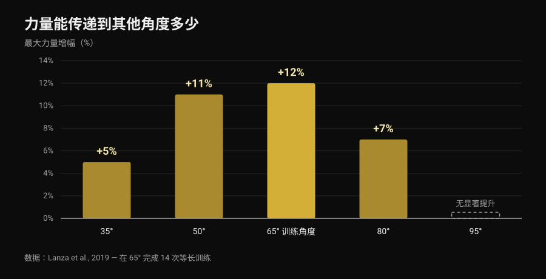
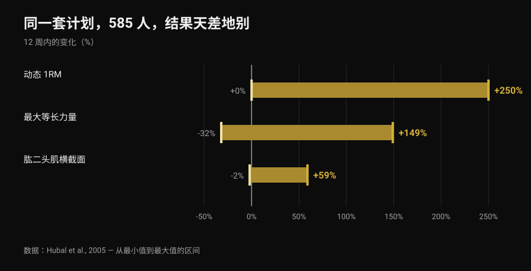

# 前水平：到底需要多少个过渡动作？

作者 [Giammaria Loi](/autore/giammaria-loi) · 更新于 2026 年 11 月 6 日

团身、进阶团身、单腿、分腿、半展体：前水平的过渡动作清单流传多年，仿佛那是一把台阶数量固定、人人通用的梯子。问题也总是同一个——练完几个才能上全展体？等长训练的文献给不出数字，但给了更有用的东西：你在一个姿势里练出来的力量，有多少真的能带到下一个姿势。这个比例，决定了梯子该怎么搭。

## 要点速览

- 没有任何研究规定过渡动作的数量：三个、四个、六个都不是任何人的必修课。
- 等长力量在很大程度上与姿势绑定：只练一个角度，力量在那里涨得最多（+12%），越远涨得越少，到 30 度之外就不再增长（Lanza et al., 2019）。
- 所以过渡动作有用，但不是用来打勾的清单：它们的作用是覆盖你想变强的那些姿势。
- 需要几个阶段因人而异，因为训练反应本身就因人而异：同一套计划、585 人，12 周的力量增幅从 0 到 +250%（Hubal et al., 2005）。
- 把姿势变难或者多加几秒都能进步：在力量和围度上，两条路打平（Chaves et al., 2024）。

## 从一个过渡到下一个，真正变的是什么

做前水平时身体水平悬在杠下：肩关节是支点，体重把肩前方的一切往下拽。难度不取决于你有多重，而取决于重心离肩有多远。把膝盖收到胸前，这段距离变短；伸直一条腿，它变长；分腿打开，又短了一些。换句话说，过渡动作就是同一个动作的不同强度——相当于杠铃上的片。

但和杠铃有一个关键差别。改变杠杆不只改变负荷：它同时改变关节角度，也改变你发力时所处的位置。研究要说的，正是这一点。

## 研究到底怎么说

### 说法 1 ——「上全展体之前必须练完 X 个过渡」
**不成立。**

没有研究检验过「几个阶段」，因为产生适应的不是数字，而是渐进超负荷。而超负荷有不止一种加法。Chaves 等人（2024）让 39 名未训练者进行 10 周双腿对照训练：一条腿靠加重量进步，另一条靠加次数。腿屈伸的 1RM 加重量组从 52.9 公斤升到 69.1 公斤，加次数组从 51.7 公斤升到 66.8 公斤；股外侧肌横截面从 21.3 升到 23.5 平方厘米，对比 21.1 升到 23.4 平方厘米。两种方法没有差别。

换到前水平上：换更难的姿势，和在已经掌握的姿势上多加几秒，都是正当的进步方式。你会经过几个过渡动作，是剂量安排的结果，不是一条规则。

### 说法 2 ——「团身练出来的力量能带到全展体」
**不成立，至少不完全成立。**

对练静力的人来说，这是最有意思的一项研究。Lanza、Balshaw 和 Folland（2019）让 13 人在 4 周内完成 14 次等长训练，膝角固定在 65 度，与 9 名对照者比较，然后在五个不同角度测力。

*Nurvan 图表，数据来自 Lanza et al., 2019（Eur J Appl Physiol）。数值取自原始摘要；13 人在 65 度训练，9 人对照，4 周 14 次训练。95 度未报告显著提升。*

力量主要长在练过的地方，越远长得越少：超出工作角度 30 度就已经测不到了。别把类比拉得太远——那项研究测的是伸膝，不是杠下的肩——但原理适用于所有静力：迁移存在，是部分的，并且随着与训练姿势的距离而衰减。[硬拉慢速到膝盖](/zh/blog/yingla-manshu-zhi-xigai)练不到整个动作，也是同一个道理。

所以哪怕没有任何数字是必修的，过渡动作依然有意义：只待在团身里，你练出来的大部分也只留在团身里。

### 说法 3 ——「需要几个，取决于你的身体条件」
**需要补充。**

路径因人而异是对的，但最扎实的证据不是关于杠杆，而是关于训练反应。Hubal 等人（2005）让 585 人用完全相同的计划训练 12 周，并在训练前后测量肘屈肌。

*Nurvan 图表，数据来自 Hubal et al., 2005（Med Sci Sports Exerc）。最小值到最大值的区间取自原始摘要；585 名受试者，342 名女性、243 名男性，12 周单臂渐进训练。*

同样的计划、同样的周期：有人力量翻倍，有人原地不动。面对这样的离散度，预测某个具体的人需要几个阶段，根本做不到。

需要补充的是「身体条件」。杠杆有影响是几何问题，不是观点：力量相同时，躯干和腿越长，力臂就越长。但没有研究测量过，单凭身体比例能在多大程度上预测所需的过渡数量。这是个合理的解释，不是一项数据。

### 说法 4 ——「等长训练练不出真正的力量」
**不成立。**

Oranchuk 等人（2019）的系统综述汇总了 26 项至少持续 3 周的等长训练研究：在所有研究过的强度下，肥大和最大力量都有实质性提升。其中两个细节对街头健身尤其重要：在更长的肌肉长度上训练带来更多肥大（每周 0.86%-1.69%，对比短长度的 0.08%-0.83%），对动态表现的迁移也更好；而要改善肌腱的结构与功能，则需要 70% 以上的高强度。

### 说法 5 ——「自重练不出铁片那样的力量」
**不成立。**

Kotarsky 等人（2018）把 23 名有训练经验的男性分成两组，训练 4 周、每周三次：一组通过越来越难的俯卧撑变式进步，另一组练卧推。两组的卧推 1RM 都上升，组间没有差异。俯卧撑组真正提升更多的，是俯卧撑进阶本身：又一次特异性，朝着训练的方向。

### 说法 6 ——「能撑 10-15 秒就换下一个」
**无法验证。**

没有任何研究把「撑住多少秒」当作换姿势的标准来检验过。视频里流传的门槛是一个好用的约定，不是数据。文献能提供的是等长训练的参数，那才是更好的决策依据。

## 撑多久、用多大强度

Lum 和 Barbosa（2019）总结了两种目标下的等长训练参数。第三列是我把这些数字翻译到前水平上的结果：翻译是我做的，研究里没有。

| 目标 | 综述中的参数 | 在静力支撑上怎么落地 |
|---|---|---|
| 肌肉肥大 | 最大收缩的 70%-75%，每次撑 3-30 秒，每次训练累计 80-150 秒以上，持续 36 次以上 | 选一个能撑 10-20 秒的姿势，重复到累计约两分钟 |
| 最大力量 | 最大收缩的 80%-100%，每次撑 1-5 秒，每次训练累计 30-90 秒，覆盖多个角度或目标角度 | 选一个 5-8 秒就掉下来的姿势，极短支撑、充分休息，累计 30-90 秒 |

*Nurvan 表格：第 1、2 列为 Lum 和 Barbosa（2019，Int J Sports Med）报告的参数；第 3 列是我们对前水平的应用，研究中并未测量。*

这样一读，「需要多少个过渡」就变成了另一个问题：我需要几个姿势，才能同时覆盖极重极短的训练和较长的训练？通常两个就够。

## 怎么用

1. **选两个姿势，而不是六个。** 一个让你在 5-8 秒掉下来（这是力量训练），一个你能保持背部平直撑住 10-20 秒（这是容量）。团身加进阶团身，或者进阶团身加单腿——取决于你现在在哪一级。
2. **一次只改一个变量。** 要么改姿势，要么改秒数。两个一起动，你就分不清是什么起了作用，十有八九还会升得太快。
3. **也要靠近目标去练。** 既然姿势之间只有部分迁移，每周都要在你能撑住的最难姿势上放几秒钟，哪怕只是从杠上控制着下放。
4. **数总秒数，不数组数。** 力量训练累计三十到九十秒，容量训练约 150 秒：这才是文献使用的单位。
5. **每 3-4 周测一次目标姿势，** 不要每次训练都测。测试本身会消耗训练。
6. **肘或肩出现疼痛就停下来去检查。** 前水平会在拉长位置上给肱二头肌腱和肩袖施加负荷；疼痛不是进阶的一个台阶。

> ### 试试 Nurvan —— 每个姿势都有自己的记录
>
> 在 Nurvan 里，前水平的每个变式都是独立的动作：团身、进阶团身和分腿的支撑时间、秒数和 RIR 互不混淆，你能看出哪个姿势真的在进步，哪个已经停了三周。热身组会自动给出，历史记录会告诉你，你是在加秒数还是只在加组数。[试试 Nurvan](https://nurvan.app)

## 常见问题

**练前水平到底需要几个过渡动作？**
没有适用于所有人的数字，也没有研究检验过。你需要足够多的姿势，既能练短而极难的支撑，也能练较长的支撑，而且彼此足够接近，才能不跳级地进步：实际操作中就是同时练两个姿势，随着水平提高而更换。

**练到全展体前水平要多久？**
没有研究测量过，所以网上看到的「六个月」都是个人经历。数据说得清楚的是：个体训练反应的差异极大（Hubal et al., 2005），拿自己的进度和别人比没有参考价值。

**长时间支撑好，还是从杠上做离心好？**
两者作用不同。在可承受姿势下的长支撑提供容量；在几乎做不到的姿势下做离心和极短支撑，提供力量与肌腱所需的高强度（Oranchuk et al., 2019）。合理的计划两者都有。

**需要额外加负重训练吗？**
不是必须：在对应动作上，自重进阶带来的力量增长和杠铃相当（Kotarsky et al., 2018）。负重的好处是能精细调节，而靠杠杆调节只能是粗颗粒的。

## 延伸阅读

- [硬拉慢速到膝盖：真的有用吗？](/zh/blog/yingla-manshu-zhi-xigai) —— 另一个「练动作的一段并不等于练整个动作」的例子。
- [力量、肌肉和有氧能同时练吗？](/zh/blog/liliang-jirou-youyang-tongshi-xunlian) —— 如何把不同目标塞进同一周而不互相抵消。
- [AI 生成健身计划：研究怎么说](/zh/blog/ai-shengcheng-jianshen-jihua) —— 把自己的进阶交给模型，能信到什么程度。

## 参考文献

- Lanza MB, Balshaw TG, Folland JP, 2019. Is the joint-angle specificity of isometric resistance training real? And if so, does it have a neural basis? *European Journal of Applied Physiology* 119(11-12):2465-2476. PMID 31522276. [DOI](https://doi.org/10.1007/s00421-019-04229-z)
- Oranchuk DJ, Storey AG, Nelson AR, Cronin JB, 2019. Isometric training and long-term adaptations: Effects of muscle length, intensity, and intent: A systematic review. *Scandinavian Journal of Medicine & Science in Sports* 29(4):484-503. PMID 30580468. [DOI](https://doi.org/10.1111/sms.13375)
- Lum D, Barbosa TM, 2019. Brief Review: Effects of Isometric Strength Training on Strength and Dynamic Performance. *International Journal of Sports Medicine* 40(6):363-375. PMID 30943568. [DOI](https://doi.org/10.1055/a-0863-4539)
- Hubal MJ, Gordish-Dressman H, Thompson PD, et al., 2005. Variability in muscle size and strength gain after unilateral resistance training. *Medicine and Science in Sports and Exercise* 37(6):964-72. PMID 15947721. [PubMed](https://pubmed.ncbi.nlm.nih.gov/15947721/)
- Kotarsky CJ, Christensen BK, Miller JS, Hackney KJ, 2018. Effect of Progressive Calisthenic Push-up Training on Muscle Strength and Thickness. *Journal of Strength and Conditioning Research* 32(3):651-659. PMID 29466268. [DOI](https://doi.org/10.1519/JSC.0000000000002345)
- Chaves TS, Scarpelli MC, Bergamasco JGA, et al., 2024. Effects of Resistance Training Overload Progression Protocols on Strength and Muscle Mass. *International Journal of Sports Medicine* 45(7):504-510. PMID 38286426. [DOI](https://doi.org/10.1055/a-2256-5857)

文献通过 PubMed 检索。选题起点：[Alessandro Mainente](https://www.instagram.com/p/DdqOETQjpuD/) 2026 年 9 月 24 日的帖子。该帖子仅用于确定主题和需要核查的说法：没有沿用其中任何文字、图片或结构。

---

Giammaria Loi 是 Nurvan 的创始人。他自 2012 年开始力量训练，自 2013 年起担任 FIPE 认证私人教练，自 2018 年起参加全国级力量举比赛。他署名的每一篇文章都从科学研究出发，落到健身房里真正有效的做法。

> 注：本文为科普内容，不能替代医生或专业人士的意见。
