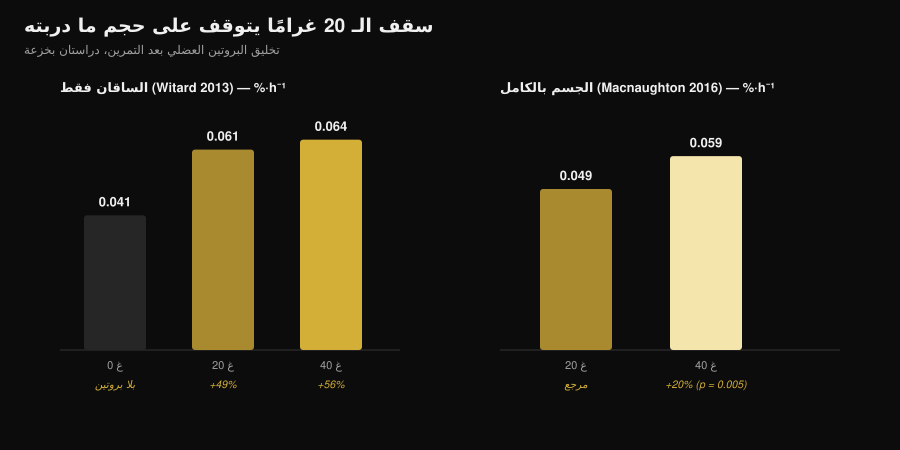
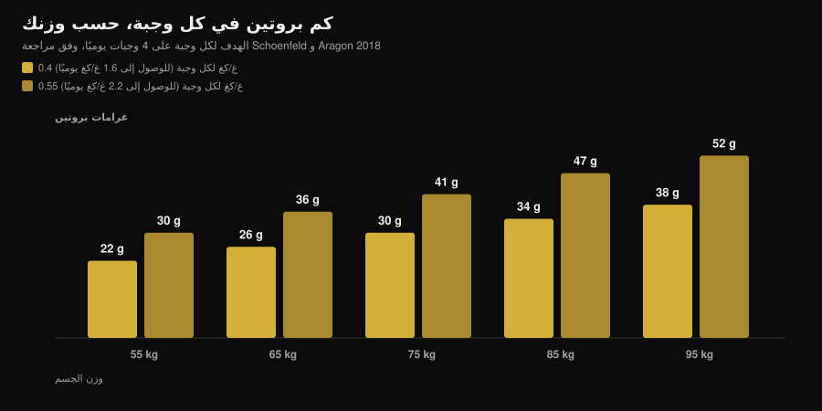

# كم بروتين في الوجبة الواحدة؟ خرافة الـ 30 غراماً

بقلم [Giammaria Loi](/autore/giammaria-loi) · محدَّث في 7 نوفمبر 2026

"أي كمية تزيد على 30 غراماً في الوجبة تذهب هدراً." سمعتها في النادي، وقرأتها على عبوة بروتين، ورأيتها في عشرات المنشورات. إنها أكثر قاعدة متداولة في تغذية الرياضة، وهي أيضاً القاعدة التي فكّكتها أدقّ دراسة أُجريت على هذا السؤال: مع 100 غرام من البروتين في وجبة واحدة كانت الاستجابة البنائية أكبر واستمرت أكثر من اثنتي عشرة ساعة. المهم أن تفهم ما يعنيه ذلك لوجباتك، لأن الخلاصة العملية ليست "كُل كل شيء في مرة واحدة".

## أهم النقاط

- **لا يوجد سقف.** باستخدام أربعة متعقّبات نظائرية في وقت واحد، أنتجت 100 غرام من البروتين بعد التمرين استجابة بنائية أكبر وأطول (أكثر من 12 ساعة) مقارنةً بـ 25 غراماً، مع أثر ضئيل على أكسدة الأحماض الأمينية.
- **"الامتصاص" و"الاستخدام" كلمتان مختلفتان.** الخرافة تعيش في هذا الخلط: لا توجد دراسة تُظهر حدّاً لامتصاص الأمعاء عند 30 غراماً. الحد الذي قيس فعلاً هو مقدار رفع الجرعة لتصنيع البروتين العضلي خلال أربع ساعات.
- **عتبة 20 غراماً تتوقف على حجم الجسم الذي درّبته.** بعد حصة للساقين فقط، لا تتفوق 40 غراماً على 20 غراماً بفارق معتبر. بعد حصة لكامل الجسم، ترفع 40 غراماً التصنيع نحو 20% أكثر من 20 غراماً (p = 0.005).
- **التوزيع لا يزال مهماً.** على مدى 12 ساعة، تفوّقت 80 غراماً من الواي مقسّمة إلى أربع جرعات من 20 غراماً كل 3 ساعات على ثماني جرعات من 10 غرامات وعلى جرعتين من 40 غراماً بنسبة 31-48%.
- **الرقم الذي تتمسك به هو الرقم اليومي.** الفائدة تتسطّح حول 1.6 غرام لكل كيلوغرام يومياً؛ وللوصول إليه تقترح أكثر مراجعة مُقتبسة 0.4 غرام لكل كيلوغرام في الوجبة، على أربع وجبات على الأقل.

## من أين جاءت قاعدة الـ 20-30 غراماً

الرقم لم يُختلق. في 2013 أعطى فريق من جامعة Stirling 48 رجلاً مدرَّباً 0 أو 10 أو 20 أو 40 غراماً من بروتين مصل الحليب (الواي) بعد تمرين للساقين، وقاس بأخذ خزعات عضلية تصنيع البروتينات الانقباضية في الساعات الأربع التالية. عشرة غرامات لم تُحدث شيئاً يزيد على الصفر؛ 20 غراماً رفعت التصنيع بنسبة 49%؛ و40 غراماً بنسبة 56%، وهو فارق غير معتبر إحصائياً مقارنةً بـ 20 غراماً. وفي الوقت نفسه زادت 40 غراماً أكسدة الفينيل ألانين وإنتاج اليوريا.

من هنا جاءت العبارة التي تكرّرت عشر سنوات: "20 غراماً تكفي، والباقي يُحرق". وقد تراكم خطأان في القراءة. الأول: *زيادة الأكسدة* لا تعني *أكسدة كل الباقي*. والثاني، وهو الأخطر: تلك الدراسة قاست أربع ساعات، لا يوماً كاملاً.

*رسم Nurvan اعتماداً على بيانات Witard et al., 2013 (Am J Clin Nutr) وMacnaughton et al., 2016 (Physiol Rep). القيمتان 0.061 و0.064 %·h⁻¹ محسوبتان بتطبيق النسب الواردة في الملخص (+49% و+56%) على القيمة الأساسية 0.041 %·h⁻¹. لم تُقرأ أي قيمة من رسم بياني.*

## الدراسة التي أزاحت الحد

في 2023 أعاد فريق من Maastricht طرح السؤال بتصميم أثقل كثيراً: متعقّب نظائري رباعي مع تسريب وريدي، وبروتين موسوم داخل الطعام نفسه، وخزعات متكررة، ونافذة مراقبة ممتدة إلى أكثر من اثنتي عشرة ساعة. وقارنوا بين 25 غراماً و100 غرام من البروتين تُؤخذ بعد حصة تدريب.

أنتجت جرعة 100 غرام استجابة **أكبر في المقدار وأطول في الزمن**. ارتفع تصنيع البروتينات العضلية الليفية، وكذلك تصنيع بروتينات النسيج الضام في العضلة وبروتينات البلازما، وارتفع أيضاً ميزان البروتين الصافي لكامل الجسم. أما تكسير البروتين وأكسدة الأحماض الأمينية فبقيا شبه ثابتين: عبارة "ستحرقه كله" الشهيرة لم تظهر في النتائج.

خلاصة الباحثين أن قدرتنا على استخدام بروتين وجبة واحدة كانت مُقدَّرة بأقل من حقيقتها. لا أن "الأكثر أفضل دائماً"، بل أن الحائط عند 20-25 غراماً غير موجود.

## الامتصاص ليس بناءً

كلمتان تُستخدمان كمترادفين، وهما ليستا كذلك.

**الامتصاص** هو عبور الأحماض الأمينية من الأمعاء إلى الدم. عملية بطيئة ومستمرة، وفي وجبة صلبة كبيرة تظل تعمل لساعات. لم تُظهر أي دراسة عتبة عند 30 غراماً تتوقف الأمعاء بعدها عن العمل — ولو كان الأمر كذلك لخرج نصف وجبة العيد غير مهضوم.

**الاستخدام البنائي** هو مقدار ما ينتهي من تلك الأحماض الأمينية داخل بروتين عضلي. هذا تحديداً ما قاسته دراسات 2013 في نافذة من أربع ساعات، وهذا ما تابعه عمل 2023 لاثنتي عشرة ساعة.

عندما تقرأ "الجسم يمتص 30 غراماً فقط"، فالعبارة تستخدم الفعل الخطأ لتروي نتيجة قديمة.

## ماذا تقول الأبحاث فعلاً

| الادّعاء المتداول | الحكم | المصدر |
|---|---|---|
| "ما يزيد على 20-30 غراماً في الوجبة يذهب هدراً" | **مُفنَّد** | Trommelen et al., 2023 |
| "الجسم يمتص 30 غراماً فقط من البروتين في الوجبة" | **مُفنَّد**: يخلط بين الامتصاص والاستخدام | Trommelen et al., 2023 |
| "20 غراماً تُعظّم تصنيع البروتين" | **يحتاج تحديداً**: يتوقف على حجم العضل الذي درّبته | Witard 2013؛ Macnaughton 2016 |
| "إذن توزيع الوجبات لا يهم" | **يحتاج تحديداً**: على 12 ساعة، 4×20 غراماً لا تزال أفضل نمط مُختبر | Areta et al., 2013 |
| "العتبات نفسها تنطبق على الجميع" | **لا جواب عنه اليوم** في حالة النساء المدرَّبات | Witard وMettler, 2024 |

### لماذا ليست الـ 20 غراماً رقماً عاماً

في 2016 غيّر خط البحث نفسه متغيراً واحداً: بدلاً من تدريب الساقين فقط، أدّى المشاركون حصة لكامل الجسم. مع 20 غراماً جاء التصنيع عند 0.049 %·h⁻¹، ومع 40 غراماً عند 0.059 %·h⁻¹ — أي نحو 20% أكثر، وبفارق معتبر إحصائياً (p = 0.005). والمثير أن كتلة الجسم النحيلة الكلية للشخص لم تُحدث فرقاً: ما كان مهماً هو حجم العضل الذي حرّضته الحصة، لا حجم العضل الذي يحمله الشخص.

وهذه أنفع فكرة تأخذها معك: الجرعة "الصحيحة" في الوجبة ليست ثابتاً في أيضك، بل متغيّر يتوقف جزئياً على ما فعلته للتو في النادي.

### لماذا ليست الوجبة العملاقة الواحدة هي الجواب

من قرأ عنوان دراسة 2023 فقط استنتج أن التوزيع صار بلا معنى. أمران يقولان العكس.

الأول تجربة من 2013 على 24 رجلاً مدرَّباً: 80 غراماً من الواي موزّعة على اثنتي عشرة ساعة من الاستشفاء بثلاثة أنماط. ثماني جرعات من 10 غرامات كل تسعين دقيقة، وأربع جرعات من 20 غراماً كل 3 ساعات، وجرعتان من 40 غراماً كل 6 ساعات. الأنماط الثلاثة كلها رفعت التصنيع فوق مستوى الراحة، لكن النمط الوسيط تفوّق على الآخرين بنسبة 31-48%.

والثاني تعليق علمي (commentary) نُشر في 2024 رداً مباشراً على دراسة الـ 100 غرام. يقبل الباحثان التقدّم العلمي، لكنهما يحذّران من أن الدلالات العملية قُرئت خطأً، وأن شطب توزيع الوجبات سابق لأوانه. ويشيران أيضاً إلى أن المشاركين كانوا شباباً نشطين غير مدرَّبين على الأثقال، وأن غياب الحدّ الأعلى لا يبدو أنه ينتقل إلى الشابات المدرَّبات. وفي هذه النقطة الأخيرة لا توجد أرقام نستطيع نقلها بعد: إنه قيد معلن، لا نتيجة مقيسة.

## كيف تطبّق هذا

الرقم الذي يهم فعلاً هو المجموع اليومي: التحليل التجميعي المرجعي يُظهر أن الفائدة على الكتلة العضلية تتسطّح حول 1.6 غرام لكل كيلوغرام من وزن الجسم يومياً. وإن كنت تتساءل عن حاجتك أثناء التنشيف، فقد تناولنا ذلك بالتفصيل في [كم بروتين تحتاج في مرحلة التنشيف](/ar/blog/protein-intake-cutting).

ولتوزيعه، تقترح مراجعة Schoenfeld وAragon حساباً بسيطاً: **0.4 غرام لكل كيلوغرام في الوجبة، على أربع وجبات على الأقل**. ومن يستهدف الحدّ الأعلى 2.2 غرام لكل كيلوغرام يومياً يصل إلى 0.55 غرام لكل كيلوغرام في الوجبة.

*رسم Nurvan: حساب على معاملات مراجعة Schoenfeld وAragon, 2018 (J Int Soc Sports Nutr)، على أربع وجبات في اليوم. القيم مقرَّبة إلى الغرام. ملاحظة منهجية: القيمتان 0.061 و0.064 %·h⁻¹ في الرسم السابق محسوبتان بتطبيق نسب الملخص (+49% و+56%) على القيمة الأساسية 0.041 %·h⁻¹، ولم تُقرأ أي قيمة من رسم بياني.*

ثلاث إشارات عملية تصمد في ضوء كل هذا:

1. **توقف عن الخوف من الوجبة الكبيرة.** إذا كان العشاء هو الوقت الوحيد الذي تأكل فيه جيداً، فإن 50-60 غراماً من البروتين هناك ليست هدراً. وجبة كبيرة أفضل من وجبة مُلغاة.
2. **إن كان الخيار بيدك، قسّم.** ثلاث أو أربع مناسبات تحتوي مصدراً بروتينياً محترماً تظل النمط الأقوى دعماً، وهي أيضاً أسهل على الشبع والهضم.
3. **ارفع الجرعة في أيام تدريب كامل الجسم.** بعد حصة لكامل الجسم أو تمرين طويل، البقاء في أعلى نطاقك للوجبة له سند مقيس.

ولتعبئة هذه الأرقام، هذه كميات بعض الأطعمة الشائعة التي توصلك إلى 30 غراماً من البروتين، بحسب جداول CREA الإيطالية:

| الطعام (بيانات CREA 2019) | الكمية مقابل 30 غراماً من البروتين | السعرات |
|---|---|---|
| Grana Padano DOP (جبن إيطالي صلب معتَّق) | 88 غراماً | 347 kcal |
| Bresaola della Valtellina IGP (لحم بقري مقدَّد إيطالي) | 91 غراماً | 138 kcal |
| صدر دجاج مطبوخ في المقلاة | 99 غراماً | 128 kcal |
| تونة في محلول ملحي، مصفّاة | 120 غراماً | 123 kcal |
| سمك القدّ أو النازلي | 176 غراماً | 125 kcal |
| بيض كامل مسلوق | 242 غراماً، نحو 5 بيضات | 310 kcal |
| بياض البيض | 280 غراماً | 121 kcal |
| جبن قريش قليل الدسم | 309 غرامات | 356 kcal |
| زبادي يوناني 0% دسم | 333 غراماً | 170 kcal |
| عدس مجفف مطبوخ | 435 غراماً | 474 kcal |

*حساب Nurvan على جداول CREA — المركز الوطني الإيطالي لبحوث الأغذية والتغذية، تحديث 2019. المعادلة: (30 ÷ البروتين لكل 100 غرام) × 100.*

يظهر فوراً سبب عدم كون المصادر قابلة للتبادل عند تساوي البروتين: 30 غراماً من الـ Grana تكلّف نحو ثلاثة أضعاف سعرات 30 غراماً من الدجاج، ومن العدس تحتاج 435 غراماً من المنتج المطبوخ. ولدينا مقال مخصّص للمقارنة بين المصادر الحيوانية والنباتية: [البروتين النباتي أم الحيواني للعضلات](/ar/blog/albrotin-alnabati-am-alhayawani-lilaadalat).

> **Nurvan: البروتين وجبة بوجبة، لا المجموع اليومي فقط**
>
> قسم التغذية في Nurvan يعمل على قاعدة بيانات الأغذية CREA ويُظهر لك بروتين كل وجبة على حدة إلى جانب مجموعك اليومي، فترى بنظرة واحدة إن كانت 140 غراماً موزّعة على أربع مناسبات أم مكدّسة كلها في العشاء. [جرّب Nurvan](https://nurvan.app)

## أسئلة شائعة

**كم بروتين يمكنني امتصاصه في وجبة واحدة؟**
لا يوجد سقف معروف. امتصاص الأمعاء يستمر ساعات بالتناسب مع ما أكلته. الدراسة التي أعطت 100 غرام في وجبة واحدة وجدت استجابة بنائية أكبر وأطول من استجابة 25 غراماً، دون ارتفاع ذي معنى في أكسدة الأحماض الأمينية.

**إذن هل 30 غراماً في الوجبة قليلة؟**
يتوقف ذلك على وزنك وعلى المجموع اليومي الذي تريد الوصول إليه. لشخص وزنه 75 كيلوغراماً، تمثل 30 غراماً في الوجبة 0.4 غرام لكل كيلوغرام بالضبط، وهو الرقم الذي تقترحه المراجعة على أربع وجبات للوصول إلى 1.6 غرام لكل كيلوغرام يومياً. ولشخص وزنه 95 كيلوغراماً، تكون 30 غراماً في الوجبة أقل من هذا الهدف.

**إذا أكلت كل بروتين يومي في وجبتين، هل أخسر عضلاً؟**
لا توجد دراسة تقول ذلك. لكن بيانات الـ 12 ساعة تُظهر أن أربع جرعات موزّعة أنتجت تصنيعاً أكبر من جرعتين كبيرتين. إن كان الخيار بيدك فقسّم، وإن لم يكن فالمجموع اليومي هو الأهم.

**هل ينطبق الأمر نفسه على النساء؟**
تعليق Witard وMettler لعام 2024 يشير إلى أن غياب الحدّ الأعلى لا يبدو أنه ينتقل إلى الشابات المدرَّبات على الأثقال. ولا توجد أرقام صلبة لنقلها بعد: إنها مسألة مفتوحة، ومن الحكمة في الوقت الحالي البقاء على القيم المرجعية للوجبة الواردة في المراجعات.

## اقرأ أيضاً

- [كم بروتين تحتاج في مرحلة التنشيف](/ar/blog/protein-intake-cutting) — المجموع اليومي عندما تكون السعرات منخفضة.
- [البروتين النباتي أم الحيواني للعضلات](/ar/blog/albrotin-alnabati-am-alhayawani-lilaadalat) — جودة المصدر تهم أكثر من الكمية.
- [بروتين اللحم البقري: هل يوازي الواي؟](/ar/blog/brotin-allahm-albaqari-am-alway) — ما يفرّق فعلاً بين مسحوق وآخر.

## المصادر

1. Trommelen J, van Lieshout GAA, Nyakayiru J, et al., 2023. The anabolic response to protein ingestion during recovery from exercise has no upper limit in magnitude and duration in vivo in humans. *Cell Rep Med* 4(12):101324. [PMID 38118410](https://pubmed.ncbi.nlm.nih.gov/38118410/) · [DOI 10.1016/j.xcrm.2023.101324](https://doi.org/10.1016/j.xcrm.2023.101324)
2. Witard OC, Mettler S, 2024. The Anabolic Response to Protein Ingestion During Recovery From Exercise Has No Upper Limit in Magnitude and Duration In Vivo in Humans: A Commentary. *Int J Sport Nutr Exerc Metab* 34(5):322–324. [PMID 38991545](https://pubmed.ncbi.nlm.nih.gov/38991545/) · [DOI 10.1123/ijsnem.2024-0041](https://doi.org/10.1123/ijsnem.2024-0041)
3. Witard OC, Jackman SR, Breen L, et al., 2014. Myofibrillar muscle protein synthesis rates subsequent to a meal in response to increasing doses of whey protein at rest and after resistance exercise. *Am J Clin Nutr* 99(1):86–95. [PMID 24257722](https://pubmed.ncbi.nlm.nih.gov/24257722/) · [DOI 10.3945/ajcn.112.055517](https://doi.org/10.3945/ajcn.112.055517)
4. Macnaughton LS, Wardle SL, Witard OC, et al., 2016. The response of muscle protein synthesis following whole-body resistance exercise is greater following 40 g than 20 g of ingested whey protein. *Physiol Rep* 4(15):e12893. [PMID 27511985](https://pubmed.ncbi.nlm.nih.gov/27511985/) · [DOI 10.14814/phy2.12893](https://doi.org/10.14814/phy2.12893)
5. Areta JL, Burke LM, Ross ML, et al., 2013. Timing and distribution of protein ingestion during prolonged recovery from resistance exercise alters myofibrillar protein synthesis. *J Physiol* 591(9):2319–2331. [PMID 23459753](https://pubmed.ncbi.nlm.nih.gov/23459753/) · [DOI 10.1113/jphysiol.2012.244897](https://doi.org/10.1113/jphysiol.2012.244897)
6. Schoenfeld BJ, Aragon AA, 2018. How much protein can the body use in a single meal for muscle-building? Implications for daily protein distribution. *J Int Soc Sports Nutr* 15:10. [PMID 29497353](https://pubmed.ncbi.nlm.nih.gov/29497353/) · [DOI 10.1186/s12970-018-0215-1](https://doi.org/10.1186/s12970-018-0215-1)
7. Morton RW, Murphy KT, McKellar SR, et al., 2018. A systematic review, meta-analysis and meta-regression of the effect of protein supplementation on resistance training-induced gains in muscle mass and strength in healthy adults. *Br J Sports Med* 52(6):376–384. [PMID 28698222](https://pubmed.ncbi.nlm.nih.gov/28698222/) · [DOI 10.1136/bjsports-2017-097608](https://doi.org/10.1136/bjsports-2017-097608)
8. Jäger R, Kerksick CM, Campbell BI, et al., 2017. International Society of Sports Nutrition Position Stand: protein and exercise. *J Int Soc Sports Nutr* 14:20. [PMID 28642676](https://pubmed.ncbi.nlm.nih.gov/28642676/) · [DOI 10.1186/s12970-017-0177-8](https://doi.org/10.1186/s12970-017-0177-8)

بيانات الأغذية: جداول تركيب الأغذية CREA، تحديث 2019. اختير الموضوع من إشارات اتجاه في أوائل نوفمبر 2026 (تغطية صحافة عامة لسؤال "كم بروتين" وصفحة أولى في جوجل مليئة بمحتوى تجاري لا يزال يردّد سقف الـ 30 غراماً). المصادر العلمية رُوجعت عبر PubMed.

**Giammaria Loi** هو مؤسس Nurvan. يتدرب بالأثقال منذ 2012، ويعمل مدرباً شخصياً وكوتشاً معتمداً من FIPE منذ 2013، وينافس في رفع الأثقال القوة (powerlifting) على المستوى الوطني منذ 2018. كل مقال يكتبه يبدأ من الأبحاث وينتهي إلى ما ينفع فعلاً في النادي. [صفحة المؤلف](/autore/giammaria-loi)

> ملاحظة: محتوى تعليمي، لا يُغني عن استشارة طبيب أو مختص مؤهل.
