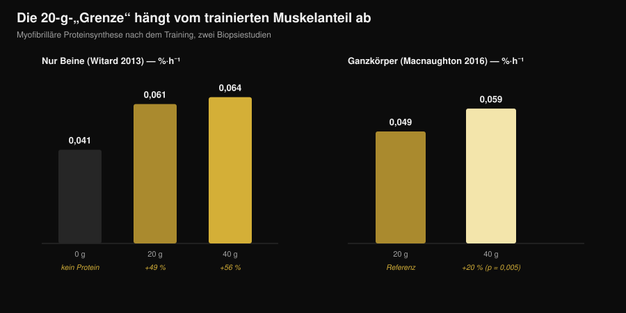
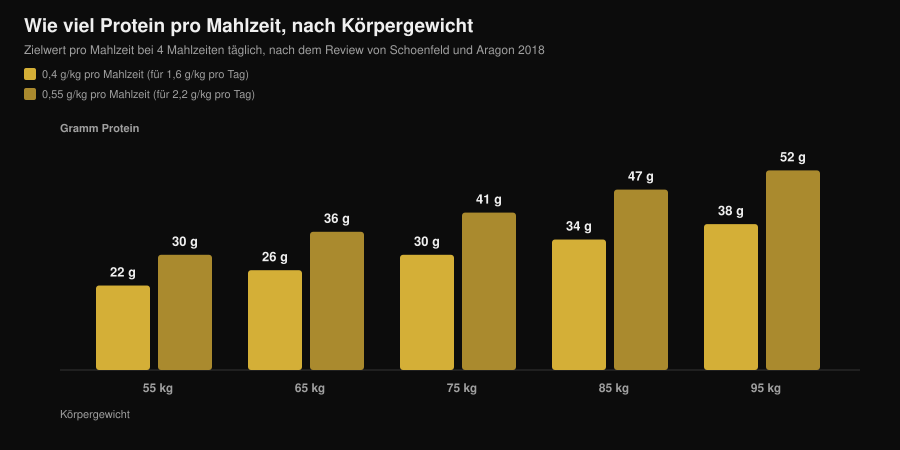

# Wie viel Protein pro Mahlzeit? Der 30-g-Mythos

Von [Giammaria Loi](/autore/giammaria-loi) · aktualisiert am 7. November 2026

"Alles über 30 g pro Mahlzeit wirfst du weg." Du hast den Satz im Studio gehört, auf einer Dose Proteinpulver gelesen und in einem Dutzend Karussells gesehen. Es ist die am häufigsten zitierte Regel der Sporternährung – und genau die, die die sorgfältigste Studie zu diesem Thema auseinandergenommen hat: mit 100 g Protein in einer einzigen Mahlzeit war die anabole Antwort größer und hielt mehr als zwölf Stunden an. Spannend wird es dort, wo du verstehst, was das für deine Mahlzeiten bedeutet. Denn die praktische Schlussfolgerung lautet nicht "iss alles auf einmal".

## Das Wichtigste in Kürze

- **Eine Obergrenze gibt es nicht.** Mit einem vierfachen Tracer-Verfahren – markierte Aminosäuren, mit denen sich der Weg des Proteins im Körper verfolgen lässt – erzeugten 100 g Protein nach dem Training eine größere und länger anhaltende anabole Antwort (über 12 Stunden) als 25 g, bei vernachlässigbarem Einfluss auf die Oxidation der Aminosäuren.
- **"Aufnehmen" und "verwerten" sind zwei verschiedene Dinge.** Aus dieser Verwechslung lebt der Mythos: keine Studie zeigt eine Aufnahmegrenze des Darms bei 30 g. Gemessen wurde, wie stark eine Dosis die Muskelproteinsynthese in vier Stunden anhebt.
- **Die 20-g-Schwelle hängt davon ab, wie viel Körper du trainiert hast.** Nach einem reinen Beintraining schlagen 40 g die 20 g nicht signifikant. Nach einem Ganzkörpertraining heben 40 g die Synthese um rund 20 % stärker an als 20 g (p = 0,005).
- **Die Verteilung zählt weiterhin.** Über 12 Stunden lieferten 80 g Whey in vier Dosen à 20 g alle 3 Stunden eine um 31-48 % höhere Synthese als acht Dosen à 10 g oder zwei Dosen à 40 g.
- **Die Zahl, die du im Kopf behalten solltest, ist die Tagesmenge.** Der Nutzen flacht um 1,6 g pro kg und Tag ab; um dorthin zu kommen, schlägt die am häufigsten zitierte Übersichtsarbeit 0,4 g pro kg pro Mahlzeit auf mindestens vier Mahlzeiten vor.

## Woher der Mythos von den 20-30 Gramm kommt

Die Zahl ist nicht erfunden. 2013 gab eine Gruppe der University of Stirling 48 trainierten Männern 0, 10, 20 oder 40 g Molkenprotein nach einem Beintraining und maß per Muskelbiopsie die Synthese der kontraktilen Proteine in den folgenden vier Stunden. Mit 10 g passierte nichts, was über null hinausging; mit 20 g stieg die Synthese um 49 %; mit 40 g um 56 %, ein Unterschied, der gegenüber 20 g nicht signifikant war. Gleichzeitig nahmen mit 40 g die Oxidation von Phenylalanin und die Harnstoffbildung zu.

Von dort stammt der Satz, der zehn Jahre lang die Runde machte: "20 g reichen, der Rest verbrennt." Zwei Fehllesarten haben sich übereinandergelegt. Die erste: *mehr Oxidation* heißt nicht *der ganze Rest oxidiert*. Die zweite, schwerere: diese Studie hat vier Stunden gemessen, nicht einen Tag.

*Nurvan-Grafik auf Basis der Daten von Witard et al., 2013 (Am J Clin Nutr) und Macnaughton et al., 2016 (Physiol Rep). Die Werte 0,061 und 0,064 %·h⁻¹ sind berechnet, indem die Prozentangaben aus dem Abstract (+49 % und +56 %) auf den Basiswert von 0,041 %·h⁻¹ angewendet wurden. Kein Wert wurde aus einer Abbildung abgelesen.*

## Die Studie, die die Grenze verschoben hat

2023 hat die Gruppe aus Maastricht die Frage mit einem deutlich aufwendigeren Design neu gestellt: vierfacher Tracer mit Infusion, markiertes Protein direkt im Lebensmittel, wiederholte Biopsien und ein Beobachtungsfenster, das auf über zwölf Stunden ausgedehnt wurde. Verglichen wurden 25 g und 100 g Protein, aufgenommen nach einem Training.

Die 100 g erzeugten eine anabole Antwort, die **größer im Ausmaß und länger in der Dauer** war. Gestiegen sind die Synthese der myofibrillären Proteine, die des muskulären Bindegewebes und die der Plasmaproteine sowie die Proteinbilanz des ganzen Körpers. Proteinabbau und Aminosäurenoxidation blieben fast unverändert: das berühmte "du verbrennst es ohnehin" war nicht zu sehen.

Das Fazit der Autoren: die Fähigkeit, das Protein einer einzigen Mahlzeit zu verwerten, war unterschätzt worden. Nicht, dass "mehr immer besser" wäre – aber die Mauer bei 20-25 g existiert nicht.

## Aufnahme ist nicht Aufbau

Es lohnt sich, bei zwei Wörtern anzuhalten, die als Synonyme benutzt werden und keine sind.

**Aufnahme** ist der Übergang der Aminosäuren aus dem Darm ins Blut. Das ist ein langsamer, kontinuierlicher Vorgang, der bei einer großen festen Mahlzeit über Stunden weiterläuft. Keine Studie hat je eine Schwelle bei 30 g gezeigt, ab der der Darm aufhört zu arbeiten: wäre es so, käme die Hälfte des Weihnachtsessens unverdaut wieder heraus.

**Anabole Verwertung** ist der Anteil dieser Aminosäuren, der am Ende in einem Muskelprotein landet. Genau das haben die Studien von 2013 in einem Fenster von vier Stunden gemessen, und genau das hat die Arbeit von 2023 zwölf Stunden lang verfolgt.

Wenn du liest "der Körper nimmt nur 30 g auf", benutzt dieser Satz das falsche Verb, um ein altes Ergebnis zu erzählen.

## Was die Forschung wirklich sagt

| Verbreitete Behauptung | Urteil | Quelle |
|---|---|---|
| "Über 20-30 g pro Mahlzeit ist der Rest verschwendet" | **Widerlegt** | Trommelen et al., 2023 |
| "Der Körper nimmt nur 30 g Protein pro Mahlzeit auf" | **Widerlegt**: verwechselt Aufnahme mit Verwertung | Trommelen et al., 2023 |
| "20 g maximieren die Proteinsynthese" | **Zu präzisieren**: hängt davon ab, wie viel Muskulatur du trainiert hast | Witard 2013; Macnaughton 2016 |
| "Dann ist die Verteilung auf die Mahlzeiten egal" | **Zu präzisieren**: über 12 Stunden bleibt 4×20 g die beste getestete Strategie | Areta et al., 2013 |
| "Dieselben Schwellen gelten für alle" | **Heute nicht beantwortbar** für trainierte Frauen | Witard und Mettler, 2024 |

### Warum "20 g" keine allgemeingültige Zahl ist

2016 hat dieselbe Forschungslinie eine einzige Variable verändert: statt nur die Beine zu trainieren, absolvierten die Teilnehmer eine Ganzkörpereinheit. Mit 20 g lag die Synthese bei 0,049 %·h⁻¹, mit 40 g bei 0,059 %·h⁻¹: rund 20 % mehr, mit einem statistisch signifikanten Unterschied (p = 0,005). Interessant: die gesamte fettfreie Masse der Person machte keinen Unterschied. Es zählte, wie viel Muskulatur das Training stimuliert hatte, nicht wie viel jemand insgesamt davon trug.

Das ist das Nützlichste zum Mitnehmen: die "richtige" Dosis pro Mahlzeit ist keine Konstante deines Stoffwechsels, sondern eine Variable, die auch davon abhängt, was du gerade im Studio gemacht hast.

### Warum eine einzige Riesenmahlzeit nicht die Antwort ist

Wer nur die Überschrift der Studie von 2023 gelesen hat, schloss daraus, dass die Verteilung erledigt ist. Zwei Dinge sagen das Gegenteil.

Das erste ist ein Experiment von 2013 an 24 trainierten Männern: 80 g Whey, verteilt über zwölf Stunden Erholung, in drei Varianten. Acht Dosen à 10 g alle anderthalb Stunden, vier à 20 g alle drei Stunden, zwei à 40 g alle sechs Stunden. Alle drei hoben die Synthese über das Ruheniveau, aber das mittlere Format war um 31-48 % besser als die beiden anderen.

Das zweite ist ein Kommentar, der 2024 direkt als Antwort auf die 100-g-Studie erschien: die Autoren erkennen den wissenschaftlichen Fortschritt an, warnen aber, dass die praktischen Folgerungen falsch verstanden wurden und dass es zu früh ist, die Mahlzeitenverteilung abzuhaken. Sie weisen außerdem darauf hin, dass die Stichprobe aus jungen, aktiven, aber nicht krafttrainierten Männern bestand und dass sich das Fehlen einer Obergrenze offenbar nicht auf junge trainierte Frauen übertragen lässt. Zu diesem letzten Punkt gibt es noch keine Zahlen, die wir berichten könnten: es ist eine erklärte Einschränkung, kein Ergebnis.

## So setzt du es um

Die Zahl, die wirklich zählt, ist die Tagessumme: die Referenz-Metaanalyse zeigt, dass der Nutzen für die Muskelmasse um 1,6 g pro kg Körpergewicht und Tag abflacht. Wenn du unsicher bist, wie viel du in der Diätphase brauchst, haben wir das im Detail in [wie viel Protein in der Diät](/de/blog/protein-in-der-diaet) behandelt.

Für die Verteilung schlägt die Übersichtsarbeit von Schoenfeld und Aragon eine einfache Rechnung vor: **0,4 g pro kg pro Mahlzeit, auf mindestens vier Mahlzeiten**. Wer die Obergrenze von 2,2 g pro kg und Tag anstrebt, landet bei 0,55 g pro kg pro Mahlzeit.

*Nurvan-Grafik: Berechnung mit den Koeffizienten der Übersichtsarbeit von Schoenfeld und Aragon, 2018 (J Int Soc Sports Nutr), auf vier Mahlzeiten pro Tag. Werte auf das Gramm gerundet.*

Drei praktische Hinweise, die im Licht all dessen tragen:

1. **Hab keine Angst mehr vor der großen Mahlzeit.** Wenn das Abendessen der einzige Moment ist, in dem du gut isst, sind 50-60 g Protein dort nicht verschwendet. Eine reichliche Mahlzeit ist mehr wert als eine ausgelassene.
2. **Wenn du wählen kannst, teile auf.** Drei oder vier Gelegenheiten mit einer anständigen Proteinquelle bleiben die am besten belegte Strategie – und sie sind auch für Sättigung und Verdauung leichter zu handhaben.
3. **Erhöhe die Dosis an Ganzkörpertagen.** Nach einer Full-Body-Einheit oder einem langen Training am oberen Rand deines Bereichs pro Mahlzeit zu liegen, hat gemessene Gründe.

Damit du diese Zahlen füllen kannst, hier mit den CREA-Tabellen in der Hand, wie viel von einigen alltäglichen Lebensmitteln nötig ist, um auf 30 g Protein zu kommen:

| Lebensmittel (CREA-Daten 2019) | Menge für 30 g Protein | Kalorien |
|---|---|---|
| Grana Padano g.U. | 88 g | 347 kcal |
| Bresaola della Valtellina g.g.A. | 91 g | 138 kcal |
| Hähnchenbrust, in der Pfanne gegart | 99 g | 128 kcal |
| Thunfisch in Lake, abgetropft | 120 g | 123 kcal |
| Kabeljau oder Seehecht | 176 g | 125 kcal |
| Hart gekochte Eier (ganz) | 242 g, etwa 5 Eier | 310 kcal |
| Eiklar | 280 g | 121 kcal |
| Magerer Hüttenkäse | 309 g | 356 kcal |
| Griechischer Joghurt 0 % | 333 g | 170 kcal |
| Getrocknete Linsen, gekocht | 435 g | 474 kcal |

*Nurvan-Auswertung der CREA-Tabellen — italienisches Forschungszentrum für Lebensmittel und Ernährung, Aktualisierung 2019. Rechnung: (30 ÷ Protein pro 100 g) × 100.*

Man sieht sofort, warum Quellen bei gleicher Proteinmenge nicht austauschbar sind: 30 g aus dem Grana kosten fast dreimal so viele Kalorien wie 30 g aus dem Hähnchen, und von den Linsen brauchst du 435 g gekochtes Produkt. Zum Vergleich zwischen tierischen und pflanzlichen Quellen haben wir einen eigenen Artikel: [pflanzliches oder tierisches Protein für den Muskelaufbau](/de/blog/pflanzliches-oder-tierisches-protein-muskelaufbau).

> **Nurvan: das Protein Mahlzeit für Mahlzeit, nicht nur die Tagessumme**
>
> Der Ernährungsbereich von Nurvan arbeitet mit der CREA-Lebensmitteldatenbank und zeigt dir das Protein jeder einzelnen Mahlzeit neben der Tagessumme: du siehst sofort, ob deine 140 g auf vier Gelegenheiten verteilt oder alle am Abend gebündelt sind. [Nurvan testen](https://nurvan.app)

## Häufige Fragen

**Wie viel Protein kann ich in einer Mahlzeit aufnehmen?**
Eine bekannte Obergrenze gibt es nicht. Die Aufnahme im Darm läuft über Stunden weiter, im Verhältnis zu dem, was du gegessen hast. Die Studie mit 100 g in einer einzigen Mahlzeit zeigte eine größere und längere anabole Antwort als die mit 25 g, ohne relevanten Anstieg der Aminosäurenoxidation.

**Sind 30 g pro Mahlzeit dann zu wenig?**
Das hängt von deinem Gewicht und von der Tagessumme ab, die du erreichen musst. Für eine Person mit 75 kg entsprechen 30 g pro Mahlzeit genau 0,4 g pro kg – dem Wert, den die Übersichtsarbeit auf vier Mahlzeiten vorschlägt, um auf 1,6 g pro kg und Tag zu kommen. Für eine Person mit 95 kg liegen 30 g pro Mahlzeit unter diesem Ziel.

**Verliere ich Muskeln, wenn ich mein ganzes Tagesprotein in zwei Mahlzeiten esse?**
Das sagt keine Studie. Die Daten über 12 Stunden zeigen allerdings, dass vier verteilte Dosen eine höhere Synthese ergaben als zwei große. Wenn du wählen kannst, teile auf; wenn nicht, zählt vor allem die Tagessumme.

**Gilt das Gleiche für Frauen?**
Der Kommentar von Witard und Mettler aus dem Jahr 2024 weist darauf hin, dass sich das Fehlen einer Obergrenze offenbar nicht auf junge krafttrainierte Frauen übertragen lässt. Belastbare Zahlen, die wir nennen könnten, gibt es noch nicht: das ist eine offene Frage, und vorerst ist es sinnvoll, bei den Referenzwerten pro Mahlzeit aus den Übersichtsarbeiten zu bleiben.

## Lies auch

- [Wie viel Protein in der Diät](/de/blog/protein-in-der-diaet) — die Tagessumme, wenn die Kalorien niedrig sind.
- [Pflanzliches oder tierisches Protein für den Muskelaufbau](/de/blog/pflanzliches-oder-tierisches-protein-muskelaufbau) — die Qualität der Quelle zählt mehr als die Menge.
- [Beef Protein: ist Rinderprotein so gut wie Whey?](/de/blog/beef-protein-rinderprotein-vs-whey) — was ein Pulver vom anderen wirklich unterscheidet.

## Quellen

1. Trommelen J, van Lieshout GAA, Nyakayiru J, et al., 2023. The anabolic response to protein ingestion during recovery from exercise has no upper limit in magnitude and duration in vivo in humans. *Cell Rep Med* 4(12):101324. [PMID 38118410](https://pubmed.ncbi.nlm.nih.gov/38118410/) · [DOI 10.1016/j.xcrm.2023.101324](https://doi.org/10.1016/j.xcrm.2023.101324)
2. Witard OC, Mettler S, 2024. The Anabolic Response to Protein Ingestion During Recovery From Exercise Has No Upper Limit in Magnitude and Duration In Vivo in Humans: A Commentary. *Int J Sport Nutr Exerc Metab* 34(5):322–324. [PMID 38991545](https://pubmed.ncbi.nlm.nih.gov/38991545/) · [DOI 10.1123/ijsnem.2024-0041](https://doi.org/10.1123/ijsnem.2024-0041)
3. Witard OC, Jackman SR, Breen L, et al., 2014. Myofibrillar muscle protein synthesis rates subsequent to a meal in response to increasing doses of whey protein at rest and after resistance exercise. *Am J Clin Nutr* 99(1):86–95. [PMID 24257722](https://pubmed.ncbi.nlm.nih.gov/24257722/) · [DOI 10.3945/ajcn.112.055517](https://doi.org/10.3945/ajcn.112.055517)
4. Macnaughton LS, Wardle SL, Witard OC, et al., 2016. The response of muscle protein synthesis following whole-body resistance exercise is greater following 40 g than 20 g of ingested whey protein. *Physiol Rep* 4(15):e12893. [PMID 27511985](https://pubmed.ncbi.nlm.nih.gov/27511985/) · [DOI 10.14814/phy2.12893](https://doi.org/10.14814/phy2.12893)
5. Areta JL, Burke LM, Ross ML, et al., 2013. Timing and distribution of protein ingestion during prolonged recovery from resistance exercise alters myofibrillar protein synthesis. *J Physiol* 591(9):2319–2331. [PMID 23459753](https://pubmed.ncbi.nlm.nih.gov/23459753/) · [DOI 10.1113/jphysiol.2012.244897](https://doi.org/10.1113/jphysiol.2012.244897)
6. Schoenfeld BJ, Aragon AA, 2018. How much protein can the body use in a single meal for muscle-building? Implications for daily protein distribution. *J Int Soc Sports Nutr* 15:10. [PMID 29497353](https://pubmed.ncbi.nlm.nih.gov/29497353/) · [DOI 10.1186/s12970-018-0215-1](https://doi.org/10.1186/s12970-018-0215-1)
7. Morton RW, Murphy KT, McKellar SR, et al., 2018. A systematic review, meta-analysis and meta-regression of the effect of protein supplementation on resistance training-induced gains in muscle mass and strength in healthy adults. *Br J Sports Med* 52(6):376–384. [PMID 28698222](https://pubmed.ncbi.nlm.nih.gov/28698222/) · [DOI 10.1136/bjsports-2017-097608](https://doi.org/10.1136/bjsports-2017-097608)
8. Jäger R, Kerksick CM, Campbell BI, et al., 2017. International Society of Sports Nutrition Position Stand: protein and exercise. *J Int Soc Sports Nutr* 14:20. [PMID 28642676](https://pubmed.ncbi.nlm.nih.gov/28642676/) · [DOI 10.1186/s12970-017-0177-8](https://doi.org/10.1186/s12970-017-0177-8)

Lebensmitteldaten: CREA-Tabellen — italienisches Forschungszentrum für Lebensmittel und Ernährung, Aktualisierung 2019. Thema ausgewählt anhand von Trendsignalen von Anfang November 2026 (Berichterstattung in der Publikumspresse zum Thema "wie viel Protein" und eine erste Suchergebnisseite voller kommerzieller Inhalte, die die 30-g-Grenze wiederholen). Wissenschaftliche Quellen über PubMed recherchiert.

**Giammaria Loi** ist der Gründer von Nurvan. Er trainiert seit 2012 mit Gewichten, arbeitet seit 2013 als Personal Trainer und FIPE-zertifizierter Coach und tritt seit 2018 im Powerlifting auf nationaler Ebene an. Jeder Artikel, den er zeichnet, beginnt bei den Studien und endet bei dem, was im Studio wirklich funktioniert. [Autorenseite](/autore/giammaria-loi)

> Hinweis: informativer Inhalt, er ersetzt nicht die Beurteilung einer Ärztin, eines Arztes oder einer qualifizierten Fachperson.
