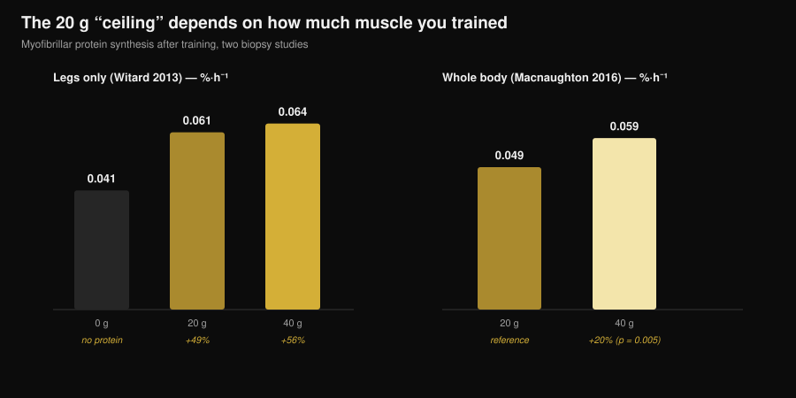
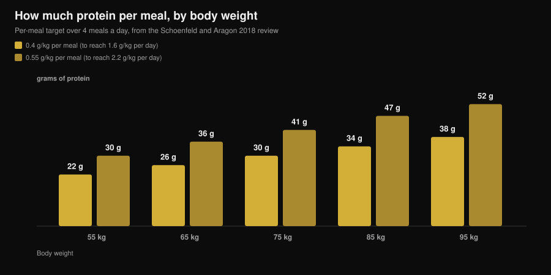

# How much protein per meal? The 30 g myth

By [Giammaria Loi](/autore/giammaria-loi) · updated 7 November 2026

"Anything over 30 g per meal is wasted." You have heard it at the gym, read it on a tub of whey and seen it in a dozen carousels. It is the most quoted rule in sports nutrition, and it is also the one the most careful study ever run on the question took apart: with 100 g of protein in a single meal, the anabolic response was bigger and lasted more than twelve hours. The useful part is working out what that means for your meals, because the practical answer is not "eat it all at once".

## Key points

- **There is no ceiling.** Using a quadruple tracer approach, 100 g of protein after training produced a greater and longer-lasting anabolic response (over 12 hours) than 25 g, with a negligible effect on amino acid oxidation.
- **"Absorb" and "use" are not the same word.** The myth lives in that confusion: no study shows a gut absorption cut-off at 30 g. The limit that was measured was how much a dose raised muscle protein synthesis over four hours.
- **The 20 g threshold depends on how much body you trained.** After a legs-only session, 40 g does not significantly beat 20 g. After a whole-body session, 40 g raises synthesis about 20% more than 20 g (p = 0.005).
- **Distribution still matters.** Over 12 hours, 80 g of whey split into four 20 g doses every 3 hours beat eight 10 g doses and two 40 g doses by 31-48%.
- **The number to hold on to is the daily one.** The benefit flattens out around 1.6 g per kg per day; to get there, the most cited review proposes 0.4 g per kg per meal across at least four meals.

## Where the 20-30 gram rule came from

The number was not invented. In 2013 a group at the University of Stirling gave 48 trained men 0, 10, 20 or 40 g of whey protein after a leg workout and used muscle biopsies to measure contractile protein synthesis over the next four hours. Ten grams did nothing beyond zero; 20 g raised synthesis by 49%; 40 g by 56%, which was not significantly more than 20 g. At the same time, 40 g did increase phenylalanine oxidation and urea production.

That is where the line everyone repeated for a decade comes from: "20 g is enough, the rest gets burned." Two misreadings stacked on top of each other. First, *more oxidation* does not mean *everything else oxidised*. Second, and worse: that study measured four hours, not a day.

*Nurvan chart from Witard et al., 2013 (Am J Clin Nutr) and Macnaughton et al., 2016 (Physiol Rep). The 0.061 and 0.064 %·h⁻¹ values are calculated by applying the percentages in the abstract (+49% and +56%) to the 0.041 %·h⁻¹ baseline. No value was read off a figure.*

## The study that moved the limit

In 2023 a group in Maastricht asked the question again with a far heavier design: a quadruple isotope tracer with infusion, labelled protein in the food itself, repeated biopsies and an observation window stretched past twelve hours. They compared 25 g and 100 g of protein taken after a training session.

The 100 g dose produced a response that was **larger in magnitude and longer in duration**. Myofibrillar protein synthesis went up, so did muscle connective tissue and plasma protein synthesis, and so did whole-body net protein balance. Protein breakdown and amino acid oxidation rates barely moved: the famous "you just burn it off" did not show up.

The authors' conclusion is that our ability to use the protein in a single meal had been underestimated. Not that more is always better, but that the wall at 20-25 g is not there.

## Absorption is not construction

Two words get used as synonyms and should not be.

**Absorption** is amino acids crossing from the gut into the blood. It is a slow, continuous process that for a large solid meal keeps going for hours. No study has ever shown a 30 g threshold beyond which the gut stops working — if it did, half of Christmas dinner would come out undigested.

**Anabolic use** is how much of those amino acids ends up inside a muscle protein. That is what the 2013-era studies measured in a four-hour window, and what the 2023 work followed for twelve.

When you read "the body only absorbs 30 g", the sentence is using the wrong verb to report an old result.

## What the research actually says

| Common claim | Verdict | Source |
|---|---|---|
| "Over 20-30 g per meal the rest is wasted" | **Debunked** | Trommelen et al., 2023 |
| "The body only absorbs 30 g of protein per meal" | **Debunked**: confuses absorption with use | Trommelen et al., 2023 |
| "20 g maximises protein synthesis" | **Needs qualifying**: depends how much muscle you trained | Witard 2013; Macnaughton 2016 |
| "So meal distribution does not matter" | **Needs qualifying**: over 12 hours, 4×20 g is still the best tested pattern | Areta et al., 2013 |
| "The same thresholds apply to everyone" | **Not answerable today** for trained women | Witard and Mettler, 2024 |

### Why 20 g is not a universal number

In 2016 the same line of research changed one variable: instead of training legs only, participants did a whole-body session. With 20 g, synthesis came out at 0.049 %·h⁻¹; with 40 g, 0.059 %·h⁻¹ — about 20% more, and statistically significant (p = 0.005). Interestingly, a person's total lean body mass made no difference: what mattered was how much muscle the session had stimulated, not how much muscle they carried.

That is the most useful thing to take away. The "right" per-meal dose is not a constant of your metabolism. It is a variable that depends partly on what you just did in the gym.

### Why one giant meal is not the answer

Anyone who read only the headline of the 2023 study concluded that distribution is dead. Two things say otherwise.

The first is a 2013 experiment on 24 trained men: 80 g of whey spread across twelve hours of recovery in three patterns. Eight 10 g doses every 90 minutes, four 20 g doses every 3 hours, two 40 g doses every 6 hours. All three raised synthesis above rest, but the middle pattern beat the other two by 31-48%.

The second is a commentary published in 2024 in direct response to the 100 g study. The authors accept the scientific advance but warn that the practical implications have been misread, and that writing off meal distribution is premature. They also point out that the participants were young active men who were not resistance-trained, and that the absence of an upper limit does not appear to carry over to young trained women. On that last point there are no numbers we can report yet: it is a stated limitation, not a result.

## How to apply it

The number that really matters is the daily total: the reference meta-analysis shows the benefit for muscle mass flattening out around 1.6 g per kg of body weight per day. If you are wondering how much you need while cutting, we covered that in detail in [how much protein you need when cutting](/en/blog/protein-intake-cutting).

To spread it out, the Schoenfeld and Aragon review offers a simple sum: **0.4 g per kg per meal, across at least four meals**. Anyone aiming at the upper end of 2.2 g per kg per day lands at 0.55 g per kg per meal.

*Nurvan chart: calculated from the coefficients in the Schoenfeld and Aragon review, 2018 (J Int Soc Sports Nutr), over four meals a day. Values rounded to the nearest gram.*

Three practical points that hold up in light of all this:

1. **Stop being afraid of the big meal.** If dinner is the one time you eat properly, 50-60 g of protein there is not wasted. A large meal beats a skipped one.
2. **If you can choose, split it.** Three or four occasions with a decent protein source is still the best-supported pattern, and it is easier on appetite and digestion too.
3. **Go higher on full-body days.** After a full-body session or a long workout, sitting at the top of your per-meal range has measured support behind it.

To fill those numbers in, here is how much of some common foods gets you to 30 g of protein, using the Italian CREA food tables:

| Food (CREA 2019 data) | Amount for 30 g of protein | Calories |
|---|---|---|
| Grana Padano PDO | 88 g | 347 kcal |
| Bresaola della Valtellina PGI | 91 g | 138 kcal |
| Chicken breast, pan-cooked | 99 g | 128 kcal |
| Tuna in brine, drained | 120 g | 123 kcal |
| Cod or hake | 176 g | 125 kcal |
| Boiled whole eggs | 242 g, about 5 eggs | 310 kcal |
| Egg white | 280 g | 121 kcal |
| Low-fat cottage cheese | 309 g | 356 kcal |
| Greek yoghurt, 0% fat | 333 g | 170 kcal |
| Dried lentils, boiled | 435 g | 474 kcal |

*Nurvan calculation on the CREA tables — Italian Council for Agricultural Research and Economics, Food and Nutrition Research Centre, 2019 update. Formula: (30 ÷ protein per 100 g) × 100.*

You can see straight away why sources are not interchangeable at equal protein: 30 g from Grana costs almost three times the calories of 30 g from chicken, and from lentils you need 435 g of cooked product. We have a dedicated piece on the animal-versus-plant comparison: [plant or animal protein for muscle](/en/blog/plant-vs-animal-protein-for-muscle).

> **Nurvan: protein meal by meal, not just the daily total**
>
> Nurvan's nutrition section runs on the CREA food database and shows the protein in every single meal next to your daily total, so you can see at a glance whether your 140 g are spread across four occasions or stacked into dinner. [Try Nurvan](https://nurvan.app)

## Frequently asked questions

**How much protein can I absorb in one meal?**
There is no known ceiling. Gut absorption continues for hours in proportion to how much you ate. The study that gave 100 g in a single meal found a bigger, longer anabolic response than 25 g, with no meaningful rise in amino acid oxidation.

**So is 30 g per meal too little?**
It depends on your body weight and the daily total you need to hit. For a 75 kg person, 30 g per meal is exactly 0.4 g per kg — the figure the review proposes across four meals to reach 1.6 g per kg per day. For a 95 kg person, 30 g per meal is below that target.

**If I eat all my protein in two meals, do I lose muscle?**
No study says that. The 12-hour data do show that four spread-out doses produced more synthesis than two large ones. If you can choose, split it; if you cannot, the daily total is what counts most.

**Does the same apply to women?**
The 2024 commentary by Witard and Mettler notes that the absence of an upper limit does not appear to carry over to young resistance-trained women. There are no solid numbers to quote yet: it is an open question, and for now the per-meal reference values from the reviews are the sensible place to stay.

## Read next

- [How much protein you need when cutting](/en/blog/protein-intake-cutting) — the daily total when calories are low.
- [Plant or animal protein for muscle](/en/blog/plant-vs-animal-protein-for-muscle) — source quality matters more than quantity.
- [Beef protein: is meat protein as good as whey?](/en/blog/beef-protein-powder-vs-whey) — what actually separates one powder from another.

## Sources

1. Trommelen J, van Lieshout GAA, Nyakayiru J, et al., 2023. The anabolic response to protein ingestion during recovery from exercise has no upper limit in magnitude and duration in vivo in humans. *Cell Rep Med* 4(12):101324. [PMID 38118410](https://pubmed.ncbi.nlm.nih.gov/38118410/) · [DOI 10.1016/j.xcrm.2023.101324](https://doi.org/10.1016/j.xcrm.2023.101324)
2. Witard OC, Mettler S, 2024. The Anabolic Response to Protein Ingestion During Recovery From Exercise Has No Upper Limit in Magnitude and Duration In Vivo in Humans: A Commentary. *Int J Sport Nutr Exerc Metab* 34(5):322–324. [PMID 38991545](https://pubmed.ncbi.nlm.nih.gov/38991545/) · [DOI 10.1123/ijsnem.2024-0041](https://doi.org/10.1123/ijsnem.2024-0041)
3. Witard OC, Jackman SR, Breen L, et al., 2014. Myofibrillar muscle protein synthesis rates subsequent to a meal in response to increasing doses of whey protein at rest and after resistance exercise. *Am J Clin Nutr* 99(1):86–95. [PMID 24257722](https://pubmed.ncbi.nlm.nih.gov/24257722/) · [DOI 10.3945/ajcn.112.055517](https://doi.org/10.3945/ajcn.112.055517)
4. Macnaughton LS, Wardle SL, Witard OC, et al., 2016. The response of muscle protein synthesis following whole-body resistance exercise is greater following 40 g than 20 g of ingested whey protein. *Physiol Rep* 4(15):e12893. [PMID 27511985](https://pubmed.ncbi.nlm.nih.gov/27511985/) · [DOI 10.14814/phy2.12893](https://doi.org/10.14814/phy2.12893)
5. Areta JL, Burke LM, Ross ML, et al., 2013. Timing and distribution of protein ingestion during prolonged recovery from resistance exercise alters myofibrillar protein synthesis. *J Physiol* 591(9):2319–2331. [PMID 23459753](https://pubmed.ncbi.nlm.nih.gov/23459753/) · [DOI 10.1113/jphysiol.2012.244897](https://doi.org/10.1113/jphysiol.2012.244897)
6. Schoenfeld BJ, Aragon AA, 2018. How much protein can the body use in a single meal for muscle-building? Implications for daily protein distribution. *J Int Soc Sports Nutr* 15:10. [PMID 29497353](https://pubmed.ncbi.nlm.nih.gov/29497353/) · [DOI 10.1186/s12970-018-0215-1](https://doi.org/10.1186/s12970-018-0215-1)
7. Morton RW, Murphy KT, McKellar SR, et al., 2018. A systematic review, meta-analysis and meta-regression of the effect of protein supplementation on resistance training-induced gains in muscle mass and strength in healthy adults. *Br J Sports Med* 52(6):376–384. [PMID 28698222](https://pubmed.ncbi.nlm.nih.gov/28698222/) · [DOI 10.1136/bjsports-2017-097608](https://doi.org/10.1136/bjsports-2017-097608)
8. Jäger R, Kerksick CM, Campbell BI, et al., 2017. International Society of Sports Nutrition Position Stand: protein and exercise. *J Int Soc Sports Nutr* 14:20. [PMID 28642676](https://pubmed.ncbi.nlm.nih.gov/28642676/) · [DOI 10.1186/s12970-017-0177-8](https://doi.org/10.1186/s12970-017-0177-8)

Food data: CREA food composition tables, 2019 update. Topic chosen from early-November 2026 trend signals (mainstream coverage of the "how much protein" question and a Google page one filled with commercial content still repeating the 30 g ceiling). Scientific sources consulted through PubMed.

**Giammaria Loi** is the founder of Nurvan. He has been lifting since 2012, has worked as a FIPE-certified personal trainer and coach since 2013, and has competed in powerlifting at national level since 2018. Every article he writes starts from the research and ends with what actually works in the gym. [Author page](/autore/giammaria-loi)

> Note: educational content, not a substitute for advice from a doctor or qualified professional.
