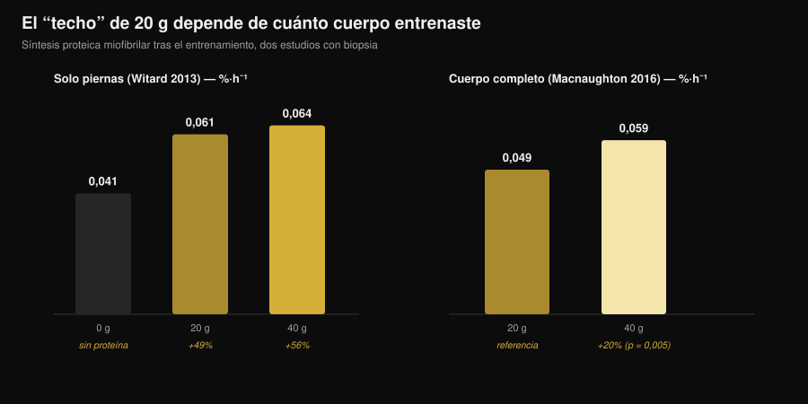
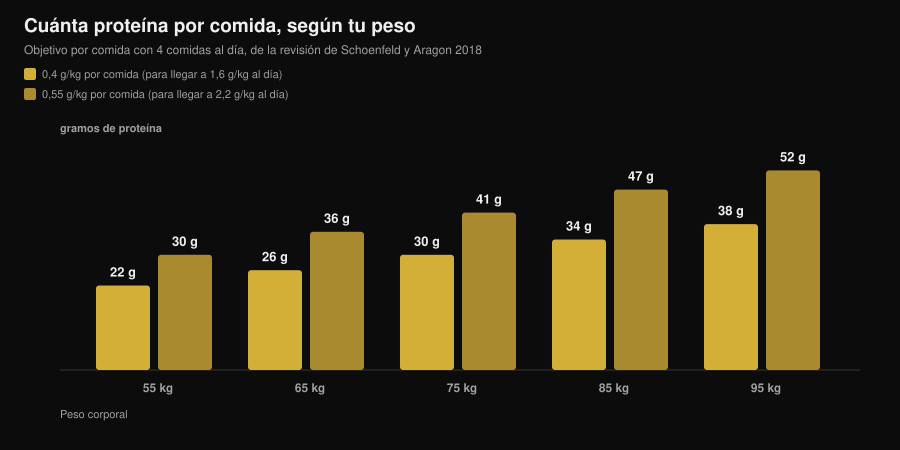

# ¿Cuánta proteína por comida? El mito de los 30 g

Por [Giammaria Loi](/autore/giammaria-loi) · actualizado el 7 de noviembre de 2026

"Más de 30 g por comida los tiras a la basura." Lo has oído en el gimnasio, lo has leído en el bote de proteína en polvo y lo has visto en diez carruseles distintos. Es la regla más citada de la nutrición deportiva, y también la que el estudio más cuidadoso que se ha hecho sobre el tema desmontó: con 100 g de proteína en una sola comida, la respuesta anabólica fue mayor y duró más de doce horas. Lo útil es entender qué significa eso para tus comidas, porque la conclusión práctica no es "cómetelo todo de golpe".

## En resumen

- **El límite no existe.** Con un trazador cuádruple, 100 g de proteína después de entrenar produjeron una respuesta anabólica mayor y más prolongada (más de 12 horas) que 25 g, con un efecto despreciable sobre la oxidación de los aminoácidos.
- **"Absorber" y "usar" no son lo mismo.** El mito vive en esa confusión: ningún estudio muestra un tope de absorción intestinal en 30 g. El límite que se midió era cuánto subía una dosis la síntesis muscular en cuatro horas.
- **El umbral de los 20 g depende de cuánto cuerpo has entrenado.** Después de una sesión solo de piernas, 40 g no superan a 20 g de forma significativa. Después de un entrenamiento de cuerpo completo, 40 g suben la síntesis un 20% más que 20 g (p = 0,005).
- **El reparto sigue contando.** En 12 horas, 80 g de suero divididos en 4 dosis de 20 g cada 3 horas dieron una síntesis superior en un 31-48% a 8 dosis de 10 g o a 2 dosis de 40 g.
- **El número que hay que recordar es el diario.** El beneficio se aplana en torno a 1,6 g por kg al día; para llegar ahí, la revisión más citada propone 0,4 g por kg por comida repartidos en al menos cuatro comidas.

## De dónde viene el mito de los 20-30 gramos

El número no está inventado. En 2013 un grupo de la Universidad de Stirling dio a 48 hombres entrenados 0, 10, 20 o 40 g de proteína de suero de leche después de un entrenamiento de piernas, y midió con biopsia la síntesis de las proteínas contráctiles en las cuatro horas siguientes. Con 10 g no pasaba nada más que con cero; con 20 g la síntesis subía un 49%; con 40 g un 56%, una diferencia no significativa respecto a 20 g. Al mismo tiempo, con 40 g aumentaban la oxidación de la fenilalanina y la producción de urea.

De ahí salió la frase que ha circulado durante diez años: "con 20 g basta, el resto se quema". Se superpusieron dos lecturas equivocadas. La primera: *más oxidación* no significa *todo lo demás oxidado*. La segunda, más grave: ese estudio medía cuatro horas, no el día entero.

*Gráfico de Nurvan con los datos de Witard et al., 2013 (Am J Clin Nutr) y Macnaughton et al., 2016 (Physiol Rep). Los valores 0,061 y 0,064 %·h⁻¹ están calculados aplicando los porcentajes del abstract (+49% y +56%) al valor base de 0,041 %·h⁻¹. Ningún valor se ha leído de una figura.*

## El estudio que movió el límite

En 2023 el grupo de Maastricht volvió a hacer la pregunta con un diseño mucho más exigente: trazador isotópico cuádruple con infusión, proteína marcada dentro del propio alimento, biopsias repetidas y una ventana de observación estirada más allá de las doce horas. Compararon 25 g y 100 g de proteína tomados después de entrenar.

Los 100 g produjeron una respuesta anabólica **mayor en magnitud y más larga en el tiempo**. Subieron la síntesis de las proteínas miofibrilares, la del tejido conectivo del músculo y la de las proteínas plasmáticas, y también el balance proteico de todo el cuerpo. La degradación proteica y la oxidación de los aminoácidos apenas se movieron: el famoso "lo quemas todo" no apareció.

La conclusión de los autores es que se había subestimado la capacidad de usar la proteína de una sola comida. No que "más sea siempre mejor", sino que el muro de los 20-25 g no está ahí.

## Absorber no es construir

Merece la pena parar en dos palabras que se usan como sinónimos y no lo son.

**Absorción** es el paso de los aminoácidos del intestino a la sangre. Es un proceso lento y continuo que, en una comida sólida abundante, sigue durante horas. Ningún estudio ha mostrado nunca un umbral en 30 g a partir del cual el intestino deje de trabajar: si fuera así, media comida de Navidad saldría sin digerir.

**Uso anabólico** es cuánto de esos aminoácidos acaba dentro de una proteína muscular. Eso es lo que medían los estudios de 2013 en una ventana de cuatro horas, y eso es lo que el trabajo de 2023 siguió durante doce.

Cuando lees "el cuerpo solo absorbe 30 g", la frase está usando el verbo equivocado para contar un dato viejo.

## Lo que dice de verdad la investigación

| Afirmación habitual | Veredicto | Fuente |
|---|---|---|
| "Más de 20-30 g por comida y el resto se desperdicia" | **Desmentido** | Trommelen et al., 2023 |
| "El cuerpo solo absorbe 30 g de proteína por comida" | **Desmentido**: confunde absorción con uso | Trommelen et al., 2023 |
| "20 g maximizan la síntesis proteica" | **Hay que matizar**: depende de cuánta masa hayas entrenado | Witard 2013; Macnaughton 2016 |
| "Entonces el reparto en las comidas no cuenta" | **Hay que matizar**: en 12 horas, 4×20 g sigue siendo el patrón mejor probado | Areta et al., 2013 |
| "Los mismos umbrales valen para todos" | **Hoy no se puede responder** en mujeres entrenadas | Witard y Mettler, 2024 |

### Por qué "20 g" no es un número universal

En 2016, la misma línea de investigación cambió una sola variable: en lugar de entrenar solo las piernas, los participantes hicieron una sesión de cuerpo completo. Con 20 g la síntesis fue de 0,049 %·h⁻¹; con 40 g, de 0,059 %·h⁻¹: alrededor de un 20% más, con una diferencia estadísticamente significativa (p = 0,005). Curiosamente, la masa magra total de la persona no marcó ninguna diferencia: lo que contaba era cuánto músculo había estimulado la sesión, no cuánto músculo tenía en total.

Es lo más útil que te puedes llevar: la dosis "correcta" por comida no es una constante de tu metabolismo, es una variable que depende también de lo que acabas de hacer en el gimnasio.

### Por qué una sola comida enorme no es la respuesta

Quien solo leyó el titular del estudio de 2023 dedujo que el reparto ya no sirve. Dos cosas dicen lo contrario.

La primera es un experimento de 2013 con 24 hombres entrenados: 80 g de suero repartidos a lo largo de doce horas de recuperación en tres patrones. Ocho dosis de 10 g cada hora y media, cuatro de 20 g cada tres horas, dos de 40 g cada seis horas. Los tres subieron la síntesis por encima del reposo, pero el patrón intermedio superó a los otros dos en un 31-48%.

La segunda es un comentario publicado en 2024 justo en respuesta al estudio de los 100 g: los autores reconocen el avance científico, pero advierten de que las implicaciones prácticas se han malinterpretado y de que archivar el reparto de las comidas es prematuro. Señalan además que la muestra eran hombres jóvenes activos pero no entrenados con pesas, y que la ausencia de un techo no parece trasladarse a las mujeres jóvenes entrenadas. Sobre este último punto todavía no hay cifras que podamos dar: es una limitación declarada, no un dato.

## Cómo aplicarlo

El número que de verdad cuenta es el total del día: el metaanálisis de referencia muestra que el beneficio sobre la masa muscular se aplana en torno a 1,6 g por kg de peso al día. Si tienes dudas sobre cuánta necesitas en fase de pérdida de grasa, lo hemos contado en detalle en [cuánta proteína hace falta en definición](/es/blog/proteinas-en-definicion).

Para repartirlo, la revisión de Schoenfeld y Aragon propone una cuenta sencilla: **0,4 g por kg por comida, en al menos cuatro comidas**. Quien apunta al extremo alto de 2,2 g por kg al día llega a 0,55 g por kg por comida.

*Gráfico de Nurvan: cálculo sobre los coeficientes de la revisión de Schoenfeld y Aragon, 2018 (J Int Soc Sports Nutr), con cuatro comidas al día. Valores redondeados al gramo.*

Tres indicaciones prácticas que aguantan a la luz de todo esto:

1. **Deja de tenerle miedo a la comida grande.** Si la cena es el único momento en el que comes bien, 50-60 g de proteína ahí no están desperdiciados. Una comida abundante vale más que una comida saltada.
2. **Si puedes elegir, reparte.** Tres o cuatro ocasiones con una fuente de proteína decente siguen siendo el patrón con mejor respaldo, y además son más fáciles de manejar en saciedad y digestión.
3. **Sube la dosis los días de entrenamiento completo.** Después de una sesión de cuerpo completo o de un entrenamiento largo, quedarte en la parte alta de tu rango por comida tiene un sentido medido.

Para rellenar esos números, con las tablas CREA en la mano, esto es lo que hace falta de algunos alimentos comunes para llegar a 30 g de proteína:

| Alimento (datos CREA 2019) | Cantidad para 30 g de proteína | Calorías |
|---|---|---|
| Grana Padano DOP | 88 g | 347 kcal |
| Bresaola della Valtellina IGP | 91 g | 138 kcal |
| Pechuga de pollo a la plancha | 99 g | 128 kcal |
| Atún en salmuera escurrido | 120 g | 123 kcal |
| Bacalao o merluza | 176 g | 125 kcal |
| Huevos cocidos (entero) | 242 g, unos 5 huevos | 310 kcal |
| Clara de huevo | 280 g | 121 kcal |
| Queso cottage desnatado | 309 g | 356 kcal |
| Yogur griego 0% | 333 g | 170 kcal |
| Lentejas secas cocidas | 435 g | 474 kcal |

*Elaboración de Nurvan sobre las tablas CREA — Centro de Investigación de Alimentos y Nutrición (Italia), actualización 2019. Cálculo: (30 ÷ proteínas por 100 g) × 100.*

Se ve enseguida por qué las fuentes no son intercambiables a igualdad de proteína: 30 g del Grana cuestan casi el triple de calorías que 30 g del pollo, y de las lentejas hacen falta 435 g de producto cocido. Sobre la comparación entre fuentes animales y vegetales tenemos un artículo dedicado: [proteína vegetal o animal para el músculo](/es/blog/proteina-vegetal-o-animal-para-el-musculo).

> **Nurvan: la proteína comida a comida, no solo el total del día**
>
> La sección de nutrición de Nurvan usa la base de datos CREA y te muestra la proteína de cada comida junto al total diario: ves de un vistazo si tus 140 g están repartidos en cuatro ocasiones o concentrados todos en la cena. [Prueba Nurvan](https://nurvan.app)

## Preguntas frecuentes

**¿Cuánta proteína puedo absorber en una comida?**
No hay un techo conocido. La absorción intestinal continúa durante horas en proporción a lo que has comido. El estudio que dio 100 g en una sola comida encontró una respuesta anabólica mayor y más larga que con 25 g, sin un aumento relevante de la oxidación de los aminoácidos.

**¿Entonces 30 g por comida son pocos?**
Depende de tu peso y del total que tengas que alcanzar. Para una persona de 75 kg, 30 g por comida son exactamente 0,4 g por kg, el valor que propone la revisión en cuatro comidas para llegar a 1,6 g por kg al día. Para una persona de 95 kg, 30 g por comida se quedan por debajo de ese objetivo.

**Si me como toda la proteína del día en dos comidas, ¿pierdo músculo?**
Ningún estudio dice eso. Los datos a 12 horas sí indican que cuatro dosis repartidas dieron más síntesis que dos dosis grandes. Si puedes elegir, reparte; si no puedes, lo que más cuenta es el total.

**¿Vale lo mismo para las mujeres?**
El comentario de Witard y Mettler de 2024 señala que la ausencia de un límite superior no parece trasladarse a las mujeres jóvenes entrenadas con pesas. Todavía no hay datos sólidos que podamos dar como cifras: es una cuestión abierta y, por ahora, lo razonable es quedarse en las referencias por comida de las revisiones.

## Lee también

- [Cuánta proteína hace falta en definición](/es/blog/proteinas-en-definicion) — el total diario cuando las calorías son bajas.
- [Proteína vegetal o animal para el músculo](/es/blog/proteina-vegetal-o-animal-para-el-musculo) — la calidad de la fuente cuenta más que la cantidad.
- [Beef protein: ¿la proteína de carne iguala a la whey?](/es/blog/beef-protein-proteina-de-carne-vs-whey) — qué cambia de verdad entre un polvo y otro.

## Fuentes

1. Trommelen J, van Lieshout GAA, Nyakayiru J, et al., 2023. The anabolic response to protein ingestion during recovery from exercise has no upper limit in magnitude and duration in vivo in humans. *Cell Rep Med* 4(12):101324. [PMID 38118410](https://pubmed.ncbi.nlm.nih.gov/38118410/) · [DOI 10.1016/j.xcrm.2023.101324](https://doi.org/10.1016/j.xcrm.2023.101324)
2. Witard OC, Mettler S, 2024. The Anabolic Response to Protein Ingestion During Recovery From Exercise Has No Upper Limit in Magnitude and Duration In Vivo in Humans: A Commentary. *Int J Sport Nutr Exerc Metab* 34(5):322–324. [PMID 38991545](https://pubmed.ncbi.nlm.nih.gov/38991545/) · [DOI 10.1123/ijsnem.2024-0041](https://doi.org/10.1123/ijsnem.2024-0041)
3. Witard OC, Jackman SR, Breen L, et al., 2014. Myofibrillar muscle protein synthesis rates subsequent to a meal in response to increasing doses of whey protein at rest and after resistance exercise. *Am J Clin Nutr* 99(1):86–95. [PMID 24257722](https://pubmed.ncbi.nlm.nih.gov/24257722/) · [DOI 10.3945/ajcn.112.055517](https://doi.org/10.3945/ajcn.112.055517)
4. Macnaughton LS, Wardle SL, Witard OC, et al., 2016. The response of muscle protein synthesis following whole-body resistance exercise is greater following 40 g than 20 g of ingested whey protein. *Physiol Rep* 4(15):e12893. [PMID 27511985](https://pubmed.ncbi.nlm.nih.gov/27511985/) · [DOI 10.14814/phy2.12893](https://doi.org/10.14814/phy2.12893)
5. Areta JL, Burke LM, Ross ML, et al., 2013. Timing and distribution of protein ingestion during prolonged recovery from resistance exercise alters myofibrillar protein synthesis. *J Physiol* 591(9):2319–2331. [PMID 23459753](https://pubmed.ncbi.nlm.nih.gov/23459753/) · [DOI 10.1113/jphysiol.2012.244897](https://doi.org/10.1113/jphysiol.2012.244897)
6. Schoenfeld BJ, Aragon AA, 2018. How much protein can the body use in a single meal for muscle-building? Implications for daily protein distribution. *J Int Soc Sports Nutr* 15:10. [PMID 29497353](https://pubmed.ncbi.nlm.nih.gov/29497353/) · [DOI 10.1186/s12970-018-0215-1](https://doi.org/10.1186/s12970-018-0215-1)
7. Morton RW, Murphy KT, McKellar SR, et al., 2018. A systematic review, meta-analysis and meta-regression of the effect of protein supplementation on resistance training-induced gains in muscle mass and strength in healthy adults. *Br J Sports Med* 52(6):376–384. [PMID 28698222](https://pubmed.ncbi.nlm.nih.gov/28698222/) · [DOI 10.1136/bjsports-2017-097608](https://doi.org/10.1136/bjsports-2017-097608)
8. Jäger R, Kerksick CM, Campbell BI, et al., 2017. International Society of Sports Nutrition Position Stand: protein and exercise. *J Int Soc Sports Nutr* 14:20. [PMID 28642676](https://pubmed.ncbi.nlm.nih.gov/28642676/) · [DOI 10.1186/s12970-017-0177-8](https://doi.org/10.1186/s12970-017-0177-8)

Datos de alimentos: tablas CREA — Centro de Investigación de Alimentos y Nutrición (Italia), actualización 2019. Tema elegido a partir de señales de tendencia de principios de noviembre de 2026 (cobertura en prensa generalista del tema "cuánta proteína" y una primera página de búsqueda ocupada por contenidos comerciales que siguen repitiendo el techo de los 30 g). Fuentes científicas consultadas a través de PubMed.

**Giammaria Loi** es el fundador de Nurvan. Entrena con pesas desde 2012, trabaja como entrenador personal y coach certificado por la FIPE desde 2013 y compite en powerlifting a nivel nacional desde 2018. Cada artículo que firma parte de los estudios científicos y llega a lo que funciona de verdad en el gimnasio. [Página del autor](/autore/giammaria-loi)

> Nota: contenido informativo, no sustituye la opinión de un médico o de un profesional cualificado.
