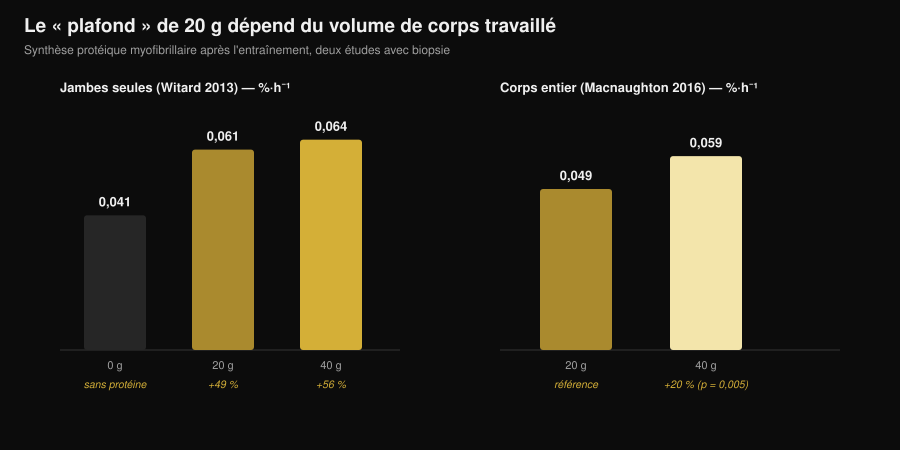
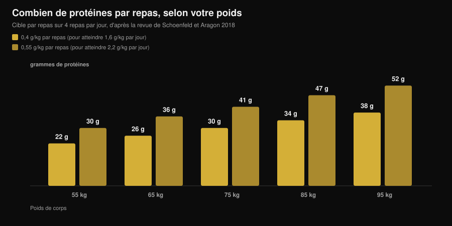

# Combien de protéines par repas ? Le mythe des 30 g

Par [Giammaria Loi](/autore/giammaria-loi) · mis à jour le 7 novembre 2026

"Au-delà de 30 g par repas, tu les jettes." Vous l'avez entendu à la salle, lu sur un pot de protéine en poudre et vu dans dix carrousels différents. C'est la règle la plus citée de la nutrition sportive, et c'est aussi celle que l'étude la plus rigoureuse jamais menée sur le sujet a démontée : avec 100 g de protéines en un seul repas, la réponse anabolique a été plus forte et a duré plus de douze heures. L'intérêt, c'est de comprendre ce que cela veut dire pour vos repas, parce que la conclusion pratique n'est pas "mangez tout d'un coup".

## L'essentiel

- **Le plafond n'existe pas.** Avec un traceur quadruple, 100 g de protéines après l'entraînement ont produit une réponse anabolique plus forte et plus longue (plus de 12 heures) que 25 g, avec un effet négligeable sur l'oxydation des acides aminés.
- **"Absorber" et "utiliser" ne sont pas la même chose.** Le mythe vit dans cette confusion : aucune étude ne montre une limite d'absorption intestinale à 30 g. La limite mesurée portait sur ce qu'une dose faisait monter la synthèse musculaire en quatre heures.
- **Le seuil des 20 g dépend de la quantité de corps entraînée.** Après une séance jambes seules, 40 g ne battent pas 20 g de façon significative. Après un entraînement du corps entier, 40 g font monter la synthèse de 20% de plus que 20 g (p = 0,005).
- **La répartition compte toujours.** Sur 12 heures, 80 g de whey répartis en 4 doses de 20 g toutes les 3 heures ont donné une synthèse supérieure de 31-48% à 8 doses de 10 g ou à 2 doses de 40 g.
- **Le chiffre à retenir est celui de la journée.** Le bénéfice s'aplatit autour de 1,6 g par kg et par jour ; pour y arriver, la revue la plus citée propose 0,4 g par kg et par repas sur au moins quatre repas.

## D'où vient le mythe des 20-30 grammes

Le chiffre n'est pas inventé. En 2013, une équipe de l'université de Stirling a donné à 48 hommes entraînés 0, 10, 20 ou 40 g de protéines de lactosérum après une séance de jambes, en mesurant par biopsie la synthèse des protéines contractiles dans les quatre heures suivantes. Avec 10 g, rien de plus qu'avec zéro ; avec 20 g, la synthèse montait de 49% ; avec 40 g, de 56%, une différence non significative par rapport à 20 g. Dans le même temps, 40 g augmentaient l'oxydation de la phénylalanine et la production d'urée.

D'où la phrase qui a circulé pendant dix ans : "20 g suffisent, le reste part en fumée". Deux lectures fausses se sont superposées. La première : *plus d'oxydation* ne veut pas dire *tout le reste oxydé*. La seconde, plus grave : cette étude mesurait quatre heures, pas une journée.

*Graphique Nurvan d'après les données de Witard et al., 2013 (Am J Clin Nutr) et Macnaughton et al., 2016 (Physiol Rep). Les valeurs 0,061 et 0,064 %·h⁻¹ sont calculées en appliquant les pourcentages de l'abstract (+49% et +56%) à la valeur de base de 0,041 %·h⁻¹. Aucune valeur n'a été lue sur une figure.*

## L'étude qui a déplacé la limite

En 2023, l'équipe de Maastricht a reposé la question avec un protocole beaucoup plus lourd : traceur isotopique quadruple avec perfusion, protéines marquées dans l'aliment lui-même, biopsies répétées et fenêtre d'observation étendue au-delà de douze heures. Les chercheurs ont comparé 25 g et 100 g de protéines pris après un entraînement.

Les 100 g ont produit une réponse anabolique **plus forte en amplitude et plus longue dans le temps**. La synthèse des protéines myofibrillaires, celle du tissu conjonctif du muscle et celle des protéines plasmatiques ont augmenté, ainsi que le bilan protéique du corps entier. La dégradation des protéines et l'oxydation des acides aminés ont à peine bougé : le fameux "tu brûles tout" ne s'est pas montré.

La conclusion des auteurs, c'est que la capacité à utiliser les protéines d'un seul repas avait été sous-estimée. Non pas que "plus est toujours mieux", mais que le mur à 20-25 g n'est pas là.

## Absorber n'est pas construire

Il vaut la peine de s'arrêter sur deux mots qu'on emploie comme des synonymes alors qu'ils ne le sont pas.

**L'absorption**, c'est le passage des acides aminés de l'intestin vers le sang. C'est un processus lent et continu qui, pour un repas solide copieux, se poursuit pendant des heures. Aucune étude n'a jamais montré un seuil à 30 g au-delà duquel l'intestin cesse de travailler : si c'était le cas, la moitié d'un repas de Noël ressortirait non digérée.

**L'utilisation anabolique**, c'est la part de ces acides aminés qui finit dans une protéine musculaire. C'est ce que les études de 2013 mesuraient sur une fenêtre de quatre heures, et c'est ce que le travail de 2023 a suivi pendant douze.

Quand vous lisez "le corps n'absorbe que 30 g", la phrase utilise le mauvais verbe pour raconter un résultat ancien.

## Ce que dit vraiment la recherche

| Affirmation courante | Verdict | Source |
|---|---|---|
| "Au-delà de 20-30 g par repas, le reste est gaspillé" | **Démenti** | Trommelen et al., 2023 |
| "Le corps n'absorbe que 30 g de protéines par repas" | **Démenti** : confond absorption et utilisation | Trommelen et al., 2023 |
| "20 g maximisent la synthèse protéique" | **À nuancer** : dépend de la masse que vous avez entraînée | Witard 2013 ; Macnaughton 2016 |
| "Donc la répartition dans les repas ne compte pas" | **À nuancer** : sur 12 heures, 4×20 g reste le schéma le mieux testé | Areta et al., 2013 |
| "Les mêmes seuils valent pour tout le monde" | **Impossible à trancher aujourd'hui** chez les femmes entraînées | Witard et Mettler, 2024 |

### Pourquoi "20 g" n'est pas un chiffre universel

En 2016, la même ligne de recherche a changé une seule variable : au lieu d'entraîner les jambes seules, les participants ont fait une séance du corps entier. Avec 20 g, la synthèse a été de 0,049 %·h⁻¹ ; avec 40 g, de 0,059 %·h⁻¹ : environ 20% de plus, avec une différence statistiquement significative (p = 0,005). Curieusement, la masse maigre totale de la personne n'a rien changé : ce qui comptait, c'était la quantité de muscle stimulée par la séance, pas la quantité de muscle portée au total.

C'est le point le plus utile à retenir : la "bonne" dose par repas n'est pas une constante de votre métabolisme, c'est une variable qui dépend aussi de ce que vous venez de faire à la salle.

### Pourquoi un seul repas géant n'est pas la réponse

Ceux qui n'ont lu que le titre de l'étude de 2023 en ont déduit que la répartition ne sert plus à rien. Deux choses disent le contraire.

La première est une expérience de 2013 sur 24 hommes entraînés : 80 g de whey répartis sur douze heures de récupération selon trois schémas. Huit doses de 10 g toutes les heures et demie, quatre de 20 g toutes les trois heures, deux de 40 g toutes les six heures. Les trois ont fait monter la synthèse au-dessus du repos, mais le schéma intermédiaire a battu les deux autres de 31-48%.

La seconde est un commentaire publié en 2024 en réponse directe à l'étude des 100 g : les auteurs reconnaissent l'avancée scientifique, mais avertissent que les implications pratiques ont été mal interprétées et qu'enterrer la répartition des repas est prématuré. Ils signalent aussi que l'échantillon était composé d'hommes jeunes actifs mais non entraînés en musculation, et que l'absence de plafond ne semble pas se transférer aux jeunes femmes entraînées. Sur ce dernier point, il n'y a pas encore de chiffres que nous puissions rapporter : c'est une limite déclarée, pas une donnée.

## Comment l'appliquer

Le chiffre qui compte vraiment, c'est le total de la journée : la méta-analyse de référence montre que le bénéfice sur la masse musculaire s'aplatit autour de 1,6 g par kg de poids et par jour. Si vous vous demandez combien il vous en faut en phase de perte de gras, nous l'avons détaillé dans [combien de protéines en sèche](/fr/blog/proteines-en-seche).

Pour la répartir, la revue de Schoenfeld et Aragon propose un calcul simple : **0,4 g par kg et par repas, sur au moins quatre repas**. Celui qui vise la limite haute de 2,2 g par kg et par jour arrive à 0,55 g par kg et par repas.

*Graphique Nurvan : calcul d'après les coefficients de la revue de Schoenfeld et Aragon, 2018 (J Int Soc Sports Nutr), sur quatre repas par jour. Valeurs arrondies au gramme.*

Trois repères pratiques qui tiennent à la lumière de tout cela :

1. **Arrêtez d'avoir peur du gros repas.** Si le dîner est le seul moment où vous mangez correctement, 50-60 g de protéines là ne sont pas gaspillés. Un repas copieux vaut mieux qu'un repas sauté.
2. **Si vous pouvez choisir, répartissez.** Trois ou quatre occasions avec une source de protéines correcte restent le schéma le mieux soutenu, et c'est aussi plus facile à gérer côté satiété et digestion.
3. **Montez la dose les jours d'entraînement complet.** Après une séance full body ou un entraînement long, rester dans le haut de votre fourchette par repas a un appui mesuré.

Pour remplir ces chiffres, tables CREA en main, voici ce qu'il faut de quelques aliments courants pour arriver à 30 g de protéines :

| Aliment (données CREA 2019) | Quantité pour 30 g de protéines | Calories |
|---|---|---|
| Grana Padano AOP | 88 g | 347 kcal |
| Bresaola della Valtellina IGP | 91 g | 138 kcal |
| Blanc de poulet poêlé | 99 g | 128 kcal |
| Thon au naturel égoutté | 120 g | 123 kcal |
| Cabillaud ou merlu | 176 g | 125 kcal |
| Œufs durs (entier) | 242 g, environ 5 œufs | 310 kcal |
| Blanc d'œuf | 280 g | 121 kcal |
| Cottage cheese maigre | 309 g | 356 kcal |
| Yaourt grec 0% | 333 g | 170 kcal |
| Lentilles sèches cuites | 435 g | 474 kcal |

*Calcul Nurvan d'après les tables CREA — Centre de recherche Alimentation et Nutrition (Italie), mise à jour 2019. Formule : (30 ÷ protéines pour 100 g) × 100.*

On voit tout de suite pourquoi les sources ne sont pas interchangeables à protéines égales : 30 g venant du Grana coûtent presque trois fois les calories de 30 g venant du poulet, et pour les lentilles il faut 435 g de produit cuit. Sur la comparaison entre sources animales et végétales, nous avons un article dédié : [protéines végétales ou animales pour les muscles](/fr/blog/proteines-vegetales-ou-animales-pour-les-muscles).

> **Nurvan : les protéines repas par repas, pas seulement le total du jour**
>
> La section nutrition de Nurvan s'appuie sur la base de données CREA et affiche les protéines de chaque repas à côté du total quotidien : vous voyez tout de suite si vos 140 g sont répartis sur quatre occasions ou concentrés au dîner. [Essayez Nurvan](https://nurvan.app)

## Questions fréquentes

**Combien de protéines puis-je absorber en un repas ?**
Il n'y a pas de plafond connu. L'absorption intestinale se poursuit pendant des heures, en proportion de ce que vous avez mangé. L'étude qui a donné 100 g en un seul repas a trouvé une réponse anabolique plus forte et plus longue qu'avec 25 g, sans hausse notable de l'oxydation des acides aminés.

**Alors 30 g par repas, c'est trop peu ?**
Cela dépend de votre poids et du total que vous devez atteindre. Pour une personne de 75 kg, 30 g par repas correspondent exactement à 0,4 g par kg, la valeur proposée par la revue sur quatre repas pour atteindre 1,6 g par kg et par jour. Pour une personne de 95 kg, 30 g par repas restent sous cette cible.

**Si je mange toutes mes protéines de la journée en deux repas, est-ce que je perds du muscle ?**
Aucune étude ne dit cela. Les données sur 12 heures montrent en revanche que quatre doses réparties ont donné plus de synthèse que deux grosses doses. Si vous pouvez choisir, répartissez ; si vous ne pouvez pas, c'est surtout le total qui compte.

**Est-ce que c'est pareil pour les femmes ?**
Le commentaire de Witard et Mettler de 2024 signale que l'absence de limite supérieure ne semble pas se transférer aux jeunes femmes entraînées en musculation. Il n'y a pas encore de données solides à rapporter sous forme de chiffres : c'est une question ouverte, et pour l'instant mieux vaut s'en tenir aux repères par repas des revues.

## À lire ensuite

- [Combien de protéines en sèche](/fr/blog/proteines-en-seche) — le total quotidien quand les calories sont basses.
- [Protéines végétales ou animales pour les muscles](/fr/blog/proteines-vegetales-ou-animales-pour-les-muscles) — la qualité de la source compte plus que la quantité.
- [Beef protein : les protéines de bœuf valent-elles la whey ?](/fr/blog/beef-protein-proteines-de-boeuf-vs-whey) — ce qui change vraiment d'une poudre à l'autre.

## Sources

1. Trommelen J, van Lieshout GAA, Nyakayiru J, et al., 2023. The anabolic response to protein ingestion during recovery from exercise has no upper limit in magnitude and duration in vivo in humans. *Cell Rep Med* 4(12):101324. [PMID 38118410](https://pubmed.ncbi.nlm.nih.gov/38118410/) · [DOI 10.1016/j.xcrm.2023.101324](https://doi.org/10.1016/j.xcrm.2023.101324)
2. Witard OC, Mettler S, 2024. The Anabolic Response to Protein Ingestion During Recovery From Exercise Has No Upper Limit in Magnitude and Duration In Vivo in Humans: A Commentary. *Int J Sport Nutr Exerc Metab* 34(5):322–324. [PMID 38991545](https://pubmed.ncbi.nlm.nih.gov/38991545/) · [DOI 10.1123/ijsnem.2024-0041](https://doi.org/10.1123/ijsnem.2024-0041)
3. Witard OC, Jackman SR, Breen L, et al., 2014. Myofibrillar muscle protein synthesis rates subsequent to a meal in response to increasing doses of whey protein at rest and after resistance exercise. *Am J Clin Nutr* 99(1):86–95. [PMID 24257722](https://pubmed.ncbi.nlm.nih.gov/24257722/) · [DOI 10.3945/ajcn.112.055517](https://doi.org/10.3945/ajcn.112.055517)
4. Macnaughton LS, Wardle SL, Witard OC, et al., 2016. The response of muscle protein synthesis following whole-body resistance exercise is greater following 40 g than 20 g of ingested whey protein. *Physiol Rep* 4(15):e12893. [PMID 27511985](https://pubmed.ncbi.nlm.nih.gov/27511985/) · [DOI 10.14814/phy2.12893](https://doi.org/10.14814/phy2.12893)
5. Areta JL, Burke LM, Ross ML, et al., 2013. Timing and distribution of protein ingestion during prolonged recovery from resistance exercise alters myofibrillar protein synthesis. *J Physiol* 591(9):2319–2331. [PMID 23459753](https://pubmed.ncbi.nlm.nih.gov/23459753/) · [DOI 10.1113/jphysiol.2012.244897](https://doi.org/10.1113/jphysiol.2012.244897)
6. Schoenfeld BJ, Aragon AA, 2018. How much protein can the body use in a single meal for muscle-building? Implications for daily protein distribution. *J Int Soc Sports Nutr* 15:10. [PMID 29497353](https://pubmed.ncbi.nlm.nih.gov/29497353/) · [DOI 10.1186/s12970-018-0215-1](https://doi.org/10.1186/s12970-018-0215-1)
7. Morton RW, Murphy KT, McKellar SR, et al., 2018. A systematic review, meta-analysis and meta-regression of the effect of protein supplementation on resistance training-induced gains in muscle mass and strength in healthy adults. *Br J Sports Med* 52(6):376–384. [PMID 28698222](https://pubmed.ncbi.nlm.nih.gov/28698222/) · [DOI 10.1136/bjsports-2017-097608](https://doi.org/10.1136/bjsports-2017-097608)
8. Jäger R, Kerksick CM, Campbell BI, et al., 2017. International Society of Sports Nutrition Position Stand: protein and exercise. *J Int Soc Sports Nutr* 14:20. [PMID 28642676](https://pubmed.ncbi.nlm.nih.gov/28642676/) · [DOI 10.1186/s12970-017-0177-8](https://doi.org/10.1186/s12970-017-0177-8)

Données alimentaires : tables CREA — Centre de recherche Alimentation et Nutrition (Italie), mise à jour 2019. Sujet choisi à partir de signaux de tendance de début novembre 2026 (couverture dans la presse généraliste de la question "combien de protéines" et première page de recherche occupée par des contenus commerciaux qui répètent encore le plafond des 30 g). Sources scientifiques consultées via PubMed.

**Giammaria Loi** est le fondateur de Nurvan. Il s'entraîne avec des poids depuis 2012, travaille comme entraîneur personnel et coach certifié FIPE depuis 2013 et participe à des compétitions de powerlifting au niveau national depuis 2018. Chaque article qu'il signe part des études scientifiques et arrive à ce qui fonctionne vraiment à la salle. [Page auteur](/autore/giammaria-loi)

> Note : contenu informatif, ne remplace pas l'avis d'un médecin ou d'un professionnel qualifié.
