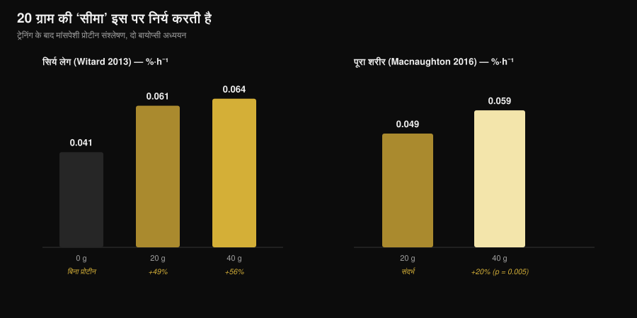
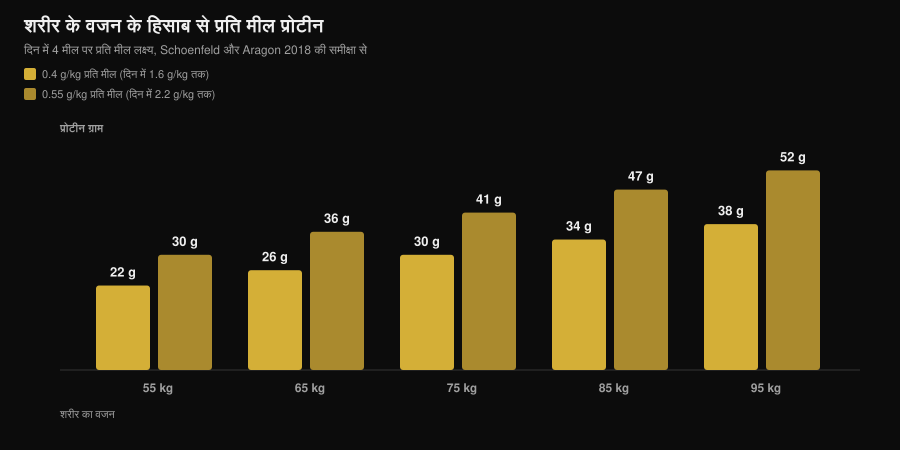

# एक मील में कितना प्रोटीन? 30 ग्राम का मिथ

लेखक: [Giammaria Loi](/autore/giammaria-loi) · अपडेट 7 नवंबर 2026

"एक मील में 30 ग्राम से ऊपर जो भी है, वो बेकार जाता है।" यह आपने जिम में सुना है, प्रोटीन के डिब्बे पर पढ़ा है और दर्जनों कैरोसेल में देखा है। स्पोर्ट्स न्यूट्रिशन का यह सबसे ज़्यादा दोहराया गया नियम है — और यही वह नियम है जिसे इस सवाल पर हुई अब तक की सबसे सटीक स्टडी ने तोड़ दिया: एक ही मील में 100 ग्राम प्रोटीन के साथ एनाबॉलिक रिस्पॉन्स (मसल प्रोटीन बनाने की प्रक्रिया) बड़ा था और बारह घंटे से ज़्यादा चला। काम की बात यह समझना है कि आपकी मील्स के लिए इसका मतलब क्या है, क्योंकि प्रैक्टिकल जवाब "सब कुछ एक बार में खा लो" नहीं है।

## मुख्य बातें

- **कोई ऊपरी सीमा नहीं है।** चार ट्रेसर (आइसोटोप से मार्क किए गए मार्कर) वाले तरीके से, ट्रेनिंग के बाद 100 ग्राम प्रोटीन ने 25 ग्राम से बड़ा और ज़्यादा देर (12 घंटे से ऊपर) चलने वाला एनाबॉलिक रिस्पॉन्स दिया, और अमीनो एसिड ऑक्सीडेशन पर असर नगण्य रहा।
- **"एब्ज़ॉर्ब होना" और "इस्तेमाल होना" एक बात नहीं है।** मिथ इसी कन्फ़्यूज़न में ज़िंदा है: कोई स्टडी 30 ग्राम पर आंत के एब्ज़ॉर्प्शन की सीमा नहीं दिखाती। जो सीमा नापी गई थी, वह यह थी कि चार घंटे में एक डोज़ ने मसल प्रोटीन सिंथेसिस कितना बढ़ाया।
- **20 ग्राम की थ्रेशोल्ड इस पर टिकी है कि आपने शरीर का कितना हिस्सा ट्रेन किया।** सिर्फ़ लेग वर्कआउट के बाद 40 ग्राम, 20 ग्राम से सार्थक रूप से आगे नहीं निकलता। फुल बॉडी वर्कआउट के बाद 40 ग्राम सिंथेसिस को 20 ग्राम से लगभग 20% ज़्यादा बढ़ाता है (p = 0.005)।
- **डिस्ट्रीब्यूशन अब भी मायने रखता है।** 12 घंटे में, 80 ग्राम व्हे को हर 3 घंटे पर 20 ग्राम की चार डोज़ में बांटने से सिंथेसिस, 10 ग्राम की आठ डोज़ और 40 ग्राम की दो डोज़ से 31-48% ज़्यादा रहा।
- **पकड़ कर रखने वाला नंबर रोज़ का टोटल है।** फ़ायदा करीब 1.6 ग्राम प्रति किलो प्रति दिन पर सपाट हो जाता है; वहाँ तक पहुँचने के लिए सबसे ज़्यादा उद्धृत रिव्यू कम से कम चार मील्स में 0.4 ग्राम प्रति किलो प्रति मील सुझाता है।

## 20-30 ग्राम का नियम कहाँ से आया

यह नंबर हवा में नहीं बना। 2013 में Stirling यूनिवर्सिटी की एक टीम ने 48 ट्रेन्ड पुरुषों को लेग वर्कआउट के बाद 0, 10, 20 या 40 ग्राम व्हे प्रोटीन दिया और मसल बायोप्सी से अगले चार घंटों में कॉन्ट्रैक्टाइल प्रोटीन सिंथेसिस नापा। 10 ग्राम से शून्य के मुकाबले कुछ नहीं हुआ; 20 ग्राम से सिंथेसिस 49% बढ़ा; 40 ग्राम से 56%, जो 20 ग्राम से सार्थक रूप से ज़्यादा नहीं था। साथ ही 40 ग्राम से फेनिलएलानिन ऑक्सीडेशन और यूरिया प्रोडक्शन बढ़े।

यहीं से वह लाइन निकली जो दस साल दोहराई गई: "20 ग्राम काफ़ी है, बाकी जल जाता है।" दो गलत पढ़त एक पर एक चढ़ गईं। पहली: *ज़्यादा ऑक्सीडेशन* का मतलब *बाकी सब ऑक्सीडाइज़* नहीं है। दूसरी, और ज़्यादा गंभीर: वह स्टडी चार घंटे नाप रही थी, पूरा दिन नहीं।

*Nurvan चार्ट, Witard et al., 2013 (Am J Clin Nutr) और Macnaughton et al., 2016 (Physiol Rep) के डेटा पर। 0.061 और 0.064 %·h⁻¹ वाली वैल्यू, एब्स्ट्रैक्ट में दिए प्रतिशत (+49% और +56%) को 0.041 %·h⁻¹ के बेसलाइन पर लगाकर निकाली गई हैं। कोई भी वैल्यू किसी फ़िगर से पढ़कर नहीं ली गई।*

## वह स्टडी जिसने सीमा हिला दी

2023 में Maastricht की एक टीम ने यही सवाल बहुत भारी डिज़ाइन के साथ फिर पूछा: इन्फ़्यूज़न के साथ चार आइसोटोप ट्रेसर, खाने में ही मार्क किया हुआ प्रोटीन, बार-बार बायोप्सी, और बारह घंटे से आगे खिंची हुई ऑब्ज़र्वेशन विंडो। उन्होंने ट्रेनिंग के बाद ली गई 25 ग्राम और 100 ग्राम प्रोटीन की तुलना की।

100 ग्राम की डोज़ ने **मात्रा में बड़ा और समय में लंबा** रिस्पॉन्स दिया। मायोफ़ाइब्रिलर प्रोटीन सिंथेसिस बढ़ा, मसल कनेक्टिव टिशू और प्लाज़्मा प्रोटीन सिंथेसिस भी बढ़ा, और पूरे शरीर का नेट प्रोटीन बैलेंस भी। प्रोटीन ब्रेकडाउन और अमीनो एसिड ऑक्सीडेशन लगभग जहाँ थे वहीं रहे: मशहूर "सब जल जाएगा" दिखा ही नहीं।

लेखकों का निष्कर्ष यह है कि एक मील के प्रोटीन को इस्तेमाल करने की हमारी क्षमता को कम आँका गया था। यह नहीं कि "ज़्यादा हमेशा बेहतर", बल्कि यह कि 20-25 ग्राम पर दीवार मौजूद नहीं है।

## एब्ज़ॉर्प्शन का मतलब मसल बनना नहीं

दो शब्द एक जैसे इस्तेमाल होते हैं, जबकि वे एक नहीं हैं।

**एब्ज़ॉर्प्शन** यानी अमीनो एसिड का आंत से खून में जाना। यह धीमी और लगातार चलने वाली प्रक्रिया है, और भारी ठोस मील के लिए घंटों चलती रहती है। किसी स्टडी ने कभी 30 ग्राम की ऐसी थ्रेशोल्ड नहीं दिखाई जिसके बाद आंत काम बंद कर दे — ऐसा होता तो शादी की आधी थाली बिना पचे बाहर आ जाती।

**एनाबॉलिक इस्तेमाल** यानी उन अमीनो एसिड का कितना हिस्सा असल में मसल प्रोटीन के अंदर पहुँचता है। 2013 के दौर की स्टडीज़ चार घंटे की विंडो में यही नाप रही थीं, और 2023 के काम ने इसी को बारह घंटे तक ट्रैक किया।

जब आप पढ़ते हैं "बॉडी सिर्फ़ 30 ग्राम एब्ज़ॉर्ब करती है", तो वह वाक्य एक पुराने नतीजे को बताने के लिए गलत क्रिया इस्तेमाल कर रहा है।

## रिसर्च असल में क्या कहती है

| आम दावा | फ़ैसला | स्रोत |
|---|---|---|
| "एक मील में 20-30 ग्राम से ऊपर बाकी बेकार जाता है" | **गलत साबित** | Trommelen et al., 2023 |
| "बॉडी एक मील में सिर्फ़ 30 ग्राम प्रोटीन एब्ज़ॉर्ब करती है" | **गलत साबित**: एब्ज़ॉर्प्शन और इस्तेमाल का घालमेल | Trommelen et al., 2023 |
| "20 ग्राम प्रोटीन सिंथेसिस को मैक्स कर देता है" | **शर्त के साथ सही**: निर्भर करता है कि कितनी मसल ट्रेन की | Witard 2013; Macnaughton 2016 |
| "तो मील डिस्ट्रीब्यूशन मायने नहीं रखता" | **शर्त के साथ**: 12 घंटे में 4×20 ग्राम अब भी सबसे अच्छा टेस्टेड पैटर्न है | Areta et al., 2013 |
| "वही थ्रेशोल्ड सबके लिए लागू हैं" | **आज जवाब नहीं**, ट्रेन्ड महिलाओं के लिए | Witard और Mettler, 2024 |

### 20 ग्राम कोई यूनिवर्सल नंबर क्यों नहीं है

2016 में उसी रिसर्च लाइन ने एक ही चीज़ बदली: सिर्फ़ लेग्स की जगह प्रतिभागियों ने फुल बॉडी सेशन किया। 20 ग्राम पर सिंथेसिस 0.049 %·h⁻¹ निकला; 40 ग्राम पर 0.059 %·h⁻¹ — लगभग 20% ज़्यादा, और सांख्यिकीय रूप से सार्थक (p = 0.005)। दिलचस्प बात यह रही कि व्यक्ति का कुल लीन बॉडी मास कोई फ़र्क नहीं डालता था: मायने यह रखा कि सेशन ने कितनी मसल को उत्तेजित किया, न कि व्यक्ति कुल कितनी मसल लेकर चलता है।

सबसे काम की बात यही है: हर मील की "सही" डोज़ आपके मेटाबॉलिज़्म का कोई स्थिर अंक नहीं है, बल्कि एक वेरिएबल है जो कुछ हद तक इस पर भी टिका है कि आपने अभी जिम में क्या किया।

### एक बड़ी मील जवाब क्यों नहीं है

जिन्होंने 2023 की स्टडी का सिर्फ़ हेडलाइन पढ़ा, उन्होंने मान लिया कि डिस्ट्रीब्यूशन खत्म हो गया। दो चीज़ें इसके उलट कहती हैं।

पहली, 2013 का 24 ट्रेन्ड पुरुषों पर हुआ एक एक्सपेरिमेंट: 80 ग्राम व्हे, बारह घंटे की रिकवरी में तीन पैटर्न में बांटकर। हर 90 मिनट पर 10 ग्राम की आठ डोज़, हर 3 घंटे पर 20 ग्राम की चार डोज़, और हर 6 घंटे पर 40 ग्राम की दो डोज़। तीनों ने सिंथेसिस को आराम के स्तर से ऊपर उठाया, लेकिन बीच वाला पैटर्न बाकी दोनों से 31-48% आगे रहा।

दूसरी, 2024 में 100 ग्राम वाली स्टडी के सीधे जवाब में छपा एक कमेंट्री। लेखक वैज्ञानिक प्रगति को मानते हैं, लेकिन चेताते हैं कि प्रैक्टिकल नतीजे गलत पढ़े गए हैं और मील डिस्ट्रीब्यूशन को किनारे करना जल्दबाज़ी है। वे यह भी बताते हैं कि प्रतिभागी युवा सक्रिय पुरुष थे जो वेट ट्रेनिंग वाले नहीं थे, और ऊपरी सीमा की गैरमौजूदगी युवा ट्रेन्ड महिलाओं पर लागू होती नहीं दिखती। इस आखिरी बात पर अभी ऐसे नंबर नहीं हैं जो हम बता सकें: यह एक घोषित सीमा है, कोई नतीजा नहीं।

## इसे कैसे लागू करें

असल में मायने रखने वाला नंबर दिन का टोटल है: रेफ़रेंस मेटा-एनालिसिस दिखाती है कि मसल मास पर फ़ायदा करीब 1.6 ग्राम प्रति किलो बॉडीवेट प्रति दिन पर सपाट हो जाता है। अगर सोच रहे हैं कि फ़ैट लॉस फ़ेज़ में कितना चाहिए, तो हमने इसे विस्तार से यहाँ कवर किया है: [फ़ैट लॉस फ़ेज़ में कितना प्रोटीन चाहिए](/hi/blog/protein-for-fat-loss-phase)।

इसे बांटने के लिए Schoenfeld और Aragon का रिव्यू एक आसान हिसाब देता है: **0.4 ग्राम प्रति किलो प्रति मील, कम से कम चार मील्स में**। जो 2.2 ग्राम प्रति किलो प्रति दिन की ऊपरी हद पर निशाना लगाते हैं, वे 0.55 ग्राम प्रति किलो प्रति मील पर पहुँचते हैं।

*Nurvan चार्ट: Schoenfeld और Aragon के रिव्यू, 2018 (J Int Soc Sports Nutr) के गुणांकों पर, दिन की चार मील्स के हिसाब से। वैल्यू ग्राम तक राउंड की गई हैं। मेथड नोट: पिछले चार्ट की 0.061 और 0.064 %·h⁻¹ वैल्यू, एब्स्ट्रैक्ट के प्रतिशत (+49% और +56%) को 0.041 %·h⁻¹ बेसलाइन पर लगाकर निकाली गई हैं; कोई वैल्यू फ़िगर से पढ़कर नहीं ली गई।*

इन सबकी रोशनी में तीन प्रैक्टिकल बातें टिकती हैं:

1. **बड़ी मील से डरना बंद करें।** अगर डिनर ही वह एक वक़्त है जब आप ठीक से खाते हैं, तो वहाँ 50-60 ग्राम प्रोटीन बेकार नहीं जाता। एक बड़ी मील, छूटी हुई मील से बेहतर है।
2. **अगर चुन सकते हैं, तो बांटें।** ढंग के प्रोटीन सोर्स वाले तीन-चार मौके अब भी सबसे अच्छे सपोर्ट वाला पैटर्न हैं, और भूख और पाचन के लिहाज़ से भी आसान हैं।
3. **फुल बॉडी वाले दिनों में डोज़ ऊपर रखें।** फुल बॉडी सेशन या लंबे वर्कआउट के बाद अपनी प्रति-मील रेंज के ऊपरी सिरे पर रहना नापे गए सबूत पर टिका है।

इन नंबरों को भरने के लिए, इटली की CREA फ़ूड टेबल के हिसाब से 30 ग्राम प्रोटीन तक पहुँचने के लिए कुछ आम चीज़ों की मात्रा:

| खाद्य पदार्थ (CREA 2019 डेटा) | 30 ग्राम प्रोटीन के लिए मात्रा | कैलोरी |
|---|---|---|
| Grana Padano DOP (इटली की हार्ड एज्ड चीज़) | 88 g | 347 kcal |
| Bresaola della Valtellina IGP (इटली का क्योर्ड बीफ़) | 91 g | 138 kcal |
| चिकन ब्रेस्ट, पैन में पका | 99 g | 128 kcal |
| टूना, नमक के पानी वाला, छाना हुआ | 120 g | 123 kcal |
| कॉड या हेक मछली | 176 g | 125 kcal |
| उबले साबुत अंडे | 242 g, लगभग 5 अंडे | 310 kcal |
| अंडे की सफ़ेदी | 280 g | 121 kcal |
| लो-फ़ैट पनीर जैसा कॉटेज चीज़ | 309 g | 356 kcal |
| ग्रीक योगर्ट 0% फ़ैट | 333 g | 170 kcal |
| सूखी मसूर/दाल, उबली हुई | 435 g | 474 kcal |

*Nurvan की गणना, CREA टेबल पर — CREA इटली का राष्ट्रीय खाद्य एवं पोषण अनुसंधान केंद्र है, 2019 अपडेट। फ़ॉर्मूला: (30 ÷ प्रति 100 g प्रोटीन) × 100.*

एक नज़र में साफ़ है कि बराबर प्रोटीन पर सोर्स आपस में बदले नहीं जा सकते: Grana से 30 ग्राम प्रोटीन की कैलोरी, चिकन से 30 ग्राम की कैलोरी से लगभग तीन गुना है, और दाल से आपको 435 g पका हुआ प्रोडक्ट चाहिए। एनिमल बनाम प्लांट सोर्स की तुलना पर हमारा अलग लेख है: [मसल्स के लिए पौधों या पशु प्रोटीन](/hi/blog/paudhon-ya-pashu-protein-muscle-ke-liye)।

> **Nurvan: प्रोटीन मील-दर-मील, सिर्फ़ दिन का टोटल नहीं**
>
> Nurvan का न्यूट्रिशन सेक्शन CREA फ़ूड डेटाबेस पर चलता है और आपके रोज़ के टोटल के साथ-साथ हर एक मील का प्रोटीन दिखाता है, जिससे एक नज़र में पता चलता है कि आपके 140 ग्राम चार मौकों में बंटे हैं या सारे डिनर में ढेर हो गए हैं। [Nurvan आज़माएँ](https://nurvan.app)

## अक्सर पूछे जाने वाले सवाल

**एक मील में मैं कितना प्रोटीन एब्ज़ॉर्ब कर सकता हूँ?**
कोई ज्ञात ऊपरी सीमा नहीं है। आपने जितना खाया है, उसके अनुपात में आंत का एब्ज़ॉर्प्शन घंटों चलता रहता है। जिस स्टडी में एक ही मील में 100 ग्राम दिया गया, उसमें 25 ग्राम से बड़ा और लंबा एनाबॉलिक रिस्पॉन्स मिला, और अमीनो एसिड ऑक्सीडेशन में कोई मायने रखने वाली बढ़त नहीं हुई।

**तो क्या एक मील में 30 ग्राम कम है?**
यह आपके वज़न और दिन के टोटल पर निर्भर है। 75 किलो के व्यक्ति के लिए 30 ग्राम प्रति मील ठीक 0.4 ग्राम प्रति किलो है — वही आंकड़ा जो रिव्यू चार मील्स में 1.6 ग्राम प्रति किलो प्रति दिन तक पहुँचने के लिए सुझाता है। 95 किलो के व्यक्ति के लिए 30 ग्राम प्रति मील उस टारगेट से नीचे है।

**अगर मैं दिन का सारा प्रोटीन दो मील्स में खा लूँ, तो मसल्स घटेंगी?**
कोई स्टडी ऐसा नहीं कहती। हाँ, 12 घंटे के डेटा में चार बंटी डोज़ ने दो बड़ी डोज़ से ज़्यादा सिंथेसिस दिया। अगर चुन सकते हैं तो बांटें; अगर नहीं, तो सबसे ज़्यादा दिन का टोटल गिनता है।

**क्या महिलाओं पर भी यही लागू होता है?**
Witard और Mettler की 2024 की कमेंट्री बताती है कि ऊपरी सीमा की गैरमौजूदगी युवा वेट-ट्रेन्ड महिलाओं पर लागू होती नहीं दिखती। अभी ऐसे ठोस नंबर नहीं हैं जिन्हें हम बता सकें: यह खुला सवाल है, और फ़िलहाल रिव्यूज़ के प्रति-मील रेफ़रेंस वैल्यू पर टिके रहना समझदारी है।

## यह भी पढ़ें

- [फ़ैट लॉस फ़ेज़ में कितना प्रोटीन चाहिए](/hi/blog/protein-for-fat-loss-phase) — कैलोरी कम होने पर दिन का टोटल।
- [मसल्स के लिए पौधों या पशु प्रोटीन](/hi/blog/paudhon-ya-pashu-protein-muscle-ke-liye) — सोर्स की क्वालिटी मात्रा से ज़्यादा मायने रखती है।
- [बीफ़ प्रोटीन पाउडर या व्हे प्रोटीन: क्या बेहतर है?](/hi/blog/beef-protein-powder-ya-whey-protein) — एक पाउडर को दूसरे से असल में क्या अलग करता है।

## स्रोत

1. Trommelen J, van Lieshout GAA, Nyakayiru J, et al., 2023. The anabolic response to protein ingestion during recovery from exercise has no upper limit in magnitude and duration in vivo in humans. *Cell Rep Med* 4(12):101324. [PMID 38118410](https://pubmed.ncbi.nlm.nih.gov/38118410/) · [DOI 10.1016/j.xcrm.2023.101324](https://doi.org/10.1016/j.xcrm.2023.101324)
2. Witard OC, Mettler S, 2024. The Anabolic Response to Protein Ingestion During Recovery From Exercise Has No Upper Limit in Magnitude and Duration In Vivo in Humans: A Commentary. *Int J Sport Nutr Exerc Metab* 34(5):322–324. [PMID 38991545](https://pubmed.ncbi.nlm.nih.gov/38991545/) · [DOI 10.1123/ijsnem.2024-0041](https://doi.org/10.1123/ijsnem.2024-0041)
3. Witard OC, Jackman SR, Breen L, et al., 2014. Myofibrillar muscle protein synthesis rates subsequent to a meal in response to increasing doses of whey protein at rest and after resistance exercise. *Am J Clin Nutr* 99(1):86–95. [PMID 24257722](https://pubmed.ncbi.nlm.nih.gov/24257722/) · [DOI 10.3945/ajcn.112.055517](https://doi.org/10.3945/ajcn.112.055517)
4. Macnaughton LS, Wardle SL, Witard OC, et al., 2016. The response of muscle protein synthesis following whole-body resistance exercise is greater following 40 g than 20 g of ingested whey protein. *Physiol Rep* 4(15):e12893. [PMID 27511985](https://pubmed.ncbi.nlm.nih.gov/27511985/) · [DOI 10.14814/phy2.12893](https://doi.org/10.14814/phy2.12893)
5. Areta JL, Burke LM, Ross ML, et al., 2013. Timing and distribution of protein ingestion during prolonged recovery from resistance exercise alters myofibrillar protein synthesis. *J Physiol* 591(9):2319–2331. [PMID 23459753](https://pubmed.ncbi.nlm.nih.gov/23459753/) · [DOI 10.1113/jphysiol.2012.244897](https://doi.org/10.1113/jphysiol.2012.244897)
6. Schoenfeld BJ, Aragon AA, 2018. How much protein can the body use in a single meal for muscle-building? Implications for daily protein distribution. *J Int Soc Sports Nutr* 15:10. [PMID 29497353](https://pubmed.ncbi.nlm.nih.gov/29497353/) · [DOI 10.1186/s12970-018-0215-1](https://doi.org/10.1186/s12970-018-0215-1)
7. Morton RW, Murphy KT, McKellar SR, et al., 2018. A systematic review, meta-analysis and meta-regression of the effect of protein supplementation on resistance training-induced gains in muscle mass and strength in healthy adults. *Br J Sports Med* 52(6):376–384. [PMID 28698222](https://pubmed.ncbi.nlm.nih.gov/28698222/) · [DOI 10.1136/bjsports-2017-097608](https://doi.org/10.1136/bjsports-2017-097608)
8. Jäger R, Kerksick CM, Campbell BI, et al., 2017. International Society of Sports Nutrition Position Stand: protein and exercise. *J Int Soc Sports Nutr* 14:20. [PMID 28642676](https://pubmed.ncbi.nlm.nih.gov/28642676/) · [DOI 10.1186/s12970-017-0177-8](https://doi.org/10.1186/s12970-017-0177-8)

फ़ूड डेटा: CREA फ़ूड कंपोज़िशन टेबल, 2019 अपडेट। विषय नवंबर 2026 की शुरुआत के ट्रेंड सिग्नल से चुना गया (मुख्यधारा मीडिया में "कितना प्रोटीन" के सवाल की कवरेज और Google का पहला पेज, जो 30 ग्राम की सीमा दोहराते कमर्शियल कंटेंट से भरा है)। वैज्ञानिक स्रोत PubMed के ज़रिए देखे गए।

**Giammaria Loi** Nurvan के फ़ाउंडर हैं। वे 2012 से वेट ट्रेनिंग कर रहे हैं, 2013 से FIPE-सर्टिफ़ाइड पर्सनल ट्रेनर और कोच के रूप में काम कर रहे हैं, और 2018 से राष्ट्रीय स्तर पर पावरलिफ़्टिंग में प्रतिस्पर्धा करते हैं। उनका हर लेख रिसर्च से शुरू होता है और जिम में असल में जो काम करता है, वहाँ खत्म होता है। [लेखक पेज](/autore/giammaria-loi)

> नोट: यह जानकारी देने वाला कंटेंट है, किसी डॉक्टर या योग्य पेशेवर की सलाह का विकल्प नहीं।
