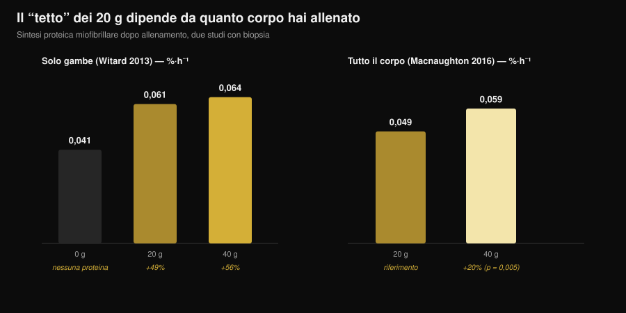
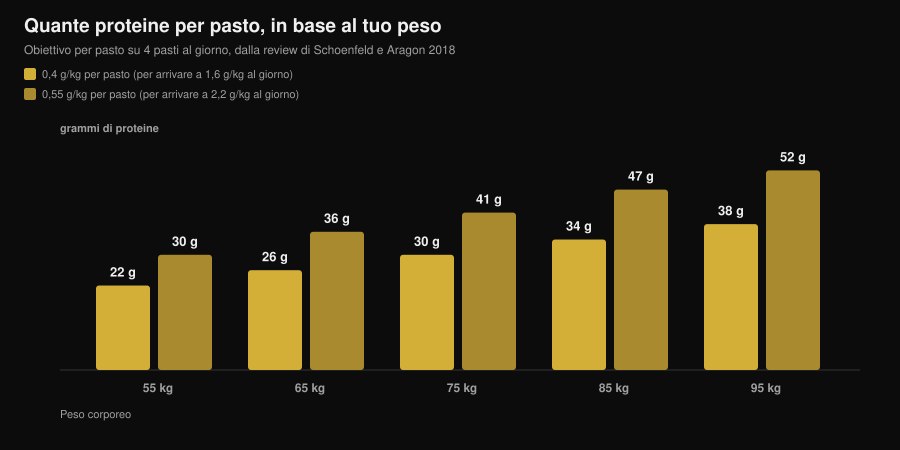

# Quante proteine per pasto: esiste un limite?

Di [Giammaria Loi](/autore/giammaria-loi) · aggiornato il 7 novembre 2026

"Oltre 30 g per pasto le butti via." L'hai sentito in palestra, letto sull'etichetta di una proteina in polvere e visto in dieci caroselli diversi. È la regola più citata della nutrizione sportiva, ed è anche quella che lo studio più accurato mai fatto sull'argomento ha smontato: con 100 g di proteine in un solo pasto la risposta anabolica è più grande e dura più di dodici ore. Il punto è capire cosa significa davvero per i tuoi pasti, perché la conclusione pratica non è "mangia tutto in una volta".

## In breve

- **Il tetto non esiste.** Con un tracciante quadruplo, 100 g di proteine dopo l'allenamento hanno prodotto una risposta anabolica maggiore e più prolungata (oltre 12 ore) rispetto a 25 g, con un impatto trascurabile sull'ossidazione degli aminoacidi.
- **"Assorbire" e "usare" sono due cose diverse.** Il mito nasce da questa confusione: nessuno studio mostra un limite di assorbimento intestinale a 30 g. Il limite misurato riguardava quanto la dose alzava la sintesi muscolare in quelle 4 ore.
- **La soglia dei 20 g dipende da quanto corpo hai allenato.** Dopo un lavoro sulle sole gambe, 40 g non battono 20 g in modo significativo. Dopo un allenamento di tutto il corpo, 40 g alzano la sintesi del 20% in più di 20 g (p = 0,005).
- **La distribuzione conta ancora.** Su 12 ore, 80 g di whey divisi in 4 dosi da 20 g ogni 3 ore hanno dato una sintesi superiore del 31-48% rispetto a 8 dosi da 10 g o a 2 dosi da 40 g.
- **Il numero da tenere a mente è quello giornaliero.** Il beneficio si appiattisce intorno a 1,6 g per kg al giorno; per arrivarci la review più citata propone 0,4 g per kg per pasto su almeno quattro pasti.

## Da dove viene il mito dei 20-30 grammi

Il numero non è inventato. Nel 2013 un gruppo dell'Università di Stirling ha dato a 48 uomini allenati 0, 10, 20 o 40 g di proteine del siero del latte dopo un allenamento di gambe, misurando con biopsia la sintesi delle proteine contrattili nelle quattro ore successive. Con 10 g non succedeva niente in più rispetto a zero; con 20 g la sintesi saliva del 49%; con 40 g del 56%, una differenza non significativa rispetto a 20 g. Nello stesso tempo, con 40 g aumentavano l'ossidazione della fenilalanina e la produzione di urea.

Da qui la frase che è girata per dieci anni: "20 g bastano, il resto si brucia". Due letture sbagliate si sono sovrapposte. La prima: *più ossidazione* non significa *tutto il resto ossidato*. La seconda, più grave: quello studio misurava quattro ore, non la giornata.

*Grafico Nurvan sui dati di Witard et al., 2013 (Am J Clin Nutr) e Macnaughton et al., 2016 (Physiol Rep). I valori 0,061 e 0,064 %·h⁻¹ sono calcolati applicando le percentuali dell'abstract (+49% e +56%) al valore base di 0,041 %·h⁻¹. Nessun valore letto da una figura.*

## Lo studio che ha spostato il limite

Nel 2023 il gruppo di Maastricht ha rifatto la domanda con un disegno molto più pesante: tracciante quadruplo con infusione, proteine marcate nell'alimento, biopsie ripetute e un periodo di osservazione esteso a oltre dodici ore. Hanno confrontato 25 g e 100 g di proteine assunti dopo un allenamento.

I 100 g hanno prodotto una risposta anabolica **maggiore in ampiezza e più lunga nel tempo**. Sono aumentate la sintesi delle proteine miofibrillari, di quelle del tessuto connettivo muscolare e di quelle plasmatiche, e il bilancio proteico di tutto il corpo. La degradazione proteica e l'ossidazione degli aminoacidi sono rimaste quasi invariate: il famoso "lo bruci tutto" non si è visto.

La conclusione degli autori è che la capacità di usare le proteine di un singolo pasto era stata sottostimata. Non che "più è sempre meglio", ma che il muro a 20-25 g non c'è.

## Assorbimento non vuol dire costruzione

Vale la pena fermarsi su due parole che vengono usate come sinonimi e non lo sono.

**Assorbimento** è il passaggio degli aminoacidi dall'intestino al sangue. È un processo lento e continuo, che per un pasto solido abbondante va avanti per ore. Nessuno studio ha mai mostrato una soglia a 30 g oltre la quale l'intestino smette di lavorare: se fosse così, mezzo pasto di Natale finirebbe non digerito.

**Uso anabolico** è quanto di quegli aminoacidi finisce dentro una proteina muscolare. È questa la cosa che gli studi del 2013 misuravano in una finestra di quattro ore, ed è questa che il lavoro del 2023 ha seguito per dodici.

Quando leggi "il corpo assorbe solo 30 g", la frase sta usando il verbo sbagliato per raccontare un dato vecchio.

## Cosa dice davvero la ricerca

| Affermazione diffusa | Verdetto | Fonte |
|---|---|---|
| "Oltre 20-30 g per pasto il resto si spreca" | **Smentito** | Trommelen et al., 2023 |
| "Il corpo assorbe solo 30 g di proteine per pasto" | **Smentito**: confonde assorbimento e uso | Trommelen et al., 2023 |
| "20 g massimizzano la sintesi proteica" | **Da precisare**: dipende da quanta massa hai allenato | Witard 2013; Macnaughton 2016 |
| "Allora la distribuzione nei pasti non conta" | **Da precisare**: su 12 ore 4×20 g resta la strategia migliore testata | Areta et al., 2013 |
| "Le stesse soglie valgono per tutti" | **Non verificabile oggi** per le donne allenate | Witard e Mettler, 2024 |

### Perché "20 g" non è un numero universale

Nel 2016, lo stesso filone di ricerca ha cambiato una sola variabile: invece di allenare solo le gambe, i partecipanti hanno fatto una seduta di tutto il corpo. Con 20 g la sintesi è stata di 0,049 %·h⁻¹, con 40 g di 0,059 %·h⁻¹: circa il 20% in più, con una differenza statisticamente significativa (p = 0,005). Curiosamente, la massa magra totale della persona non ha fatto differenza: contava quanto muscolo era stato stimolato dall'allenamento, non quanto ne avesse in tutto.

È la cosa più utile da portarsi via: la dose "giusta" per pasto non è una costante del metabolismo, è una variabile che dipende anche da cosa hai appena fatto in palestra.

### Perché un solo pasto gigante non è la risposta

Chi ha letto solo il titolo dello studio del 2023 ne ha dedotto che la distribuzione non serve più. Due cose dicono il contrario.

La prima è un esperimento del 2013 su 24 uomini allenati: 80 g di whey distribuiti su dodici ore di recupero in tre modi diversi. Otto dosi da 10 g ogni ora e mezza, quattro da 20 g ogni tre ore, due da 40 g ogni sei ore. Tutte e tre hanno alzato la sintesi sopra il riposo, ma il formato intermedio ha fatto meglio degli altri due del 31-48%.

La seconda è un commentary pubblicato nel 2024 proprio in risposta allo studio dei 100 g: gli autori riconoscono l'avanzamento scientifico, ma avvertono che le implicazioni pratiche sono state malinterpretate e che archiviare la distribuzione dei pasti è prematuro. Segnalano anche che il campione era composto da uomini giovani attivi ma non allenati con i pesi, e che l'assenza di un tetto non sembra trasferirsi alle donne giovani allenate. Su quest'ultimo punto non ci sono ancora numeri che possiamo riportare: è un limite dichiarato, non un dato.

## Come applicarlo

Il numero che conta davvero è il totale della giornata: la meta-analisi di riferimento mostra che il beneficio sulla massa muscolare si appiattisce intorno a 1,6 g per kg di peso al giorno. Se hai dubbi su quanto ti serve in fase di dimagrimento, ne abbiamo parlato in dettaglio in [quante proteine servono in definizione](/blog/proteine-in-definizione).

Per distribuirlo, la review di Schoenfeld e Aragon propone un conto semplice: **0,4 g per kg per pasto, su almeno quattro pasti**. Chi punta al limite superiore di 2,2 g per kg al giorno arriva a 0,55 g per kg per pasto.

*Grafico Nurvan: calcolo sui coefficienti della review di Schoenfeld e Aragon, 2018 (J Int Soc Sports Nutr), su quattro pasti al giorno. Valori arrotondati al grammo.*

Tre indicazioni pratiche che reggono alla luce di tutto questo:

1. **Smetti di avere paura del pasto grosso.** Se la cena è l'unico momento in cui mangi bene, 50-60 g di proteine lì non sono sprecati. Un pasto abbondante vale più di un pasto saltato.
2. **Se puoi scegliere, dividi.** Tre o quattro occasioni con una fonte proteica decente restano la strategia con il supporto migliore, e sono anche più facili da gestire su sazietà e digestione.
3. **Alza la dose nei giorni di allenamento completo.** Dopo una seduta full body o un allenamento lungo, stare sulla parte alta del tuo range per pasto ha un senso misurato.

Per riempire quei numeri, tabelle CREA alla mano, ecco quanto serve di alcuni alimenti comuni per arrivare a 30 g di proteine:

| Alimento (dati CREA 2019) | Quantità per 30 g di proteine | Calorie |
|---|---|---|
| Grana Padano DOP | 88 g | 347 kcal |
| Bresaola della Valtellina IGP | 91 g | 138 kcal |
| Petto di pollo cotto in padella | 99 g | 128 kcal |
| Tonno in salamoia sgocciolato | 120 g | 123 kcal |
| Merluzzo o nasello | 176 g | 125 kcal |
| Uova sode (intero) | 242 g, circa 5 uova | 310 kcal |
| Albume d'uovo | 280 g | 121 kcal |
| Fiocchi di formaggio magro | 309 g | 356 kcal |
| Yogurt greco 0% | 333 g | 170 kcal |
| Lenticchie secche cotte | 435 g | 474 kcal |

*Elaborazione Nurvan sulle tabelle CREA — Centro di ricerca Alimenti e Nutrizione, aggiornamento 2019. Calcolo: (30 ÷ proteine per 100 g) × 100.*

Si vede subito il motivo per cui le fonti non sono interscambiabili a parità di proteine: 30 g dal Grana costano quasi tre volte le calorie di 30 g dal pollo, e dalle lenticchie servono 435 g di prodotto cotto. Sul confronto fra fonti animali e vegetali abbiamo un articolo dedicato: [proteine vegetali o animali per i muscoli](/blog/proteine-vegetali-o-animali-per-i-muscoli).

> **Nurvan: le proteine pasto per pasto, non solo il totale del giorno**
>
> La sezione nutrizione di Nurvan usa il database CREA e ti mostra le proteine di ogni singolo pasto accanto al totale giornaliero: vedi subito se i tuoi 140 g sono distribuiti su quattro occasioni o concentrati tutti a cena. [Prova Nurvan](https://nurvan.app)

## Domande frequenti

**Quante proteine posso assorbire in un pasto?**
Non c'è un tetto noto. L'assorbimento intestinale continua per ore in proporzione a quanto hai mangiato. Lo studio con 100 g in un unico pasto ha mostrato una risposta anabolica più grande e più lunga di quella con 25 g, senza un aumento rilevante dell'ossidazione degli aminoacidi.

**Allora 30 g per pasto sono pochi?**
Dipende dal tuo peso e dal totale che devi raggiungere. Per una persona di 75 kg, 30 g per pasto corrispondono a 0,4 g per kg, esattamente il valore proposto dalla review su quattro pasti per arrivare a 1,6 g per kg al giorno. Per una persona di 95 kg, 30 g per pasto sono sotto quel bersaglio.

**Se mangio tutte le proteine della giornata in due pasti perdo muscolo?**
Nessuno studio dice questo. I dati su 12 ore indicano però che quattro dosi distribuite hanno dato una sintesi superiore a due dosi grandi. Se puoi scegliere, dividi; se non puoi, conta soprattutto il totale.

**Vale lo stesso per le donne?**
Il commentary di Witard e Mettler del 2024 segnala che l'assenza di un limite superiore non sembra trasferirsi alle donne giovani allenate con i pesi. Non ci sono ancora dati solidi da riportare come numeri: è una questione aperta, e per ora conviene restare sui riferimenti per pasto delle review.

## Leggi anche

- [Quante proteine servono in definizione](/blog/proteine-in-definizione) — il totale giornaliero quando le calorie sono basse.
- [Proteine vegetali o animali per i muscoli](/blog/proteine-vegetali-o-animali-per-i-muscoli) — la qualità della fonte conta più della quantità.
- [Beef protein: le proteine della carne valgono le whey?](/blog/beef-protein-proteine-carne-polvere) — cosa cambia davvero fra una polvere e l'altra.

## Fonti

1. Trommelen J, van Lieshout GAA, Nyakayiru J, et al., 2023. The anabolic response to protein ingestion during recovery from exercise has no upper limit in magnitude and duration in vivo in humans. *Cell Rep Med* 4(12):101324. [PMID 38118410](https://pubmed.ncbi.nlm.nih.gov/38118410/) · [DOI 10.1016/j.xcrm.2023.101324](https://doi.org/10.1016/j.xcrm.2023.101324)
2. Witard OC, Mettler S, 2024. The Anabolic Response to Protein Ingestion During Recovery From Exercise Has No Upper Limit in Magnitude and Duration In Vivo in Humans: A Commentary. *Int J Sport Nutr Exerc Metab* 34(5):322–324. [PMID 38991545](https://pubmed.ncbi.nlm.nih.gov/38991545/) · [DOI 10.1123/ijsnem.2024-0041](https://doi.org/10.1123/ijsnem.2024-0041)
3. Witard OC, Jackman SR, Breen L, et al., 2014. Myofibrillar muscle protein synthesis rates subsequent to a meal in response to increasing doses of whey protein at rest and after resistance exercise. *Am J Clin Nutr* 99(1):86–95. [PMID 24257722](https://pubmed.ncbi.nlm.nih.gov/24257722/) · [DOI 10.3945/ajcn.112.055517](https://doi.org/10.3945/ajcn.112.055517)
4. Macnaughton LS, Wardle SL, Witard OC, et al., 2016. The response of muscle protein synthesis following whole-body resistance exercise is greater following 40 g than 20 g of ingested whey protein. *Physiol Rep* 4(15):e12893. [PMID 27511985](https://pubmed.ncbi.nlm.nih.gov/27511985/) · [DOI 10.14814/phy2.12893](https://doi.org/10.14814/phy2.12893)
5. Areta JL, Burke LM, Ross ML, et al., 2013. Timing and distribution of protein ingestion during prolonged recovery from resistance exercise alters myofibrillar protein synthesis. *J Physiol* 591(9):2319–2331. [PMID 23459753](https://pubmed.ncbi.nlm.nih.gov/23459753/) · [DOI 10.1113/jphysiol.2012.244897](https://doi.org/10.1113/jphysiol.2012.244897)
6. Schoenfeld BJ, Aragon AA, 2018. How much protein can the body use in a single meal for muscle-building? Implications for daily protein distribution. *J Int Soc Sports Nutr* 15:10. [PMID 29497353](https://pubmed.ncbi.nlm.nih.gov/29497353/) · [DOI 10.1186/s12970-018-0215-1](https://doi.org/10.1186/s12970-018-0215-1)
7. Morton RW, Murphy KT, McKellar SR, et al., 2018. A systematic review, meta-analysis and meta-regression of the effect of protein supplementation on resistance training-induced gains in muscle mass and strength in healthy adults. *Br J Sports Med* 52(6):376–384. [PMID 28698222](https://pubmed.ncbi.nlm.nih.gov/28698222/) · [DOI 10.1136/bjsports-2017-097608](https://doi.org/10.1136/bjsports-2017-097608)
8. Jäger R, Kerksick CM, Campbell BI, et al., 2017. International Society of Sports Nutrition Position Stand: protein and exercise. *J Int Soc Sports Nutr* 14:20. [PMID 28642676](https://pubmed.ncbi.nlm.nih.gov/28642676/) · [DOI 10.1186/s12970-017-0177-8](https://doi.org/10.1186/s12970-017-0177-8)

Dati alimentari: tabelle CREA — Centro di ricerca Alimenti e Nutrizione, aggiornamento 2019. Tema scelto da segnali di tendenza di inizio novembre 2026 (copertura su stampa generalista del tema "quante proteine" e prima pagina di ricerca occupata da contenuti commerciali che ripetono il tetto dei 30 g). Fonti scientifiche consultate tramite PubMed.

**Giammaria Loi** è il fondatore di Nurvan. Si allena con i pesi dal 2012, lavora come personal trainer e coach certificato FIPE dal 2013 e gareggia nel powerlifting a livello nazionale dal 2018. Ogni articolo che firma parte dagli studi scientifici e arriva a ciò che funziona davvero in palestra. [Pagina autore](/autore/giammaria-loi)

> Nota: contenuto informativo, non sostituisce il parere di un medico o di un professionista qualificato.
