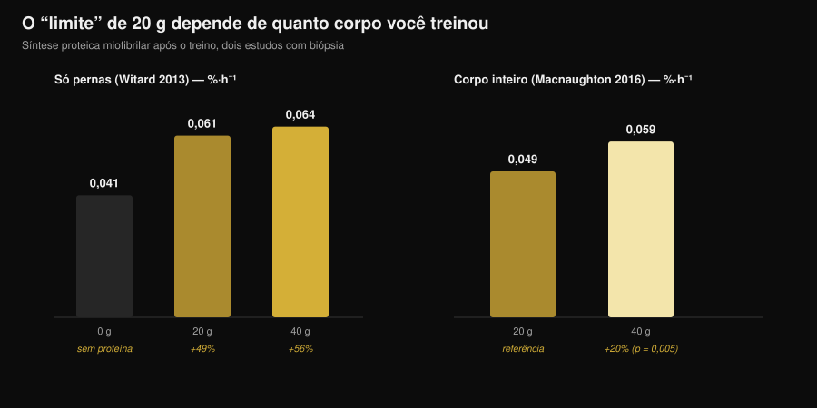
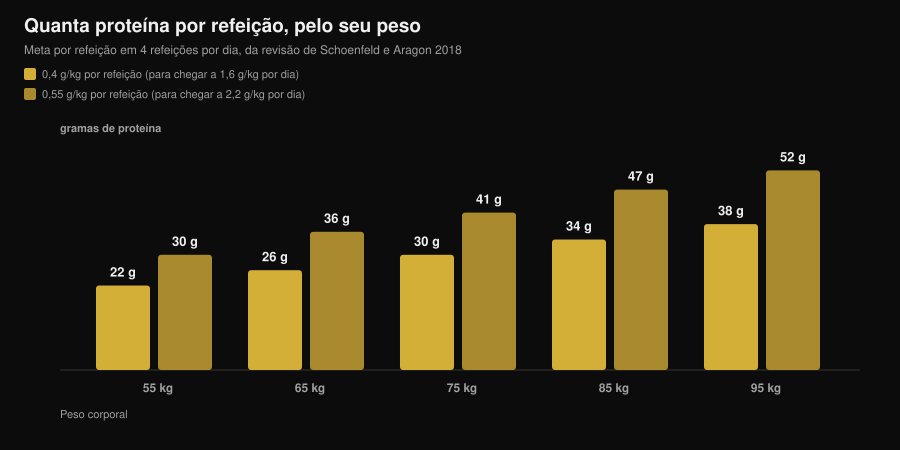

# Quanta proteína por refeição? O mito dos 30 g

Por [Giammaria Loi](/autore/giammaria-loi) · atualizado em 7 de novembro de 2026

"Acima de 30 g por refeição você joga fora." Você já ouviu isso na academia, leu no rótulo de um pote de proteína em pó e viu em uma dezena de carrosséis. É a regra mais citada da nutrição esportiva, e é também a que o estudo mais cuidadoso já feito sobre o tema desmontou: com 100 g de proteína em uma única refeição a resposta anabólica foi maior e durou mais de doze horas. O ponto é entender o que isso significa de verdade para as suas refeições, porque a conclusão prática não é "coma tudo de uma vez".

## Em resumo

- **O limite não existe.** Com um traçador quádruplo — aminoácidos marcados que permitem seguir o caminho da proteína dentro do corpo —, 100 g de proteína depois do treino produziram uma resposta anabólica maior e mais prolongada (mais de 12 horas) do que 25 g, com impacto desprezível na oxidação dos aminoácidos.
- **"Absorver" e "usar" são duas coisas diferentes.** O mito nasce dessa confusão: nenhum estudo mostra um limite de absorção intestinal em 30 g. O limite medido dizia respeito a quanto a dose elevava a síntese muscular naquelas 4 horas.
- **O patamar dos 20 g depende de quanto corpo você treinou.** Depois de um treino só de pernas, 40 g não superam 20 g de forma significativa. Depois de um treino de corpo inteiro, 40 g elevam a síntese cerca de 20% mais do que 20 g (p = 0,005).
- **A distribuição continua contando.** Ao longo de 12 horas, 80 g de whey divididos em 4 doses de 20 g a cada 3 horas deram uma síntese 31-48% superior à de 8 doses de 10 g ou 2 doses de 40 g.
- **O número para guardar é o diário.** O benefício se achata em torno de 1,6 g por kg por dia; para chegar lá, a revisão mais citada propõe 0,4 g por kg por refeição em pelo menos quatro refeições.

## De onde vem o mito dos 20-30 gramas

O número não foi inventado. Em 2013 um grupo da Universidade de Stirling deu a 48 homens treinados 0, 10, 20 ou 40 g de proteína do soro do leite depois de um treino de pernas, medindo por biópsia a síntese das proteínas contráteis nas quatro horas seguintes. Com 10 g não acontecia nada além do que acontecia com zero; com 20 g a síntese subia 49%; com 40 g subia 56%, uma diferença não significativa em relação a 20 g. Ao mesmo tempo, com 40 g aumentavam a oxidação da fenilalanina e a produção de ureia.

Daí veio a frase que circulou por dez anos: "20 g bastam, o resto queima". Duas leituras erradas se sobrepuseram. A primeira: *mais oxidação* não significa *todo o resto oxidado*. A segunda, mais grave: aquele estudo mediu quatro horas, não o dia inteiro.

*Gráfico Nurvan com os dados de Witard et al., 2013 (Am J Clin Nutr) e Macnaughton et al., 2016 (Physiol Rep). Os valores 0,061 e 0,064 %·h⁻¹ foram calculados aplicando as porcentagens do resumo (+49% e +56%) ao valor base de 0,041 %·h⁻¹. Nenhum valor foi lido de uma figura.*

## O estudo que mudou o limite de lugar

Em 2023 o grupo de Maastricht refez a pergunta com um desenho muito mais robusto: traçador quádruplo com infusão, proteína marcada dentro do próprio alimento, biópsias repetidas e um período de observação estendido para mais de doze horas. Compararam 25 g e 100 g de proteína ingeridos depois de um treino.

Os 100 g produziram uma resposta anabólica **maior em amplitude e mais longa no tempo**. Aumentaram a síntese das proteínas miofibrilares, a das proteínas do tecido conectivo do músculo e a das proteínas plasmáticas, além do balanço proteico de todo o corpo. A degradação proteica e a oxidação dos aminoácidos ficaram praticamente iguais: o famoso "você queima tudo" não apareceu.

A conclusão dos autores é que a capacidade de usar a proteína de uma única refeição havia sido subestimada. Não que "mais seja sempre melhor", mas que o muro dos 20-25 g não existe.

## Absorver não é construir

Vale parar em duas palavras que são usadas como sinônimos e não são.

**Absorção** é a passagem dos aminoácidos do intestino para o sangue. É um processo lento e contínuo, que numa refeição sólida e abundante segue por horas. Nenhum estudo jamais mostrou um patamar em 30 g acima do qual o intestino para de trabalhar: se fosse assim, metade do almoço de Natal sairia sem ser digerida.

**Uso anabólico** é quanto desses aminoácidos termina dentro de uma proteína muscular. É isso que os estudos de 2013 mediam numa janela de quatro horas, e é isso que o trabalho de 2023 acompanhou por doze.

Quando você lê "o corpo absorve só 30 g", a frase está usando o verbo errado para contar um dado antigo.

## O que a pesquisa diz de verdade

| Afirmação comum | Veredito | Fonte |
|---|---|---|
| "Acima de 20-30 g por refeição o resto se desperdiça" | **Desmentido** | Trommelen et al., 2023 |
| "O corpo absorve só 30 g de proteína por refeição" | **Desmentido**: confunde absorção com uso | Trommelen et al., 2023 |
| "20 g maximizam a síntese proteica" | **A precisar**: depende de quanta massa você treinou | Witard 2013; Macnaughton 2016 |
| "Então a distribuição nas refeições não importa" | **A precisar**: em 12 horas, 4×20 g continua a melhor estratégia testada | Areta et al., 2013 |
| "Os mesmos patamares valem para todos" | **Não verificável hoje** para mulheres treinadas | Witard e Mettler, 2024 |

### Por que "20 g" não é um número universal

Em 2016, a mesma linha de pesquisa mudou uma única variável: em vez de treinar apenas as pernas, os participantes fizeram uma sessão de corpo inteiro. Com 20 g a síntese foi de 0,049 %·h⁻¹, com 40 g de 0,059 %·h⁻¹: cerca de 20% mais, com diferença estatisticamente significativa (p = 0,005). Curiosamente, a massa magra total da pessoa não fez diferença: contava quanto músculo havia sido estimulado pelo treino, não quanto músculo ela tinha no total.

É o que mais vale levar para casa: a dose "certa" por refeição não é uma constante do metabolismo, é uma variável que depende também do que você acabou de fazer na academia.

### Por que uma única refeição gigante não é a resposta

Quem leu apenas o título do estudo de 2023 concluiu que a distribuição não serve mais para nada. Duas coisas dizem o contrário.

A primeira é um experimento de 2013 com 24 homens treinados: 80 g de whey distribuídos ao longo de doze horas de recuperação em três formatos. Oito doses de 10 g a cada hora e meia, quatro de 20 g a cada três horas, duas de 40 g a cada seis horas. Todos os três elevaram a síntese acima do repouso, mas o formato intermediário foi 31-48% melhor que os outros dois.

A segunda é um comentário publicado em 2024 justamente em resposta ao estudo dos 100 g: os autores reconhecem o avanço científico, mas alertam que as implicações práticas foram mal interpretadas e que arquivar a distribuição das refeições é prematuro. Apontam também que a amostra era composta por homens jovens ativos, mas não treinados com pesos, e que a ausência de um limite superior não parece se transferir para mulheres jovens treinadas. Sobre esse último ponto ainda não há números que possamos relatar: é uma limitação declarada, não um resultado.

## Como aplicar isso

O número que conta de verdade é o total do dia: a meta-análise de referência mostra que o benefício sobre a massa muscular se achata em torno de 1,6 g por kg de peso por dia. Se você tem dúvidas sobre quanto precisa na fase de emagrecimento, falamos disso em detalhe em [quanta proteína na definição](/pt/blog/proteina-na-definicao).

Para distribuir, a revisão de Schoenfeld e Aragon propõe uma conta simples: **0,4 g por kg por refeição, em pelo menos quatro refeições**. Quem visa o limite superior de 2,2 g por kg por dia chega a 0,55 g por kg por refeição.

*Gráfico Nurvan: cálculo sobre os coeficientes da revisão de Schoenfeld e Aragon, 2018 (J Int Soc Sports Nutr), em quatro refeições por dia. Valores arredondados ao grama.*

Três orientações práticas que se sustentam à luz de tudo isso:

1. **Pare de ter medo da refeição grande.** Se o jantar é o único momento em que você come bem, 50-60 g de proteína ali não são desperdiçados. Uma refeição abundante vale mais do que uma refeição pulada.
2. **Se puder escolher, divida.** Três ou quatro ocasiões com uma fonte proteica decente continuam sendo a estratégia com melhor respaldo, e são mais fáceis de administrar em termos de saciedade e digestão.
3. **Aumente a dose nos dias de treino completo.** Depois de uma sessão de corpo inteiro ou de um treino longo, ficar na parte alta da sua faixa por refeição tem sentido medido.

Para preencher esses números, com as tabelas CREA na mão, veja quanto é preciso de alguns alimentos comuns para chegar a 30 g de proteína:

| Alimento (dados CREA 2019) | Quantidade para 30 g de proteína | Calorias |
|---|---|---|
| Grana Padano DOP | 88 g | 347 kcal |
| Bresaola della Valtellina IGP | 91 g | 138 kcal |
| Peito de frango cozido na frigideira | 99 g | 128 kcal |
| Atum em salmoura escorrido | 120 g | 123 kcal |
| Bacalhau fresco ou merluza | 176 g | 125 kcal |
| Ovos cozidos (inteiros) | 242 g, cerca de 5 ovos | 310 kcal |
| Clara de ovo | 280 g | 121 kcal |
| Queijo cottage magro | 309 g | 356 kcal |
| Iogurte grego 0% | 333 g | 170 kcal |
| Lentilhas secas cozidas | 435 g | 474 kcal |

*Elaboração Nurvan sobre as tabelas CREA — Centro de Pesquisa em Alimentos e Nutrição (Itália), atualização de 2019. Cálculo: (30 ÷ proteína por 100 g) × 100.*

Dá para ver na hora por que as fontes não são intercambiáveis com a mesma quantidade de proteína: 30 g vindos do Grana custam quase três vezes as calorias de 30 g vindos do frango, e das lentilhas são necessários 435 g de produto cozido. Sobre a comparação entre fontes animais e vegetais temos um artigo dedicado: [proteína vegetal ou animal para os músculos](/pt/blog/proteina-vegetal-ou-animal-para-musculos).

> **Nurvan: a proteína refeição por refeição, não só o total do dia**
>
> A seção de nutrição do Nurvan usa o banco de dados de alimentos CREA e mostra a proteína de cada refeição ao lado do total diário: você vê na hora se os seus 140 g estão distribuídos em quatro ocasiões ou concentrados todos no jantar. [Experimente o Nurvan](https://nurvan.app)

## Perguntas frequentes

**Quanta proteína eu consigo absorver em uma refeição?**
Não existe um limite conhecido. A absorção intestinal continua por horas, em proporção ao que você comeu. O estudo com 100 g em uma única refeição mostrou uma resposta anabólica maior e mais longa do que a de 25 g, sem aumento relevante da oxidação dos aminoácidos.

**Então 30 g por refeição é pouco?**
Depende do seu peso e do total que você precisa alcançar. Para uma pessoa de 75 kg, 30 g por refeição correspondem a 0,4 g por kg, exatamente o valor proposto pela revisão em quatro refeições para chegar a 1,6 g por kg por dia. Para uma pessoa de 95 kg, 30 g por refeição ficam abaixo desse alvo.

**Se eu comer toda a proteína do dia em duas refeições, perco músculo?**
Nenhum estudo diz isso. Os dados ao longo de 12 horas indicam, porém, que quatro doses distribuídas deram uma síntese superior à de duas doses grandes. Se puder escolher, divida; se não puder, o que mais conta é o total do dia.

**Vale o mesmo para as mulheres?**
O comentário de Witard e Mettler de 2024 aponta que a ausência de um limite superior não parece se transferir para mulheres jovens treinadas com pesos. Ainda não há dados sólidos para citar como números: é uma questão aberta e, por ora, o sensato é ficar nos valores de referência por refeição das revisões.

## Leia também

- [Quanta proteína na definição](/pt/blog/proteina-na-definicao) — o total diário quando as calorias estão baixas.
- [Proteína vegetal ou animal para os músculos](/pt/blog/proteina-vegetal-ou-animal-para-musculos) — a qualidade da fonte conta mais do que a quantidade.
- [Beef protein: a proteína de carne vale o mesmo que o whey?](/pt/blog/beef-protein-proteina-de-carne-vs-whey-pt) — o que muda de verdade de um pó para o outro.

## Fontes

1. Trommelen J, van Lieshout GAA, Nyakayiru J, et al., 2023. The anabolic response to protein ingestion during recovery from exercise has no upper limit in magnitude and duration in vivo in humans. *Cell Rep Med* 4(12):101324. [PMID 38118410](https://pubmed.ncbi.nlm.nih.gov/38118410/) · [DOI 10.1016/j.xcrm.2023.101324](https://doi.org/10.1016/j.xcrm.2023.101324)
2. Witard OC, Mettler S, 2024. The Anabolic Response to Protein Ingestion During Recovery From Exercise Has No Upper Limit in Magnitude and Duration In Vivo in Humans: A Commentary. *Int J Sport Nutr Exerc Metab* 34(5):322–324. [PMID 38991545](https://pubmed.ncbi.nlm.nih.gov/38991545/) · [DOI 10.1123/ijsnem.2024-0041](https://doi.org/10.1123/ijsnem.2024-0041)
3. Witard OC, Jackman SR, Breen L, et al., 2014. Myofibrillar muscle protein synthesis rates subsequent to a meal in response to increasing doses of whey protein at rest and after resistance exercise. *Am J Clin Nutr* 99(1):86–95. [PMID 24257722](https://pubmed.ncbi.nlm.nih.gov/24257722/) · [DOI 10.3945/ajcn.112.055517](https://doi.org/10.3945/ajcn.112.055517)
4. Macnaughton LS, Wardle SL, Witard OC, et al., 2016. The response of muscle protein synthesis following whole-body resistance exercise is greater following 40 g than 20 g of ingested whey protein. *Physiol Rep* 4(15):e12893. [PMID 27511985](https://pubmed.ncbi.nlm.nih.gov/27511985/) · [DOI 10.14814/phy2.12893](https://doi.org/10.14814/phy2.12893)
5. Areta JL, Burke LM, Ross ML, et al., 2013. Timing and distribution of protein ingestion during prolonged recovery from resistance exercise alters myofibrillar protein synthesis. *J Physiol* 591(9):2319–2331. [PMID 23459753](https://pubmed.ncbi.nlm.nih.gov/23459753/) · [DOI 10.1113/jphysiol.2012.244897](https://doi.org/10.1113/jphysiol.2012.244897)
6. Schoenfeld BJ, Aragon AA, 2018. How much protein can the body use in a single meal for muscle-building? Implications for daily protein distribution. *J Int Soc Sports Nutr* 15:10. [PMID 29497353](https://pubmed.ncbi.nlm.nih.gov/29497353/) · [DOI 10.1186/s12970-018-0215-1](https://doi.org/10.1186/s12970-018-0215-1)
7. Morton RW, Murphy KT, McKellar SR, et al., 2018. A systematic review, meta-analysis and meta-regression of the effect of protein supplementation on resistance training-induced gains in muscle mass and strength in healthy adults. *Br J Sports Med* 52(6):376–384. [PMID 28698222](https://pubmed.ncbi.nlm.nih.gov/28698222/) · [DOI 10.1136/bjsports-2017-097608](https://doi.org/10.1136/bjsports-2017-097608)
8. Jäger R, Kerksick CM, Campbell BI, et al., 2017. International Society of Sports Nutrition Position Stand: protein and exercise. *J Int Soc Sports Nutr* 14:20. [PMID 28642676](https://pubmed.ncbi.nlm.nih.gov/28642676/) · [DOI 10.1186/s12970-017-0177-8](https://doi.org/10.1186/s12970-017-0177-8)

Dados alimentares: tabelas CREA — Centro de Pesquisa em Alimentos e Nutrição (Itália), atualização de 2019. Tema escolhido a partir de sinais de tendência do início de novembro de 2026 (cobertura na imprensa generalista do tema "quanta proteína" e primeira página de busca ocupada por conteúdos comerciais que repetem o limite dos 30 g). Fontes científicas consultadas pelo PubMed.

**Giammaria Loi** é o fundador do Nurvan. Treina com pesos desde 2012, trabalha como personal trainer e coach certificado FIPE desde 2013 e compete em powerlifting em nível nacional desde 2018. Cada artigo que ele assina parte dos estudos científicos e chega ao que funciona de verdade na academia. [Página do autor](/autore/giammaria-loi)

> Nota: conteúdo informativo, não substitui a opinião de um médico ou de um profissional qualificado.
