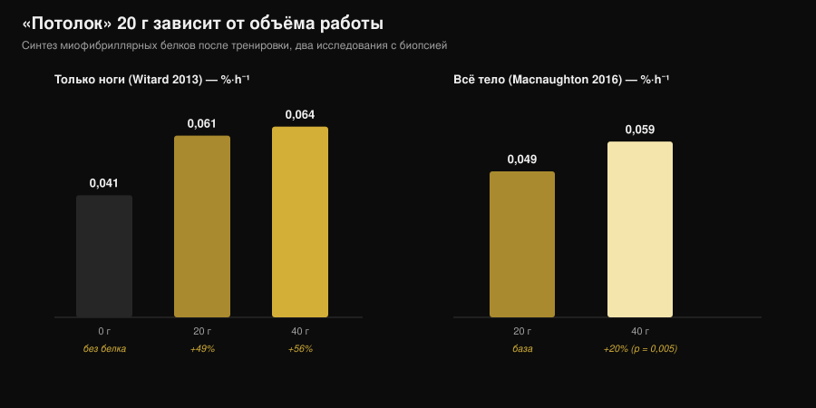
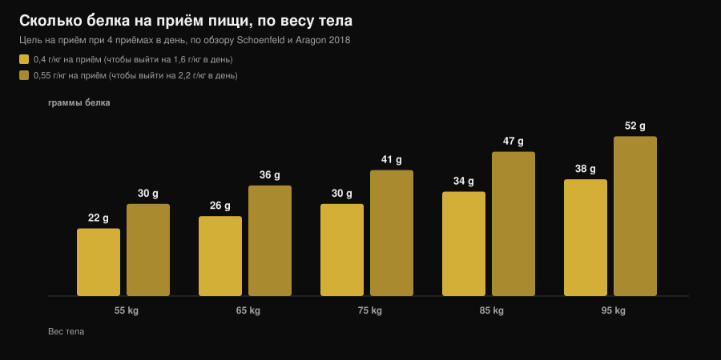

# Сколько белка за один приём пищи: есть ли предел?

Автор: [Giammaria Loi](/autore/giammaria-loi) · обновлено 7 ноября 2026

«Всё, что больше 30 г за приём пищи, уходит в никуда». Вы слышали это в зале, читали на банке протеина и видели в десятке карусельных постов. Это самое цитируемое правило спортивного питания — и то самое, которое разобрало по частям самое аккуратное исследование по теме: при 100 г белка за один приём пищи анаболический отклик оказался больше и длился дольше двенадцати часов. Дальше важно понять, что это значит для ваших приёмов пищи, потому что практический вывод — вовсе не «ешьте всё сразу».

## Коротко о главном

- **Потолка нет.** В исследовании с четырёхкратной изотопной меткой 100 г белка после тренировки дали более сильный и более долгий анаболический отклик (свыше 12 часов), чем 25 г, почти не затронув окисление аминокислот.
- **«Усвоить» и «использовать» — не одно и то же.** Миф живёт именно в этой путанице: ни одно исследование не показало предела всасывания в кишечнике на уровне 30 г. Измеряли другое — насколько доза поднимает синтез мышечного белка за четыре часа.
- **Порог в 20 г зависит от того, сколько мышц вы нагрузили.** После тренировки только ног 40 г не дают значимого преимущества над 20 г. После тренировки на всё тело 40 г поднимают синтез примерно на 20% сильнее, чем 20 г (p = 0,005).
- **Распределение по-прежнему важно.** За 12 часов 80 г сывороточного белка, разделённые на четыре порции по 20 г каждые 3 часа, дали синтез на 31-48% выше, чем восемь порций по 10 г или две по 40 г.
- **Запоминать стоит суточную цифру.** Польза выходит на плато около 1,6 г на кг в сутки; чтобы набрать эту норму, самый цитируемый обзор предлагает 0,4 г на кг за приём пищи минимум в четырёх приёмах.

## Откуда взялось правило «20-30 грамм»

Цифра не выдумана. В 2013 году группа из Университета Стерлинга дала 48 тренированным мужчинам 0, 10, 20 или 40 г сывороточного белка после тренировки ног и с помощью биопсии мышц измерила синтез сократительных белков в следующие четыре часа. Десять грамм не дали ничего по сравнению с нулём; 20 г подняли синтез на 49%; 40 г — на 56%, и это уже не было значимо больше, чем 20 г. При этом на 40 г выросли окисление фенилаланина и выработка мочевины.

Отсюда и фраза, которую повторяли десять лет: «20 г хватает, остальное сгорает». Здесь наложились две ошибки чтения. Первая: *больше окисления* не значит *всё остальное окислилось*. Вторая, серьёзнее: то исследование измеряло четыре часа, а не сутки.

*График Nurvan по данным Witard et al., 2013 (Am J Clin Nutr) и Macnaughton et al., 2016 (Physiol Rep). Значения 0,061 и 0,064 %·ч⁻¹ рассчитаны: проценты из абстракта (+49% и +56%) применены к базовому значению 0,041 %·ч⁻¹. Ни одно значение не считано с рисунка.*

## Исследование, которое сдвинуло предел

В 2023 году группа из Маастрихта задала тот же вопрос с гораздо более тяжёлым дизайном: четырёхкратная изотопная метка с инфузией, меченый белок прямо в пище, повторные биопсии и окно наблюдения, растянутое больше чем на двенадцать часов. Сравнивали 25 г и 100 г белка, принятых после тренировки.

Доза 100 г дала отклик **больший по амплитуде и более долгий по времени**. Выросли синтез миофибриллярных белков, белков соединительной ткани мышцы и белков плазмы, а также общий белковый баланс тела. Распад белка и окисление аминокислот почти не изменились: знаменитого «ты просто всё это сожжёшь» не случилось.

Вывод авторов: способность использовать белок одного приёма пищи была недооценена. Не «чем больше, тем лучше», а «стены на 20-25 г нет».

## Усвоение — это не строительство

Стоит остановиться на двух словах, которые используют как синонимы, хотя это не так.

**Усвоение (всасывание)** — это переход аминокислот из кишечника в кровь. Процесс медленный и непрерывный, и для большого твёрдого приёма пищи он идёт часами. Ни одно исследование не показало порога на 30 г, за которым кишечник перестаёт работать: если бы так было, половина праздничного ужина выходила бы непереваренной.

**Анаболическое использование** — это то, сколько из этих аминокислот оказывается внутри мышечного белка. Именно это измеряли работы 2013 года в окне четырёх часов, и именно это работа 2023 года отследила на протяжении двенадцати.

Когда вы читаете «организм усваивает только 30 г», в этой фразе взят неверный глагол для пересказа старого результата.

## Что на самом деле говорит наука

| Распространённое утверждение | Вердикт | Источник |
|---|---|---|
| «Всё, что свыше 20-30 г за приём пищи, тратится впустую» | **Опровергнуто** | Trommelen et al., 2023 |
| «Организм усваивает только 30 г белка за приём пищи» | **Опровергнуто**: путает усвоение и использование | Trommelen et al., 2023 |
| «20 г максимизируют синтез белка» | **Нужна оговорка**: зависит от того, сколько мышц вы нагрузили | Witard 2013; Macnaughton 2016 |
| «Значит, распределение по приёмам пищи не важно» | **Нужна оговорка**: на отрезке 12 часов 4×20 г остаётся лучшей из проверенных схем | Areta et al., 2013 |
| «Одни и те же пороги подходят всем» | **Сегодня проверить нельзя** для тренированных женщин | Witard и Mettler, 2024 |

### Почему 20 г — не универсальная цифра

В 2016 году то же направление исследований поменяло одну переменную: вместо тренировки только ног участники сделали тренировку на всё тело. При 20 г синтез составил 0,049 %·ч⁻¹, при 40 г — 0,059 %·ч⁻¹: примерно на 20% больше, и разница статистически значима (p = 0,005). Любопытно, что общая мышечная масса человека не играла роли: важно было, сколько мышц стимулировала тренировка, а не сколько их у человека всего.

Это самое полезное, что стоит забрать с собой: «правильная» доза за приём пищи — не константа вашего обмена, а переменная, которая зависит и от того, что вы только что сделали в зале.

### Почему один гигантский приём пищи — не решение

Кто прочитал только заголовок исследования 2023 года, сделал вывод, что распределение больше не нужно. Против этого говорят две вещи.

Первая — эксперимент 2013 года на 24 тренированных мужчинах: 80 г сывороточного белка распределили на двенадцать часов восстановления тремя способами. Восемь порций по 10 г каждые полтора часа, четыре по 20 г каждые 3 часа, две по 40 г каждые 6 часов. Все три схемы подняли синтез выше уровня покоя, но средняя обошла две остальные на 31-48%.

Вторая — комментарий, опубликованный в 2024 году прямо в ответ на исследование со 100 г. Авторы признают научный шаг вперёд, но предупреждают: практические выводы прочитали неверно, и списывать распределение приёмов пищи рано. Они также отмечают, что участники были молодыми активными мужчинами без силового стажа и что отсутствие верхнего предела, по-видимому, не переносится на молодых тренированных женщин. По этому последнему пункту цифр, которые можно привести, пока нет: это заявленное ограничение, а не результат.

## Как это применить

Цифра, которая действительно имеет значение, — суточная сумма: опорный метаанализ показывает, что польза для мышечной массы выходит на плато около 1,6 г на кг веса в сутки. Если вы не уверены, сколько нужно на похудении, мы подробно разобрали это в материале [сколько белка нужно на сушке](/ru/blog/belok-na-sushke).

Чтобы распределить эту норму, обзор Шёнфелда и Арагона предлагает простой расчёт: **0,4 г на кг за приём пищи минимум в четырёх приёмах**. Кто целится в верхнюю границу 2,2 г на кг в сутки, выходит на 0,55 г на кг за приём пищи.

*График Nurvan: расчёт по коэффициентам из обзора Шёнфелда и Арагона, 2018 (J Int Soc Sports Nutr), для четырёх приёмов пищи в день. Значения округлены до грамма.*

Три практических вывода, которые выдерживают всё сказанное выше:

1. **Перестаньте бояться большого приёма пищи.** Если ужин — единственный момент, когда вы едите нормально, то 50-60 г белка там не потрачены впустую. Большой приём пищи лучше пропущенного.
2. **Если есть выбор — делите.** Три-четыре приёма пищи с нормальным источником белка остаются схемой с лучшей поддержкой в данных, и это легче и для аппетита, и для пищеварения.
3. **Поднимайте дозу в дни тренировок на всё тело.** После полнотелой или долгой тренировки держаться у верхней границы своего диапазона за приём пищи — решение с измеренной поддержкой.

Чтобы наполнить эти цифры едой, вот сколько нужно некоторых обычных продуктов, чтобы получить 30 г белка:

| Продукт (данные CREA 2019) | Количество на 30 г белка | Калории |
|---|---|---|
| Grana Padano DOP (твёрдый итальянский сыр) | 88 г | 347 ккал |
| Bresaola della Valtellina IGP (вяленая говядина) | 91 г | 138 ккал |
| Куриная грудка, обжаренная на сковороде | 99 г | 128 ккал |
| Тунец в рассоле, без жидкости | 120 г | 123 ккал |
| Треска или хек | 176 г | 125 ккал |
| Яйца вкрутую (целые) | 242 г, около 5 яиц | 310 ккал |
| Яичный белок | 280 г | 121 ккал |
| Обезжиренный зернёный творог | 309 г | 356 ккал |
| Греческий йогурт 0% | 333 г | 170 ккал |
| Сухая чечевица, отварная | 435 г | 474 ккал |

*Расчёт Nurvan по таблицам CREA — Centro di ricerca Alimenti e Nutrizione, итальянский государственный центр исследований питания и официальный источник данных о составе продуктов в Италии, обновление 2019. Формула: (30 ÷ белок на 100 г) × 100.*

Сразу видно, почему источники не взаимозаменяемы при равном белке: 30 г из Grana стоят почти втрое больше калорий, чем 30 г из курицы, а чечевицы нужно 435 г готового продукта. Сравнению животных и растительных источников у нас посвящена отдельная статья: [растительный или животный белок для мышц](/ru/blog/rastitelnyy-ili-zhivotnyy-belok-dlya-myshts).

> **Nurvan: белок по каждому приёму пищи, а не только суточный итог**
>
> Раздел питания в Nurvan работает на базе данных CREA и показывает белок каждого отдельного приёма пищи рядом с суточным итогом: вы сразу видите, распределены ли ваши 140 г по четырём приёмам или собраны целиком в ужин. [Попробовать Nurvan](https://nurvan.app)

## Частые вопросы

**Сколько белка усваивается за один приём пищи?**
Известного потолка нет. Всасывание в кишечнике продолжается часами пропорционально тому, сколько вы съели. Исследование, где давали 100 г за один приём пищи, показало более сильный и более долгий анаболический отклик, чем при 25 г, без заметного роста окисления аминокислот.

**Значит, 30 г за приём пищи — это мало?**
Зависит от вашего веса и от суточной нормы, которую нужно набрать. Для человека 75 кг 30 г за приём пищи — это ровно 0,4 г на кг, та самая величина, которую обзор предлагает на четыре приёма пищи, чтобы выйти на 1,6 г на кг в сутки. Для человека 95 кг 30 г за приём пищи уже ниже этой цели.

**Если я съедаю весь дневной белок в два приёма пищи, я потеряю мышцы?**
Ни одно исследование этого не утверждает. Но данные на отрезке 12 часов показывают, что четыре распределённые порции дали больше синтеза, чем две крупные. Есть выбор — делите; нет выбора — важнее всего суточная сумма.

**Это работает так же у женщин?**
Комментарий Витарда и Меттлера 2024 года отмечает, что отсутствие верхнего предела, по-видимому, не переносится на молодых женщин с силовым стажем. Надёжных цифр, которые можно привести, пока нет: вопрос открытый, и сейчас разумнее держаться ориентиров на приём пищи из обзоров.

## Читайте также

- [Сколько белка нужно на сушке](/ru/blog/belok-na-sushke) — суточная норма, когда калорий мало.
- [Растительный или животный белок для мышц](/ru/blog/rastitelnyy-ili-zhivotnyy-belok-dlya-myshts) — качество источника важнее количества.
- [Beef protein: говяжий протеин против сывороточного](/ru/blog/beef-protein-govyazhiy-protein-protiv-syvorotochnogo) — что на самом деле отличает один порошок от другого.

## Источники

1. Trommelen J, van Lieshout GAA, Nyakayiru J, et al., 2023. The anabolic response to protein ingestion during recovery from exercise has no upper limit in magnitude and duration in vivo in humans. *Cell Rep Med* 4(12):101324. [PMID 38118410](https://pubmed.ncbi.nlm.nih.gov/38118410/) · [DOI 10.1016/j.xcrm.2023.101324](https://doi.org/10.1016/j.xcrm.2023.101324)
2. Witard OC, Mettler S, 2024. The Anabolic Response to Protein Ingestion During Recovery From Exercise Has No Upper Limit in Magnitude and Duration In Vivo in Humans: A Commentary. *Int J Sport Nutr Exerc Metab* 34(5):322–324. [PMID 38991545](https://pubmed.ncbi.nlm.nih.gov/38991545/) · [DOI 10.1123/ijsnem.2024-0041](https://doi.org/10.1123/ijsnem.2024-0041)
3. Witard OC, Jackman SR, Breen L, et al., 2014. Myofibrillar muscle protein synthesis rates subsequent to a meal in response to increasing doses of whey protein at rest and after resistance exercise. *Am J Clin Nutr* 99(1):86–95. [PMID 24257722](https://pubmed.ncbi.nlm.nih.gov/24257722/) · [DOI 10.3945/ajcn.112.055517](https://doi.org/10.3945/ajcn.112.055517)
4. Macnaughton LS, Wardle SL, Witard OC, et al., 2016. The response of muscle protein synthesis following whole-body resistance exercise is greater following 40 g than 20 g of ingested whey protein. *Physiol Rep* 4(15):e12893. [PMID 27511985](https://pubmed.ncbi.nlm.nih.gov/27511985/) · [DOI 10.14814/phy2.12893](https://doi.org/10.14814/phy2.12893)
5. Areta JL, Burke LM, Ross ML, et al., 2013. Timing and distribution of protein ingestion during prolonged recovery from resistance exercise alters myofibrillar protein synthesis. *J Physiol* 591(9):2319–2331. [PMID 23459753](https://pubmed.ncbi.nlm.nih.gov/23459753/) · [DOI 10.1113/jphysiol.2012.244897](https://doi.org/10.1113/jphysiol.2012.244897)
6. Schoenfeld BJ, Aragon AA, 2018. How much protein can the body use in a single meal for muscle-building? Implications for daily protein distribution. *J Int Soc Sports Nutr* 15:10. [PMID 29497353](https://pubmed.ncbi.nlm.nih.gov/29497353/) · [DOI 10.1186/s12970-018-0215-1](https://doi.org/10.1186/s12970-018-0215-1)
7. Morton RW, Murphy KT, McKellar SR, et al., 2018. A systematic review, meta-analysis and meta-regression of the effect of protein supplementation on resistance training-induced gains in muscle mass and strength in healthy adults. *Br J Sports Med* 52(6):376–384. [PMID 28698222](https://pubmed.ncbi.nlm.nih.gov/28698222/) · [DOI 10.1136/bjsports-2017-097608](https://doi.org/10.1136/bjsports-2017-097608)
8. Jäger R, Kerksick CM, Campbell BI, et al., 2017. International Society of Sports Nutrition Position Stand: protein and exercise. *J Int Soc Sports Nutr* 14:20. [PMID 28642676](https://pubmed.ncbi.nlm.nih.gov/28642676/) · [DOI 10.1186/s12970-017-0177-8](https://doi.org/10.1186/s12970-017-0177-8)

Данные по продуктам: таблицы состава продуктов CREA, обновление 2019. Тема выбрана по трендовым сигналам начала ноября 2026 года (освещение темы «сколько нужно белка» в обычных медиа и первая страница поиска, занятая коммерческим контентом, который до сих пор повторяет лимит в 30 г). Научные источники найдены через PubMed.

**Giammaria Loi** — основатель Nurvan. Тренируется с отягощениями с 2012 года, работает персональным тренером и сертифицированным коучем FIPE с 2013 года, выступает в пауэрлифтинге на национальном уровне с 2018 года. Каждая его статья начинается с исследований и заканчивается тем, что действительно работает в зале. [Страница автора](/autore/giammaria-loi)

> Примечание: информационный материал, он не заменяет консультацию врача или квалифицированного специалиста.
