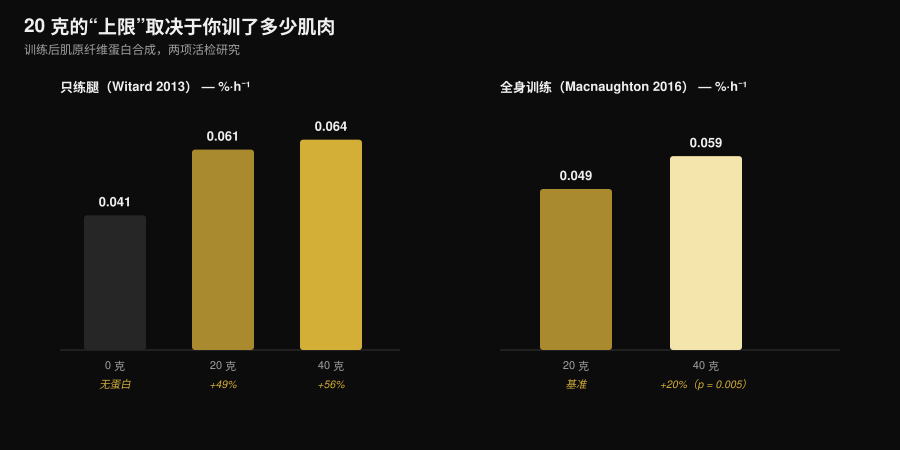
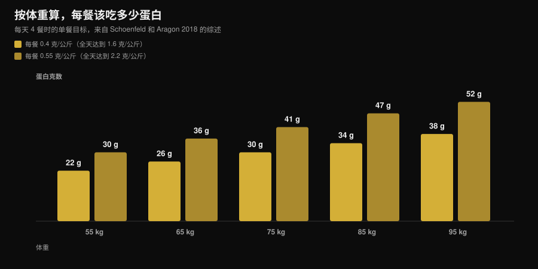

# 一餐能吸收多少蛋白质？30 克上限是真的吗

作者：[Giammaria Loi](/autore/giammaria-loi) · 更新于 2026 年 11 月 7 日

“一餐超过 30 克，多出来的都浪费了。” 这句话你在健身房听过，在蛋白粉罐子上读过，也在十几个图文帖里见过。它是运动营养里被引用最多的一条规则，也正是迄今设计最严谨的那项研究拆掉的一条规则：一餐吃下 100 克蛋白质，合成反应更强，而且持续超过十二个小时。真正有用的部分是弄清楚这对你的每一餐意味着什么——因为实际结论并不是“一次全吃完”。

## 一句话重点

- **没有上限。** 用四重同位素示踪的方法，训练后摄入 100 克蛋白质比 25 克带来了更强、持续更久的合成反应（超过 12 小时），而对氨基酸氧化的影响微乎其微。
- **“吸收”和“利用”不是一回事。** 这个说法就活在这层混淆里：没有任何研究显示肠道吸收在 30 克处有个闸门。当年测到的“上限”，指的是一个剂量在四小时内把肌肉蛋白合成抬高了多少。
- **20 克这个门槛取决于你练了多少肌肉。** 只练腿之后，40 克并没有显著超过 20 克。而全身训练之后，40 克把合成抬高的幅度比 20 克多约 20%（p = 0.005）。
- **分配依然重要。** 在 12 小时里，80 克乳清蛋白分成四份、每份 20 克、每 3 小时一次，合成比八份 10 克或两份 40 克高出 31-48%。
- **真正该记住的是每天的总量。** 好处在每公斤体重每天 1.6 克左右趋于平缓；为了达到这个量，被引用最多的综述建议每餐每公斤体重 0.4 克，至少分四餐。

## “20-30 克”这条规则是怎么来的

这个数字不是凭空编的。2013 年，斯特灵大学的一个团队给 48 名有训练经验的男性在腿部训练后分别摄入 0、10、20 或 40 克乳清蛋白，并用肌肉活检测量之后四小时内收缩蛋白的合成速率。10 克与零相比没有任何额外效果；20 克把合成抬高了 49%；40 克抬高了 56%，而这比 20 克并没有显著更多。与此同时，40 克确实提高了苯丙氨酸氧化和尿素生成。

于是就有了被重复了十年的那句话：“20 克够了，其余都烧掉了。” 这里叠了两个误读。第一，*氧化变多*不等于*其余全部被氧化*。第二个更严重：那项研究测的是四小时，不是一整天。

*Nurvan 图表，数据来自 Witard et al., 2013（Am J Clin Nutr）与 Macnaughton et al., 2016（Physiol Rep）。0.061 和 0.064 %·h⁻¹ 这两个数值是把摘要中的百分比（+49% 和 +56%）套用在 0.041 %·h⁻¹ 的基线上计算得出的。没有任何数值是从图上读取的。*

## 把上限推翻的那项研究

2023 年，马斯特里赫特的一个团队用一套重得多的设计重新问了同一个问题：带输注的四重同位素示踪、食物本身就带标记的蛋白质、反复活检，以及拉长到十二小时以上的观察窗口。他们比较了训练后摄入 25 克和 100 克蛋白质。

100 克这一组的反应**幅度更大、持续时间更长**。肌纤维蛋白合成上升了，肌肉结缔组织和血浆蛋白的合成也上升了，全身净蛋白平衡同样如此。蛋白分解速率和氨基酸氧化速率几乎没动：那句著名的“你只是把它烧掉了”并没有出现。

作者的结论是：我们对单独一餐里蛋白质的利用能力一直被低估了。这不等于“越多越好”，而是说 20-25 克那道墙并不存在。

## 吸收不等于合成

有两个被当成同义词用的词，其实不是一回事。

**吸收**是氨基酸从肠道进入血液的过程。它缓慢而连续，对一顿量大的固体餐来说会持续好几个小时。从来没有研究显示存在一个 30 克的门槛，过了它肠道就停工——要真是那样，年夜饭有一半会原样排出来。

**合成利用**是这些氨基酸里有多少最终进入了肌肉蛋白。这才是 2013 年那一批研究在四小时窗口里测的东西，也是 2023 年那项工作追踪了十二小时的东西。

所以当你读到“身体一次只能吸收 30 克”时，这句话用了错的动词去转述一个旧结果。

## 研究到底说了什么

| 常见说法 | 结论 | 来源 |
|---|---|---|
| “一餐超过 20-30 克，其余都浪费了” | **已被推翻** | Trommelen et al., 2023 |
| “身体一餐只能吸收 30 克蛋白质” | **已被推翻**：混淆了吸收与利用 | Trommelen et al., 2023 |
| “20 克就能让蛋白合成最大化” | **需要补充条件**：取决于你练了多少肌肉 | Witard 2013; Macnaughton 2016 |
| “所以分几餐吃并不重要” | **需要补充条件**：在 12 小时里，4×20 克仍是实测最好的方案 | Areta et al., 2013 |
| “同一套门槛对所有人都适用” | 对有训练经验的女性而言，**目前无法回答** | Witard 与 Mettler, 2024 |

### 为什么 20 克不是一个通用数字

2016 年，同一条研究脉络只改了一个变量：参与者做的不是只练腿，而是一次全身训练。摄入 20 克时，合成速率为 0.049 %·h⁻¹；摄入 40 克时为 0.059 %·h⁻¹——高出约 20%，而且具有统计学显著性（p = 0.005）。有意思的是，一个人的总瘦体重并不影响结果：起作用的是这次训练刺激了多少肌肉，而不是他身上有多少肌肉。

这是最值得带走的一点：每餐“合适”的剂量不是你代谢里的一个常数，而是一个变量，它也取决于你刚刚在健身房做了什么。

### 为什么一顿巨餐不是答案

只看了 2023 年那项研究标题的人，会得出“分餐已经没用了”的结论。有两件事说明并非如此。

第一件是 2013 年在 24 名有训练经验的男性身上做的实验：80 克乳清蛋白按三种方式分布在十二小时的恢复期里。八份 10 克、每 90 分钟一次；四份 20 克、每 3 小时一次；两份 40 克、每 6 小时一次。三种方式都把合成抬到了静息水平之上，但中间那种方案比另外两种高出 31-48%。

第二件是 2024 年专门针对这项 100 克研究发表的一篇评论。作者承认这是科学上的进步，但提醒说它的实际含义被读错了，现在就给分餐判死刑还太早。他们还指出，参与者是年轻、活跃但没有做过抗阻训练的男性，而“没有上限”这一点看起来并不能照搬到年轻的、有抗阻训练经验的女性身上。关于最后这一点，目前还没有可以引用的数字：这是作者声明的研究局限，不是一个结果。

## 怎么落到自己身上

真正重要的数字是一天的总量：作为参考的那篇荟萃分析显示，对肌肉量的好处在每公斤体重每天 1.6 克左右趋于平缓。如果你不确定减脂期该吃多少，我们在[减脂期要吃多少蛋白质](/zh/blog/protein-intake-cutting-zh)里讲得更细。

至于怎么把它分配开，Schoenfeld 与 Aragon 的综述给了一个简单算法：**每餐每公斤体重 0.4 克，至少分四餐**。想冲每公斤体重每天 2.2 克上限的人，对应到每餐每公斤体重 0.55 克。

*Nurvan 图表：按 Schoenfeld 与 Aragon 2018 年综述（J Int Soc Sports Nutr）中的系数、以每天四餐计算。数值取整到克。*

把这些放到实践里，有三条站得住脚的建议：

1. **不用再怕那顿大餐。** 如果晚餐是你一天里唯一吃得像样的时候，那里的 50-60 克蛋白质并没有浪费。吃一顿大的，总比干脆不吃好。
2. **有条件就分开吃。** 三到四次、每次都有一个像样的蛋白质来源，仍然是证据支持最好的方案，而且对食欲和消化也更友好。
3. **全身训练日把量往上调。** 做完全身训练或长时间训练之后，把每餐的量放在自己区间的上端，是有实测支持的。

想把这些数字换成食物，下面是几种常见食材吃到 30 克蛋白质分别需要多少：

| 食物（CREA 2019 数据） | 吃到 30 克蛋白质的量 | 热量 |
|---|---|---|
| Grana Padano DOP（意大利硬质干酪） | 88 g | 347 kcal |
| Bresaola della Valtellina IGP（意大利风干牛肉） | 91 g | 138 kcal |
| 鸡胸肉，平底锅煎熟 | 99 g | 128 kcal |
| 盐水金枪鱼罐头，沥干 | 120 g | 123 kcal |
| 鳕鱼或无须鳕 | 176 g | 125 kcal |
| 水煮全蛋 | 242 g，约 5 个 | 310 kcal |
| 蛋白 | 280 g | 121 kcal |
| 低脂白干酪（cottage cheese） | 309 g | 356 kcal |
| 0% 脂肪希腊酸奶 | 333 g | 170 kcal |
| 干扁豆，煮熟 | 435 g | 474 kcal |

*Nurvan 基于 CREA 食物成分表计算 — CREA（Centro di ricerca Alimenti e Nutrizione）是意大利国家级的食品与营养研究中心，也是意大利食物成分数据的官方权威机构，2019 年更新版。公式：（30 ÷ 每 100 g 蛋白质）× 100。*

一眼就能看出为什么在蛋白质相同的情况下食材并不能随意互换：从 Grana 拿到 30 克蛋白质，热量差不多是从鸡肉拿同样 30 克的三倍，而扁豆要吃到 435 g 的熟品。动物蛋白与植物蛋白的比较我们有专门一篇：[植物蛋白还是动物蛋白更适合增肌](/zh/blog/zhiwu-dongwu-danbai-zhi-zengji)。

> **Nurvan：看每一餐的蛋白质，不只是一天的总数**
>
> Nurvan 的营养模块基于 CREA 食物数据库，会把每一餐的蛋白质和当天的总量并排显示出来：你一眼就能看出自己那 140 克是分在四餐里，还是全堆在晚饭。[试用 Nurvan](https://nurvan.app)

## 常见问题

**一餐能吸收多少蛋白质？**
目前没有已知的上限。肠道吸收会按你吃进去的量持续好几个小时。那项一餐给 100 克的研究发现，它带来的合成反应比 25 克更强、更久，而氨基酸氧化并没有明显上升。

**那每餐 30 克是不是太少了？**
这取决于你的体重和要达到的每日总量。对一个 75 公斤的人来说，每餐 30 克正好是每公斤 0.4 克——也就是综述建议分四餐、以达到每公斤每天 1.6 克的那个数。对一个 95 公斤的人来说，每餐 30 克就低于这个目标了。

**如果我把一天的蛋白质全放在两餐里，会掉肌肉吗？**
没有研究这么说。不过 12 小时的数据确实显示，四份分开摄入比两份大剂量带来了更多合成。有条件就分开吃；没条件的话，一天的总量才是最要紧的。

**女性也一样吗？**
Witard 与 Mettler 2024 年的评论指出，“没有上限”这一点看起来并不能照搬到年轻的、有抗阻训练经验的女性身上。目前还没有可以引用的可靠数字：这是一个未解的问题，现阶段按综述给出的每餐参考值来安排更稳妥。

## 延伸阅读

- [减脂期要吃多少蛋白质](/zh/blog/protein-intake-cutting-zh) — 热量很低时，每天该吃多少。
- [植物蛋白还是动物蛋白更适合增肌](/zh/blog/zhiwu-dongwu-danbai-zhi-zengji) — 来源的质量比数量更重要。
- [牛肉蛋白粉还是乳清蛋白：差别在哪](/zh/blog/niurou-danbai-fen-haishi-rujiang-danbai) — 一种粉和另一种粉真正的区别。

## 参考文献

1. Trommelen J, van Lieshout GAA, Nyakayiru J, et al., 2023. The anabolic response to protein ingestion during recovery from exercise has no upper limit in magnitude and duration in vivo in humans. *Cell Rep Med* 4(12):101324. [PMID 38118410](https://pubmed.ncbi.nlm.nih.gov/38118410/) · [DOI 10.1016/j.xcrm.2023.101324](https://doi.org/10.1016/j.xcrm.2023.101324)
2. Witard OC, Mettler S, 2024. The Anabolic Response to Protein Ingestion During Recovery From Exercise Has No Upper Limit in Magnitude and Duration In Vivo in Humans: A Commentary. *Int J Sport Nutr Exerc Metab* 34(5):322–324. [PMID 38991545](https://pubmed.ncbi.nlm.nih.gov/38991545/) · [DOI 10.1123/ijsnem.2024-0041](https://doi.org/10.1123/ijsnem.2024-0041)
3. Witard OC, Jackman SR, Breen L, et al., 2014. Myofibrillar muscle protein synthesis rates subsequent to a meal in response to increasing doses of whey protein at rest and after resistance exercise. *Am J Clin Nutr* 99(1):86–95. [PMID 24257722](https://pubmed.ncbi.nlm.nih.gov/24257722/) · [DOI 10.3945/ajcn.112.055517](https://doi.org/10.3945/ajcn.112.055517)
4. Macnaughton LS, Wardle SL, Witard OC, et al., 2016. The response of muscle protein synthesis following whole-body resistance exercise is greater following 40 g than 20 g of ingested whey protein. *Physiol Rep* 4(15):e12893. [PMID 27511985](https://pubmed.ncbi.nlm.nih.gov/27511985/) · [DOI 10.14814/phy2.12893](https://doi.org/10.14814/phy2.12893)
5. Areta JL, Burke LM, Ross ML, et al., 2013. Timing and distribution of protein ingestion during prolonged recovery from resistance exercise alters myofibrillar protein synthesis. *J Physiol* 591(9):2319–2331. [PMID 23459753](https://pubmed.ncbi.nlm.nih.gov/23459753/) · [DOI 10.1113/jphysiol.2012.244897](https://doi.org/10.1113/jphysiol.2012.244897)
6. Schoenfeld BJ, Aragon AA, 2018. How much protein can the body use in a single meal for muscle-building? Implications for daily protein distribution. *J Int Soc Sports Nutr* 15:10. [PMID 29497353](https://pubmed.ncbi.nlm.nih.gov/29497353/) · [DOI 10.1186/s12970-018-0215-1](https://doi.org/10.1186/s12970-018-0215-1)
7. Morton RW, Murphy KT, McKellar SR, et al., 2018. A systematic review, meta-analysis and meta-regression of the effect of protein supplementation on resistance training-induced gains in muscle mass and strength in healthy adults. *Br J Sports Med* 52(6):376–384. [PMID 28698222](https://pubmed.ncbi.nlm.nih.gov/28698222/) · [DOI 10.1136/bjsports-2017-097608](https://doi.org/10.1136/bjsports-2017-097608)
8. Jäger R, Kerksick CM, Campbell BI, et al., 2017. International Society of Sports Nutrition Position Stand: protein and exercise. *J Int Soc Sports Nutr* 14:20. [PMID 28642676](https://pubmed.ncbi.nlm.nih.gov/28642676/) · [DOI 10.1186/s12970-017-0177-8](https://doi.org/10.1186/s12970-017-0177-8)

食物数据：CREA 食物成分表，2019 年更新版。选题来自 2026 年 11 月初的趋势信号（大众媒体对“要吃多少蛋白质”的报道，以及搜索首页被仍在重复 30 克上限的商业内容占满）。科学文献通过 PubMed 检索。

**Giammaria Loi** 是 Nurvan 的创始人。他从 2012 年开始进行力量训练，2013 年起担任私人教练和 FIPE 认证教练，2018 年起参加全国级别的力量举比赛。他写的每一篇文章都从研究出发，落到健身房里真正有效的做法。[作者页面](/autore/giammaria-loi)

> 说明：本文为科普内容，不能替代医生或合格专业人士的意见。
