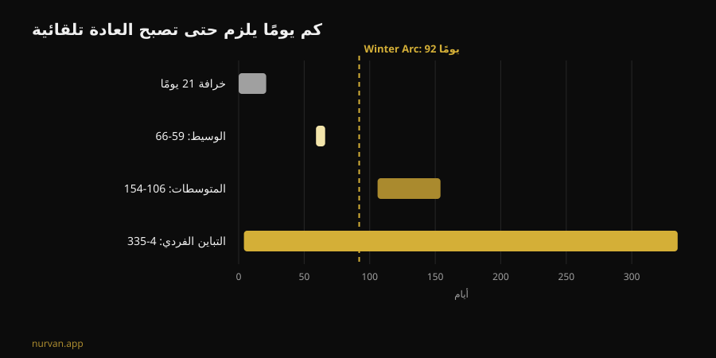
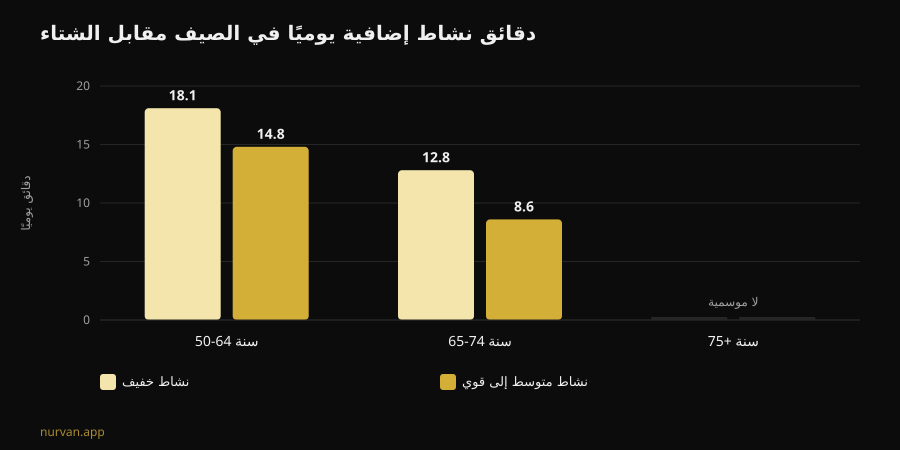

# هل ينجح تحدي Winter Arc؟ ما تقوله الأبحاث

بقلم [Giammaria Loi](/autore/giammaria-loi) · محدَّث في 8 نوفمبر 2026

Winter Arc هو تحدي هذا الموسم: ثلاثة أشهر من الانضباط الكامل، من 1 أكتوبر إلى 1 يناير، مع قائمة قواعد تُشطب كل يوم. والوعد أن تخرج منها شخصاً آخر. قرأت سبعة أبحاث مفهرسة عن تكوين العادة، وموسمية النشاط البدني، وتخطيط السلوك، والنتيجة أطرف من مجرد "نعم" أو "لا": التحدي مصيب في اختيار التوقيت، ومخطئ في المنهج كله تقريباً.

## أهم النقاط

- **قاعدة الـ 21 يوماً ليست نتيجة بحثية.** أحدث مراجعة منهجية عن الوقت اللازم ليصبح سلوك صحي تلقائياً تسجّل **وسيطاً بين 59 و66 يوماً** ومتوسطات بين **106 و154 يوماً**، مع تباين فردي يمتد من **4 أيام إلى 335 يوماً** (Singh et al., 2024).
- **الـ 92 يوماً تكفي نصف الناس تقريباً.** المدة الرسمية للتحدي تتجاوز الوسيط، لكن من يقع في الطرف البطيء من التوزيع ينتهي تقويمه قبل أن تترسّخ العادة.
- **الشتاء ليس عذراً اخترعه الناس.** بقياس مقياس التسارع، يؤدي البالغون بين 50 و64 سنة في الصيف **14.8 دقيقة إضافية يومياً** من النشاط المتوسط إلى القوي و**18.1 دقيقة إضافية** من النشاط الخفيف مقارنة بالشتاء، وينامون في الشتاء **31.8 دقيقة أطول** في الليلة (Cepeda et al., 2018).
- **الخلل هو اليوم الذي تتغيّب فيه.** على 19,883 شخصاً، نوع التخطيط الذي يتوسّط فعلاً الانتقال من النية إلى السلوك هو **تخطيط المواجهة** — خطتك لحين يسوء الأمر — بينما تخطيط "متى وأين" وحده لا يخرج دالاً إحصائياً (Wang et al., 2025).
- **ما تبنيه لا يتبخّر في 2 يناير.** عند كبار السن، لم يُنتج التوقف الكامل عن تدريب المقاومة لمدة 12 إلى 24 أسبوعاً انخفاضاً دالاً إحصائياً في حجم العضلة المكتسَب؛ الانخفاض يصبح واضحاً بعد 31 أسبوعاً (Grgic, 2022).

## ما هو Winter Arc عملياً

وُلد على TikTok وصار قالباً تحريرياً قائماً بذاته، وهو في جوهره نافذة زمنية: من 1 أكتوبر إلى 1 يناير، أي 92 يوماً. لا يوجد بروتوكول. الصفحات التي تشرحه تتفق على شيء واحد — "الانضباط والالتزام" — وتترك لك قائمة القواعد، التي تصير في النسخة الشائعة على مواقع التواصل حزمة من خمس أو ست: الاستيقاظ باكراً، والنادي عدداً محدداً من المرات أسبوعياً، ونظام غذائي صارم، والقراءة، والاستحمام البارد، وصفر كحول.

جزءان من هذا البناء لهما سند. الأول هو التوقيت: الشتاء فعلاً هو الموسم الذي ينخفض فيه النشاط. والثاني هو كتابة الأهداف وشطبها: المراقبة الذاتية من أكثر التقنيات استخداماً في التدخلات الرقمية الخاصة بالنشاط البدني (Omkar et al., 2026).

أما البقية — تاريخ الانتهاء الثابت، وعدد القواعد، ومنطق السلسلة التي يجب ألا تنكسر — فزينة سردية. وواحدة من الثلاث تُحدث ضرراً حقيقياً.

## خرافة الـ 21 يوماً: الأرقام الحقيقية

رقم الـ 21 يوماً يدور منذ عقود، وهو لا يأتي من دراسة عن العادات. المراجعة المنهجية مع التحليل البعدي التي نشرها Singh وزملاؤه أواخر 2024 جمعت 20 دراسة شملت 2,601 شخص قاست التلقائية في سلوكيات صحية: النشاط البدني، وشرب الماء، وخيط الأسنان، والتغذية، وتقليل الجلوس.

أربع من تلك الدراسات تذكر المدة اللازمة للوصول إلى التلقائية. **الوسيط** يقع بين 59 و66 يوماً. و**المتوسطات** بين 106 و154، وهي أعلى لأن بعض الناس يحتاجون وقتاً أطول بكثير. والرقم الأهم لك هو المدى الفردي المُلاحَظ: **من 4 أيام إلى 335 يوماً**.

هذا ليس تفصيلاً تقنياً. معناه أن شخصين يبدآن في 1 أكتوبر نفسه بالبرنامج نفسه قد يصلان إلى منتصف يناير وأحدهما يؤدي الأمر تلقائياً والآخر ما زال يتفاوض مع نفسه كل مساء. والثاني ليس أقل انضباطاً: هو داخل مدى طبيعي تماماً.

ومن المراجعة نفسها يأتي الجزء النافع. قوة العادة تتأثر بـ**التكرار**، و**وقت اليوم**، و**نوع السلوك**، وكون العادة **مختارة من الشخص** لا مفروضة عليه، وبحكمه الوجداني على الفعل، وبوجود عادات تمهيدية. الممارسات الصباحية والسلوكيات التي يختارها الشخص بنفسه تخرج الأقوى. ويشير الباحثون كذلك إلى حدود العمل: 11 دراسة من أصل 20 ذات خطر تحيّز مرتفع، وعدد الدراسات صغير.

بلغة التحدي نفسه: **قاعدة واحدة اخترتها أنت تتفوق على خمس قواعد منسوخة من منشور.**

## الشتاء ليس عذراً: الانخفاض مُقاس

هنا يلتقط Winter Arc شيئاً حقيقياً. وضعت دراسة Rotterdam مقياس تسارع على 1,116 شخصاً لسبعة أيام لكل منهم، بين 2011 و2016، وقارنت بين الفصول.

عند البالغين بين 50 و64 سنة، يزيد النشاط المتوسط إلى القوي في الصيف بمقدار **14.8 دقيقة يومياً** عنه في الشتاء، ويزيد النشاط الخفيف بمقدار **18.1 دقيقة يومياً**. وعند فئة 65-74 سنة يصير الفارق 8.6 و12.8 دقيقة. وفوق 75 سنة تختفي الموسمية تماماً. أما النوم الليلي فيسير في الاتجاه المعاكس: **أطول بـ 31.8 دقيقة** في الشتاء لدى فئة 50-64.

تفصيلان يغيّران القراءة. الأول: النمط مفسَّر بـ**درجة الحرارة وساعات ضوء النهار**، لا بالشخصية. والثاني، وهو الأكثر إزعاجاً: السلوك الجالس **لا** يُظهر أي موسمية. أي أننا في الشتاء لا نجلس أكثر — بل نتحرك أقل. ما يختفي هو الحركة الاختيارية، الجزء الذي تقرره أنت.

فقرار أن تفعل شيئاً في نوفمبر ليس هوساً نابعاً من مواقع التواصل. إنه الموسم الذي يضيع فيه الهامش. والباحثون أنفسهم يخلصون إلى أن كسر الجلوس بنشاط خفيف نقطة انطلاق جيدة.

## عيب التصميم: لا خطة لليوم الذي تتغيّب فيه

هنا ينكسر التحدي، والمسألة ليست مسألة إرادة.

النموذج الذهني لـ Winter Arc هو السلسلة التي لا تنكسر: 92 مربعاً تُشطب. ومعنى ذلك أن البروتوكول لا يقول شيئاً عن اليوم الذي تمرض فيه، أو تعمل حتى التاسعة، أو تتعطل سيارتك. وحين يحدث ذلك تكون السلسلة قد انكسرت ويكون التحدي قد فشل — في ديسمبر، بعد ثلاثة أسابيع جيدة.

وأبحاث التخطيط تشير مباشرة إلى موضع العلاج. تحليل بعدي لـ 41 تجربة عشوائية و5,439 شخصاً قاس أثر تدخلات التخطيط على النشاط البدني: **SMD 0.35** (فاصل ثقة 95% من 0.25 إلى 0.44)، أي أثر صغير إلى متوسط لكنه ثابت، ويتحسّن حين يوجد تعزيز أثناء المتابعة (Peng et al., 2022).

وفي 2025 فكّك بحث آخر الآلية بنمذجة المعادلات البنائية على 19,883 شخصاً في 49 دراسة. النية تتنبأ بالسلوك (β = 0.416). لكن من بين نوعَي التخطيط، **تخطيط المواجهة وحده** — "ماذا أفعل إذا أمطرت، أو تأخرت، أو فاتني الاثنين" — يتوسّط بدلالة إحصائية الانتقال من النية إلى الفعل (β = 0.067, p < 0.001). أما **تخطيط الفعل** الصرف، أي "الثلاثاء والخميس السابعة مساءً في النادي"، فيخرج **غير دال** في النموذج نفسه (β = -0.001).

التحليلان لا يقولان الشيء نفسه عن تخطيط الفعل، ومن الأمانة قول ذلك صراحة: في تجارب Peng كانت التدخلات المبنية على تخطيط الفعل أفضل أداءً، وفي نموذج Wang يقوم تخطيط المواجهة بعمل الوساطة. والذي يصمد في الحالتين أن **التخطيط يتفوق على القرار اللحظي**، وأن خطة الطوارئ ليست إضافة اختيارية.

وتحدي Winter Arc، كما ينتشر، يملك النصف الأول فقط: قواعد ومواعيد ومربعات. ولا يملك النصف الثاني.

## ماذا تقول الأبحاث فعلاً

| الادعاء الشائع | الحكم | المصدر |
|---|---|---|
| "تكوين العادة يحتاج 21 يوماً" | **مفنَّد**: الوسيط 59-66 يوماً، والمدى 4-335 | Singh et al., 2024 |
| "92 يوماً تكفي لتغييرك" | **يحتاج تدقيقاً**: تتجاوز الوسيط لا الطرف البطيء | Singh et al., 2024 |
| "في الشتاء المسألة دافعية فقط" | **يحتاج تدقيقاً**: الانخفاض مُقاس ومرتبط بالضوء والحرارة | Cepeda et al., 2018 |
| "يوم واحد يفوتك يكسر السلسلة: ابدأ من جديد" | **مفنَّد كاستراتيجية**: تحتاج خطة بديلة لا إعادة ضبط | Wang et al., 2025; Peng et al., 2022 |
| "إذا توقفت بعد التحدي تخسر كل شيء خلال أسبوعين" | **مفنَّد زمنياً**: 12-24 أسبوعاً دون خسارة دالة (بيانات على كبار السن) | Grgic, 2022 |
| "تحتاج قائمة من خمس قواعد يومية" | **غير مدعوم**: المهم التكرار والاختيار الشخصي | Singh et al., 2024 |
| "لا تحتاج تطبيقاً، تحتاج انضباطاً" | **يحتاج تدقيقاً**: الأدوات الرقمية تُظهر أثراً صغيراً لكنه إيجابي | Omkar et al., 2026 |

## وماذا لو توقفت في 2 يناير؟

الخوف الذي يُبقي هذه التحديات قائمة بسيط: ينتهي التحدي، فأتوقف، فأخسر كل شيء. أرقام التوقف عن التدريب ألطف من ذلك بكثير.

جمع التحليل البعدي لـ Grgic ست دراسات على كبار السن تدرّبوا على القوة من 9 إلى 24 أسبوعاً، مع زيادة واضحة في حجم العضلة (d = 0.99). وخلال التوقف الكامل ينخفض الحجم (d = -0.83) — لكن المجموعة الفرعية التي توقفت **من 12 إلى 24 أسبوعاً** لا تُظهر انخفاضاً دالاً إحصائياً (d = -0.60، بفاصل من -1.21 إلى 0.01). والخسارة تصبح واضحة بعد **31 أسبوعاً**. ومهم جداً: العينة من كبار السن لا من شباب مدرَّبين منذ سنوات، والقياس على حجم العضلة لا على القوة.

والقوة، بالمناسبة، هي الأهشّ: على امتداد العمر تنخفض القوة والقدرة بسرعة تصل إلى ثمانية أضعاف سرعة انخفاض الكتلة العضلية (Fyfe et al., 2021). وهي أيضاً الأسهل في الدفاع عنها بالقليل. المراجعة نفسها تجمع الأدلة على **الجرعات الدنيا**: حجم عمل منخفض في الحصة مع أحمال ثقيلة وحصص قليلة، أو حصص قصيرة متكررة بعتاد بسيط أو بلا عتاد، تُحسّن القوة والقدرة الوظيفية. مع ملاحظة تقع ثقيلة على Winter Arc: أحجام التدريب الأعلى مرتبطة بـ**انزعاج أكبر ومتعة أقل**، وهذا يعمل ضد الالتزام.

بعبارة أخرى: البرنامج الأقسى ليس البرنامج الذي يصمد.

## كيف تطبّق هذا

إذا أردت إطار Winter Arc دون عيبه التصميمي:

1. **اختر قاعدة واحدة لا خمساً.** القاعدة التي اخترتها أنت، لا التي جاءت في الفيديو. الاختيار الشخصي من محدِّدات قوة العادة.
2. **أبقِ التكرار عالياً والمطلوب منخفضاً.** ثلاث حصص قصيرة تؤديها فعلاً تتفوق على أربع حصص طويلة تتغيّب عنها. والمتعة ليست ضعفاً هنا: إنها متغيّر التزام.
3. **اكتب الخطة البديلة قبل أن تحتاجها.** "إذا فاتني الثلاثاء أذهب الأربعاء." "إذا أُغلق النادي، عشرون دقيقة في البيت." هذا، لا المربع المشطوب، هو ما تربطه الأبحاث بالسلوك الفعلي.
4. **اعمل مع الضوء.** بما أن انخفاض الشتاء يتبع الحرارة وساعات النهار، ضع الحصة حيث تساعدك الظروف وأزل الاحتكاك: الحقيبة جاهزة، والمسافة قصيرة، والموعد ثابت.
5. **احذف تاريخ الانتهاء.** عدّاد يُصفَّر في 1 يناير هو نقيض العادة. وإذا وصلت يناير ولم يصر الأمر تلقائياً بعد، فأنت داخل المعدل الإحصائي: لم تنتهِ، بل أنت مستمر.
6. **تابِع الأحمال لا سلسلة الأيام.** صفّ من 92 مربعاً لا يخبرك شيئاً عن التقدم. تدرّج الأحمال يفعل — وهو ينجو من يوم اثنين فائت.

وعمّا يجب أن تطلبه ممن يتابعك عن بُعد لدينا مقال مخصص: [هل ينجح التدريب عن بُعد؟ ما تقوله الدراسات](/ar/blog/hal-yanjah-altadrib-an-bud). وإن أردت الصورة الأوسع لما يصمد وما لا يصمد من موضات القطاع، رتّبناها في [اتجاهات اللياقة 2027](/ar/blog/itijahat-allyaqa-2027-ma-yanjah).

### Nurvan: الالتزام يُقاس بالأحمال لا بالمربعات

يسجّل Nurvan كل مجموعة وتكرار وقيمة RIR ويعرض لك التدرّج الحقيقي أسبوعاً بأسبوع: إذا تغيّبت يوم الاثنين يبقى منحنى الأحمال موجوداً، لأن المهم هو المنحنى لا سلسلة الأيام المتتالية. ومجموعات الإحماء المقترحة تلقائياً وسجلّ التمارين السابق يخفّضان الاحتكاك في الأمسيات التي تتدرب فيها على مضض — وهي في الشتاء أغلب الأمسيات. **[جرّب Nurvan](https://nurvan.app)**

## أسئلة شائعة

**كم يوماً تحتاج فعلاً لتكوين عادة تمرين؟**
بحسب أحدث مراجعة منهجية، وسيط الوصول إلى التلقائية في السلوكيات الصحية هو 59-66 يوماً، بمتوسطات بين 106 و154 يوماً وتباين فردي من 4 إلى 335 يوماً. ورقم الـ 21 يوماً لا يأتي من هذه الأدبيات.

**هل تحدي Winter Arc مضر؟**
القالب نفسه ليس خطراً، فهو نافذة زمنية. المشكلات تأتي من النسخ التي تكدّس قواعد صارمة كثيرة دفعة واحدة، ومن منطق "ابدأ من جديد" بعد يوم فائت، ومن أحجام تدريب عالية ومفاجئة لمن يبدأ من الصفر. وإذا كان لديك ألم أو حالة صحية قائمة أو تعود بعد إصابة، فاستشر طبيباً قبل البدء.

**أيهما أفضل: تحدي 90 يوماً أم بلا موعد نهائي؟**
البيانات لا تقارن القالبين مباشرة. ما نعرفه أن الموعد النهائي لا دور له في تكوين العادة، بينما للتكرار والاختيار الشخصي والتخطيط للطوارئ دور واضح. الموعد النهائي قد يساعدك على البدء؛ والخطر أن تبقيه خط نهاية.

**إذا توقفت في يناير، كم أخسر؟**
في التحليل البعدي على كبار السن، لم يُنتج التوقف الكامل عن تدريب المقاومة من 12 إلى 24 أسبوعاً انخفاضاً دالاً إحصائياً في حجم العضلة؛ وبعد 31 أسبوعاً نعم. وهذه ليست بيانات على شباب مدرَّبين، وتقيس الحجم لا القوة. وفي كل الأحوال، حصص قصيرة قليلة تدافع عن أكثر مما يتصوّر الناس.

## اقرأ أيضاً

- [هل ينجح التدريب عن بُعد؟ ما تقوله الدراسات](/ar/blog/hal-yanjah-altadrib-an-bud) — ما الذي يجب أن يراقبه الكوتش عن بُعد ليعادل كوتشاً بجانبك.
- [اتجاهات اللياقة 2027: ما الذي ينجح فعلاً](/ar/blog/itijahat-allyaqa-2027-ma-yanjah) — موضات القطاع ممرَّرة عبر مصفاة الأدلة.
- [برنامج تدريب بالذكاء الاصطناعي: ماذا تقول الدراسات](/ar/blog/barnamij-tadrib-bialdhakaa-alistinaei) — متى يصمد برنامج مولَّد تلقائياً ومتى لا يصمد.

## المصادر

1. Singh B, Murphy A, Maher C, Smith AE, 2024. Time to Form a Habit: A Systematic Review and Meta-Analysis of Health Behaviour Habit Formation and Its Determinants. *Healthcare (Basel)* 12(23):2488. [PMID 39685110](https://pubmed.ncbi.nlm.nih.gov/39685110/) · [DOI 10.3390/healthcare12232488](https://doi.org/10.3390/healthcare12232488)
2. Cepeda M, Koolhaas CM, van Rooij FJA, Tiemeier H, Guxens M, Franco OH, Schoufour JD, 2018. Seasonality of physical activity, sedentary behavior, and sleep in a middle-aged and elderly population: The Rotterdam study. *Maturitas* 110:41–50. [PMID 29563034](https://pubmed.ncbi.nlm.nih.gov/29563034/) · [DOI 10.1016/j.maturitas.2018.01.016](https://doi.org/10.1016/j.maturitas.2018.01.016)
3. Wang L, Li X, Qiu K, Wang D, 2025. Examining the impact of perceived behavioral control and planning on closing the exercise intention-behavior gap: Insights from a meta-analytic structural equation modeling study. *Psychol Sport Exerc* 78:102822. [PMID 39952422](https://pubmed.ncbi.nlm.nih.gov/39952422/) · [DOI 10.1016/j.psychsport.2025.102822](https://doi.org/10.1016/j.psychsport.2025.102822)
4. Peng S, Othman AT, Yuan F, Liang J, 2022. The Effectiveness of Planning Interventions for Improving Physical Activity in the General Population: A Systematic Review and Meta-Analysis of Randomized Controlled Trials. *Int J Environ Res Public Health* 19(12):7337. [PMID 35742582](https://pubmed.ncbi.nlm.nih.gov/35742582/) · [DOI 10.3390/ijerph19127337](https://doi.org/10.3390/ijerph19127337)
5. Grgic J, 2022. Use It or Lose It? A Meta-Analysis on the Effects of Resistance Training Cessation (Detraining) on Muscle Size in Older Adults. *Int J Environ Res Public Health* 19(21):14048. [PMID 36360927](https://pubmed.ncbi.nlm.nih.gov/36360927/) · [DOI 10.3390/ijerph192114048](https://doi.org/10.3390/ijerph192114048)
6. Fyfe JJ, Hamilton DL, Daly RM, 2021. Minimal-Dose Resistance Training for Improving Muscle Mass, Strength, and Function: A Narrative Review of Current Evidence and Practical Considerations. *Sports Med* 52(3):463–479. [PMID 34822137](https://pubmed.ncbi.nlm.nih.gov/34822137/) · [DOI 10.1007/s40279-021-01605-8](https://doi.org/10.1007/s40279-021-01605-8)
7. Omkar A, Bertrand JK, Sadasivan C, et al., 2026. Behaviour change techniques in eHealth interventions for older, frail, or sarcopenic adults: A systematic review and meta-analysis. *Digit Health* 12:20552076261473804. [PMID 42534183](https://pubmed.ncbi.nlm.nih.gov/42534183/) · [DOI 10.1177/20552076261473804](https://doi.org/10.1177/20552076261473804)

المصادر العلمية رُوجعت عبر PubMed. إشارات الاتجاه: صفحة Gymshark التعريفية عن [Winter Arc](https://www.gymshark.com/blog/article/what-is-the-winter-arc) (الموسم من 1 أكتوبر إلى 1 يناير)، إضافة إلى التغطية الإيطالية للمصطلح على My-Personaltrainer وSportOutdoor24 وEroicaFenice، ولا تشير أي منها إلى أدبيات تكوين العادة. نص هذا المقال وبنيته ورسومه وعمليات التحقق فيه أصلية.

---

**Giammaria Loi** هو مؤسس Nurvan. يتدرب بالأثقال منذ 2012، ويعمل مدرباً شخصياً وكوتشاً معتمداً من FIPE منذ 2013، وينافس في رفع الأثقال القوة (powerlifting) على المستوى الوطني منذ 2018. كل مقال يكتبه يبدأ من الأبحاث وينتهي إلى ما ينفع فعلاً في النادي. [صفحة المؤلف](/autore/giammaria-loi)

> ملاحظة: محتوى تعليمي، لا يُغني عن استشارة طبيب أو مختص مؤهل. إذا كان لديك ألم أو حالة صحية قائمة أو تعود بعد إصابة، فاستشر طبيباً قبل بدء برنامج تدريبي أو تغييره.
