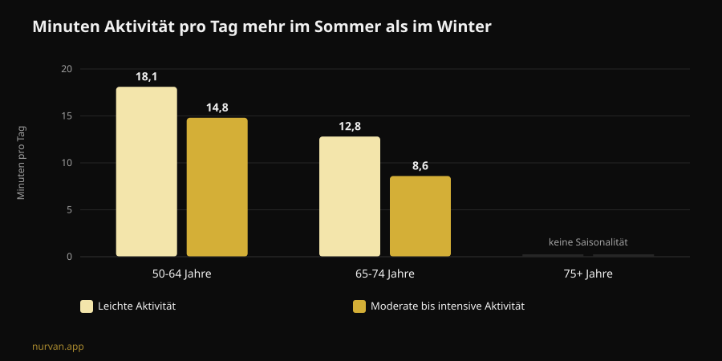

# Funktioniert der Winter Arc? Was die Studien zeigen

Von [Giammaria Loi](/autore/giammaria-loi) · aktualisiert am 8. November 2026

Der Winter Arc ist die Challenge der Stunde: drei Monate totale Disziplin, vom 1. Oktober bis zum 1. Januar, mit einer Liste von Regeln, die jeden Tag abzuhaken sind. Versprochen wird, dass man im Januar „verwandelt" herauskommt. Ich habe sieben indexierte Arbeiten zu Gewohnheitsbildung, Saisonalität körperlicher Aktivität und Verhaltensplanung gelesen. Das Ergebnis ist interessanter als ein Ja oder Nein: Der Trend trifft den richtigen Zeitpunkt und liegt bei der Methode fast vollständig daneben.

## Kurz gefasst

- **Die 21 Tage gibt es nicht.** Die aktuellste systematische Übersichtsarbeit zur Frage, wie lange ein Gesundheitsverhalten bis zur Automatisierung braucht, nennt einen **Median von 59-66 Tagen** und Mittelwerte zwischen **106 und 154 Tagen**, bei einer individuellen Spanne von **4 bis 335 Tagen** (Singh et al., 2024).
- **92 Tage reichen für etwa die Hälfte der Leute.** Die „offizielle" Dauer der Challenge deckt den Median ab, aber wer am langsamen Ende der Verteilung steht, hat keinen Kalender mehr übrig, bevor die Gewohnheit sitzt.
- **Der Winter ist keine erfundene Ausrede.** Per Akzelerometer gemessen bewegen sich Erwachsene zwischen 50 und 64 im Sommer **14,8 Minuten pro Tag länger** moderat bis intensiv als im Winter, bei leichter Aktivität sind es **18,1 Minuten**. Sie schlafen im Winter außerdem **31,8 Minuten länger** pro Nacht (Cepeda et al., 2018).
- **Die Lücke des Winter Arc ist der Tag, an dem du ausfällst.** Über 19.883 Personen hinweg ist es das **Coping Planning** — der Plan B für Unvorhergesehenes —, das den Schritt von der Absicht zum Verhalten tatsächlich vermittelt, während die bloße „Wann und wo"-Planung nicht signifikant wird (Wang et al., 2025).
- **Was du aufbaust, verschwindet nicht am 2. Januar.** Bei älteren Menschen führten 12 bis 24 Wochen kompletter Trainingspause **nicht** zu einem statistisch signifikanten Verlust der aufgebauten Muskelmasse; deutlich wird der Rückgang erst jenseits von 31 Wochen (Grgic, 2022).

## Was der Winter Arc konkret ist

Auf TikTok entstanden und inzwischen ein eigenes redaktionelles Format, ist der Winter Arc ein Zeitfenster: 1. Oktober bis 1. Januar, also 92 Tage. Ein Protokoll gibt es nicht. Die Seiten, die ihn erklären, sind sich in einem Punkt einig — „Disziplin und Konstanz" — und überlassen dir die Regelliste, die in der typischen Social-Version zu einem Paket aus fünf oder sechs Punkten wird: früh aufstehen, Studio an festgelegten Tagen, strenge Ernährung, Lesen, kalte Dusche, kein Alkohol.

Zwei Bausteine davon haben Substanz. Erstens die Wahl des Zeitraums: Im Winter geht die Aktivität tatsächlich zurück. Zweitens die Idee, Ziele aufzuschreiben und abzuhaken: Selbstbeobachtung gehört zu den am häufigsten eingesetzten Techniken in digitalen Interventionen zur körperlichen Aktivität (Omkar et al., 2026).

Der Rest — das feste Enddatum, die Zahl der Regeln, die Logik der ununterbrochenen Serie — ist Inszenierung. Und einer der drei Punkte richtet Schaden an.

## Der 21-Tage-Mythos und die echten Zahlen

Die Zahl 21 kursiert seit Jahrzehnten und stammt nicht aus einer Studie über Gewohnheiten. Die systematische Übersichtsarbeit mit Metaanalyse von Singh und Kolleginnen, Ende 2024 veröffentlicht, fasst 20 Studien mit 2.601 Personen zusammen, die Automatizität bei Gesundheitsverhalten gemessen haben: körperliche Aktivität, Trinken, Zahnseide, Ernährung, Abbau von Sitzzeit.

Vier dieser Studien berichten, wie lange es bis zur Automatisierung dauert. Die **Mediane** liegen zwischen 59 und 66 Tagen. Die **Mittelwerte** zwischen 106 und 154 — höher, weil manche Menschen deutlich länger brauchen. Und die Zahl, die für dich wirklich zählt, ist die beobachtete individuelle Spanne: **4 bis 335 Tage**.

Das ist kein Detail. Es heißt, dass zwei Personen, die am selben 1. Oktober mit demselben Plan starten, Mitte Januar sehr unterschiedlich dastehen können: Die eine macht es automatisch, die andere verhandelt jeden Abend mit sich selbst. Und die zweite ist nicht undisziplinierter. Sie liegt in einem normalen Bereich.

Aus derselben Arbeit kommt der nützliche Teil. Auf die Stärke einer Gewohnheit wirken **Häufigkeit**, **Tageszeit**, **Art des Verhaltens**, die Tatsache, dass die Gewohnheit **selbst gewählt** und nicht verordnet ist, das affektive Urteil über die Handlung und vorbereitende Gewohnheiten. Morgenroutinen und selbst gewählte Verhaltensweisen schneiden am stärksten ab. Die Autorinnen nennen auch die Grenzen: 11 der 20 Studien haben ein hohes Verzerrungsrisiko, und die Studienzahl ist klein.

Übersetzt in die Sprache des Trends: **Eine Regel, die du selbst gewählt hast, ist mehr wert als fünf aus einem Karussell kopierte.**

## Der Winter ist keine Ausrede: Der Rückgang ist gemessen

Hier trifft der Winter Arc etwas Reales. Die Rotterdam-Studie hat 1.116 Personen je sieben Tage lang zwischen 2011 und 2016 mit einem Akzelerometer ausgestattet und die Jahreszeiten verglichen.

Bei Erwachsenen zwischen 50 und 64 liegt die moderate bis intensive Aktivität im Sommer **14,8 Minuten pro Tag** höher als im Winter, die leichte Aktivität **18,1 Minuten pro Tag**. Bei den 65- bis 74-Jährigen sind es 8,6 und 12,8 Minuten. Über 75 verschwindet die Saisonalität. Der Nachtschlaf läuft in die Gegenrichtung: **31,8 Minuten länger** im Winter bei den 50- bis 64-Jährigen.

Zwei Details verändern die Lesart. Erstens erklärt sich das Muster über **Außentemperatur und Sonnenstunden**, nicht über den Charakter. Zweitens, und das ist das Unangenehme: Sitzendes Verhalten zeigt **keine** Saisonalität. Im Winter sitzen wir also nicht mehr — wir bewegen uns weniger. Weg ist der Anteil freiwilliger Bewegung, der, über den du entscheidest.

Im November etwas vorzunehmen ist deshalb keine Social-Media-Hysterie. Es ist die Jahreszeit, in der die Reserve verloren geht. Die Autorinnen selbst schließen, dass Sitzzeit durch leichte Aktivität zu unterbrechen ein guter Anfang ist.

## Der Konstruktionsfehler: kein Plan für den Tag, an dem du ausfällst

Hier bricht die Challenge, und es ist kein Willensproblem.

Das mentale Modell des Winter Arc ist die ununterbrochene Serie: 92 Kästchen zum Abhaken. Für den Tag, an dem du krank wirst, bis neun arbeitest oder dein Auto liegen bleibt, sieht das Protokoll nichts vor. Passiert es, ist die Serie gerissen und die Challenge bereits gescheitert — im Dezember, mit drei guten Wochen im Rücken.

Die Forschung zur Planung zeigt genau, wo anzusetzen ist. Eine Metaanalyse aus 41 randomisierten Studien mit 5.439 Personen hat den Effekt von Planungsinterventionen auf körperliche Aktivität gemessen: **SMD 0,35** (95-%-Konfidenzintervall 0,25 bis 0,44), ein kleiner bis moderater, aber konsistenter Effekt, der besser ausfällt, wenn während der Nachbeobachtung nachgefasst wird (Peng et al., 2022).

Eine Arbeit von 2025 hat den Mechanismus mit einem Strukturgleichungsmodell über 19.883 Personen aus 49 Studien zerlegt. Die Absicht sagt das Verhalten vorher (β = 0,416). Von den zwei Planungsarten vermittelt aber **nur das Coping Planning** — „was mache ich, wenn es regnet, wenn ich spät rauskomme, wenn der Montag ausfällt" — den Schritt von der Absicht zur Tat signifikant (β = 0,067, p < 0,001). Reines **Action Planning**, das klassische „dienstags und donnerstags um 19 Uhr ins Studio", wird im selben Modell **nicht** signifikant (β = -0,001).

Die beiden Analysen sagen über Action Planning nicht dasselbe, und das gehört klar benannt: In den Studien von Peng wirkten auf Action Planning aufgebaute Interventionen besser, im Modell von Wang leistet das Coping Planning die Vermittlung. Was in beiden Fällen bleibt: **Planen schlägt spontanes Entscheiden**, und der Plan für Unvorhergesehenes ist kein Zubehör.

Der Winter Arc, wie er zirkuliert, hat nur die erste Hälfte: Regeln, Zeiten, Kästchen. Die zweite fehlt.

## Was die Forschung wirklich sagt

| Verbreitete Behauptung | Urteil | Quelle |
|---|---|---|
| „Eine Gewohnheit braucht 21 Tage" | **Widerlegt**: Median 59-66 Tage, Spanne 4-335 | Singh et al., 2024 |
| „92 Tage reichen für die Verwandlung" | **Zu präzisieren**: sie decken den Median ab, nicht das langsame Ende | Singh et al., 2024 |
| „Im Winter ist es reine Motivationsfrage" | **Zu präzisieren**: der Rückgang ist gemessen und hängt an Licht und Temperatur | Cepeda et al., 2018 |
| „Ein Tag verpasst, Serie gerissen, von vorn" | **Als Strategie widerlegt**: es braucht einen Plan B, keinen Reset | Wang et al., 2025; Peng et al., 2022 |
| „Nach der Challenge ist in zwei Wochen alles weg" | **Beim Zeitraum widerlegt**: 12-24 Wochen Pause ohne signifikanten Verlust (Daten bei Älteren) | Grgic, 2022 |
| „Man braucht fünf Regeln pro Tag" | **Nicht belegt**: Häufigkeit und eigene Wahl zählen | Singh et al., 2024 |
| „Keine App nötig, nur Disziplin" | **Zu präzisieren**: kleiner, aber positiver Effekt digitaler Hilfen | Omkar et al., 2026 |

## Und wenn du am 2. Januar aufhörst?

Die Angst, die befristete Challenges zusammenhält, ist simpel: Es endet, ich höre auf, alles ist weg. Die Zahlen zum Detraining sind großzügiger.

Grgics Metaanalyse fasst sechs Studien bei älteren Menschen zusammen, die 9 bis 24 Wochen Krafttraining absolviert hatten, mit klarem Zuwachs an Muskelmasse (d = 0,99). In den kompletten Pausen sinkt die Masse (d = -0,83), doch die Untergruppe mit **12 bis 24 Wochen** Pause zeigt keinen statistisch signifikanten Rückgang (d = -0,60, Intervall -1,21 bis 0,01). Deutlich wird der Verlust jenseits von **31 Wochen**. Wichtig: Es handelt sich um eine Stichprobe älterer Menschen, nicht um junge Trainierte, und die Daten betreffen die Muskelgröße, nicht die Kraft.

Die Kraft ist übrigens das Empfindlichste: Über die Lebensspanne fallen Kraft und Leistung bis zu achtmal schneller als die Muskelmasse (Fyfe et al., 2021). Sie lässt sich aber auch mit wenig verteidigen. Dieselbe Übersichtsarbeit sammelt die Belege zu **Minimaldosen**: geringe Umfänge pro Einheit mit schweren Lasten, oder kurze häufige Einheiten mit wenig Material, verbessern Kraft und funktionelle Kapazität. Mit einer Randnotiz, die den Winter Arc trifft: Höhere Trainingsumfänge gehen mit **mehr Unbehagen und weniger Freude** einher, und das arbeitet gegen das Dranbleiben.

Anders gesagt: Das härteste Programm ist nicht das Programm, das überlebt.

## So wendest du es an

Wenn du den Rahmen des Winter Arc ohne seinen Konstruktionsfehler willst:

1. **Wähle eine Regel, nicht fünf.** Deine eigene, nicht die aus dem Video. Die eigene Wahl zählt zu den Determinanten der Gewohnheitsstärke.
2. **Halte die Häufigkeit hoch und den Anspruch niedrig.** Drei kurze Einheiten, die du machst, schlagen vier lange, die ausfallen. Freude ist hier keine Schwäche, sondern eine Adhärenzvariable.
3. **Schreib den Plan B auf, bevor du ihn brauchst.** „Fällt Dienstag aus, gehe ich Mittwoch." „Ist das Studio zu, 20 Minuten zu Hause." Genau das, nicht das abgehakte Kästchen, verknüpft die Forschung mit tatsächlichem Verhalten.
4. **Nutze das Licht.** Da der Wintereinbruch an Temperatur und Tageslänge hängt, lege die Einheit dorthin, wo die Umgebung hilft, und nimm Reibung raus: Tasche gepackt, kurzer Weg, fester Termin.
5. **Streich das Enddatum.** Ein Zähler, der am 1. Januar auf null springt, ist das Gegenteil einer Gewohnheit. Wenn es im Januar noch nicht automatisch läuft, bist du im statistischen Normalbereich: Du bist nicht fertig, du machst weiter.
6. **Miss die Lasten, nicht die Tage am Stück.** Eine Reihe aus 92 Kästchen sagt nichts über Fortschritt. Eine Lastprogression schon — und sie übersteht einen verpassten Montag.

Was du von jemandem verlangen solltest, der dich aus der Ferne betreut, steht in einem eigenen Artikel: [Funktioniert Online-Coaching? Was Studien zeigen](/de/blog/funktioniert-online-coaching). Und das größere Bild, welche Branchenmoden halten, haben wir in [Fitness-Trends 2027: was wirklich funktioniert](/de/blog/fitness-trends-2027-was-wirklich-funktioniert) sortiert.

### Nurvan: Konstanz misst sich in Lasten, nicht in Kästchen

Nurvan protokolliert jeden Satz, jede Wiederholung und jeden RIR und zeigt dir die echte Progression Woche für Woche: Fällt ein Montag aus, bleibt die Lastkurve trotzdem stehen, denn es zählt die Kurve, nicht die Serie aufeinanderfolgender Tage. Automatisch vorgeschlagene Aufwärmsätze und die Übungshistorie senken die Reibung an den Abenden, an denen du widerwillig trainierst — im Winter sind das die meisten. **[Nurvan ausprobieren](https://nurvan.app)**

## Häufige Fragen

**Wie lange dauert es wirklich, eine Trainingsgewohnheit aufzubauen?**
Laut der aktuellsten systematischen Übersichtsarbeit liegt der Median bis zur Automatisierung bei Gesundheitsverhalten bei 59-66 Tagen, mit Mittelwerten von 106-154 Tagen und einer individuellen Spanne von 4 bis 335 Tagen. Die 21 Tage stammen nicht aus dieser Literatur.

**Ist der Winter Arc schädlich?**
Das Format selbst ist nicht gefährlich, es ist ein Zeitfenster. Probleme entstehen durch Versionen, die viele starre Regeln gleichzeitig stapeln, durch die „Fang wieder von vorn an"-Logik nach einem Ausfall und durch hohe, plötzliche Trainingsumfänge bei Einsteigern. Bei Schmerzen, einer bestehenden Erkrankung oder nach einer Verletzung sprich vor dem Start mit einer Ärztin oder einem Arzt.

**Lieber eine 90-Tage-Challenge oder gar keine Frist?**
Die Daten vergleichen beide Formate nicht direkt. Bekannt ist, dass die Frist bei der Gewohnheitsbildung keine Rolle spielt, Häufigkeit, eigene Wahl und Planung für Störfälle dagegen schon. Eine Frist kann beim Start helfen; sie als Ziellinie zu behalten, ist das Risiko.

**Wenn ich im Januar aufhöre, wie viel verliere ich?**
In der Metaanalyse bei älteren Menschen führten 12 bis 24 Wochen kompletter Trainingspause zu keinem statistisch signifikanten Rückgang der Muskelmasse; jenseits von 31 Wochen schon. Das sind keine Daten zu jungen Trainierten, und sie betreffen die Muskelgröße, nicht die Kraft. Wenige kurze Einheiten schützen jedenfalls weit mehr, als man denkt.

## Weiterlesen

- [Funktioniert Online-Coaching? Was Studien zeigen](/de/blog/funktioniert-online-coaching) — was ein Coach aus der Ferne kontrollieren muss, um einem im Studio gleichzukommen.
- [Fitness-Trends 2027: was wirklich funktioniert](/de/blog/fitness-trends-2027-was-wirklich-funktioniert) — Branchenmoden durch den Evidenzfilter.
- [Trainingsplan mit KI: was die Studien zeigen](/de/blog/trainingsplan-mit-ki-studien) — wann ein automatisch erzeugtes Programm trägt und wann nicht.

## Quellen

1. Singh B, Murphy A, Maher C, Smith AE, 2024. Time to Form a Habit: A Systematic Review and Meta-Analysis of Health Behaviour Habit Formation and Its Determinants. *Healthcare (Basel)* 12(23):2488. PMID [39685110](https://pubmed.ncbi.nlm.nih.gov/39685110/) · [DOI 10.3390/healthcare12232488](https://doi.org/10.3390/healthcare12232488)
2. Cepeda M, Koolhaas CM, van Rooij FJA, Tiemeier H, Guxens M, Franco OH, Schoufour JD, 2018. Seasonality of physical activity, sedentary behavior, and sleep in a middle-aged and elderly population: The Rotterdam study. *Maturitas* 110:41–50. PMID [29563034](https://pubmed.ncbi.nlm.nih.gov/29563034/) · [DOI 10.1016/j.maturitas.2018.01.016](https://doi.org/10.1016/j.maturitas.2018.01.016)
3. Wang L, Li X, Qiu K, Wang D, 2025. Examining the impact of perceived behavioral control and planning on closing the exercise intention-behavior gap: Insights from a meta-analytic structural equation modeling study. *Psychol Sport Exerc* 78:102822. PMID [39952422](https://pubmed.ncbi.nlm.nih.gov/39952422/) · [DOI 10.1016/j.psychsport.2025.102822](https://doi.org/10.1016/j.psychsport.2025.102822)
4. Peng S, Othman AT, Yuan F, Liang J, 2022. The Effectiveness of Planning Interventions for Improving Physical Activity in the General Population: A Systematic Review and Meta-Analysis of Randomized Controlled Trials. *Int J Environ Res Public Health* 19(12):7337. PMID [35742582](https://pubmed.ncbi.nlm.nih.gov/35742582/) · [DOI 10.3390/ijerph19127337](https://doi.org/10.3390/ijerph19127337)
5. Grgic J, 2022. Use It or Lose It? A Meta-Analysis on the Effects of Resistance Training Cessation (Detraining) on Muscle Size in Older Adults. *Int J Environ Res Public Health* 19(21):14048. PMID [36360927](https://pubmed.ncbi.nlm.nih.gov/36360927/) · [DOI 10.3390/ijerph192114048](https://doi.org/10.3390/ijerph192114048)
6. Fyfe JJ, Hamilton DL, Daly RM, 2021. Minimal-Dose Resistance Training for Improving Muscle Mass, Strength, and Function: A Narrative Review of Current Evidence and Practical Considerations. *Sports Med* 52(3):463–479. PMID [34822137](https://pubmed.ncbi.nlm.nih.gov/34822137/) · [DOI 10.1007/s40279-021-01605-8](https://doi.org/10.1007/s40279-021-01605-8)
7. Omkar A, Bertrand JK, Sadasivan C, et al., 2026. Behaviour change techniques in eHealth interventions for older, frail, or sarcopenic adults: A systematic review and meta-analysis. *Digit Health* 12:20552076261473804. PMID [42534183](https://pubmed.ncbi.nlm.nih.gov/42534183/) · [DOI 10.1177/20552076261473804](https://doi.org/10.1177/20552076261473804)

Wissenschaftliche Quellen über PubMed recherchiert. Trendsignale: die Erklärseite von Gymshark zum [Winter Arc](https://www.gymshark.com/blog/article/what-is-the-winter-arc) (Saison 1. Oktober bis 1. Januar) sowie die Berichterstattung zum Begriff in der italienischen Fitnesspresse (My-Personaltrainer, SportOutdoor24, EroicaFenice), die sämtlich ohne Bezug auf die Forschung zur Gewohnheitsbildung auskommt. Text, Struktur, Grafiken und Prüfungen dieses Artikels sind original.

---

**Giammaria Loi** ist der Gründer von Nurvan. Er trainiert seit 2012 mit Gewichten, arbeitet seit 2013 als FIPE-zertifizierter Personal Trainer und Coach und startet seit 2018 im Powerlifting auf nationaler Ebene. Jeder Artikel, den er zeichnet, beginnt bei den Studien und endet bei dem, was im Studio wirklich funktioniert. [Autorenseite](/autore/giammaria-loi)

> Hinweis: informativer Inhalt, kein Ersatz für die Einschätzung einer Ärztin, eines Arztes oder einer qualifizierten Fachperson. Bei Schmerzen, einer bestehenden Erkrankung oder nach einer Verletzung sprich mit einer Ärztin oder einem Arzt, bevor du ein Trainingsprogramm beginnst oder änderst.
