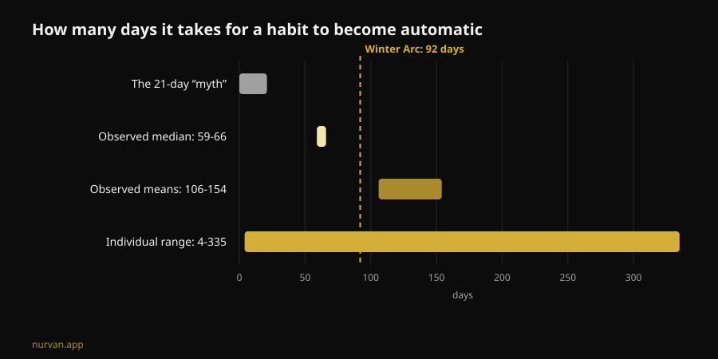
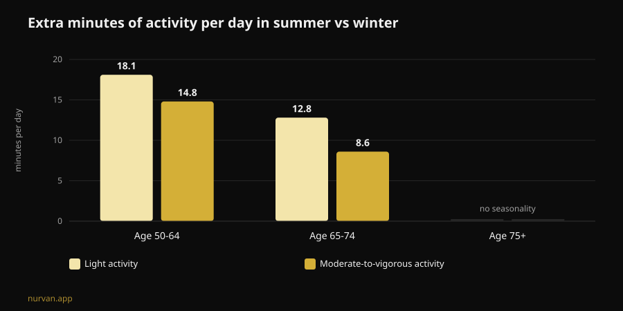

# Does the Winter Arc work? What the research says

By [Giammaria Loi](/autore/giammaria-loi) · updated 8 November 2026

The Winter Arc is this season's challenge: three months of total discipline, 1 October to 1 January, with a list of rules to tick off every single day. The promise is that you come out of it transformed. I read seven indexed papers on habit formation, seasonality of physical activity and behavioural planning, and the answer is more interesting than yes or no: the trend gets the timing right and the method almost entirely wrong.

## The short version

- **The 21-day rule isn't a finding.** The most recent systematic review on how long it takes a health behaviour to become automatic reports a **median of 59-66 days** and means between **106 and 154 days**, with individual variation running from **4 to 335 days** (Singh et al., 2024).
- **Ninety-two days is enough for about half of people.** The challenge's official length clears the median, but anyone on the slow side of that distribution runs out of calendar before the habit has set.
- **Winter is not an excuse people invented.** Measured by accelerometer, adults aged 50-64 do **14.8 more minutes a day** of moderate-to-vigorous activity in summer than in winter, and **18.1 more minutes** of light activity. They also sleep **31.8 minutes longer** per night in winter (Cepeda et al., 2018).
- **The flaw is the day you miss.** Across 19,883 people, the type of planning that actually mediates the jump from intention to behaviour is **coping planning** — your plan for when things go wrong — while plain "when and where" planning does not come out significant (Wang et al., 2025).
- **What you build doesn't vanish on 2 January.** In older adults, 12 to 24 weeks of stopping resistance training completely did **not** produce a statistically significant loss of the muscle size gained; the drop only becomes clear past 31 weeks (Grgic, 2022).

## What the Winter Arc actually is

Born on TikTok and now a publishing format of its own, the Winter Arc is a window: 1 October to 1 January, which is 92 days. There is no protocol. The pages explaining it agree on one thing — "discipline and consistency" — and leave the rule list to you, which in the typical social version becomes a bundle of five or six: early alarm, gym a set number of times a week, strict diet, reading, cold shower, no alcohol.

Two parts of that structure have something behind them. The first is the timing: winter really is when activity drops. The second is writing goals down and ticking them off — self-monitoring is one of the most frequently used techniques in digital physical-activity interventions (Omkar et al., 2026).

The rest — the fixed end date, the number of rules, the unbroken-streak logic — is narrative decoration. And one of the three does damage.

## The 21-day myth, with the real numbers

The 21-day figure has been circulating for decades and does not come from a study of habits. The systematic review with meta-analysis by Singh and colleagues, published at the end of 2024, pooled 20 studies covering 2,601 people that measured automaticity in health behaviours: physical activity, drinking water, flossing, diet, reducing sedentary time.

Four of those studies report how long it took to reach automaticity. The **medians** sit between 59 and 66 days. The **means** between 106 and 154 — higher because some people take far longer. And the number that matters most to you is the observed individual range: **4 to 335 days**.

That is not a technicality. It means two people who start the same 1 October on the same programme can arrive in mid-January with one of them running on autopilot and the other still negotiating with themselves every evening. The second one is not less disciplined. They are inside a normal range.

The same review carries the useful part. Habit strength is influenced by **frequency**, **time of day**, the **type of behaviour**, whether the habit is **chosen by the person** rather than imposed, how they feel about doing it, and whether preparatory habits exist. Morning practices and self-selected behaviours come out strongest. The authors also flag the limits: 11 of the 20 studies carry a high risk of bias, and the pool of studies is small.

Translated into the language of the trend: **one rule you picked beats five copied off a carousel.**

## Winter isn't an excuse: the drop is measured

Here the Winter Arc is onto something real. The Rotterdam study put an accelerometer on 1,116 people for seven days each between 2011 and 2016, and compared the seasons.

In adults aged 50-64, moderate-to-vigorous activity in summer runs **14.8 minutes a day** higher than in winter, and light activity **18.1 minutes a day** higher. In the young-elderly group, 65-74, the gaps are 8.6 and 12.8 minutes. Above 75, seasonality disappears. Night-time sleep runs the other way: **31.8 minutes longer** in winter for the 50-64 group.

Two details change how you read that. First, the pattern is explained by **ambient temperature and hours of sunlight**, not by character. Second, and more awkward: sedentary behaviour shows **no** seasonality at all. In other words, we don't sit more in winter — we move less. What disappears is the voluntary movement, the part you choose.

So deciding to do something in November isn't social hysteria. It's the season when the margin goes missing. The authors themselves conclude that breaking up sitting with light activity is a good starting point.

## The design flaw: no plan for the day you miss

This is where the challenge breaks, and it isn't a willpower problem.

The mental model of the Winter Arc is the unbroken streak: 92 boxes to tick. Which means the protocol has nothing to say about the day you get ill, work until nine, or your car dies. When that happens the streak is broken and the challenge has already failed — in December, with three good weeks behind you.

The planning research points straight at the fix. A meta-analysis of 41 randomised trials and 5,439 people measured the effect of planning interventions on physical activity: **SMD 0.35** (95% CI 0.25 to 0.44), a small-to-moderate but consistent effect, better when reinforcement happens during follow-up (Peng et al., 2022).

And a 2025 paper took the mechanism apart with structural equation modelling across 19,883 people in 49 studies. Intention predicts behaviour (β = 0.416). But of the two kinds of plan, **only coping planning** — "what do I do if it rains, if I finish late, if I miss Monday" — significantly mediates the step from intention to action (β = 0.067, p < 0.001). Pure **action planning**, the classic "Tuesday and Thursday, 7pm, gym", comes out **non-significant** in the same model (β = -0.001).

The two analyses don't say the same thing about action planning, and that's worth stating plainly: in Peng's trials, interventions built on action planning performed better; in Wang's model, coping planning does the mediating work. What survives in both is that **planning beats deciding in the moment**, and that the contingency plan is not an optional extra.

The Winter Arc, as it circulates, only has the first half: rules, times, boxes. It doesn't have the second.

## What the research actually says

| Common claim | Verdict | Source |
|---|---|---|
| "It takes 21 days to build a habit" | **Busted**: median 59-66 days, range 4-335 | Singh et al., 2024 |
| "Ninety-two days is enough to transform you" | **Needs nuance**: it clears the median, not the slow tail | Singh et al., 2024 |
| "In winter it's purely a motivation problem" | **Needs nuance**: the drop is measured, and tied to light and temperature | Cepeda et al., 2018 |
| "Miss a day and the streak is broken — start over" | **Busted as a strategy**: you need a plan B, not a reset | Wang et al., 2025; Peng et al., 2022 |
| "Stop after the challenge and you lose it all in two weeks" | **Busted on timing**: 12-24 weeks off with no significant loss (data in older adults) | Grgic, 2022 |
| "You need a list of five daily rules" | **Unsupported**: frequency and personal choice are what count | Singh et al., 2024 |
| "You don't need an app, you need discipline" | **Needs nuance**: digital tools show a small but positive effect | Omkar et al., 2026 |

## And if you stop on 2 January?

The fear holding these challenges together is simple: it ends, I quit, I lose everything. The detraining numbers are kinder than that.

Grgic's meta-analysis pooled six studies in older adults who had trained for strength for 9-24 weeks, with a clear gain in muscle size (d = 0.99). During complete training cessation, size falls (d = -0.83) — but the subgroup stopping for **12-24 weeks** shows no statistically significant reduction (d = -0.60, interval -1.21 to 0.01). The loss becomes clear past **31 weeks**. Important: this is an older-adult sample, not young trained lifters, and it measures muscle size, not strength.

Strength, incidentally, is the fragile one: across the lifespan, strength and power decline up to eight times faster than muscle mass (Fyfe et al., 2021). It is also the easiest thing to defend with very little. The same review gathers the evidence on **minimal doses**: low session volumes with heavy loads and few sessions, or brief frequent sessions with little or no equipment, improve strength and functional capacity. With a note that lands hard on the Winter Arc: higher training volumes are associated with **more discomfort and less enjoyment**, and that works against adherence.

Which is to say: the hardest programme is not the programme that survives.

## How to use it

If you want the Winter Arc frame without its design flaw:

1. **Pick one rule, not five.** The one you chose, not the one from the video. Personal choice is among the determinants of habit strength.
2. **Keep frequency high and the ask low.** Three short sessions you do beat four long ones you skip. Enjoyment isn't a weakness here: it's an adherence variable.
3. **Write the plan B before you need it.** "If I miss Tuesday, I go Wednesday." "If the gym is shut, 20 minutes at home." That, not the ticked box, is what the research links to actual behaviour.
4. **Work with the light.** Since the winter drop tracks temperature and daylight, put the session where the environment helps and strip out friction: bag packed, short commute, fixed slot.
5. **Delete the end date.** A counter that resets on 1 January is the opposite of a habit. If you reach January and it still isn't automatic, you're inside the statistical norm: you haven't finished, you're continuing.
6. **Track load, not streaks.** A row of 92 boxes tells you nothing about progress. A load progression does — and it survives a missed Monday.

On what to ask of someone coaching you remotely, we have a dedicated piece: [does online coaching work?](/en/blog/does-online-coaching-work). And if you want the wider picture of which industry fads hold up, we lined them up in [fitness trends 2027](/en/blog/fitness-trends-2027-what-works).

### Nurvan: consistency measured in load, not ticked boxes

Nurvan logs every set, rep and RIR and shows you the real progression week by week: miss a Monday and the load chart is still there, because what counts is the curve, not the run of consecutive days. Automatic warm-up sets and exercise history cut the friction on the evenings you train reluctantly — which in winter is most of them. **[Try Nurvan](https://nurvan.app)**

## FAQ

**How long does it really take to build a workout habit?**
According to the most recent systematic review, the median time to automaticity in health behaviours is 59-66 days, with means of 106-154 days and individual variation from 4 to 335 days. The 21-day figure does not come from this literature.

**Is the Winter Arc bad for you?**
The format itself isn't dangerous — it's a time window. Problems come from versions stacking many rigid rules at once, from the "start over" logic after a missed day, and from high, sudden training volumes in people starting from scratch. If you have pain, an ongoing health condition, or you're coming back from injury, talk to a doctor before you start.

**Is a 90-day challenge better than no deadline?**
The data don't compare the two formats directly. What we know is that a deadline plays no role in habit formation, while frequency, personal choice and planning for setbacks do. A deadline can help you start; keeping it as the finish line is the risk.

**If I stop in January, how much do I lose?**
In the older-adult meta-analysis, 12-24 weeks of completely stopping resistance training produced no statistically significant reduction in muscle size; past 31 weeks it did. That isn't data on young trained lifters, and it measures size rather than strength. Either way, a few short sessions defend far more than people assume.

## Read next

- [Does online coaching work? What the studies say](/en/blog/does-online-coaching-work) — what a remote coach has to monitor to match one standing next to you.
- [Fitness trends 2027: what actually works](/en/blog/fitness-trends-2027-what-works) — industry fads run through the evidence filter.
- [AI workout plans: what the research actually shows](/en/blog/ai-generated-workout-plans-research) — when an auto-generated programme holds up and when it doesn't.

## Sources

1. Singh B, Murphy A, Maher C, Smith AE, 2024. Time to Form a Habit: A Systematic Review and Meta-Analysis of Health Behaviour Habit Formation and Its Determinants. *Healthcare (Basel)* 12(23):2488. PMID [39685110](https://pubmed.ncbi.nlm.nih.gov/39685110/) · [DOI 10.3390/healthcare12232488](https://doi.org/10.3390/healthcare12232488)
2. Cepeda M, Koolhaas CM, van Rooij FJA, Tiemeier H, Guxens M, Franco OH, Schoufour JD, 2018. Seasonality of physical activity, sedentary behavior, and sleep in a middle-aged and elderly population: The Rotterdam study. *Maturitas* 110:41–50. PMID [29563034](https://pubmed.ncbi.nlm.nih.gov/29563034/) · [DOI 10.1016/j.maturitas.2018.01.016](https://doi.org/10.1016/j.maturitas.2018.01.016)
3. Wang L, Li X, Qiu K, Wang D, 2025. Examining the impact of perceived behavioral control and planning on closing the exercise intention-behavior gap: Insights from a meta-analytic structural equation modeling study. *Psychol Sport Exerc* 78:102822. PMID [39952422](https://pubmed.ncbi.nlm.nih.gov/39952422/) · [DOI 10.1016/j.psychsport.2025.102822](https://doi.org/10.1016/j.psychsport.2025.102822)
4. Peng S, Othman AT, Yuan F, Liang J, 2022. The Effectiveness of Planning Interventions for Improving Physical Activity in the General Population: A Systematic Review and Meta-Analysis of Randomized Controlled Trials. *Int J Environ Res Public Health* 19(12):7337. PMID [35742582](https://pubmed.ncbi.nlm.nih.gov/35742582/) · [DOI 10.3390/ijerph19127337](https://doi.org/10.3390/ijerph19127337)
5. Grgic J, 2022. Use It or Lose It? A Meta-Analysis on the Effects of Resistance Training Cessation (Detraining) on Muscle Size in Older Adults. *Int J Environ Res Public Health* 19(21):14048. PMID [36360927](https://pubmed.ncbi.nlm.nih.gov/36360927/) · [DOI 10.3390/ijerph192114048](https://doi.org/10.3390/ijerph192114048)
6. Fyfe JJ, Hamilton DL, Daly RM, 2021. Minimal-Dose Resistance Training for Improving Muscle Mass, Strength, and Function: A Narrative Review of Current Evidence and Practical Considerations. *Sports Med* 52(3):463–479. PMID [34822137](https://pubmed.ncbi.nlm.nih.gov/34822137/) · [DOI 10.1007/s40279-021-01605-8](https://doi.org/10.1007/s40279-021-01605-8)
7. Omkar A, Bertrand JK, Sadasivan C, et al., 2026. Behaviour change techniques in eHealth interventions for older, frail, or sarcopenic adults: A systematic review and meta-analysis. *Digit Health* 12:20552076261473804. PMID [42534183](https://pubmed.ncbi.nlm.nih.gov/42534183/) · [DOI 10.1177/20552076261473804](https://doi.org/10.1177/20552076261473804)

Scientific sources retrieved through PubMed. Trend signals: Gymshark's explainer on the [Winter Arc](https://www.gymshark.com/blog/article/what-is-the-winter-arc) (season running 1 October to 1 January) plus the Italian-language coverage of the term on My-Personaltrainer, SportOutdoor24 and EroicaFenice, none of which reference the habit-formation literature. The text, structure, charts and fact-checking in this article are original.

---

**Giammaria Loi** is the founder of Nurvan. He has been lifting since 2012, has worked as a FIPE-certified personal trainer and coach since 2013, and has competed in powerlifting at national level since 2018. Every article he writes starts from the research and ends with what actually works in the gym. [Author page](/autore/giammaria-loi)

> Note: educational content, not a substitute for advice from a doctor or qualified professional. If you have pain, an ongoing health condition, or you are returning from injury, speak to a doctor before starting or changing a training programme.
