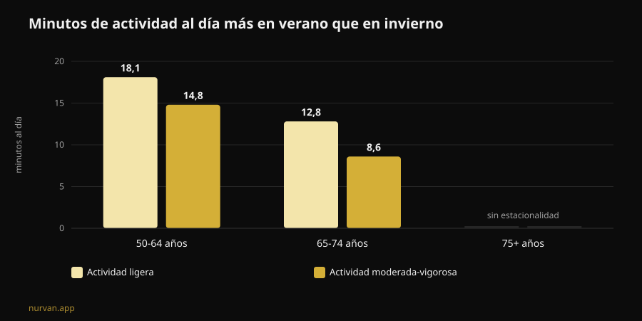

# ¿Funciona el Winter Arc? Esto dicen los estudios

De [Giammaria Loi](/autore/giammaria-loi) · actualizado el 8 de noviembre de 2026

El Winter Arc es el reto del momento: tres meses de disciplina total, del 1 de octubre al 1 de enero, con una lista de normas que cumplir cada día. La promesa es llegar a enero "transformado". He leído siete trabajos indexados sobre formación de hábitos, estacionalidad de la actividad física y planificación del comportamiento, y el resultado es más interesante que un sí o un no: el reto acierta con el momento y se equivoca en casi todo el método.

## En resumen

- **Los 21 días no existen.** La revisión sistemática más reciente sobre cuánto tarda una conducta de salud en volverse automática describe una **mediana de 59-66 días** y medias de entre **106 y 154 días**, con una variabilidad individual que va de **4 a 335 días** (Singh et al., 2024).
- **Noventa y dos días bastan para la mitad de la gente.** La duración "oficial" del reto cubre la mediana, pero quien esté en la parte lenta de esa distribución se queda sin calendario antes de que el hábito se consolide.
- **El invierno no es una excusa inventada.** Medida con acelerómetro, la actividad moderada-vigorosa de los adultos de 50 a 64 años es **14,8 minutos al día mayor** en verano que en invierno, y la actividad ligera **18,1 minutos mayor**. Además duermen **31,8 minutos más** por noche en invierno (Cepeda et al., 2018).
- **El agujero del Winter Arc es el día que fallas.** Sobre 19.883 personas, el tipo de planificación que de verdad media el paso de la intención a la conducta es el **coping planning** —el plan B para los imprevistos—, mientras que el simple plan de "cuándo y dónde" no sale significativo (Wang et al., 2025).
- **Lo que construyes no se evapora el 2 de enero.** En personas mayores, entre 12 y 24 semanas de parada completa con pesas **no** redujeron de forma estadísticamente significativa la masa muscular ganada; la caída solo se vuelve clara a partir de las 31 semanas (Grgic, 2022).

## Qué es el Winter Arc, en la práctica

Nacido en TikTok y convertido ya en formato editorial, el Winter Arc es una ventana de tiempo: del 1 de octubre al 1 de enero, 92 días. No hay protocolo. Las páginas que lo explican coinciden en una sola cosa —"disciplina y constancia"— y te dejan a ti la lista de normas, que en la versión social típica es un paquete de cinco o seis: despertarse al amanecer, gimnasio, dieta estricta, lectura, ducha fría, cero alcohol.

Dos elementos de esa estructura tienen fundamento. El primero es la elección del periodo: en invierno la actividad baja de verdad. El segundo es la idea de escribir los objetivos e ir tachándolos: el autorregistro es una de las técnicas más usadas en las intervenciones digitales sobre actividad física (Omkar et al., 2026).

El resto —la duración con fecha de caducidad, el número de normas, la lógica de la racha que no se puede romper— es decoración narrativa. Y una de las tres hace daño.

## El mito de los 21 días: los números reales

La cifra de los 21 días lleva décadas circulando y no procede de un estudio sobre hábitos. La revisión sistemática con metaanálisis de Singh y colaboradores, de finales de 2024, reunió 20 estudios con 2.601 personas que medían la automaticidad de conductas de salud: actividad física, beber agua, hilo dental, alimentación, sedentarismo.

Cuatro de esos estudios informan de cuánto se tarda en llegar al automatismo. Las **medianas** están entre 59 y 66 días. Las **medias**, entre 106 y 154: más altas porque a algunas personas les cuesta mucho más. Y el dato que de verdad te importa es el intervalo individual observado: **de 4 a 335 días**.

No es un detalle técnico. Significa que dos personas que empiezan el mismo 1 de octubre con el mismo plan pueden llegar a mediados de enero con una de ellas haciendo el gesto en automático y la otra todavía negociando consigo misma cada noche. Y la segunda no es menos disciplinada: está dentro de un rango normal.

De la misma revisión llega la parte útil. En la fuerza del hábito influyen la **frecuencia**, el **momento del día**, el **tipo de conducta**, que el hábito sea **elegido por la persona** y no impuesto, el juicio afectivo sobre ese gesto y la existencia de hábitos "preparatorios". Las prácticas matutinas y las conductas autoelegidas salen como las más fuertes. Los autores señalan los límites: 11 de los 20 estudios tienen riesgo de sesgo elevado y el número de estudios es pequeño.

Traducido al idioma del reto: **una norma que has elegido tú vale más que cinco copiadas de un carrusel.**

## El invierno no es una excusa: la caída está medida

Aquí el Winter Arc toca algo real. El estudio Rotterdam puso un acelerómetro a 1.116 personas durante siete días a cada una, entre 2011 y 2016, y comparó las estaciones.

En los adultos de 50 a 64 años, la actividad moderada-vigorosa en verano es **14,8 minutos al día** mayor que en invierno, y la actividad ligera, **18,1 minutos al día** mayor. En los mayores jóvenes, de 65 a 74 años, la diferencia es de 8,6 y 12,8 minutos. Por encima de los 75 la estacionalidad desaparece. El sueño nocturno va al revés: **31,8 minutos más largo** en invierno en el grupo de 50-64.

Dos detalles cambian la lectura. El primero: el patrón se explica por la **temperatura ambiente y las horas de luz**, no por el carácter. El segundo, el más incómodo: el comportamiento sedentario **no** muestra estacionalidad. Traducido, en invierno no nos sentamos más: nos movemos menos. Lo que desaparece es la parte de movimiento voluntario, la que decides tú.

Decidir hacer algo en noviembre no es histeria de redes: es la estación en la que se pierde el margen. Los propios autores concluyen que interrumpir el sedentarismo con actividad ligera es un buen punto de partida.

## El defecto de diseño: no hay plan para el día que fallas

Aquí es donde el reto se rompe, y no es un problema de fuerza de voluntad.

El modelo mental del Winter Arc es la racha intacta: 92 casillas que tachar. Lo que significa que el protocolo no contempla el día en que te pones enfermo, trabajas hasta las nueve o se te rompe el coche. Cuando pasa, la racha está rota y el reto ya ha fracasado: en diciembre, con tres buenas semanas a la espalda.

La investigación sobre planificación señala exactamente dónde intervenir. Un metaanálisis de 41 ensayos aleatorizados y 5.439 personas midió el efecto de las intervenciones de planificación sobre la actividad física: **DME 0,35** (intervalo de confianza del 95 % de 0,25 a 0,44), es decir, un efecto pequeño-moderado pero consistente, y mejor cuando hay refuerzos durante el seguimiento (Peng et al., 2022).

Un trabajo de 2025 desmontó el mecanismo con un modelo de ecuaciones estructurales sobre 19.883 personas en 49 estudios. La intención predice la conducta (β = 0,416). Pero de los dos tipos de plan, **solo el coping planning** —"qué hago si llueve, si salgo tarde, si fallo el lunes"— media de forma significativa el paso de la intención al hecho (β = 0,067, p < 0,001). El **action planning** puro, el clásico "martes y jueves a las 19:00 en el gimnasio", en ese mismo modelo **no** resulta significativo (β = -0,001).

Los dos análisis no dicen lo mismo sobre el action planning, y conviene decirlo con claridad: en los ensayos de Peng, las intervenciones basadas en action planning funcionaban mejor; en el modelo de Wang es el coping planning el que hace el trabajo de mediación. Lo que se sostiene en ambos es que **planificar gana a decidir sobre la marcha**, y que el plan para los imprevistos no es un accesorio.

El Winter Arc, tal y como circula, solo tiene la primera mitad: normas, horarios, casillas. No tiene la segunda.

## Qué dice de verdad la investigación

| Afirmación habitual | Veredicto | Fuente |
|---|---|---|
| "Hacen falta 21 días para crear un hábito" | **Desmentido**: mediana de 59-66 días, rango de 4 a 335 | Singh et al., 2024 |
| "Noventa y dos días bastan para transformarte" | **Hay que matizar**: cubren la mediana, no la cola lenta | Singh et al., 2024 |
| "En invierno es solo cuestión de motivación" | **Hay que matizar**: la caída está medida y ligada a luz y temperatura | Cepeda et al., 2018 |
| "Si fallas un día la racha se rompe: empieza de cero" | **Desmentido como estrategia**: hace falta el plan B, no el reinicio | Wang et al., 2025; Peng et al., 2022 |
| "Si paras después del reto lo pierdes todo en dos semanas" | **Desmentido en los plazos**: 12-24 semanas de parada sin pérdida significativa (datos en mayores) | Grgic, 2022 |
| "Hace falta una lista de cinco normas al día" | **Sin respaldo**: cuentan la frecuencia y la elección personal | Singh et al., 2024 |
| "No necesitas una app, necesitas disciplina" | **Hay que matizar**: efecto pequeño pero positivo de las herramientas digitales | Omkar et al., 2026 |

## ¿Y si paras el 2 de enero?

El miedo que sostiene los retos con fecha de caducidad es este: se acaba, lo dejo, lo pierdo todo. Los números sobre el desentrenamiento son más generosos que eso.

El metaanálisis de Grgic reunió seis estudios en personas mayores que habían entrenado la fuerza 9-24 semanas, con un aumento claro de masa muscular (d = 0,99). En las paradas completas la masa baja (d = -0,83), pero el subgrupo que paraba **12-24 semanas** no muestra una reducción estadísticamente significativa (d = -0,60, intervalo de -1,21 a 0,01). La caída se vuelve clara a partir de las **31 semanas**. Importante: es una muestra de personas mayores, no de jóvenes entrenados, y el dato se refiere al tamaño del músculo, no a la fuerza.

La fuerza, por cierto, es lo más frágil: a lo largo de la vida, la fuerza y la potencia caen hasta ocho veces más rápido que la masa muscular (Fyfe et al., 2021). Y también es lo más fácil de defender con poco. Esa misma revisión recopila la evidencia sobre las **dosis mínimas**: volúmenes bajos por sesión con cargas altas, o microsesiones frecuentes con poco material, mejoran la fuerza y la capacidad funcional. Con una nota que pesa sobre el Winter Arc: los volúmenes de entrenamiento más altos se asocian a **más molestia y menos disfrute**, y eso juega en contra de la adherencia.

Es decir: el programa más duro no es el programa que resiste.

## Cómo aplicarlo

Si quieres usar el marco del Winter Arc sin su defecto de diseño:

1. **Elige una norma, no cinco.** La que has elegido tú, no la del vídeo. La elección personal está entre los determinantes de la fuerza del hábito.
2. **Mantén alta la frecuencia y bajo el listón.** Tres sesiones cortas que haces ganan a cuatro largas que te saltas. El disfrute no es un vicio: es una variable de adherencia.
3. **Escribe el plan B antes de necesitarlo.** "Si fallo el martes, voy el miércoles." "Si el gimnasio está cerrado, 20 minutos en casa." Eso, y no la casilla tachada, es lo que la investigación asocia con la conducta real.
4. **Agárrate a la luz.** Como la caída invernal va ligada a la temperatura y a las horas de luz, pon la sesión donde el entorno te ayuda y quita fricción: bolsa preparada, trayecto corto, horario fijo.
5. **Borra la fecha de caducidad.** Un contador que se pone a cero el 1 de enero es lo contrario de un hábito. Si llegas a enero y el gesto todavía no es automático, estás dentro de la norma estadística: no has terminado, estás continuando.
6. **Mide las cargas, no los días seguidos.** Una fila de 92 casillas no te dice si estás progresando. Una progresión de carga sí, y sobrevive a un lunes perdido.

Sobre qué pedirle a quien te sigue en remoto tenemos un artículo dedicado: [¿Funciona el coaching online? Esto dicen los estudios](/es/blog/funciona-el-coaching-online). Y si te interesa el cuadro más amplio de qué modas del sector se sostienen, las pusimos en fila en [Tendencias fitness 2027: qué funciona de verdad](/es/blog/tendencias-fitness-2027-que-funciona).

### Nurvan: la constancia se mide en cargas, no en casillas

Nurvan registra cada serie, repetición y RIR y te enseña la progresión real semana a semana: si fallas un lunes, el gráfico de cargas sigue ahí, porque lo que cuenta es la curva y no la racha de días seguidos. Las series de calentamiento propuestas automáticamente y el histórico de cada ejercicio bajan la fricción en las tardes en las que entrenas a regañadientes, que en invierno son la mayoría. **[Prueba Nurvan](https://nurvan.app)**

## Preguntas frecuentes

**¿Cuánto se tarda de verdad en crear el hábito de entrenar?**
Según la revisión sistemática más reciente, la mediana para llegar al automatismo en conductas de salud es de 59-66 días, con medias de 106-154 días y una variabilidad individual que va de 4 a 335 días. Los 21 días no salen de esta literatura.

**¿El Winter Arc es malo?**
El formato en sí no es peligroso: es una ventana de tiempo. Los problemas vienen de las versiones que apilan muchas normas rígidas a la vez, de la lógica del "vuelve a empezar" tras un fallo y de los volúmenes altos y repentinos en quien parte de cero. Si tienes dolor, una condición de salud en curso o vuelves de una lesión, consúltalo con un médico antes de empezar.

**¿Mejor un reto de 90 días o sin fecha límite?**
Los datos no comparan los dos formatos directamente. Sabemos que la fecha límite no influye en la formación del hábito, mientras que la frecuencia, la elección personal y la planificación de los imprevistos sí. Una fecha puede ayudarte a arrancar; mantenerla como meta final es el riesgo.

**Si paro en enero, ¿cuánto pierdo?**
En el metaanálisis sobre personas mayores, de 12 a 24 semanas de parada completa con pesas no produjeron una reducción estadísticamente significativa de la masa muscular; por encima de las 31 semanas, sí. No son datos sobre jóvenes entrenados y se refieren al tamaño del músculo, no a la fuerza. Unas pocas sesiones cortas defienden mucho más de lo que se cree.

## Lee también

- [¿Funciona el coaching online? Esto dicen los estudios](/es/blog/funciona-el-coaching-online) — qué tiene que controlar un entrenador a distancia para valer lo que uno en sala.
- [Tendencias fitness 2027: qué funciona de verdad](/es/blog/tendencias-fitness-2027-que-funciona) — las modas del sector pasadas por el filtro de la evidencia.
- [Rutina de entrenamiento con IA: qué dicen los estudios](/es/blog/rutina-de-entrenamiento-con-ia) — cuándo se sostiene un programa generado automáticamente y cuándo no.

## Fuentes

1. Singh B, Murphy A, Maher C, Smith AE, 2024. Time to Form a Habit: A Systematic Review and Meta-Analysis of Health Behaviour Habit Formation and Its Determinants. *Healthcare (Basel)* 12(23):2488. PMID [39685110](https://pubmed.ncbi.nlm.nih.gov/39685110/) · [DOI 10.3390/healthcare12232488](https://doi.org/10.3390/healthcare12232488)
2. Cepeda M, Koolhaas CM, van Rooij FJA, Tiemeier H, Guxens M, Franco OH, Schoufour JD, 2018. Seasonality of physical activity, sedentary behavior, and sleep in a middle-aged and elderly population: The Rotterdam study. *Maturitas* 110:41–50. PMID [29563034](https://pubmed.ncbi.nlm.nih.gov/29563034/) · [DOI 10.1016/j.maturitas.2018.01.016](https://doi.org/10.1016/j.maturitas.2018.01.016)
3. Wang L, Li X, Qiu K, Wang D, 2025. Examining the impact of perceived behavioral control and planning on closing the exercise intention-behavior gap: Insights from a meta-analytic structural equation modeling study. *Psychol Sport Exerc* 78:102822. PMID [39952422](https://pubmed.ncbi.nlm.nih.gov/39952422/) · [DOI 10.1016/j.psychsport.2025.102822](https://doi.org/10.1016/j.psychsport.2025.102822)
4. Peng S, Othman AT, Yuan F, Liang J, 2022. The Effectiveness of Planning Interventions for Improving Physical Activity in the General Population: A Systematic Review and Meta-Analysis of Randomized Controlled Trials. *Int J Environ Res Public Health* 19(12):7337. PMID [35742582](https://pubmed.ncbi.nlm.nih.gov/35742582/) · [DOI 10.3390/ijerph19127337](https://doi.org/10.3390/ijerph19127337)
5. Grgic J, 2022. Use It or Lose It? A Meta-Analysis on the Effects of Resistance Training Cessation (Detraining) on Muscle Size in Older Adults. *Int J Environ Res Public Health* 19(21):14048. PMID [36360927](https://pubmed.ncbi.nlm.nih.gov/36360927/) · [DOI 10.3390/ijerph192114048](https://doi.org/10.3390/ijerph192114048)
6. Fyfe JJ, Hamilton DL, Daly RM, 2021. Minimal-Dose Resistance Training for Improving Muscle Mass, Strength, and Function: A Narrative Review of Current Evidence and Practical Considerations. *Sports Med* 52(3):463–479. PMID [34822137](https://pubmed.ncbi.nlm.nih.gov/34822137/) · [DOI 10.1007/s40279-021-01605-8](https://doi.org/10.1007/s40279-021-01605-8)
7. Omkar A, Bertrand JK, Sadasivan C, et al., 2026. Behaviour change techniques in eHealth interventions for older, frail, or sarcopenic adults: A systematic review and meta-analysis. *Digit Health* 12:20552076261473804. PMID [42534183](https://pubmed.ncbi.nlm.nih.gov/42534183/) · [DOI 10.1177/20552076261473804](https://doi.org/10.1177/20552076261473804)

Fuentes científicas consultadas a través de PubMed. Señales de tendencia: la página explicativa de Gymshark sobre el [Winter Arc](https://www.gymshark.com/blog/article/what-is-the-winter-arc) (temporada del 1 de octubre al 1 de enero) y la cobertura del término en prensa de fitness en italiano (My-Personaltrainer, SportOutdoor24, EroicaFenice), ninguna con referencias a la literatura sobre formación de hábitos. Texto, estructura, gráficos y verificaciones son originales.

---

**Giammaria Loi** es el fundador de Nurvan. Entrena con pesas desde 2012, trabaja como entrenador personal y coach certificado por la FIPE desde 2013 y compite en powerlifting a nivel nacional desde 2018. Cada artículo que firma parte de los estudios científicos y llega a lo que funciona de verdad en el gimnasio. [Página del autor](/autore/giammaria-loi)

> Nota: contenido informativo, no sustituye la opinión de un médico o de un profesional cualificado. Si tienes dolor, una condición de salud en curso o vuelves después de una lesión, consúltalo con un médico antes de empezar o cambiar un programa de entrenamiento.
