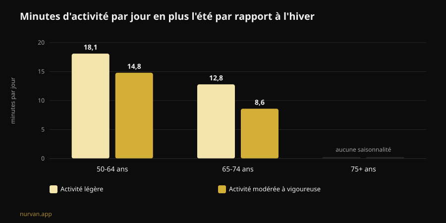

# Le Winter Arc fonctionne-t-il ? Ce que disent les études

Par [Giammaria Loi](/autore/giammaria-loi) · mis à jour le 8 novembre 2026

Le Winter Arc est le défi du moment : trois mois de discipline totale, du 1er octobre au 1er janvier, avec une liste de règles à cocher chaque jour. La promesse, c'est d'arriver en janvier « transformé ». J'ai lu sept travaux indexés sur la formation des habitudes, la saisonnalité de l'activité physique et la planification du comportement : la tendance a raison sur le moment choisi et tort sur presque toute la méthode.

## L'essentiel

- **Les 21 jours n'existent pas.** La revue systématique la plus récente sur le temps nécessaire pour qu'un comportement de santé devienne automatique rapporte une **médiane de 59 à 66 jours** et des moyennes comprises entre **106 et 154 jours**, avec une variabilité individuelle allant de **4 à 335 jours** (Singh et al., 2024).
- **Quatre-vingt-douze jours suffisent pour une personne sur deux.** La durée « officielle » du défi couvre la médiane, mais si vous êtes du côté lent de la distribution, le calendrier s'arrête avant que l'habitude ne soit installée.
- **L'hiver n'est pas une excuse inventée.** Mesurée à l'accéléromètre, l'activité modérée à vigoureuse des adultes de 50 à 64 ans est supérieure de **14,8 minutes par jour** en été par rapport à l'hiver, et l'activité légère de **18,1 minutes**. Ils dorment aussi **31,8 minutes de plus** par nuit en hiver (Cepeda et al., 2018).
- **Le trou du Winter Arc, c'est le jour où vous sautez.** Sur 19 883 personnes, le type de planification qui médie réellement le passage de l'intention au comportement est le **coping planning** — le plan B pour les imprévus — tandis que le simple plan « quand et où » ne ressort pas comme significatif (Wang et al., 2025).
- **Ce que vous construisez ne disparaît pas le 2 janvier.** Chez des personnes âgées, de 12 à 24 semaines d'arrêt complet de la musculation n'ont **pas** réduit de façon statistiquement significative la masse musculaire gagnée ; la baisse ne devient nette qu'au-delà de 31 semaines (Grgic, 2022).

## Le Winter Arc, concrètement

Né sur TikTok et devenu un format éditorial, le Winter Arc est une fenêtre de temps : du 1er octobre au 1er janvier, soit 92 jours. Aucun protocole. Les pages qui l'expliquent s'accordent sur une seule chose — « discipline et régularité » — et vous laissent la liste des règles, qui dans la version réseaux sociaux devient un paquet de cinq ou six : réveil à l'aube, salle de sport, alimentation stricte, lecture, douche froide, zéro alcool.

Deux éléments tiennent debout. Le choix de la période, d'abord : l'hiver est bien le moment où l'activité baisse. L'idée d'écrire ses objectifs et de les cocher, ensuite : l'auto-enregistrement est l'une des techniques les plus utilisées dans les interventions numériques sur l'activité physique (Omkar et al., 2026).

Le reste — la durée à échéance fixe, le nombre de règles, la logique de la série à ne pas briser — relève de la mise en scène. Et l'une des trois fait des dégâts.

## Le mythe des 21 jours : les vrais chiffres

Le chiffre des 21 jours circule depuis des décennies sans venir d'une étude sur les habitudes. La revue systématique avec méta-analyse de Singh et collègues, publiée fin 2024, a réuni 20 études portant sur 2 601 personnes qui mesuraient l'automaticité de comportements de santé : activité physique, hydratation, fil dentaire, alimentation, sédentarité.

Quatre de ces études indiquent le temps nécessaire pour atteindre l'automaticité. Les **médianes** vont de 59 à 66 jours. Les **moyennes**, de 106 à 154 : plus hautes parce que certains mettent bien plus longtemps. Et la donnée qui compte pour vous, c'est l'intervalle individuel observé : **de 4 à 335 jours**.

Ce n'est pas un détail technique. Deux personnes qui commencent le même 1er octobre avec le même programme peuvent se retrouver, à la mi-janvier, l'une avec le geste devenu automatique et l'autre encore en train de négocier avec elle-même chaque soir. La seconde n'est pas moins disciplinée : elle est dans un intervalle normal.

La même revue apporte la partie utile. La force de l'habitude dépend de la **fréquence**, du **moment de la journée**, du **type de comportement**, du fait que l'habitude soit **choisie par la personne** plutôt qu'imposée, du jugement affectif porté sur ce geste et de la présence d'habitudes « préparatoires ». Les pratiques matinales et les comportements auto-choisis ressortent comme les plus forts. Limites signalées par les auteurs : 11 des 20 études présentent un risque de biais élevé et le nombre d'études reste faible.

Traduit dans la langue de la tendance : **une règle que vous avez choisie vaut mieux que cinq copiées sur un carrousel.**

## L'hiver n'est pas une excuse : la baisse est mesurée

Ici, le Winter Arc touche quelque chose de réel. L'étude de Rotterdam a équipé 1 116 personnes d'un accéléromètre sept jours durant, entre 2011 et 2016, et comparé les saisons.

Chez les 50-64 ans, l'activité modérée à vigoureuse est en été supérieure de **14,8 minutes par jour** à celle de l'hiver, et l'activité légère de **18,1 minutes**. Chez les 65-74 ans, les écarts sont de 8,6 et 12,8 minutes. Au-delà de 75 ans, la saisonnalité disparaît. Le sommeil va dans l'autre sens : **31,8 minutes de plus** en hiver chez les 50-64 ans.

Deux détails changent la lecture. Le schéma s'explique par la **température ambiante et les heures de lumière**, pas par le caractère. Et le comportement sédentaire ne montre **aucune** saisonnalité : en hiver on ne s'assoit pas davantage, on bouge moins. Ce qui disparaît, c'est le mouvement volontaire, celui que vous décidez.

Décider de faire quelque chose en novembre n'est donc pas une lubie : c'est la saison où la marge se perd. Les auteurs concluent qu'interrompre la sédentarité par de l'activité légère est un bon point de départ.

## Le défaut de conception : aucun plan pour le jour où vous sautez

C'est là que le défi casse, et ce n'est pas une affaire de volonté.

Le modèle mental du Winter Arc est la série ininterrompue : 92 cases à cocher. Le protocole ne prévoit donc rien pour le jour où vous tombez malade, où vous travaillez jusqu'à 21 heures ou où votre voiture lâche. Quand cela arrive, la série est brisée et le défi a déjà échoué — en décembre, avec trois bonnes semaines derrière vous.

La recherche sur la planification indique exactement où intervenir. Une méta-analyse de 41 essais randomisés et 5 439 personnes a mesuré l'effet des interventions de planification sur l'activité physique : **DMS 0,35** (IC à 95 % de 0,25 à 0,44), un effet faible à modéré mais constant, meilleur avec des relances pendant le suivi (Peng et al., 2022).

Un travail de 2025 a démonté le mécanisme avec un modèle d'équations structurelles portant sur 19 883 personnes dans 49 études. L'intention prédit le comportement (β = 0,416). Mais des deux types de plan, **seul le coping planning** — « qu'est-ce que je fais s'il pleut, si je finis tard, si je saute lundi » — médie significativement le passage de l'intention à l'acte (β = 0,067, p < 0,001). L'**action planning** pur, le classique « mardi et jeudi à 19 heures à la salle », n'est **pas** significatif dans ce même modèle (β = -0,001).

Les deux analyses divergent sur l'action planning, et autant le dire : chez Peng, les interventions fondées dessus marchaient mieux ; chez Wang, c'est le coping planning qui fait la médiation. Ce qui tient dans les deux cas : **planifier vaut mieux que décider sur le moment**, et le plan pour les imprévus n'est pas un accessoire.

Le Winter Arc, tel qu'il circule, n'a que la première moitié : règles, horaires, cases. Pas la seconde.

## Ce que dit vraiment la recherche

| Affirmation courante | Verdict | Source |
|---|---|---|
| « Il faut 21 jours pour créer une habitude » | **Démenti** : médiane de 59 à 66 jours, intervalle de 4 à 335 | Singh et al., 2024 |
| « Quatre-vingt-douze jours suffisent à vous transformer » | **À nuancer** : ils couvrent la médiane, pas la traîne lente | Singh et al., 2024 |
| « En hiver, c'est juste une question de motivation » | **À nuancer** : la baisse est mesurée et liée à la lumière et à la température | Cepeda et al., 2018 |
| « Un jour sauté et la série est brisée : on recommence » | **Démenti comme stratégie** : il faut un plan B, pas une remise à zéro | Wang et al., 2025 ; Peng et al., 2022 |
| « Si vous arrêtez après le défi, vous perdez tout en deux semaines » | **Démenti sur les délais** : 12 à 24 semaines d'arrêt sans perte significative (données chez des personnes âgées) | Grgic, 2022 |
| « Il faut une liste de cinq règles par jour » | **Non étayé** : ce sont la fréquence et le choix personnel qui comptent | Singh et al., 2024 |
| « Une application ne sert à rien, il faut de la discipline » | **À nuancer** : effet faible mais positif des outils numériques | Omkar et al., 2026 |

## Et si vous arrêtez le 2 janvier ?

La peur qui fait tenir les défis à durée déterminée est simple : ça se termine, j'arrête, je perds tout. Les chiffres sur le désentraînement sont plus rassurants.

La méta-analyse de Grgic a réuni six études chez des personnes âgées ayant suivi un entraînement de force de 9 à 24 semaines, avec un gain net de masse musculaire (d = 0,99). Pendant les arrêts complets, la masse diminue (d = -0,83), mais le sous-groupe arrêté **12 à 24 semaines** ne montre pas de réduction statistiquement significative (d = -0,60, intervalle de -1,21 à 0,01). La baisse devient nette au-delà de **31 semaines**. Important : échantillon de personnes âgées, pas de jeunes entraînés, et la donnée porte sur la taille du muscle, pas sur la force.

La force est d'ailleurs la plus fragile : au cours de la vie, force et puissance déclinent jusqu'à huit fois plus vite que la masse musculaire (Fyfe et al., 2021). C'est aussi ce qui se défend le plus facilement avec peu : cette même revue rassemble les données sur les **doses minimales**, volumes de séance faibles avec charges lourdes ou micro-séances fréquentes avec peu de matériel, qui améliorent la force et la capacité fonctionnelle. Avec une remarque qui pèse sur le Winter Arc : les volumes plus élevés sont associés à **plus d'inconfort et moins de plaisir**, ce qui joue contre l'adhésion.

Autrement dit : le programme le plus dur n'est pas celui qui tient.

## Comment l'appliquer

Pour garder le cadre du Winter Arc sans son défaut de conception :

1. **Choisissez une règle, pas cinq.** La vôtre, pas celle de la vidéo : le choix personnel fait partie des déterminants de la force de l'habitude.
2. **Gardez la fréquence haute et l'exigence basse.** Trois séances courtes faites valent mieux que quatre longues sautées. Le plaisir n'est pas un défaut : c'est une variable d'adhésion.
3. **Écrivez le plan B avant d'en avoir besoin.** « Si je saute mardi, j'y vais mercredi. » « Si la salle est fermée, 20 minutes à la maison. » C'est cela, pas la case cochée, que la recherche associe au comportement réel.
4. **Accrochez-vous à la lumière.** La baisse hivernale suit la température et la durée du jour : placez la séance là où l'environnement vous aide et supprimez les frictions, sac prêt, trajet court, créneau fixe.
5. **Supprimez la date de fin.** Un compteur remis à zéro le 1er janvier est le contraire d'une habitude. Si le geste n'est pas encore automatique en janvier, vous êtes dans la norme statistique : vous n'avez pas fini, vous continuez.
6. **Suivez les charges, pas les jours d'affilée.** Une rangée de 92 cases ne dit rien de votre progression. Une progression de charge, si — et elle survit à un lundi manqué.

Sur ce qu'il faut exiger d'un coach à distance, nous avons un article dédié : [Le coaching en ligne fonctionne-t-il ? Les études](/fr/blog/le-coaching-en-ligne-fonctionne). Et pour le tableau plus large des modes du secteur, voir [Tendances fitness 2027 : ce qui marche vraiment](/fr/blog/tendances-fitness-2027-ce-qui-marche).

### Nurvan : la régularité se mesure en charges, pas en cases cochées

Nurvan enregistre chaque série, chaque répétition et chaque RIR et montre la progression réelle semaine après semaine : si vous sautez un lundi, la courbe des charges reste là, parce que ce qui compte c'est la courbe, pas la série de jours consécutifs. Les séries d'échauffement automatiques et l'historique des exercices réduisent la friction les soirs où vous vous entraînez à contrecœur — la plupart des soirs d'hiver. **[Essayez Nurvan](https://nurvan.app)**

## Questions fréquentes

**Combien de temps faut-il vraiment pour créer une habitude d'entraînement ?**
D'après la revue systématique la plus récente, la médiane pour atteindre l'automaticité est de 59 à 66 jours, avec des moyennes de 106 à 154 jours et une variabilité individuelle de 4 à 335 jours. Les 21 jours ne viennent pas de cette littérature.

**Le Winter Arc est-il dangereux ?**
Le format en lui-même ne l'est pas : c'est une fenêtre de temps. Les problèmes viennent des versions qui empilent beaucoup de règles rigides, de la logique du « on recommence » après un jour sauté, et des volumes élevés et soudains chez les débutants. Si vous avez des douleurs, une pathologie en cours ou si vous revenez d'une blessure, parlez-en à un médecin avant de commencer.

**Mieux vaut un défi de 90 jours ou pas d'échéance du tout ?**
Les données ne comparent pas directement les deux formats. On sait que l'échéance ne joue aucun rôle dans la formation de l'habitude, alors que la fréquence, le choix personnel et la planification des imprévus, oui. Une échéance peut aider à démarrer ; la garder comme ligne d'arrivée est le risque.

**Si j'arrête en janvier, combien est-ce que je perds ?**
Dans la méta-analyse chez des personnes âgées, 12 à 24 semaines d'arrêt complet n'ont pas produit de réduction statistiquement significative de la masse musculaire ; au-delà de 31 semaines, si. Ce ne sont pas des données sur de jeunes pratiquants entraînés et elles portent sur la taille du muscle, pas sur la force. Quelques séances courtes protègent bien plus qu'on ne le croit.

## À lire aussi

- [Le coaching en ligne fonctionne-t-il ? Les études](/fr/blog/le-coaching-en-ligne-fonctionne) — ce qu'un coach à distance doit contrôler pour valoir un coach en salle.
- [Tendances fitness 2027 : ce qui marche vraiment](/fr/blog/tendances-fitness-2027-ce-qui-marche) — les modes du secteur au filtre des preuves.
- [Programme d'entraînement IA : ce que disent les études](/fr/blog/programme-entrainement-genere-par-ia) — quand un programme automatique tient la route.

## Sources

1. Singh B, Murphy A, Maher C, Smith AE, 2024. Time to Form a Habit: A Systematic Review and Meta-Analysis of Health Behaviour Habit Formation and Its Determinants. *Healthcare (Basel)* 12(23):2488. PMID [39685110](https://pubmed.ncbi.nlm.nih.gov/39685110/) · [DOI 10.3390/healthcare12232488](https://doi.org/10.3390/healthcare12232488)
2. Cepeda M, Koolhaas CM, van Rooij FJA, Tiemeier H, Guxens M, Franco OH, Schoufour JD, 2018. Seasonality of physical activity, sedentary behavior, and sleep in a middle-aged and elderly population: The Rotterdam study. *Maturitas* 110:41–50. PMID [29563034](https://pubmed.ncbi.nlm.nih.gov/29563034/) · [DOI 10.1016/j.maturitas.2018.01.016](https://doi.org/10.1016/j.maturitas.2018.01.016)
3. Wang L, Li X, Qiu K, Wang D, 2025. Examining the impact of perceived behavioral control and planning on closing the exercise intention-behavior gap: Insights from a meta-analytic structural equation modeling study. *Psychol Sport Exerc* 78:102822. PMID [39952422](https://pubmed.ncbi.nlm.nih.gov/39952422/) · [DOI 10.1016/j.psychsport.2025.102822](https://doi.org/10.1016/j.psychsport.2025.102822)
4. Peng S, Othman AT, Yuan F, Liang J, 2022. The Effectiveness of Planning Interventions for Improving Physical Activity in the General Population: A Systematic Review and Meta-Analysis of Randomized Controlled Trials. *Int J Environ Res Public Health* 19(12):7337. PMID [35742582](https://pubmed.ncbi.nlm.nih.gov/35742582/) · [DOI 10.3390/ijerph19127337](https://doi.org/10.3390/ijerph19127337)
5. Grgic J, 2022. Use It or Lose It? A Meta-Analysis on the Effects of Resistance Training Cessation (Detraining) on Muscle Size in Older Adults. *Int J Environ Res Public Health* 19(21):14048. PMID [36360927](https://pubmed.ncbi.nlm.nih.gov/36360927/) · [DOI 10.3390/ijerph192114048](https://doi.org/10.3390/ijerph192114048)
6. Fyfe JJ, Hamilton DL, Daly RM, 2021. Minimal-Dose Resistance Training for Improving Muscle Mass, Strength, and Function: A Narrative Review of Current Evidence and Practical Considerations. *Sports Med* 52(3):463–479. PMID [34822137](https://pubmed.ncbi.nlm.nih.gov/34822137/) · [DOI 10.1007/s40279-021-01605-8](https://doi.org/10.1007/s40279-021-01605-8)
7. Omkar A, Bertrand JK, Sadasivan C, et al., 2026. Behaviour change techniques in eHealth interventions for older, frail, or sarcopenic adults: A systematic review and meta-analysis. *Digit Health* 12:20552076261473804. PMID [42534183](https://pubmed.ncbi.nlm.nih.gov/42534183/) · [DOI 10.1177/20552076261473804](https://doi.org/10.1177/20552076261473804)

Sources scientifiques consultées via PubMed. Signaux de tendance : la page de Gymshark sur le [Winter Arc](https://www.gymshark.com/blog/article/what-is-the-winter-arc) (saison du 1er octobre au 1er janvier) et la couverture du terme dans la presse fitness italienne (My-Personaltrainer, SportOutdoor24, EroicaFenice), aucune ne renvoyant à la littérature sur la formation des habitudes. Texte, structure, graphiques et vérifications sont originaux.

---

**Giammaria Loi** est le fondateur de Nurvan. Il s'entraîne avec des charges depuis 2012, travaille comme entraîneur personnel et coach certifié FIPE depuis 2013 et compète en powerlifting au niveau national depuis 2018. Chaque article qu'il signe part des études scientifiques et aboutit à ce qui fonctionne vraiment en salle. [Page auteur](/autore/giammaria-loi)

> Note : contenu informatif, ne remplace pas l'avis d'un médecin ou d'un professionnel qualifié. Si vous avez des douleurs, une pathologie en cours ou si vous revenez d'une blessure, parlez-en à un médecin avant de commencer ou de modifier un programme d'entraînement.
