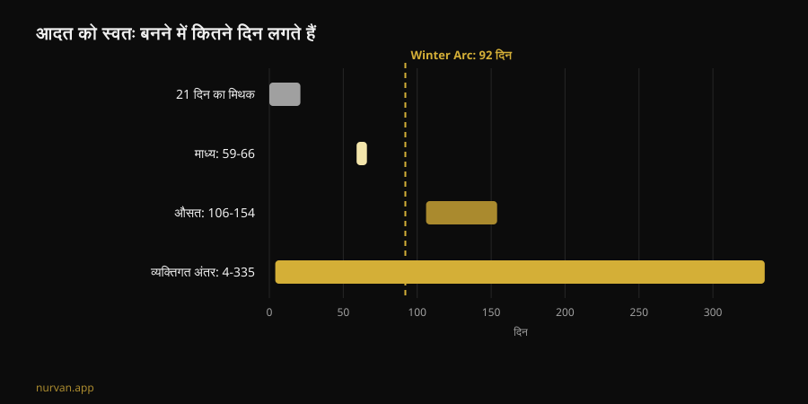
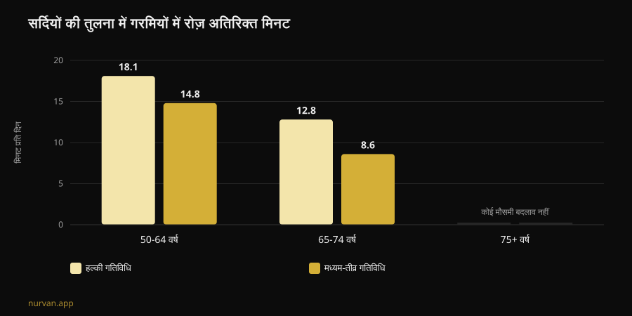

# Winter Arc काम करता है? रिसर्च क्या कहती है

लेखक: [Giammaria Loi](/autore/giammaria-loi) · अपडेट 8 नवंबर 2026

Winter Arc इस सीज़न का चैलेंज है: 1 अक्टूबर से 1 जनवरी तक तीन महीने की पूरी डिसिप्लिन, और हर दिन टिक करने के लिए नियमों की एक लिस्ट। वादा यह है कि आप इससे बदले हुए इंसान बनकर निकलेंगे। मैंने आदत बनने, फ़िज़िकल एक्टिविटी की मौसमी चाल और बिहेवियर प्लानिंग पर इंडेक्स्ड सात पेपर पढ़े, और जवाब "हाँ या ना" से ज़्यादा दिलचस्प है: यह ट्रेंड टाइमिंग में सही है और तरीक़े में लगभग पूरी तरह ग़लत।

## मुख्य बातें

- **21 दिन वाला नियम कोई रिसर्च फ़ाइंडिंग नहीं है।** किसी हेल्थ बिहेवियर को ऑटोमैटिक बनने में कितना समय लगता है, इस पर सबसे नई सिस्टेमैटिक रिव्यू **59-66 दिन का मीडियन** और **106 से 154 दिन** के मीन बताती है, और व्यक्तिगत फ़र्क़ **4 से 335 दिन** तक जाता है (Singh et al., 2024)।
- **92 दिन लगभग आधे लोगों के लिए काफ़ी हैं।** चैलेंज की आधिकारिक लंबाई मीडियन पार कर लेती है, लेकिन जो लोग डिस्ट्रिब्यूशन के धीमे हिस्से में हैं, उनका कैलेंडर आदत जमने से पहले ही खत्म हो जाता है।
- **सर्दी कोई गढ़ा हुआ बहाना नहीं है।** एक्सेलेरोमीटर से मापने पर 50-64 साल के वयस्क गर्मियों में सर्दियों के मुक़ाबले रोज़ **14.8 मिनट ज़्यादा** मॉडरेट-टू-वाइगरस एक्टिविटी और **18.1 मिनट ज़्यादा** हल्की एक्टिविटी करते हैं। सर्दियों में वे रात को **31.8 मिनट ज़्यादा** सोते भी हैं (Cepeda et al., 2018)।
- **असली खामी वह दिन है जो आपसे छूट जाता है।** 19,883 लोगों के डेटा में, इरादे से व्यवहार तक की छलांग में असल मध्यस्थता **कोपिंग प्लानिंग** करती है — यानी गड़बड़ होने पर क्या करेंगे, उसकी योजना — जबकि सिर्फ़ "कब और कहाँ" वाली प्लानिंग सांख्यिकीय रूप से सार्थक नहीं निकलती (Wang et al., 2025)।
- **जो बनाया है वह 2 जनवरी को ग़ायब नहीं होता।** बुज़ुर्गों में रेज़िस्टेंस ट्रेनिंग पूरी तरह 12 से 24 हफ़्ते बंद करने पर मसल साइज़ में सांख्यिकीय रूप से सार्थक गिरावट **नहीं** दिखी; गिरावट 31 हफ़्ते के बाद साफ़ होती है (Grgic, 2022)।

## Winter Arc असल में है क्या

TikTok पर जन्मा और अब अपने आप में एक पब्लिशिंग फ़ॉर्मैट बन चुका Winter Arc दरअसल एक विंडो है: 1 अक्टूबर से 1 जनवरी, यानी 92 दिन। कोई प्रोटोकॉल नहीं है। इसे समझाने वाले पेज एक बात पर सहमत हैं — "डिसिप्लिन और कंसिस्टेंसी" — और नियमों की लिस्ट आप पर छोड़ देते हैं, जो सोशल वाले आम वर्शन में पाँच-छह चीज़ों का बंडल बन जाती है: सुबह जल्दी अलार्म, हफ़्ते में तय बार जिम, सख़्त डाइट, पढ़ना, ठंडा शावर, ज़ीरो अल्कोहल।

इस ढाँचे के दो हिस्सों के पीछे कुछ दम है। पहला टाइमिंग: सर्दी वाक़ई वह मौसम है जब एक्टिविटी गिरती है। दूसरा, लक्ष्य लिखना और टिक करना — सेल्फ़-मॉनिटरिंग फ़िज़िकल एक्टिविटी के डिजिटल इंटरवेंशन में सबसे ज़्यादा इस्तेमाल होने वाली तकनीकों में से है (Omkar et al., 2026)।

बाक़ी — तय आख़िरी तारीख़, नियमों की गिनती, और "सिलसिला टूटना नहीं चाहिए" वाला तर्क — कहानी की सजावट है। और इन तीन में से एक असल में नुक़सान करती है।

## 21 दिन का मिथक: असली आँकड़े

21 दिन का आँकड़ा दशकों से घूम रहा है और यह आदतों पर हुई किसी स्टडी से नहीं आता। Singh और साथियों की सिस्टेमैटिक रिव्यू विद मेटा-एनालिसिस, जो 2024 के आख़िर में छपी, ने 2,601 लोगों को कवर करती 20 स्टडीज़ को जोड़ा जिनमें हेल्थ बिहेवियर की ऑटोमैटिसिटी मापी गई थी: फ़िज़िकल एक्टिविटी, पानी पीना, फ़्लॉसिंग, डाइट, और बैठे रहने का समय घटाना।

इनमें से चार स्टडीज़ बताती हैं कि ऑटोमैटिसिटी तक पहुँचने में कितना समय लगा। **मीडियन** 59 से 66 दिन के बीच है। **मीन** 106 से 154 के बीच — ज़्यादा इसलिए कि कुछ लोगों को कहीं ज़्यादा वक़्त लगता है। और आपके लिए सबसे अहम आँकड़ा है देखी गई व्यक्तिगत रेंज: **4 से 335 दिन**।

यह कोई तकनीकी बारीकी नहीं है। इसका मतलब है कि एक ही 1 अक्टूबर को एक ही प्रोग्राम से शुरू करने वाले दो लोग जनवरी के मध्य तक पहुँचें, तो एक ऑटोपायलट पर चल रहा होगा और दूसरा हर शाम ख़ुद से बहस कर रहा होगा। दूसरा कम डिसिप्लिन्ड नहीं है — वह एक सामान्य रेंज के भीतर है।

उसी रिव्यू में काम की बात भी है। आदत की मज़बूती पर असर डालते हैं: **फ़्रीक्वेंसी**, **दिन का समय**, **व्यवहार का प्रकार**, आदत **आपने ख़ुद चुनी है या थोपी गई है**, उस काम को लेकर आपका भावनात्मक रुख़, और तैयारी वाली आदतों का होना। सुबह की प्रैक्टिस और ख़ुद चुने गए व्यवहार सबसे मज़बूत निकलते हैं। लेखक सीमाएँ भी बताते हैं: 20 में से 11 स्टडीज़ में बायस का जोखिम ऊँचा है और स्टडीज़ की संख्या कम है।

ट्रेंड की भाषा में: **आपकी चुनी हुई एक आदत, किसी पोस्ट से कॉपी किए पाँच नियमों से बेहतर है।**

## सर्दी बहाना नहीं: गिरावट मापी गई है

यहाँ Winter Arc एक असली चीज़ पकड़ता है। Rotterdam स्टडी ने 2011 से 2016 के बीच 1,116 लोगों को सात-सात दिन एक्सेलेरोमीटर पहनाया और मौसमों की तुलना की।

50-64 साल के वयस्कों में गर्मियों की मॉडरेट-टू-वाइगरस एक्टिविटी सर्दियों से रोज़ **14.8 मिनट** ज़्यादा रहती है, और हल्की एक्टिविटी **18.1 मिनट** ज़्यादा। 65-74 साल वालों में यह अंतर 8.6 और 12.8 मिनट है। 75 से ऊपर मौसमी फ़र्क़ ग़ायब हो जाता है। रात की नींद उल्टी दिशा में चलती है: 50-64 वालों में सर्दियों में **31.8 मिनट ज़्यादा**।

दो बातें पढ़ने का तरीक़ा बदल देती हैं। पहली: यह पैटर्न **तापमान और धूप के घंटों** से समझाया जाता है, आपके कैरेक्टर से नहीं। दूसरी, और ज़्यादा असहज: बैठे रहने के व्यवहार में **कोई** मौसमी बदलाव नहीं दिखता। यानी सर्दियों में हम ज़्यादा बैठते नहीं — हम कम चलते हैं। जो ग़ायब होता है वह स्वैच्छिक मूवमेंट है, यानी वही हिस्सा जो आप तय करते हैं।

तो नवंबर में कुछ करने का फ़ैसला सोशल मीडिया की हड़बड़ी नहीं है। यही वह मौसम है जब मार्जिन गुम होता है। लेखक ख़ुद यह नतीजा देते हैं कि बैठने को हल्की एक्टिविटी से तोड़ना एक अच्छी शुरुआत है।

## डिज़ाइन की खामी: छूटे हुए दिन के लिए कोई प्लान नहीं

यहीं यह चैलेंज टूटता है, और मामला विलपावर का नहीं है।

Winter Arc का मेंटल मॉडल है अटूट सिलसिला: टिक करने के लिए 92 ख़ाने। इसका मतलब यह हुआ कि प्रोटोकॉल के पास उस दिन के लिए कुछ नहीं है जब आप बीमार पड़ें, नौ बजे तक काम करें, या गाड़ी ख़राब हो जाए। जब ऐसा होता है तो सिलसिला टूट चुका होता है और चैलेंज फ़ेल हो चुका होता है — दिसंबर में, तीन अच्छे हफ़्तों के बाद।

प्लानिंग पर हुई रिसर्च सीधे इलाज की जगह बताती है। 41 रैंडमाइज़्ड ट्रायल और 5,439 लोगों की एक मेटा-एनालिसिस ने फ़िज़िकल एक्टिविटी पर प्लानिंग इंटरवेंशन का असर मापा: **SMD 0.35** (95% CI 0.25 से 0.44), यानी छोटा-से-मध्यम पर टिकाऊ असर, और फ़ॉलो-अप के दौरान रीइन्फ़ोर्समेंट मिलने पर बेहतर (Peng et al., 2022)।

और 2025 के एक पेपर ने 49 स्टडीज़ के 19,883 लोगों पर स्ट्रक्चरल इक्वेशन मॉडलिंग से इस मशीन को खोलकर देखा। इरादा व्यवहार की भविष्यवाणी करता है (β = 0.416)। लेकिन दो तरह की प्लानिंग में से **सिर्फ़ कोपिंग प्लानिंग** — "बारिश हुई तो क्या, देर से छूटा तो क्या, सोमवार छूट गया तो क्या" — इरादे से काम तक के क़दम में सार्थक मध्यस्थता करती है (β = 0.067, p < 0.001)। शुद्ध **एक्शन प्लानिंग**, यानी क्लासिक "मंगल और गुरु, शाम 7 बजे, जिम", उसी मॉडल में **सार्थक नहीं** निकलती (β = -0.001)।

दोनों विश्लेषण एक्शन प्लानिंग पर एक ही बात नहीं कहते, और यह साफ़ कहना ज़रूरी है: Peng के ट्रायल्स में एक्शन प्लानिंग पर बने इंटरवेंशन बेहतर चले, जबकि Wang के मॉडल में मध्यस्थता का काम कोपिंग प्लानिंग करती है। दोनों में जो टिकता है वह यह है कि **मौक़े पर तय करने से प्लानिंग बेहतर है**, और आकस्मिकता की योजना कोई वैकल्पिक अतिरिक्त चीज़ नहीं है।

Winter Arc जैसा चल रहा है, उसके पास सिर्फ़ पहला आधा हिस्सा है: नियम, समय, ख़ाने। दूसरा आधा उसके पास नहीं है।

## रिसर्च असल में क्या कहती है

| आम दावा | नतीजा | स्रोत |
|---|---|---|
| "आदत बनने में 21 दिन लगते हैं" | **ग़लत**: मीडियन 59-66 दिन, रेंज 4-335 | Singh et al., 2024 |
| "92 दिन आपको बदलने के लिए काफ़ी हैं" | **स्पष्टीकरण ज़रूरी**: मीडियन पार होता है, धीमा हिस्सा नहीं | Singh et al., 2024 |
| "सर्दियों में बात सिर्फ़ मोटिवेशन की है" | **स्पष्टीकरण ज़रूरी**: गिरावट मापी गई है और रोशनी-तापमान से जुड़ी है | Cepeda et al., 2018 |
| "एक दिन छूटा तो सिलसिला टूटा, फिर से शुरू करो" | **रणनीति के तौर पर ग़लत**: रीसेट नहीं, प्लान बी चाहिए | Wang et al., 2025; Peng et al., 2022 |
| "चैलेंज के बाद रुके तो दो हफ़्ते में सब चला जाएगा" | **समय के लिहाज़ से ग़लत**: 12-24 हफ़्ते बिना सार्थक नुक़सान (डेटा बुज़ुर्गों पर) | Grgic, 2022 |
| "रोज़ पाँच नियमों की लिस्ट चाहिए" | **असमर्थित**: मायने फ़्रीक्वेंसी और अपनी पसंद रखती है | Singh et al., 2024 |
| "ऐप नहीं, डिसिप्लिन चाहिए" | **स्पष्टीकरण ज़रूरी**: डिजिटल टूल्स का असर छोटा पर सकारात्मक है | Omkar et al., 2026 |

## और अगर आप 2 जनवरी को रुक गए?

इन चैलेंजों को थामे रखने वाला डर सीधा है: यह खत्म होगा, मैं छोड़ दूँगा, सब चला जाएगा। डिट्रेनिंग के आँकड़े इससे कहीं नरम हैं।

Grgic की मेटा-एनालिसिस ने बुज़ुर्गों पर छह स्टडीज़ जोड़ीं जिन्होंने 9-24 हफ़्ते स्ट्रेंथ ट्रेनिंग की थी, और मसल साइज़ में साफ़ बढ़त मिली (d = 0.99)। ट्रेनिंग पूरी तरह बंद करने पर साइज़ गिरता है (d = -0.83) — लेकिन **12-24 हफ़्ते** रुकने वाले सबग्रुप में सांख्यिकीय रूप से सार्थक कमी नहीं दिखती (d = -0.60, इंटरवल -1.21 से 0.01)। नुक़सान **31 हफ़्ते** के बाद साफ़ होता है। ज़रूरी बात: यह सैंपल बुज़ुर्गों का है, सालों से ट्रेन्ड युवाओं का नहीं, और यह मसल साइज़ मापता है, स्ट्रेंथ नहीं।

वैसे स्ट्रेंथ ही ज़्यादा नाज़ुक चीज़ है: पूरी ज़िंदगी के दौरान स्ट्रेंथ और पावर मसल मास के मुक़ाबले आठ गुना तक तेज़ी से घटती हैं (Fyfe et al., 2021)। और इसे बहुत कम मेहनत से बचाया भी जा सकता है। यही रिव्यू **मिनिमल डोज़** पर सबूत जुटाती है: भारी लोड के साथ कम सेशन वॉल्यूम और कम सेशन, या थोड़े या बिना उपकरण के छोटे-छोटे बार-बार सेशन, स्ट्रेंथ और फ़ंक्शनल क्षमता सुधारते हैं। और एक नोट जो Winter Arc पर भारी पड़ता है: ज़्यादा ट्रेनिंग वॉल्यूम **ज़्यादा तकलीफ़ और कम मज़े** से जुड़ा है, और यह कंसिस्टेंसी के ख़िलाफ़ काम करता है।

मतलब: सबसे सख़्त प्रोग्राम वह प्रोग्राम नहीं है जो टिकता है।

## इसे कैसे लागू करें

अगर आप Winter Arc का ढाँचा चाहते हैं, उसकी डिज़ाइन खामी के बिना:

1. **पाँच नहीं, एक नियम चुनें।** वही जो आपने चुना है, वीडियो वाला नहीं। अपनी पसंद आदत की मज़बूती तय करने वाले कारकों में से है।
2. **फ़्रीक्वेंसी ऊँची रखें, माँग कम।** तीन छोटे सेशन जो आप करते हैं, चार लंबे सेशन से बेहतर हैं जो आप छोड़ देते हैं। मज़ा आना यहाँ कमज़ोरी नहीं: यह कंसिस्टेंसी का वेरिएबल है।
3. **प्लान बी ज़रूरत पड़ने से पहले लिख लें।** "मंगल छूटा तो बुध को जाऊँगा।" "जिम बंद हुआ तो घर पर 20 मिनट।" रिसर्च असली व्यवहार से इसी को जोड़ती है, टिक किए हुए ख़ाने से नहीं।
4. **रोशनी के साथ चलें।** सर्दियों की गिरावट तापमान और दिन की रोशनी से जुड़ी है, इसलिए सेशन वहाँ रखें जहाँ माहौल मदद करे और रुकावट हटाएँ: बैग तैयार, रास्ता छोटा, समय तय।
5. **आख़िरी तारीख़ मिटा दें।** 1 जनवरी को रीसेट होने वाला काउंटर आदत का उलटा है। जनवरी आ जाए और अब भी ऑटोमैटिक न लगे, तो आप सांख्यिकीय रूप से सामान्य हैं: आप ख़त्म नहीं हुए, आप जारी हैं।
6. **सिलसिला नहीं, लोड ट्रैक करें।** 92 ख़ानों की कतार प्रगति के बारे में कुछ नहीं बताती। लोड प्रोग्रेशन बताता है — और वह एक छूटे हुए सोमवार से बच जाता है।

दूर से आपको फ़ॉलो करने वाले कोच से क्या माँगना चाहिए, इस पर हमारा अलग लेख है: [ऑनलाइन कोचिंग काम करती है? रिसर्च क्या कहती है](/hi/blog/online-coaching-kaam-karta-hai)। और अगर आप यह बड़ी तस्वीर चाहते हैं कि इंडस्ट्री के किन फ़ैशन में दम है, तो हमने उन्हें [फिटनेस ट्रेंड 2027](/hi/blog/fitness-trends-2027-kya-kaam-karta-hai) में क़तार में रखा है।

### Nurvan: कंसिस्टेंसी ख़ानों से नहीं, लोड से मापी जाती है

Nurvan हर सेट, रेप और RIR रिकॉर्ड करता है और हफ़्ते-दर-हफ़्ते असली प्रोग्रेशन दिखाता है: सोमवार छूट जाए तो भी लोड का ग्राफ़ वहीं रहता है, क्योंकि मायने कर्व रखता है, लगातार दिनों की लकीर नहीं। अपने आप सुझाए गए वॉर्म-अप सेट और एक्सरसाइज़ हिस्ट्री उन शामों की रुकावट घटाते हैं जब आप बेमन से ट्रेन करते हैं — और सर्दियों में ऐसी शामें ही ज़्यादा होती हैं। **[Nurvan आज़माएँ](https://nurvan.app)**

## अक्सर पूछे जाने वाले सवाल

**वर्कआउट की आदत बनने में असल में कितना समय लगता है?**
सबसे नई सिस्टेमैटिक रिव्यू के मुताबिक़ हेल्थ बिहेवियर में ऑटोमैटिसिटी तक पहुँचने का मीडियन 59-66 दिन है, मीन 106-154 दिन, और व्यक्तिगत फ़र्क़ 4 से 335 दिन तक। 21 दिन वाला आँकड़ा इस रिसर्च से नहीं आता।

**क्या Winter Arc नुक़सानदेह है?**
फ़ॉर्मैट ख़ुद ख़तरनाक नहीं है — यह बस एक समय-खिड़की है। दिक़्क़तें उन वर्शनों से आती हैं जो एक साथ कई सख़्त नियम ढेर कर देते हैं, छूटे हुए दिन के बाद "फिर से शुरू करो" वाले तर्क से, और शून्य से शुरू करने वालों में अचानक ऊँचे ट्रेनिंग वॉल्यूम से। अगर दर्द है, कोई चल रही हेल्थ कंडीशन है, या आप चोट के बाद लौट रहे हैं, तो शुरू करने से पहले डॉक्टर से बात करें।

**90 दिन का चैलेंज बेहतर है या बिना डेडलाइन?**
डेटा दोनों फ़ॉर्मैट की सीधी तुलना नहीं करता। हम इतना जानते हैं कि आदत बनने में डेडलाइन की कोई भूमिका नहीं है, जबकि फ़्रीक्वेंसी, अपनी पसंद और रुकावटों की प्लानिंग की भूमिका है। डेडलाइन शुरू करने में मदद कर सकती है; उसे फ़िनिश लाइन बनाकर रखना ही जोखिम है।

**जनवरी में रुक गया तो कितना नुक़सान होगा?**
बुज़ुर्गों पर हुई मेटा-एनालिसिस में रेज़िस्टेंस ट्रेनिंग पूरी तरह 12-24 हफ़्ते बंद करने पर मसल साइज़ में सांख्यिकीय रूप से सार्थक कमी नहीं मिली; 31 हफ़्ते के बाद मिली। यह ट्रेन्ड युवाओं का डेटा नहीं है और यह साइज़ मापता है, स्ट्रेंथ नहीं। वैसे भी कुछ छोटे सेशन लोगों की सोच से कहीं ज़्यादा बचा लेते हैं।

## ये भी पढ़ें

- [ऑनलाइन कोचिंग काम करती है? रिसर्च क्या कहती है](/hi/blog/online-coaching-kaam-karta-hai) — दूर से कोचिंग देने वाले को क्या-क्या मॉनिटर करना चाहिए ताकि वह साथ खड़े कोच के बराबर हो।
- [फिटनेस ट्रेंड 2027: असल में क्या काम करता है](/hi/blog/fitness-trends-2027-kya-kaam-karta-hai) — इंडस्ट्री के फ़ैशन सबूतों की छलनी से गुज़रे हुए।
- [AI workout plan: रिसर्च असल में क्या कहती है](/hi/blog/ai-se-banaya-workout-plan) — ऑटो-जनरेटेड प्रोग्राम कब टिकता है और कब नहीं।

## स्रोत

1. Singh B, Murphy A, Maher C, Smith AE, 2024. Time to Form a Habit: A Systematic Review and Meta-Analysis of Health Behaviour Habit Formation and Its Determinants. *Healthcare (Basel)* 12(23):2488. [PMID 39685110](https://pubmed.ncbi.nlm.nih.gov/39685110/) · [DOI 10.3390/healthcare12232488](https://doi.org/10.3390/healthcare12232488)
2. Cepeda M, Koolhaas CM, van Rooij FJA, Tiemeier H, Guxens M, Franco OH, Schoufour JD, 2018. Seasonality of physical activity, sedentary behavior, and sleep in a middle-aged and elderly population: The Rotterdam study. *Maturitas* 110:41–50. [PMID 29563034](https://pubmed.ncbi.nlm.nih.gov/29563034/) · [DOI 10.1016/j.maturitas.2018.01.016](https://doi.org/10.1016/j.maturitas.2018.01.016)
3. Wang L, Li X, Qiu K, Wang D, 2025. Examining the impact of perceived behavioral control and planning on closing the exercise intention-behavior gap: Insights from a meta-analytic structural equation modeling study. *Psychol Sport Exerc* 78:102822. [PMID 39952422](https://pubmed.ncbi.nlm.nih.gov/39952422/) · [DOI 10.1016/j.psychsport.2025.102822](https://doi.org/10.1016/j.psychsport.2025.102822)
4. Peng S, Othman AT, Yuan F, Liang J, 2022. The Effectiveness of Planning Interventions for Improving Physical Activity in the General Population: A Systematic Review and Meta-Analysis of Randomized Controlled Trials. *Int J Environ Res Public Health* 19(12):7337. [PMID 35742582](https://pubmed.ncbi.nlm.nih.gov/35742582/) · [DOI 10.3390/ijerph19127337](https://doi.org/10.3390/ijerph19127337)
5. Grgic J, 2022. Use It or Lose It? A Meta-Analysis on the Effects of Resistance Training Cessation (Detraining) on Muscle Size in Older Adults. *Int J Environ Res Public Health* 19(21):14048. [PMID 36360927](https://pubmed.ncbi.nlm.nih.gov/36360927/) · [DOI 10.3390/ijerph192114048](https://doi.org/10.3390/ijerph192114048)
6. Fyfe JJ, Hamilton DL, Daly RM, 2021. Minimal-Dose Resistance Training for Improving Muscle Mass, Strength, and Function: A Narrative Review of Current Evidence and Practical Considerations. *Sports Med* 52(3):463–479. [PMID 34822137](https://pubmed.ncbi.nlm.nih.gov/34822137/) · [DOI 10.1007/s40279-021-01605-8](https://doi.org/10.1007/s40279-021-01605-8)
7. Omkar A, Bertrand JK, Sadasivan C, et al., 2026. Behaviour change techniques in eHealth interventions for older, frail, or sarcopenic adults: A systematic review and meta-analysis. *Digit Health* 12:20552076261473804. [PMID 42534183](https://pubmed.ncbi.nlm.nih.gov/42534183/) · [DOI 10.1177/20552076261473804](https://doi.org/10.1177/20552076261473804)

वैज्ञानिक स्रोत PubMed के ज़रिए देखे गए। ट्रेंड सिग्नल: [Winter Arc](https://www.gymshark.com/blog/article/what-is-the-winter-arc) पर Gymshark का एक्सप्लेनर (सीज़न 1 अक्टूबर से 1 जनवरी), और My-Personaltrainer, SportOutdoor24 तथा EroicaFenice पर इस शब्द की इतालवी कवरेज — इनमें से कोई भी आदत बनने पर मौजूद रिसर्च का हवाला नहीं देता। इस लेख का टेक्स्ट, ढाँचा, चार्ट और तथ्य-जाँच मौलिक हैं।

---

**Giammaria Loi** Nurvan के फ़ाउंडर हैं। वे 2012 से वेट ट्रेनिंग कर रहे हैं, 2013 से FIPE-सर्टिफ़ाइड पर्सनल ट्रेनर और कोच के रूप में काम कर रहे हैं, और 2018 से राष्ट्रीय स्तर पर पावरलिफ़्टिंग में प्रतिस्पर्धा करते हैं। उनका हर लेख रिसर्च से शुरू होता है और जिम में असल में जो काम करता है, वहाँ खत्म होता है। [लेखक पेज](/autore/giammaria-loi)

> नोट: यह जानकारी देने वाला कंटेंट है, किसी डॉक्टर या योग्य पेशेवर की सलाह का विकल्प नहीं। अगर दर्द है, कोई चल रही हेल्थ कंडीशन है, या आप चोट के बाद लौट रहे हैं, तो ट्रेनिंग प्रोग्राम शुरू या बदलने से पहले डॉक्टर से बात करें।
