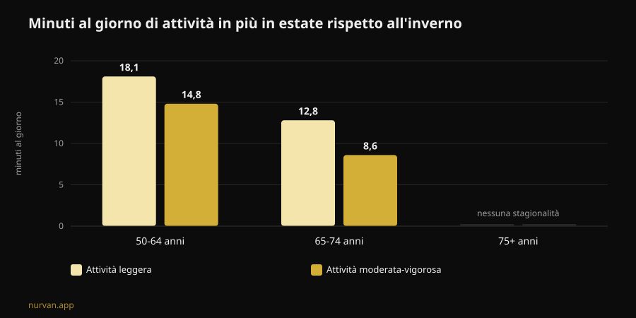

# Winter Arc: funziona davvero? Cosa dicono gli studi

Di [Giammaria Loi](/autore/giammaria-loi) · aggiornato l'8 novembre 2026

Il Winter Arc è la sfida di questo momento: tre mesi di disciplina totale, dal primo ottobre al primo gennaio, con una lista di regole da rispettare ogni giorno. La promessa è arrivare a gennaio "trasformato". Ho letto sette lavori indicizzati su formazione delle abitudini, stagionalità dell'attività fisica e pianificazione del comportamento, e il risultato è più interessante di un semplice sì o no: il trend ha ragione sul momento scelto e torto quasi su tutto il metodo.

## In breve

- **I 21 giorni non esistono.** La revisione sistematica più recente sul tempo necessario a rendere automatica un'abitudine di salute riporta una **mediana di 59-66 giorni** e medie fra **106 e 154 giorni**, con una variabilità individuale che va da **4 a 335 giorni** (Singh et al., 2024).
- **Novantadue giorni sono abbastanza per metà delle persone.** La durata "ufficiale" della sfida copre la mediana, ma per chi sta nella parte lenta della distribuzione tre mesi finiscono prima che l'abitudine si sia consolidata.
- **L'inverno non è una scusa inventata.** Con l'accelerometro, gli adulti fra 50 e 64 anni fanno in estate **14,8 minuti al giorno in più** di attività moderata-vigorosa e **18,1 in più** di attività leggera rispetto all'inverno; dormono anche **31,8 minuti in più** per notte d'inverno (Cepeda et al., 2018).
- **Il buco del Winter Arc è il giorno in cui salti.** Su 19.883 persone, il tipo di pianificazione che media davvero il passaggio dall'intenzione al comportamento è il **coping planning** — il piano B per gli imprevisti — mentre il semplice piano "quando e dove" non risulta significativo (Wang et al., 2025).
- **Quello che costruisci non svanisce il 2 gennaio.** Negli anziani, da 12 a 24 settimane di stop completo dai pesi **non** hanno ridotto in modo statisticamente significativo la massa muscolare guadagnata; il calo diventa significativo oltre le 31 settimane (Grgic, 2022).

## Che cos'è il Winter Arc, in pratica

Nato su TikTok e diventato un formato editoriale, il Winter Arc è una finestra temporale: dal 1° ottobre al 1° gennaio, cioè 92 giorni. Non c'è un protocollo. Le pagine che lo spiegano concordano su una sola cosa — "disciplina e costanza" — e lasciano a te la lista delle regole, che nella versione social tipica diventa un pacchetto di cinque o sei: sveglia all'alba, palestra un certo numero di volte a settimana, dieta rigida, lettura, doccia fredda, zero alcol.

Due elementi di quella struttura hanno un fondamento. Il primo è la scelta del periodo: l'inverno è davvero il momento in cui l'attività cala. Il secondo è l'idea di scrivere gli obiettivi e spuntarli: il self-monitoring è una delle tecniche più usate negli interventi digitali sull'attività fisica (Omkar et al., 2026).

Il resto — la durata a termine, il numero di regole, la logica della serie da non rompere — è decorazione narrativa. E una delle tre fa danni.

## Il mito dei 21 giorni: i numeri veri

La cifra dei 21 giorni gira da decenni e non viene da uno studio sulle abitudini. La revisione sistematica con meta-analisi di Singh e colleghi, pubblicata alla fine del 2024, ha raccolto 20 studi su 2.601 persone che misuravano l'automatismo di comportamenti di salute: attività fisica, bere acqua, filo interdentale, alimentazione, riduzione della sedentarietà.

Quattro di quegli studi riportano quanto tempo serve per arrivare all'automatismo. Le **mediane** stanno fra 59 e 66 giorni. Le **medie** fra 106 e 154: più alte perché qualcuno ci mette molto di più. E il dato che conta davvero per te è l'intervallo individuale osservato: **da 4 a 335 giorni**.

Non è una differenza di dettaglio. Vuol dire che due persone che iniziano lo stesso primo ottobre con la stessa scheda possono trovarsi, a metà gennaio, una con il gesto diventato automatico e l'altra ancora a combattere ogni singola sera. E la seconda non è meno disciplinata: è dentro un intervallo normale.

Dalla stessa revisione arriva la parte utile. Sulla forza dell'abitudine incidono la **frequenza**, il **momento della giornata**, il **tipo di comportamento**, il fatto che l'abitudine sia **scelta dalla persona** e non imposta, il giudizio affettivo su quel gesto e la presenza di abitudini "preparatorie". Le pratiche mattutine e i comportamenti auto-scelti risultano i più forti. Gli autori segnalano anche il limite del lavoro: 11 studi su 20 hanno un rischio di bias elevato e il numero di studi è piccolo.

Tradotto nel linguaggio del trend: **una regola che hai scelto tu vale più di cinque copiate da un carosello.**

## L'inverno non è una scusa: il calo è misurato

Qui il Winter Arc coglie qualcosa di reale. Lo studio Rotterdam ha messo un accelerometro al polso di 1.116 persone per sette giorni ciascuna, fra il 2011 e il 2016, e ha confrontato le stagioni.

Negli adulti fra 50 e 64 anni, l'attività moderata-vigorosa in estate è più alta di **14,8 minuti al giorno** rispetto all'inverno, e l'attività leggera di **18,1 minuti al giorno**. Nei giovani-anziani fra 65 e 74 anni il divario è di 8,6 e 12,8 minuti. Negli over 75 la stagionalità sparisce. Il sonno notturno, al contrario, è più lungo d'inverno: **+31,8 minuti** nei 50-64.

Due dettagli cambiano la lettura. Il primo: il pattern è spiegato da **temperatura ambientale e ore di luce**, non dal carattere. Il secondo, il più scomodo: il comportamento sedentario **non** mostra stagionalità. Tradotto, d'inverno non ci sediamo di più — ci muoviamo meno. Sparisce la quota di movimento volontario, quella che decidi.

Quindi l'idea di fare qualcosa a novembre non è isteria social. È la stagione in cui il margine si perde. Gli autori stessi concludono che interrompere la sedentarietà con attività leggera è un buon punto di partenza.

## Il difetto di progetto: non c'è un piano per il giorno in cui salti

Questo è il punto in cui la sfida si rompe, e non è un problema di volontà.

Il modello mentale del Winter Arc è la serie da non interrompere: 92 caselle da spuntare. Il che significa che il protocollo non prevede il giorno in cui ti ammali, lavori fino alle nove o ti si rompe l'auto. Quando succede, la serie è spezzata e la sfida ha già fallito — a dicembre, con tre settimane buone alle spalle.

La ricerca sulla pianificazione dice esattamente dove intervenire. Una meta-analisi su 41 studi randomizzati e 5.439 persone ha misurato l'effetto degli interventi di pianificazione sull'attività fisica: **SMD 0,35** (intervallo di confidenza 95% da 0,25 a 0,44), cioè un effetto piccolo-moderato ma consistente, migliore quando ci sono rinforzi durante il follow-up (Peng et al., 2022).

E un lavoro del 2025 ha smontato il meccanismo con un modello di equazioni strutturali su 19.883 persone in 49 studi. L'intenzione predice il comportamento (β = 0,416). Ma dei due tipi di piano, **solo il coping planning** — "cosa faccio se piove, se finisco tardi, se salto lunedì" — media in modo significativo il passaggio dall'intenzione al fatto (β = 0,067, p < 0,001). L'**action planning** puro, il classico "martedì e giovedì alle 19 in palestra", nello stesso modello **non** risulta significativo (β = -0,001).

Le due analisi non dicono la stessa cosa sull'action planning, e vale la pena esplicitarlo: nei trial di Peng gli interventi basati su action planning funzionavano meglio, nel modello di Wang è il coping planning a fare il lavoro di mediazione. Ciò che resta in piedi in entrambi è che **pianificare batte decidere sul momento**, e che il piano per gli imprevisti non è un dettaglio accessorio.

Il Winter Arc, così come circola, ha solo la prima metà: regole, orari, caselle. Non ha la seconda.

## Cosa dice davvero la ricerca

| Affermazione diffusa | Verdetto | Fonte |
|---|---|---|
| "Servono 21 giorni per creare un'abitudine" | **Smentito**: mediana 59-66 giorni, range 4-335 | Singh et al., 2024 |
| "Novantadue giorni bastano per trasformarti" | **Da precisare**: coprono la mediana, non la coda lenta | Singh et al., 2024 |
| "D'inverno è solo questione di motivazione" | **Da precisare**: il calo è misurato e spiegato da luce e temperatura | Cepeda et al., 2018 |
| "Se salti un giorno la serie è rotta, ricomincia" | **Smentito come strategia**: serve il piano B, non il reset | Wang et al., 2025; Peng et al., 2022 |
| "Se ti fermi dopo la sfida perdi tutto in due settimane" | **Smentito nei tempi**: 12-24 settimane di stop senza perdita significativa (dati su anziani) | Grgic, 2022 |
| "Serve una lista di cinque regole al giorno" | **Non supportato**: contano frequenza e scelta personale | Singh et al., 2024 |
| "Un'app non serve, serve disciplina" | **Da precisare**: effetto piccolo ma positivo degli strumenti digitali | Omkar et al., 2026 |

## E se ti fermi il 2 gennaio?

La paura che tiene in piedi le sfide a tempo è questa: finisce, mollo, perdo tutto. I numeri sul detraining sono più generosi di così.

La meta-analisi di Grgic ha raccolto sei studi su anziani che avevano allenato la forza per 9-24 settimane, con un aumento netto della massa muscolare (d = 0,99). Nei periodi di stop completo, la massa cala (d = -0,83) — ma il sottogruppo che si fermava per **12-24 settimane** non mostra una riduzione statisticamente significativa (d = -0,60, intervallo da -1,21 a 0,01). Il calo diventa chiaro oltre le **31 settimane**. Importante: è un campione di anziani, non di giovani allenati da anni, e il dato riguarda la dimensione del muscolo, non la forza.

La forza, tra l'altro, è la cosa più fragile: nell'arco della vita forza e potenza calano fino a otto volte più in fretta della massa muscolare (Fyfe et al., 2021). Ed è anche la cosa più facile da difendere con poco. Quella stessa review raccoglie le evidenze sulle **dosi minime**: volumi di seduta bassi con carichi alti e poche sedute, oppure micro-sedute frequenti con poca o nessuna attrezzatura, migliorano forza e capacità funzionale. Con una nota che pesa sul Winter Arc: volumi di allenamento più alti sono associati a **più fastidio e meno piacere**, e questo influenza negativamente l'aderenza.

Cioè: il programma più duro non è il programma che resiste.

## Come applicarlo

Se vuoi usare la cornice del Winter Arc senza il suo difetto di progetto:

1. **Scegli una regola, non cinque.** Quella che hai scelto tu, non quella del video. La scelta personale è fra i determinanti della forza dell'abitudine.
2. **Tieni la frequenza alta e l'impegno basso.** Tre sedute brevi che fai battono quattro sedute lunghe che salti. Il piacere percepito non è un vizio: è una variabile di aderenza.
3. **Scrivi il piano B prima di averne bisogno.** "Se salto martedì, vado mercoledì." "Se la palestra è chiusa, 20 minuti a casa." Questo, non la casella spuntata, è ciò che la ricerca associa al comportamento effettivo.
4. **Attaccati alla luce.** Visto che il calo invernale è legato a temperatura e ore di luce, tieni la seduta nelle fasce in cui l'ambiente ti aiuta e togli attrito: borsa pronta, tragitto breve, orario fisso.
5. **Cancella la data di scadenza.** Un contatore che si azzera il 1° gennaio è l'opposto di un'abitudine. Se arrivi a gennaio e il gesto non è ancora automatico, sei nella norma statistica: non hai finito, stai continuando.
6. **Misura i carichi, non i giorni di fila.** Una serie di 92 caselle non ti dice se stai progredendo. Una progressione di carico sì — e sopravvive a un lunedì saltato.

Su cosa chiedere a chi ti segue da remoto abbiamo un articolo dedicato: [il coaching online funziona?](/blog/coaching-online-funziona-studi). Se invece ti interessa il quadro più ampio di cosa regge e cosa no fra le mode del settore, l'abbiamo messo in fila nelle [tendenze fitness 2027](/blog/tendenze-fitness-2027-cosa-funziona).

### Nurvan: la costanza si misura sui carichi, non sulle caselle

Nurvan registra ogni serie, ripetizione e RIR e ti mostra la progressione reale settimana per settimana: se lunedì salti, il grafico dei carichi resta, perché a contare è la curva, non la striscia di giorni consecutivi. Le serie di riscaldamento proposte automaticamente e lo storico degli esercizi abbassano l'attrito nelle sere in cui ti alleni di malavoglia — che d'inverno sono la maggior parte. **[Prova Nurvan](https://nurvan.app)**

## Domande frequenti

**Quanto tempo serve davvero per creare un'abitudine di allenamento?**
Secondo la revisione sistematica più recente, la mediana per arrivare all'automatismo nei comportamenti di salute è di 59-66 giorni, con medie di 106-154 giorni e una variabilità individuale che va da 4 a 335 giorni. I 21 giorni non vengono da questa letteratura.

**Il Winter Arc fa male?**
Il formato in sé non è pericoloso: è una finestra temporale. I problemi nascono dalle versioni con molte regole rigide insieme, dalla logica del "ricomincia da zero" dopo un salto e dai volumi di allenamento alti e improvvisi in chi parte da fermo. Se hai dolore, una condizione di salute in corso o stai riprendendo dopo un infortunio, parlane con un medico prima di iniziare.

**Meglio una sfida di 90 giorni o nessuna scadenza?**
I dati non confrontano direttamente i due formati. Quello che sappiamo è che la scadenza non ha un ruolo nella formazione dell'abitudine, mentre frequenza, scelta personale e pianificazione degli imprevisti sì. Una scadenza può aiutare a partire; mantenerla come traguardo finale è il rischio.

**Se mi fermo a gennaio, quanto perdo?**
Nella meta-analisi sugli anziani, 12-24 settimane di stop completo dai pesi non hanno prodotto una riduzione statisticamente significativa della massa muscolare; oltre le 31 settimane sì. Non sono dati su giovani allenati e riguardano la dimensione del muscolo, non la forza. In ogni caso, poche sedute brevi bastano a difendere molto più di quanto si creda.

## Leggi anche

- [Coaching online: funziona? Cosa dicono gli studi](/blog/coaching-online-funziona-studi) — cosa deve controllare un coach a distanza per valere quanto uno in sala.
- [Tendenze fitness 2027: cosa funziona davvero](/blog/tendenze-fitness-2027-cosa-funziona) — le mode del settore passate al filtro delle evidenze.
- [Schede di allenamento con l'AI: cosa dicono gli studi](/blog/scheda-allenamento-ai-studi) — quando un programma generato automaticamente regge e quando no.

## Fonti

1. Singh B, Murphy A, Maher C, Smith AE, 2024. Time to Form a Habit: A Systematic Review and Meta-Analysis of Health Behaviour Habit Formation and Its Determinants. *Healthcare (Basel)* 12(23):2488. PMID [39685110](https://pubmed.ncbi.nlm.nih.gov/39685110/) · [DOI 10.3390/healthcare12232488](https://doi.org/10.3390/healthcare12232488)
2. Cepeda M, Koolhaas CM, van Rooij FJA, Tiemeier H, Guxens M, Franco OH, Schoufour JD, 2018. Seasonality of physical activity, sedentary behavior, and sleep in a middle-aged and elderly population: The Rotterdam study. *Maturitas* 110:41–50. PMID [29563034](https://pubmed.ncbi.nlm.nih.gov/29563034/) · [DOI 10.1016/j.maturitas.2018.01.016](https://doi.org/10.1016/j.maturitas.2018.01.016)
3. Wang L, Li X, Qiu K, Wang D, 2025. Examining the impact of perceived behavioral control and planning on closing the exercise intention-behavior gap: Insights from a meta-analytic structural equation modeling study. *Psychol Sport Exerc* 78:102822. PMID [39952422](https://pubmed.ncbi.nlm.nih.gov/39952422/) · [DOI 10.1016/j.psychsport.2025.102822](https://doi.org/10.1016/j.psychsport.2025.102822)
4. Peng S, Othman AT, Yuan F, Liang J, 2022. The Effectiveness of Planning Interventions for Improving Physical Activity in the General Population: A Systematic Review and Meta-Analysis of Randomized Controlled Trials. *Int J Environ Res Public Health* 19(12):7337. PMID [35742582](https://pubmed.ncbi.nlm.nih.gov/35742582/) · [DOI 10.3390/ijerph19127337](https://doi.org/10.3390/ijerph19127337)
5. Grgic J, 2022. Use It or Lose It? A Meta-Analysis on the Effects of Resistance Training Cessation (Detraining) on Muscle Size in Older Adults. *Int J Environ Res Public Health* 19(21):14048. PMID [36360927](https://pubmed.ncbi.nlm.nih.gov/36360927/) · [DOI 10.3390/ijerph192114048](https://doi.org/10.3390/ijerph192114048)
6. Fyfe JJ, Hamilton DL, Daly RM, 2021. Minimal-Dose Resistance Training for Improving Muscle Mass, Strength, and Function: A Narrative Review of Current Evidence and Practical Considerations. *Sports Med* 52(3):463–479. PMID [34822137](https://pubmed.ncbi.nlm.nih.gov/34822137/) · [DOI 10.1007/s40279-021-01605-8](https://doi.org/10.1007/s40279-021-01605-8)
7. Omkar A, Bertrand JK, Sadasivan C, et al., 2026. Behaviour change techniques in eHealth interventions for older, frail, or sarcopenic adults: A systematic review and meta-analysis. *Digit Health* 12:20552076261473804. PMID [42534183](https://pubmed.ncbi.nlm.nih.gov/42534183/) · [DOI 10.1177/20552076261473804](https://doi.org/10.1177/20552076261473804)

Fonti scientifiche consultate tramite PubMed. Segnali di tendenza: la pagina esplicativa di Gymshark sul [Winter Arc](https://www.gymshark.com/blog/article/what-is-the-winter-arc) (stagione 1° ottobre-1° gennaio) e la copertura italiana del termine su My-Personaltrainer, SportOutdoor24 ed EroicaFenice, tutte senza riferimenti alla letteratura sulla formazione delle abitudini. Testo, struttura, grafici e verifiche di questo articolo sono originali.

---

**Giammaria Loi** è il fondatore di Nurvan. Si allena con i pesi dal 2012, lavora come personal trainer e coach certificato FIPE dal 2013 e gareggia nel powerlifting a livello nazionale dal 2018. Ogni articolo che firma parte dagli studi scientifici e arriva a ciò che funziona davvero in palestra. [Pagina autore](/autore/giammaria-loi)

> Nota: contenuto informativo, non sostituisce il parere di un medico o di un professionista qualificato. Se hai dolore, una condizione di salute in corso o stai riprendendo dopo un infortunio, parlane con un medico prima di iniziare o cambiare un programma di allenamento.
