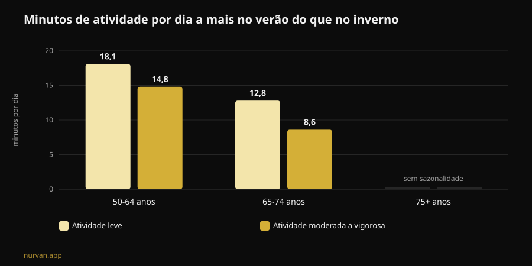

# O Winter Arc funciona? O que dizem os estudos

Por [Giammaria Loi](/autore/giammaria-loi) · atualizado em 8 de novembro de 2026

O Winter Arc é o desafio do momento: três meses de disciplina total, de 1 de outubro a 1 de janeiro, com uma lista de regras para cumprir todos os dias. A promessa é chegar a janeiro "transformado". Li sete trabalhos indexados sobre formação de hábitos, sazonalidade da atividade física e planeamento do comportamento, e o resultado é mais interessante do que um simples sim ou não: a tendência acerta no momento escolhido e erra em quase todo o método.

## Em resumo

- **Os 21 dias não existem.** A revisão sistemática mais recente sobre o tempo necessário para um comportamento de saúde ficar automático reporta uma **mediana de 59-66 dias** e médias entre **106 e 154 dias**, com variabilidade individual de **4 a 335 dias** (Singh et al., 2024).
- **Noventa e dois dias chegam para metade das pessoas.** A duração "oficial" do desafio cobre a mediana, mas quem está no lado lento da distribuição fica sem calendário antes de o hábito assentar.
- **O inverno não é uma desculpa inventada.** Medido com acelerómetro, os adultos entre 50 e 64 anos fazem no verão **mais 14,8 minutos por dia** de atividade moderada a vigorosa e **mais 18,1 minutos** de atividade leve do que no inverno; dormem também **mais 31,8 minutos** por noite no inverno (Cepeda et al., 2018).
- **A falha do Winter Arc é o dia em que falhas.** Em 19.883 pessoas, o tipo de planeamento que realmente medeia a passagem da intenção ao comportamento é o **coping planning** — o plano B para os imprevistos —, enquanto o simples plano de "quando e onde" não sai significativo (Wang et al., 2025).
- **O que constróis não desaparece a 2 de janeiro.** Em idosos, 12 a 24 semanas de paragem completa dos pesos **não** reduziram de forma estatisticamente significativa a massa muscular ganha; a queda só fica clara acima das 31 semanas (Grgic, 2022).

## O que é o Winter Arc, na prática

Nascido no TikTok e transformado em formato editorial, o Winter Arc é uma janela de tempo: de 1 de outubro a 1 de janeiro, ou seja, 92 dias. Não existe protocolo. As páginas que o explicam concordam numa coisa só — "disciplina e constância" — e deixam-te a lista de regras, que na versão social típica vira um pacote de cinco ou seis: despertador de madrugada, academia um certo número de vezes por semana, dieta rígida, leitura, duche frio, zero álcool.

Dois elementos dessa estrutura têm fundamento. O primeiro é a escolha do período: o inverno é mesmo o momento em que a atividade cai. O segundo é a ideia de escrever os objetivos e ir marcando: o self-monitoring é uma das técnicas mais usadas nas intervenções digitais sobre atividade física (Omkar et al., 2026).

O resto — a duração com prazo, o número de regras, a lógica da sequência que não se pode quebrar — é decoração narrativa. E uma das três faz estragos.

## O mito dos 21 dias: os números reais

O número dos 21 dias circula há décadas e não vem de um estudo sobre hábitos. A revisão sistemática com meta-análise de Singh e colegas, publicada no final de 2024, reuniu 20 estudos com 2.601 pessoas que mediam a automaticidade de comportamentos de saúde: atividade física, beber água, fio dental, alimentação, redução do sedentarismo.

Quatro desses estudos reportam quanto tempo é preciso para chegar à automaticidade. As **medianas** ficam entre 59 e 66 dias. As **médias** entre 106 e 154: mais altas porque há quem demore muito mais. E o dado que mais te interessa é o intervalo individual observado: **de 4 a 335 dias**.

Não é um detalhe técnico. Quer dizer que duas pessoas que começam no mesmo 1 de outubro com o mesmo treino podem chegar a meados de janeiro com uma delas no automático e a outra ainda a negociar consigo mesma todas as noites. E a segunda não é menos disciplinada: está dentro de um intervalo normal.

Da mesma revisão vem a parte útil. Na força do hábito pesam a **frequência**, o **momento do dia**, o **tipo de comportamento**, o facto de o hábito ser **escolhido pela pessoa** e não imposto, o julgamento afetivo sobre aquele gesto e a presença de hábitos "preparatórios". As práticas matinais e os comportamentos auto-escolhidos saem como os mais fortes. Os autores assinalam também o limite do trabalho: 11 dos 20 estudos têm risco de viés elevado e o número de estudos é pequeno.

Traduzido para a linguagem da tendência: **uma regra que escolheste tu vale mais do que cinco copiadas de um carrossel.**

## O inverno não é desculpa: a queda está medida

Aqui o Winter Arc apanha algo real. O estudo de Roterdão colocou um acelerómetro no pulso de 1.116 pessoas durante sete dias cada uma, entre 2011 e 2016, e comparou as estações.

Nos adultos entre 50 e 64 anos, a atividade moderada a vigorosa no verão é **14,8 minutos por dia** mais alta do que no inverno, e a atividade leve **18,1 minutos por dia**. Nos jovens idosos, entre 65 e 74 anos, a diferença é de 8,6 e 12,8 minutos. Acima dos 75 a sazonalidade desaparece. O sono noturno vai ao contrário: **mais 31,8 minutos** no inverno no grupo dos 50-64.

Dois detalhes mudam a leitura. O primeiro: o padrão explica-se por **temperatura ambiente e horas de luz**, não pelo carácter. O segundo, o mais incómodo: o comportamento sedentário **não** mostra sazonalidade. Traduzindo, no inverno não nos sentamos mais — mexemo-nos menos. Desaparece a parcela de movimento voluntário, aquela que decides.

Portanto, a ideia de fazer alguma coisa em novembro não é histeria de redes sociais. É a estação em que a margem se perde. Os próprios autores concluem que interromper o sedentarismo com atividade leve é um bom ponto de partida.

## O defeito de projeto: não há plano para o dia em que falhas

É aqui que o desafio parte, e não é um problema de força de vontade.

O modelo mental do Winter Arc é a sequência que não se interrompe: 92 quadradinhos para marcar. O que significa que o protocolo não prevê o dia em que ficas doente, trabalhas até às nove ou o carro avaria. Quando acontece, a sequência está quebrada e o desafio já falhou — em dezembro, com três boas semanas atrás.

A investigação sobre planeamento diz exatamente onde intervir. Uma meta-análise com 41 estudos aleatorizados e 5.439 pessoas mediu o efeito das intervenções de planeamento na atividade física: **SMD 0,35** (intervalo de confiança 95% de 0,25 a 0,44), ou seja, um efeito pequeno a moderado mas consistente, melhor quando há reforços durante o seguimento (Peng et al., 2022).

E um trabalho de 2025 desmontou o mecanismo com um modelo de equações estruturais em 19.883 pessoas e 49 estudos. A intenção prediz o comportamento (β = 0,416). Mas dos dois tipos de plano, **só o coping planning** — "o que faço se chover, se sair tarde, se falhar segunda-feira" — medeia de forma significativa a passagem da intenção ao facto (β = 0,067, p < 0,001). O **action planning** puro, o clássico "terça e quinta às 19h na academia", no mesmo modelo **não** sai significativo (β = -0,001).

As duas análises não dizem o mesmo sobre o action planning, e vale a pena explicitá-lo: nos ensaios de Peng, as intervenções baseadas em action planning funcionavam melhor; no modelo de Wang, é o coping planning que faz o trabalho de mediação. O que fica de pé em ambos é que **planear vence decidir na hora**, e que o plano para os imprevistos não é um acessório.

O Winter Arc, tal como circula, só tem a primeira metade: regras, horários, quadradinhos. Não tem a segunda.

## O que diz mesmo a investigação

| Afirmação comum | Veredito | Fonte |
|---|---|---|
| "São precisos 21 dias para criar um hábito" | **Desmentido**: mediana 59-66 dias, intervalo 4-335 | Singh et al., 2024 |
| "Noventa e dois dias chegam para te transformar" | **A precisar**: cobrem a mediana, não a cauda lenta | Singh et al., 2024 |
| "No inverno é só questão de motivação" | **A precisar**: a queda está medida e ligada à luz e à temperatura | Cepeda et al., 2018 |
| "Se falhas um dia a sequência quebra, recomeça" | **Desmentido como estratégia**: é preciso o plano B, não o reset | Wang et al., 2025; Peng et al., 2022 |
| "Se paras depois do desafio perdes tudo em duas semanas" | **Desmentido nos prazos**: 12-24 semanas de paragem sem perda significativa (dados em idosos) | Grgic, 2022 |
| "É preciso uma lista de cinco regras por dia" | **Sem suporte**: contam a frequência e a escolha pessoal | Singh et al., 2024 |
| "Não é preciso app, é precisa disciplina" | **A precisar**: efeito pequeno mas positivo das ferramentas digitais | Omkar et al., 2026 |

## E se parares a 2 de janeiro?

O medo que sustenta os desafios com prazo é este: acaba, desisto, perco tudo. Os números sobre destreino são mais generosos do que isso.

A meta-análise de Grgic reuniu seis estudos em idosos que tinham treinado força durante 9-24 semanas, com um aumento claro da massa muscular (d = 0,99). Nos períodos de paragem completa, a massa cai (d = -0,83) — mas o subgrupo que parava **12-24 semanas** não mostra redução estatisticamente significativa (d = -0,60, intervalo de -1,21 a 0,01). A queda torna-se clara acima das **31 semanas**. Importante: é uma amostra de idosos, não de jovens treinados há anos, e o dado refere-se ao tamanho do músculo, não à força.

A força, aliás, é a parte mais frágil: ao longo da vida, força e potência caem até oito vezes mais depressa do que a massa muscular (Fyfe et al., 2021). E é também a mais fácil de defender com pouco. Essa mesma revisão reúne a evidência sobre **doses mínimas**: volumes de sessão baixos com cargas altas e poucas sessões, ou micro-sessões frequentes com pouco ou nenhum equipamento, melhoram a força e a capacidade funcional. Com uma nota que pesa no Winter Arc: volumes de treino mais altos associam-se a **mais desconforto e menos prazer**, e isso joga contra a adesão.

Ou seja: o programa mais duro não é o programa que resiste.

## Como aplicar

Se queres a moldura do Winter Arc sem o seu defeito de projeto:

1. **Escolhe uma regra, não cinco.** A que escolheste tu, não a do vídeo. A escolha pessoal está entre os determinantes da força do hábito.
2. **Mantém a frequência alta e a exigência baixa.** Três sessões curtas que fazes valem mais do que quatro longas que falhas. O prazer percebido não é um vício: é uma variável de adesão.
3. **Escreve o plano B antes de precisares dele.** "Se falhar terça, vou quarta." "Se a academia estiver fechada, 20 minutos em casa." É isto, e não o quadradinho marcado, que a investigação associa ao comportamento real.
4. **Agarra-te à luz.** Como a queda invernal está ligada à temperatura e às horas de luz, põe a sessão nas faixas em que o ambiente ajuda e tira atrito: saco pronto, trajeto curto, horário fixo.
5. **Apaga a data de validade.** Um contador que zera a 1 de janeiro é o oposto de um hábito. Se chegas a janeiro e o gesto ainda não é automático, estás na norma estatística: não acabaste, estás a continuar.
6. **Mede as cargas, não os dias seguidos.** Uma fila de 92 quadradinhos não te diz se estás a progredir. Uma progressão de carga diz — e sobrevive a uma segunda-feira falhada.

Sobre o que pedir a quem te acompanha à distância temos um artigo dedicado: [o coaching online funciona?](/pt/blog/o-coaching-online-funciona). Se preferes o quadro mais amplo do que aguenta e do que não aguenta entre as modas do setor, pusemo-lo em fila nas [tendências fitness 2027](/pt/blog/tendencias-fitness-2027-o-que-funciona).

### Nurvan: a constância mede-se nas cargas, não nos quadradinhos

A Nurvan regista cada série, repetição e RIR e mostra-te a progressão real semana a semana: se falhas segunda-feira, o gráfico das cargas fica lá, porque o que conta é a curva e não a fila de dias seguidos. As séries de aquecimento propostas automaticamente e o histórico dos exercícios baixam o atrito nas noites em que treinas contrariado — que no inverno são a maioria. **[Experimenta a Nurvan](https://nurvan.app)**

## Perguntas frequentes

**Quanto tempo demora mesmo a criar um hábito de treino?**
Segundo a revisão sistemática mais recente, a mediana para chegar à automaticidade nos comportamentos de saúde é de 59-66 dias, com médias de 106-154 dias e variabilidade individual de 4 a 335 dias. Os 21 dias não vêm desta literatura.

**O Winter Arc faz mal?**
O formato em si não é perigoso: é uma janela de tempo. Os problemas nascem das versões com muitas regras rígidas ao mesmo tempo, da lógica do "recomeça do zero" depois de uma falha e dos volumes de treino altos e repentinos em quem parte do sedentarismo. Se tens dor, uma condição de saúde em curso ou estás a recuperar de uma lesão, fala com um médico antes de começar.

**Melhor um desafio de 90 dias ou sem prazo?**
Os dados não comparam diretamente os dois formatos. O que sabemos é que o prazo não tem papel na formação do hábito, enquanto a frequência, a escolha pessoal e o planeamento dos imprevistos têm. Um prazo pode ajudar a arrancar; mantê-lo como meta final é que é o risco.

**Se parar em janeiro, quanto perco?**
Na meta-análise em idosos, 12-24 semanas de paragem completa dos pesos não produziram redução estatisticamente significativa da massa muscular; acima das 31 semanas sim. Não são dados sobre jovens treinados e referem-se ao tamanho do músculo, não à força. De qualquer forma, poucas sessões curtas chegam para defender muito mais do que se pensa.

## Leia também

- [O coaching online funciona? O que dizem os estudos](/pt/blog/o-coaching-online-funciona) — o que um treinador à distância tem de controlar para valer tanto como um na sala.
- [Tendências fitness 2027: o que funciona mesmo](/pt/blog/tendencias-fitness-2027-o-que-funciona) — as modas do setor passadas pelo filtro da evidência.
- [Treino gerado por IA: o que dizem os estudos](/pt/blog/treino-gerado-por-ia-estudos) — quando um programa automático aguenta e quando não.

## Fontes

1. Singh B, Murphy A, Maher C, Smith AE, 2024. Time to Form a Habit: A Systematic Review and Meta-Analysis of Health Behaviour Habit Formation and Its Determinants. *Healthcare (Basel)* 12(23):2488. PMID [39685110](https://pubmed.ncbi.nlm.nih.gov/39685110/) · [DOI 10.3390/healthcare12232488](https://doi.org/10.3390/healthcare12232488)
2. Cepeda M, Koolhaas CM, van Rooij FJA, Tiemeier H, Guxens M, Franco OH, Schoufour JD, 2018. Seasonality of physical activity, sedentary behavior, and sleep in a middle-aged and elderly population: The Rotterdam study. *Maturitas* 110:41–50. PMID [29563034](https://pubmed.ncbi.nlm.nih.gov/29563034/) · [DOI 10.1016/j.maturitas.2018.01.016](https://doi.org/10.1016/j.maturitas.2018.01.016)
3. Wang L, Li X, Qiu K, Wang D, 2025. Examining the impact of perceived behavioral control and planning on closing the exercise intention-behavior gap: Insights from a meta-analytic structural equation modeling study. *Psychol Sport Exerc* 78:102822. PMID [39952422](https://pubmed.ncbi.nlm.nih.gov/39952422/) · [DOI 10.1016/j.psychsport.2025.102822](https://doi.org/10.1016/j.psychsport.2025.102822)
4. Peng S, Othman AT, Yuan F, Liang J, 2022. The Effectiveness of Planning Interventions for Improving Physical Activity in the General Population: A Systematic Review and Meta-Analysis of Randomized Controlled Trials. *Int J Environ Res Public Health* 19(12):7337. PMID [35742582](https://pubmed.ncbi.nlm.nih.gov/35742582/) · [DOI 10.3390/ijerph19127337](https://doi.org/10.3390/ijerph19127337)
5. Grgic J, 2022. Use It or Lose It? A Meta-Analysis on the Effects of Resistance Training Cessation (Detraining) on Muscle Size in Older Adults. *Int J Environ Res Public Health* 19(21):14048. PMID [36360927](https://pubmed.ncbi.nlm.nih.gov/36360927/) · [DOI 10.3390/ijerph192114048](https://doi.org/10.3390/ijerph192114048)
6. Fyfe JJ, Hamilton DL, Daly RM, 2021. Minimal-Dose Resistance Training for Improving Muscle Mass, Strength, and Function: A Narrative Review of Current Evidence and Practical Considerations. *Sports Med* 52(3):463–479. PMID [34822137](https://pubmed.ncbi.nlm.nih.gov/34822137/) · [DOI 10.1007/s40279-021-01605-8](https://doi.org/10.1007/s40279-021-01605-8)
7. Omkar A, Bertrand JK, Sadasivan C, et al., 2026. Behaviour change techniques in eHealth interventions for older, frail, or sarcopenic adults: A systematic review and meta-analysis. *Digit Health* 12:20552076261473804. PMID [42534183](https://pubmed.ncbi.nlm.nih.gov/42534183/) · [DOI 10.1177/20552076261473804](https://doi.org/10.1177/20552076261473804)

Fontes científicas consultadas através da PubMed. Sinais de tendência: a página explicativa da Gymshark sobre o [Winter Arc](https://www.gymshark.com/blog/article/what-is-the-winter-arc) (temporada de 1 de outubro a 1 de janeiro) e a cobertura italiana do termo em My-Personaltrainer, SportOutdoor24 e EroicaFenice, todas sem referências à literatura sobre formação de hábitos. O texto, a estrutura, os gráficos e as verificações deste artigo são originais.

---

**Giammaria Loi** é o fundador da Nurvan. Treina com pesos desde 2012, trabalha como personal trainer e treinador certificado FIPE desde 2013 e compete em powerlifting a nível nacional desde 2018. Cada artigo que assina parte dos estudos científicos e chega ao que funciona mesmo no ginásio. [Página do autor](/autore/giammaria-loi)

> Nota: conteúdo informativo, não substitui a opinião de um médico ou de um profissional qualificado. Se tens dor, uma condição de saúde em curso ou estás a recuperar de uma lesão, fala com um médico antes de começar ou mudar um programa de treino.
