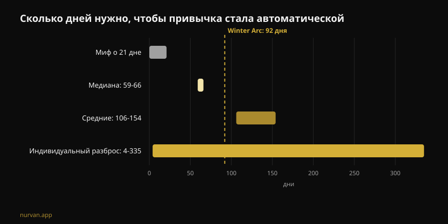
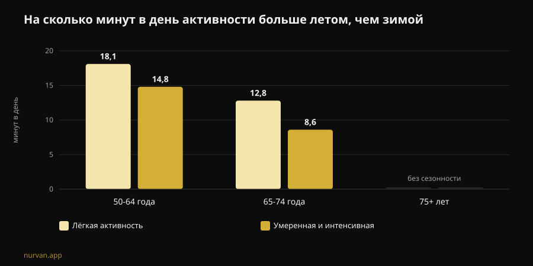

# Работает ли Winter Arc? Что говорят исследования

Автор: [Джаммария Лои](/autore/giammaria-loi) · обновлено 8 ноября 2026 года

Winter Arc — челлендж этого сезона: три месяца полной дисциплины, с 1 октября по 1 января, со списком правил, которые нужно выполнять каждый день. Обещание — выйти из зимы «другим человеком». Я прочитал семь индексированных работ о формировании привычек, сезонности физической активности и планировании поведения, и ответ интереснее простого «да» или «нет»: тренд угадал момент и почти полностью ошибся в методе.

## Коротко

- **Никаких 21 дня не существует.** Самый свежий систематический обзор о времени, нужном для автоматизма в поведении, связанном со здоровьем, даёт **медиану 59-66 дней** и средние значения от **106 до 154 дней**, с индивидуальным разбросом от **4 до 335 дней** (Singh et al., 2024).
- **Девяносто двух дней хватает примерно половине людей.** «Официальная» длительность челленджа перекрывает медиану, но тем, кто попал в медленную часть распределения, календарь заканчивается раньше, чем привычка закрепляется.
- **Зима — не выдуманная отговорка.** По данным акселерометра взрослые 50-64 лет летом набирают **на 14,8 минуты в день больше** активности средней и высокой интенсивности и **на 18,1 минуты больше** лёгкой активности, чем зимой; зимой они также спят **на 31,8 минуты дольше** за ночь (Cepeda et al., 2018).
- **Слабое место Winter Arc — тот день, когда вы пропустите.** На выборке в 19 883 человека связь намерения с поведением достоверно опосредует именно **coping planning** — план Б на случай сбоя, — а обычный план «когда и где» значимым не оказывается (Wang et al., 2025).
- **То, что вы построили, не исчезнет 2 января.** У пожилых людей 12-24 недели полной остановки силовых тренировок **не** привели к статистически значимой потере набранной мышечной массы; падение становится явным только после 31 недели (Grgic, 2022).

## Что такое Winter Arc на практике

Родившийся в TikTok и превратившийся в отдельный медиаформат, Winter Arc — это просто окно времени: с 1 октября по 1 января, то есть 92 дня. Протокола нет. Страницы, которые его объясняют, сходятся в одном — «дисциплина и постоянство», — а список правил оставляют вам. В типичной соцсетевой версии он превращается в набор из пяти-шести пунктов: ранний подъём, зал определённое число раз в неделю, жёсткая диета, чтение, холодный душ, ноль алкоголя.

Два элемента этой конструкции имеют основания. Первый — выбор периода: зимой активность действительно падает. Второй — идея записывать цели и отмечать выполненное: самоконтроль входит в число самых часто используемых техник в цифровых программах по физической активности (Omkar et al., 2026).

Всё остальное — срок с датой окончания, количество правил, логика непрерывной серии — повествовательная декорация. И одна из трёх приносит вред.

## Миф о 21 дне: реальные цифры

Цифра в 21 день ходит десятилетиями и не происходит из исследования привычек. Систематический обзор с метаанализом Singh и коллег, опубликованный в конце 2024 года, собрал 20 исследований с 2601 участником, где измеряли автоматизм в поведении, связанном со здоровьем: физическая активность, питьё воды, зубная нить, питание, снижение сидячего времени.

Четыре из этих исследований сообщают, сколько времени нужно до автоматизма. **Медианы** лежат между 59 и 66 днями. **Средние** — между 106 и 154: выше, потому что кому-то требуется гораздо больше. И самое важное для вас число — наблюдаемый индивидуальный диапазон: **от 4 до 335 дней**.

Это не техническая деталь. Это значит, что два человека, начавшие в одно и то же 1 октября по одной программе, к середине января могут оказаться в разном положении: один делает всё на автомате, второй каждый вечер заново договаривается с собой. И второй не менее дисциплинирован — он внутри нормального диапазона.

Из того же обзора идёт полезная часть. На силу привычки влияют **частота**, **время суток**, **тип поведения**, то, что привычка **выбрана самим человеком**, а не навязана, эмоциональная оценка действия и наличие «подготовительных» привычек. Самыми сильными оказываются утренние практики и самостоятельно выбранное поведение. Авторы отмечают и ограничения работы: 11 исследований из 20 имеют высокий риск систематической ошибки, а общее число исследований невелико.

В переводе на язык тренда: **одно правило, выбранное вами, стоит больше пяти, скопированных из карусели.**

## Зима — не отговорка: спад измерен

Здесь Winter Arc попадает в реальную вещь. Роттердамское исследование надело акселерометр на запястье 1116 человек на семь дней каждому, с 2011 по 2016 год, и сравнило сезоны.

У взрослых 50-64 лет активность средней и высокой интенсивности летом выше, чем зимой, на **14,8 минуты в день**, а лёгкая активность — на **18,1 минуты в день**. В группе 65-74 лет разрыв составляет 8,6 и 12,8 минуты. После 75 лет сезонность исчезает. Ночной сон ведёт себя наоборот: **на 31,8 минуты дольше** зимой в группе 50-64.

Две детали меняют прочтение. Первая: паттерн объясняется **температурой воздуха и продолжительностью светового дня**, а не характером. Вторая, более неприятная: сидячее поведение **не** показывает сезонности. То есть зимой мы не сидим больше — мы меньше двигаемся. Исчезает именно добровольное движение, то, которое вы выбираете.

Так что идея взяться за себя в ноябре — не истерика соцсетей. Это сезон, в котором теряется запас. Сами авторы заключают, что прерывать сидячее время лёгкой активностью — хорошая отправная точка.

## Ошибка конструкции: нет плана на день, который вы пропустите

Именно здесь челлендж ломается, и дело не в силе воли.

Мысленная модель Winter Arc — непрерывная серия: 92 клетки, которые нужно закрасить. А значит, протокол ничего не говорит о дне, когда вы заболели, работали до девяти или у вас сломалась машина. Когда это происходит, серия прервана и челлендж уже провален — в декабре, с тремя хорошими неделями за спиной.

Исследования о планировании указывают, где именно вмешиваться. Метаанализ 41 рандомизированного исследования с 5439 участниками измерил эффект вмешательств по планированию на физическую активность: **SMD 0,35** (95% доверительный интервал от 0,25 до 0,44) — небольшой или умеренный, но устойчивый эффект, который выше при подкреплении в период наблюдения (Peng et al., 2022).

А работа 2025 года разобрала механизм с помощью моделирования структурными уравнениями на 19 883 людях из 49 исследований. Намерение предсказывает поведение (β = 0,416). Но из двух типов плана **только coping planning** — «что я делаю, если дождь, если задержусь на работе, если пропущу понедельник» — значимо опосредует переход от намерения к действию (β = 0,067, p < 0,001). Чистый **action planning**, классическое «вторник и четверг в 19:00 в зале», в той же модели значимым **не** оказывается (β = -0,001).

Два анализа говорят об action planning разное, и это стоит проговорить: в испытаниях Peng вмешательства на основе action planning работали лучше, а в модели Wang работу опосредования делает coping planning. В обоих случаях остаётся одно: **планировать лучше, чем решать по ситуации**, и план на случай сбоя — не дополнительная опция.

У Winter Arc в том виде, в каком он ходит по сети, есть только первая половина: правила, расписание, клетки. Второй половины нет.

## Что на самом деле говорит наука

| Распространённое утверждение | Вердикт | Источник |
|---|---|---|
| «Привычка формируется за 21 день» | **Опровергнуто**: медиана 59-66 дней, диапазон 4-335 | Singh et al., 2024 |
| «Девяноста двух дней хватит, чтобы измениться» | **Требует уточнения**: перекрывают медиану, но не медленный хвост | Singh et al., 2024 |
| «Зимой всё дело только в мотивации» | **Требует уточнения**: спад измерен и связан со светом и температурой | Cepeda et al., 2018 |
| «Пропустил день — серия сломана, начинай заново» | **Опровергнуто как стратегия**: нужен план Б, а не сброс | Wang et al., 2025; Peng et al., 2022 |
| «Остановишься после челленджа — за две недели потеряешь всё» | **Опровергнуто по срокам**: 12-24 недели паузы без значимой потери (данные по пожилым) | Grgic, 2022 |
| «Нужен список из пяти правил на день» | **Не подтверждено**: важны частота и личный выбор | Singh et al., 2024 |
| «Приложение не нужно, нужна дисциплина» | **Требует уточнения**: у цифровых инструментов небольшой, но положительный эффект | Omkar et al., 2026 |

## А если остановиться 2 января?

Страх, на котором держатся срочные челленджи, прост: он закончится, я брошу, я всё потеряю. Цифры по детренированности мягче.

Метаанализ Grgic собрал шесть исследований на пожилых людях, тренировавших силу 9-24 недели, с явным приростом мышечной массы (d = 0,99). В периоды полной остановки масса снижается (d = -0,83), но подгруппа с паузой **12-24 недели** не показывает статистически значимого снижения (d = -0,60, интервал от -1,21 до 0,01). Падение становится очевидным после **31 недели**. Важно: это выборка пожилых, а не молодых тренированных людей, и речь о размере мышцы, а не о силе.

Сила, кстати, — самое хрупкое: за жизнь сила и мощность падают до восьми раз быстрее, чем мышечная масса (Fyfe et al., 2021). И её же проще всего защитить малыми средствами. Тот же обзор собирает данные о **минимальных дозах**: низкий объём на тренировке с большими весами и редкими занятиями либо короткие частые микротренировки почти без оборудования улучшают силу и функциональные возможности. С замечанием, которое бьёт точно по Winter Arc: более высокие объёмы тренировок связаны с **большим дискомфортом и меньшим удовольствием**, а это работает против приверженности.

То есть: самая жёсткая программа — не та программа, которая выживает.

## Как это применить

Если хотите взять рамку Winter Arc без её конструктивной ошибки:

1. **Выберите одно правило, а не пять.** То, которое выбрали вы, а не то, что в видео. Личный выбор входит в число факторов силы привычки.
2. **Держите частоту высокой, а требования низкими.** Три короткие тренировки, которые вы делаете, лучше четырёх длинных, которые вы пропускаете. Удовольствие здесь не слабость, а переменная приверженности.
3. **Напишите план Б до того, как он понадобится.** «Пропустил вторник — иду в среду». «Зал закрыт — 20 минут дома». Именно это, а не закрашенная клетка, исследования связывают с реальным поведением.
4. **Опирайтесь на свет.** Раз зимний спад связан с температурой и световым днём, ставьте тренировку туда, где среда помогает, и убирайте трение: сумка собрана, дорога короткая, время фиксированное.
5. **Уберите дату окончания.** Счётчик, который обнуляется 1 января, — противоположность привычке. Если к январю действие ещё не стало автоматическим, вы в статистической норме: вы не закончили, вы продолжаете.
6. **Измеряйте веса, а не дни подряд.** Ряд из 92 клеток ничего не говорит о прогрессе. Прогрессия нагрузки говорит — и переживает пропущенный понедельник.

О том, что спрашивать с того, кто ведёт вас удалённо, у нас есть отдельная статья: [работает ли онлайн-коучинг?](/ru/blog/rabotaet-li-onlayn-kouching). Если интереснее общая картина того, что в индустрии выдерживает проверку, мы разложили её в [фитнес-трендах 2027](/ru/blog/fitnes-trendy-2027-chto-rabotaet).

### Nurvan: постоянство измеряется в весах, а не в клетках

Nurvan записывает каждый подход, повтор и RIR и показывает реальную прогрессию неделя за неделей: пропустили понедельник — график нагрузок остаётся, потому что важна кривая, а не серия подряд идущих дней. Автоматически предлагаемые разминочные подходы и история упражнений снижают трение в те вечера, когда тренироваться не хочется, — а зимой таких большинство. **[Попробовать Nurvan](https://nurvan.app)**

## Частые вопросы

**Сколько на самом деле нужно, чтобы выработать привычку тренироваться?**
По данным самого свежего систематического обзора, медиана достижения автоматизма в поведении, связанном со здоровьем, составляет 59-66 дней, средние значения — 106-154 дня, индивидуальный разброс — от 4 до 335 дней. Цифра в 21 день из этой литературы не происходит.

**Winter Arc вреден?**
Сам формат не опасен: это просто окно времени. Проблемы начинаются в версиях, где сразу складывают много жёстких правил, в логике «начни сначала» после пропуска и в высоких внезапных объёмах тренировок у тех, кто стартует с нуля. Если у вас боль, текущее заболевание или вы восстанавливаетесь после травмы, поговорите с врачом до начала.

**Что лучше: челлендж на 90 дней или без срока?**
Данных, которые сравнивали бы эти два формата напрямую, нет. Известно, что срок не играет роли в формировании привычки, а частота, личный выбор и планирование сбоев — играют. Срок может помочь начать; риск — оставить его финишной чертой.

**Если я остановлюсь в январе, сколько потеряю?**
В метаанализе на пожилых людях 12-24 недели полной остановки силовых тренировок не дали статистически значимого снижения мышечной массы; после 31 недели — дали. Это не данные о молодых тренированных людях, и речь о размере мышцы, а не о силе. В любом случае нескольких коротких тренировок хватает, чтобы защитить гораздо больше, чем принято думать.

## Читайте также

- [Работает ли онлайн-коучинг? Что говорят исследования](/ru/blog/rabotaet-li-onlayn-kouching) — что должен контролировать тренер на расстоянии, чтобы стоить столько же, сколько тренер в зале.
- [Фитнес-тренды 2027: что работает на самом деле](/ru/blog/fitnes-trendy-2027-chto-rabotaet) — моды индустрии, пропущенные через фильтр доказательств.
- [План тренировок от ИИ: что говорят исследования](/ru/blog/plan-trenirovok-ot-ii) — когда автоматически созданная программа выдерживает проверку, а когда нет.

## Источники

1. Singh B, Murphy A, Maher C, Smith AE, 2024. Time to Form a Habit: A Systematic Review and Meta-Analysis of Health Behaviour Habit Formation and Its Determinants. *Healthcare (Basel)* 12(23):2488. PMID [39685110](https://pubmed.ncbi.nlm.nih.gov/39685110/) · [DOI 10.3390/healthcare12232488](https://doi.org/10.3390/healthcare12232488)
2. Cepeda M, Koolhaas CM, van Rooij FJA, Tiemeier H, Guxens M, Franco OH, Schoufour JD, 2018. Seasonality of physical activity, sedentary behavior, and sleep in a middle-aged and elderly population: The Rotterdam study. *Maturitas* 110:41–50. PMID [29563034](https://pubmed.ncbi.nlm.nih.gov/29563034/) · [DOI 10.1016/j.maturitas.2018.01.016](https://doi.org/10.1016/j.maturitas.2018.01.016)
3. Wang L, Li X, Qiu K, Wang D, 2025. Examining the impact of perceived behavioral control and planning on closing the exercise intention-behavior gap: Insights from a meta-analytic structural equation modeling study. *Psychol Sport Exerc* 78:102822. PMID [39952422](https://pubmed.ncbi.nlm.nih.gov/39952422/) · [DOI 10.1016/j.psychsport.2025.102822](https://doi.org/10.1016/j.psychsport.2025.102822)
4. Peng S, Othman AT, Yuan F, Liang J, 2022. The Effectiveness of Planning Interventions for Improving Physical Activity in the General Population: A Systematic Review and Meta-Analysis of Randomized Controlled Trials. *Int J Environ Res Public Health* 19(12):7337. PMID [35742582](https://pubmed.ncbi.nlm.nih.gov/35742582/) · [DOI 10.3390/ijerph19127337](https://doi.org/10.3390/ijerph19127337)
5. Grgic J, 2022. Use It or Lose It? A Meta-Analysis on the Effects of Resistance Training Cessation (Detraining) on Muscle Size in Older Adults. *Int J Environ Res Public Health* 19(21):14048. PMID [36360927](https://pubmed.ncbi.nlm.nih.gov/36360927/) · [DOI 10.3390/ijerph192114048](https://doi.org/10.3390/ijerph192114048)
6. Fyfe JJ, Hamilton DL, Daly RM, 2021. Minimal-Dose Resistance Training for Improving Muscle Mass, Strength, and Function: A Narrative Review of Current Evidence and Practical Considerations. *Sports Med* 52(3):463–479. PMID [34822137](https://pubmed.ncbi.nlm.nih.gov/34822137/) · [DOI 10.1007/s40279-021-01605-8](https://doi.org/10.1007/s40279-021-01605-8)
7. Omkar A, Bertrand JK, Sadasivan C, et al., 2026. Behaviour change techniques in eHealth interventions for older, frail, or sarcopenic adults: A systematic review and meta-analysis. *Digit Health* 12:20552076261473804. PMID [42534183](https://pubmed.ncbi.nlm.nih.gov/42534183/) · [DOI 10.1177/20552076261473804](https://doi.org/10.1177/20552076261473804)

Научные источники получены через PubMed. Сигналы тренда: объясняющая страница Gymshark о [Winter Arc](https://www.gymshark.com/blog/article/what-is-the-winter-arc) (сезон с 1 октября по 1 января) и итальянские публикации о термине на My-Personaltrainer, SportOutdoor24 и EroicaFenice — ни одна из них не ссылается на литературу о формировании привычек. Текст, структура, графики и проверки этой статьи оригинальны.

---

**Джаммария Лои** — основатель Nurvan. Занимается с отягощениями с 2012 года, работает персональным тренером и коучем с сертификацией FIPE с 2013 года и выступает в пауэрлифтинге на национальном уровне с 2018 года. Каждая статья, которую он подписывает, начинается с научных исследований и заканчивается тем, что действительно работает в зале. [Страница автора](/autore/giammaria-loi)

> Примечание: информационный материал, не заменяет консультацию врача или квалифицированного специалиста. Если у вас боль, текущее заболевание или вы восстанавливаетесь после травмы, поговорите с врачом до начала или изменения программы тренировок.
