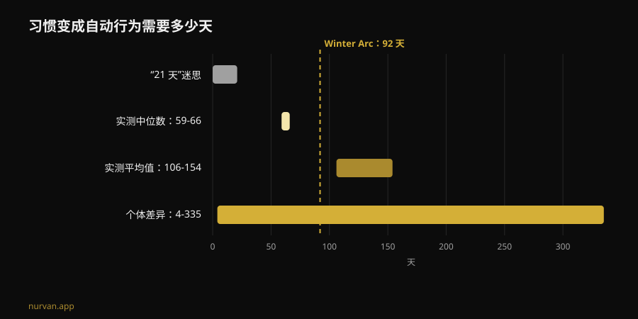
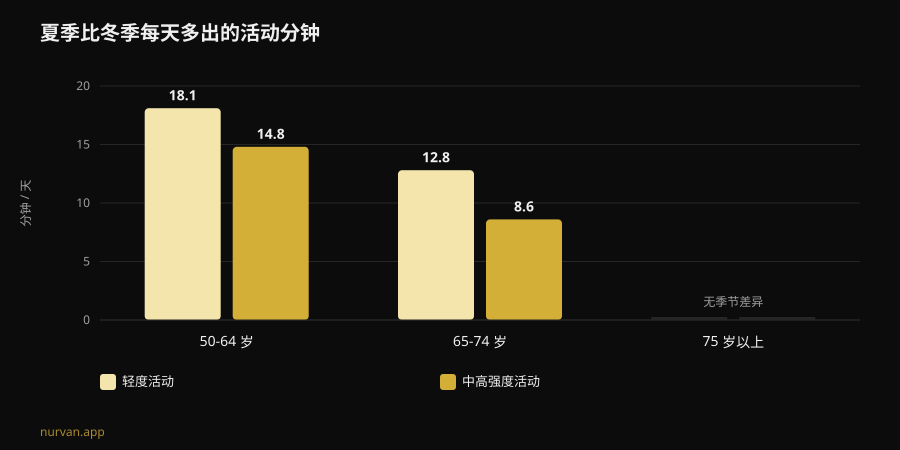

# Winter Arc 真的有用吗？研究怎么说

作者：[Giammaria Loi](/autore/giammaria-loi) · 更新于 2026 年 11 月 8 日

Winter Arc 是这个季节最火的挑战：从 10 月 1 日到次年 1 月 1 日，三个月的全面自律，每天都要打勾一张规则清单。它许诺的是，一月的你会脱胎换骨。我读了七篇被索引的论文，内容涉及习惯养成、体力活动的季节性和行为计划，结论比「有用」或「没用」更有意思：这个趋势挑对了时机，却几乎在方法上全错。

## 要点速览

- **21 天这个数字并不存在。** 关于健康行为需要多久才能变成自动反应，最新的系统综述给出的是**中位数 59-66 天**、平均值 **106 到 154 天**，个体差异跨度从 **4 天到 335 天**（Singh et al., 2024）。
- **92 天对大约一半的人够用。** 挑战的「官方」时长刚好越过中位数，但落在分布慢的一侧的人，日历会在习惯定型之前先用完。
- **冬天不是人们编出来的借口。** 加速度计数据显示，50-64 岁的成年人夏天比冬天每天多做 **14.8 分钟**中高强度活动和 **18.1 分钟**轻度活动；冬天每晚还要多睡 **31.8 分钟**（Cepeda et al., 2018）。
- **Winter Arc 的漏洞是你缺席的那一天。** 在 19,883 人的数据中，真正把意图变成行为的中介是**应对计划（coping planning）**——也就是出意外时的 B 计划——而单纯「何时何地」的计划并不显著（Wang et al., 2025）。
- **你积累的东西不会在 1 月 2 日消失。** 在老年人群中，完全停止力量训练 12 到 24 周**并没有**造成已获得肌肉量的统计显著下降；只有超过 31 周，下降才变得明显（Grgic, 2022）。

## Winter Arc 到底是什么

它诞生于 TikTok，如今已经成了一种内容模板。Winter Arc 本质上只是一个时间窗口：10 月 1 日到次年 1 月 1 日，也就是 92 天。它没有协议。解释它的页面只在一件事上达成一致——「自律和坚持」——规则清单留给你自己写。在典型的社媒版本里，它会变成五六条打包规则：早起、每周固定次数去健身房、严格饮食、读书、冷水澡、滴酒不沾。

这个结构里有两件事是有依据的。第一是时间点的选择：冬天的活动量确实会下降。第二是把目标写下来并逐条打勾：自我监测是数字化体力活动干预中最常被使用的技术之一（Omkar et al., 2026）。

剩下的部分——固定的结束日期、规则的数量、「连续不能断」的逻辑——都是叙事装饰。而其中一样是会造成伤害的。

## 21 天迷思：真实的数字

21 天这个说法流传了几十年，但它并不来自任何一项关于习惯的研究。Singh 等人在 2024 年底发表的系统综述与荟萃分析，汇总了 20 项研究、共 2,601 人，测量的是健康行为的自动化程度：体力活动、喝水、用牙线、饮食、减少久坐。

其中四项研究报告了达到自动化所需的时间。**中位数**在 59 到 66 天之间。**平均值**在 106 到 154 天之间——之所以更高，是因为有些人花的时间远远更长。而对你最有意义的数字，是观察到的个体区间：**4 天到 335 天**。

这不是细枝末节。它意味着，同样在 10 月 1 日开始、练同一份计划的两个人，到一月中旬可能是两种状态：一个已经进入自动模式，另一个每天晚上还在和自己讨价还价。第二个人并不是更不自律，他只是落在正常区间里。

同一篇综述里还有更实用的部分。影响习惯强度的因素包括**频率**、**一天中的时段**、**行为类型**、这个习惯是**本人选择的**还是被强加的、对这个动作的情绪评价，以及是否存在「准备性」习惯。早晨的练习和自己挑选的行为表现出最强的习惯强度。作者也标明了局限：20 项研究中有 11 项偏倚风险偏高，纳入的研究数量偏少。

翻译成这个趋势的语言就是：**你自己挑的一条规则，胜过从图文帖里抄来的五条。**

## 冬天不是借口：下降是被测出来的

在这一点上，Winter Arc 抓住了真实的东西。鹿特丹研究在 2011 到 2016 年间，为 1,116 人每人佩戴了七天加速度计，并比较了不同季节。

在 50-64 岁的成年人中，夏天的中高强度活动比冬天每天高 **14.8 分钟**，轻度活动每天高 **18.1 分钟**。在 65-74 岁这一组，差距是 8.6 和 12.8 分钟。75 岁以上，季节性消失。夜间睡眠则相反：50-64 岁组冬天每晚**多睡 31.8 分钟**。

有两个细节会改变你的解读。第一，这个模式由**气温和日照时数**解释，而不是性格。第二，也是更让人不舒服的一点：久坐行为**没有**季节性。换句话说，冬天我们并没有坐得更多——我们是动得更少。消失的正是那部分主动运动，也就是你自己决定的那部分。

所以在十一月决定做点什么，并不是社媒式的焦虑。这正是余量流失的季节。作者本人也得出结论：用轻度活动打断久坐，是一个不错的起点。

## 设计缺陷：没有为「缺席那天」准备方案

挑战就是在这里崩掉的，而且这不是意志力的问题。

Winter Arc 的心理模型是一条不能断的连续记录：92 个待打勾的格子。这意味着，这套做法对你生病、加班到九点、车抛锚的那一天毫无安排。真的发生时，连续记录断了，挑战就已经失败了——在十二月，背后还有三个不错的星期。

关于计划的研究恰好指出该从哪里下手。一项纳入 41 项随机试验、5,439 人的荟萃分析测量了计划类干预对体力活动的效果：**SMD 0.35**（95% 置信区间 0.25 到 0.44），即一个小到中等但稳定的效应，在随访期间有强化时效果更好（Peng et al., 2022）。

2025 年的一篇论文则用结构方程模型拆解了机制，覆盖 49 项研究、19,883 人。意图确实能预测行为（β = 0.416）。但在两类计划中，**只有应对计划**——「下雨怎么办、加班怎么办、周一缺席怎么办」——显著中介了从意图到行动的这一步（β = 0.067，p < 0.001）。纯粹的**行动计划**，也就是经典的「周二周四晚上七点去健身房」，在同一模型中**并不显著**（β = -0.001）。

两项分析对行动计划的说法并不一致，这一点值得明说：在 Peng 的试验里，以行动计划为基础的干预表现更好；在 Wang 的模型里，做中介工作的是应对计划。两者共同成立的是：**有计划胜过临场决定**，而且意外预案不是可有可无的附加项。

现在流传的 Winter Arc 只有前一半：规则、时间、格子。它没有后一半。

## 研究到底说了什么

| 常见说法 | 结论 | 来源 |
|---|---|---|
| 「养成一个习惯需要 21 天」 | **不成立**：中位数 59-66 天，区间 4-335 天 | Singh et al., 2024 |
| 「92 天足以让你脱胎换骨」 | **需要补充**：越过了中位数，但覆盖不了慢的那一端 | Singh et al., 2024 |
| 「冬天纯粹是动力问题」 | **需要补充**：下降是被测出来的，与光照和气温有关 | Cepeda et al., 2018 |
| 「断了一天就前功尽弃，重新开始」 | **作为策略不成立**：需要的是 B 计划，不是清零 | Wang et al., 2025；Peng et al., 2022 |
| 「挑战结束后停练，两周就全掉光」 | **时间上不成立**：停练 12-24 周未见显著损失（老年人群数据） | Grgic, 2022 |
| 「必须有一张每天五条的规则清单」 | **缺乏支持**：真正起作用的是频率和个人选择 | Singh et al., 2024 |
| 「不需要 App，需要的是自律」 | **需要补充**：数字工具的效应虽小但为正 | Omkar et al., 2026 |

## 如果 1 月 2 日就停了呢？

支撑这类限时挑战的恐惧很简单：它结束了，我就会放弃，然后前功尽弃。而停训（detraining）的数字其实宽容得多。

Grgic 的荟萃分析汇总了六项老年人研究，这些人先进行了 9-24 周的力量训练，肌肉量明显增加（d = 0.99）。在完全停训期间，肌肉量确实下降（d = -0.83）——但停练 **12-24 周**的亚组没有出现统计显著的减少（d = -0.60，区间 -1.21 到 0.01）。只有超过 **31 周**，下降才变得清晰。需要注意：这是老年人样本，不是多年训练的年轻人，而且测的是肌肉围度，不是力量。

顺带一提，力量才是最脆弱的那一项：在整个生命周期中，力量和功率的下降速度可达肌肉量的八倍（Fyfe et al., 2021）。它同时也是最容易用很少成本守住的东西。同一篇综述汇总了**最小有效剂量**的证据：用大负荷、低频率的低量训练，或者几乎不需要器材的高频微型训练，都能改善力量和功能能力。其中有一条对 Winter Arc 特别不利：更高的训练量与**更多不适、更少愉悦感**相关，而这会削弱依从性。

也就是说：最狠的计划，并不是能活下来的那个计划。

## 怎么落地

如果你想保留 Winter Arc 的框架，但不要它的设计缺陷：

1. **挑一条规则，不是五条。** 要你自己挑的那条，不是视频里的那条。个人选择本身就是习惯强度的影响因素之一。
2. **保持高频率、低门槛。** 你真的会做的三次短训练，胜过你会缺席的四次长训练。愉悦感不是软弱，它是依从性变量。
3. **在用得上之前就写好 B 计划。** 「周二缺了就周三去」「健身房关门就在家练 20 分钟」。研究关联到真实行为的是这个，不是打勾的格子。
4. **顺着光走。** 既然冬季下降与气温和日照相关，就把训练放在环境帮得上忙的时段，并减少摩擦：包提前收好、路程短、时间固定。
5. **删掉截止日期。** 一个在 1 月 1 日清零的计数器，正好是习惯的反面。如果到一月它还没变成自动反应，你只是落在统计常态里：你不是没做完，你是在继续。
6. **记录负荷，不是连续天数。** 一排 92 个格子说明不了你是否在进步，负荷的进阶可以——而且它扛得住缺席的一个周一。

关于远程带你训练的人该满足哪些条件，我们有一篇专门的文章：[线上教练真的有用吗？](/zh/blog/xianshang-jiaolian-youxiao-ma)。如果你想看的是行业潮流里哪些站得住脚的全景，我们在[2027 健身趋势](/zh/blog/2027-jianshen-qushi-shime-youxiao)里排过一遍。

### Nurvan：坚持要看负荷，不是看打勾

Nurvan 会记录每一组、每一次和 RIR，按周呈现真实的进阶曲线：周一缺席了，负荷曲线依然在那里，因为重要的是曲线，而不是连续天数。自动给出的热身组和历史训练记录，会在那些你不太想练的夜晚降低启动成本——而冬天，这样的夜晚占多数。**[试用 Nurvan](https://nurvan.app)**

## 常见问题

**养成一个健身习惯到底要多久？**
根据最新的系统综述，健康行为达到自动化的中位时间是 59-66 天，平均 106-154 天，个体差异从 4 天到 335 天。21 天这个数字并不出自这类文献。

**Winter Arc 有害吗？**
这个形式本身并不危险，它只是一个时间窗口。问题出在那些一次堆上很多条硬性规则的版本、缺席一天就「从头再来」的逻辑，以及零基础的人突然上大训练量。如果你有疼痛、正在治疗中的健康问题，或刚从伤病中恢复，开始前请先咨询医生。

**是做 90 天挑战好，还是不设期限好？**
目前没有直接比较这两种形式的数据。我们知道的是，期限在习惯养成中不起作用，而频率、个人选择和对意外的预案起作用。期限可以帮你开始；把它当成终点线才是风险。

**如果一月停下来，会掉多少？**
在老年人群的荟萃分析里，完全停止力量训练 12-24 周没有造成肌肉量的统计显著减少；超过 31 周则有。这不是针对年轻训练者的数据，而且测的是围度而非力量。无论如何，少量的短训练能守住的，比大多数人以为的多得多。

## 延伸阅读

- [线上教练真的有用吗？研究怎么说](/zh/blog/xianshang-jiaolian-youxiao-ma)——远程教练要盯住哪些东西，才抵得上一个站在你旁边的人。
- [2027 健身趋势：哪些真的有效](/zh/blog/2027-jianshen-qushi-shime-youxiao)——把行业潮流放进证据的筛子里。
- [AI 健身计划：研究到底怎么说](/zh/blog/ai-shengcheng-jianshen-jihua)——自动生成的训练计划什么时候靠谱，什么时候不靠谱。

## 参考文献

1. Singh B, Murphy A, Maher C, Smith AE, 2024. Time to Form a Habit: A Systematic Review and Meta-Analysis of Health Behaviour Habit Formation and Its Determinants. *Healthcare (Basel)* 12(23):2488. PMID [39685110](https://pubmed.ncbi.nlm.nih.gov/39685110/) · [DOI 10.3390/healthcare12232488](https://doi.org/10.3390/healthcare12232488)
2. Cepeda M, Koolhaas CM, van Rooij FJA, Tiemeier H, Guxens M, Franco OH, Schoufour JD, 2018. Seasonality of physical activity, sedentary behavior, and sleep in a middle-aged and elderly population: The Rotterdam study. *Maturitas* 110:41–50. PMID [29563034](https://pubmed.ncbi.nlm.nih.gov/29563034/) · [DOI 10.1016/j.maturitas.2018.01.016](https://doi.org/10.1016/j.maturitas.2018.01.016)
3. Wang L, Li X, Qiu K, Wang D, 2025. Examining the impact of perceived behavioral control and planning on closing the exercise intention-behavior gap: Insights from a meta-analytic structural equation modeling study. *Psychol Sport Exerc* 78:102822. PMID [39952422](https://pubmed.ncbi.nlm.nih.gov/39952422/) · [DOI 10.1016/j.psychsport.2025.102822](https://doi.org/10.1016/j.psychsport.2025.102822)
4. Peng S, Othman AT, Yuan F, Liang J, 2022. The Effectiveness of Planning Interventions for Improving Physical Activity in the General Population: A Systematic Review and Meta-Analysis of Randomized Controlled Trials. *Int J Environ Res Public Health* 19(12):7337. PMID [35742582](https://pubmed.ncbi.nlm.nih.gov/35742582/) · [DOI 10.3390/ijerph19127337](https://doi.org/10.3390/ijerph19127337)
5. Grgic J, 2022. Use It or Lose It? A Meta-Analysis on the Effects of Resistance Training Cessation (Detraining) on Muscle Size in Older Adults. *Int J Environ Res Public Health* 19(21):14048. PMID [36360927](https://pubmed.ncbi.nlm.nih.gov/36360927/) · [DOI 10.3390/ijerph192114048](https://doi.org/10.3390/ijerph192114048)
6. Fyfe JJ, Hamilton DL, Daly RM, 2021. Minimal-Dose Resistance Training for Improving Muscle Mass, Strength, and Function: A Narrative Review of Current Evidence and Practical Considerations. *Sports Med* 52(3):463–479. PMID [34822137](https://pubmed.ncbi.nlm.nih.gov/34822137/) · [DOI 10.1007/s40279-021-01605-8](https://doi.org/10.1007/s40279-021-01605-8)
7. Omkar A, Bertrand JK, Sadasivan C, et al., 2026. Behaviour change techniques in eHealth interventions for older, frail, or sarcopenic adults: A systematic review and meta-analysis. *Digit Health* 12:20552076261473804. PMID [42534183](https://pubmed.ncbi.nlm.nih.gov/42534183/) · [DOI 10.1177/20552076261473804](https://doi.org/10.1177/20552076261473804)

科学文献通过 PubMed 检索。趋势信号：Gymshark 关于 [Winter Arc](https://www.gymshark.com/blog/article/what-is-the-winter-arc) 的说明页（赛季为 10 月 1 日至次年 1 月 1 日），以及 My-Personaltrainer、SportOutdoor24 和 EroicaFenice 对该词的意大利文报道——这些内容都没有引用习惯养成的研究文献。本文的文字、结构、图表和事实核查均为原创。

---

**Giammaria Loi** 是 Nurvan 的创始人。他从 2012 年开始进行力量训练，自 2013 年起担任 FIPE 认证的私人教练与教练员，并自 2018 年起在全国级别参加力量举比赛。他署名的每一篇文章都从科学研究出发，落到健身房里真正有效的做法。[作者页面](/autore/giammaria-loi)

> 注：本文为科普内容，不能替代医生或合格专业人士的意见。如果你有疼痛、正在治疗中的健康问题，或正从伤病中恢复，请在开始或调整训练计划前先咨询医生。
