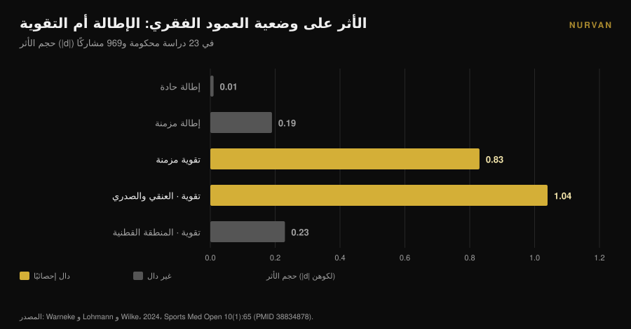
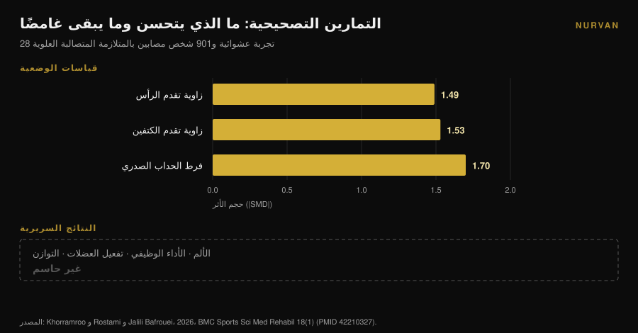

# الأكتاف المستديرة: الإطالة لا تصلحها

بقلم [جياماريا لوي](/autore/giammaria-loi) · حُدِّث في 9 نوفمبر 2026

كل منشور عن الأكتاف المستديرة يصف الوصفة نفسها: افتح الصدر، أطِل العضلة الصدرية، أدِر أعلى الظهر. المنطق يبدو نظيفًا: عضلة صدرية قصيرة تسحب الكتفين إلى الأمام، فلنُطِلها ويعود كل شيء إلى مكانه. التحليل البعدي الذي اختبر هذا المنطق لم يجد أي أثر. الإطالة، حادة كانت أم مزمنة، لا تحرّك الوضعية. هناك ما يحرّكها بالفعل، وهو نوع التمرين المعاكس تمامًا.

## باختصار

- **الإطالة لا تغيّر الوضعية.** عبر 23 دراسة محكومة و969 شخصًا، جاءت الإطالة الحادة عند **d = 0.01** (p = 0.97) والمزمنة عند **d = -0.19** (p = 0.16): كلاهما لا يمكن تمييزه عن الصفر (Warneke وزملاؤه، 2024).
- **التقوية تغيّرها.** في المراجعة نفسها، بلغت التقوية المزمنة **d = -0.83** (p = 0.01) وتفوّقت على الإطالة بفارق دال (d = 0.81، p = 0.004).
- **تعمل فوق الخصر.** الأثر كبير في الفقرات العنقية والصدرية (**d = -1.04**، p = 0.005) ومعدوم في المنطقة القطنية والقطنية الحوضية (d = -0.23، p = 0.25).
- **تحسّن الوضعية لا يعني تراجع الأعراض.** في 28 تجربة عشوائية و901 شخص مصابين بالمتلازمة المتصالبة العلوية، حرّكت التمارين التصحيحية زوايا الوضعية كثيرًا، بينما بقيت الآثار على الألم والأداء الوظيفي والتوازن **غير حاسمة** (Khorramroo وزملاؤه، 2026).
- **الجرعة الحقيقية ليست أربعة تمارين.** البروتوكول الذي حرّك الزوايا والألم فعلًا كان **45 دقيقة، خمسة أيام أسبوعيًا، لمدة ثمانية أسابيع** (Guo وزملاؤه، 2025).

## ما المقصود فعلًا بـ«الأكتاف المستديرة»

تحت هذا المسمّى تسير عادةً ثلاثة أشياء مختلفة معًا: الرأس متقدم على الجذع، الكتفان يدوران إلى الأمام، وتحدّب صدري أوضح. في الأدبيات تظهر باسم **الزاوية القحفية الفقرية**، و**زاوية تقدم الكتفين**، و**الحداب الصدري**، وعند اجتماعها الثلاثة يُقال *المتلازمة المتصالبة العلوية*.

هذه قياسات، لا تشخيصات. يصوّرك أحدهم من الجانب، يرسم الزوايا، فيخرج برقم. الاحتفاظ بهذا التمييز هو السبيل الوحيد لقراءة ما يلي قراءة صحيحة: ما تقيسه الأبحاث جيدًا هو الزوايا. أما ما يهمّك أنت فعلًا — كتف يتحرك بحرية، ورقبة لا تحترق عند السادسة مساءً — فمتغيّر آخر، وهما لا يسيران دائمًا معًا.

## الإطالة لا تغيّر الوضعية: الرقم الذي لا يكاد أحد يذكره

العمل الحاسم هنا مراجعة منهجية مع تحليل بعدي لـ Warneke وLohmann وWilke، نُشرت عام 2024 في *Sports Medicine - Open*. جمعت 23 دراسة محكومة و969 شخصًا أصحاء للإجابة عن سؤال محدد: هل نهج «أطِل ما هو قصير وقوِّ ما هو ضعيف» يغيّر فعلًا وضعية العمود الفقري؟

الأرقام صريحة. **الإطالة الحادة: d = 0.01، p = 0.97.** صفر. **الإطالة المزمنة: d = -0.19، p = 0.16.** الاتجاه صحيح، والنتيجة لا تُميَّز عن الصدفة.

**التقوية المزمنة: d = -0.83، p = 0.01.** أثر كبير. وفي المقارنة المباشرة، تتفوّق التقوية على الإطالة بـ d = 0.81 (p = 0.004).

يكتب المؤلفون ذلك دون مواربة: الأدلة ذات اليقين المتوسط لا تدعم استخدام الإطالة كعلاج لاختلال التوازن العضلي، وعلى من يعمل على الوضعية أن يركّز على برامج تقوية تستهدف العضلات الضعيفة.

وثمة تفصيل يجعل هذه النتيجة أكثر فائدة لك. تُظهر التحليلات الفرعية أن التقوية تعمل **في المنطقة العنقية والصدرية** (d = -1.04، p = 0.005) و**لا تعمل** في المنطقة القطنية والقطنية الحوضية (d = -0.23، p = 0.25). أعلى الظهر يستجيب للتدريب، والحوض لا. والأكتاف المستديرة تقع تحديدًا في المنطقة التي تستجيب.

## التقوية تحرّكها، وهذا ليس مجانيًا

إذا كانت التقوية هي الرافعة، فالسؤال التالي: كم منها؟

هنا يجب النظر إلى البروتوكولات لا إلى الخلاصات. أوضح تجربة عشوائية في هذا الباب، نشرها Guo وزملاؤه عام 2025، أخذت 74 طالبًا جامعيًا مصابين بالمتلازمة المتصالبة العلوية وقسّمتهم مجموعتين. تدرّبت مجموعة التدخل على الرقبة والفقرات الصدرية **خمسة أيام أسبوعيًا، 45 دقيقة في الجلسة، لمدة ثمانية أسابيع**. أما المجموعة الضابطة فواصلت حياتها المعتادة.

النتائج جيدة: زاوية تقدم الرأس d = 1.113، زاوية تقدم الكتفين d = 1.052، الألم d = 0.854، العجز الرقبي d = 0.754، بل وتحسّن في وظيفة الرئة (FEV1/FVC d = 0.516).

لكن احسب الجرعة: **نحو 30 ساعة عمل في شهرين.** لا أربعة تمارين «في الأيام التي يتركك فيها الجلوس متيبّسًا».

التحليل البعدي لـ Xing وزملائه، 2026، على عشر تجارب عشوائية و550 شخصًا يشير إلى الاتجاه نفسه: حسّن التمرين العلاجي الزاوية القحفية الفقرية بمقدار **3.38 درجة** في المتوسط (فاصل ثقة 95%: 2.10-4.65)، وخفّض الألم (فرق متوسط -1.42) والعجز الرقبي (-5.44). وفي التحليلات الاستكشافية، حققت البرامج التي تستمر **ثمانية أسابيع على الأقل** وتجمع أنواعًا متعددة من التمارين نتائج أكبر. ويحذّر المؤلفون من أن اليقين الإجمالي يبقى منخفضًا إلى متوسط.

ثلاث درجات بعد شهرين من العمل المنتظم. نتيجة حقيقية، وهي في الوقت نفسه مقياس لصعوبة تحريك وضعية شخص بالغ.

## الوضعية تتحسن، والأعراض لا تتبعها بالضرورة

هنا تأتي أكثر النتائج إزعاجًا في الموضوع كله، وهي حديثة.

نشر Khorramroo وRostami وJalili Bafrouei عام 2026 مراجعة منهجية مع تحليل بعدي شملت 28 تجربة عشوائية و901 شخص مصابين بالمتلازمة المتصالبة العلوية. حسّنت التمارين التصحيحية الزوايا بوضوح: زاوية تقدم الرأس **SMD -1.49**، زاوية تقدم الكتفين **SMD -1.53**، فرط الحداب الصدري **SMD -1.70**. آثار كبيرة على طول الخط.

ثم يأتي النصف الثاني من العمل. في النتائج التي تهم من يعاني — الألم والأداء الوظيفي وتفعيل العضلات والتوازن — جاءت النتائج **غير حاسمة**. وخلاصة المؤلفين: التمارين التصحيحية تعالج بفاعلية العجز الوضعي الميكانيكي الحيوي، لكن ترجمة ذلك إلى تخفيف للأعراض وتحسّن وظيفي تبقى غير مؤكدة.

عنوان الدراسة نفسه يقولها: الوضعية تتحسن كثيرًا، والفوائد السريرية غير متسقة. ويجدر أن نضيف أن التباين بين الدراسات مرتفع (I² بين 78% و88%)، أي أن الدراسات الفردية تتفق فيما بينها أقل مما يوحي به الرقم المجمّع.

## وماذا لو لم تكن الأكتاف المستديرة سبب الألم؟

الافتراض غير المعلن وراء كل روتين «تصحيحي» هو أن الوضعية السيئة تؤلم. هذا افتراض، لا حقيقة ثابتة.

قارنت دراسة حالات وشواهد عام 2025 بين 146 شابًا بالغًا: 73 يعانون ألمًا رقبيًا مزمنًا و73 لا يعانونه، بمتوسط عمر 21.6 سنة. ما ارتبط بالألم هو **مشكلات الإبصار** (نسبة الأرجحية 2.83؛ فاصل ثقة 95%: 1.26-6.38) و**قلة الحركة** (OR 2.41؛ 1.01-5.88). أما عادات الوضعية المُبلَّغ عنها ذاتيًا فلم ترتبط ارتباطًا دالًا (p > 0.05).

إنها دراسة واحدة، استعادية، تعتمد وضعية مُبلَّغًا عنها لا مقيسة، وعلى شباب بالغين: فهي لا تُغلق الملف. لكن بوضعها إلى جانب تحليل Khorramroo تتشكّل صورة متماسكة. تبدو الوضعية مؤشرًا أكثر منها سببًا، ويظل السلوك الخامل — كم تتحرك قليلًا، لا كيف تجلس — هو ما يتكرر ظهوره.

إذا كنت تتدرب وكتفك يؤلمك، فالأمر يستحق تقييمًا حقيقيًا لا روتين مرونة مأخوذًا من منشور. الألم الذي لا يهدأ، أو يوقظك ليلًا، أو يرافقه تنميل أو ضعف في الذراع، يذهب إلى طبيب أو أخصائي علاج طبيعي، لا إلى أربع إطالات.

## إذن هل مرونة الفقرات الصدرية بلا فائدة؟ لا، لكن لسبب آخر

احذر المبالغة في التصحيح. العمل على الفقرات الصدرية له سند متين، لكنه لا يمر عبر الوضعية.

قاس تحليل بعدي عام 2025 على عشر تجارب عشوائية و444 شخصًا مصابين بمتلازمة الانحشار تحت الأخرم أثر العلاج اليدوي للفقرات الصدرية: الألم **SMD -0.94** (فاصل ثقة 95%: -1.23 إلى -0.65) عند 2-6 أسابيع و-0.83 في المتابعة المتوسطة، والعجز -0.82، بأدلة عالية الجودة. وتحسّن مدى الحركة بأدلة متوسطة الجودة: الدوران الداخلي SMD 0.61، والدوران الخارجي 0.58.

إذن الفقرات الصدرية مهمة لكيفية حركة الكتف، خصوصًا في الدوران. والسبب ميكانيكي: لوح الكتف ينزلق على قفص صدري، فإذا امتد هذا القفص ودار بشكل أفضل وجدت الذراع فوق الرأس مجالًا أوسع. ولهذا أيضًا وجدت مراجعة عام 2026 على 13 تجربة و819 شخصًا أن البرامج التي تجمع الرقبة **والفقرات الصدرية** تخفّض الألم بدلالة إحصائية، بينما برامج الرقبة وحدها تحسّن الزوايا دون أن تبلغ الأثر نفسه — مع يقين في الأدلة، لا بد من قوله، منخفض إلى منخفض جدًا.

الرسالة العملية ليست «تخلَّ عن تمارين المرونة»، بل: **مرونة الفقرات الصدرية تجعلك تتحرك أفضل، لا تجعلك تستقيم.** اجعلها جزءًا من الإحماء قبل الدفع فوق الرأس أو السحب، لا علاجًا للوضعية.

## ما تقوله الأبحاث فعلًا

| ادعاء شائع | الحكم | المصدر |
|---|---|---|
| «أطِل الصدر وسيعود الكتفان» | **مفنَّد**: الإطالة الحادة d = 0.01، المزمنة d = -0.19، وكلاهما غير دال | Warneke وزملاؤه، 2024 |
| «تقوية الظهر لا تغيّر الوضعية» | **مفنَّد**: d = -0.83، و d = -1.04 في المنطقة العنقية الصدرية | Warneke وزملاؤه، 2024 |
| «أربعة تمارين مرونة تصحّح الأكتاف المستديرة» | **غير مدعوم**: الجرعة الفعالة في الدراسات 45 دقيقة × 5 أيام × 8 أسابيع | Guo وزملاؤه، 2025؛ Xing وزملاؤه، 2026 |
| «الأكتاف المستديرة تسبب الألم» | **يحتاج تدقيقًا**: غير مُثبت؛ الوضعية تتحسن والأعراض لا | Khorramroo وزملاؤه، 2026؛ Assis وزملاؤه، 2025 |
| «العمل على الفقرات الصدرية يفيد الكتف» | **مؤكَّد**: الألم SMD -0.94، الدوران الداخلي 0.61، الخارجي 0.58 | Yu وزملاؤه، 2025 |
| «صحّح الوضعية تختفِ الأعراض» | **مفنَّد كقاعدة تلقائية**: الزوايا تتحسن والنتائج السريرية غير حاسمة | Khorramroo وزملاؤه، 2026 |

## كيف تطبّق ذلك

1. **توقّف عن ملاحقة التصحيح وابدأ بملاحقة الحمل.** إن خصّصت للوضعية عشر دقائق يوميًا، فاصرفها في السحب الأفقي والعمودي لا في إطالات الصدر. هذا هو المتغيّر الوحيد الذي رآه التحليل البعدي يتحرك.
2. **اختر حركات السحب للجزء العلوي.** السحب بالبار والدمبل، السحب الأرضي، العقلة، face pull، الرفرفة الجانبية والخلفية. هذه هي العضلات التي ثبتت فاعلية تقويتها تحديدًا في المنطقة العنقية الصدرية.
3. **تقدّم فعليًا.** المحفّز الذي يهم هو الحمل الذي ينمو مع الوقت، لا قائمة التمارين. سجّل الأحمال والتكرارات والتكرارات الاحتياطية (RIR، أي كم تكرارًا كان بوسعك إضافته في نهاية المجموعة): بدون هذه البيانات يبقى «التقدم» نية. وإن احتجت أساسًا، فابدأ من [كيف يختلف تقسيم التمرين بين المبتدئ والمتقدم](/ar/blog/taqsim-altadrib-mubtadi-mutaqaddim).
4. **امنحه وقتًا: ثمانية أسابيع هي الحد الأدنى.** دون هذه العتبة لا تُظهر البيانات الكثير. والنتيجة الواقعية في حدود بضع درجات، لا تحوّل كامل.
5. **استخدم المرونة حيث تفيد فعلًا: في الإحماء.** دقيقتان أو ثلاث من دوران الفقرات الصدرية قبل الدفع فوق الرأس أو السحب لها معنى لطريقة حركتك ذلك اليوم. لا تتوقع منها إعادة تشكيل وضعيتك.
6. **إن كان هناك ألم، فهو ليس مشكلة وضعية حتى يقول ذلك من فحصك.** ألم مستمر أو ليلي، أو مصحوب بتنميل أو ضعف: طبيب أو أخصائي علاج طبيعي.

> ### جرّب Nurvan — التقدّم الذي تتطلبه الوضعية فعلًا
>
> الرافعة التي تعمل ليست روتين إطالة، بل تقوية للظهر تنمو أسبوعًا بعد أسبوع لمدة شهرين على الأقل. مع Nurvan تسجّل الحمل والتكرارات وRIR لكل مجموعة سحب وعقلة، وترى منحنى التقدم بدل الاعتماد على الذاكرة، وتستورد البرنامج الذي تستخدمه أصلًا من PDF أو Excel أو حتى من صورة. [جرّب Nurvan](https://nurvan.app)

## أسئلة شائعة

**هل إطالة العضلة الصدرية بلا فائدة؟**
ليست بلا فائدة للإحساس بالمرونة أو كجزء من الإحماء؛ إنما هي غير فعّالة كأداة لتغيير الوضعية. عبر 23 دراسة، كان أثر الإطالة على محاذاة العمود الفقري غير قابل للتمييز إحصائيًا عن الصفر (Warneke وزملاؤه، 2024).

**كم يستغرق تصحيح الأكتاف المستديرة؟**
الدراسات التي حققت تغيّرًا قابلًا للقياس استخدمت برامج لا تقل عن ثمانية أسابيع؛ وأكبرها أثرًا بلغ 45 دقيقة، خمسة أيام أسبوعيًا. ومتوسط تحسّن الزاوية القحفية الفقرية في التحليلات البعدية نحو ثلاث درجات.

**هل تسبب الأكتاف المستديرة ألم الرقبة؟**
غير مُثبت. في التحليلات البعدية تتحسن زوايا الوضعية كثيرًا بالتمرين، لكن الآثار على الألم والأداء تبقى غير حاسمة، ولم تجد دراسة حالات وشواهد ارتباطًا بين عادات الوضعية وألم الرقبة المزمن.

**إذن هل لمرونة الفقرات الصدرية فائدة؟**
نعم، لحركة الكتف. العمل على الفقرات الصدرية يحسّن الألم والدوران لدى المصابين بالانحشار تحت الأخرم، بأدلة جيدة الجودة. استخدمها تحضيرًا للحركة، لا تصحيحًا للوضعية.

## اقرأ أيضًا

- [الركبتان إلى الخارج في القرفصاء: قاعدة أم إشارة؟](/ar/blog/alrukbatan-ila-alkharij-fi-alqurfusa) — حالة أخرى تتحول فيها إشارة تقنية إلى قاعدة لا تسندها الأدبيات.
- [أسطوانة التدليك: هل تفيد فعلًا؟ ما تقوله الأبحاث](/ar/blog/foam-roller-hal-yufid-altaafi) — السؤال نفسه موجّهًا إلى أداة سلبية أخرى واسعة الانتشار.
- [دفع الدمبل أم التفتيح: أيهما يكبّر الصدر أكثر؟](/ar/blog/dafa-aldumbil-am-alfard-lilsadr) — إن أردت تدريب الصدر جيدًا بدل الاكتفاء بإطالته.

## المصادر

1. Warneke K, Lohmann LH, Wilke J, 2024. Effects of Stretching or Strengthening Exercise on Spinal and Lumbopelvic Posture: A Systematic Review with Meta-Analysis. *Sports Medicine - Open* 10(1):65. PMID 38834878. [DOI 10.1186/s40798-024-00733-5](https://doi.org/10.1186/s40798-024-00733-5)
2. Khorramroo F, Rostami M, Jalili Bafrouei M, 2026. Corrective exercises strongly improve posture but fail to produce consistent clinical or functional benefits in patients with upper crossed syndrome: a systematic review and meta-analysis of randomized controlled trials. *BMC Sports Science, Medicine & Rehabilitation* 18(1). PMID 42210327. [DOI 10.1186/s13102-026-01707-8](https://doi.org/10.1186/s13102-026-01707-8)
3. Xing Y, Wang R, Zhao X, Xu A, 2026. Therapeutic Exercise for Forward Head Posture in Neck Pain Patients: A Systematic Review and Meta-Analysis. *Journal of Pain Research* 19:614524. PMID 42445930. [DOI 10.2147/JPR.S614524](https://doi.org/10.2147/JPR.S614524)
4. Carrasco-Uribarren A, Ceballos-Laita L, Pérez-Guillén S, Jiménez-Del-Barrio S, Pantaleón-Hernández D, Cabanillas-Barea S, 2026. Impact of therapeutic exercise on craniovertebral angle in forward head posture: a systematic review and meta-analysis. *The Journal of Manual & Manipulative Therapy*. PMID 42281352. [DOI 10.1080/10669817.2026.2686739](https://doi.org/10.1080/10669817.2026.2686739)
5. Guo Y, Li M, Xie C, Liu X, Chen Y, Yang J, Wu Y, Chen S, Wang S, Lin J, 2025. Effect of the cervical and thoracic "Daoyin" training on posture and pulmonary function in patients with upper crossed syndrome: a randomized controlled trial. *BMC Complementary Medicine and Therapies* 25(1):41. PMID 39905404. [DOI 10.1186/s12906-025-04791-4](https://doi.org/10.1186/s12906-025-04791-4)
6. Yu S, Chen S, Yang Z, Ma X, Huang J, Yang L, 2025. Effectiveness of Thoracic Spine Manual Therapy in Treating Subacromial Impingement Syndrome: A Systematic Review and Meta-analysis. *Archives of Physical Medicine and Rehabilitation* 106(12):1886-1898. PMID 40712864. [DOI 10.1016/j.apmr.2025.07.008](https://doi.org/10.1016/j.apmr.2025.07.008)
7. Assis SJC de, Sanchis GJB, Meziat-Filho N, Souza CG de, Roncalli A, 2025. Association of self-reported posture habits and vision problems with chronic neck pain: A case-control study. *Journal of Bodywork and Movement Therapies* 45:946-952. PMID 41316668. [DOI 10.1016/j.jbmt.2025.10.023](https://doi.org/10.1016/j.jbmt.2025.10.023)

المصادر البحثية عبر PubMed. نقطة الانطلاق: منشور [@themobilitymanual](https://www.instagram.com/p/DdYn-F3Fiqa/) بتاريخ 17 سبتمبر 2026 عن روتين مرونة للأكتاف المستديرة. لم يُعَد إنتاج أي نص أو صورة من ذلك المنشور: جرت إعادة التحقق من الموضوع وادعاءاته في الأدبيات.

---

*جياماريا لوي هو مؤسس Nurvan. يتدرب بالأثقال منذ 2012، ويعمل مدربًا شخصيًا ومدربًا معتمدًا من FIPE منذ 2013، ويشارك في منافسات رفع الأثقال القوة على المستوى الوطني منذ 2018. كل مقال يوقّعه ينطلق من الدراسات العلمية وينتهي عند ما ينفع فعلًا في الصالة.*

> ملاحظة: محتوى تثقيفي، لا يغني عن رأي الطبيب أو المختص.
