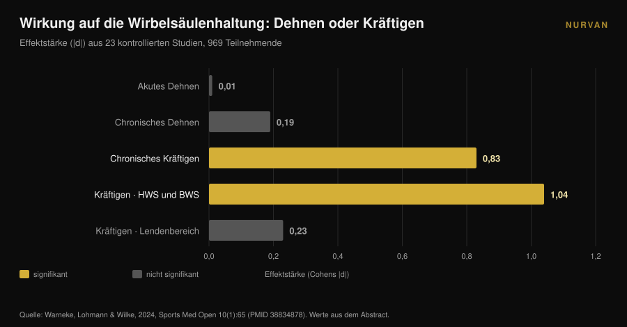
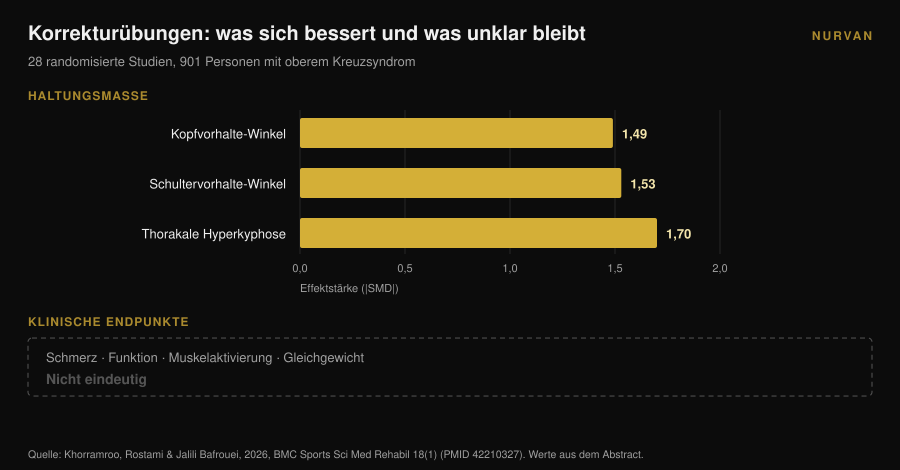

# Runde Schultern: Dehnen bringt hier nichts

Von [Giammaria Loi](/autore/giammaria-loi) · aktualisiert am 9. November 2026

Jede Karussell-Anleitung zu runden Schultern verschreibt dasselbe: Brust öffnen, Pectoralis dehnen, oberen Rücken rotieren. Die Logik ist sauber — ein verkürzter Brustmuskel zieht die Schultern nach vorn, also dehnt man ihn und alles rückt zurück. Die Meta-Analyse, die diese Logik geprüft hat, fand keinen Effekt. Dehnen, akut oder langfristig, bewegt die Haltung nicht. Etwas bewegt sie sehr wohl — und zwar die gegenteilige Übungsart.

## Kurz gefasst

- **Dehnen verändert die Haltung nicht.** Über 23 kontrollierte Studien und 969 Personen kam akutes Dehnen auf **d = 0,01** (p = 0,97) und chronisches Dehnen auf **d = -0,19** (p = 0,16): beides nicht von null zu unterscheiden (Warneke et al., 2024).
- **Kräftigen schon.** In derselben Übersichtsarbeit erreichte chronisches Krafttraining **d = -0,83** (p = 0,01) und war dem Dehnen signifikant überlegen (d = 0,81, p = 0,004).
- **Es wirkt oberhalb der Taille.** Der Effekt ist groß in der Hals- und Brustwirbelsäule (**d = -1,04**, p = 0,005) und null im Lenden- und lumbopelvinen Bereich (d = -0,23, p = 0,25).
- **Bessere Haltung heißt nicht weniger Beschwerden.** In 28 randomisierten Studien mit 901 Personen mit oberem Kreuzsyndrom verbesserte Korrekturtraining die Haltungswinkel deutlich, während die Effekte auf Schmerz, Funktion und Gleichgewicht **nicht eindeutig** blieben (Khorramroo et al., 2026).
- **Die reale Dosis sind nicht vier Übungen.** Das Protokoll, das Winkel und Schmerz tatsächlich bewegte, lief **45 Minuten, fünf Tage pro Woche, acht Wochen lang** (Guo et al., 2025).

## Was „runde Schultern" eigentlich bedeutet

Unter diesem Etikett reisen meist drei verschiedene Dinge gemeinsam: der Kopf vor dem Rumpf, nach vorn rotierte Schultern und eine stärker ausgeprägte Brustwirbelkrümmung. In der Literatur heißen sie **kraniovertebraler Winkel**, **Schultervorhalte-Winkel** und **thorakale Kyphose**; treten alle drei zusammen auf, spricht man vom *oberen Kreuzsyndrom*.

Das sind Messwerte, keine Diagnosen. Jemand fotografiert dich von der Seite, zeichnet Winkel ein, am Ende steht eine Zahl. Diese Unterscheidung im Kopf zu behalten ist der einzige Weg, das Folgende richtig zu lesen: Was die Forschung gut misst, sind Winkel. Was dich wirklich interessiert — eine Schulter, die sich frei bewegt, ein Nacken, der um achtzehn Uhr nicht brennt — ist eine andere Größe, und beide laufen nicht immer parallel.

## Dehnen verändert die Haltung nicht: der Befund, den kaum jemand zitiert

Entscheidend ist hier eine systematische Übersichtsarbeit mit Meta-Analyse von Warneke, Lohmann und Wilke, 2024 in *Sports Medicine - Open* erschienen. Sie fasste 23 kontrollierte Studien und 969 gesunde Personen zusammen, um eine präzise Frage zu beantworten: Verändert der Ansatz „dehne, was verkürzt ist, kräftige, was schwach ist" die Wirbelsäulenhaltung tatsächlich?

Die Zahlen sind eindeutig. **Akutes Dehnen: d = 0,01, p = 0,97.** Null. **Chronisches Dehnen: d = -0,19, p = 0,16.** Richtige Richtung, nicht vom Zufall zu unterscheiden.

**Chronisches Kräftigen: d = -0,83, p = 0,01.** Ein großer Effekt. Im direkten Vergleich schlägt Kräftigen das Dehnen mit d = 0,81 (p = 0,004).

Die Autoren schreiben es ohne Umschweife: Evidenz von moderater Sicherheit stützt Dehnen als Behandlung muskulärer Dysbalancen nicht, und wer an der Haltung arbeitet, sollte sich auf Kräftigungsprogramme für die abgeschwächten Muskeln konzentrieren.

Ein Detail macht den Befund noch nützlicher. Die Subanalysen zeigen, dass Kräftigen **in der Hals- und Brustwirbelsäule** wirkt (d = -1,04, p = 0,005) und **nicht** im Lenden- und lumbopelvinen Bereich (d = -0,23, p = 0,25). Der obere Rücken reagiert auf Training, das Becken nicht. Runde Schultern liegen genau in der Zone, die reagiert.

## Kräftigen bewegt sie — und das ist nicht gratis

Wenn Kräftigen der Hebel ist, lautet die nächste Frage: wie viel davon?

Hier muss man die Protokolle lesen, nicht die Schlussfolgerungen. Die klarste randomisierte Studie dazu, 2025 von Guo und Kollegen veröffentlicht, nahm 74 Studierende mit oberem Kreuzsyndrom und teilte sie in zwei Gruppen. Die Interventionsgruppe trainierte Nacken und Brustwirbelsäule **fünf Tage pro Woche, 45 Minuten pro Einheit, acht Wochen lang**. Die Kontrollgruppe machte weiter wie bisher.

Die Ergebnisse sind gut: Kopfvorhalte-Winkel d = 1,113, Schultervorhalte-Winkel d = 1,052, Schmerz d = 0,854, Nackenbeeinträchtigung d = 0,754 und sogar ein messbarer Gewinn an Lungenfunktion (FEV1/FVC d = 0,516).

Aber rechne die Dosis nach: **rund 30 Stunden Arbeit in zwei Monaten.** Nicht vier Übungen „an Tagen, an denen langes Sitzen steif macht".

Die Meta-Analyse von Xing und Kollegen, 2026, über zehn randomisierte Studien und 550 Personen, weist in dieselbe Richtung: Therapeutisches Training verbesserte den kraniovertebralen Winkel im Mittel um **3,38 Grad** (95-%-Konfidenzintervall: 2,10-4,65), senkte Schmerz (mittlere Differenz -1,42) und Nackenbeeinträchtigung (-5,44). In explorativen Analysen schnitten Programme über **mindestens acht Wochen** mit kombinierten Übungsformen besser ab. Die Autoren betonen, dass die Gesamtsicherheit niedrig bis moderat bleibt.

Drei Grad, nach zwei Monaten konsequenter Arbeit. Das ist ein echtes Ergebnis — und zugleich das Maß dafür, wie schwer sich die Haltung eines Erwachsenen verschieben lässt.

## Die Haltung bessert sich, die Beschwerden folgen nicht zwangsläufig

Hier kommt der unbequemste Befund des ganzen Themas, und er ist neu.

Khorramroo, Rostami und Jalili Bafrouei veröffentlichten 2026 eine systematische Übersichtsarbeit mit Meta-Analyse über 28 randomisierte Studien und 901 Personen mit oberem Kreuzsyndrom. Korrekturübungen verbessern die Winkel deutlich: Kopfvorhalte-Winkel **SMD -1,49**, Schultervorhalte-Winkel **SMD -1,53**, thorakale Hyperkyphose **SMD -1,70**. Große Effekte auf ganzer Linie.

Dann folgt die zweite Hälfte der Arbeit. Bei den Endpunkten, die für Beschwerden zählen — Schmerz, Funktion, Muskelaktivierung, Gleichgewicht — sind die Ergebnisse **nicht eindeutig**. Die Autoren fassen zusammen: Korrekturtraining adressiert biomechanische Haltungsdefizite wirksam, aber ob sich das in Symptomlinderung und funktionelle Verbesserung übersetzt, bleibt unsicher.

Schon der Titel der Studie sagt es: Die Haltung bessert sich stark, die klinischen Vorteile sind nicht konsistent. Hinzuzufügen ist, dass die Heterogenität zwischen den Studien hoch ist (I² zwischen 78 % und 88 %) — die Einzelstudien stimmen weniger überein, als die Gesamtzahl vermuten lässt.

## Und wenn runde Schultern gar nicht die Schmerzursache wären?

Die unausgesprochene Prämisse jeder „Korrektur"-Routine lautet: schlechte Haltung tut weh. Das ist eine Prämisse, keine gesicherte Tatsache.

Eine Fall-Kontroll-Studie von 2025 verglich 146 junge Erwachsene: 73 mit chronischen Nackenschmerzen, 73 ohne, Durchschnittsalter 21,6 Jahre. Mit Schmerz assoziiert waren **Sehprobleme** (Odds Ratio 2,83; 95-%-KI: 1,26-6,38) und **Bewegungsmangel** (OR 2,41; 1,01-5,88). Selbstberichtete Haltungsgewohnheiten: kein signifikanter Zusammenhang (p > 0,05).

Es ist eine einzelne, retrospektive Studie zu selbstberichteter statt gemessener Haltung bei jungen Erwachsenen — sie schließt die Frage nicht ab. Neben Khorramroos Meta-Analyse ergibt sich aber ein stimmiges Bild. Haltung wirkt eher wie ein Marker als wie eine Ursache, und sitzendes Verhalten — wie wenig du dich bewegst, nicht wie du sitzt — taucht immer wieder auf.

Wenn du trainierst und die Schulter schmerzt, verdient das eine echte Abklärung, keine Mobility-Routine aus einem Post. Schmerz, der nicht nachlässt, nachts weckt, mit Kribbeln oder Kraftverlust im Arm einhergeht, gehört zu Ärztin oder Physiotherapeut, nicht zu vier Dehnübungen.

## Ist BWS-Mobilität also sinnlos? Nein — aber aus einem anderen Grund

Nicht übersteuern. Arbeit an der Brustwirbelsäule hat solide Belege. Sie führt nur nicht über die Haltung.

Eine Meta-Analyse von 2025 über zehn randomisierte Studien und 444 Personen mit subakromialem Impingement maß manuelle Therapie an der BWS: Schmerz **SMD -0,94** (95-%-KI: -1,23 bis -0,65) nach 2-6 Wochen und -0,83 im mittelfristigen Follow-up, Beeinträchtigung -0,82, auf hochwertiger Evidenz. Der Bewegungsumfang verbesserte sich auf moderater Evidenz: Innenrotation SMD 0,61, Außenrotation 0,58.

Die Brustwirbelsäule zählt also dafür, wie sich die Schulter bewegt, besonders in Rotation. Der Grund ist mechanisch: Die Skapula gleitet auf einem Brustkorb, und wenn dieser besser extendiert und rotiert, findet der Arm über Kopf mehr Weg. Deshalb fand auch eine Übersichtsarbeit von 2026 über 13 Studien und 819 Personen, dass Programme mit Nacken **und** Brustwirbelsäule den Schmerz signifikant senken, während reine Nackenprogramme die Winkel verbessern, ohne das zu erreichen — bei, das sei gesagt, niedriger bis sehr niedriger Evidenzsicherheit.

Die praktische Botschaft lautet nicht „wirf die Mobility weg". Sie lautet: **BWS-Mobilität hilft dir, dich besser zu bewegen, nicht gerader zu stehen.** Nutze sie als Aufwärmen vor Überkopfdrücken oder Rudern, nicht als Haltungstherapie.

## Was die Forschung wirklich sagt

| Verbreitete Behauptung | Urteil | Quelle |
|---|---|---|
| „Dehne die Brust und die Schultern gehen zurück" | **Widerlegt**: akutes Dehnen d = 0,01, chronisch d = -0,19, beides nicht signifikant | Warneke et al., 2024 |
| „Rückenkräftigung ändert die Haltung nicht" | **Widerlegt**: d = -0,83, und d = -1,04 im zervikothorakalen Bereich | Warneke et al., 2024 |
| „Vier Mobility-Übungen korrigieren runde Schultern" | **Nicht belegt**: die wirksame Dosis in Studien war 45 Min. × 5 Tage × 8 Wochen | Guo et al., 2025; Xing et al., 2026 |
| „Runde Schultern verursachen Schmerzen" | **Einzuschränken**: nicht nachgewiesen; Haltung bessert sich, Beschwerden nicht | Khorramroo et al., 2026; Assis et al., 2025 |
| „BWS-Arbeit hilft der Schulter" | **Bestätigt**: Schmerz SMD -0,94, Innenrotation 0,61, Außenrotation 0,58 | Yu et al., 2025 |
| „Korrigiere die Haltung und die Beschwerden gehen" | **Als Automatismus widerlegt**: Winkel bessern sich, klinische Endpunkte nicht eindeutig | Khorramroo et al., 2026 |

## Wie du es umsetzt

1. **Hör auf, die Korrektur zu suchen, und such die Last.** Wenn du der Haltung zehn Minuten am Tag gibst, steck sie in horizontales und vertikales Ziehen, nicht in Brustdehnungen. Das ist die einzige Variable, die sich in der Meta-Analyse bewegt hat.
2. **Wähle Zugbewegungen für den Oberkörper.** Langhantel- und Kurzhantelrudern, Kabelrudern, Klimmzüge, Face Pulls, Seit- und hintere Schulterheben. Genau diese Muskeln zeigten im zervikothorakalen Bereich wirksame Kräftigung.
3. **Progressiere wirklich.** Der Reiz, der zählt, ist die Last, die über die Zeit wächst — nicht die Übungsliste. Notiere Last, Wiederholungen und Wiederholungen in Reserve (RIR, wie viele am Satzende noch möglich wären): ohne diese Daten bleibt „Fortschritt" eine Absicht. Wenn du eine Grundstruktur brauchst, starte damit, wie sich [ein Trainingssplit zwischen Anfängern und Fortgeschrittenen unterscheidet](/de/blog/trainingssplit-anfaenger-fortgeschrittene).
4. **Gib ihm Zeit: acht Wochen sind das Minimum.** Darunter zeigen die Daten wenig. Und das realistische Ergebnis liegt bei wenigen Grad, nicht bei einer Verwandlung.
5. **Setze Mobility dort ein, wo sie wirklich hilft: im Aufwärmen.** Zwei bis drei Minuten BWS-Rotationen vor Überkopfdrücken oder Rudern ergeben Sinn für den Tag. Erwarte nicht, dass sie deine Haltung umformen.
6. **Wenn es schmerzt, ist es kein Haltungsproblem, bis jemand dich untersucht hat.** Anhaltender oder nächtlicher Schmerz, Kribbeln oder Schwäche: Ärztin oder Physiotherapeut.

> ### Nurvan testen — die Progression, die Haltung wirklich braucht
>
> Der Hebel, der wirkt, ist keine Dehnroutine: Es ist Rückenkraft, die über mindestens zwei Monate Woche für Woche wächst. Mit Nurvan protokollierst du Last, Wiederholungen und RIR für jeden Satz Rudern und Klimmzüge, siehst die Progressionskurve statt dich auf dein Gedächtnis zu verlassen, und importierst deinen bestehenden Plan aus PDF, Excel oder sogar einem Foto. [Nurvan testen](https://nurvan.app)

## Häufige Fragen

**Ist Brustdehnen nutzlos?**
Nicht für das Mobilitätsgefühl oder als Aufwärmen — es ist nur als Werkzeug zur Haltungsänderung wirkungslos. Über 23 Studien war der Effekt des Dehnens auf die Wirbelsäulenausrichtung statistisch nicht von null zu unterscheiden (Warneke et al., 2024).

**Wie lange dauert es, runde Schultern zu korrigieren?**
Studien mit messbaren Veränderungen nutzten Programme von mindestens acht Wochen; die mit den größten Effekten lief 45 Minuten an fünf Tagen pro Woche. Die mittlere Verbesserung des kraniovertebralen Winkels in Meta-Analysen liegt bei rund drei Grad.

**Verursachen runde Schultern Nackenschmerzen?**
Das ist nicht nachgewiesen. In Meta-Analysen bessern sich die Haltungswinkel durch Training deutlich, die Effekte auf Schmerz und Funktion bleiben aber uneindeutig, und eine Fall-Kontroll-Studie fand keinen Zusammenhang zwischen Haltungsgewohnheiten und chronischem Nackenschmerz.

**Taugt BWS-Mobilität dann überhaupt etwas?**
Ja — für die Schulterbewegung. BWS-Arbeit verbessert Schmerz und Rotation bei subakromialem Impingement, auf guter Evidenz. Nutze sie zur Bewegungsvorbereitung, nicht zur Haltungskorrektur.

## Weiterlesen

- [Knie nach außen in der Kniebeuge: Regel oder Cue?](/de/blog/knie-nach-aussen-kniebeuge) — ein weiterer Fall, in dem ein Technik-Cue zur Regel wird, die die Literatur nicht trägt.
- [Faszienrolle: Was bringt sie wirklich? 8 Studien](/de/blog/faszienrolle-wirkung-regeneration) — dieselbe Frage an ein anderes stark vermarktetes passives Hilfsmittel.
- [Kurzhantel-Bankdrücken oder Fliegende: was wächst mehr?](/de/blog/kurzhantel-bankdruecken-oder-fliegende-brust) — wenn du die Brust trainieren willst, statt sie nur zu dehnen.

## Quellen

1. Warneke K, Lohmann LH, Wilke J, 2024. Effects of Stretching or Strengthening Exercise on Spinal and Lumbopelvic Posture: A Systematic Review with Meta-Analysis. *Sports Medicine - Open* 10(1):65. PMID 38834878. [DOI 10.1186/s40798-024-00733-5](https://doi.org/10.1186/s40798-024-00733-5)
2. Khorramroo F, Rostami M, Jalili Bafrouei M, 2026. Corrective exercises strongly improve posture but fail to produce consistent clinical or functional benefits in patients with upper crossed syndrome: a systematic review and meta-analysis of randomized controlled trials. *BMC Sports Science, Medicine & Rehabilitation* 18(1). PMID 42210327. [DOI 10.1186/s13102-026-01707-8](https://doi.org/10.1186/s13102-026-01707-8)
3. Xing Y, Wang R, Zhao X, Xu A, 2026. Therapeutic Exercise for Forward Head Posture in Neck Pain Patients: A Systematic Review and Meta-Analysis. *Journal of Pain Research* 19:614524. PMID 42445930. [DOI 10.2147/JPR.S614524](https://doi.org/10.2147/JPR.S614524)
4. Carrasco-Uribarren A, Ceballos-Laita L, Pérez-Guillén S, Jiménez-Del-Barrio S, Pantaleón-Hernández D, Cabanillas-Barea S, 2026. Impact of therapeutic exercise on craniovertebral angle in forward head posture: a systematic review and meta-analysis. *The Journal of Manual & Manipulative Therapy*. PMID 42281352. [DOI 10.1080/10669817.2026.2686739](https://doi.org/10.1080/10669817.2026.2686739)
5. Guo Y, Li M, Xie C, Liu X, Chen Y, Yang J, Wu Y, Chen S, Wang S, Lin J, 2025. Effect of the cervical and thoracic "Daoyin" training on posture and pulmonary function in patients with upper crossed syndrome: a randomized controlled trial. *BMC Complementary Medicine and Therapies* 25(1):41. PMID 39905404. [DOI 10.1186/s12906-025-04791-4](https://doi.org/10.1186/s12906-025-04791-4)
6. Yu S, Chen S, Yang Z, Ma X, Huang J, Yang L, 2025. Effectiveness of Thoracic Spine Manual Therapy in Treating Subacromial Impingement Syndrome: A Systematic Review and Meta-analysis. *Archives of Physical Medicine and Rehabilitation* 106(12):1886-1898. PMID 40712864. [DOI 10.1016/j.apmr.2025.07.008](https://doi.org/10.1016/j.apmr.2025.07.008)
7. Assis SJC de, Sanchis GJB, Meziat-Filho N, Souza CG de, Roncalli A, 2025. Association of self-reported posture habits and vision problems with chronic neck pain: A case-control study. *Journal of Bodywork and Movement Therapies* 45:946-952. PMID 41316668. [DOI 10.1016/j.jbmt.2025.10.023](https://doi.org/10.1016/j.jbmt.2025.10.023)

Literatur über PubMed recherchiert. Ausgangspunkt: ein Beitrag von [@themobilitymanual](https://www.instagram.com/p/DdYn-F3Fiqa/) vom 17. September 2026 über eine Mobility-Routine für runde Schultern. Kein Text und kein Bild dieses Beitrags wurde reproduziert: Thema und Behauptungen wurden an der Literatur neu geprüft.

---

*Giammaria Loi ist der Gründer von Nurvan. Er trainiert seit 2012 mit Gewichten, arbeitet seit 2013 als FIPE-zertifizierter Personal Trainer und Coach und startet seit 2018 auf nationalem Niveau im Powerlifting. Jeder Artikel, den er zeichnet, beginnt bei den Studien und endet bei dem, was im Studio wirklich funktioniert.*

> Hinweis: Informativer Inhalt, er ersetzt nicht den Rat einer Ärztin, eines Arztes oder einer Fachperson.
