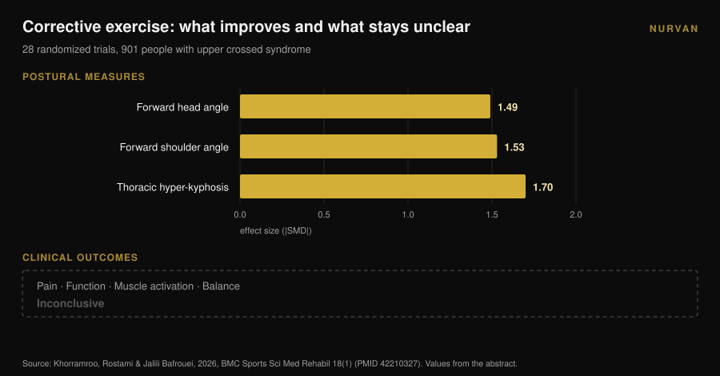

# Rounded shoulders: stretching won't fix them

By [Giammaria Loi](/autore/giammaria-loi) · updated 9 November 2026

Every carousel about rounded shoulders prescribes the same thing: open the chest, stretch the pecs, rotate the upper back. The logic is tidy — a short pectoral pulls the shoulders forward, so lengthen it and everything falls back into place. The meta-analysis that tested that logic found no effect. Stretching, acute or chronic, does not move posture. Something does move it, and it is the opposite kind of exercise.

## The short version

- **Stretching does not change posture.** Across 23 controlled trials and 969 people, acute stretching came out at **d = 0.01** (p = 0.97) and chronic stretching at **d = -0.19** (p = 0.16): both indistinguishable from zero (Warneke et al., 2024).
- **Strengthening does.** In the same review, chronic strengthening reached **d = -0.83** (p = 0.01) and was significantly better than stretching (d = 0.81, p = 0.004).
- **It works above the waist.** The effect is large in the cervical and thoracic spine (**d = -1.04**, p = 0.005) and absent in the lumbar and lumbopelvic region (d = -0.23, p = 0.25).
- **Better posture is not the same as fewer symptoms.** Across 28 randomized trials and 901 people with upper crossed syndrome, corrective exercise moved the postural angles a lot — while the effects on pain, function and balance stayed **inconclusive** (Khorramroo et al., 2026).
- **The dose is not four drills.** The protocol that actually shifted both angles and pain ran **45 minutes, five days a week, for eight weeks** (Guo et al., 2025).

## What "rounded shoulders" actually means

Three different things usually travel together under that label: the head sitting forward of the trunk, the shoulders rolling forward, and a more pronounced upper-back curve. In the literature they appear as **craniovertebral angle**, **forward shoulder angle** and **thoracic kyphosis**, and when all three show up together clinicians call it *upper crossed syndrome*.

These are measurements, not diagnoses. Someone photographs you from the side, draws the angles, and produces a number. Holding on to that distinction is the only way to read what follows correctly: what the research measures well are angles. What you actually care about — a shoulder that moves freely, a neck that doesn't burn by six in the evening — is a different variable, and the two do not always move together.

## Stretching doesn't change posture: the finding nobody quotes

The paper that settles this is a 2024 systematic review with meta-analysis by Warneke, Lohmann and Wilke in *Sports Medicine - Open*. It pooled 23 controlled trials and 969 healthy people to answer one question: does the "stretch what's tight, strengthen what's weak" model actually change spinal posture?

The numbers are blunt. **Acute stretching: d = 0.01, p = 0.97.** Zero. **Chronic stretching: d = -0.19, p = 0.16.** Right direction, indistinguishable from chance.

**Chronic strengthening: d = -0.83, p = 0.01.** A large effect. Head to head, strengthening beat stretching at d = 0.81 (p = 0.004).

The authors put it plainly: moderate-certainty evidence does not support stretching as a treatment for muscle imbalance, and therapists should focus on strengthening programmes targeting the weakened muscles.

One detail makes this even more useful to you. The sub-analyses show strengthening works **in the cervical and thoracic spine** (d = -1.04, p = 0.005) and **does not work** in the lumbar and lumbopelvic region (d = -0.23, p = 0.25). The upper back responds to training; the pelvis doesn't. Rounded shoulders sit squarely in the zone that responds.

## Strengthening moves them — and it isn't cheap

If strengthening is the lever, the next question is: how much of it?

Here you have to read the protocols, not the conclusions. The clearest randomized trial on this point, published in 2025 by Guo and colleagues, took 74 university students with upper crossed syndrome and split them in two. The intervention group trained the neck and thoracic spine **five days a week, 45 minutes a session, for eight weeks**. The control group carried on as usual.

The results are good: forward head angle d = 1.113, forward shoulder angle d = 1.052, pain d = 0.854, neck disability d = 0.754, and even a measurable gain in lung function (FEV1/FVC d = 0.516).

Now do the arithmetic on the dose: **roughly 30 hours of work in two months.** Not four drills "on days when sitting leaves you stiff".

The 2026 meta-analysis by Xing and colleagues, pooling ten randomized trials and 550 people, points the same way: therapeutic exercise improved the craniovertebral angle by **3.38 degrees** on average (95% confidence interval: 2.10-4.65), reduced pain (mean difference -1.42) and neck disability (-5.44). In exploratory analyses, programmes running **at least eight weeks** and combining several exercise types did better. The authors flag that overall certainty remains low to moderate.

Three degrees, after two months of consistent work. That is a real result, and it is also the measure of how hard it is to shift an adult's posture.

## Posture improves, symptoms don't necessarily follow

This is the most awkward finding in the whole topic, and it is recent.

Khorramroo, Rostami and Jalili Bafrouei published a 2026 systematic review with meta-analysis covering 28 randomized trials and 901 people with upper crossed syndrome. Corrective exercise improved the angles decisively: forward head angle **SMD -1.49**, forward shoulder angle **SMD -1.53**, thoracic hyper-kyphosis **SMD -1.70**. Large effects across the board.

Then comes the second half of the paper. On the outcomes that matter to someone in pain — pain itself, function, muscle activation, balance — the results were **inconclusive**. The authors' own summary: corrective exercise effectively addresses biomechanical postural deficits, but whether that translates into symptom relief and functional improvement remains uncertain.

The study's title says it outright: posture improves strongly, clinical benefits are not consistent. Worth adding that heterogeneity between studies was high (I² between 78% and 88%), which means the individual trials agree with each other less than the pooled number suggests.

## What if rounded shoulders aren't causing the pain?

The unstated premise behind every corrective routine is that bad posture hurts. It is a premise, not an established fact.

A 2025 case-control study compared 146 young adults — 73 with chronic neck pain, 73 without, mean age 21.6. What came out associated with pain was **vision problems** (odds ratio 2.83; 95% CI: 1.26-6.38) and **a sedentary lifestyle** (OR 2.41; 1.01-5.88). Self-reported postural habits: no significant association (p > 0.05).

It is one retrospective study, on self-reported rather than measured posture, in young adults. It doesn't close the question. But set next to Khorramroo's meta-analysis it tells a coherent story: posture looks more like a marker than a cause, and sedentary behaviour — how little you move, not how you sit — keeps showing up.

If you train and your shoulder hurts, that deserves a proper assessment, not a mobility routine lifted from a post. Pain that won't settle, wakes you at night, or comes with tingling or loss of strength in the arm belongs with a doctor or physiotherapist, not with four stretches.

## So is thoracic mobility pointless? No — but for a different reason

Don't overcorrect. Working on the thoracic spine has solid support. It just doesn't run through posture.

A 2025 meta-analysis of ten randomized trials and 444 people with subacromial impingement measured thoracic spine manual therapy: pain **SMD -0.94** (95% CI: -1.23 to -0.65) at 2-6 weeks and -0.83 at intermediate follow-up, disability -0.82, all on high-quality evidence. Range of motion improved on moderate-quality evidence: internal rotation SMD 0.61, external rotation 0.58.

So the thoracic spine matters for how the shoulder moves, especially in rotation. The reason is mechanical: the scapula slides on a ribcage, and when that ribcage extends and rotates better, the arm overhead finds more room. It is also why a 2026 review of 13 trials and 819 people found that programmes combining neck **and** thoracic work significantly reduced pain, while neck-only programmes improved angles without matching that — on evidence rated, it should be said, low to very low certainty.

The practical point isn't "bin the mobility work". It is: **thoracic mobility helps you move better, not stand straighter.** Keep it as a warm-up before pressing overhead or rowing, not as postural therapy.

## What the research actually says

| Common claim | Verdict | Source |
|---|---|---|
| "Stretch the chest and the shoulders come back" | **Busted**: acute stretching d = 0.01, chronic d = -0.19, neither significant | Warneke et al., 2024 |
| "Back strengthening doesn't change posture" | **Busted**: d = -0.83, and d = -1.04 in the cervico-thoracic region | Warneke et al., 2024 |
| "Four mobility drills fix rounded shoulders" | **Unsupported**: the effective dose in trials was 45 min × 5 days × 8 weeks | Guo et al., 2025; Xing et al., 2026 |
| "Rounded shoulders cause pain" | **Needs qualifying**: not demonstrated; posture improves while symptoms don't | Khorramroo et al., 2026; Assis et al., 2025 |
| "Thoracic work helps the shoulder" | **Confirmed**: pain SMD -0.94, internal rotation 0.61, external rotation 0.58 | Yu et al., 2025 |
| "Fix the posture and the symptoms go" | **Busted as an automatic rule**: angles improve, clinical outcomes inconclusive | Khorramroo et al., 2026 |

## How to apply it

1. **Stop chasing correction and start chasing load.** If you give posture ten minutes a day, spend them on horizontal and vertical pulling, not chest stretches. That is the only variable the meta-analysis saw move.
2. **Pick upper-body pulling movements.** Barbell and dumbbell rows, cable rows, pull-ups, face pulls, lateral and rear delt raises. These are the muscles whose strengthening proved effective precisely in the cervico-thoracic region.
3. **Actually progress.** The stimulus that counts is load rising over time, not the list of exercises. Track load, reps and reps in reserve (RIR — how many you could still have done at the end of a set); without that, "progressing" stays an intention. If you need a starting structure, see how a [training split differs between beginner and advanced lifters](/en/blog/training-split-beginner-vs-advanced).
4. **Give it eight weeks minimum.** Below that threshold the data show little. And the realistic result is a few degrees, not a transformation.
5. **Use mobility where it genuinely helps: the warm-up.** Two or three minutes of thoracic rotations before pressing overhead or rowing makes sense for how you move that day. Don't expect them to reshape your posture.
6. **If it hurts, it isn't a posture problem until someone who examined you says so.** Persistent or night pain, tingling or weakness: doctor or physiotherapist.

> ### Try Nurvan — the progression posture actually needs
>
> The lever that works isn't a stretching routine: it's upper-back strengthening that grows week after week for at least two months. With Nurvan you log load, reps and RIR for every set of rows and pull-ups, see the progression curve instead of trusting memory, and import the programme you already use from PDF, Excel or even a photo. [Try Nurvan](https://nurvan.app)

## Frequently asked questions

**Is chest stretching useless?**
Not for how mobile you feel, or as part of a warm-up — it's ineffective as a tool for changing posture. Across 23 trials, the effect of stretching on spinal alignment was statistically indistinguishable from zero (Warneke et al., 2024).

**How long does it take to fix rounded shoulders?**
Trials that produced measurable change used programmes of at least eight weeks; the one with the largest results ran 45 minutes, five days a week. The average craniovertebral angle improvement in meta-analyses is around three degrees.

**Do rounded shoulders cause neck pain?**
It isn't demonstrated. In meta-analyses the postural angles improve substantially with exercise, but effects on pain and function stay inconclusive, and a case-control study found no association between postural habits and chronic neck pain.

**So is thoracic mobility good for anything?**
Yes — for shoulder movement. Thoracic work improves pain and rotation in people with subacromial impingement, on good-quality evidence. Use it to prepare for movement, not to correct posture.

## Read next

- [Knees out in the squat: cue or actual rule?](/en/blog/knees-out-squat-cue-or-rule) — another case where a coaching cue hardens into a rule the literature doesn't support.
- [Does foam rolling work? What 8 studies actually say](/en/blog/does-foam-rolling-work-recovery) — the same question asked of another heavily marketed passive tool.
- [Dumbbell Press vs Fly: Which Builds More Chest?](/en/blog/dumbbell-bench-press-vs-fly-chest-growth) — if you want to train the pecs properly rather than only stretch them.

## Sources

1. Warneke K, Lohmann LH, Wilke J, 2024. Effects of Stretching or Strengthening Exercise on Spinal and Lumbopelvic Posture: A Systematic Review with Meta-Analysis. *Sports Medicine - Open* 10(1):65. PMID 38834878. [DOI 10.1186/s40798-024-00733-5](https://doi.org/10.1186/s40798-024-00733-5)
2. Khorramroo F, Rostami M, Jalili Bafrouei M, 2026. Corrective exercises strongly improve posture but fail to produce consistent clinical or functional benefits in patients with upper crossed syndrome: a systematic review and meta-analysis of randomized controlled trials. *BMC Sports Science, Medicine & Rehabilitation* 18(1). PMID 42210327. [DOI 10.1186/s13102-026-01707-8](https://doi.org/10.1186/s13102-026-01707-8)
3. Xing Y, Wang R, Zhao X, Xu A, 2026. Therapeutic Exercise for Forward Head Posture in Neck Pain Patients: A Systematic Review and Meta-Analysis. *Journal of Pain Research* 19:614524. PMID 42445930. [DOI 10.2147/JPR.S614524](https://doi.org/10.2147/JPR.S614524)
4. Carrasco-Uribarren A, Ceballos-Laita L, Pérez-Guillén S, Jiménez-Del-Barrio S, Pantaleón-Hernández D, Cabanillas-Barea S, 2026. Impact of therapeutic exercise on craniovertebral angle in forward head posture: a systematic review and meta-analysis. *The Journal of Manual & Manipulative Therapy*. PMID 42281352. [DOI 10.1080/10669817.2026.2686739](https://doi.org/10.1080/10669817.2026.2686739)
5. Guo Y, Li M, Xie C, Liu X, Chen Y, Yang J, Wu Y, Chen S, Wang S, Lin J, 2025. Effect of the cervical and thoracic "Daoyin" training on posture and pulmonary function in patients with upper crossed syndrome: a randomized controlled trial. *BMC Complementary Medicine and Therapies* 25(1):41. PMID 39905404. [DOI 10.1186/s12906-025-04791-4](https://doi.org/10.1186/s12906-025-04791-4)
6. Yu S, Chen S, Yang Z, Ma X, Huang J, Yang L, 2025. Effectiveness of Thoracic Spine Manual Therapy in Treating Subacromial Impingement Syndrome: A Systematic Review and Meta-analysis. *Archives of Physical Medicine and Rehabilitation* 106(12):1886-1898. PMID 40712864. [DOI 10.1016/j.apmr.2025.07.008](https://doi.org/10.1016/j.apmr.2025.07.008)
7. Assis SJC de, Sanchis GJB, Meziat-Filho N, Souza CG de, Roncalli A, 2025. Association of self-reported posture habits and vision problems with chronic neck pain: A case-control study. *Journal of Bodywork and Movement Therapies* 45:946-952. PMID 41316668. [DOI 10.1016/j.jbmt.2025.10.023](https://doi.org/10.1016/j.jbmt.2025.10.023)

References retrieved via PubMed. Starting point: a post by [@themobilitymanual](https://www.instagram.com/p/DdYn-F3Fiqa/) from 17 September 2026 on a mobility routine for rounded shoulders. No text or image from that post has been reproduced: the topic and its claims were re-checked against the literature.

---

*Giammaria Loi is the founder of Nurvan. He has been lifting since 2012, has worked as a FIPE-certified personal trainer and coach since 2013, and has competed in powerlifting at national level since 2018. Every article he writes starts from the research and ends with what actually works in the gym.*

> Note: educational content. It does not replace advice from a doctor or qualified professional.
