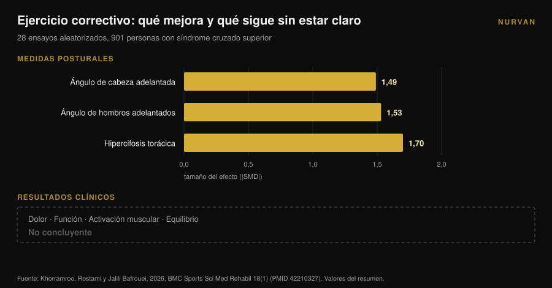

# Hombros redondeados: estirar no los corrige

Por [Giammaria Loi](/autore/giammaria-loi) · actualizado el 9 de noviembre de 2026

Todos los carruseles sobre hombros redondeados recetan lo mismo: abre el pecho, estira el pectoral, rota la espalda alta. La lógica es limpia: el pectoral acortado tira de los hombros hacia delante, así que si lo alargas todo vuelve a su sitio. El metanálisis que puso a prueba esa lógica no encontró ningún efecto. Estirar, de forma aguda o crónica, no mueve la postura. Algo sí la mueve, y es justo el ejercicio contrario.

## En resumen

- **Estirar no cambia la postura.** En 23 estudios controlados y 969 personas, el estiramiento agudo dio **d = 0,01** (p = 0,97) y el crónico **d = -0,19** (p = 0,16): ambos indistinguibles de cero (Warneke et al., 2024).
- **La fuerza sí.** En la misma revisión, el trabajo de fuerza crónico alcanzó **d = -0,83** (p = 0,01) y fue significativamente superior al estiramiento (d = 0,81, p = 0,004).
- **Funciona por encima de la cintura.** El efecto es grande en la columna cervical y torácica (**d = -1,04**, p = 0,005) y nulo en la zona lumbar y lumbopélvica (d = -0,23, p = 0,25).
- **Mejor postura no equivale a menos síntomas.** En 28 ensayos aleatorizados y 901 personas con síndrome cruzado superior, el ejercicio correctivo movió mucho los ángulos posturales, pero los efectos sobre dolor, función y equilibrio siguieron siendo **no concluyentes** (Khorramroo et al., 2026).
- **La dosis real no son cuatro ejercicios.** El protocolo que movió de verdad los ángulos y el dolor exigía **45 minutos, cinco días por semana, durante ocho semanas** (Guo et al., 2025).

## Qué son realmente los "hombros redondeados"

Bajo esa etiqueta suelen viajar juntas tres cosas distintas: la cabeza adelantada respecto al tronco, los hombros rotados hacia delante y una curva dorsal más marcada. En la literatura aparecen como **ángulo craneovertebral**, **ángulo de hombros adelantados** y **cifosis torácica**, y cuando aparecen las tres se habla de *síndrome cruzado superior*.

Son medidas, no diagnósticos. Alguien te fotografía de perfil, traza los ángulos y obtiene un número. Mantener esa distinción es la única forma de leer bien lo que viene: lo que la investigación mide con precisión son ángulos. Lo que a ti te importa de verdad —un hombro que se mueve bien, un cuello que no arde a las seis de la tarde— es otra variable, y no siempre camina junto a la primera.

## Estirar no cambia la postura: el dato que casi nadie cita

El trabajo que zanja este punto es una revisión sistemática con metanálisis de Warneke, Lohmann y Wilke, publicada en 2024 en *Sports Medicine - Open*. Reunió 23 estudios controlados y 969 personas sanas para responder a una pregunta concreta: ¿el enfoque de "estira lo que está corto, fortalece lo que está débil" cambia realmente la postura de la columna?

Los números son tajantes. **Estiramiento agudo: d = 0,01, p = 0,97.** Cero. **Estiramiento crónico: d = -0,19, p = 0,16.** Dirección correcta, resultado indistinguible del azar.

**Fuerza crónica: d = -0,83, p = 0,01.** Un efecto grande. Y en la comparación directa, la fuerza supera al estiramiento con d = 0,81 (p = 0,004).

Los autores lo escriben sin rodeos: la evidencia de certeza moderada no respalda el estiramiento como tratamiento del desequilibrio muscular, y quien trabaja la postura debería centrarse en programas de fuerza dirigidos a los músculos debilitados.

Hay un detalle que lo hace aún más útil para ti. Los subanálisis muestran que la fuerza funciona **en la zona cervical y torácica** (d = -1,04, p = 0,005) y **no funciona** en la lumbar y lumbopélvica (d = -0,23, p = 0,25). La parte alta de la espalda responde al entrenamiento; la pelvis no. Los hombros redondeados están justo en la zona que responde.

## La fuerza sí los mueve, y no sale gratis

Si la fuerza es la palanca, la pregunta siguiente es: ¿cuánta?

Aquí hay que mirar los protocolos, no las conclusiones. El ensayo aleatorizado más claro al respecto, publicado en 2025 por Guo y colaboradores, tomó a 74 estudiantes universitarios con síndrome cruzado superior y los dividió en dos grupos. El grupo de intervención entrenó cuello y columna torácica **cinco días por semana, 45 minutos por sesión, durante ocho semanas**. El grupo control siguió con su vida de siempre.

Los resultados son buenos: ángulo de cabeza adelantada d = 1,113, ángulo de hombros adelantados d = 1,052, dolor d = 0,854, discapacidad cervical d = 0,754, e incluso una mejora de la función pulmonar (FEV1/FVC d = 0,516).

Pero haz la cuenta de la dosis: **unas 30 horas de trabajo en dos meses.** No cuatro ejercicios "los días en que estar sentado te deja rígido".

El metanálisis de Xing y colaboradores, de 2026, sobre diez ensayos aleatorizados y 550 personas, apunta en la misma dirección: el ejercicio terapéutico mejoró el ángulo craneovertebral en **3,38 grados** de media (intervalo de confianza del 95%: 2,10-4,65), redujo el dolor (diferencia media -1,42) y la discapacidad cervical (-5,44). En los análisis exploratorios, los programas de **al menos ocho semanas** y que combinan varios tipos de ejercicio obtuvieron más. Los autores advierten de que la certeza global sigue siendo de baja a moderada.

Tres grados, tras dos meses de trabajo constante. Es un resultado real, y también la medida de lo difícil que es mover la postura de una persona adulta.

## La postura mejora, los síntomas no siguen necesariamente

Aquí llega el dato más incómodo de todo el asunto, y es reciente.

Khorramroo, Rostami y Jalili Bafrouei publicaron en 2026 una revisión sistemática con metanálisis sobre 28 ensayos aleatorizados y 901 personas con síndrome cruzado superior. Los ejercicios correctivos mejoran los ángulos de forma clara: ángulo de cabeza adelantada **SMD -1,49**, ángulo de hombros adelantados **SMD -1,53**, hipercifosis torácica **SMD -1,70**. Efectos grandes en toda la línea.

Luego llega la segunda mitad del trabajo. En los desenlaces que importan a quien está mal —dolor, función, activación muscular, equilibrio— los resultados son **no concluyentes**. Los autores lo resumen así: el ejercicio correctivo aborda con eficacia los déficits posturales biomecánicos, pero su traducción en alivio de los síntomas y mejora funcional sigue siendo incierta.

El propio título del estudio lo dice: la postura mejora mucho, los beneficios clínicos no son consistentes. Conviene añadir que la heterogeneidad entre estudios es alta (I² entre el 78% y el 88%), lo que significa que los trabajos individuales coinciden entre sí menos de lo que sugiere la cifra conjunta.

## ¿Y si los hombros redondeados no fueran la causa del dolor?

La premisa no dicha de toda rutina "correctiva" es que la mala postura duele. Es una premisa, no un hecho establecido.

Un estudio de casos y controles de 2025 comparó a 146 adultos jóvenes: 73 con dolor cervical crónico y 73 sin él, edad media 21,6 años. Lo que resultó asociado al dolor fueron **los problemas de visión** (odds ratio 2,83; IC del 95%: 1,26-6,38) y **el sedentarismo** (OR 2,41; 1,01-5,88). Los hábitos posturales autodeclarados: ninguna asociación significativa (p > 0,05).

Es un solo estudio, retrospectivo, sobre postura autodeclarada y no medida, y en adultos jóvenes: no cierra la cuestión. Pero junto al metanálisis de Khorramroo cuenta una historia coherente. La postura parece más un indicador que una causa, y el sedentarismo —cuánto te mueves, no cómo te sientas— sigue apareciendo.

Si entrenas y te duele el hombro, eso merece una valoración de verdad, no una rutina de movilidad sacada de un post. Dolor que no cede, que te despierta por la noche, hormigueo o pérdida de fuerza en el brazo son cosas para llevar a un médico o fisioterapeuta, no para gestionar con cuatro estiramientos.

## ¿Entonces la movilidad torácica es inútil? No, pero por otro motivo

Cuidado con pasarse de frenada. Trabajar la columna torácica tiene respaldo sólido; solo que no pasa por la postura.

Un metanálisis de 2025 sobre diez ensayos aleatorizados y 444 personas con síndrome de pinzamiento subacromial midió los efectos de la terapia manual torácica: dolor **SMD -0,94** (IC del 95%: -1,23 a -0,65) a las 2-6 semanas y -0,83 en el seguimiento intermedio, discapacidad -0,82, con evidencia de alta calidad. El rango de movimiento mejora con evidencia de calidad moderada: rotación interna SMD 0,61, rotación externa 0,58.

Así que la columna torácica cuenta para cómo se mueve el hombro, sobre todo en rotación. El motivo es mecánico: la escápula se desliza sobre una caja torácica, y si esa caja se extiende y rota mejor, el brazo por encima de la cabeza encuentra más recorrido. Es también la razón por la que una revisión de 2026 sobre 13 estudios y 819 personas halló que los programas que combinan cuello **y** columna torácica reducen el dolor de forma significativa, mientras que los de solo cuello mejoran los ángulos sin igualar ese efecto, con una certeza de la evidencia, eso sí, de baja a muy baja.

El mensaje práctico no es "tira la movilidad a la basura". Es: **la movilidad torácica sirve para moverte mejor, no para enderezarte.** Úsala como calentamiento antes de empujar por encima de la cabeza o de remar, no como terapia postural.

## Qué dice realmente la investigación

| Afirmación frecuente | Veredicto | Fuente |
|---|---|---|
| "Estira el pecho y los hombros vuelven atrás" | **Desmentido**: estiramiento agudo d = 0,01, crónico d = -0,19, ninguno significativo | Warneke et al., 2024 |
| "La fuerza de espalda no cambia la postura" | **Desmentido**: d = -0,83, y d = -1,04 en la zona cervicotorácica | Warneke et al., 2024 |
| "Cuatro ejercicios de movilidad corrigen los hombros redondeados" | **Sin respaldo**: la dosis eficaz en los estudios es 45 min × 5 días × 8 semanas | Guo et al., 2025; Xing et al., 2026 |
| "Los hombros redondeados causan dolor" | **Matizable**: no demostrado; la postura mejora y los síntomas no | Khorramroo et al., 2026; Assis et al., 2025 |
| "Trabajar la zona torácica ayuda al hombro" | **Confirmado**: dolor SMD -0,94, rotación interna 0,61, externa 0,58 | Yu et al., 2025 |
| "Si corriges la postura desaparecen los síntomas" | **Desmentido como automatismo**: los ángulos mejoran, los desenlaces clínicos no concluyen | Khorramroo et al., 2026 |

## Cómo aplicarlo

1. **Deja de buscar la corrección y empieza a buscar la carga.** Si dedicas diez minutos al día a la postura, inviértelos en tracciones horizontales y verticales, no en estiramientos de pecho. Es la única variable que el metanálisis vio moverse.
2. **Elige movimientos de tracción del tren superior.** Remos con barra y mancuerna, polea, dominadas, face pull, elevaciones laterales y posteriores. Son los músculos cuyo fortalecimiento resultó eficaz justo en la zona cervicotorácica.
3. **Progresa de verdad.** El estímulo que cuenta es la carga que crece con el tiempo, no la lista de ejercicios. Registra cargas, repeticiones y repeticiones en reserva (RIR, cuántas te quedarían al final de la serie): sin ese dato, "progresar" se queda en intención. Si necesitas una base, parte de cómo [se estructura una rutina entre principiante y avanzado](/es/blog/rutina-entrenamiento-principiante-avanzado).
4. **Dale tiempo: ocho semanas es el mínimo.** Por debajo de ese umbral los datos no muestran gran cosa. Y el resultado realista es del orden de pocos grados, no una transformación.
5. **Usa la movilidad donde sirve de verdad: en el calentamiento.** Dos o tres minutos de rotaciones torácicas antes de empujar por encima de la cabeza o de remar tienen sentido para cómo te mueves ese día. No esperes que remodelen tu postura.
6. **Si duele, no es un problema de postura hasta que lo diga alguien que te haya explorado.** Dolor persistente, nocturno, con hormigueo o debilidad: médico o fisioterapeuta.

> ### Prueba Nurvan — la progresión que la postura exige
>
> La palanca que funciona no es una rutina de estiramientos: es un trabajo de fuerza de espalda que crece semana a semana durante al menos dos meses. Con Nurvan registras cargas, repeticiones y RIR de cada serie de remo y dominadas, ves la curva de progresión en lugar de fiarte de la memoria, e importas la rutina que ya usas desde PDF, Excel o incluso una foto. [Prueba Nurvan](https://nurvan.app)

## Preguntas frecuentes

**¿Estirar el pectoral es inútil?**
No lo es para la sensación de movilidad ni como calentamiento: es ineficaz como herramienta para cambiar la postura. En 23 estudios, el efecto del estiramiento sobre la alineación de la columna era estadísticamente indistinguible de cero (Warneke et al., 2024).

**¿Cuánto tiempo hace falta para corregir los hombros redondeados?**
Los estudios que lograron cambios medibles usaban programas de al menos ocho semanas; el de mayores resultados llegaba a 45 minutos, cinco días por semana. La mejora media del ángulo craneovertebral en los metanálisis ronda los tres grados.

**¿Los hombros redondeados causan dolor de cuello?**
No está demostrado. En los metanálisis los ángulos posturales mejoran mucho con el ejercicio, pero los efectos sobre dolor y función siguen sin ser concluyentes, y un estudio de casos y controles no halló asociación entre hábitos posturales y dolor cervical crónico.

**¿Entonces la movilidad torácica sirve para algo?**
Sí, para el movimiento del hombro. El trabajo torácico mejora dolor y rotación en quien tiene pinzamiento subacromial, con evidencia de buena calidad. Úsala como preparación al movimiento, no como corrección postural.

## Lee también

- [Rodillas hacia fuera en sentadilla: ¿regla o cue?](/es/blog/rodillas-hacia-fuera-sentadilla) — otro caso en que una indicación técnica se convierte en una regla que la literatura no sostiene.
- [¿El foam roller sirve? Esto dicen 8 estudios](/es/blog/foam-roller-sirve-recuperacion) — la misma pregunta sobre otra herramienta pasiva muy vendida.
- [Press con mancuernas o aperturas: ¿qué hace crecer más?](/es/blog/press-con-mancuernas-o-aperturas-pecho) — si quieres entrenar bien el pectoral en vez de solo estirarlo.

## Fuentes

1. Warneke K, Lohmann LH, Wilke J, 2024. Effects of Stretching or Strengthening Exercise on Spinal and Lumbopelvic Posture: A Systematic Review with Meta-Analysis. *Sports Medicine - Open* 10(1):65. PMID 38834878. [DOI 10.1186/s40798-024-00733-5](https://doi.org/10.1186/s40798-024-00733-5)
2. Khorramroo F, Rostami M, Jalili Bafrouei M, 2026. Corrective exercises strongly improve posture but fail to produce consistent clinical or functional benefits in patients with upper crossed syndrome: a systematic review and meta-analysis of randomized controlled trials. *BMC Sports Science, Medicine & Rehabilitation* 18(1). PMID 42210327. [DOI 10.1186/s13102-026-01707-8](https://doi.org/10.1186/s13102-026-01707-8)
3. Xing Y, Wang R, Zhao X, Xu A, 2026. Therapeutic Exercise for Forward Head Posture in Neck Pain Patients: A Systematic Review and Meta-Analysis. *Journal of Pain Research* 19:614524. PMID 42445930. [DOI 10.2147/JPR.S614524](https://doi.org/10.2147/JPR.S614524)
4. Carrasco-Uribarren A, Ceballos-Laita L, Pérez-Guillén S, Jiménez-Del-Barrio S, Pantaleón-Hernández D, Cabanillas-Barea S, 2026. Impact of therapeutic exercise on craniovertebral angle in forward head posture: a systematic review and meta-analysis. *The Journal of Manual & Manipulative Therapy*. PMID 42281352. [DOI 10.1080/10669817.2026.2686739](https://doi.org/10.1080/10669817.2026.2686739)
5. Guo Y, Li M, Xie C, Liu X, Chen Y, Yang J, Wu Y, Chen S, Wang S, Lin J, 2025. Effect of the cervical and thoracic "Daoyin" training on posture and pulmonary function in patients with upper crossed syndrome: a randomized controlled trial. *BMC Complementary Medicine and Therapies* 25(1):41. PMID 39905404. [DOI 10.1186/s12906-025-04791-4](https://doi.org/10.1186/s12906-025-04791-4)
6. Yu S, Chen S, Yang Z, Ma X, Huang J, Yang L, 2025. Effectiveness of Thoracic Spine Manual Therapy in Treating Subacromial Impingement Syndrome: A Systematic Review and Meta-analysis. *Archives of Physical Medicine and Rehabilitation* 106(12):1886-1898. PMID 40712864. [DOI 10.1016/j.apmr.2025.07.008](https://doi.org/10.1016/j.apmr.2025.07.008)
7. Assis SJC de, Sanchis GJB, Meziat-Filho N, Souza CG de, Roncalli A, 2025. Association of self-reported posture habits and vision problems with chronic neck pain: A case-control study. *Journal of Bodywork and Movement Therapies* 45:946-952. PMID 41316668. [DOI 10.1016/j.jbmt.2025.10.023](https://doi.org/10.1016/j.jbmt.2025.10.023)

Fuentes bibliográficas localizadas a través de PubMed. Punto de partida: una publicación de [@themobilitymanual](https://www.instagram.com/p/DdYn-F3Fiqa/) del 17 de septiembre de 2026 sobre una rutina de movilidad para los hombros redondeados. No se ha reproducido ningún texto ni imagen de esa publicación: el tema y sus afirmaciones se han vuelto a verificar en la literatura.

---

*Giammaria Loi es el fundador de Nurvan. Entrena con pesas desde 2012, trabaja como entrenador personal y coach certificado FIPE desde 2013 y compite en powerlifting a nivel nacional desde 2018. Cada artículo que firma parte de los estudios científicos y llega a lo que funciona de verdad en el gimnasio.*

> Nota: contenido informativo; no sustituye la opinión de un médico o profesional.
