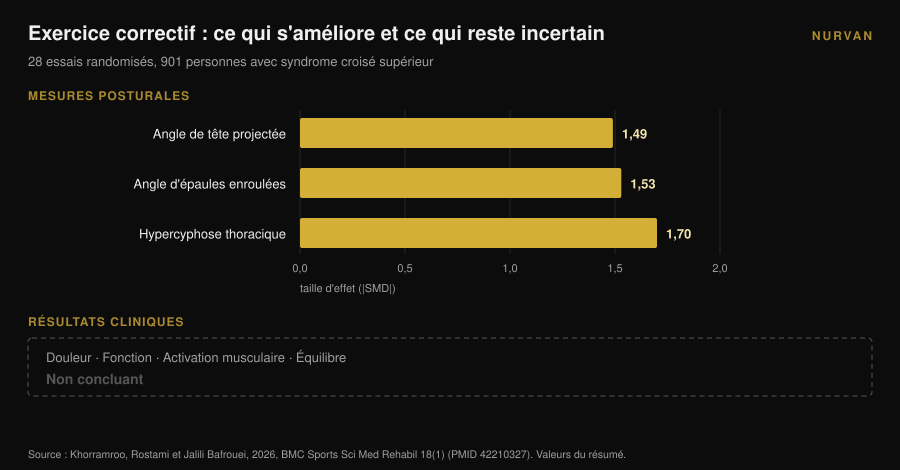

# Épaules enroulées : les étirements n'y font rien

Par [Giammaria Loi](/autore/giammaria-loi) · mis à jour le 9 novembre 2026

Tous les carrousels sur les épaules enroulées prescrivent la même chose : ouvre la poitrine, étire les pectoraux, fais tourner le haut du dos. Le raisonnement est propre : un pectoral court tire les épaules vers l'avant, donc on l'allonge et tout revient en place. La méta-analyse qui a testé ce raisonnement n'a trouvé aucun effet. Les étirements, aigus ou chroniques, ne déplacent pas la posture. Quelque chose la déplace, et c'est exactement l'exercice inverse.

## L'essentiel

- **Les étirements ne changent pas la posture.** Sur 23 essais contrôlés et 969 personnes, l'étirement aigu ressort à **d = 0,01** (p = 0,97) et l'étirement chronique à **d = -0,19** (p = 0,16) : tous deux indiscernables de zéro (Warneke et al., 2024).
- **Le renforcement, si.** Dans la même revue, le renforcement chronique atteint **d = -0,83** (p = 0,01) et dépasse significativement l'étirement (d = 0,81, p = 0,004).
- **Cela fonctionne au-dessus de la taille.** L'effet est grand au niveau cervical et thoracique (**d = -1,04**, p = 0,005) et nul au niveau lombaire et lombopelvien (d = -0,23, p = 0,25).
- **Meilleure posture ne veut pas dire moins de symptômes.** Sur 28 essais randomisés et 901 personnes avec syndrome croisé supérieur, l'exercice correctif déplace beaucoup les angles posturaux, mais les effets sur la douleur, la fonction et l'équilibre restent **non concluants** (Khorramroo et al., 2026).
- **La vraie dose, ce n'est pas quatre exercices.** Le protocole qui a réellement bougé les angles et la douleur demandait **45 minutes, cinq jours par semaine, pendant huit semaines** (Guo et al., 2025).

## Ce que signifient vraiment les « épaules enroulées »

Sous cette étiquette voyagent en général trois choses distinctes : la tête projetée en avant du tronc, les épaules qui s'enroulent, et une courbure dorsale plus marquée. Dans la littérature on les trouve sous les noms d'**angle craniovertébral**, **angle d'épaules enroulées** et **cyphose thoracique**, et quand les trois apparaissent ensemble on parle de *syndrome croisé supérieur*.

Ce sont des mesures, pas des diagnostics. On te photographie de profil, on trace les angles, on obtient un chiffre. Garder cette distinction en tête est la seule façon de lire correctement ce qui suit : ce que la recherche mesure bien, ce sont des angles. Ce qui t'intéresse vraiment — une épaule qui bouge bien, une nuque qui ne brûle pas à dix-huit heures — est une autre variable, et les deux n'avancent pas toujours ensemble.

## Les étirements ne changent pas la posture : la donnée que presque personne ne cite

Le travail qui tranche ici est une revue systématique avec méta-analyse de Warneke, Lohmann et Wilke, publiée en 2024 dans *Sports Medicine - Open*. Elle a regroupé 23 essais contrôlés et 969 personnes en bonne santé pour répondre à une question précise : l'approche « étire ce qui est court, renforce ce qui est faible » change-t-elle vraiment la posture du rachis ?

Les chiffres sont nets. **Étirement aigu : d = 0,01, p = 0,97.** Zéro. **Étirement chronique : d = -0,19, p = 0,16.** Bonne direction, résultat indiscernable du hasard.

**Renforcement chronique : d = -0,83, p = 0,01.** Un effet large. Et en comparaison directe, le renforcement bat l'étirement avec d = 0,81 (p = 0,004).

Les auteurs l'écrivent sans détour : des preuves de certitude modérée ne soutiennent pas l'usage de l'étirement comme traitement du déséquilibre musculaire, et les thérapeutes devraient se concentrer sur des programmes de renforcement ciblant les muscles affaiblis.

Un détail rend cette donnée encore plus utile. Les sous-analyses montrent que le renforcement fonctionne **au niveau cervical et thoracique** (d = -1,04, p = 0,005) et **ne fonctionne pas** au niveau lombaire et lombopelvien (d = -0,23, p = 0,25). Le haut du dos répond à l'entraînement, le bassin non. Les épaules enroulées se trouvent exactement dans la zone qui répond.

## Le renforcement les déplace, et ce n'est pas gratuit

Si le renforcement est le levier, la question devient : combien ?

Ici il faut regarder les protocoles, pas les conclusions. L'essai randomisé le plus clair sur ce point, publié en 2025 par Guo et ses collègues, a pris 74 étudiants avec syndrome croisé supérieur et les a répartis en deux groupes. Le groupe d'intervention a entraîné le cou et le rachis thoracique **cinq jours par semaine, 45 minutes par séance, pendant huit semaines**. Le groupe témoin a continué sa vie habituelle.

Les résultats sont bons : angle de tête projetée d = 1,113, angle d'épaules enroulées d = 1,052, douleur d = 0,854, incapacité cervicale d = 0,754, et même un gain de fonction respiratoire (VEMS/CVF d = 0,516).

Mais fais le calcul de la dose : **environ 30 heures de travail en deux mois.** Pas quatre exercices « les jours où la position assise te raidit ».

La méta-analyse de Xing et ses collègues, parue en 2026 sur dix essais randomisés et 550 personnes, va dans le même sens : l'exercice thérapeutique améliore l'angle craniovertébral de **3,38 degrés** en moyenne (intervalle de confiance à 95 % : 2,10-4,65), réduit la douleur (différence moyenne -1,42) et l'incapacité cervicale (-5,44). Dans les analyses exploratoires, les programmes d'**au moins huit semaines** combinant plusieurs types d'exercice obtiennent davantage. Les auteurs préviennent que la certitude globale reste faible à modérée.

Trois degrés, après deux mois de travail régulier. C'est un résultat réel, et c'est aussi la mesure de la difficulté à déplacer la posture d'un adulte.

## La posture s'améliore, les symptômes ne suivent pas forcément

Voici la donnée la plus gênante du sujet, et elle est récente.

Khorramroo, Rostami et Jalili Bafrouei ont publié en 2026 une revue systématique avec méta-analyse portant sur 28 essais randomisés et 901 personnes avec syndrome croisé supérieur. Les exercices correctifs améliorent nettement les angles : angle de tête projetée **SMD -1,49**, angle d'épaules enroulées **SMD -1,53**, hypercyphose thoracique **SMD -1,70**. De gros effets sur toute la ligne.

Puis vient la seconde moitié du travail. Sur les critères qui comptent pour quelqu'un qui a mal — douleur, fonction, activation musculaire, équilibre — les résultats sont **non concluants**. Le résumé des auteurs : l'exercice correctif traite efficacement les déficits posturaux biomécaniques, mais sa traduction en soulagement des symptômes et en amélioration fonctionnelle reste incertaine.

Le titre même de l'étude le dit : la posture s'améliore fortement, les bénéfices cliniques ne sont pas constants. Il faut ajouter que l'hétérogénéité entre études est élevée (I² entre 78 % et 88 %), ce qui signifie que les essais individuels s'accordent moins entre eux que le chiffre global ne le laisse croire.

## Et si les épaules enroulées n'étaient pas la cause de la douleur ?

Le présupposé non dit de toute routine « corrective », c'est qu'une mauvaise posture fait mal. C'est un présupposé, pas un fait établi.

Une étude cas-témoins de 2025 a comparé 146 jeunes adultes : 73 avec cervicalgie chronique, 73 sans, âge moyen 21,6 ans. Ce qui ressortait associé à la douleur, ce sont **les troubles de la vision** (odds ratio 2,83 ; IC à 95 % : 1,26-6,38) et **la sédentarité** (OR 2,41 ; 1,01-5,88). Les habitudes posturales autodéclarées : aucune association significative (p > 0,05).

C'est une seule étude, rétrospective, sur une posture autodéclarée et non mesurée, chez de jeunes adultes : elle ne clôt pas la question. Mais placée à côté de la méta-analyse de Khorramroo, elle raconte une histoire cohérente. La posture ressemble plus à un indicateur qu'à une cause, et la sédentarité — combien peu tu bouges, pas comment tu es assis — revient sans cesse.

Si tu t'entraînes et que ton épaule fait mal, cela mérite un vrai bilan, pas une routine de mobilité tirée d'un post. Une douleur qui ne passe pas, qui réveille la nuit, des fourmillements ou une perte de force dans le bras relèvent d'un médecin ou d'un kinésithérapeute, pas de quatre étirements.

## Alors la mobilité thoracique est inutile ? Non, mais pour une autre raison

Attention à ne pas surcorriger. Travailler le rachis thoracique a un appui solide. Simplement, il ne passe pas par la posture.

Une méta-analyse de 2025 sur dix essais randomisés et 444 personnes avec conflit sous-acromial a mesuré les effets de la thérapie manuelle thoracique : douleur **SMD -0,94** (IC à 95 % : -1,23 à -0,65) à 2-6 semaines et -0,83 au suivi intermédiaire, incapacité -0,82, sur des preuves de haute qualité. L'amplitude s'améliore sur des preuves de qualité modérée : rotation interne SMD 0,61, rotation externe 0,58.

Le rachis thoracique compte donc pour la façon dont l'épaule bouge, surtout en rotation. La raison est mécanique : la scapula glisse sur une cage thoracique, et quand cette cage s'étend et tourne mieux, le bras au-dessus de la tête trouve plus de place. C'est aussi pourquoi une revue de 2026 sur 13 essais et 819 personnes a trouvé que les programmes combinant cou **et** rachis thoracique réduisent significativement la douleur, alors que ceux portant sur le seul cou améliorent les angles sans égaler cet effet — avec une certitude des preuves, il faut le dire, faible à très faible.

Le message pratique n'est pas « jette la mobilité ». C'est : **la mobilité thoracique sert à mieux bouger, pas à te redresser.** Garde-la en échauffement avant de pousser au-dessus de la tête ou de tirer, pas comme thérapie posturale.

## Ce que dit vraiment la recherche

| Affirmation courante | Verdict | Source |
|---|---|---|
| « Étire les pectoraux et les épaules reviennent » | **Démenti** : étirement aigu d = 0,01, chronique d = -0,19, aucun significatif | Warneke et al., 2024 |
| « Renforcer le dos ne change pas la posture » | **Démenti** : d = -0,83, et d = -1,04 au niveau cervico-thoracique | Warneke et al., 2024 |
| « Quatre exercices de mobilité corrigent les épaules enroulées » | **Non étayé** : la dose efficace dans les essais est 45 min × 5 jours × 8 semaines | Guo et al., 2025 ; Xing et al., 2026 |
| « Les épaules enroulées causent la douleur » | **À nuancer** : non démontré ; la posture s'améliore, pas les symptômes | Khorramroo et al., 2026 ; Assis et al., 2025 |
| « Travailler le thoracique aide l'épaule » | **Confirmé** : douleur SMD -0,94, rotation interne 0,61, externe 0,58 | Yu et al., 2025 |
| « Corrige la posture et les symptômes disparaissent » | **Démenti comme automatisme** : les angles s'améliorent, les critères cliniques non concluants | Khorramroo et al., 2026 |

## Comment l'appliquer

1. **Arrête de chercher la correction, cherche la charge.** Si tu consacres dix minutes par jour à la posture, mets-les sur des tirages horizontaux et verticaux, pas sur des étirements de pectoraux. C'est la seule variable que la méta-analyse a vu bouger.
2. **Choisis les tirages du haut du corps.** Rowing barre et haltère, tirage poulie, tractions, face pull, élévations latérales et postérieures. Ce sont les muscles dont le renforcement s'est révélé efficace précisément dans la région cervico-thoracique.
3. **Progresse réellement.** Le stimulus qui compte, c'est la charge qui monte dans le temps, pas la liste d'exercices. Note charges, répétitions et répétitions en réserve (RIR, combien il t'en resterait en fin de série) : sans cette donnée, « progresser » reste une intention. Si tu as besoin d'une base, pars de la façon dont [un split d'entraînement diffère entre débutant et avancé](/fr/blog/split-entrainement-debutant-avance).
4. **Donne-lui du temps : huit semaines au minimum.** En dessous, les données ne montrent pas grand-chose. Et le résultat réaliste se compte en quelques degrés, pas en transformation.
5. **Utilise la mobilité là où elle sert vraiment : à l'échauffement.** Deux ou trois minutes de rotations thoraciques avant de pousser au-dessus de la tête ou de tirer ont du sens pour ta façon de bouger ce jour-là. N'attends pas qu'elles remodèlent ta posture.
6. **Si ça fait mal, ce n'est pas un problème de posture tant que quelqu'un qui t'a examiné ne l'a pas dit.** Douleur persistante, nocturne, avec fourmillements ou faiblesse : médecin ou kinésithérapeute.

> ### Essaie Nurvan — la progression qu'exige la posture
>
> Le levier qui marche n'est pas une routine d'étirements : c'est un renforcement du dos qui monte semaine après semaine pendant au moins deux mois. Avec Nurvan tu enregistres charges, répétitions et RIR de chaque série de rowing et de tractions, tu vois la courbe de progression au lieu de te fier à ta mémoire, et tu importes le programme que tu utilises déjà depuis un PDF, un Excel ou même une photo. [Essaie Nurvan](https://nurvan.app)

## Questions fréquentes

**L'étirement des pectoraux est-il inutile ?**
Pas pour la sensation de mobilité ni comme échauffement : il est inefficace comme outil de changement postural. Sur 23 essais, l'effet de l'étirement sur l'alignement du rachis était statistiquement indiscernable de zéro (Warneke et al., 2024).

**Combien de temps faut-il pour corriger des épaules enroulées ?**
Les études ayant obtenu des changements mesurables utilisaient des programmes d'au moins huit semaines ; celle aux plus gros résultats allait jusqu'à 45 minutes, cinq jours par semaine. L'amélioration moyenne de l'angle craniovertébral dans les méta-analyses tourne autour de trois degrés.

**Les épaules enroulées causent-elles des douleurs cervicales ?**
Ce n'est pas démontré. Dans les méta-analyses les angles posturaux s'améliorent beaucoup avec l'exercice, mais les effets sur la douleur et la fonction restent non concluants, et une étude cas-témoins n'a trouvé aucune association entre habitudes posturales et cervicalgie chronique.

**La mobilité thoracique sert-elle alors à quelque chose ?**
Oui, pour le mouvement de l'épaule. Le travail thoracique améliore douleur et rotation chez les personnes avec conflit sous-acromial, sur des preuves de bonne qualité. Utilise-la comme préparation au mouvement, pas comme correction posturale.

## À lire aussi

- [Genoux vers l'extérieur au squat : règle ou cue ?](/fr/blog/genoux-vers-exterieur-squat) — un autre cas où une consigne technique devient une règle que la littérature ne soutient pas.
- [Le rouleau de massage est-il utile ? 8 études](/fr/blog/rouleau-massage-efficace-recuperation) — la même question posée à un autre outil passif très vendu.
- [Développé haltères ou écartés : qui fait le plus grossir ?](/fr/blog/developpe-halteres-ou-ecartes-pectoraux) — si tu veux bien entraîner les pectoraux au lieu de seulement les étirer.

## Sources

1. Warneke K, Lohmann LH, Wilke J, 2024. Effects of Stretching or Strengthening Exercise on Spinal and Lumbopelvic Posture: A Systematic Review with Meta-Analysis. *Sports Medicine - Open* 10(1):65. PMID 38834878. [DOI 10.1186/s40798-024-00733-5](https://doi.org/10.1186/s40798-024-00733-5)
2. Khorramroo F, Rostami M, Jalili Bafrouei M, 2026. Corrective exercises strongly improve posture but fail to produce consistent clinical or functional benefits in patients with upper crossed syndrome: a systematic review and meta-analysis of randomized controlled trials. *BMC Sports Science, Medicine & Rehabilitation* 18(1). PMID 42210327. [DOI 10.1186/s13102-026-01707-8](https://doi.org/10.1186/s13102-026-01707-8)
3. Xing Y, Wang R, Zhao X, Xu A, 2026. Therapeutic Exercise for Forward Head Posture in Neck Pain Patients: A Systematic Review and Meta-Analysis. *Journal of Pain Research* 19:614524. PMID 42445930. [DOI 10.2147/JPR.S614524](https://doi.org/10.2147/JPR.S614524)
4. Carrasco-Uribarren A, Ceballos-Laita L, Pérez-Guillén S, Jiménez-Del-Barrio S, Pantaleón-Hernández D, Cabanillas-Barea S, 2026. Impact of therapeutic exercise on craniovertebral angle in forward head posture: a systematic review and meta-analysis. *The Journal of Manual & Manipulative Therapy*. PMID 42281352. [DOI 10.1080/10669817.2026.2686739](https://doi.org/10.1080/10669817.2026.2686739)
5. Guo Y, Li M, Xie C, Liu X, Chen Y, Yang J, Wu Y, Chen S, Wang S, Lin J, 2025. Effect of the cervical and thoracic "Daoyin" training on posture and pulmonary function in patients with upper crossed syndrome: a randomized controlled trial. *BMC Complementary Medicine and Therapies* 25(1):41. PMID 39905404. [DOI 10.1186/s12906-025-04791-4](https://doi.org/10.1186/s12906-025-04791-4)
6. Yu S, Chen S, Yang Z, Ma X, Huang J, Yang L, 2025. Effectiveness of Thoracic Spine Manual Therapy in Treating Subacromial Impingement Syndrome: A Systematic Review and Meta-analysis. *Archives of Physical Medicine and Rehabilitation* 106(12):1886-1898. PMID 40712864. [DOI 10.1016/j.apmr.2025.07.008](https://doi.org/10.1016/j.apmr.2025.07.008)
7. Assis SJC de, Sanchis GJB, Meziat-Filho N, Souza CG de, Roncalli A, 2025. Association of self-reported posture habits and vision problems with chronic neck pain: A case-control study. *Journal of Bodywork and Movement Therapies* 45:946-952. PMID 41316668. [DOI 10.1016/j.jbmt.2025.10.023](https://doi.org/10.1016/j.jbmt.2025.10.023)

Sources bibliographiques trouvées via PubMed. Point de départ : une publication de [@themobilitymanual](https://www.instagram.com/p/DdYn-F3Fiqa/) du 17 septembre 2026 sur une routine de mobilité pour les épaules enroulées. Aucun texte ni image de cette publication n'a été reproduit : le sujet et ses affirmations ont été revérifiés dans la littérature.

---

*Giammaria Loi est le fondateur de Nurvan. Il soulève des poids depuis 2012, travaille comme entraîneur personnel et coach certifié FIPE depuis 2013 et participe à des compétitions de powerlifting au niveau national depuis 2018. Chaque article qu'il signe part des études scientifiques et aboutit à ce qui fonctionne vraiment en salle.*

> Note : contenu informatif, il ne remplace pas l'avis d'un médecin ou d'un professionnel.
