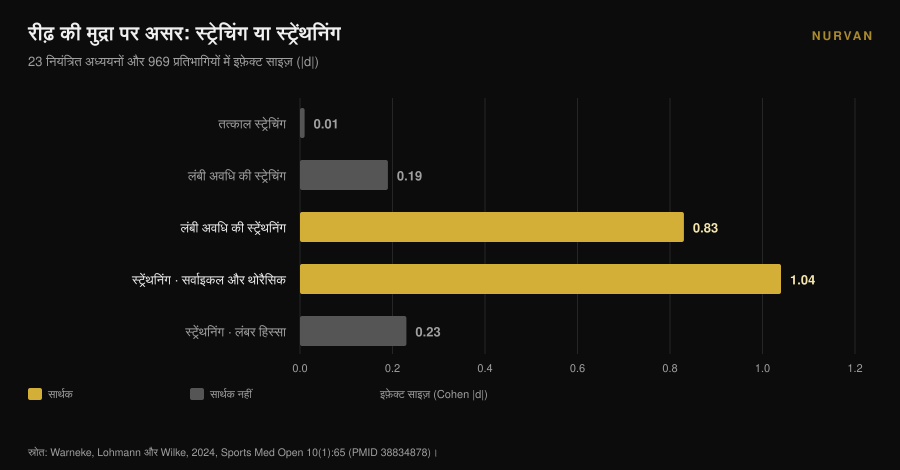
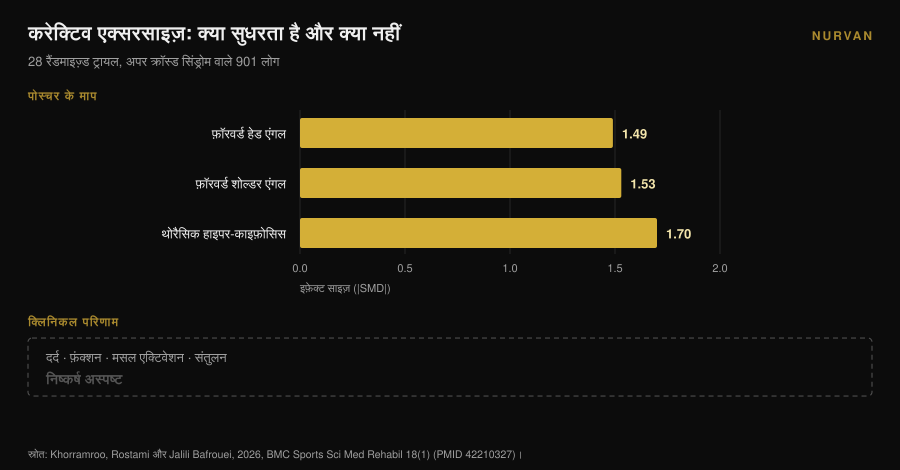

# राउंडेड शोल्डर: स्ट्रेचिंग से ठीक नहीं होते

लेखक: [जियाम्मारिया लोई](/autore/giammaria-loi) · अपडेट: 9 नवंबर 2026

राउंडेड शोल्डर पर बनने वाला हर कैरोसेल एक ही नुस्ख़ा देता है: चेस्ट खोलो, पेक्टोरल स्ट्रेच करो, ऊपरी पीठ को घुमाओ। तर्क साफ़ लगता है — छोटा हो चुका पेक्टोरल कंधों को आगे खींचता है, तो उसे लंबा कर दो और सब ठीक हो जाएगा। जिस मेटा-विश्लेषण ने इस तर्क को जाँचा, उसे कोई असर नहीं मिला। स्ट्रेचिंग — चाहे एक बार की हो या लंबे समय की — पोस्चर को हिलाती नहीं। कुछ है जो उसे हिलाता है, और वह ठीक उल्टी तरह की ट्रेनिंग है।

## एक नज़र में

- **स्ट्रेचिंग पोस्चर नहीं बदलती।** 23 नियंत्रित अध्ययनों और 969 लोगों में तत्काल स्ट्रेचिंग का असर **d = 0.01** (p = 0.97) और लंबी अवधि की स्ट्रेचिंग का **d = -0.19** (p = 0.16) रहा: दोनों शून्य से अलग नहीं (Warneke et al., 2024)।
- **स्ट्रेंथनिंग बदलती है।** उसी समीक्षा में लंबी अवधि की स्ट्रेंथ ट्रेनिंग **d = -0.83** (p = 0.01) तक पहुँची और स्ट्रेचिंग से काफ़ी बेहतर रही (d = 0.81, p = 0.004)।
- **यह कमर से ऊपर काम करती है।** असर सर्वाइकल और थोरैसिक हिस्से में बड़ा है (**d = -1.04**, p = 0.005) और लंबर व लंबो-पेल्विक हिस्से में शून्य (d = -0.23, p = 0.25)।
- **बेहतर पोस्चर का मतलब कम लक्षण नहीं।** अपर क्रॉस्ड सिंड्रोम वाले 901 लोगों पर 28 रैंडमाइज़्ड ट्रायल में करेक्टिव एक्सरसाइज़ ने पोस्चर के कोण काफ़ी बदले, पर दर्द, फ़ंक्शन और संतुलन पर असर **अस्पष्ट** रहा (Khorramroo et al., 2026)।
- **असली डोज़ चार एक्सरसाइज़ नहीं है।** जिस प्रोटोकॉल ने कोण और दर्द दोनों को सचमुच बदला, वह था **45 मिनट, हफ़्ते में 5 दिन, 8 हफ़्ते तक** (Guo et al., 2025)।

## "राउंडेड शोल्डर" असल में क्या है

इस लेबल के नीचे आमतौर पर तीन अलग चीज़ें साथ चलती हैं: धड़ के मुक़ाबले सिर का आगे रहना, कंधों का आगे घूमना और ऊपरी पीठ का ज़्यादा मुड़ाव। शोध में ये **क्रेनियोवर्टिब्रल एंगल**, **फ़ॉरवर्ड शोल्डर एंगल** और **थोरैसिक काइफ़ोसिस** कहलाते हैं, और तीनों एक साथ दिखें तो उसे *अपर क्रॉस्ड सिंड्रोम* कहा जाता है।

ये माप हैं, निदान नहीं। कोई आपकी साइड से फ़ोटो लेता है, कोण खींचता है और एक संख्या निकल आती है। इस फ़र्क़ को याद रखना ही आगे की बात ठीक से समझने का तरीक़ा है: शोध जिसे अच्छे से मापता है वह कोण है। और आपके लिए जो सचमुच मायने रखता है — कंधा जो आराम से चले, गर्दन जो शाम छह बजे न जले — वह दूसरी चीज़ है, और दोनों हमेशा साथ नहीं चलतीं।

## स्ट्रेचिंग पोस्चर नहीं बदलती: वह आँकड़ा जिसे लगभग कोई नहीं बताता

इस बिंदु पर निर्णायक काम है Warneke, Lohmann और Wilke की 2024 की व्यवस्थित समीक्षा और मेटा-विश्लेषण, जो *Sports Medicine - Open* में छपी। इसमें 23 नियंत्रित अध्ययनों और 969 स्वस्थ लोगों को जोड़कर एक सीधा सवाल पूछा गया: "जो छोटा है उसे खींचो, जो कमज़ोर है उसे मज़बूत करो" वाला तरीक़ा क्या सच में रीढ़ की मुद्रा बदलता है?

आँकड़े दो-टूक हैं। **तत्काल स्ट्रेचिंग: d = 0.01, p = 0.97.** शून्य। **लंबी अवधि की स्ट्रेचिंग: d = -0.19, p = 0.16.** दिशा सही, नतीजा संयोग से अलग नहीं।

**लंबी अवधि की स्ट्रेंथनिंग: d = -0.83, p = 0.01.** बड़ा असर। और सीधे मुक़ाबले में स्ट्रेंथनिंग ने स्ट्रेचिंग को d = 0.81 (p = 0.004) से हराया।

लेखक इसे बिना लाग-लपेट लिखते हैं: मध्यम निश्चितता वाले प्रमाण मांसपेशीय असंतुलन के इलाज के रूप में स्ट्रेचिंग का समर्थन नहीं करते, और पोस्चर पर काम करने वालों को कमज़ोर मांसपेशियों के लिए स्ट्रेंथ प्रोग्राम पर ध्यान देना चाहिए।

एक और बात इसे और उपयोगी बनाती है। उप-विश्लेषण दिखाते हैं कि स्ट्रेंथनिंग **सर्वाइकल और थोरैसिक हिस्से में** काम करती है (d = -1.04, p = 0.005) और **लंबर व लंबो-पेल्विक हिस्से में नहीं** (d = -0.23, p = 0.25)। ऊपरी पीठ ट्रेनिंग का जवाब देती है, पेल्विस नहीं। राउंडेड शोल्डर ठीक उसी हिस्से में हैं जो जवाब देता है।

## स्ट्रेंथनिंग इन्हें बदलती है, और यह मुफ़्त नहीं

अगर स्ट्रेंथनिंग ही लीवर है, तो अगला सवाल है: कितनी?

यहाँ नतीजों की जगह प्रोटोकॉल देखने होंगे। इस विषय पर सबसे स्पष्ट रैंडमाइज़्ड ट्रायल 2025 में Guo और साथियों ने प्रकाशित किया: अपर क्रॉस्ड सिंड्रोम वाले 74 विश्वविद्यालय छात्रों को दो समूहों में बाँटा गया। हस्तक्षेप समूह ने गर्दन और थोरैसिक रीढ़ की ट्रेनिंग **हफ़्ते में 5 दिन, हर सत्र 45 मिनट, 8 हफ़्ते तक** की। नियंत्रण समूह ने सामान्य दिनचर्या जारी रखी।

नतीजे अच्छे हैं: फ़ॉरवर्ड हेड एंगल d = 1.113, फ़ॉरवर्ड शोल्डर एंगल d = 1.052, दर्द d = 0.854, नेक डिसएबिलिटी d = 0.754, और फेफड़ों की कार्यक्षमता में भी सुधार (FEV1/FVC d = 0.516)।

पर डोज़ का हिसाब लगाइए: **दो महीनों में लगभग 30 घंटे का काम।** "जिन दिनों बैठे-बैठे अकड़न हो" वाले चार एक्सरसाइज़ नहीं।

Xing और साथियों का 2026 का मेटा-विश्लेषण, दस रैंडमाइज़्ड ट्रायल और 550 लोगों पर, उसी दिशा में इशारा करता है: थेरेप्यूटिक एक्सरसाइज़ ने क्रेनियोवर्टिब्रल एंगल औसतन **3.38 डिग्री** सुधारा (95% विश्वास अंतराल: 2.10-4.65), दर्द घटाया (औसत अंतर -1.42) और नेक डिसएबिलिटी (-5.44)। खोजपरक विश्लेषण में **कम से कम आठ हफ़्ते** चलने वाले और कई तरह की एक्सरसाइज़ मिलाने वाले प्रोग्राम ज़्यादा असरदार रहे। लेखक चेताते हैं कि कुल निश्चितता निम्न से मध्यम बनी रहती है।

दो महीने की लगातार मेहनत के बाद तीन डिग्री। यह असली नतीजा है, और यह भी बताता है कि किसी वयस्क की पोस्चर बदलना कितना मुश्किल है।

## पोस्चर सुधरता है, लक्षण ज़रूरी नहीं कि साथ चलें

यहाँ पूरे विषय का सबसे असहज आँकड़ा आता है, और वह नया है।

Khorramroo, Rostami और Jalili Bafrouei ने 2026 में एक व्यवस्थित समीक्षा और मेटा-विश्लेषण प्रकाशित किया, जिसमें अपर क्रॉस्ड सिंड्रोम वाले 901 लोगों पर 28 रैंडमाइज़्ड ट्रायल शामिल थे। करेक्टिव एक्सरसाइज़ कोणों को साफ़ तौर पर सुधारती है: फ़ॉरवर्ड हेड एंगल **SMD -1.49**, फ़ॉरवर्ड शोल्डर एंगल **SMD -1.53**, थोरैसिक हाइपर-काइफ़ोसिस **SMD -1.70**। हर जगह बड़े असर।

फिर काम का दूसरा हिस्सा आता है। जिन नतीजों की परवाह तकलीफ़ वाले व्यक्ति को है — दर्द, फ़ंक्शन, मसल एक्टिवेशन, संतुलन — वहाँ परिणाम **अस्पष्ट** हैं। लेखकों का अपना सारांश: करेक्टिव एक्सरसाइज़ बायोमैकेनिकल पोस्चरल कमियों को प्रभावी ढंग से दूर करती है, पर यह लक्षणों में राहत और कार्यक्षमता में सुधार में बदलेगी या नहीं, यह अनिश्चित है।

अध्ययन का शीर्षक ही यह कहता है: पोस्चर बहुत सुधरता है, क्लिनिकल लाभ एकसमान नहीं। यह भी जोड़ना चाहिए कि अध्ययनों के बीच विषमता ऊँची है (I² 78% से 88% के बीच), यानी अलग-अलग ट्रायल आपस में उतना सहमत नहीं जितना कुल आँकड़ा लगता है।

## और अगर दर्द की वजह राउंडेड शोल्डर है ही नहीं?

हर "करेक्टिव" रूटीन के पीछे एक अनकही मान्यता है: ख़राब पोस्चर दर्द देता है। यह मान्यता है, स्थापित तथ्य नहीं।

2025 के एक केस-कंट्रोल अध्ययन ने 146 युवा वयस्कों की तुलना की: 73 क्रॉनिक नेक पेन वाले और 73 बिना, औसत आयु 21.6 वर्ष। दर्द से जुड़े निकले **दृष्टि संबंधी समस्याएँ** (ऑड्स रेशियो 2.83; 95% CI: 1.26-6.38) और **गतिहीन जीवनशैली** (OR 2.41; 1.01-5.88)। स्व-रिपोर्ट की गई पोस्चर आदतें: कोई सार्थक संबंध नहीं (p > 0.05)।

यह एक ही अध्ययन है, पूर्वव्यापी, मापी गई नहीं बल्कि स्व-रिपोर्ट की गई पोस्चर पर, और युवाओं पर: यह बहस बंद नहीं करता। पर Khorramroo के मेटा-विश्लेषण के साथ रखें तो कहानी संगत बनती है। पोस्चर कारण से ज़्यादा एक संकेतक लगता है, और गतिहीनता — आप कितना कम चलते हैं, न कि कैसे बैठते हैं — बार-बार सामने आती है।

अगर आप ट्रेनिंग करते हैं और कंधे में दर्द है, तो वह असली जाँच का हक़दार है, किसी पोस्ट से उठाई गई मोबिलिटी रूटीन का नहीं। जो दर्द जाता नहीं, रात में जगाता है, या बाँह में झनझनाहट या कमज़ोरी के साथ आता है — वह डॉक्टर या फ़िज़ियोथेरेपिस्ट के पास जाता है, चार स्ट्रेच के पास नहीं।

## तो क्या थोरैसिक मोबिलिटी बेकार है? नहीं, पर वजह दूसरी है

ज़्यादा उलट मत जाइए। थोरैसिक रीढ़ पर काम करने के पीछे ठोस प्रमाण हैं — बस वे पोस्चर के रास्ते नहीं आते।

2025 के एक मेटा-विश्लेषण ने सबएक्रोमियल इम्पिंजमेंट वाले 444 लोगों पर दस रैंडमाइज़्ड ट्रायल में थोरैसिक मैनुअल थेरेपी मापी: दर्द **SMD -0.94** (95% CI: -1.23 से -0.65) 2-6 हफ़्ते पर और मध्यम-अवधि फ़ॉलोअप पर -0.83, डिसएबिलिटी -0.82, उच्च गुणवत्ता के प्रमाण के साथ। गति की सीमा मध्यम गुणवत्ता के प्रमाण पर सुधरी: इंटरनल रोटेशन SMD 0.61, एक्सटर्नल रोटेशन 0.58।

यानी थोरैसिक रीढ़ इस बात के लिए मायने रखती है कि कंधा कैसे चलता है, ख़ासकर रोटेशन में। वजह यांत्रिक है: स्कैपुला पसलियों के पिंजरे पर सरकती है, और वह पिंजरा बेहतर खुले और घूमे तो सिर के ऊपर जाती बाँह को ज़्यादा जगह मिलती है। इसी वजह से 2026 की 13 ट्रायल और 819 लोगों वाली समीक्षा में पाया गया कि गर्दन **और** थोरैसिक रीढ़ दोनों को मिलाने वाले प्रोग्राम दर्द को सार्थक रूप से घटाते हैं, जबकि सिर्फ़ गर्दन वाले प्रोग्राम कोण तो सुधारते हैं पर वह असर नहीं देते — हालाँकि यह कहना ज़रूरी है कि इन प्रमाणों की निश्चितता निम्न से बहुत निम्न है।

व्यावहारिक संदेश "मोबिलिटी छोड़ दो" नहीं है। यह है: **थोरैसिक मोबिलिटी आपको बेहतर चलने में मदद करती है, सीधा खड़ा करने में नहीं।** इसे ओवरहेड प्रेस या रो से पहले वॉर्म-अप में रखें, पोस्चर थेरेपी के रूप में नहीं।

## शोध असल में क्या कहता है

| आम दावा | फ़ैसला | स्रोत |
|---|---|---|
| "चेस्ट स्ट्रेच करो, कंधे पीछे आ जाएँगे" | **ग़लत**: तत्काल स्ट्रेचिंग d = 0.01, लंबी अवधि d = -0.19, दोनों सार्थक नहीं | Warneke et al., 2024 |
| "बैक स्ट्रेंथनिंग से पोस्चर नहीं बदलता" | **ग़लत**: d = -0.83, और सर्वाइको-थोरैसिक हिस्से में d = -1.04 | Warneke et al., 2024 |
| "चार मोबिलिटी ड्रिल राउंडेड शोल्डर ठीक कर देती हैं" | **असमर्थित**: अध्ययनों में असरदार डोज़ 45 मिनट × 5 दिन × 8 हफ़्ते था | Guo et al., 2025; Xing et al., 2026 |
| "राउंडेड शोल्डर दर्द पैदा करते हैं" | **स्पष्टीकरण चाहिए**: सिद्ध नहीं; पोस्चर सुधरता है, लक्षण नहीं | Khorramroo et al., 2026; Assis et al., 2025 |
| "थोरैसिक पर काम कंधे की मदद करता है" | **पुष्ट**: दर्द SMD -0.94, इंटरनल रोटेशन 0.61, एक्सटर्नल 0.58 | Yu et al., 2025 |
| "पोस्चर ठीक कर लो, लक्षण चले जाएँगे" | **स्वचालित नियम के रूप में ग़लत**: कोण सुधरते हैं, क्लिनिकल परिणाम अस्पष्ट | Khorramroo et al., 2026 |

## इसे कैसे लागू करें

1. **करेक्शन का पीछा छोड़िए, लोड का पीछा कीजिए।** अगर आप पोस्चर को रोज़ दस मिनट देते हैं, तो उन्हें हॉरिज़ॉन्टल और वर्टिकल पुलिंग में लगाइए, चेस्ट स्ट्रेच में नहीं। मेटा-विश्लेषण में यही एक चीज़ हिलती दिखी।
2. **ऊपरी शरीर की पुलिंग मूवमेंट चुनिए।** बारबेल और डम्बल रो, केबल रो, पुल-अप, फ़ेस पुल, लेटरल और रियर डेल्ट रेज़। इन्हीं मांसपेशियों की मज़बूती सर्वाइको-थोरैसिक हिस्से में कारगर साबित हुई।
3. **सचमुच प्रोग्रेस कीजिए।** मायने रखने वाली उत्तेजना समय के साथ बढ़ता लोड है, एक्सरसाइज़ की सूची नहीं। हर सेट का वज़न, रेप्स और रेप्स इन रिज़र्व (RIR — सेट के अंत में कितने और कर सकते थे) दर्ज कीजिए; इस डेटा के बिना "प्रोग्रेस" सिर्फ़ इरादा है। ढाँचे की ज़रूरत हो तो देखिए कि [बिगिनर और एडवांस्ड के लिए ट्रेनिंग स्प्लिट कैसे अलग होता है](/hi/blog/training-split-beginner-advanced)।
4. **समय दीजिए: आठ हफ़्ते न्यूनतम हैं।** उससे कम में डेटा कुछ ख़ास नहीं दिखाता। और यथार्थवादी नतीजा कुछ डिग्री का है, कायापलट का नहीं।
5. **मोबिलिटी वहाँ इस्तेमाल कीजिए जहाँ वह सचमुच काम आती है: वॉर्म-अप में।** ओवरहेड प्रेस या रो से पहले दो-तीन मिनट की थोरैसिक रोटेशन उस दिन की मूवमेंट क्वालिटी के लिए समझ में आती है। यह उम्मीद मत रखिए कि वे आपकी पोस्चर दोबारा गढ़ देंगी।
6. **अगर दर्द है, तो जब तक किसी ने आपकी जाँच न की हो, वह पोस्चर की समस्या नहीं है।** लगातार या रात का दर्द, झनझनाहट या कमज़ोरी: डॉक्टर या फ़िज़ियोथेरेपिस्ट।

> ### Nurvan आज़माइए — पोस्चर को जिस प्रोग्रेशन की ज़रूरत है
>
> जो लीवर काम करता है वह स्ट्रेचिंग रूटीन नहीं है: वह पीठ की स्ट्रेंथ है जो कम से कम दो महीने तक हफ़्ता-दर-हफ़्ता बढ़ती है। Nurvan में आप हर रो और पुल-अप सेट का लोड, रेप्स और RIR दर्ज करते हैं, याददाश्त पर भरोसा करने के बजाय प्रोग्रेशन कर्व देखते हैं, और जो प्लान पहले से इस्तेमाल कर रहे हैं उसे PDF, Excel या फ़ोटो से भी इम्पोर्ट कर लेते हैं। [Nurvan आज़माएँ](https://nurvan.app)

## अक्सर पूछे जाने वाले सवाल

**क्या चेस्ट स्ट्रेचिंग बेकार है?**
मोबिलिटी के एहसास या वॉर्म-अप के लिहाज़ से बेकार नहीं है; पोस्चर बदलने के औज़ार के रूप में यह असरहीन है। 23 अध्ययनों में रीढ़ के अलाइनमेंट पर स्ट्रेचिंग का असर सांख्यिकीय रूप से शून्य से अलग नहीं था (Warneke et al., 2024)।

**राउंडेड शोल्डर ठीक करने में कितना समय लगता है?**
जिन अध्ययनों में मापने लायक़ बदलाव आया, उनमें प्रोग्राम कम से कम आठ हफ़्ते के थे; सबसे बड़े नतीजे वाले में 45 मिनट, हफ़्ते में पाँच दिन। मेटा-विश्लेषण में क्रेनियोवर्टिब्रल एंगल का औसत सुधार क़रीब तीन डिग्री है।

**क्या राउंडेड शोल्डर गर्दन के दर्द की वजह बनते हैं?**
यह सिद्ध नहीं है। मेटा-विश्लेषण में एक्सरसाइज़ से पोस्चर के कोण काफ़ी सुधरते हैं, पर दर्द और फ़ंक्शन पर असर अस्पष्ट रहता है, और एक केस-कंट्रोल अध्ययन में पोस्चर की आदतों और क्रॉनिक नेक पेन के बीच कोई संबंध नहीं मिला।

**तो थोरैसिक मोबिलिटी किस काम की है?**
कंधे की मूवमेंट के काम की। थोरैसिक पर काम सबएक्रोमियल इम्पिंजमेंट वालों में दर्द और रोटेशन सुधारता है, अच्छी गुणवत्ता के प्रमाण के साथ। इसे मूवमेंट की तैयारी के रूप में इस्तेमाल कीजिए, पोस्चर करेक्शन के रूप में नहीं।

## यह भी पढ़ें

- [स्क्वाट में घुटने बाहर: नियम है या सिर्फ़ क्यू?](/hi/blog/squat-mein-knees-out-cue) — एक और मामला जहाँ तकनीकी संकेत नियम बन जाता है, जिसे शोध समर्थन नहीं देता।
- [फोम रोलर सच में काम करता है? रिसर्च क्या कहती है](/hi/blog/foam-roller-recovery-ke-liye-kaam-karta-hai) — एक और ख़ूब बिकने वाले निष्क्रिय औज़ार से वही सवाल।
- [डम्बल प्रेस या फ्लाई: चेस्ट किससे ज़्यादा बढ़ती है?](/hi/blog/dumbbell-bench-press-ya-fly-chest-growth) — अगर आप चेस्ट को सिर्फ़ खींचने के बजाय ठीक से ट्रेन करना चाहते हैं।

## स्रोत

1. Warneke K, Lohmann LH, Wilke J, 2024. Effects of Stretching or Strengthening Exercise on Spinal and Lumbopelvic Posture: A Systematic Review with Meta-Analysis. *Sports Medicine - Open* 10(1):65. PMID 38834878. [DOI 10.1186/s40798-024-00733-5](https://doi.org/10.1186/s40798-024-00733-5)
2. Khorramroo F, Rostami M, Jalili Bafrouei M, 2026. Corrective exercises strongly improve posture but fail to produce consistent clinical or functional benefits in patients with upper crossed syndrome: a systematic review and meta-analysis of randomized controlled trials. *BMC Sports Science, Medicine & Rehabilitation* 18(1). PMID 42210327. [DOI 10.1186/s13102-026-01707-8](https://doi.org/10.1186/s13102-026-01707-8)
3. Xing Y, Wang R, Zhao X, Xu A, 2026. Therapeutic Exercise for Forward Head Posture in Neck Pain Patients: A Systematic Review and Meta-Analysis. *Journal of Pain Research* 19:614524. PMID 42445930. [DOI 10.2147/JPR.S614524](https://doi.org/10.2147/JPR.S614524)
4. Carrasco-Uribarren A, Ceballos-Laita L, Pérez-Guillén S, Jiménez-Del-Barrio S, Pantaleón-Hernández D, Cabanillas-Barea S, 2026. Impact of therapeutic exercise on craniovertebral angle in forward head posture: a systematic review and meta-analysis. *The Journal of Manual & Manipulative Therapy*. PMID 42281352. [DOI 10.1080/10669817.2026.2686739](https://doi.org/10.1080/10669817.2026.2686739)
5. Guo Y, Li M, Xie C, Liu X, Chen Y, Yang J, Wu Y, Chen S, Wang S, Lin J, 2025. Effect of the cervical and thoracic "Daoyin" training on posture and pulmonary function in patients with upper crossed syndrome: a randomized controlled trial. *BMC Complementary Medicine and Therapies* 25(1):41. PMID 39905404. [DOI 10.1186/s12906-025-04791-4](https://doi.org/10.1186/s12906-025-04791-4)
6. Yu S, Chen S, Yang Z, Ma X, Huang J, Yang L, 2025. Effectiveness of Thoracic Spine Manual Therapy in Treating Subacromial Impingement Syndrome: A Systematic Review and Meta-analysis. *Archives of Physical Medicine and Rehabilitation* 106(12):1886-1898. PMID 40712864. [DOI 10.1016/j.apmr.2025.07.008](https://doi.org/10.1016/j.apmr.2025.07.008)
7. Assis SJC de, Sanchis GJB, Meziat-Filho N, Souza CG de, Roncalli A, 2025. Association of self-reported posture habits and vision problems with chronic neck pain: A case-control study. *Journal of Bodywork and Movement Therapies* 45:946-952. PMID 41316668. [DOI 10.1016/j.jbmt.2025.10.023](https://doi.org/10.1016/j.jbmt.2025.10.023)

संदर्भ PubMed के ज़रिए खोजे गए। शुरुआती बिंदु: [@themobilitymanual](https://www.instagram.com/p/DdYn-F3Fiqa/) की 17 सितंबर 2026 की पोस्ट, जो राउंडेड शोल्डर के लिए एक मोबिलिटी रूटीन पर थी। उस पोस्ट का कोई टेक्स्ट या चित्र दोहराया नहीं गया है: विषय और उसके दावे शोध साहित्य में दोबारा जाँचे गए हैं।

---

*जियाम्मारिया लोई Nurvan के संस्थापक हैं। वे 2012 से वेट ट्रेनिंग कर रहे हैं, 2013 से FIPE-प्रमाणित पर्सनल ट्रेनर और कोच के रूप में काम करते हैं, और 2018 से राष्ट्रीय स्तर पर पावरलिफ्टिंग में प्रतिस्पर्धा करते हैं। उनके हर लेख की शुरुआत शोध से होती है और अंत इस पर कि जिम में असल में क्या काम करता है।*

> नोट: यह जानकारीपरक सामग्री है, यह किसी डॉक्टर या पेशेवर की सलाह का विकल्प नहीं है।
