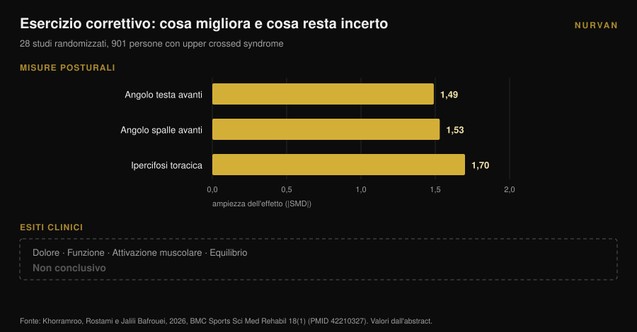

# Spalle arrotondate: lo stretching non basta

Di [Giammaria Loi](/autore/giammaria-loi) · aggiornato il 9 novembre 2026

Ogni carosello sulle spalle arrotondate propone la stessa ricetta: allunga il petto, apri il torace, ruota il dorso. L'idea di fondo è che il pettorale accorciato tiri le spalle in avanti e che allungandolo si rimetta tutto a posto. È una spiegazione pulita, e la meta-analisi che l'ha messa alla prova dice che non funziona: lo stretching, acuto o cronico, non sposta la postura. Qualcosa che la sposta esiste, ma è l'esercizio opposto a quello che ti propongono.

## In breve

- **Lo stretching non cambia la postura.** Su 23 studi controllati e 969 persone, lo stretching acuto ha un effetto di **d = 0,01** (p = 0,97) e quello cronico di **d = -0,19** (p = 0,16): entrambi indistinguibili da zero (Warneke et al., 2024).
- **Il rinforzo sì.** Nella stessa revisione il rinforzo cronico vale **d = -0,83** (p = 0,01), ed è significativamente superiore allo stretching (d = 0,81, p = 0,004).
- **Funziona sopra la vita.** L'effetto del rinforzo è grande nel tratto cervicale e toracico (**d = -1,04**, p = 0,005) e nullo in quello lombare e lombopelvico (d = -0,23, p = 0,25).
- **Postura corretta non vuol dire sintomi risolti.** In 28 studi randomizzati su 901 persone con "upper crossed syndrome" l'esercizio correttivo migliora molto gli angoli posturali, ma gli effetti su dolore, funzione ed equilibrio restano **non conclusivi** (Khorramroo et al., 2026).
- **La dose vera non è quattro esercizi.** Il protocollo che ha spostato davvero gli angoli e il dolore chiedeva **45 minuti, 5 giorni a settimana, per 8 settimane** (Guo et al., 2025).

## Che cosa sono davvero le "spalle arrotondate"

Sotto l'etichetta ci sono tre cose diverse che di solito viaggiano insieme: la testa più avanti rispetto al tronco, le spalle che ruotano in avanti e la curva dorsale più accentuata. Nei lavori scientifici le trovi come **angolo craniovertebrale**, **angolo delle spalle in avanti** e **cifosi toracica**, e quando compaiono tutte e tre si parla di *upper crossed syndrome*.

Sono misure, non diagnosi. Si fotografa una persona di profilo, si tracciano gli angoli e si ottiene un numero. Tenere a mente questa distinzione è l'unico modo per leggere correttamente quello che segue: tutto ciò che la ricerca misura bene sono gli angoli. Quello che ti interessa davvero — spalla che si muove bene, collo che non brucia alle sei di sera — è un'altra variabile, e non cammina sempre insieme alla prima.

## Lo stretching non cambia la postura: il dato che quasi nessuno cita

Il lavoro che conta su questo punto è una revisione sistematica con meta-analisi di Warneke, Lohmann e Wilke, pubblicata nel 2024 su *Sports Medicine - Open*. Ha raccolto 23 studi controllati e 969 persone sane per rispondere a una domanda precisa: l'approccio "allunga quello che è corto, rinforza quello che è debole" sposta davvero la postura della colonna?

I numeri sono netti. **Stretching acuto: d = 0,01, p = 0,97.** Cioè zero. **Stretching cronico: d = -0,19, p = 0,16.** Una direzione giusta ma un risultato che non si distingue dal caso.

**Rinforzo cronico: d = -0,83, p = 0,01.** Un effetto grande. E nel confronto diretto, il rinforzo batte lo stretching con d = 0,81 (p = 0,004).

Gli autori lo scrivono senza giri di parole: prove di certezza moderata non sostengono l'uso dello stretching come trattamento dello squilibrio muscolare, e chi lavora sulla postura dovrebbe concentrarsi su programmi di rinforzo dei muscoli deboli.

C'è un dettaglio che rende questo dato ancora più utile per te. Le sottoanalisi mostrano che il rinforzo funziona **nel tratto cervicale e toracico** (d = -1,04, p = 0,005) e **non funziona** in quello lombare e lombopelvico (d = -0,23, p = 0,25). Tradotto: la parte alta della schiena risponde all'allenamento, il bacino no. Le spalle arrotondate stanno esattamente nella zona che risponde.

## Il rinforzo le cambia, e la cosa non è gratis

Se il rinforzo è la leva, la domanda diventa: quanto rinforzo?

Qui serve guardare i protocolli, non le conclusioni. Lo studio randomizzato più chiaro su questo punto, pubblicato nel 2025 da Guo e colleghi, ha preso 74 studenti universitari con upper crossed syndrome e li ha divisi in due gruppi. Il gruppo di intervento ha fatto un training mirato per collo e tratto toracico **5 giorni a settimana, 45 minuti a seduta, per 8 settimane**. Il gruppo di controllo ha continuato la vita di sempre.

I risultati sono buoni: angolo testa avanti d = 1,113, angolo spalle avanti d = 1,052, dolore d = 0,854, disabilità cervicale d = 0,754, e perfino un miglioramento della funzione respiratoria (FEV1/FVC d = 0,516).

Ma fai il conto della dose: **circa 30 ore di lavoro in due mesi**. Non quattro esercizi fatti "nei giorni in cui stai seduto troppo".

La meta-analisi di Xing e colleghi, uscita nel 2026 su dieci studi randomizzati e 550 persone, va nella stessa direzione: l'esercizio terapeutico migliora l'angolo craniovertebrale di **3,38 gradi** in media (intervallo di confidenza 95%: 2,10-4,65), riduce il dolore (differenza media -1,42) e la disabilità cervicale (-5,44). Nelle analisi esplorative, i programmi che durano **almeno 8 settimane** e che combinano più tipi di esercizio ottengono di più. Gli autori avvertono che la certezza complessiva resta da bassa a moderata.

Tre gradi, dopo due mesi di lavoro costante. È un risultato reale, ed è anche la misura di quanto sia difficile spostare la postura di una persona adulta.

## La postura migliora, i sintomi non seguono per forza

Qui arriva il dato più scomodo dell'intero argomento, ed è recente.

Khorramroo, Rostami e Jalili Bafrouei hanno pubblicato nel 2026 una revisione sistematica con meta-analisi su 28 studi randomizzati e 901 persone con upper crossed syndrome. Gli esercizi correttivi migliorano gli angoli in modo netto: angolo testa avanti **SMD -1,49**, angolo spalle avanti **SMD -1,53**, ipercifosi toracica **SMD -1,70**. Effetti grandi, su tutta la linea.

Poi arriva la seconda metà del lavoro. Sugli esiti che contano per chi sta male — dolore, funzione, attivazione muscolare, equilibrio — i risultati sono **non conclusivi**. Gli autori lo riassumono così: l'esercizio correttivo affronta efficacemente i deficit posturali biomeccanici, ma la loro traduzione in sollievo dai sintomi e miglioramento funzionale resta incerta.

Il titolo stesso dello studio dice che la postura migliora molto ma i benefici clinici non sono consistenti. Vale la pena aggiungere che l'eterogeneità fra gli studi è alta (I² fra 78% e 88%), il che significa che i singoli lavori non concordano fra loro quanto il numero complessivo lascerebbe pensare.

## E se le spalle arrotondate non fossero la causa del dolore?

Il presupposto non detto di ogni routine "correttiva" è che la postura storta faccia male. È un presupposto, non un fatto accertato.

Uno studio caso-controllo del 2025 ha confrontato 146 giovani adulti, 73 con dolore cervicale cronico e 73 senza, età media 21,6 anni. Quello che risultava associato al dolore erano **i problemi di vista** (odds ratio 2,83; intervallo di confidenza 95%: 1,26-6,38) e **la sedentarietà** (OR 2,41; 1,01-5,88). Le abitudini posturali autoriferite: nessuna associazione significativa (p > 0,05).

È un singolo studio, retrospettivo, su postura autoriferita e non misurata, e su giovani adulti: non chiude la questione. Ma messo accanto alla meta-analisi di Khorramroo racconta una storia coerente. La postura è più un indicatore che una causa, e la sedentarietà — cioè quanto poco ti muovi, non come stai seduto — è il fattore che continua a comparire.

Se ti alleni e le spalle ti fanno male, il problema vale un controllo vero, non una routine di mobilità presa da un post. Dolore che non passa, che ti sveglia di notte, formicolio o perdita di forza al braccio sono cose da portare da un medico o da un fisioterapista, non da gestire con quattro stretch.

## Allora la mobilità toracica è inutile? No, ma per un altro motivo

Attenzione a non ribaltare troppo. Lavorare sul tratto toracico ha un supporto solido — solo che non passa dalla postura.

Una meta-analisi del 2025 su dieci studi randomizzati e 444 persone con sindrome da conflitto subacromiale ha misurato gli effetti della terapia manuale sul tratto toracico: dolore **SMD -0,94** (IC 95%: da -1,23 a -0,65) a 2-6 settimane e -0,83 nel follow-up a medio termine, disabilità -0,82, con prove di alta qualità. Il range di movimento migliora con prove di qualità moderata: rotazione interna SMD 0,61, rotazione esterna 0,58.

Quindi il tratto toracico conta per come si muove la spalla, soprattutto in rotazione. Il motivo è meccanico: la scapola scorre su una gabbia toracica, e se quella gabbia si estende e ruota meglio, il braccio sopra la testa trova più strada. È anche il motivo per cui una revisione del 2026 su 13 studi e 819 persone ha trovato che i programmi che combinano collo **e** tratto toracico riducono il dolore in modo significativo, mentre quelli sul solo collo migliorano gli angoli ma non altrettanto il dolore — con una certezza delle prove, va detto, da bassa a molto bassa.

Il messaggio pratico non è "butta via la mobilità". È: **la mobilità toracica serve a muoverti meglio, non a raddrizzarti.** Tienila come riscaldamento prima di spingere sopra la testa o di remare, non come terapia posturale.

## Cosa dice davvero la ricerca

| Affermazione diffusa | Verdetto | Fonte |
|---|---|---|
| "Allunga il petto e le spalle tornano indietro" | **Smentito**: stretching acuto d = 0,01, cronico d = -0,19, entrambi non significativi | Warneke et al., 2024 |
| "Il rinforzo del dorso non cambia la postura" | **Smentito**: d = -0,83, e d = -1,04 nel tratto cervico-toracico | Warneke et al., 2024 |
| "Quattro esercizi di mobilità correggono le spalle arrotondate" | **Non supportato**: la dose efficace negli studi è 45 min × 5 giorni × 8 settimane | Guo et al., 2025; Xing et al., 2026 |
| "Le spalle arrotondate causano dolore" | **Da precisare**: non dimostrato; postura corretta ma sintomi invariati nelle meta-analisi | Khorramroo et al., 2026; Assis et al., 2025 |
| "Lavorare sul tratto toracico aiuta la spalla" | **Confermato**: dolore SMD -0,94, rotazione interna 0,61, esterna 0,58 | Yu et al., 2025 |
| "Se correggi la postura spariscono i sintomi" | **Smentito come automatismo**: angoli migliorano, esiti clinici non conclusivi | Khorramroo et al., 2026 |

## Come applicarlo

1. **Smetti di cercare la correzione e inizia a cercare il carico.** Se dedichi 10 minuti al giorno alla postura, mettili su trazioni orizzontali e verticali, non su stretch del petto. È l'unica variabile che la meta-analisi ha visto muoversi.
2. **Scegli i movimenti del tratto alto.** Rematori con bilanciere o manubrio, pulley, trazioni, face pull, alzate laterali e posteriori. Sono i muscoli il cui rinforzo è risultato efficace proprio nella zona cervico-toracica.
3. **Progredisci davvero.** Lo stimolo che conta è il carico che cresce nel tempo, non la lista di esercizi. Tieni traccia di carichi, ripetizioni e ripetizioni di riserva (RIR, cioè quante ne avresti ancora nel serbatoio a fine serie): senza quel dato "progredire" resta un'intenzione. Se ti serve una base, parti da come [si struttura una split fra principiante e avanzato](/blog/split-allenamento-principiante-avanzato).
4. **Dai tempo: 8 settimane sono il minimo.** Sotto quella soglia i dati non mostrano granché. E il risultato realistico è dell'ordine di pochi gradi, non di una trasformazione.
5. **Usa la mobilità dove serve davvero: nel riscaldamento.** Due o tre minuti di rotazioni toraciche prima di spingere sopra la testa o remare hanno senso per come ti muovi quel giorno. Non aspettarti che rimodellino la tua postura.
6. **Se fa male, non è un problema di postura finché non l'ha detto qualcuno che ti ha visitato.** Dolore persistente, notturno, con formicolio o debolezza: medico o fisioterapista.

> ### Prova Nurvan — la progressione che la postura richiede
>
> La leva che funziona non è una routine di stretching: è un rinforzo del dorso che cresce di settimana in settimana per almeno due mesi. Con Nurvan registri carichi, ripetizioni e RIR di ogni serie di rematori e trazioni, vedi la curva di progressione invece di affidarti alla memoria, e importi la scheda che già usi da PDF, Excel o anche da una foto. [Prova Nurvan](https://nurvan.app)

## Domande frequenti

**Lo stretching del pettorale è inutile?**
Non è inutile per la sensazione di mobilità o come riscaldamento: è inefficace come strumento per cambiare la postura. Su 23 studi l'effetto dello stretching sugli allineamenti della colonna era statisticamente indistinguibile da zero (Warneke et al., 2024).

**Quanto tempo serve per correggere le spalle arrotondate?**
Gli studi che hanno ottenuto cambiamenti misurabili usavano programmi di almeno 8 settimane; quello con i risultati più grandi arrivava a 45 minuti per 5 giorni a settimana. Il miglioramento medio dell'angolo craniovertebrale nelle meta-analisi è di circa 3 gradi.

**Le spalle arrotondate causano dolore al collo?**
Non è dimostrato. Nelle meta-analisi gli angoli posturali migliorano molto con l'esercizio, ma gli effetti su dolore e funzione restano non conclusivi, e uno studio caso-controllo non ha trovato associazione fra abitudini posturali e dolore cervicale cronico.

**Allora la mobilità toracica serve a qualcosa?**
Sì, per il movimento della spalla. Il lavoro sul tratto toracico migliora dolore e rotazione in chi ha un conflitto subacromiale, con prove di buona qualità. Usala come preparazione al movimento, non come correzione posturale.

## Leggi anche

- [Ginocchia in fuori nello squat: regola o cue?](/blog/ginocchia-in-fuori-squat) — un altro caso in cui un'indicazione tecnica diventa una regola che la letteratura non sostiene.
- [Foam roller: serve davvero? Cosa dicono gli studi](/blog/foam-roller-serve-davvero-recupero) — stessa domanda su un altro strumento passivo molto venduto.
- [Panca o croci: cosa fa crescere di più il petto?](/blog/panca-o-croci-pettorali) — se vuoi allenare bene i pettorali invece di allungarli e basta.

## Fonti

1. Warneke K, Lohmann LH, Wilke J, 2024. Effects of Stretching or Strengthening Exercise on Spinal and Lumbopelvic Posture: A Systematic Review with Meta-Analysis. *Sports Medicine - Open* 10(1):65. PMID 38834878. [DOI 10.1186/s40798-024-00733-5](https://doi.org/10.1186/s40798-024-00733-5)
2. Khorramroo F, Rostami M, Jalili Bafrouei M, 2026. Corrective exercises strongly improve posture but fail to produce consistent clinical or functional benefits in patients with upper crossed syndrome: a systematic review and meta-analysis of randomized controlled trials. *BMC Sports Science, Medicine & Rehabilitation* 18(1). PMID 42210327. [DOI 10.1186/s13102-026-01707-8](https://doi.org/10.1186/s13102-026-01707-8)
3. Xing Y, Wang R, Zhao X, Xu A, 2026. Therapeutic Exercise for Forward Head Posture in Neck Pain Patients: A Systematic Review and Meta-Analysis. *Journal of Pain Research* 19:614524. PMID 42445930. [DOI 10.2147/JPR.S614524](https://doi.org/10.2147/JPR.S614524)
4. Carrasco-Uribarren A, Ceballos-Laita L, Pérez-Guillén S, Jiménez-Del-Barrio S, Pantaleón-Hernández D, Cabanillas-Barea S, 2026. Impact of therapeutic exercise on craniovertebral angle in forward head posture: a systematic review and meta-analysis. *The Journal of Manual & Manipulative Therapy*. PMID 42281352. [DOI 10.1080/10669817.2026.2686739](https://doi.org/10.1080/10669817.2026.2686739)
5. Guo Y, Li M, Xie C, Liu X, Chen Y, Yang J, Wu Y, Chen S, Wang S, Lin J, 2025. Effect of the cervical and thoracic "Daoyin" training on posture and pulmonary function in patients with upper crossed syndrome: a randomized controlled trial. *BMC Complementary Medicine and Therapies* 25(1):41. PMID 39905404. [DOI 10.1186/s12906-025-04791-4](https://doi.org/10.1186/s12906-025-04791-4)
6. Yu S, Chen S, Yang Z, Ma X, Huang J, Yang L, 2025. Effectiveness of Thoracic Spine Manual Therapy in Treating Subacromial Impingement Syndrome: A Systematic Review and Meta-analysis. *Archives of Physical Medicine and Rehabilitation* 106(12):1886-1898. PMID 40712864. [DOI 10.1016/j.apmr.2025.07.008](https://doi.org/10.1016/j.apmr.2025.07.008)
7. Assis SJC de, Sanchis GJB, Meziat-Filho N, Souza CG de, Roncalli A, 2025. Association of self-reported posture habits and vision problems with chronic neck pain: A case-control study. *Journal of Bodywork and Movement Therapies* 45:946-952. PMID 41316668. [DOI 10.1016/j.jbmt.2025.10.023](https://doi.org/10.1016/j.jbmt.2025.10.023)

Fonti bibliografiche reperite tramite PubMed. Spunto iniziale: post di [@themobilitymanual](https://www.instagram.com/p/DdYn-F3Fiqa/) del 17 settembre 2026 sulla routine di mobilità per le spalle arrotondate. Nessun testo o immagine di quel post è stato riprodotto: tema e affermazioni sono stati riverificati sulla letteratura.

---

*Giammaria Loi è il fondatore di Nurvan. Si allena con i pesi dal 2012, lavora come personal trainer e coach certificato FIPE dal 2013 e gareggia nel powerlifting a livello nazionale dal 2018. Ogni articolo che firma parte dagli studi scientifici e arriva a ciò che funziona davvero in palestra.*

> Nota: contenuto informativo, non sostituisce il parere di un medico o professionista.
