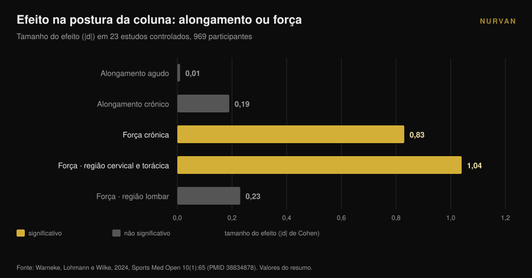
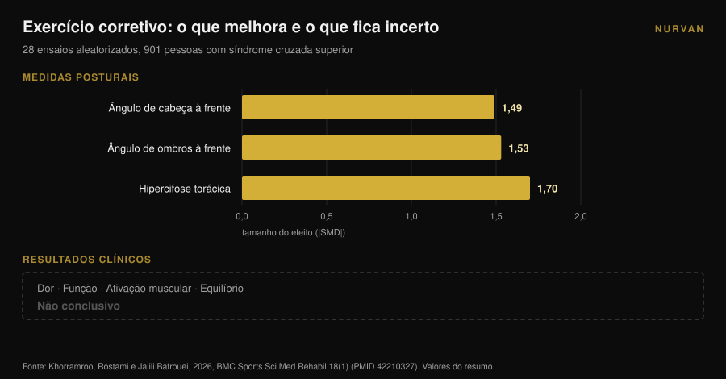

# Ombros arredondados: alongar não resolve

Por [Giammaria Loi](/autore/giammaria-loi) · atualizado a 9 de novembro de 2026

Todos os carrosséis sobre ombros arredondados receitam o mesmo: abre o peito, alonga o peitoral, roda as costas altas. A lógica é limpa — um peitoral encurtado puxa os ombros para a frente, logo basta alongá-lo e tudo volta ao lugar. A meta-análise que testou essa lógica não encontrou efeito nenhum. Alongar, de forma aguda ou crónica, não move a postura. Algo move, e é exatamente o exercício oposto.

## Em resumo

- **Alongar não muda a postura.** Em 23 estudos controlados e 969 pessoas, o alongamento agudo deu **d = 0,01** (p = 0,97) e o crónico **d = -0,19** (p = 0,16): ambos indistinguíveis de zero (Warneke et al., 2024).
- **A força muda.** Na mesma revisão, o treino de força crónico atingiu **d = -0,83** (p = 0,01) e foi significativamente superior ao alongamento (d = 0,81, p = 0,004).
- **Funciona acima da cintura.** O efeito é grande na coluna cervical e torácica (**d = -1,04**, p = 0,005) e nulo na zona lombar e lombopélvica (d = -0,23, p = 0,25).
- **Melhor postura não significa menos sintomas.** Em 28 ensaios aleatorizados com 901 pessoas com síndrome cruzada superior, o exercício corretivo moveu muito os ângulos posturais, mas os efeitos em dor, função e equilíbrio ficaram **não conclusivos** (Khorramroo et al., 2026).
- **A dose real não são quatro exercícios.** O protocolo que moveu mesmo ângulos e dor pedia **45 minutos, cinco dias por semana, durante oito semanas** (Guo et al., 2025).

## O que são afinal os "ombros arredondados"

Sob este rótulo viajam normalmente três coisas distintas: a cabeça à frente do tronco, os ombros rodados para a frente e uma curva dorsal mais acentuada. Na literatura aparecem como **ângulo craniovertebral**, **ângulo de ombros à frente** e **cifose torácica**, e quando surgem as três fala-se de *síndrome cruzada superior*.

São medidas, não diagnósticos. Alguém te fotografa de perfil, traça os ângulos e obtém um número. Manter esta distinção é a única forma de ler bem o que se segue: o que a investigação mede bem são ângulos. O que realmente te importa — um ombro que se move bem, um pescoço que não arde às seis da tarde — é outra variável, e as duas nem sempre andam juntas.

## Alongar não muda a postura: o dado que quase ninguém cita

O trabalho decisivo aqui é uma revisão sistemática com meta-análise de Warneke, Lohmann e Wilke, publicada em 2024 na *Sports Medicine - Open*. Reuniu 23 estudos controlados e 969 pessoas saudáveis para responder a uma pergunta precisa: a abordagem "alonga o que está curto, fortalece o que está fraco" muda mesmo a postura da coluna?

Os números são diretos. **Alongamento agudo: d = 0,01, p = 0,97.** Zero. **Alongamento crónico: d = -0,19, p = 0,16.** Direção certa, resultado indistinguível do acaso.

**Força crónica: d = -0,83, p = 0,01.** Um efeito grande. E na comparação direta, a força bate o alongamento com d = 0,81 (p = 0,004).

Os autores escrevem-no sem rodeios: evidência de certeza moderada não sustenta o alongamento como tratamento do desequilíbrio muscular, e quem trabalha a postura deve concentrar-se em programas de força dirigidos aos músculos enfraquecidos.

Há um detalhe que torna isto ainda mais útil. As subanálises mostram que a força funciona **na zona cervical e torácica** (d = -1,04, p = 0,005) e **não funciona** na lombar e lombopélvica (d = -0,23, p = 0,25). As costas altas respondem ao treino; a bacia não. Os ombros arredondados ficam exatamente na zona que responde.

## A força move-os, e isso não sai de graça

Se a força é a alavanca, a pergunta passa a ser: quanta?

Aqui é preciso olhar para os protocolos, não para as conclusões. O ensaio aleatorizado mais claro sobre o tema, publicado em 2025 por Guo e colegas, pegou em 74 estudantes universitários com síndrome cruzada superior e dividiu-os em dois grupos. O grupo de intervenção treinou pescoço e coluna torácica **cinco dias por semana, 45 minutos por sessão, durante oito semanas**. O grupo de controlo seguiu a vida de sempre.

Os resultados são bons: ângulo de cabeça à frente d = 1,113, ângulo de ombros à frente d = 1,052, dor d = 0,854, incapacidade cervical d = 0,754, e até um ganho de função pulmonar (FEV1/FVC d = 0,516).

Mas faz as contas à dose: **cerca de 30 horas de trabalho em dois meses.** Não quatro exercícios "nos dias em que estar sentado deixa o corpo rígido".

A meta-análise de Xing e colegas, de 2026, sobre dez ensaios aleatorizados e 550 pessoas, aponta no mesmo sentido: o exercício terapêutico melhorou o ângulo craniovertebral em **3,38 graus** em média (intervalo de confiança a 95%: 2,10-4,65), reduziu a dor (diferença média -1,42) e a incapacidade cervical (-5,44). Nas análises exploratórias, os programas de **pelo menos oito semanas** que combinam vários tipos de exercício obtiveram mais. Os autores avisam que a certeza global continua baixa a moderada.

Três graus, depois de dois meses de trabalho consistente. É um resultado real e é também a medida de quão difícil é mover a postura de um adulto.

## A postura melhora, os sintomas não seguem necessariamente

Chegamos ao dado mais incómodo de todo o tema, e é recente.

Khorramroo, Rostami e Jalili Bafrouei publicaram em 2026 uma revisão sistemática com meta-análise sobre 28 ensaios aleatorizados e 901 pessoas com síndrome cruzada superior. Os exercícios corretivos melhoram os ângulos de forma clara: ângulo de cabeça à frente **SMD -1,49**, ângulo de ombros à frente **SMD -1,53**, hipercifose torácica **SMD -1,70**. Efeitos grandes em toda a linha.

Depois vem a segunda metade do trabalho. Nos desfechos que importam a quem está com dores — dor, função, ativação muscular, equilíbrio — os resultados são **não conclusivos**. O resumo dos autores: o exercício corretivo aborda eficazmente os défices posturais biomecânicos, mas a sua tradução em alívio dos sintomas e melhoria funcional permanece incerta.

O próprio título do estudo diz isso: a postura melhora muito, os benefícios clínicos não são consistentes. Vale acrescentar que a heterogeneidade entre estudos é alta (I² entre 78% e 88%), o que significa que os trabalhos individuais concordam entre si menos do que o número conjunto sugere.

## E se os ombros arredondados não fossem a causa da dor?

O pressuposto não dito de qualquer rotina "corretiva" é que a má postura dói. É um pressuposto, não um facto estabelecido.

Um estudo de caso-controlo de 2025 comparou 146 jovens adultos: 73 com dor cervical crónica e 73 sem, idade média 21,6 anos. O que surgiu associado à dor foram **os problemas de visão** (odds ratio 2,83; IC a 95%: 1,26-6,38) e **o sedentarismo** (OR 2,41; 1,01-5,88). Os hábitos posturais autorrelatados: nenhuma associação significativa (p > 0,05).

É um único estudo, retrospetivo, sobre postura autorrelatada e não medida, em jovens adultos: não fecha a questão. Mas ao lado da meta-análise de Khorramroo conta uma história coerente. A postura parece mais um indicador do que uma causa, e o comportamento sedentário — quão pouco te mexes, não como te sentas — continua a aparecer.

Se treinas e o ombro dói, isso merece uma avaliação a sério, não uma rotina de mobilidade tirada de uma publicação. Dor que não passa, que acorda à noite, formigueiro ou perda de força no braço são coisas para levar a um médico ou fisioterapeuta, não para gerir com quatro alongamentos.

## Então a mobilidade torácica é inútil? Não, mas por outro motivo

Atenção a não exagerar na correção. Trabalhar a coluna torácica tem suporte sólido. Só que não passa pela postura.

Uma meta-análise de 2025 sobre dez ensaios aleatorizados e 444 pessoas com síndrome do conflito subacromial mediu a terapia manual torácica: dor **SMD -0,94** (IC a 95%: -1,23 a -0,65) às 2-6 semanas e -0,83 no seguimento intermédio, incapacidade -0,82, com evidência de alta qualidade. A amplitude de movimento melhora com evidência de qualidade moderada: rotação interna SMD 0,61, rotação externa 0,58.

Ou seja, a coluna torácica conta para o modo como o ombro se move, sobretudo em rotação. A razão é mecânica: a omoplata desliza sobre uma caixa torácica e, se essa caixa estende e roda melhor, o braço acima da cabeça encontra mais espaço. É também por isso que uma revisão de 2026 sobre 13 ensaios e 819 pessoas verificou que os programas que combinam pescoço **e** coluna torácica reduzem a dor de forma significativa, enquanto os de pescoço apenas melhoram os ângulos sem igualar esse efeito — com uma certeza da evidência, note-se, baixa a muito baixa.

A mensagem prática não é "deita fora a mobilidade". É: **a mobilidade torácica serve para te moveres melhor, não para te endireitar.** Usa-a como aquecimento antes de empurrar acima da cabeça ou de remar, não como terapia postural.

## O que a investigação diz mesmo

| Afirmação comum | Veredicto | Fonte |
|---|---|---|
| "Alonga o peito e os ombros voltam atrás" | **Desmentido**: alongamento agudo d = 0,01, crónico d = -0,19, nenhum significativo | Warneke et al., 2024 |
| "Fortalecer as costas não muda a postura" | **Desmentido**: d = -0,83, e d = -1,04 na zona cervicotorácica | Warneke et al., 2024 |
| "Quatro exercícios de mobilidade corrigem os ombros arredondados" | **Sem suporte**: a dose eficaz nos estudos é 45 min × 5 dias × 8 semanas | Guo et al., 2025; Xing et al., 2026 |
| "Os ombros arredondados causam dor" | **A precisar**: não demonstrado; a postura melhora, os sintomas não | Khorramroo et al., 2026; Assis et al., 2025 |
| "Trabalhar a zona torácica ajuda o ombro" | **Confirmado**: dor SMD -0,94, rotação interna 0,61, externa 0,58 | Yu et al., 2025 |
| "Corrige a postura e os sintomas desaparecem" | **Desmentido como automatismo**: os ângulos melhoram, os desfechos clínicos não concluem | Khorramroo et al., 2026 |

## Como aplicar

1. **Para de procurar a correção e começa a procurar a carga.** Se dedicas dez minutos por dia à postura, põe-nos em trações horizontais e verticais, não em alongamentos de peito. É a única variável que a meta-análise viu mexer.
2. **Escolhe movimentos de puxar do tronco superior.** Remadas com barra e halteres, polia, elevações na barra, face pull, elevações laterais e posteriores. São os músculos cujo fortalecimento se revelou eficaz precisamente na zona cervicotorácica.
3. **Progride a sério.** O estímulo que conta é a carga a crescer ao longo do tempo, não a lista de exercícios. Regista cargas, repetições e repetições em reserva (RIR, quantas ainda terias no fim da série): sem esse dado, "progredir" fica em intenção. Se precisas de uma base, parte de como [uma divisão de treino difere entre iniciante e avançado](/pt/blog/divisao-treino-iniciante-avancado).
4. **Dá tempo: oito semanas é o mínimo.** Abaixo desse limiar os dados mostram pouco. E o resultado realista é da ordem de poucos graus, não de uma transformação.
5. **Usa a mobilidade onde serve mesmo: no aquecimento.** Dois ou três minutos de rotações torácicas antes de empurrar acima da cabeça ou de remar fazem sentido para o modo como te moves nesse dia. Não esperes que remodelem a tua postura.
6. **Se dói, não é um problema de postura até que alguém que te observou o diga.** Dor persistente, noturna, com formigueiro ou fraqueza: médico ou fisioterapeuta.

> ### Experimenta a Nurvan — a progressão que a postura exige
>
> A alavanca que funciona não é uma rotina de alongamentos: é um trabalho de força das costas que cresce semana após semana durante pelo menos dois meses. Com a Nurvan registas cargas, repetições e RIR de cada série de remadas e elevações na barra, vês a curva de progressão em vez de confiares na memória, e importas o plano que já usas a partir de PDF, Excel ou até de uma foto. [Experimenta a Nurvan](https://nurvan.app)

## Perguntas frequentes

**Alongar o peitoral é inútil?**
Não para a sensação de mobilidade nem como aquecimento: é ineficaz como ferramenta para mudar a postura. Em 23 estudos, o efeito do alongamento no alinhamento da coluna era estatisticamente indistinguível de zero (Warneke et al., 2024).

**Quanto tempo demora a corrigir ombros arredondados?**
Os estudos que obtiveram mudanças mensuráveis usaram programas de pelo menos oito semanas; o de maiores resultados chegava a 45 minutos, cinco dias por semana. A melhoria média do ângulo craniovertebral nas meta-análises ronda os três graus.

**Os ombros arredondados causam dor no pescoço?**
Não está demonstrado. Nas meta-análises os ângulos posturais melhoram muito com o exercício, mas os efeitos na dor e na função continuam não conclusivos, e um estudo de caso-controlo não encontrou associação entre hábitos posturais e dor cervical crónica.

**Então a mobilidade torácica serve para alguma coisa?**
Sim, para o movimento do ombro. O trabalho torácico melhora dor e rotação em quem tem conflito subacromial, com evidência de boa qualidade. Usa-a como preparação para o movimento, não como correção postural.

## Lê também

- [Joelhos para fora no agachamento: regra ou cue?](/pt/blog/joelhos-para-fora-agachamento) — outro caso em que uma indicação técnica vira regra que a literatura não sustenta.
- [Rolo de espuma funciona? O que dizem 8 estudos](/pt/blog/rolo-de-espuma-funciona-recuperacao) — a mesma pergunta sobre outra ferramenta passiva muito vendida.
- [Supino com halteres ou crucifixo: o que cresce mais?](/pt/blog/supino-com-halteres-ou-crucifixo-peitoral) — se queres treinar bem o peitoral em vez de só o alongar.

## Fontes

1. Warneke K, Lohmann LH, Wilke J, 2024. Effects of Stretching or Strengthening Exercise on Spinal and Lumbopelvic Posture: A Systematic Review with Meta-Analysis. *Sports Medicine - Open* 10(1):65. PMID 38834878. [DOI 10.1186/s40798-024-00733-5](https://doi.org/10.1186/s40798-024-00733-5)
2. Khorramroo F, Rostami M, Jalili Bafrouei M, 2026. Corrective exercises strongly improve posture but fail to produce consistent clinical or functional benefits in patients with upper crossed syndrome: a systematic review and meta-analysis of randomized controlled trials. *BMC Sports Science, Medicine & Rehabilitation* 18(1). PMID 42210327. [DOI 10.1186/s13102-026-01707-8](https://doi.org/10.1186/s13102-026-01707-8)
3. Xing Y, Wang R, Zhao X, Xu A, 2026. Therapeutic Exercise for Forward Head Posture in Neck Pain Patients: A Systematic Review and Meta-Analysis. *Journal of Pain Research* 19:614524. PMID 42445930. [DOI 10.2147/JPR.S614524](https://doi.org/10.2147/JPR.S614524)
4. Carrasco-Uribarren A, Ceballos-Laita L, Pérez-Guillén S, Jiménez-Del-Barrio S, Pantaleón-Hernández D, Cabanillas-Barea S, 2026. Impact of therapeutic exercise on craniovertebral angle in forward head posture: a systematic review and meta-analysis. *The Journal of Manual & Manipulative Therapy*. PMID 42281352. [DOI 10.1080/10669817.2026.2686739](https://doi.org/10.1080/10669817.2026.2686739)
5. Guo Y, Li M, Xie C, Liu X, Chen Y, Yang J, Wu Y, Chen S, Wang S, Lin J, 2025. Effect of the cervical and thoracic "Daoyin" training on posture and pulmonary function in patients with upper crossed syndrome: a randomized controlled trial. *BMC Complementary Medicine and Therapies* 25(1):41. PMID 39905404. [DOI 10.1186/s12906-025-04791-4](https://doi.org/10.1186/s12906-025-04791-4)
6. Yu S, Chen S, Yang Z, Ma X, Huang J, Yang L, 2025. Effectiveness of Thoracic Spine Manual Therapy in Treating Subacromial Impingement Syndrome: A Systematic Review and Meta-analysis. *Archives of Physical Medicine and Rehabilitation* 106(12):1886-1898. PMID 40712864. [DOI 10.1016/j.apmr.2025.07.008](https://doi.org/10.1016/j.apmr.2025.07.008)
7. Assis SJC de, Sanchis GJB, Meziat-Filho N, Souza CG de, Roncalli A, 2025. Association of self-reported posture habits and vision problems with chronic neck pain: A case-control study. *Journal of Bodywork and Movement Therapies* 45:946-952. PMID 41316668. [DOI 10.1016/j.jbmt.2025.10.023](https://doi.org/10.1016/j.jbmt.2025.10.023)

Fontes bibliográficas obtidas através da PubMed. Ponto de partida: uma publicação de [@themobilitymanual](https://www.instagram.com/p/DdYn-F3Fiqa/) de 17 de setembro de 2026 sobre uma rotina de mobilidade para ombros arredondados. Nenhum texto ou imagem dessa publicação foi reproduzido: o tema e as suas afirmações foram reverificados na literatura.

---

*Giammaria Loi é o fundador da Nurvan. Treina com pesos desde 2012, trabalha como personal trainer e coach certificado FIPE desde 2013 e compete em powerlifting a nível nacional desde 2018. Cada artigo que assina parte dos estudos científicos e chega ao que funciona mesmo no ginásio.*

> Nota: conteúdo informativo, não substitui a opinião de um médico ou profissional.
