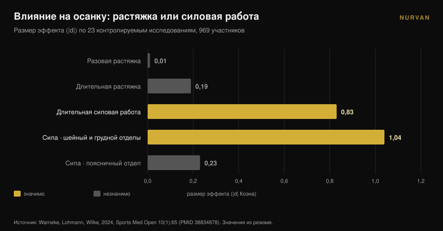
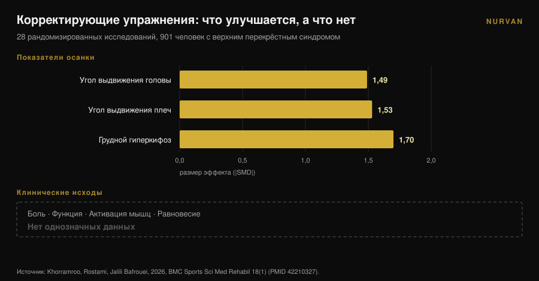

# Сутулые плечи: растяжка их не исправит

Автор: [Джаммария Лои](/autore/giammaria-loi) · обновлено 9 ноября 2026

Любая карусель про сутулые плечи предлагает одно и то же: раскрой грудную клетку, растяни грудные, прокрути верх спины. Логика выглядит стройно: укороченная грудная мышца тянет плечи вперёд, значит, растянем её — и всё встанет на место. Мета-анализ, который проверил эту логику, не нашёл никакого эффекта. Растяжка — разовая или длительная — осанку не двигает. Кое-что её двигает, и это упражнения ровно противоположного типа.

## Коротко

- **Растяжка не меняет осанку.** В 23 контролируемых исследованиях с участием 969 человек разовая растяжка дала **d = 0,01** (p = 0,97), длительная — **d = -0,19** (p = 0,16): оба значения неотличимы от нуля (Warneke et al., 2024).
- **Силовая работа — меняет.** В том же обзоре длительная силовая работа дала **d = -0,83** (p = 0,01) и значимо превзошла растяжку (d = 0,81, p = 0,004).
- **Работает выше пояса.** Эффект велик в шейном и грудном отделах (**d = -1,04**, p = 0,005) и отсутствует в поясничном и пояснично-тазовом (d = -0,23, p = 0,25).
- **Лучше осанка — не значит меньше симптомов.** В 28 рандомизированных исследованиях с 901 участником с верхним перекрёстным синдромом корректирующие упражнения сильно сдвинули углы осанки, но эффекты на боль, функцию и равновесие остались **неоднозначными** (Khorramroo et al., 2026).
- **Реальная доза — не четыре упражнения.** Протокол, который действительно сдвинул и углы, и боль, требовал **45 минут, пять дней в неделю, восемь недель** (Guo et al., 2025).

## Что на самом деле такое «сутулые плечи»

Под этим ярлыком обычно идут вместе три разные вещи: голова выдвинута вперёд относительно корпуса, плечи развёрнуты вперёд и усилен грудной изгиб. В литературе это **краниовертебральный угол**, **угол выдвижения плеч** и **грудной кифоз**; когда присутствуют все три, говорят о *верхнем перекрёстном синдроме*.

Это измерения, а не диагнозы. Вас фотографируют сбоку, прочерчивают углы и получают число. Держать это различие в голове — единственный способ правильно прочитать дальнейшее: исследования хорошо измеряют именно углы. А то, что действительно важно вам — плечо, которое свободно двигается, шея, которая не горит к шести вечера, — это другая переменная, и эти две не всегда идут вместе.

## Растяжка не меняет осанку: цифра, которую почти не цитируют

Ключевая работа здесь — систематический обзор с мета-анализом Warneke, Lohmann и Wilke, опубликованный в 2024 году в *Sports Medicine - Open*. Он объединил 23 контролируемых исследования и 969 здоровых человек, чтобы ответить на конкретный вопрос: действительно ли подход «растяни то, что укорочено, укрепи то, что слабо» меняет осанку позвоночника?

Цифры прямолинейны. **Разовая растяжка: d = 0,01, p = 0,97.** Ноль. **Длительная растяжка: d = -0,19, p = 0,16.** Направление верное, результат неотличим от случайности.

**Длительная силовая работа: d = -0,83, p = 0,01.** Большой эффект. В прямом сравнении сила обходит растяжку с d = 0,81 (p = 0,004).

Авторы пишут это без обиняков: данные умеренной достоверности не поддерживают растяжку как метод лечения мышечного дисбаланса, и специалистам стоит сосредоточиться на силовых программах для ослабленных мышц.

Одна деталь делает результат ещё полезнее. Подгрупповой анализ показывает, что силовая работа действует **в шейном и грудном отделах** (d = -1,04, p = 0,005) и **не действует** в поясничном и пояснично-тазовом (d = -0,23, p = 0,25). Верх спины отвечает на тренировку, таз — нет. Сутулые плечи находятся ровно в зоне, которая отвечает.

## Сила их сдвигает — и это недёшево

Если сила — рычаг, следующий вопрос: сколько её нужно?

Здесь надо читать протоколы, а не выводы. Самое ясное рандомизированное исследование по теме, опубликованное в 2025 году Guo с соавторами, взяло 74 студентов с верхним перекрёстным синдромом и разделило их на две группы. Группа вмешательства тренировала шею и грудной отдел **пять дней в неделю по 45 минут на протяжении восьми недель**. Контрольная группа жила как обычно.

Результаты хорошие: угол выдвижения головы d = 1,113, угол выдвижения плеч d = 1,052, боль d = 0,854, шейная дисфункция d = 0,754 и даже прирост функции лёгких (ОФВ1/ФЖЕЛ d = 0,516).

Но посчитайте дозу: **около 30 часов работы за два месяца.** Не четыре упражнения «в те дни, когда от сидения всё затекает».

Мета-анализ Xing с соавторами, 2026, по десяти рандомизированным исследованиям и 550 участникам указывает в ту же сторону: терапевтические упражнения улучшили краниовертебральный угол в среднем на **3,38 градуса** (95% доверительный интервал: 2,10-4,65), снизили боль (средняя разница -1,42) и шейную дисфункцию (-5,44). В поисковых анализах программы длительностью **не менее восьми недель** с комбинацией разных типов упражнений дали больше. Авторы предупреждают, что общая достоверность остаётся низкой или умеренной.

Три градуса после двух месяцев стабильной работы. Это реальный результат — и одновременно мера того, насколько трудно сдвинуть осанку взрослого человека.

## Осанка улучшается, симптомы не обязательно следуют за ней

Вот самый неудобный факт во всей теме, и он свежий.

Khorramroo, Rostami и Jalili Bafrouei опубликовали в 2026 году систематический обзор с мета-анализом по 28 рандомизированным исследованиям и 901 человеку с верхним перекрёстным синдромом. Корректирующие упражнения заметно улучшают углы: угол выдвижения головы **SMD -1,49**, угол выдвижения плеч **SMD -1,53**, грудной гиперкифоз **SMD -1,70**. Большие эффекты по всем позициям.

Затем идёт вторая половина работы. По исходам, которые важны человеку с жалобами — боль, функция, активация мышц, равновесие — результаты **неоднозначны**. Формулировка авторов: корректирующие упражнения эффективно устраняют биомеханические дефициты осанки, но их перевод в облегчение симптомов и улучшение функции остаётся неопределённым.

Само название исследования говорит об этом: осанка улучшается сильно, клиническая польза непоследовательна. Стоит добавить, что гетерогенность между исследованиями высокая (I² от 78% до 88%): отдельные работы согласуются друг с другом хуже, чем выглядит сводная цифра.

## А если сутулые плечи — не причина боли?

Невысказанная предпосылка любой «корректирующей» рутины: плохая осанка вызывает боль. Это предпосылка, а не установленный факт.

Исследование «случай-контроль» 2025 года сравнило 146 молодых взрослых: 73 с хронической болью в шее и 73 без неё, средний возраст 21,6 года. С болью оказались связаны **проблемы со зрением** (отношение шансов 2,83; 95% ДИ: 1,26-6,38) и **малоподвижный образ жизни** (ОШ 2,41; 1,01-5,88). Самоотчётные привычки осанки: значимой связи нет (p > 0,05).

Это одно ретроспективное исследование, на самоотчётной, а не измеренной осанке, у молодых взрослых: вопрос оно не закрывает. Но рядом с мета-анализом Khorramroo складывается согласованная картина. Осанка больше похожа на маркер, чем на причину, а малоподвижность — то, насколько мало вы двигаетесь, а не то, как вы сидите, — всплывает снова и снова.

Если вы тренируетесь и плечо болит, это заслуживает настоящего обследования, а не подборки упражнений из поста. Боль, которая не проходит, будит ночью, сопровождается покалыванием или потерей силы в руке, — это к врачу или физиотерапевту, а не к четырём растяжкам.

## Значит, мобильность грудного отдела бесполезна? Нет, но по другой причине

Не стоит перегибать в обратную сторону. У работы с грудным отделом есть крепкая доказательная база. Просто она идёт не через осанку.

Мета-анализ 2025 года по десяти рандомизированным исследованиям и 444 людям с субакромиальным импинджментом оценил мануальную терапию грудного отдела: боль **SMD -0,94** (95% ДИ: от -1,23 до -0,65) через 2-6 недель и -0,83 на среднесрочном контроле, нарушение функции -0,82 — на данных высокого качества. Амплитуда движения улучшается на данных умеренного качества: внутренняя ротация SMD 0,61, наружная 0,58.

То есть грудной отдел важен для того, как движется плечо, особенно в ротации. Причина механическая: лопатка скользит по грудной клетке, и если эта клетка лучше разгибается и вращается, рука над головой находит больше пространства. По той же причине обзор 2026 года по 13 исследованиям и 819 участникам обнаружил, что программы, сочетающие шею **и** грудной отдел, значимо снижают боль, тогда как программы только на шею улучшают углы, но не дают того же по боли — при, надо сказать, низкой и очень низкой достоверности данных.

Практический вывод не «выбрось мобильность». Он такой: **мобильность грудного отдела нужна, чтобы лучше двигаться, а не чтобы выпрямиться.** Оставьте её в разминке перед жимом над головой или тягами, а не как терапию осанки.

## Что на самом деле говорит наука

| Распространённое утверждение | Вердикт | Источник |
|---|---|---|
| «Растяни грудные — и плечи вернутся назад» | **Опровергнуто**: разовая растяжка d = 0,01, длительная d = -0,19, обе незначимы | Warneke et al., 2024 |
| «Силовая работа на спину не меняет осанку» | **Опровергнуто**: d = -0,83, а в шейно-грудном отделе d = -1,04 | Warneke et al., 2024 |
| «Четыре упражнения на мобильность исправляют сутулость» | **Не подтверждено**: эффективная доза в исследованиях — 45 мин × 5 дней × 8 недель | Guo et al., 2025; Xing et al., 2026 |
| «Сутулые плечи вызывают боль» | **Требует уточнения**: не доказано; осанка улучшается, симптомы — нет | Khorramroo et al., 2026; Assis et al., 2025 |
| «Работа с грудным отделом помогает плечу» | **Подтверждено**: боль SMD -0,94, внутренняя ротация 0,61, наружная 0,58 | Yu et al., 2025 |
| «Исправишь осанку — уйдут симптомы» | **Опровергнуто как автоматизм**: углы улучшаются, клинические исходы неоднозначны | Khorramroo et al., 2026 |

## Как это применить

1. **Перестаньте искать коррекцию и начните искать нагрузку.** Если вы отдаёте осанке десять минут в день, потратьте их на горизонтальные и вертикальные тяги, а не на растяжку груди. Это единственная переменная, которую мета-анализ увидел сдвинувшейся.
2. **Выбирайте тяговые движения для верха тела.** Тяги со штангой и гантелями, блочные тяги, подтягивания, face pull, махи в стороны и на задние дельты. Именно укрепление этих мышц оказалось эффективным в шейно-грудной зоне.
3. **Реально прогрессируйте.** Значение имеет нагрузка, растущая во времени, а не список упражнений. Записывайте вес, повторения и повторения в запасе (RIR — сколько ещё могли бы сделать в конце подхода): без этих данных «прогресс» остаётся намерением. Если нужна основа, начните с того, как [сплит отличается у новичка и продвинутого](/ru/blog/split-trenirovok-novichok-prodvinutyy).
4. **Дайте времени: восемь недель — минимум.** Ниже этого порога данные показывают немного. И реалистичный результат — порядка нескольких градусов, а не преображение.
5. **Используйте мобильность там, где она действительно помогает: в разминке.** Две-три минуты ротаций грудного отдела перед жимом над головой или тягами имеют смысл для того, как вы двигаетесь в этот день. Не ждите, что они переформатируют вашу осанку.
6. **Если болит, это не проблема осанки, пока так не сказал тот, кто вас осмотрел.** Стойкая или ночная боль, покалывание, слабость: врач или физиотерапевт.

> ### Попробуйте Nurvan — прогрессия, которую требует осанка
>
> Рычаг, который работает, — не комплекс растяжек, а силовая работа на спину, растущая неделя за неделей минимум два месяца. В Nurvan вы записываете вес, повторения и RIR в каждом подходе тяг и подтягиваний, видите кривую прогресса вместо опоры на память и импортируете уже используемую программу из PDF, Excel или даже с фотографии. [Попробовать Nurvan](https://nurvan.app)

## Частые вопросы

**Растяжка грудных бесполезна?**
Не бесполезна для ощущения подвижности и как часть разминки — она неэффективна как инструмент изменения осанки. В 23 исследованиях влияние растяжки на выравнивание позвоночника было статистически неотличимо от нуля (Warneke et al., 2024).

**Сколько времени нужно, чтобы исправить сутулые плечи?**
Исследования с измеримыми изменениями использовали программы минимум восемь недель; в работе с самыми крупными эффектами занятия шли 45 минут пять дней в неделю. Среднее улучшение краниовертебрального угла в мета-анализах — около трёх градусов.

**Сутулые плечи вызывают боль в шее?**
Это не доказано. В мета-анализах углы осанки заметно улучшаются от упражнений, но эффекты на боль и функцию остаются неоднозначными, а исследование «случай-контроль» не нашло связи между привычками осанки и хронической болью в шее.

**Тогда мобильность грудного отдела для чего-то нужна?**
Да, для движения плеча. Работа с грудным отделом улучшает боль и ротацию при субакромиальном импинджменте, на данных хорошего качества. Используйте её для подготовки к движению, а не для коррекции осанки.

## Читайте также

- [Колени наружу в приседе: правило или подсказка?](/ru/blog/koleni-naruzhu-prised) — ещё один случай, когда технический ориентир превращается в правило, которого литература не поддерживает.
- [Фоам-роллер: работает ли он? Данные 8 работ](/ru/blog/foam-roller-polza-vosstanovlenie) — тот же вопрос к другому активно продаваемому пассивному инструменту.
- [Жим гантелями или разведения: что растит грудь?](/ru/blog/zhim-gantelyami-ili-razvedeniya-grud) — если хотите тренировать грудные, а не только их растягивать.

## Источники

1. Warneke K, Lohmann LH, Wilke J, 2024. Effects of Stretching or Strengthening Exercise on Spinal and Lumbopelvic Posture: A Systematic Review with Meta-Analysis. *Sports Medicine - Open* 10(1):65. PMID 38834878. [DOI 10.1186/s40798-024-00733-5](https://doi.org/10.1186/s40798-024-00733-5)
2. Khorramroo F, Rostami M, Jalili Bafrouei M, 2026. Corrective exercises strongly improve posture but fail to produce consistent clinical or functional benefits in patients with upper crossed syndrome: a systematic review and meta-analysis of randomized controlled trials. *BMC Sports Science, Medicine & Rehabilitation* 18(1). PMID 42210327. [DOI 10.1186/s13102-026-01707-8](https://doi.org/10.1186/s13102-026-01707-8)
3. Xing Y, Wang R, Zhao X, Xu A, 2026. Therapeutic Exercise for Forward Head Posture in Neck Pain Patients: A Systematic Review and Meta-Analysis. *Journal of Pain Research* 19:614524. PMID 42445930. [DOI 10.2147/JPR.S614524](https://doi.org/10.2147/JPR.S614524)
4. Carrasco-Uribarren A, Ceballos-Laita L, Pérez-Guillén S, Jiménez-Del-Barrio S, Pantaleón-Hernández D, Cabanillas-Barea S, 2026. Impact of therapeutic exercise on craniovertebral angle in forward head posture: a systematic review and meta-analysis. *The Journal of Manual & Manipulative Therapy*. PMID 42281352. [DOI 10.1080/10669817.2026.2686739](https://doi.org/10.1080/10669817.2026.2686739)
5. Guo Y, Li M, Xie C, Liu X, Chen Y, Yang J, Wu Y, Chen S, Wang S, Lin J, 2025. Effect of the cervical and thoracic "Daoyin" training on posture and pulmonary function in patients with upper crossed syndrome: a randomized controlled trial. *BMC Complementary Medicine and Therapies* 25(1):41. PMID 39905404. [DOI 10.1186/s12906-025-04791-4](https://doi.org/10.1186/s12906-025-04791-4)
6. Yu S, Chen S, Yang Z, Ma X, Huang J, Yang L, 2025. Effectiveness of Thoracic Spine Manual Therapy in Treating Subacromial Impingement Syndrome: A Systematic Review and Meta-analysis. *Archives of Physical Medicine and Rehabilitation* 106(12):1886-1898. PMID 40712864. [DOI 10.1016/j.apmr.2025.07.008](https://doi.org/10.1016/j.apmr.2025.07.008)
7. Assis SJC de, Sanchis GJB, Meziat-Filho N, Souza CG de, Roncalli A, 2025. Association of self-reported posture habits and vision problems with chronic neck pain: A case-control study. *Journal of Bodywork and Movement Therapies* 45:946-952. PMID 41316668. [DOI 10.1016/j.jbmt.2025.10.023](https://doi.org/10.1016/j.jbmt.2025.10.023)

Литература найдена через PubMed. Отправная точка: пост [@themobilitymanual](https://www.instagram.com/p/DdYn-F3Fiqa/) от 17 сентября 2026 года о комплексе мобильности для сутулых плеч. Ни текст, ни изображения этого поста не воспроизводились: тема и утверждения перепроверены по литературе.

---

*Джаммария Лои — основатель Nurvan. Тренируется с отягощениями с 2012 года, работает персональным тренером и коучем с сертификацией FIPE с 2013 года и выступает в пауэрлифтинге на национальном уровне с 2018 года. Каждая его статья начинается с научных работ и заканчивается тем, что действительно работает в зале.*

> Примечание: информационный материал, он не заменяет консультацию врача или специалиста.
