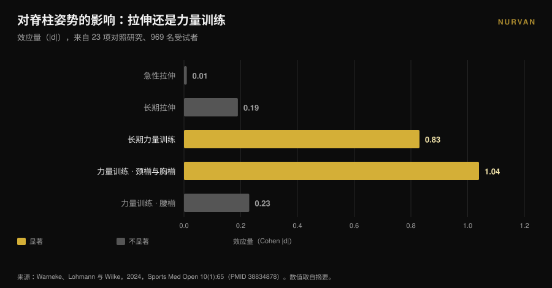
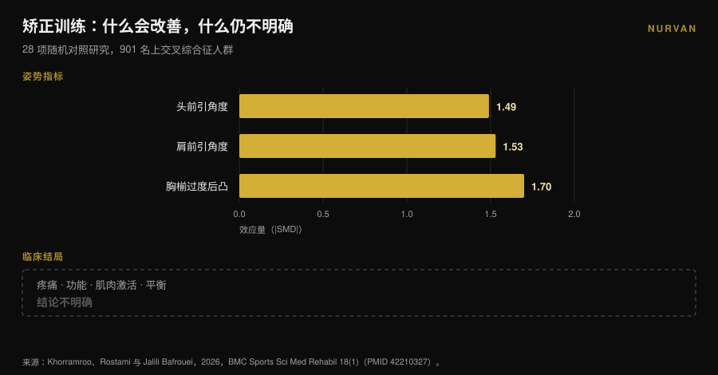

# 圆肩：拉伸根本改不了

作者：[Giammaria Loi](/autore/giammaria-loi) · 更新于 2026 年 11 月 9 日

每一篇讲圆肩的图文都开同一个方子：打开胸廓、拉伸胸大肌、旋转上背。逻辑很干净——胸肌缩短把肩膀拽向前方，那就把它拉长，一切自然归位。可真正检验这条逻辑的那篇荟萃分析，没有找到任何效果。拉伸，无论是急性还是长期，都不会改变体态。有东西能改变它，而那恰好是相反的一类训练。

## 一句话版本

- **拉伸不改变体态。** 在 23 项对照研究、969 名受试者中，急性拉伸为 **d = 0.01**（p = 0.97），长期拉伸为 **d = -0.19**（p = 0.16）：两者都与零无法区分（Warneke 等，2024）。
- **力量训练可以。** 同一篇综述中，长期力量训练达到 **d = -0.83**（p = 0.01），并显著优于拉伸（d = 0.81，p = 0.004）。
- **它在腰部以上有效。** 效应在颈椎与胸椎很大（**d = -1.04**，p = 0.005），在腰椎与腰骨盆区域为零（d = -0.23，p = 0.25）。
- **体态变好不等于症状减少。** 在 28 项随机对照研究、901 名上交叉综合征人群中，矫正训练把体态角度改善了很多，但对疼痛、功能与平衡的效果**结论不明确**（Khorramroo 等，2026）。
- **真实剂量不是四个动作。** 真正同时改变角度与疼痛的方案是**每次 45 分钟、每周 5 天、持续 8 周**（Guo 等，2025）。

## 「圆肩」到底指什么

这个标签下通常同时出现三件不同的事：头部相对躯干前移、肩膀向前旋转、胸椎曲度更明显。文献里它们叫**颅椎角**、**肩前引角度**和**胸椎后凸**；三者同时出现时，被称为*上交叉综合征*。

它们是测量值，不是诊断。有人从侧面给你拍照、画角度、得出一个数字。记住这个区别，才能读懂下面的内容：研究能精确测量的是角度。而你真正在意的——肩膀活动顺畅、脖子到傍晚六点不发烫——是另一个变量，两者并不总是同步。

## 拉伸不改变体态：几乎没人引用的那个数字

在这一点上定调的，是 Warneke、Lohmann 与 Wilke 2024 年发表于 *Sports Medicine - Open* 的系统综述与荟萃分析。它汇总了 23 项对照研究、969 名健康受试者，回答一个具体问题：「拉长紧的、强化弱的」这套做法，真的能改变脊柱姿势吗？

数字很干脆。**急性拉伸：d = 0.01，p = 0.97。** 等于零。**长期拉伸：d = -0.19，p = 0.16。** 方向对，但与随机无法区分。

**长期力量训练：d = -0.83，p = 0.01。** 大效应。直接比较时，力量训练以 d = 0.81（p = 0.004）胜过拉伸。

作者写得毫不含糊：中等确定性的证据并不支持把拉伸当作肌肉失衡的治疗手段，针对体态工作的人应把重点放在强化薄弱肌群的力量方案上。

还有一个细节让这个结果更有用。亚组分析显示，力量训练**在颈椎与胸椎有效**（d = -1.04，p = 0.005），**在腰椎与腰骨盆区域无效**（d = -0.23，p = 0.25）。上背对训练有反应，骨盆没有。圆肩恰好位于有反应的那一段。

## 力量能改变它，而且代价不小

如果力量是杠杆，下一个问题就是：要多少？

这里要看方案，而不是看结论。这方面最清楚的随机对照研究，是 Guo 等人 2025 年发表的工作：74 名患有上交叉综合征的大学生被分成两组。干预组针对颈部与胸椎训练，**每周 5 天、每次 45 分钟、持续 8 周**。对照组照常生活。

结果不错：头前引角度 d = 1.113，肩前引角度 d = 1.052，疼痛 d = 0.854，颈部功能障碍 d = 0.754，甚至肺功能也有改善（FEV1/FVC d = 0.516）。

但算一下剂量：**两个月里约 30 小时的训练。** 不是「久坐发僵那几天」做四个动作。

Xing 等人 2026 年的荟萃分析汇总了十项随机对照研究、550 人，指向同一方向：治疗性训练使颅椎角平均改善 **3.38 度**（95% 置信区间：2.10-4.65），降低疼痛（平均差 -1.42）与颈部功能障碍（-5.44）。在探索性分析中，持续**至少 8 周**并结合多种训练形式的方案收获更多。作者提醒，整体证据确定性仍为低到中等。

三度，换来的是两个月的稳定训练。这是真实的结果，同时也说明：要挪动一个成年人的体态有多难。

## 体态改善了，症状未必跟着走

这是整个话题里最不舒服的一项结果，而且很新。

Khorramroo、Rostami 与 Jalili Bafrouei 在 2026 年发表了一篇系统综述与荟萃分析，涵盖 28 项随机对照研究、901 名上交叉综合征人群。矫正训练把角度改得很明显：头前引角度 **SMD -1.49**，肩前引角度 **SMD -1.53**，胸椎过度后凸 **SMD -1.70**。全线大效应。

接着是这篇文章的后半部分。在真正困扰患者的结局上——疼痛、功能、肌肉激活、平衡——结果**不明确**。作者自己的总结是：矫正训练能有效处理生物力学上的体态缺陷，但这能否转化为症状缓解和功能改善，仍不确定。

研究标题本身就写明了：体态改善显著，临床获益并不一致。还要补充一点，研究间异质性很高（I² 介于 78% 与 88%），这意味着各项研究之间的一致程度，比汇总数字看起来要低。

## 如果圆肩根本不是疼痛的原因呢？

每一套「矫正」流程背后都有一个没说出口的前提：体态不好会痛。这是前提，不是已确立的事实。

2025 年的一项病例对照研究比较了 146 名年轻成年人：73 名有慢性颈痛、73 名没有，平均年龄 21.6 岁。与疼痛相关的是**视力问题**（比值比 2.83；95% CI：1.26-6.38）和**久坐少动**（OR 2.41；1.01-5.88）。自我报告的体态习惯：无显著关联（p > 0.05）。

这是一项回顾性研究，用的是自报而非实测体态，对象是年轻人，并不能盖棺定论。但与 Khorramroo 的荟萃分析放在一起，故事是连贯的：体态更像一个标记，而不是原因；真正反复出现的是久坐——你动得有多少，而不是你怎么坐。

如果你在训练而肩膀疼，那值得一次正式评估，而不是一套从帖子里抄来的灵活性流程。持续不退、夜间痛醒、伴随手臂麻木或力量下降的疼痛，该交给医生或物理治疗师，而不是四个拉伸。

## 那胸椎灵活性没用吗？有用，但理由不同

别矫枉过正。针对胸椎的工作有扎实的证据，只是它不经由体态起作用。

2025 年一篇荟萃分析汇总十项随机对照研究、444 名肩峰下撞击综合征患者，评估了胸椎手法治疗：疼痛 **SMD -0.94**（95% CI：-1.23 至 -0.65）于 2-6 周，中期随访为 -0.83，功能障碍 -0.82，均为高质量证据。活动度在中等质量证据下改善：内旋 SMD 0.61，外旋 0.58。

所以胸椎对肩关节如何活动是有意义的，尤其是旋转。原因是力学上的：肩胛骨在胸廓上滑动，胸廓伸展与旋转更好，手臂过顶时就有更多空间。这也是为什么 2026 年一篇涵盖 13 项研究、819 人的综述发现：同时训练颈部**与**胸椎的方案能显著降低疼痛，而只练颈部的方案虽然改善角度，却达不到同样的效果——不过要说明，这部分证据的确定性为低到极低。

实用结论不是「把灵活性训练扔掉」，而是：**胸椎灵活性让你动得更好，而不是让你站得更直。** 把它放在过顶推举或划船前的热身里，而不是当作体态治疗。

## 研究到底怎么说

| 常见说法 | 判定 | 来源 |
|---|---|---|
| 「拉伸胸肌，肩膀就会回来」 | **被推翻**：急性拉伸 d = 0.01，长期 d = -0.19，均不显著 | Warneke 等，2024 |
| 「练背不会改变体态」 | **被推翻**：d = -0.83，颈胸段为 d = -1.04 | Warneke 等，2024 |
| 「四个灵活性动作能矫正圆肩」 | **缺乏支持**：研究中的有效剂量是 45 分钟 × 5 天 × 8 周 | Guo 等，2025；Xing 等，2026 |
| 「圆肩会引起疼痛」 | **需要限定**：未被证实；体态改善而症状未必 | Khorramroo 等，2026；Assis 等，2025 |
| 「练胸椎对肩膀有帮助」 | **被证实**：疼痛 SMD -0.94，内旋 0.61，外旋 0.58 | Yu 等，2025 |
| 「矫正体态，症状就消失」 | **作为必然规律被推翻**：角度改善，临床结局不明确 | Khorramroo 等，2026 |

## 怎么落地

1. **别再追求矫正，开始追求负荷。** 如果你每天给体态十分钟，把它花在水平与垂直拉的动作上，而不是胸部拉伸。这是荟萃分析里唯一动起来的变量。
2. **选上肢的拉类动作。** 杠铃划船、哑铃划船、坐姿划船、引体向上、face pull、侧平举与后束飞鸟。正是这些肌群的强化，在颈胸段被证明有效。
3. **真的做到渐进。** 起作用的刺激是随时间增长的负荷，不是动作清单。记录重量、次数与储备次数（RIR，即一组结束时还能再做几次）：没有这项数据，「进步」只是意图。如果需要一个结构起点，可以先看[新手与高手的训练分化有什么不同](/zh/blog/xunlian-fenhua-xinshou-gaoji)。
4. **给它时间：8 周是起步。** 低于这个阈值，数据显示不出什么。而现实的结果是几度，不是脱胎换骨。
5. **把灵活性用在真正有用的地方：热身。** 过顶推举或划船前做两三分钟胸椎旋转，对当天的动作质量有意义。别指望它重塑你的体态。
6. **只要会痛，在有人真正检查过之前，它都不算体态问题。** 持续性疼痛、夜间痛、伴麻木或无力：找医生或物理治疗师。

> ### 试试 Nurvan —— 体态真正需要的渐进
>
> 有效的杠杆不是一套拉伸流程，而是至少持续两个月、一周比一周增长的背部力量训练。用 Nurvan 记录每一组划船和引体向上的负荷、次数与 RIR，用进步曲线代替凭记忆估计，还能把你现有的计划从 PDF、Excel 甚至一张照片导入。[试试 Nurvan](https://nurvan.app)

## 常见问题

**拉伸胸肌没用吗？**
就活动感受或作为热身而言并非没用；它只是作为改变体态的工具无效。在 23 项研究中，拉伸对脊柱排列的影响在统计上与零无法区分（Warneke 等，2024）。

**矫正圆肩需要多久？**
取得可测量变化的研究采用的方案至少 8 周；效果最大的那项是每次 45 分钟、每周 5 天。荟萃分析中颅椎角的平均改善约为三度。

**圆肩会引起颈痛吗？**
尚未被证实。荟萃分析显示训练能明显改善体态角度，但对疼痛与功能的效果仍不明确；一项病例对照研究也未发现体态习惯与慢性颈痛之间的关联。

**那胸椎灵活性到底有什么用？**
对肩关节活动有用。针对胸椎的处理能改善肩峰下撞击人群的疼痛与旋转，证据质量良好。把它当作动作准备，而不是体态矫正。

## 延伸阅读

- [深蹲「膝盖外展」：是规则还是口令？](/zh/blog/shenzun-xigai-waizhan) —— 另一个技术提示被当成规则、却得不到文献支持的例子。
- [泡沫轴到底有没有用？八项研究给出答案](/zh/blog/paomozhou-youyong-ma-huifu) —— 对另一件热销被动工具提出同样的问题。
- [哑铃卧推还是飞鸟：哪个让胸肌长得更多？](/zh/blog/yaling-wotui-haishi-feiniao-xiongji) —— 如果你想好好练胸，而不只是拉伸它。

## 参考文献

1. Warneke K, Lohmann LH, Wilke J, 2024. Effects of Stretching or Strengthening Exercise on Spinal and Lumbopelvic Posture: A Systematic Review with Meta-Analysis. *Sports Medicine - Open* 10(1):65. PMID 38834878. [DOI 10.1186/s40798-024-00733-5](https://doi.org/10.1186/s40798-024-00733-5)
2. Khorramroo F, Rostami M, Jalili Bafrouei M, 2026. Corrective exercises strongly improve posture but fail to produce consistent clinical or functional benefits in patients with upper crossed syndrome: a systematic review and meta-analysis of randomized controlled trials. *BMC Sports Science, Medicine & Rehabilitation* 18(1). PMID 42210327. [DOI 10.1186/s13102-026-01707-8](https://doi.org/10.1186/s13102-026-01707-8)
3. Xing Y, Wang R, Zhao X, Xu A, 2026. Therapeutic Exercise for Forward Head Posture in Neck Pain Patients: A Systematic Review and Meta-Analysis. *Journal of Pain Research* 19:614524. PMID 42445930. [DOI 10.2147/JPR.S614524](https://doi.org/10.2147/JPR.S614524)
4. Carrasco-Uribarren A, Ceballos-Laita L, Pérez-Guillén S, Jiménez-Del-Barrio S, Pantaleón-Hernández D, Cabanillas-Barea S, 2026. Impact of therapeutic exercise on craniovertebral angle in forward head posture: a systematic review and meta-analysis. *The Journal of Manual & Manipulative Therapy*. PMID 42281352. [DOI 10.1080/10669817.2026.2686739](https://doi.org/10.1080/10669817.2026.2686739)
5. Guo Y, Li M, Xie C, Liu X, Chen Y, Yang J, Wu Y, Chen S, Wang S, Lin J, 2025. Effect of the cervical and thoracic "Daoyin" training on posture and pulmonary function in patients with upper crossed syndrome: a randomized controlled trial. *BMC Complementary Medicine and Therapies* 25(1):41. PMID 39905404. [DOI 10.1186/s12906-025-04791-4](https://doi.org/10.1186/s12906-025-04791-4)
6. Yu S, Chen S, Yang Z, Ma X, Huang J, Yang L, 2025. Effectiveness of Thoracic Spine Manual Therapy in Treating Subacromial Impingement Syndrome: A Systematic Review and Meta-analysis. *Archives of Physical Medicine and Rehabilitation* 106(12):1886-1898. PMID 40712864. [DOI 10.1016/j.apmr.2025.07.008](https://doi.org/10.1016/j.apmr.2025.07.008)
7. Assis SJC de, Sanchis GJB, Meziat-Filho N, Souza CG de, Roncalli A, 2025. Association of self-reported posture habits and vision problems with chronic neck pain: A case-control study. *Journal of Bodywork and Movement Therapies* 45:946-952. PMID 41316668. [DOI 10.1016/j.jbmt.2025.10.023](https://doi.org/10.1016/j.jbmt.2025.10.023)

文献通过 PubMed 检索。选题起点：[@themobilitymanual](https://www.instagram.com/p/DdYn-F3Fiqa/) 于 2026 年 9 月 17 日发布的一则关于圆肩灵活性流程的帖子。该帖子的文字与图片均未被复制：主题与其中的说法已在文献中重新核验。

---

*Giammaria Loi 是 Nurvan 的创始人。他自 2012 年开始力量训练，2013 年起担任 FIPE 认证私人教练与教练，2018 年起在国家级powerlifting 赛事中参赛。他署名的每篇文章都从科学研究出发，落到健身房里真正有效的做法。*

> 注意：本文为科普内容，不能替代医生或专业人士的意见。
