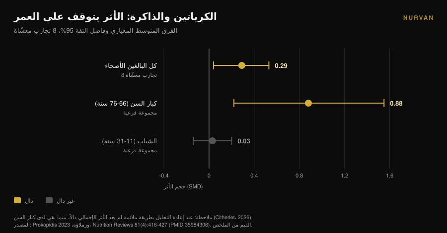
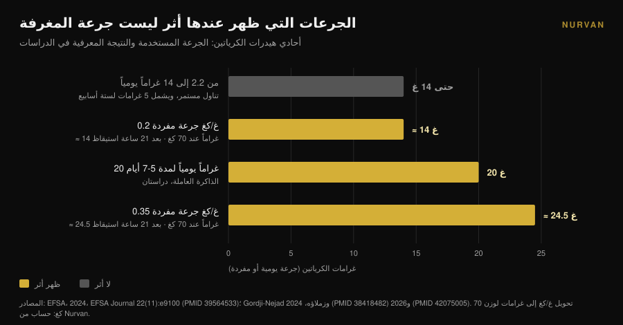

# الكرياتين والدماغ: ماذا تقول الدراسات فعلاً

بقلم [Giammaria Loi](/autore/giammaria-loi) · حُدِّث في 10 نوفمبر 2026

خلال سنة تقريباً لم يعد الكرياتين شأناً خاصاً بالنادي: نمت عمليات البحث عن «الكرياتين للدماغ» بنسبة 118% في اثني عشر شهراً، وصارت المغرفة تُباع كترقية ذهنية. في الفترة نفسها رفضت الهيئة الأوروبية لسلامة الأغذية الادعاء المعرفي، ووُجِّه إلى التحليل البعدي الأكثر استشهاداً اتهام بخطأ في العدّ. إليك ما يصمد، ولمن، وبأي جرعة.

## باختصار

- **EFSA قالت لا.** في 2024 خلصت اللجنة الأوروبية إلى أن العلاقة السببية بين تناول الكرياتين وتحسّن الوظائف المعرفية **لم تُثبت**.
- **التحليل البعدي الأكثر استشهاداً موضع طعن.** يذكر Xu وزملاؤه (2024) أثراً على الذاكرة (SMD 0.31)، لكن تعليقاً نُشر في 2026 يبيّن أن المشاركين أنفسهم حُسبوا أكثر من مرة: عدد الملاحظات يتجاوز عدد من جرت عشوأتهم.
- **عند إعادة الحساب بشكل صحيح لا يبقى سوى العمر.** حين صُحِّح الخلل نفسه في تحليل بعدي آخر اختفى أثر الذاكرة إلا عند كبار السن: **SMD 0.88** في الفئة 66-76 سنة مقابل **0.03** لدى الشباب.
- **الجرعات التي ظهر عندها أثر ليست جرعة المغرفة.** الإشارات جاءت من 20 غراماً يومياً لمدة 5-7 أيام، أو من جرعات مفردة بمقدار 0.2-0.35 غرام/كغ — أي **14 إلى 24.5 غراماً** لشخص وزنه 70 كغ — وبعد ليلة بلا نوم.
- **عنق الزجاجة هو الحاجز الدموي الدماغي.** يدخل الكرياتين العضلة بسهولة، أما الدماغ فأقل بكثير، والزيادات المقاسة تبقى متواضعة.

## لماذا صار «الكرياتين للدماغ» في كل مكان الآن

الإشارة قابلة للقياس. نما البحث الإنجليزي "creatine for brain" بنسبة 118% على أساس سنوي ويدور حول 22,000 عملية بحث شهرياً (بيانات Glimpse حتى أبريل 2025). في الفترة نفسها انتقل الكرياتين من رفّ مكملات الرياضة إلى رفوف صحة الدماغ والمزاج وسن اليأس.

لاحظ الباحثون ذلك. في 2025 نشرت *Journal of Nutrition* مقال رأي عنوانه حرفياً «الوعد والدليل والإدراك العام»: يصف الكاتب حماسة عامة وتجارية رفعت المبيعات والوصفات والتفاعل على الشبكات، في مقابل رصيد من الأدلة ظلّ — بتعبيره — محدوداً على نحو مفارق (Eckert، 2025).

الأمر هنا ليس دفاعاً عن الكرياتين ولا هجوماً عليه. على صعيد العضلة يبقى من أكثر المكملات استناداً إلى الأدلة، ولهذا يتصدّر [تصنيفنا لمكملات القوة](/ar/blog/tasnif-mukammilat-alquwa). السؤال أضيق: كم من الذي تقرأه عن الدماغ تسنده البيانات فعلاً؟

## العضلة نعم، الدماغ قصة أخرى

سبب عدم انتقال الاستنتاج من أحدهما إلى الآخر تشريحي. تلتقط العضلة الكرياتين عبر ناقل مخصص فيرتفع المخزون بصورة قابلة للقياس. أما الدماغ فمحميّ بـ**الحاجز الدموي الدماغي**، ذلك المرشّح الذي يقرر ما ينتقل من الدم إلى الجهاز العصبي، وهو يسمح بمرور كمية أقل بكثير من الكرياتين.

مراجعة نُشرت في 2025 في *Nutrition and Health* تضع هذا في الصميم: الغموض الأساسي هو ما إذا كان الكرياتين المتناول فموياً يصل إلى الدماغ بكمية كافية لتغيير أيض الخلايا العصبية. تُظهر بعض الدراسات زيادات متواضعة في كرياتين الدماغ، لكن القيود المنهجية والتباين الفردي وغياب بروتوكولات موحّدة تمنع أي استنتاج حاسم. وخاتمة الكاتب لا تحتمل اللبس: في الوقت الحالي يجب اعتبار التناول لغرض معرفي لدى كبار السن **فرضية، لا ممارسة سريرية راسخة** (Machado، 2025).

احتفظ بهذا في ذهنك وأنت تقرأ البقية. كل النقاش حول الأرقام ينطلق من مشكلة وصول: إن لم يصل الجزيء فلا يمكن أن يظهر الأثر، مهما بدت الآلية أنيقة على الورق.

## التحليل البعدي الذي يستشهد به الجميع فيه مشكلة عدّ

إذا بحثت عن «الكرياتين والذاكرة» فالمصدر الذي يظهر غالباً هو المراجعة المنهجية مع التحليل البعدي لـ Xu وزملائه، المنشورة في 2024 في *Frontiers in Nutrition*: 16 تجربة معشّاة، 492 مشاركاً تتراوح أعمارهم بين 20.8 و76.4 سنة. تبدو النتائج واضحة — الذاكرة SMD 0.31 (فاصل ثقة 95%: 0.18-0.44)، زمن الانتباه -0.31، سرعة المعالجة -0.51 — دون أثر على الإدراك العام أو الوظائف التنفيذية.

في أبريل 2026 نشرت المجلة نفسها تعليقاً يفكّك المنهج. عدة دراسات مشمولة تورد مقاييس معرفية متعددة ومترابطة لدى المشاركين أنفسهم — سبعة اختبارات فرعية للذاكرة أو أكثر للفرد في بعض الحالات — وعوملت تلك المقاييس كأحجام أثر مستقلة. والنتيجة أن **عدد الملاحظات في التحليل المجمَّع يتجاوز عدد من جرت عشوأتهم فعلاً** (Citherlet، 2026).

يسمّى هذا العدّ المزدوج، وهو خطأ في وحدة التحليل. يضخّم الدقة والقوة الإحصائية اصطناعياً: يخرج فاصل الثقة أضيق مما تسمح به البيانات، فيبدو الأثر غير المؤكد مؤكداً.

وليست هذه ملاحظة يتيمة. فقد أثارت EFSA النقطة نفسها في 2024، مشيرة إلى أن تجميع نتائج معرفية غير مستقلة في ذلك التحليل ضخّم أحجام العينات، وخلصت إلى تعذّر استخلاص أي استنتاج من تلك البيانات.

لكن الجزء الأكثر إفادة يخص عملاً أسبق. التحليل البعدي لـ Prokopidis وزملائه من 2023 حول الذاكرة لدى الأصحاء كان فيه الخلل ذاته. وحين أعاد المؤلفون التحليل بطريقة ملائمة، **لم يعد الأثر الإجمالي للكرياتين على الذاكرة دالاً إحصائياً — إلا لدى كبار السن**.

تفسّر هذه التفصيلة معظم الالتباس، وكانت ظاهرة أصلاً في المجموعات الفرعية المنشورة عام 2023: في الفئة 66-76 سنة بلغ أثر الذاكرة SMD 0.88 (فاصل ثقة 95%: 0.22-1.55)؛ وفي الفئة 11-31 سنة بلغ 0.03 (فاصل ثقة 95%: من -0.14 إلى 0.20)، أي صفر. ولم تغيّر النتيجةَ الجرعةُ (من 2.2 إلى 20 غراماً يومياً) ولا المدة (من 5 أيام إلى 24 أسبوعاً) ولا الجنس ولا المنشأ الجغرافي.

## لماذا رفضت EFSA الادعاء

في 2024 طلبت شركة من الاتحاد الأوروبي السماح بكتابة أن الكرياتين يحسّن الوظائف المعرفية على العبوة. راجعت لجنة NDA في EFSA 23 دراسة تدخّلية على البشر وأجابت بالرفض.

الاستدلال أثمن من الحكم، لأنه خريطة جرعات. ظهر الأثر الحاد على الذاكرة العاملة في **دراستين، بجرعة 20 غراماً يومياً لمدة 5-7 أيام**. ولم يظهر عند جرعات بين 2.2 و14 غراماً يومياً. ولم يظهر أيضاً مع التناول المستمر لـ**5 غرامات يومياً لستة أسابيع** بعد مرحلة تحميل من خمسة أيام.

أما الأثر على كبح الاستجابة، وأيضاً عند 20 غراماً يومياً لمدة 7 أيام، فبقي نتيجة معزولة بين عشر دراسات على أصحاء، دون آثار على بقية المجالات المعرفية. والدراسات الثلاث على مرضى لم تدعم الأثر، كما اعتبرت اللجنة معقولية الآلية ضعيفة هي الأخرى. والخلاصة بنصّها: **لم تُثبت علاقة سببية** (EFSA، 2024).

بالترجمة العملية: الجرعة التي يتناولها الجميع تقريباً — مغرفة الخمسة غرامات، التي تعمل بامتياز من أجل العضلة — ليست الجرعة التي قاس عندها أحدٌ أثراً معرفياً.

## السيناريو الوحيد الذي تقنع فيه الأرقام: ليلة بلا نوم

ثمة حالة تصبح فيها البيانات أكثر إثارة للاهتمام، وهي أيضاً الأقل بريقاً: الحرمان من النوم.

في 2024 أعطى فريق من مركز يوليش البحثي **جرعة مفردة مرتفعة جداً** من أحادي هيدرات الكرياتين — 0.35 غرام لكل كيلوغرام من الوزن — لأشخاص أُبقوا مستيقظين 21 ساعة، مع تتبّع فوسفاتات الدماغ عالية الطاقة بالتحليل الطيفي بالرنين المغناطيسي. غيّر الكرياتين تلك المؤشرات، ومنع انخفاض الأس الهيدروجيني، وحسّن الأداء المعرفي وسرعة المعالجة مقارنة بالدواء الوهمي (Gordji-Nejad وزملاؤه، 2024).

وفي 2026 كرّر الفريق نفسه التجربة بجرعة أقل، 0.2 غرام لكل كيلوغرام، على 29 شخصاً. خفّ التدهور المعرفي الناجم عن السهر الطويل في المهام المنطقية والعددية، وفي سرعة المعالجة اللغوية، وفي اختبار اليقظة النفسحركية، بتحسّن **يصل إلى 12%**. كان الأثر أقل وضوحاً منه مع الجرعة المرتفعة، واستفادت النساء أكثر من الرجال في المنطق واليقظة والسرعة (Gordji-Nejad وزملاؤه، 2026).

قبل أن تطلب العبوة الكبيرة، احسب. لشخص وزنه 70 كيلوغراماً، 0.2 غرام/كغ تعني **14 غراماً** دفعة واحدة، و0.35 غرام/كغ تعني **24.5 غراماً**: أي نحو ثلاث مغارف وخمس مغارف من فئة 5 غرامات. هذه بروتوكولات مخبرية حادة، على عينات صغيرة، من فريق بحثي واحد، وتقيس التعافي من ليلة بلا نوم — لا تعزيزاً معرفياً لدى شخص ينام بانتظام.

وهناك قراءة أكثر أمانة للنتيجة: ما تراه ليس كرياتيناً يجعلك أكثر صفاءً، بل كرياتيناً يعوّض جزئياً عجزاً طاقياً مُستحدثاً. خبر مفيد لمن يعمل في المناوبات الليلية؛ لا وعد لمن يريد مذاكرة أفضل.

## ماذا تقول الأبحاث فعلاً

| ادعاء شائع | الحكم | المصدر |
|---|---|---|
| «الكرياتين يحسّن الوظائف المعرفية» | **مرفوض كادعاء**: لم تُثبت علاقة سببية | EFSA، 2024 |
| «التحليلات البعدية تثبت أثراً على الذاكرة» | **يحتاج تحفّظاً**: عدّ مزدوج للمشاركين، ويلزم إعادة تحليل | Citherlet، 2026؛ EFSA، 2024 |
| «يعمل بالقدر نفسه في كل عمر» | **مُفنَّد**: SMD 0.88 في 66-76 سنة مقابل 0.03 في 11-31 سنة | Prokopidis وزملاؤه، 2023 |
| «5 غرامات يومياً تكفي للدماغ أيضاً» | **غير مدعوم**: لا أثر عند 5 غ/يوم لستة أسابيع؛ الإشارات عند 20 غ/يوم | EFSA، 2024 |
| «يساعد بعد ليلة بلا نوم» | **مؤكَّد مخبرياً**: حتى +12% بجرعة مفردة 0.2 غ/كغ | Gordji-Nejad وزملاؤه، 2024 و2026 |
| «يصل إلى الدماغ كما يصل إلى العضلة» | **مُفنَّد**: الحاجز الدموي الدماغي يحدّ من الدخول، والزيادات متواضعة | Machado، 2025 |
| «الكرياتين منشط ذهني» | **غير قابل للتحقق اليوم**: الحماسة العامة تفوق الأدلة بكثير | Eckert، 2025 |

## كيف تطبّقه

1. **إن كنت تتناوله من أجل العضلة فاستمر.** لا شيء في هذا المقال يشكّك في الاستخدام الرياضي للكرياتين: هناك الأدلة متينة. ما لا يصمد هو الادعاء المعرفي.
2. **لا ترفع الجرعة «من أجل الدماغ».** الجرعات التي ظهر عندها شيء — 20 غراماً يومياً، أو جرعات مفردة من 14 إلى 24.5 غراماً — تأتي من بروتوكولات بحثية تحت مراقبة، لا من عادة يومية. خارج الدراسة لا يوجد ما يبرر الصعود، والجرعات المرتفعة تصحبها غالباً اضطرابات هضمية.
3. **إن تجاوزت الخامسة والستين فأنت في المجموعة الفرعية الوحيدة التي ظهرت فيها إشارة.** تبقى إشارة، لا علاجاً. تحدّث مع طبيبك قبل البدء، خاصة مع مشكلات الكلى أو وجود دواء مستمر.
4. **توقّع صفراً إن كنت تنام جيداً.** لدى البالغين الشباب المرتاحين، الأثر المقاس على الذاكرة لا يُميَّز عن الصفر. أما النوم فيحرّك المتغير نفسه فعلاً، وبكلفة أقل.
5. **تشكّك في المنتجات التي تُباع باسم «كرياتين للذهن».** إن كانت التركيبة أغلى فعليها أن تبرهن: اسأل عن الجرعة والمدة والفئة التي قيس فيها الأثر.
6. **سجّل ما تتناوله فعلاً.** بين ما تظن أنك تأخذه وما تأخذه فعلاً أسابيع منسية ومغارف تقريبية. لمعرفة ما إذا كان مكمّل ما يفعل شيئاً، لا بد من تدوين البيانات. وإن كنت لا تزال تختار الشكل، قارنّا بين [الحلوى المطاطية والبودرة](/ar/blog/alsakakir-almatatiya-bialkrieatin).

> ### جرّب Nurvan — مكملات يمكنك فعلاً مراجعتها
>
> تسجّل وحدة المكملات في Nurvan شكل ما تتناوله وجرعته وتوقيته، والكرياتين ضمنها، وتضعه إلى جانب الأحمال والقياسات والحصص التدريبية. هكذا تتوقف عن الحكم على مكمّل بالإحساس وترى ما الذي تغيّر، أسبوعاً بعد أسبوع، خلال الفترة التي تناولته فيها. [جرّب Nurvan](https://nurvan.app)

## أسئلة شائعة

**هل يحسّن الكرياتين الذاكرة؟**
ليس بما يكفي لتأكيد ذلك. التحليلات البعدية التي أوردت أثراً حسبت المشاركين أنفسهم أكثر من مرة، وبعد تصحيح المشكلة بقي الأثر لدى كبار السن فقط. وخلصت EFSA في 2024 إلى أن العلاقة السببية لم تُثبت.

**كم كرياتيناً يلزم الدماغ؟**
لا توجد جرعة موصى بها لأنه لا يوجد أثر مثبت. في الدراسات التي ظهر فيها شيء كانت الجرعات 20 غراماً يومياً لمدة 5-7 أيام أو جرعات مفردة من 0.2 إلى 0.35 غرام/كغ: أكثر بكثير من مغرفة الخمسة غرامات، وفي سياقات بحثية مضبوطة. وليست إرشاداً يُطبَّق ذاتياً.

**هل يساعد الكرياتين إن كنت أنام قليلاً؟**
أظهرت تجربتان معشّاتان على حرمان حاد من النوم تعافياً جزئياً في الأداء المعرفي، حتى 12% بجرعة مفردة 0.2 غرام/كغ. عيّنتان صغيرتان من الفريق البحثي نفسه، وتخصّان ليلة واحدة بلا نوم: ولا تقولان شيئاً عمّن ينام بانتظام.

**لماذا ينفع في العضلة ولا ينفع في الدماغ؟**
لأن العضلة تلتقطه بسهولة، بينما الدماغ محميّ بالحاجز الدموي الدماغي الذي يسمح بمرور كمية أقل بكثير. والزيادات المقاسة في كرياتين الدماغ بعد التناول تبقى متواضعة وتتفاوت كثيراً بين شخص وآخر.

## اقرأ أيضاً

- [هل تنفع حلوى الكرياتين المطاطية مثل البودرة؟](/ar/blog/alsakakir-almatatiya-bialkrieatin) — الجزيء نفسه بشكل أغلى: ما الذي يتغير فعلاً.
- [الكرياتين بلا تمرين بعد الخامسة والأربعين: ماذا تقول الدراسة](/ar/blog/creatine-bidun-tamarin-baad-45) — الحالة الأخرى التي يغيّر فيها العمر الاستجابة للمكمّل.
- [تصنيف مكملات القوة: ماذا يقول البحث العلمي](/ar/blog/tasnif-mukammilat-alquwa) — أين يقف الكرياتين حين يكون الحديث عن القوة، ومن يجاوره.

## المصادر

1. EFSA Panel on Nutrition, Novel Foods and Food Allergens (Turck D, Bohn T, Cámara M, et al.), 2024. Creatine and improvement in cognitive function: Evaluation of a health claim pursuant to article 13(5) of regulation (EC) No 1924/2006. *EFSA Journal* 22(11):e9100. PMID 39564533. [DOI 10.2903/j.efsa.2024.9100](https://doi.org/10.2903/j.efsa.2024.9100)
2. Eckert I, 2025. Creatine Supplementation for Cognition: A Critical Perspective on Promise, Proof, and Public Perception. *The Journal of Nutrition* 155(10):3143-3147. PMID 40744234. [DOI 10.1016/j.tjnut.2025.07.016](https://doi.org/10.1016/j.tjnut.2025.07.016)
3. Citherlet T, 2026. Commentary: The effects of creatine supplementation on cognitive function in adults: a systematic review and meta-analysis. *Frontiers in Nutrition* 13:1716285. PMID 42039906. [DOI 10.3389/fnut.2026.1716285](https://doi.org/10.3389/fnut.2026.1716285)
4. Xu C, Bi S, Zhang W, Luo L, 2024. The effects of creatine supplementation on cognitive function in adults: a systematic review and meta-analysis. *Frontiers in Nutrition* 11:1424972. PMID 39070254. [DOI 10.3389/fnut.2024.1424972](https://doi.org/10.3389/fnut.2024.1424972)
5. Prokopidis K, Giannos P, Triantafyllidis KK, Kechagias KS, Forbes SC, Candow DG, 2023. Effects of creatine supplementation on memory in healthy individuals: a systematic review and meta-analysis of randomized controlled trials. *Nutrition Reviews* 81(4):416-427. PMID 35984306. [DOI 10.1093/nutrit/nuac064](https://doi.org/10.1093/nutrit/nuac064)
6. Gordji-Nejad A, Matusch A, Kleedörfer S, Jayeshkumar Patel H, Drzezga A, Elmenhorst D, Binkofski F, Bauer A, 2024. Single dose creatine improves cognitive performance and induces changes in cerebral high energy phosphates during sleep deprivation. *Scientific Reports* 14(1):4937. PMID 38418482. [DOI 10.1038/s41598-024-54249-9](https://doi.org/10.1038/s41598-024-54249-9)
7. Gordji-Nejad A, Matusch A, Hengstler L, Beer S, Kroll T, Klein S, Elmenhorst D, Bauer A, Drzezga A, 2026. Single-Dose Creatine Reduces Sleep Deprivation-Induced Deterioration in Cognitive Performance. *Nutrients* 18(8):1192. PMID 42075005. [DOI 10.3390/nu18081192](https://doi.org/10.3390/nu18081192)
8. Machado M, 2025. Creatine supplementation and cognitive aging: The challenge of crossing the blood-brain barrier. *Nutrition and Health* 32(3):761-763. PMID 41359040. [DOI 10.1177/02601060251404327](https://doi.org/10.1177/02601060251404327)

المصادر الببليوغرافية جرى الحصول عليها عبر PubMed. اختير الموضوع من إشارة اتجاه: البحث "creatine for brain" بزيادة 118% على أساس سنوي ونحو 22,000 بحث شهرياً (Glimpse، بيانات أبريل 2025)، إلى جانب مقال الرأي النقدي المنشور في *Journal of Nutrition* عام 2025 حول الفجوة بين التسويق والأدلة.

---

*جياماريا لوي هو مؤسس Nurvan. يتدرب بالأثقال منذ 2012، ويعمل مدرباً شخصياً ومدرّباً معتمداً من FIPE منذ 2013، وينافس في رفع الأثقال القوة على المستوى الوطني منذ 2018. كل مقال يوقّعه ينطلق من الدراسات العلمية وينتهي إلى ما ينفع فعلاً في النادي.*

> ملاحظة: محتوى تثقيفي، لا يغني عن رأي الطبيب أو المختص.
