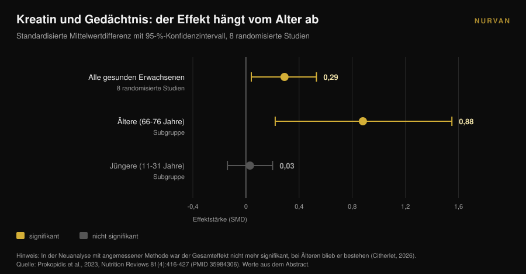
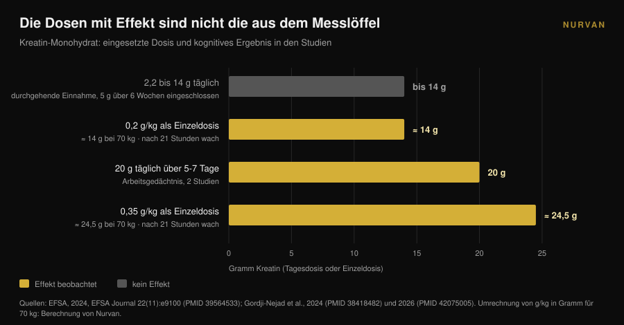

# Kreatin und Gehirn: was die Studien wirklich zeigen

Von [Giammaria Loi](/autore/giammaria-loi) · aktualisiert am 10. November 2026

Seit etwa einem Jahr ist Kreatin keine reine Gym-Sache mehr: Die Suchanfragen nach "creatine for brain" sind in zwölf Monaten um 118 % gestiegen, und der Messlöffel wird als mentales Upgrade verkauft. Im selben Zeitraum hat die europäische Lebensmittelbehörde die kognitive Aussage abgelehnt, und die meistzitierte Meta-Analyse geriet wegen eines Zählfehlers in die Kritik. Was davon bleibt, für wen und in welcher Dosis.

## Kurz gefasst

- **Die EFSA sagte Nein.** 2024 kam das europäische Gremium zu dem Schluss, dass ein Ursache-Wirkungs-Zusammenhang zwischen Kreatin und verbesserter kognitiver Funktion **nicht belegt ist**.
- **Die meistzitierte Meta-Analyse ist umstritten.** Xu und Kollegen (2024) berichten einen Effekt auf das Gedächtnis (SMD 0,31), doch ein Kommentar von 2026 zeigt, dass dieselben Teilnehmenden mehrfach gezählt wurden: Die Beobachtungen übersteigen die Zahl der randomisierten Personen.
- **Richtig gerechnet bleibt nur das Alter.** Als derselbe Fehler in einer anderen Meta-Analyse korrigiert wurde, verschwand der Gedächtniseffekt bis auf ältere Menschen: **SMD 0,88** bei 66-76 Jahren gegenüber **0,03** bei Jüngeren.
- **Die Dosen mit Signal sind nicht die aus dem Messlöffel.** Die Signale stammen von 20 g täglich über 5-7 Tage oder von Einzeldosen von 0,2-0,35 g/kg — **14 bis 24,5 g** bei 70 kg Körpergewicht — und zwar nach einer schlaflosen Nacht.
- **Der Engpass ist die Blut-Hirn-Schranke.** In den Muskel gelangt Kreatin leicht, ins Gehirn deutlich weniger, und die gemessenen Anstiege bleiben moderat.

## Warum „Kreatin fürs Gehirn“ gerade überall ist

Das Signal ist messbar. Die englische Suchanfrage "creatine for brain" wuchs im Jahresvergleich um 118 % und liegt bei rund 22.000 Suchen pro Monat (Glimpse-Daten mit Stand April 2025). Im selben Zeitraum wanderte Kreatin vom Regal für Sportsupplemente in das für Gehirngesundheit, Stimmung und Wechseljahre.

Die Forschung hat es bemerkt. 2025 veröffentlichte das *Journal of Nutrition* einen Perspektivbeitrag mit dem Titel, wörtlich, „Versprechen, Beleg und öffentliche Wahrnehmung“: Der Autor beschreibt eine öffentliche und kommerzielle Begeisterung, die Verkäufe, Verordnungen und Social-Media-Interaktionen hochschnellen ließ — bei einer Evidenzlage, die, seine Formulierung, paradoxerweise begrenzt geblieben ist (Eckert, 2025).

Es geht hier nicht darum, Kreatin zu verteidigen oder anzugreifen. Für den Muskel bleibt es eines der am besten belegten Supplemente überhaupt, weshalb es in unserer [Tier-List der Kraftsport-Supplemente](/de/blog/kraftsport-supplemente-tier-list) ganz oben steht. Die Frage ist enger: Wie viel von dem, was du über das Gehirn liest, trägt die Datenlage wirklich?

## Muskel ja, Gehirn ist eine andere Baustelle

Der Grund, warum das eine nicht das andere bedeutet, ist anatomisch. Der Muskel nimmt Kreatin über einen eigenen Transporter auf, der Speicher steigt messbar. Das Gehirn liegt hinter der **Blut-Hirn-Schranke**, dem Filter, der entscheidet, was aus dem Blut ins Nervensystem gelangt — und dieser Filter lässt weit weniger Kreatin durch.

Eine Übersicht von 2025 in *Nutrition and Health* stellt genau das in den Mittelpunkt: Die zentrale Unsicherheit ist, ob oral zugeführtes Kreatin in ausreichender Menge ins Gehirn gelangt, um den Stoffwechsel der Neurone zu verändern. Einige Studien zeigen moderate Anstiege des Hirnkreatins, doch methodische Grenzen, individuelle Variabilität und fehlende standardisierte Protokolle verhindern feste Schlüsse. Das Fazit des Autors ist unmissverständlich: Die Einnahme zu kognitiven Zwecken bei Älteren ist vorerst **eine Hypothese, keine etablierte klinische Praxis** (Machado, 2025).

Behalte das beim Weiterlesen im Kopf. Die ganze Zahlendebatte beginnt mit einem Transportproblem: Wenn das Molekül nicht ankommt, kann es keinen Effekt geben, so elegant der Mechanismus auf dem Papier auch wirkt.

## Die Meta-Analyse, die alle zitieren, hat ein Zählproblem

Wer nach „Kreatin und Gedächtnis“ sucht, landet fast immer bei der systematischen Übersicht mit Meta-Analyse von Xu und Kollegen, 2024 in *Frontiers in Nutrition* erschienen: 16 randomisierte Studien, 492 Teilnehmende zwischen 20,8 und 76,4 Jahren. Die Ergebnisse wirken eindeutig — Gedächtnis SMD 0,31 (95-%-KI: 0,18-0,44), Aufmerksamkeitszeit -0,31, Verarbeitungsgeschwindigkeit -0,51 — ohne Effekt auf die Gesamtkognition oder die exekutiven Funktionen.

Im April 2026 veröffentlichte dieselbe Zeitschrift einen Kommentar, der die Methode zerlegt. Mehrere eingeschlossene Studien berichten mehrere korrelierte kognitive Messungen derselben Teilnehmenden — teils sieben oder mehr Gedächtnis-Subtests pro Person — und diese Messungen wurden als unabhängige Effektgrößen behandelt. Die Folge: In der gepoolten Analyse **übersteigt die Zahl der Beobachtungen die Zahl der tatsächlich randomisierten Personen** (Citherlet, 2026).

Das nennt man Doppelzählung, ein Fehler in der Analyseeinheit. Er bläht Präzision und statistische Power künstlich auf: Das Konfidenzintervall fällt enger aus, als die Daten zulassen, und ein unsicherer Effekt wirkt sicher.

Es ist keine Einzelkritik. Die EFSA hatte denselben Punkt schon 2024 angeführt: Das Zusammenfassen nicht unabhängiger kognitiver Ergebnisse in dieser Meta-Analyse habe die Stichprobengrößen aufgebläht, weshalb aus diesen Daten keine Schlüsse gezogen werden könnten.

Am lehrreichsten ist jedoch eine frühere Arbeit. Die Meta-Analyse von Prokopidis und Kollegen aus dem Jahr 2023 zum Gedächtnis bei Gesunden hatte denselben Mangel. Als die Autoren die Analyse mit einer angemessenen Methode wiederholten, war der Gesamteffekt von Kreatin auf das Gedächtnis **nicht mehr statistisch signifikant — außer bei Älteren**.

Dieses Detail erklärt einen Großteil der Verwirrung, und es war bereits in den 2023 publizierten Subgruppen sichtbar: Bei 66-76 Jahren lag der Gedächtniseffekt bei SMD 0,88 (95-%-KI: 0,22-1,55), bei 11-31 Jahren bei 0,03 (95-%-KI: -0,14 bis 0,20), also null. Dosis (2,2 bis 20 g täglich), Dauer (5 Tage bis 24 Wochen), Geschlecht und geografische Herkunft änderten daran nichts.

## Warum die EFSA die Aussage abgelehnt hat

2024 beantragte ein Unternehmen bei der Europäischen Union, auf der Verpackung schreiben zu dürfen, dass Kreatin die kognitive Funktion verbessert. Das NDA-Gremium der EFSA prüfte 23 Interventionsstudien am Menschen und sagte Nein.

Die Begründung ist wertvoller als das Urteil, denn sie ist eine Landkarte der Dosen. Der akute Effekt auf das Arbeitsgedächtnis zeigte sich in **zwei Studien, bei 20 g täglich über 5-7 Tage**. Bei Dosen zwischen 2,2 und 14 g täglich trat er nicht auf. Auch bei durchgehender Einnahme von **5 g täglich über sechs Wochen** nach einer fünftägigen Ladephase trat er nicht auf.

Ein Effekt auf die Reaktionshemmung, ebenfalls bei 20 g täglich über 7 Tage, blieb ein isolierter Befund unter zehn Studien an Gesunden, ohne Wirkung auf andere kognitive Bereiche. Die drei Studien an Erkrankten stützten den Effekt nicht, und das Gremium bewertete auch die Plausibilität des Mechanismus als schwach. Im Wortlaut: **ein Ursache-Wirkungs-Zusammenhang wurde nicht hergestellt** (EFSA, 2024).

Praktisch übersetzt: Die Dosis, die fast alle nehmen — der 5-Gramm-Messlöffel, der für den Muskel hervorragend funktioniert — ist nicht die Dosis, bei der jemand einen kognitiven Effekt gemessen hat.

## Das einzige Szenario mit überzeugenden Zahlen: die durchwachte Nacht

Es gibt eine Situation, in der die Daten interessanter werden, und sie ist zugleich die unglamouröseste: Schlafentzug.

2024 verabreichte eine Gruppe des Forschungszentrums Jülich eine **sehr hohe Einzeldosis** Kreatin-Monohydrat — 0,35 g pro Kilogramm Körpergewicht — an Personen, die 21 Stunden wach gehalten wurden, und verfolgte per Magnetresonanzspektroskopie die energiereichen Phosphate im Gehirn. Kreatin veränderte diese Parameter, verhinderte den pH-Abfall und verbesserte kognitive Leistung und Verarbeitungsgeschwindigkeit gegenüber Placebo (Gordji-Nejad et al., 2024).

2026 wiederholte dieselbe Gruppe das Experiment mit einer niedrigeren Dosis, 0,2 g pro Kilogramm, bei 29 Personen. Die durch das lange Wachbleiben verursachte kognitive Verschlechterung fiel bei logischen und numerischen Aufgaben, bei der sprachbezogenen Verarbeitungsgeschwindigkeit und im Test zur psychomotorischen Vigilanz geringer aus, mit einer Verbesserung von **bis zu 12 %**. Der Effekt war schwächer als bei der hohen Dosis, und Frauen profitierten in Logik, Vigilanz und Tempo stärker als Männer (Gordji-Nejad et al., 2026).

Bevor du die große Dose bestellst, rechne nach. Bei 70 Kilogramm sind 0,2 g/kg **14 Gramm** auf einmal und 0,35 g/kg **24,5 Gramm**: fast drei und fast fünf Messlöffel zu 5 g. Das sind akute Laborprotokolle an kleinen Stichproben aus einer einzigen Forschungsgruppe, und sie messen die Erholung von einer schlaflosen Nacht — keine kognitive Steigerung bei jemandem, der normal schläft.

Es gibt auch eine ehrlichere Lesart: Was du siehst, ist nicht Kreatin, das dich wacher macht, sondern Kreatin, das ein herbeigeführtes Energiedefizit teilweise ausgleicht. Interessant für Nachtschichten; kein Versprechen für besseres Lernen.

## Was die Forschung wirklich sagt

| Verbreitete Aussage | Urteil | Quelle |
|---|---|---|
| „Kreatin verbessert die kognitive Funktion“ | **Als Aussage abgelehnt**: kein Ursache-Wirkungs-Zusammenhang belegt | EFSA, 2024 |
| „Meta-Analysen belegen einen Gedächtniseffekt“ | **Einzuschränken**: Teilnehmende doppelt gezählt, eine Neuanalyse ist nötig | Citherlet, 2026; EFSA, 2024 |
| „Wirkt in jedem Alter gleich“ | **Widerlegt**: SMD 0,88 bei 66-76 Jahren gegenüber 0,03 bei 11-31 Jahren | Prokopidis et al., 2023 |
| „5 g täglich reichen auch fürs Gehirn“ | **Nicht gestützt**: kein Effekt bei 5 g/Tag über 6 Wochen; Signale liegen bei 20 g/Tag | EFSA, 2024 |
| „Hilft nach einer schlaflosen Nacht“ | **Im Labor bestätigt**: bis zu +12 % mit einer Einzeldosis von 0,2 g/kg | Gordji-Nejad et al., 2024 und 2026 |
| „Erreicht das Gehirn wie den Muskel“ | **Widerlegt**: die Blut-Hirn-Schranke begrenzt den Eintritt, Anstiege bleiben moderat | Machado, 2025 |
| „Kreatin ist ein Nootropikum“ | **Heute nicht überprüfbar**: die öffentliche Begeisterung übersteigt die Evidenz deutlich | Eckert, 2025 |

## So setzt du es um

1. **Wenn du es für den Muskel nimmst, mach weiter.** Nichts in diesem Artikel stellt die sportliche Nutzung von Kreatin infrage: Dort ist die Evidenz solide. Was nicht trägt, ist die kognitive Aussage.
2. **Erhöhe die Dosis nicht „fürs Gehirn“.** Die Dosen, bei denen etwas gesehen wurde — 20 g täglich oder Einzeldosen von 14 bis 24,5 g — stammen aus überwachten Forschungsprotokollen, nicht aus einer Alltagsroutine. Außerhalb der Studie gibt es keinen Grund hochzugehen, und hohe Dosen bringen häufig Magen-Darm-Beschwerden mit sich.
3. **Über 65 bist du in der einzigen Subgruppe mit Signal.** Es bleibt ein Signal, keine Therapie. Sprich vor dem Start mit deiner Ärztin oder deinem Arzt, besonders bei Nierenproblemen oder laufender Medikation.
4. **Erwarte null, wenn du gut schläfst.** Bei jungen, ausgeruhten Erwachsenen ist der gemessene Gedächtniseffekt von null nicht zu unterscheiden. Schlaf bewegt dieselbe Variable tatsächlich — und kostet weniger.
5. **Sei skeptisch bei Produkten, die als „Kreatin für den Kopf“ verkauft werden.** Wenn eine Formulierung mehr kostet, muss sie es belegen: Frag nach Dosis, Dauer und Population, in der der Effekt gemessen wurde.
6. **Protokolliere, was du tatsächlich nimmst.** Zwischen dem, was du zu nehmen glaubst, und dem, was du nimmst, liegen vergessene Wochen und ungenaue Messlöffel. Wer wissen will, ob ein Supplement etwas bewirkt, muss die Daten festhalten. Und falls du noch bei der Form schwankst: Wir haben [Gummies und Pulver verglichen](/de/blog/kreatin-gummies-wirksam).

> ### Nurvan testen — Supplementierung, die du wirklich überprüfen kannst
>
> Das Supplement-Modul von Nurvan erfasst Form, Dosis und Uhrzeit dessen, was du nimmst, Kreatin eingeschlossen, und stellt es neben Lasten, Messwerte und Einheiten. Statt ein Supplement nach Gefühl zu beurteilen, siehst du Woche für Woche, was sich in der Zeit verändert hat, in der du es genommen hast. [Nurvan testen](https://nurvan.app)

## Häufige Fragen

**Verbessert Kreatin das Gedächtnis?**
Nicht so klar, dass man es behaupten könnte. Die Meta-Analysen mit positivem Befund haben dieselben Teilnehmenden mehrfach gezählt; nach der Korrektur blieb der Effekt nur bei Älteren. Die EFSA kam 2024 zu dem Schluss, dass der Ursache-Wirkungs-Zusammenhang nicht belegt ist.

**Wie viel Kreatin braucht das Gehirn?**
Es gibt keine empfohlene Dosis, weil es keinen gesicherten Effekt gibt. In den Studien mit Befund lagen die Dosen bei 20 g täglich über 5-7 Tage oder bei Einzeldosen von 0,2-0,35 g/kg: weit mehr als der 5-g-Messlöffel, und unter kontrollierten Forschungsbedingungen. Das ist keine Anleitung zur Eigenanwendung.

**Hilft Kreatin, wenn ich wenig schlafe?**
Zwei randomisierte Studien zu akutem Schlafentzug zeigten eine teilweise Erholung der kognitiven Leistung, bis zu 12 % mit einer Einzeldosis von 0,2 g/kg. Es sind kleine Stichproben aus derselben Forschungsgruppe, und sie betreffen eine durchwachte Nacht: Über Menschen mit normalem Schlaf sagen sie nichts.

**Warum wirkt es im Muskel und nicht im Gehirn?**
Weil der Muskel es leicht aufnimmt, während das Gehirn durch die Blut-Hirn-Schranke geschützt ist, die deutlich weniger durchlässt. Die nach Supplementierung gemessenen Anstiege des Hirnkreatins bleiben moderat und schwanken stark zwischen Personen.

## Mehr lesen

- [Kreatin Gummies: wirken sie wie Pulver?](/de/blog/kreatin-gummies-wirksam) — gleiches Molekül, teurere Form: was sich wirklich ändert.
- [Kreatin ohne Training ab 45: was die Studie zeigt](/de/blog/kreatin-ohne-training-ab-45) — der andere Fall, in dem das Alter die Antwort auf ein Supplement verändert.
- [Supplement-Tier-List für Kraft: was die Studien sagen](/de/blog/kraftsport-supplemente-tier-list) — wo Kreatin bei der Kraft steht und was daneben liegt.

## Quellen

1. EFSA Panel on Nutrition, Novel Foods and Food Allergens (Turck D, Bohn T, Cámara M, et al.), 2024. Creatine and improvement in cognitive function: Evaluation of a health claim pursuant to article 13(5) of regulation (EC) No 1924/2006. *EFSA Journal* 22(11):e9100. PMID 39564533. [DOI 10.2903/j.efsa.2024.9100](https://doi.org/10.2903/j.efsa.2024.9100)
2. Eckert I, 2025. Creatine Supplementation for Cognition: A Critical Perspective on Promise, Proof, and Public Perception. *The Journal of Nutrition* 155(10):3143-3147. PMID 40744234. [DOI 10.1016/j.tjnut.2025.07.016](https://doi.org/10.1016/j.tjnut.2025.07.016)
3. Citherlet T, 2026. Commentary: The effects of creatine supplementation on cognitive function in adults: a systematic review and meta-analysis. *Frontiers in Nutrition* 13:1716285. PMID 42039906. [DOI 10.3389/fnut.2026.1716285](https://doi.org/10.3389/fnut.2026.1716285)
4. Xu C, Bi S, Zhang W, Luo L, 2024. The effects of creatine supplementation on cognitive function in adults: a systematic review and meta-analysis. *Frontiers in Nutrition* 11:1424972. PMID 39070254. [DOI 10.3389/fnut.2024.1424972](https://doi.org/10.3389/fnut.2024.1424972)
5. Prokopidis K, Giannos P, Triantafyllidis KK, Kechagias KS, Forbes SC, Candow DG, 2023. Effects of creatine supplementation on memory in healthy individuals: a systematic review and meta-analysis of randomized controlled trials. *Nutrition Reviews* 81(4):416-427. PMID 35984306. [DOI 10.1093/nutrit/nuac064](https://doi.org/10.1093/nutrit/nuac064)
6. Gordji-Nejad A, Matusch A, Kleedörfer S, Jayeshkumar Patel H, Drzezga A, Elmenhorst D, Binkofski F, Bauer A, 2024. Single dose creatine improves cognitive performance and induces changes in cerebral high energy phosphates during sleep deprivation. *Scientific Reports* 14(1):4937. PMID 38418482. [DOI 10.1038/s41598-024-54249-9](https://doi.org/10.1038/s41598-024-54249-9)
7. Gordji-Nejad A, Matusch A, Hengstler L, Beer S, Kroll T, Klein S, Elmenhorst D, Bauer A, Drzezga A, 2026. Single-Dose Creatine Reduces Sleep Deprivation-Induced Deterioration in Cognitive Performance. *Nutrients* 18(8):1192. PMID 42075005. [DOI 10.3390/nu18081192](https://doi.org/10.3390/nu18081192)
8. Machado M, 2025. Creatine supplementation and cognitive aging: The challenge of crossing the blood-brain barrier. *Nutrition and Health* 32(3):761-763. PMID 41359040. [DOI 10.1177/02601060251404327](https://doi.org/10.1177/02601060251404327)

Literaturquellen über PubMed recherchiert. Thema aus einem Trendsignal gewählt: die Suchanfrage "creatine for brain", +118 % im Jahresvergleich und rund 22.000 Suchen pro Monat (Glimpse, Stand April 2025), zusammen mit dem kritischen Perspektivbeitrag im *Journal of Nutrition* 2025 über die Lücke zwischen Marketing und Evidenz.

---

*Giammaria Loi ist der Gründer von Nurvan. Er trainiert seit 2012 mit Gewichten, arbeitet seit 2013 als FIPE-zertifizierter Personal Trainer und Coach und startet seit 2018 national im Powerlifting. Jeder Artikel von ihm beginnt bei den Studien und endet bei dem, was im Gym wirklich funktioniert.*

> Hinweis: Informativer Inhalt, er ersetzt nicht den Rat einer Ärztin, eines Arztes oder einer Fachperson.
