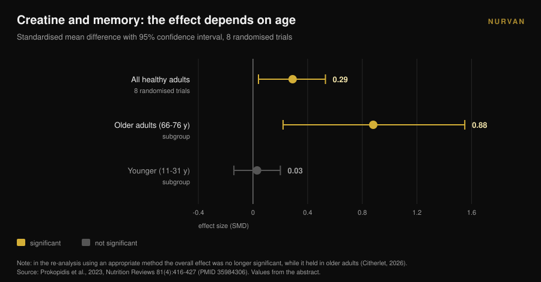
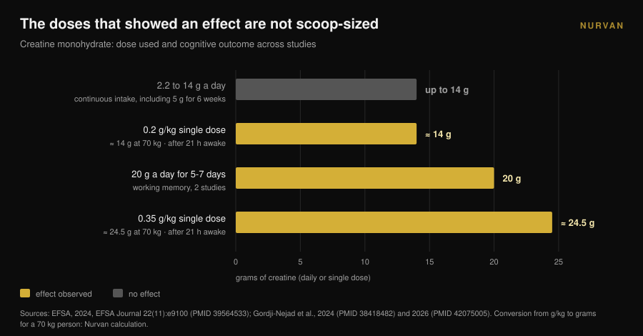

# Creatine and the brain: what the research says

By [Giammaria Loi](/autore/giammaria-loi) · updated 10 November 2026

In about a year creatine stopped being a gym thing. Searches for "creatine for brain" grew 118% in twelve months and the scoop is now sold as a mental upgrade. In that same window Europe's food safety authority rejected the cognitive claim, and the most-cited meta-analysis was called out for a counting error. Here is what survives, for whom, and at what dose.

## In short

- **EFSA said no.** In 2024 the European panel concluded that a cause-and-effect relationship between creatine supplementation and improved cognitive function **has not been established**.
- **The most-cited meta-analysis is disputed.** Xu and colleagues (2024) report an effect on memory (SMD 0.31), but a 2026 commentary shows the same participants were counted several times: observations exceed the number of randomised people.
- **Recount it properly and only age survives.** When the same flaw was corrected in another meta-analysis the memory effect disappeared except in older adults: **SMD 0.88** at 66-76 years versus **0.03** in younger people.
- **The doses that showed something are not scoop-sized.** The signals come from 20 g a day for 5-7 days, or single doses of 0.2-0.35 g/kg — **14 to 24.5 g** for a 70 kg person — and only after a sleepless night.
- **The bottleneck is the blood-brain barrier.** Creatine enters muscle easily; it enters the brain far less, and the measured increases stay modest.

## Why "creatine for brain" is suddenly everywhere

The signal is measurable. The search "creatine for brain" grew 118% year on year and sits at roughly 22,000 searches a month (Glimpse data as of April 2025). Over the same period creatine moved from the sports-supplement shelf to the brain-health, mood and menopause shelves.

Researchers noticed. In 2025 the *Journal of Nutrition* ran a perspective piece titled, literally, "promise, proof, and public perception". The author describes public and commercial enthusiasm that spiked sales, prescriptions and social media engagement against a body of evidence that — their word — has paradoxically remained limited (Eckert, 2025).

This is not an argument for or against creatine. For muscle it remains one of the best-supported supplements on the market, which is why it sits at the top of our [strength supplement tier list](/en/blog/strength-supplements-tier-list-evidence). The question here is narrower: how much of what you read about the brain is actually backed by data?

## Muscle yes, brain is a different problem

The reason the two do not transfer is anatomical. Muscle takes creatine up through a dedicated transporter and the store rises measurably. The brain sits behind the **blood-brain barrier**, the filter that decides what crosses from blood into the nervous system, and that filter lets far less creatine through.

A 2025 review in *Nutrition and Health* puts exactly this at the centre: the key uncertainty is whether oral creatine reaches the brain in amounts large enough to change neuronal metabolism. Some studies show modest increases in brain creatine, but methodological constraints, individual variability and the absence of standardised protocols prevent firm conclusions. The author closes without hedging: for now, supplementing for cognition in older adults should be treated as **a hypothesis, not established clinical practice** (Machado, 2025).

Keep that in mind for everything below. The whole numbers debate starts from a delivery problem: if the molecule does not arrive, the effect cannot happen, however elegant the mechanism looks on paper.

## The meta-analysis everyone cites has a counting problem

Search "creatine and memory" and the source you almost always land on is the systematic review and meta-analysis by Xu and colleagues, published in *Frontiers in Nutrition* in 2024: 16 randomised trials, 492 participants aged 20.8 to 76.4. The results look clean — memory SMD 0.31 (95% CI 0.18-0.44), attention time -0.31, processing speed -0.51 — with no effect on overall cognition or executive function.

In April 2026 the same journal published a commentary that takes the method apart. Several included trials report multiple correlated cognitive outcomes from the same participants — in some cases seven or more memory subtests each — and those measures were treated as independent effect sizes. The consequence is that in the pooled analysis **the number of observations exceeds the number of uniquely randomised participants** (Citherlet, 2026).

This is double counting, a unit-of-analysis error. It artificially inflates precision and statistical power: the confidence interval comes out narrower than the data allow, and an uncertain effect looks certain.

It is not an isolated complaint. EFSA had raised the same concern in 2024, noting that pooling non-independent cognitive results in that meta-analysis inflated sample sizes, and concluding that no conclusions could be drawn from the data.

The most instructive part concerns an earlier paper. The 2023 meta-analysis by Prokopidis and colleagues, on memory in healthy people, had the same flaw. When the authors re-ran the analysis with an appropriate method, the overall effect of creatine on memory **was no longer statistically significant — except in older adults**.

That detail explains most of the confusion, and it was already visible in the subgroups published in 2023: at 66-76 years the memory effect was SMD 0.88 (95% CI 0.22-1.55); at 11-31 years it was 0.03 (95% CI -0.14 to 0.20), effectively zero. Dose (2.2 to 20 g a day), duration (5 days to 24 weeks), sex and geographical origin did not change the result.

## Why EFSA rejected the claim

In 2024 a manufacturer asked the European Union for permission to state on packaging that creatine improves cognitive function. EFSA's NDA panel reviewed 23 human intervention studies and said no.

The reasoning is more useful than the verdict, because it is a map of doses. The acute effect on working memory was seen in **two studies, at 20 g a day for 5-7 days**. It did not appear at doses between 2.2 and 14 g a day. It did not appear with continuous intake of **5 g a day for six weeks** following a five-day loading phase either.

An effect on response inhibition, again at 20 g a day for 7 days, was an isolated finding among ten trials in healthy people, with no effect on other cognitive domains. The three trials in people with disease did not support the effect, and the panel judged the mechanism's plausibility weak as well. Their words: **a cause-and-effect relationship has not been established** (EFSA, 2024).

In practice: the dose nearly everybody takes — the 5 gram scoop, the one that works beautifully for muscle — is not the dose anyone measured a cognitive effect at.

## The one scenario where the numbers convince: the sleepless night

There is one situation where the data get interesting, and it is also the least glamorous: sleep deprivation.

In 2024 a group at the Jülich research centre gave a **very high single dose** of creatine monohydrate — 0.35 g per kilo of body weight — to people kept awake for 21 hours, tracking the brain's high-energy phosphates with magnetic resonance spectroscopy. Creatine shifted those parameters, prevented the drop in pH, and improved cognitive performance and processing speed compared with placebo (Gordji-Nejad et al., 2024).

In 2026 the same group repeated the experiment with a lower dose, 0.2 g per kilo, in 29 people. The cognitive deterioration caused by extended wakefulness was blunted in logical and numerical tasks, in language-related processing speed and on the psychomotor vigilance test, with an improvement of **up to 12%**. The effect was smaller than with the high dose, and women benefited more than men in logic, vigilance and speed (Gordji-Nejad et al., 2026).

Before you order the big tub, do the arithmetic. For a 70 kg person, 0.2 g/kg is **14 grams** in one go and 0.35 g/kg is **24.5 grams**: nearly three and nearly five 5 g scoops. These are acute laboratory protocols, in small samples, from a single research group, and they measure recovery from a sleepless night — not cognitive enhancement in someone who sleeps normally.

There is also a more honest reading of the result: what you are seeing is not creatine making you sharper, it is creatine partly offsetting an induced energy deficit. Interesting news if you work night shifts; not a promise if you want to study better.

## What the research actually says

| Common claim | Verdict | Source |
|---|---|---|
| "Creatine improves cognitive function" | **Rejected as a claim**: no cause-and-effect relationship established | EFSA, 2024 |
| "Meta-analyses prove an effect on memory" | **Needs qualifying**: participants double-counted, a re-analysis is required | Citherlet, 2026; EFSA, 2024 |
| "It works the same at any age" | **Refuted**: SMD 0.88 at 66-76 years versus 0.03 at 11-31 years | Prokopidis et al., 2023 |
| "5 g a day is enough for the brain too" | **Unsupported**: no effect at 5 g/day for 6 weeks; the signals sit at 20 g/day | EFSA, 2024 |
| "It helps after a sleepless night" | **Confirmed in the lab**: up to +12% with a single 0.2 g/kg dose | Gordji-Nejad et al., 2024 and 2026 |
| "It reaches the brain the way it reaches muscle" | **Refuted**: the blood-brain barrier limits entry, increases stay modest | Machado, 2025 |
| "Creatine is a nootropic" | **Not verifiable today**: public enthusiasm far exceeds the evidence | Eckert, 2025 |

## How to apply it

1. **If you take it for muscle, carry on.** Nothing here questions creatine's sporting use: that is where the evidence is solid. What does not hold up is the cognitive claim.
2. **Do not raise the dose "for the brain".** The doses where something was seen — 20 g a day, or single doses of 14 to 24.5 g — come from monitored research protocols, not daily habits. Outside the study there is no indication to go there, and high doses often bring gastrointestinal upset.
3. **If you are over 65, you are in the one subgroup with a signal.** It is still a signal, not a treatment. Talk to your doctor before starting, especially with kidney problems or ongoing medication.
4. **Expect nothing if you sleep well.** In young, rested adults the measured effect on memory is indistinguishable from zero. Sleep does move that same variable, and it is cheaper.
5. **Be sceptical of products sold as "creatine for the mind".** If a formulation costs more it has to show its work: ask at what dose, for how long, and in which population the effect was measured.
6. **Log what you actually take.** Between what you think you take and what you take there are forgotten weeks and approximate scoops. If you want to know whether a supplement is doing anything, the data has to be written down. And if you are still choosing a format, we compared [gummies with powder](/en/blog/creatine-gummies-do-they-work).

> ### Try Nurvan — supplementation you can actually audit
>
> Nurvan's supplement module logs the form, dose and timing of what you take, creatine included, and lines it up with your loads, measurements and sessions. So instead of judging a supplement by feel, you can see what changed, week by week, over the period you took it. [Try Nurvan](https://nurvan.app)

## Frequently asked questions

**Does creatine improve memory?**
Not clearly enough to say so. The meta-analyses reporting an effect counted the same participants several times, and once that was corrected the effect remained only in older adults. EFSA concluded in 2024 that a cause-and-effect relationship has not been established.

**How much creatine do you need for the brain?**
There is no recommended dose, because there is no established effect. In the studies where something was seen the doses were 20 g a day for 5-7 days, or single doses of 0.2-0.35 g/kg: far more than the 5 g scoop, and in controlled research settings. It is not guidance to apply on your own.

**Does creatine help if I sleep badly?**
Two randomised trials on acute sleep deprivation showed partial recovery of cognitive performance, up to 12% with a single 0.2 g/kg dose. They are small samples, from the same research group, and they concern one sleepless night: they say nothing about people who sleep normally.

**Why does it work on muscle and not on the brain?**
Because muscle takes it up easily, while the brain is protected by the blood-brain barrier, which lets far less through. Brain creatine increases measured after supplementation stay modest and vary a lot between people.

## Read next

- [Creatine gummies: do they work as well as powder?](/en/blog/creatine-gummies-do-they-work) — same molecule, pricier format: what actually changes.
- [Creatine without the gym after 45: what the study shows](/en/blog/creatine-without-training-over-45) — the other case where age changes the response to a supplement.
- [Strength supplement tier list: what research says](/en/blog/strength-supplements-tier-list-evidence) — where creatine stands on strength, and what sits near it.

## References

1. EFSA Panel on Nutrition, Novel Foods and Food Allergens (Turck D, Bohn T, Cámara M, et al.), 2024. Creatine and improvement in cognitive function: Evaluation of a health claim pursuant to article 13(5) of regulation (EC) No 1924/2006. *EFSA Journal* 22(11):e9100. PMID 39564533. [DOI 10.2903/j.efsa.2024.9100](https://doi.org/10.2903/j.efsa.2024.9100)
2. Eckert I, 2025. Creatine Supplementation for Cognition: A Critical Perspective on Promise, Proof, and Public Perception. *The Journal of Nutrition* 155(10):3143-3147. PMID 40744234. [DOI 10.1016/j.tjnut.2025.07.016](https://doi.org/10.1016/j.tjnut.2025.07.016)
3. Citherlet T, 2026. Commentary: The effects of creatine supplementation on cognitive function in adults: a systematic review and meta-analysis. *Frontiers in Nutrition* 13:1716285. PMID 42039906. [DOI 10.3389/fnut.2026.1716285](https://doi.org/10.3389/fnut.2026.1716285)
4. Xu C, Bi S, Zhang W, Luo L, 2024. The effects of creatine supplementation on cognitive function in adults: a systematic review and meta-analysis. *Frontiers in Nutrition* 11:1424972. PMID 39070254. [DOI 10.3389/fnut.2024.1424972](https://doi.org/10.3389/fnut.2024.1424972)
5. Prokopidis K, Giannos P, Triantafyllidis KK, Kechagias KS, Forbes SC, Candow DG, 2023. Effects of creatine supplementation on memory in healthy individuals: a systematic review and meta-analysis of randomized controlled trials. *Nutrition Reviews* 81(4):416-427. PMID 35984306. [DOI 10.1093/nutrit/nuac064](https://doi.org/10.1093/nutrit/nuac064)
6. Gordji-Nejad A, Matusch A, Kleedörfer S, Jayeshkumar Patel H, Drzezga A, Elmenhorst D, Binkofski F, Bauer A, 2024. Single dose creatine improves cognitive performance and induces changes in cerebral high energy phosphates during sleep deprivation. *Scientific Reports* 14(1):4937. PMID 38418482. [DOI 10.1038/s41598-024-54249-9](https://doi.org/10.1038/s41598-024-54249-9)
7. Gordji-Nejad A, Matusch A, Hengstler L, Beer S, Kroll T, Klein S, Elmenhorst D, Bauer A, Drzezga A, 2026. Single-Dose Creatine Reduces Sleep Deprivation-Induced Deterioration in Cognitive Performance. *Nutrients* 18(8):1192. PMID 42075005. [DOI 10.3390/nu18081192](https://doi.org/10.3390/nu18081192)
8. Machado M, 2025. Creatine supplementation and cognitive aging: The challenge of crossing the blood-brain barrier. *Nutrition and Health* 32(3):761-763. PMID 41359040. [DOI 10.1177/02601060251404327](https://doi.org/10.1177/02601060251404327)

Bibliographic sources retrieved through PubMed. Topic chosen from a trend signal: the query "creatine for brain", up 118% year on year and around 22,000 monthly searches (Glimpse, as of April 2025), together with the 2025 *Journal of Nutrition* perspective on the gap between marketing and evidence.

---

*Giammaria Loi is the founder of Nurvan. He has been lifting since 2012, has worked as a FIPE-certified personal trainer and coach since 2013, and has competed in powerlifting at national level since 2018. Every article he writes starts from the research and ends with what actually works in the gym.*

> Note: educational content. It does not replace advice from a doctor or qualified professional.
