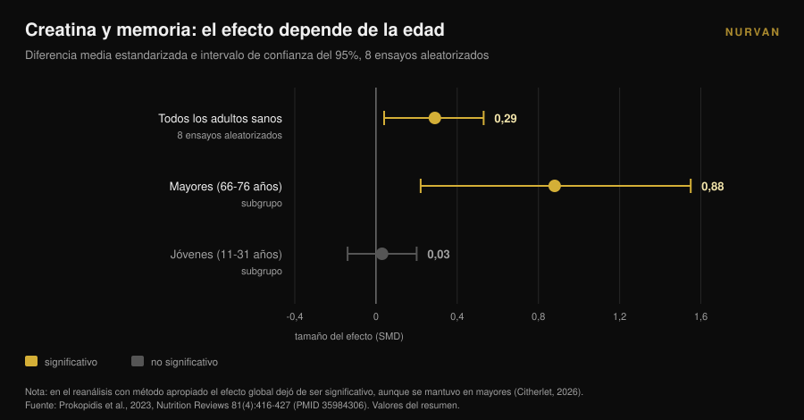
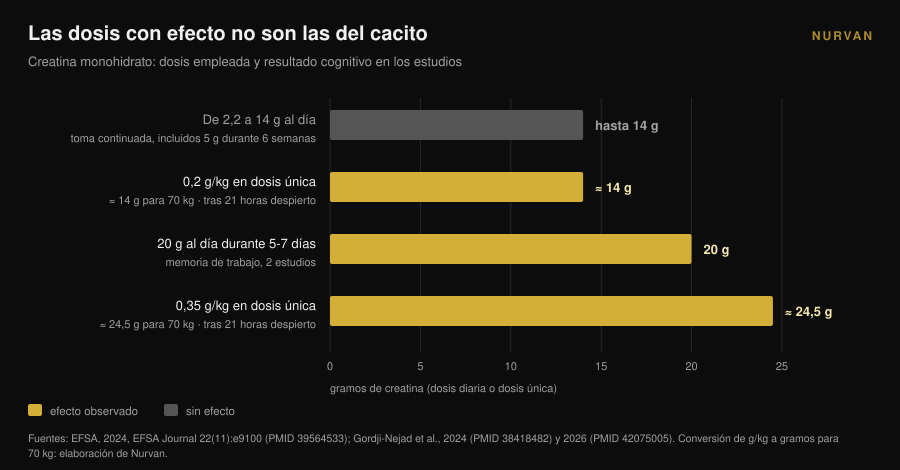

# Creatina y cerebro: qué dicen de verdad los estudios

Por [Giammaria Loi](/autore/giammaria-loi) · actualizado el 10 de noviembre de 2026

En un año la creatina dejó de ser cosa de gimnasio: las búsquedas de "creatina para el cerebro" crecieron un 118% en doce meses y el cacito se vende como una mejora mental. En ese mismo periodo la autoridad europea de seguridad alimentaria rechazó la alegación cognitiva y el metaanálisis más citado quedó señalado por un error de recuento. Esto es lo que se sostiene, en quién y a qué dosis.

## En resumen

- **La EFSA dijo que no.** En 2024 el panel europeo concluyó que **no se ha establecido** una relación causa-efecto entre la suplementación con creatina y la mejora de la función cognitiva.
- **El metaanálisis más citado está cuestionado.** Xu y colegas (2024) describen un efecto sobre la memoria (SMD 0,31), pero un comentario de 2026 muestra que los mismos participantes se contaron varias veces: las observaciones superan a las personas aleatorizadas.
- **Al recalcularlo bien solo queda la edad.** Cuando se corrigió el mismo fallo en otro metaanálisis, el efecto sobre la memoria desapareció salvo en mayores: **SMD 0,88** entre 66 y 76 años frente a **0,03** en jóvenes.
- **Las dosis con señal no son las del cacito.** Las señales vienen de 20 g al día durante 5-7 días o de dosis únicas de 0,2-0,35 g/kg — **14 a 24,5 g** para una persona de 70 kg — y tras una noche sin dormir.
- **El cuello de botella es la barrera hematoencefálica.** La creatina entra con facilidad en el músculo; en el cerebro mucho menos, y los aumentos medidos siguen siendo modestos.

## Por qué «creatina para el cerebro» está ahora en todas partes

La señal es medible. La búsqueda en inglés "creatine for brain" creció un 118% interanual y ronda las 22.000 búsquedas mensuales (datos de Glimpse actualizados a abril de 2025). En ese mismo periodo la creatina pasó del estante de los suplementos deportivos al de la salud cerebral, el ánimo y la menopausia.

La investigación lo notó. En 2025 el *Journal of Nutrition* publicó un artículo de perspectiva titulado, literalmente, «promesa, prueba y percepción pública»: el autor describe un entusiasmo público y comercial que disparó ventas, prescripciones e interacción en redes frente a un cuerpo de evidencia que —textual— ha seguido siendo paradójicamente limitado (Eckert, 2025).

Esto no va de defender ni de atacar la creatina. Para el músculo sigue siendo uno de los suplementos con mejor respaldo, y por eso encabeza nuestra [tier list de suplementos para la fuerza](/es/blog/clasificacion-suplementos-fuerza-tier-list). La pregunta es otra: ¿cuánto de lo que lees sobre el cerebro está realmente sostenido por los datos?

## El músculo sí, el cerebro es otra historia

El motivo por el que una cosa no implica la otra es anatómico. El músculo capta la creatina mediante un transportador específico y el depósito sube de forma medible. El cerebro está protegido por la **barrera hematoencefálica**, el filtro que decide qué pasa de la sangre al sistema nervioso, y ese filtro deja entrar mucha menos creatina.

Una revisión de 2025 en *Nutrition and Health* pone justo eso en el centro: la incertidumbre clave es si la creatina tomada por vía oral llega al cerebro en cantidad suficiente para cambiar el metabolismo neuronal. Algunos estudios muestran aumentos modestos de creatina cerebral, pero las limitaciones metodológicas, la variabilidad individual y la ausencia de protocolos estandarizados impiden conclusiones firmes. El autor cierra sin matices: por ahora la suplementación con fin cognitivo en mayores debe considerarse **una hipótesis, no una práctica clínica establecida** (Machado, 2025).

Tenlo presente al leer el resto. Todo el debate sobre cifras parte de un problema de entrega: si la molécula no llega, el efecto no puede producirse, por elegante que sea el mecanismo sobre el papel.

## El metaanálisis que todos citan tiene un problema de recuento

Si buscas «creatina y memoria», la fuente que aparece casi siempre es la revisión sistemática con metaanálisis de Xu y colegas, publicada en 2024 en *Frontiers in Nutrition*: 16 ensayos aleatorizados, 492 participantes de 20,8 a 76,4 años. Los resultados parecen limpios —memoria SMD 0,31 (IC 95%: 0,18-0,44), tiempo de atención -0,31, velocidad de procesamiento -0,51— sin efecto sobre la cognición global ni sobre las funciones ejecutivas.

En abril de 2026 la misma revista publicó un comentario que desmonta el método. Varios estudios incluidos aportan múltiples pruebas cognitivas correlacionadas de los mismos participantes —en algunos casos siete o más subtests de memoria cada uno— y esas medidas se trataron como efectos independientes. El resultado es que en el análisis agregado **el número de observaciones supera al de personas realmente aleatorizadas** (Citherlet, 2026).

Se llama doble conteo y es un error de unidad de análisis. Infla artificialmente la precisión y la potencia estadística: el intervalo de confianza sale más estrecho de lo que los datos permiten y un efecto incierto parece seguro.

No es una crítica aislada. La EFSA ya había señalado lo mismo en 2024: agregar resultados cognitivos no independientes en ese metaanálisis infló los tamaños muestrales, por lo que de esos datos no podían extraerse conclusiones.

La parte más instructiva, sin embargo, tiene que ver con un trabajo anterior. El metaanálisis de Prokopidis y colegas de 2023, sobre memoria en personas sanas, tenía el mismo defecto. Cuando los autores repitieron el análisis con un método apropiado, el efecto global de la creatina sobre la memoria **dejó de ser estadísticamente significativo, salvo en mayores**.

Ese detalle explica buena parte de la confusión, y ya se veía en los subgrupos publicados en 2023: entre 66 y 76 años el efecto sobre la memoria era SMD 0,88 (IC 95%: 0,22-1,55); entre 11 y 31 años era 0,03 (IC 95%: de -0,14 a 0,20), es decir cero. La dosis (de 2,2 a 20 g al día), la duración (de 5 días a 24 semanas), el sexo y el origen geográfico no cambiaban el resultado.

## Por qué la EFSA rechazó la alegación

En 2024 una empresa pidió a la Unión Europea poder escribir en el envase que la creatina mejora la función cognitiva. El panel NDA de la EFSA revisó 23 estudios de intervención en humanos y dijo que no.

El razonamiento vale más que el veredicto, porque es un mapa de dosis. El efecto agudo sobre la memoria de trabajo se observó en **dos estudios, con 20 g al día durante 5-7 días**. No apareció con dosis de entre 2,2 y 14 g al día. Tampoco apareció con la toma continuada de **5 g al día durante seis semanas** tras una fase de carga de cinco días.

Un efecto sobre la inhibición de respuesta, también con 20 g al día durante 7 días, fue un hallazgo aislado entre diez estudios en personas sanas, sin efectos en el resto de dominios cognitivos. Los tres estudios en personas con enfermedad no apoyaban el efecto, y el panel consideró débil también la plausibilidad del mecanismo. Conclusión textual: **no se ha establecido una relación causa-efecto** (EFSA, 2024).

Traducido a la práctica: la dosis que casi todo el mundo toma —el cacito de 5 gramos, el que funciona de maravilla para el músculo— no es la dosis en la que alguien midió un efecto cognitivo.

## El único escenario donde los números convencen: la noche en blanco

Hay una situación en la que los datos son más interesantes, y es también la menos glamurosa: la privación de sueño.

En 2024 un grupo del centro de investigación de Jülich administró una **dosis única muy alta** de creatina monohidrato —0,35 g por kilo de peso— a personas mantenidas despiertas 21 horas, midiendo con espectroscopia por resonancia magnética los fosfatos de alta energía del cerebro. La creatina modificó esos parámetros, evitó la caída del pH y mejoró el rendimiento cognitivo y la velocidad de procesamiento frente al placebo (Gordji-Nejad et al., 2024).

En 2026 el mismo grupo repitió el experimento con una dosis menor, 0,2 g por kilo, en 29 personas. El deterioro cognitivo provocado por la vigilia prolongada se atenuó en tareas lógicas y numéricas, en la velocidad de procesamiento del lenguaje y en el test de vigilancia psicomotora, con una mejora **de hasta el 12%**. El efecto fue menor que con la dosis alta, y las mujeres se beneficiaron más que los hombres en lógica, vigilancia y velocidad (Gordji-Nejad et al., 2026).

Antes de comprar el bote grande, haz la cuenta. Para una persona de 70 kilos, 0,2 g/kg son **14 gramos** de golpe y 0,35 g/kg son **24,5 gramos**: casi tres y casi cinco cacitos de 5 g. Son protocolos agudos de laboratorio, con muestras pequeñas, del mismo grupo de investigación, y miden la recuperación de una noche sin dormir, no una mejora cognitiva en quien duerme bien.

Hay además una lectura más honesta del dato: lo que ves no es creatina que te despierta, es creatina que compensa en parte un déficit energético inducido. Buena noticia para quien hace turnos de noche; no una promesa para quien quiere estudiar mejor.

## Qué dice de verdad la investigación

| Afirmación habitual | Veredicto | Fuente |
|---|---|---|
| «La creatina mejora la función cognitiva» | **Rechazado como alegación**: no se ha establecido relación causa-efecto | EFSA, 2024 |
| «Los metaanálisis demuestran un efecto sobre la memoria» | **Hay que matizar**: doble conteo de participantes, hace falta reanalizar | Citherlet, 2026; EFSA, 2024 |
| «Funciona igual a cualquier edad» | **Desmentido**: SMD 0,88 entre 66 y 76 años frente a 0,03 entre 11 y 31 | Prokopidis et al., 2023 |
| «Con 5 g al día basta también para el cerebro» | **Sin respaldo**: con 5 g/día durante 6 semanas no hubo efecto; las señales están en 20 g/día | EFSA, 2024 |
| «Ayuda tras una noche sin dormir» | **Confirmado en laboratorio**: hasta +12% con 0,2 g/kg en dosis única | Gordji-Nejad et al., 2024 y 2026 |
| «Llega al cerebro igual que al músculo» | **Desmentido**: la barrera hematoencefálica limita la entrada, aumentos modestos | Machado, 2025 |
| «La creatina es un nootrópico» | **Hoy no verificable**: el entusiasmo público supera con mucho a la evidencia | Eckert, 2025 |

## Cómo aplicarlo

1. **Si la tomas por el músculo, sigue.** Nada de este artículo cuestiona el uso deportivo de la creatina: ahí la evidencia es sólida. Lo que no se sostiene es la alegación cognitiva.
2. **No subas la dosis «por el cerebro».** Las dosis en las que se vio algo —20 g al día, o dosis únicas de 14 a 24,5 g— vienen de protocolos de investigación con seguimiento, no de un hábito diario. Fuera del estudio no hay indicación para subir, y las dosis altas suelen traer molestias gastrointestinales.
3. **Si tienes más de 65 años, estás en el único subgrupo con señal.** Sigue siendo una señal, no un tratamiento. Háblalo con tu médico antes de empezar, sobre todo si hay problemas renales o medicación en curso.
4. **Espera cero si duermes bien.** En adultos jóvenes y descansados el efecto medido sobre la memoria es indistinguible de cero. El sueño sí mueve esa misma variable, y sale más barato.
5. **Desconfía de los productos vendidos como «creatina para la mente».** Si una fórmula cuesta más tiene que demostrarlo: pregunta a qué dosis, durante cuánto tiempo y en qué población se midió el efecto.
6. **Registra lo que tomas de verdad.** Entre lo que crees tomar y lo que tomas hay semanas olvidadas y cacitos aproximados. Si quieres saber si un suplemento está haciendo algo, el dato hay que escribirlo. Y si aún estás eligiendo formato, comparamos [las gomitas con el polvo](/es/blog/gomitas-de-creatina-funcionan).

> ### Prueba Nurvan — la suplementación que de verdad controlas
>
> El módulo de suplementación de Nurvan registra forma, dosis y horario de lo que tomas, creatina incluida, y lo pone junto a tus cargas, medidas y sesiones. Así dejas de juzgar un suplemento por sensaciones y ves qué cambió, semana a semana, en el periodo en que lo tomaste. [Prueba Nurvan](https://nurvan.app)

## Preguntas frecuentes

**¿La creatina mejora la memoria?**
No lo bastante como para afirmarlo. Los metaanálisis que describen un efecto contaron varias veces a los mismos participantes y, corregido el problema, el efecto solo quedó en mayores. La EFSA concluyó en 2024 que la relación causa-efecto no está establecida.

**¿Cuánta creatina hace falta para el cerebro?**
No hay dosis recomendada, porque no hay efecto establecido. En los estudios donde se vio algo las dosis eran 20 g al día durante 5-7 días o dosis únicas de 0,2-0,35 g/kg: mucho más que el cacito de 5 g, y en contextos de investigación controlados. No es una pauta para aplicar por tu cuenta.

**¿La creatina ayuda si duermo poco?**
Dos ensayos aleatorizados sobre privación aguda de sueño mostraron una recuperación parcial del rendimiento cognitivo, de hasta el 12% con 0,2 g/kg en dosis única. Son muestras pequeñas, del mismo grupo de investigación, y se refieren a una noche en blanco: no dicen nada sobre quien duerme con normalidad.

**¿Por qué funciona en el músculo y no en el cerebro?**
Porque el músculo la capta con facilidad, mientras que el cerebro está protegido por la barrera hematoencefálica, que deja pasar mucha menos. Los aumentos de creatina cerebral medidos tras la suplementación son modestos y varían mucho entre personas.

## Lee también

- [Gomitas de creatina: ¿funcionan como el polvo?](/es/blog/gomitas-de-creatina-funcionan) — misma molécula, formato más caro: qué cambia de verdad.
- [Creatina sin entrenar después de los 45: qué dice el estudio](/es/blog/creatina-sin-entrenar-mas-de-45) — el otro caso en el que la edad cambia la respuesta al suplemento.
- [Tier list de suplementos para la fuerza: la evidencia](/es/blog/clasificacion-suplementos-fuerza-tier-list) — dónde queda la creatina cuando se habla de fuerza, y quién la acompaña.

## Fuentes

1. EFSA Panel on Nutrition, Novel Foods and Food Allergens (Turck D, Bohn T, Cámara M, et al.), 2024. Creatine and improvement in cognitive function: Evaluation of a health claim pursuant to article 13(5) of regulation (EC) No 1924/2006. *EFSA Journal* 22(11):e9100. PMID 39564533. [DOI 10.2903/j.efsa.2024.9100](https://doi.org/10.2903/j.efsa.2024.9100)
2. Eckert I, 2025. Creatine Supplementation for Cognition: A Critical Perspective on Promise, Proof, and Public Perception. *The Journal of Nutrition* 155(10):3143-3147. PMID 40744234. [DOI 10.1016/j.tjnut.2025.07.016](https://doi.org/10.1016/j.tjnut.2025.07.016)
3. Citherlet T, 2026. Commentary: The effects of creatine supplementation on cognitive function in adults: a systematic review and meta-analysis. *Frontiers in Nutrition* 13:1716285. PMID 42039906. [DOI 10.3389/fnut.2026.1716285](https://doi.org/10.3389/fnut.2026.1716285)
4. Xu C, Bi S, Zhang W, Luo L, 2024. The effects of creatine supplementation on cognitive function in adults: a systematic review and meta-analysis. *Frontiers in Nutrition* 11:1424972. PMID 39070254. [DOI 10.3389/fnut.2024.1424972](https://doi.org/10.3389/fnut.2024.1424972)
5. Prokopidis K, Giannos P, Triantafyllidis KK, Kechagias KS, Forbes SC, Candow DG, 2023. Effects of creatine supplementation on memory in healthy individuals: a systematic review and meta-analysis of randomized controlled trials. *Nutrition Reviews* 81(4):416-427. PMID 35984306. [DOI 10.1093/nutrit/nuac064](https://doi.org/10.1093/nutrit/nuac064)
6. Gordji-Nejad A, Matusch A, Kleedörfer S, Jayeshkumar Patel H, Drzezga A, Elmenhorst D, Binkofski F, Bauer A, 2024. Single dose creatine improves cognitive performance and induces changes in cerebral high energy phosphates during sleep deprivation. *Scientific Reports* 14(1):4937. PMID 38418482. [DOI 10.1038/s41598-024-54249-9](https://doi.org/10.1038/s41598-024-54249-9)
7. Gordji-Nejad A, Matusch A, Hengstler L, Beer S, Kroll T, Klein S, Elmenhorst D, Bauer A, Drzezga A, 2026. Single-Dose Creatine Reduces Sleep Deprivation-Induced Deterioration in Cognitive Performance. *Nutrients* 18(8):1192. PMID 42075005. [DOI 10.3390/nu18081192](https://doi.org/10.3390/nu18081192)
8. Machado M, 2025. Creatine supplementation and cognitive aging: The challenge of crossing the blood-brain barrier. *Nutrition and Health* 32(3):761-763. PMID 41359040. [DOI 10.1177/02601060251404327](https://doi.org/10.1177/02601060251404327)

Fuentes bibliográficas obtenidas a través de PubMed. Tema elegido a partir de una señal de tendencia: la búsqueda "creatine for brain", con un +118% interanual y unas 22.000 búsquedas mensuales (Glimpse, dato de abril de 2025), junto al artículo de perspectiva crítica publicado en el *Journal of Nutrition* en 2025 sobre la distancia entre marketing y evidencia.

---

*Giammaria Loi es el fundador de Nurvan. Entrena con pesas desde 2012, trabaja como entrenador personal y coach certificado FIPE desde 2013 y compite en powerlifting a nivel nacional desde 2018. Cada artículo que firma parte de los estudios científicos y llega a lo que funciona de verdad en el gimnasio.*

> Nota: contenido informativo; no sustituye la opinión de un médico o profesional.
