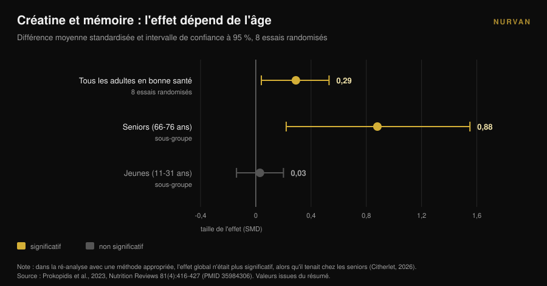
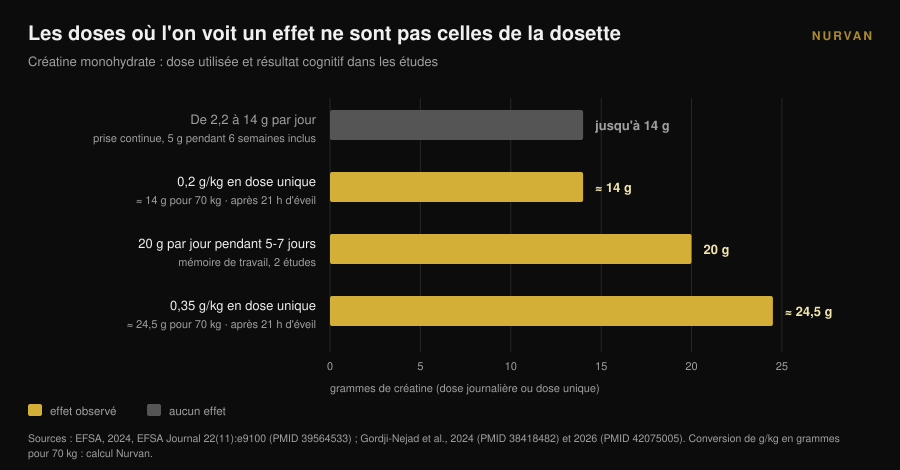

# Créatine et cerveau : ce que disent vraiment les études

Par [Giammaria Loi](/autore/giammaria-loi) · mis à jour le 10 novembre 2026

En un an, la créatine a cessé d'être une affaire de salle de sport : les recherches sur « créatine pour le cerveau » ont progressé de 118 % en douze mois et la dosette se vend comme une amélioration mentale. Pendant ce temps, l'autorité européenne de sécurité des aliments a rejeté l'allégation cognitive et la méta-analyse la plus citée a été épinglée pour une erreur de comptage. Voici ce qui tient, pour qui, et à quelle dose.

## En bref

- **L'EFSA a dit non.** En 2024, le panel européen a conclu qu'une relation de cause à effet entre la supplémentation en créatine et l'amélioration des fonctions cognitives **n'a pas été établie**.
- **La méta-analyse la plus citée est contestée.** Xu et ses collègues (2024) rapportent un effet sur la mémoire (SMD 0,31), mais un commentaire de 2026 montre que les mêmes participants ont été comptés plusieurs fois : les observations dépassent le nombre de personnes randomisées.
- **Recalculée correctement, il ne reste que l'âge.** Lorsque le même défaut a été corrigé dans une autre méta-analyse, l'effet sur la mémoire a disparu sauf chez les seniors : **SMD 0,88** entre 66 et 76 ans contre **0,03** chez les jeunes.
- **Les doses où l'on a vu quelque chose ne sont pas celles de la dosette.** Les signaux viennent de 20 g par jour pendant 5 à 7 jours, ou de doses uniques de 0,2 à 0,35 g/kg — **14 à 24,5 g** pour une personne de 70 kg — et après une nuit blanche.
- **Le goulot d'étranglement est la barrière hémato-encéphalique.** La créatine entre facilement dans le muscle ; dans le cerveau beaucoup moins, et les hausses mesurées restent modestes.

## Pourquoi « créatine pour le cerveau » est partout en ce moment

Le signal est mesurable. La requête anglaise "creatine for brain" a progressé de 118 % sur un an et tourne autour de 22 000 recherches par mois (données Glimpse à jour en avril 2025). Sur la même période, la créatine est passée du rayon des compléments sportifs à celui de la santé cérébrale, de l'humeur et de la ménopause.

La recherche l'a remarqué. En 2025, le *Journal of Nutrition* a publié un article de perspective intitulé, littéralement, « promesse, preuve et perception publique » : l'auteur décrit un enthousiasme public et commercial qui a fait bondir les ventes, les prescriptions et l'engagement sur les réseaux, face à un corpus de preuves qui — c'est son mot — est resté paradoxalement limité (Eckert, 2025).

Il ne s'agit pas de défendre ni d'attaquer la créatine. Côté muscle, elle reste l'un des compléments les mieux étayés du marché, et c'est pour cela qu'elle occupe la première place de notre [tier list des compléments pour la force](/fr/blog/classement-complements-force-tier-list). La question est autre : quelle part de ce que vous lisez sur le cerveau repose vraiment sur des données ?

## Le muscle oui, le cerveau c'est une autre histoire

La raison pour laquelle l'un n'implique pas l'autre est anatomique. Le muscle capte la créatine via un transporteur dédié et la réserve augmente de façon mesurable. Le cerveau, lui, est protégé par la **barrière hémato-encéphalique**, le filtre qui décide de ce qui passe du sang au système nerveux, et ce filtre laisse entrer bien moins de créatine.

Une revue de 2025 parue dans *Nutrition and Health* place exactement cela au centre : l'incertitude clé est de savoir si la créatine prise par voie orale atteint le cerveau en quantité suffisante pour modifier le métabolisme neuronal. Certaines études montrent des hausses modestes de créatine cérébrale, mais les limites méthodologiques, la variabilité individuelle et l'absence de protocoles standardisés empêchent toute conclusion ferme. L'auteur conclut sans nuance : pour l'instant, la supplémentation à visée cognitive chez le senior doit être considérée comme **une hypothèse, pas une pratique clinique établie** (Machado, 2025).

Gardez-le en tête pour la suite. Tout le débat sur les chiffres part d'un problème de livraison : si la molécule n'arrive pas, l'effet ne peut pas exister, aussi élégant que soit le mécanisme sur le papier.

## La méta-analyse que tout le monde cite a un problème de comptage

Si vous cherchez « créatine et mémoire », la source qui apparaît presque toujours est la revue systématique avec méta-analyse de Xu et ses collègues, publiée en 2024 dans *Frontiers in Nutrition* : 16 essais randomisés, 492 participants de 20,8 à 76,4 ans. Les résultats semblent nets — mémoire SMD 0,31 (IC 95 % : 0,18-0,44), temps d'attention -0,31, vitesse de traitement -0,51 — sans effet sur la cognition globale ni sur les fonctions exécutives.

En avril 2026, la même revue a publié un commentaire qui démonte la méthode. Plusieurs études incluses rapportent plusieurs tests cognitifs corrélés chez les mêmes participants — parfois sept sous-tests de mémoire ou plus chacun — et ces mesures ont été traitées comme des effets indépendants. Résultat : dans l'analyse groupée, **le nombre d'observations dépasse le nombre de personnes réellement randomisées** (Citherlet, 2026).

On appelle cela le double comptage, une erreur d'unité d'analyse. Elle gonfle artificiellement la précision et la puissance statistique : l'intervalle de confiance ressort plus étroit que ce que les données autorisent, et un effet incertain paraît certain.

Ce n'est pas une critique isolée. L'EFSA avait soulevé le même point dès 2024, notant que l'agrégation de résultats cognitifs non indépendants dans cette méta-analyse avait gonflé les effectifs, et concluant qu'aucune conclusion ne pouvait être tirée de ces données.

La partie la plus instructive concerne toutefois un travail antérieur. La méta-analyse de Prokopidis et ses collègues de 2023, sur la mémoire chez des personnes en bonne santé, avait le même défaut. Lorsque les auteurs ont refait l'analyse avec une méthode appropriée, l'effet global de la créatine sur la mémoire **n'était plus statistiquement significatif — sauf chez les seniors**.

Ce détail explique l'essentiel de la confusion, et il se voyait déjà dans les sous-groupes publiés en 2023 : entre 66 et 76 ans, l'effet sur la mémoire était de SMD 0,88 (IC 95 % : 0,22-1,55) ; entre 11 et 31 ans, de 0,03 (IC 95 % : -0,14 à 0,20), soit zéro. La dose (de 2,2 à 20 g par jour), la durée (de 5 jours à 24 semaines), le sexe et l'origine géographique ne changeaient rien.

## Pourquoi l'EFSA a rejeté l'allégation

En 2024, une entreprise a demandé à l'Union européenne l'autorisation d'écrire sur ses emballages que la créatine améliore les fonctions cognitives. Le panel NDA de l'EFSA a examiné 23 études d'intervention chez l'humain et a répondu non.

Le raisonnement vaut plus que le verdict, car c'est une carte des doses. L'effet aigu sur la mémoire de travail a été observé dans **deux études, à 20 g par jour pendant 5 à 7 jours**. Il n'est pas apparu à des doses comprises entre 2,2 et 14 g par jour. Il n'est pas apparu non plus avec une prise continue de **5 g par jour pendant six semaines** après une phase de charge de cinq jours.

Un effet sur l'inhibition de la réponse, là encore à 20 g par jour pendant 7 jours, est resté un résultat isolé parmi dix études chez des personnes en bonne santé, sans effet sur les autres domaines cognitifs. Les trois études chez des personnes malades ne soutenaient pas l'effet, et le panel a jugé la plausibilité du mécanisme faible elle aussi. Conclusion textuelle : **une relation de cause à effet n'a pas été établie** (EFSA, 2024).

Traduit en pratique : la dose que presque tout le monde prend — la dosette de 5 grammes, celle qui marche très bien pour le muscle — n'est pas celle à laquelle quelqu'un a mesuré un effet cognitif.

## Le seul scénario où les chiffres convainquent : la nuit blanche

Il existe une situation où les données deviennent intéressantes, et c'est aussi la moins glamour : la privation de sommeil.

En 2024, une équipe du centre de recherche de Jülich a administré une **dose unique très élevée** de créatine monohydrate — 0,35 g par kilo de poids — à des personnes maintenues éveillées 21 heures, en suivant par spectroscopie par résonance magnétique les phosphates à haute énergie du cerveau. La créatine a modifié ces paramètres, évité la baisse du pH et amélioré la performance cognitive et la vitesse de traitement par rapport au placebo (Gordji-Nejad et al., 2024).

En 2026, la même équipe a répété l'expérience avec une dose plus faible, 0,2 g par kilo, chez 29 personnes. La dégradation cognitive due à l'éveil prolongé a été atténuée sur les tâches logiques et numériques, sur la vitesse de traitement du langage et au test de vigilance psychomotrice, avec une amélioration **jusqu'à 12 %**. L'effet était moins marqué qu'avec la dose élevée, et les femmes en profitaient davantage que les hommes en logique, vigilance et vitesse (Gordji-Nejad et al., 2026).

Avant de commander le gros pot, faites le calcul. Pour une personne de 70 kilos, 0,2 g/kg font **14 grammes** d'un coup et 0,35 g/kg font **24,5 grammes** : près de trois et près de cinq dosettes de 5 g. Ce sont des protocoles aigus de laboratoire, sur de petits échantillons, issus d'une même équipe, et ils mesurent la récupération après une nuit blanche — pas une amélioration cognitive chez quelqu'un qui dort normalement.

Il y a aussi une lecture plus honnête du résultat : ce que vous voyez, ce n'est pas la créatine qui vous rend plus vif, c'est la créatine qui compense en partie un déficit énergétique induit. Bonne nouvelle si vous travaillez de nuit ; pas une promesse si vous voulez mieux réviser.

## Ce que dit vraiment la recherche

| Affirmation courante | Verdict | Source |
|---|---|---|
| « La créatine améliore les fonctions cognitives » | **Rejeté comme allégation** : aucune relation de cause à effet établie | EFSA, 2024 |
| « Les méta-analyses prouvent un effet sur la mémoire » | **À nuancer** : double comptage des participants, une ré-analyse s'impose | Citherlet, 2026 ; EFSA, 2024 |
| « Ça marche pareil à tout âge » | **Démenti** : SMD 0,88 entre 66 et 76 ans contre 0,03 entre 11 et 31 ans | Prokopidis et al., 2023 |
| « 5 g par jour suffisent aussi pour le cerveau » | **Non étayé** : aucun effet à 5 g/jour pendant 6 semaines ; les signaux sont à 20 g/jour | EFSA, 2024 |
| « Elle aide après une nuit blanche » | **Confirmé en laboratoire** : jusqu'à +12 % avec 0,2 g/kg en dose unique | Gordji-Nejad et al., 2024 et 2026 |
| « Elle atteint le cerveau comme le muscle » | **Démenti** : la barrière hémato-encéphalique limite l'entrée, hausses modestes | Machado, 2025 |
| « La créatine est un nootropique » | **Non vérifiable aujourd'hui** : l'enthousiasme public dépasse largement les preuves | Eckert, 2025 |

## Comment l'appliquer

1. **Si vous la prenez pour le muscle, continuez.** Rien ici ne remet en cause l'usage sportif de la créatine : c'est là que les preuves sont solides. Ce qui ne tient pas, c'est l'allégation cognitive.
2. **N'augmentez pas la dose « pour le cerveau ».** Les doses où quelque chose a été observé — 20 g par jour, ou des doses uniques de 14 à 24,5 g — viennent de protocoles de recherche surveillés, pas d'une habitude quotidienne. Hors étude, rien n'indique d'y monter, et les fortes doses s'accompagnent souvent de troubles digestifs.
3. **Si vous avez plus de 65 ans, vous êtes dans le seul sous-groupe avec un signal.** Cela reste un signal, pas un traitement. Parlez-en à votre médecin avant de commencer, surtout en cas de problèmes rénaux ou de traitement en cours.
4. **N'attendez rien si vous dormez bien.** Chez les adultes jeunes et reposés, l'effet mesuré sur la mémoire est indiscernable de zéro. Le sommeil, lui, déplace vraiment cette variable, et il coûte moins cher.
5. **Méfiez-vous des produits vendus comme « créatine pour l'esprit ».** Si une formule coûte plus cher, elle doit le démontrer : demandez à quelle dose, pendant combien de temps et dans quelle population l'effet a été mesuré.
6. **Notez ce que vous prenez réellement.** Entre ce que vous croyez prendre et ce que vous prenez, il y a des semaines oubliées et des dosettes approximatives. Pour savoir si un complément fait quelque chose, la donnée doit être écrite. Et si vous hésitez encore sur le format, nous avons comparé [les gommes et la poudre](/fr/blog/gommes-de-creatine-efficaces).

> ### Essayez Nurvan — la supplémentation que vous contrôlez vraiment
>
> Le module compléments de Nurvan enregistre la forme, la dose et l'horaire de ce que vous prenez, créatine incluse, et les met en regard de vos charges, de vos mesures et de vos séances. Vous cessez d'évaluer un complément au ressenti et vous voyez ce qui a changé, semaine après semaine, sur la période où vous l'avez pris. [Essayer Nurvan](https://nurvan.app)

## Questions fréquentes

**La créatine améliore-t-elle la mémoire ?**
Pas assez pour l'affirmer. Les méta-analyses qui rapportent un effet ont compté plusieurs fois les mêmes participants et, une fois le problème corrigé, l'effet n'est resté que chez les seniors. L'EFSA a conclu en 2024 que la relation de cause à effet n'est pas établie.

**Quelle dose de créatine pour le cerveau ?**
Il n'existe pas de dose recommandée, puisqu'il n'existe pas d'effet établi. Dans les études où quelque chose a été vu, les doses étaient de 20 g par jour pendant 5 à 7 jours ou des doses uniques de 0,2 à 0,35 g/kg : bien plus que la dosette de 5 g, et en contexte de recherche contrôlé. Ce n'est pas une consigne à appliquer seul.

**La créatine aide-t-elle si je dors peu ?**
Deux essais randomisés sur privation aiguë de sommeil ont montré une récupération partielle de la performance cognitive, jusqu'à 12 % avec 0,2 g/kg en dose unique. Ce sont de petits échantillons, issus d'une même équipe, et ils portent sur une nuit blanche : ils ne disent rien de ceux qui dorment normalement.

**Pourquoi ça marche sur le muscle et pas sur le cerveau ?**
Parce que le muscle la capte facilement, tandis que le cerveau est protégé par la barrière hémato-encéphalique, qui en laisse passer bien moins. Les hausses de créatine cérébrale mesurées après supplémentation restent modestes et varient beaucoup d'une personne à l'autre.

## À lire aussi

- [Gommes de créatine : efficaces comme la poudre ?](/fr/blog/gommes-de-creatine-efficaces) — même molécule, format plus cher : ce qui change vraiment.
- [Créatine sans musculation après 45 ans : ce que dit l'étude](/fr/blog/creatine-sans-musculation-apres-45-ans) — l'autre cas où l'âge change la réponse au complément.
- [Tier list des compléments pour la force : la science](/fr/blog/classement-complements-force-tier-list) — où se situe la créatine sur la force, et qui l'accompagne.

## Sources

1. EFSA Panel on Nutrition, Novel Foods and Food Allergens (Turck D, Bohn T, Cámara M, et al.), 2024. Creatine and improvement in cognitive function: Evaluation of a health claim pursuant to article 13(5) of regulation (EC) No 1924/2006. *EFSA Journal* 22(11):e9100. PMID 39564533. [DOI 10.2903/j.efsa.2024.9100](https://doi.org/10.2903/j.efsa.2024.9100)
2. Eckert I, 2025. Creatine Supplementation for Cognition: A Critical Perspective on Promise, Proof, and Public Perception. *The Journal of Nutrition* 155(10):3143-3147. PMID 40744234. [DOI 10.1016/j.tjnut.2025.07.016](https://doi.org/10.1016/j.tjnut.2025.07.016)
3. Citherlet T, 2026. Commentary: The effects of creatine supplementation on cognitive function in adults: a systematic review and meta-analysis. *Frontiers in Nutrition* 13:1716285. PMID 42039906. [DOI 10.3389/fnut.2026.1716285](https://doi.org/10.3389/fnut.2026.1716285)
4. Xu C, Bi S, Zhang W, Luo L, 2024. The effects of creatine supplementation on cognitive function in adults: a systematic review and meta-analysis. *Frontiers in Nutrition* 11:1424972. PMID 39070254. [DOI 10.3389/fnut.2024.1424972](https://doi.org/10.3389/fnut.2024.1424972)
5. Prokopidis K, Giannos P, Triantafyllidis KK, Kechagias KS, Forbes SC, Candow DG, 2023. Effects of creatine supplementation on memory in healthy individuals: a systematic review and meta-analysis of randomized controlled trials. *Nutrition Reviews* 81(4):416-427. PMID 35984306. [DOI 10.1093/nutrit/nuac064](https://doi.org/10.1093/nutrit/nuac064)
6. Gordji-Nejad A, Matusch A, Kleedörfer S, Jayeshkumar Patel H, Drzezga A, Elmenhorst D, Binkofski F, Bauer A, 2024. Single dose creatine improves cognitive performance and induces changes in cerebral high energy phosphates during sleep deprivation. *Scientific Reports* 14(1):4937. PMID 38418482. [DOI 10.1038/s41598-024-54249-9](https://doi.org/10.1038/s41598-024-54249-9)
7. Gordji-Nejad A, Matusch A, Hengstler L, Beer S, Kroll T, Klein S, Elmenhorst D, Bauer A, Drzezga A, 2026. Single-Dose Creatine Reduces Sleep Deprivation-Induced Deterioration in Cognitive Performance. *Nutrients* 18(8):1192. PMID 42075005. [DOI 10.3390/nu18081192](https://doi.org/10.3390/nu18081192)
8. Machado M, 2025. Creatine supplementation and cognitive aging: The challenge of crossing the blood-brain barrier. *Nutrition and Health* 32(3):761-763. PMID 41359040. [DOI 10.1177/02601060251404327](https://doi.org/10.1177/02601060251404327)

Sources bibliographiques obtenues via PubMed. Sujet choisi à partir d'un signal de tendance : la requête "creatine for brain", en hausse de 118 % sur un an et autour de 22 000 recherches mensuelles (Glimpse, données d'avril 2025), ainsi que l'article de perspective critique publié dans le *Journal of Nutrition* en 2025 sur l'écart entre marketing et preuves.

---

*Giammaria Loi est le fondateur de Nurvan. Il soulève des poids depuis 2012, exerce comme coach et entraîneur personnel certifié FIPE depuis 2013 et dispute des compétitions de powerlifting au niveau national depuis 2018. Chaque article qu'il signe part des études scientifiques et aboutit à ce qui fonctionne vraiment en salle.*

> Note : contenu informatif, il ne remplace pas l'avis d'un médecin ou d'un professionnel.
