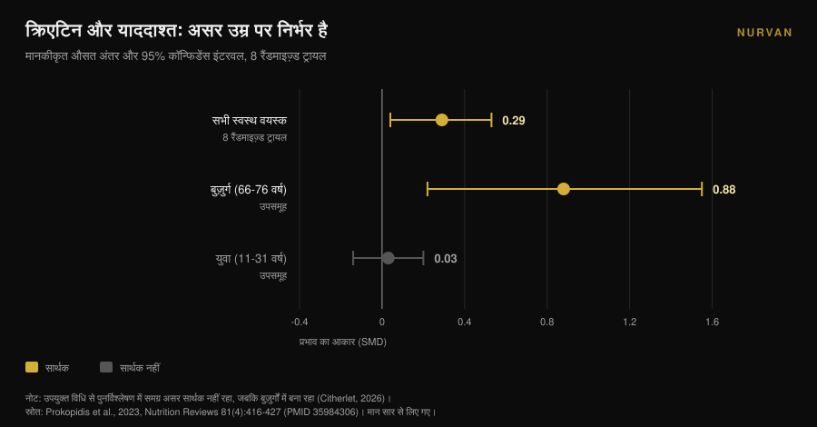
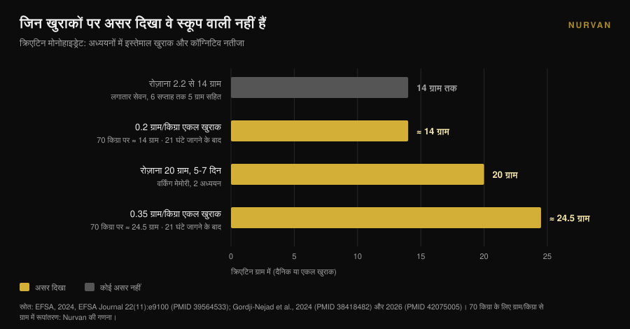

# क्रिएटिन और दिमाग: रिसर्च असल में क्या कहती है

लेखक: [Giammaria Loi](/autore/giammaria-loi) · अपडेट: 10 नवंबर 2026

लगभग एक साल में क्रिएटिन सिर्फ जिम का मामला नहीं रह गया: "creatine for brain" की सर्च बारह महीनों में 118% बढ़ी और स्कूप को दिमागी अपग्रेड की तरह बेचा जाने लगा। उसी दौरान यूरोप की खाद्य सुरक्षा एजेंसी ने कॉग्निटिव दावा खारिज कर दिया, और सबसे ज़्यादा उद्धृत मेटा-विश्लेषण गिनती की गलती पर घिर गया। देखते हैं क्या टिकता है, किसके लिए, और किस खुराक पर।

## संक्षेप में

- **EFSA ने मना कर दिया।** 2024 में यूरोपीय पैनल ने निष्कर्ष दिया कि क्रिएटिन लेने और कॉग्निटिव फंक्शन में सुधार के बीच कारण-प्रभाव संबंध **स्थापित नहीं हुआ है**।
- **सबसे ज़्यादा उद्धृत मेटा-विश्लेषण विवादित है।** Xu और साथियों (2024) याददाश्त पर असर बताते हैं (SMD 0.31), पर 2026 की एक टिप्पणी दिखाती है कि वही प्रतिभागी कई बार गिने गए: अवलोकनों की संख्या रैंडमाइज़ किए गए लोगों से ज़्यादा है।
- **ठीक से दोबारा गिनने पर सिर्फ उम्र बचती है।** जब यही खामी दूसरे मेटा-विश्लेषण में ठीक की गई तो याददाश्त पर असर बुज़ुर्गों को छोड़कर गायब हो गया: 66-76 वर्ष में **SMD 0.88** बनाम युवाओं में **0.03**।
- **जिन खुराकों पर असर दिखा वे स्कूप वाली नहीं हैं।** संकेत रोज़ाना 20 ग्राम 5-7 दिन तक, या 0.2-0.35 ग्राम/किग्रा की एकल खुराक से आए — 70 किग्रा के व्यक्ति के लिए **14 से 24.5 ग्राम** — और वह भी रात भर जागने के बाद।
- **अड़चन रक्त-मस्तिष्क अवरोध है।** क्रिएटिन मांसपेशी में आसानी से पहुँचता है, दिमाग में बहुत कम, और मापी गई बढ़ोतरी मामूली रहती है।

## «दिमाग के लिए क्रिएटिन» अभी हर जगह क्यों है

संकेत मापने लायक है। अंग्रेज़ी सर्च "creatine for brain" सालाना 118% बढ़ी और करीब 22,000 मासिक सर्च पर है (Glimpse डेटा, अप्रैल 2025 तक)। उसी दौर में क्रिएटिन स्पोर्ट्स सप्लीमेंट की शेल्फ से हटकर ब्रेन हेल्थ, मूड और मेनोपॉज़ की शेल्फ पर पहुँच गया।

रिसर्च जगत ने इसे नोट किया। 2025 में *Journal of Nutrition* ने एक परिप्रेक्ष्य लेख छापा जिसका शीर्षक शब्दशः था «वादा, प्रमाण और सार्वजनिक धारणा»: लेखक एक सार्वजनिक और व्यावसायिक उत्साह का वर्णन करते हैं जिसने बिक्री, प्रिस्क्रिप्शन और सोशल मीडिया जुड़ाव को उछाल दिया, जबकि प्रमाणों का भंडार — उन्हीं के शब्दों में — विरोधाभासी रूप से सीमित ही रहा (Eckert, 2025)।

बात क्रिएटिन के बचाव या विरोध की नहीं है। मांसपेशी के मोर्चे पर यह आज भी सबसे मज़बूत प्रमाण वाले सप्लीमेंट्स में है, इसीलिए हमारी [स्ट्रेंथ सप्लीमेंट टियर लिस्ट](/hi/blog/strength-supplements-tier-list-hindi) में यह सबसे ऊपर है। सवाल संकरा है: दिमाग को लेकर आप जो पढ़ते हैं, उसमें से कितना वाकई डेटा पर टिका है?

## मांसपेशी में हाँ, दिमाग अलग मामला है

दोनों के बीच छलांग न लगाने की वजह शरीर-रचना में है। मांसपेशी एक विशेष ट्रांसपोर्टर से क्रिएटिन खींचती है और भंडार मापने लायक बढ़ता है। दिमाग **रक्त-मस्तिष्क अवरोध** के पीछे है — वह छननी जो तय करती है कि खून से तंत्रिका तंत्र में क्या जाएगा — और वह छननी क्रिएटिन को कहीं कम जाने देती है।

2025 में *Nutrition and Health* की एक समीक्षा ठीक इसी को केंद्र में रखती है: मुख्य अनिश्चितता यह है कि मुँह से लिया क्रिएटिन इतनी मात्रा में दिमाग तक पहुँचता है या नहीं कि न्यूरॉन्स का चयापचय बदल सके। कुछ अध्ययनों में मस्तिष्कीय क्रिएटिन में मामूली बढ़ोतरी दिखती है, पर पद्धतिगत सीमाएँ, व्यक्तिगत भिन्नता और मानकीकृत प्रोटोकॉल का अभाव पक्के निष्कर्ष नहीं बनने देते। लेखक का अंत दो-टूक है: फिलहाल बुज़ुर्गों में कॉग्निटिव उद्देश्य से सप्लीमेंट लेना **एक परिकल्पना है, स्थापित क्लिनिकल प्रैक्टिस नहीं** (Machado, 2025)।

आगे पढ़ते हुए यह याद रखें। आँकड़ों की पूरी बहस एक पहुँच की समस्या से शुरू होती है: अगर अणु पहुँचता ही नहीं, तो असर हो ही नहीं सकता, मशीनरी कागज़ पर चाहे कितनी सुंदर लगे।

## जिस मेटा-विश्लेषण को सब उद्धृत करते हैं, उसमें गिनती की गड़बड़ है

«क्रिएटिन और याददाश्त» खोजिए तो लगभग हमेशा Xu और साथियों की वह व्यवस्थित समीक्षा सामने आती है जो 2024 में *Frontiers in Nutrition* में छपी: 16 रैंडमाइज़्ड ट्रायल, 20.8 से 76.4 वर्ष के 492 प्रतिभागी। नतीजे साफ़ लगते हैं — याददाश्त SMD 0.31 (95% CI: 0.18-0.44), ध्यान का समय -0.31, प्रोसेसिंग स्पीड -0.51 — जबकि समग्र कॉग्निशन और एग्ज़ीक्यूटिव फंक्शन पर कोई असर नहीं।

अप्रैल 2026 में उसी पत्रिका ने एक टिप्पणी छापी जो पद्धति की परतें खोल देती है। शामिल कई ट्रायल एक ही प्रतिभागियों से कई परस्पर-संबद्ध कॉग्निटिव माप बताते हैं — कहीं-कहीं प्रति व्यक्ति सात या उससे ज़्यादा मेमोरी सब-टेस्ट — और उन मापों को स्वतंत्र प्रभाव-आकार मान लिया गया। नतीजा यह कि संकलित विश्लेषण में **अवलोकनों की संख्या वास्तव में रैंडमाइज़ किए गए लोगों से ज़्यादा हो जाती है** (Citherlet, 2026)।

इसे डबल काउंटिंग कहते हैं, यह विश्लेषण-इकाई की गलती है। यह परिशुद्धता और सांख्यिकीय शक्ति को कृत्रिम रूप से बढ़ा देती है: कॉन्फिडेंस इंटरवल डेटा की इजाज़त से ज़्यादा संकरा निकलता है और अनिश्चित असर पक्का दिखने लगता है।

यह अकेली आलोचना नहीं है। EFSA ने 2024 में ही यही बात उठाई थी, कि उस मेटा-विश्लेषण में गैर-स्वतंत्र कॉग्निटिव नतीजों को जोड़ने से नमूना-आकार फूल गए, और इसलिए उन आँकड़ों से कोई निष्कर्ष नहीं निकाला जा सकता।

सबसे शिक्षाप्रद हिस्सा हालाँकि एक पुराने काम से जुड़ा है। Prokopidis और साथियों का 2023 का मेटा-विश्लेषण, स्वस्थ लोगों की याददाश्त पर, इसी खामी से ग्रस्त था। जब लेखकों ने उपयुक्त विधि से विश्लेषण दोबारा किया, तो याददाश्त पर क्रिएटिन का समग्र असर **सांख्यिकीय रूप से सार्थक नहीं रहा — सिवाय बुज़ुर्गों के**।

यही बारीकी ज़्यादातर भ्रम समझा देती है, और 2023 में छपे उपसमूहों में यह पहले से दिख रही थी: 66-76 वर्ष में याददाश्त पर असर SMD 0.88 था (95% CI: 0.22-1.55); 11-31 वर्ष में 0.03 (95% CI: -0.14 से 0.20), यानी शून्य। खुराक (रोज़ाना 2.2 से 20 ग्राम), अवधि (5 दिन से 24 सप्ताह), लिंग और भौगोलिक क्षेत्र से नतीजा नहीं बदला।

## EFSA ने दावा क्यों खारिज किया

2024 में एक कंपनी ने यूरोपीय संघ से पैकेजिंग पर यह लिखने की अनुमति माँगी कि क्रिएटिन कॉग्निटिव फंक्शन सुधारता है। EFSA के NDA पैनल ने मनुष्यों पर हुए 23 हस्तक्षेप अध्ययन देखे और मना कर दिया।

तर्क नतीजे से ज़्यादा काम का है, क्योंकि वह खुराकों का नक्शा है। वर्किंग मेमोरी पर तात्कालिक असर **दो अध्ययनों में दिखा, रोज़ाना 20 ग्राम 5-7 दिन तक**। रोज़ाना 2.2 से 14 ग्राम की खुराकों पर यह नहीं दिखा। पाँच दिन की लोडिंग के बाद **रोज़ाना 5 ग्राम छह सप्ताह तक** लगातार लेने पर भी नहीं दिखा।

प्रतिक्रिया-निषेध पर एक असर, फिर रोज़ाना 20 ग्राम 7 दिन पर, स्वस्थ लोगों के दस अध्ययनों के बीच अकेला नतीजा रहा, बाकी कॉग्निटिव क्षेत्रों पर कोई असर नहीं। रोगग्रस्त लोगों पर हुए तीन अध्ययन असर का समर्थन नहीं करते थे, और पैनल ने तंत्र की संभाव्यता को भी कमज़ोर माना। शब्दशः निष्कर्ष: **कारण-प्रभाव संबंध स्थापित नहीं हुआ** (EFSA, 2024)।

व्यवहार में इसका मतलब: जो खुराक लगभग सब लेते हैं — 5 ग्राम का स्कूप, जो मांसपेशी के लिए बहुत अच्छा काम करता है — वह वह खुराक नहीं है जिस पर किसी ने कॉग्निटिव असर मापा हो।

## एकमात्र स्थिति जहाँ आँकड़े भरोसा जगाते हैं: बिना नींद की रात

एक स्थिति है जहाँ डेटा ज़्यादा दिलचस्प हो जाता है, और वही सबसे कम चमकदार है: नींद की कमी।

2024 में यूलिष अनुसंधान केंद्र के एक समूह ने 21 घंटे जगाए गए लोगों को क्रिएटिन मोनोहाइड्रेट की **बहुत ऊँची एकल खुराक** दी — 0.35 ग्राम प्रति किलो वज़न — और मैग्नेटिक रेज़ोनेंस स्पेक्ट्रोस्कोपी से दिमाग के उच्च-ऊर्जा फॉस्फेट नापे। क्रिएटिन ने उन मापदंडों को बदला, pH की गिरावट रोकी, और प्लेसिबो की तुलना में कॉग्निटिव प्रदर्शन तथा प्रोसेसिंग स्पीड सुधारी (Gordji-Nejad et al., 2024)।

2026 में उसी समूह ने कम खुराक, 0.2 ग्राम प्रति किलो, के साथ 29 लोगों पर प्रयोग दोहराया। लंबी जागरण-अवधि से होने वाली कॉग्निटिव गिरावट तार्किक और संख्यात्मक कार्यों में, भाषा-संबंधी प्रोसेसिंग स्पीड में और साइकोमोटर विजिलेंस टेस्ट में कम हुई, सुधार **12% तक**। असर ऊँची खुराक से कमज़ोर था, और तर्क, सतर्कता तथा गति में महिलाओं को पुरुषों से ज़्यादा फायदा हुआ (Gordji-Nejad et al., 2026)।

बड़ा डिब्बा मँगाने से पहले हिसाब लगाइए। 70 किलो के व्यक्ति के लिए 0.2 ग्राम/किग्रा यानी एक बार में **14 ग्राम**, और 0.35 ग्राम/किग्रा यानी **24.5 ग्राम**: करीब तीन और करीब पाँच 5-ग्राम स्कूप। ये प्रयोगशाला के तात्कालिक प्रोटोकॉल हैं, छोटे नमूनों पर, एक ही शोध समूह से, और वे एक रात की नींद-हानि से उबरना मापते हैं — नियमित सोने वाले व्यक्ति में दिमागी बढ़त नहीं।

एक ज़्यादा ईमानदार पाठ भी है: आप जो देख रहे हैं वह क्रिएटिन का आपको तेज़ बनाना नहीं, बल्कि कृत्रिम रूप से पैदा की गई ऊर्जा-कमी की आंशिक भरपाई है। नाइट शिफ्ट वालों के लिए अच्छी खबर; बेहतर पढ़ाई चाहने वालों के लिए वादा नहीं।

## रिसर्च असल में क्या कहती है

| प्रचलित दावा | निष्कर्ष | स्रोत |
|---|---|---|
| «क्रिएटिन कॉग्निटिव फंक्शन सुधारता है» | **दावे के रूप में खारिज**: कोई कारण-प्रभाव संबंध स्थापित नहीं | EFSA, 2024 |
| «मेटा-विश्लेषण याददाश्त पर असर साबित करते हैं» | **शर्त के साथ**: प्रतिभागी दोबारा गिने गए, पुनर्विश्लेषण चाहिए | Citherlet, 2026; EFSA, 2024 |
| «हर उम्र में एक जैसा काम करता है» | **खंडित**: 66-76 वर्ष में SMD 0.88 बनाम 11-31 वर्ष में 0.03 | Prokopidis et al., 2023 |
| «दिमाग के लिए भी रोज़ 5 ग्राम काफी है» | **असमर्थित**: 6 सप्ताह तक 5 ग्राम/दिन पर कोई असर नहीं; संकेत 20 ग्राम/दिन पर | EFSA, 2024 |
| «बिना नींद की रात के बाद मदद करता है» | **प्रयोगशाला में पुष्ट**: 0.2 ग्राम/किग्रा एकल खुराक से +12% तक | Gordji-Nejad et al., 2024 और 2026 |
| «मांसपेशी की तरह दिमाग तक भी पहुँचता है» | **खंडित**: रक्त-मस्तिष्क अवरोध प्रवेश सीमित करता है, बढ़ोतरी मामूली | Machado, 2025 |
| «क्रिएटिन एक नूट्रोपिक है» | **आज सत्यापन योग्य नहीं**: सार्वजनिक उत्साह प्रमाणों से कहीं आगे | Eckert, 2025 |

## इसे कैसे लागू करें

1. **अगर मांसपेशी के लिए ले रहे हैं तो जारी रखें।** इस लेख में कुछ भी क्रिएटिन के खेल-संबंधी उपयोग पर सवाल नहीं उठाता: वहाँ प्रमाण मज़बूत हैं। जो नहीं टिकता वह कॉग्निटिव दावा है।
2. **«दिमाग के लिए» खुराक मत बढ़ाइए।** जिन खुराकों पर कुछ दिखा — रोज़ाना 20 ग्राम, या 14 से 24.5 ग्राम की एकल खुराक — वे निगरानी वाले शोध प्रोटोकॉल से आती हैं, रोज़मर्रा की आदत से नहीं। अध्ययन के बाहर ऊपर जाने का कोई संकेत नहीं है, और ऊँची खुराकों के साथ अक्सर पेट की तकलीफ आती है।
3. **अगर आपकी उम्र 65 से ऊपर है, आप एकमात्र संकेत वाले उपसमूह में हैं।** यह फिर भी एक संकेत है, इलाज नहीं। शुरू करने से पहले डॉक्टर से बात करें, खासकर गुर्दे की समस्या या चल रही दवा होने पर।
4. **अगर नींद ठीक है तो शून्य की उम्मीद रखें।** युवा और आराम किए हुए वयस्कों में याददाश्त पर मापा गया असर शून्य से अलग नहीं है। नींद उसी चर को वाकई हिलाती है, और सस्ती भी पड़ती है।
5. **«दिमाग वाला क्रिएटिन» कहकर बिकने वाले उत्पादों पर शक कीजिए।** अगर कोई फॉर्मूलेशन महँगा है तो उसे साबित करना होगा: पूछिए कि असर किस खुराक पर, कितने समय तक और किस आबादी में मापा गया।
6. **जो वाकई लेते हैं उसे दर्ज कीजिए।** आप जो सोचते हैं कि ले रहे हैं और जो वाकई लेते हैं, उनके बीच भूले हुए हफ्ते और अंदाज़न स्कूप होते हैं। कोई सप्लीमेंट कुछ कर रहा है या नहीं, यह जानने के लिए डेटा लिखना पड़ता है। और अगर आप अब भी रूप चुन रहे हैं, हमने [गमीज़ और पाउडर की तुलना](/hi/blog/creatine-gummies-kaam-karti-hain) की है।

> ### Nurvan आज़माइए — वह सप्लीमेंटेशन जिसे आप सच में जाँच सकें
>
> Nurvan का सप्लीमेंट मॉड्यूल आप जो लेते हैं उसका रूप, खुराक और समय दर्ज करता है, क्रिएटिन समेत, और उसे आपके वज़न, माप और सेशन के साथ रखता है। इससे आप किसी सप्लीमेंट को अहसास से आँकना छोड़कर यह देख पाते हैं कि जिस अवधि में आपने उसे लिया, हफ्ते-दर-हफ्ते क्या बदला। [Nurvan आज़माएँ](https://nurvan.app)

## अक्सर पूछे जाने वाले सवाल

**क्या क्रिएटिन याददाश्त सुधारता है?**
इतना नहीं कि यह कहा जा सके। जिन मेटा-विश्लेषणों में असर बताया गया उनमें वही प्रतिभागी कई बार गिने गए थे, और सुधार के बाद असर सिर्फ बुज़ुर्गों में बचा। EFSA ने 2024 में निष्कर्ष दिया कि कारण-प्रभाव संबंध स्थापित नहीं है।

**दिमाग के लिए कितना क्रिएटिन चाहिए?**
कोई अनुशंसित खुराक नहीं है, क्योंकि कोई स्थापित असर नहीं है। जिन अध्ययनों में कुछ दिखा उनमें खुराक रोज़ाना 20 ग्राम 5-7 दिन तक, या 0.2-0.35 ग्राम/किग्रा की एकल खुराक थी: 5 ग्राम के स्कूप से कहीं ज़्यादा, और नियंत्रित शोध परिस्थितियों में। यह अपने आप अपनाने लायक सलाह नहीं है।

**नींद कम लेता हूँ तो क्या क्रिएटिन मदद करेगा?**
तीव्र नींद-हानि पर दो रैंडमाइज़्ड ट्रायल में कॉग्निटिव प्रदर्शन की आंशिक रिकवरी दिखी, 0.2 ग्राम/किग्रा की एकल खुराक से 12% तक। ये छोटे नमूने हैं, एक ही शोध समूह से, और एक रात जागने से जुड़े हैं: नियमित सोने वालों के बारे में वे कुछ नहीं कहते।

**मांसपेशी पर असर क्यों और दिमाग पर क्यों नहीं?**
क्योंकि मांसपेशी इसे आसानी से खींच लेती है, जबकि दिमाग रक्त-मस्तिष्क अवरोध से सुरक्षित है जो कहीं कम जाने देता है। सप्लीमेंट के बाद मापी गई मस्तिष्कीय क्रिएटिन की बढ़ोतरी मामूली रहती है और व्यक्ति-दर-व्यक्ति बहुत बदलती है।

## यह भी पढ़ें

- [क्रिएटिन गमीज़ काम करती हैं या पाउडर बेहतर है?](/hi/blog/creatine-gummies-kaam-karti-hain) — वही अणु, महँगा रूप: असल में क्या बदलता है।
- [45 के बाद बिना जिम क्रिएटिन: अध्ययन क्या कहता है](/hi/blog/creatine-bina-vyayam-45-ke-baad) — दूसरा मामला जहाँ उम्र सप्लीमेंट की प्रतिक्रिया बदल देती है।
- [स्ट्रेंथ सप्लीमेंट टियर लिस्ट: रिसर्च क्या कहती है](/hi/blog/strength-supplements-tier-list-hindi) — ताकत की बात हो तो क्रिएटिन कहाँ खड़ा है, और उसके पास कौन।

## स्रोत

1. EFSA Panel on Nutrition, Novel Foods and Food Allergens (Turck D, Bohn T, Cámara M, et al.), 2024. Creatine and improvement in cognitive function: Evaluation of a health claim pursuant to article 13(5) of regulation (EC) No 1924/2006. *EFSA Journal* 22(11):e9100. PMID 39564533. [DOI 10.2903/j.efsa.2024.9100](https://doi.org/10.2903/j.efsa.2024.9100)
2. Eckert I, 2025. Creatine Supplementation for Cognition: A Critical Perspective on Promise, Proof, and Public Perception. *The Journal of Nutrition* 155(10):3143-3147. PMID 40744234. [DOI 10.1016/j.tjnut.2025.07.016](https://doi.org/10.1016/j.tjnut.2025.07.016)
3. Citherlet T, 2026. Commentary: The effects of creatine supplementation on cognitive function in adults: a systematic review and meta-analysis. *Frontiers in Nutrition* 13:1716285. PMID 42039906. [DOI 10.3389/fnut.2026.1716285](https://doi.org/10.3389/fnut.2026.1716285)
4. Xu C, Bi S, Zhang W, Luo L, 2024. The effects of creatine supplementation on cognitive function in adults: a systematic review and meta-analysis. *Frontiers in Nutrition* 11:1424972. PMID 39070254. [DOI 10.3389/fnut.2024.1424972](https://doi.org/10.3389/fnut.2024.1424972)
5. Prokopidis K, Giannos P, Triantafyllidis KK, Kechagias KS, Forbes SC, Candow DG, 2023. Effects of creatine supplementation on memory in healthy individuals: a systematic review and meta-analysis of randomized controlled trials. *Nutrition Reviews* 81(4):416-427. PMID 35984306. [DOI 10.1093/nutrit/nuac064](https://doi.org/10.1093/nutrit/nuac064)
6. Gordji-Nejad A, Matusch A, Kleedörfer S, Jayeshkumar Patel H, Drzezga A, Elmenhorst D, Binkofski F, Bauer A, 2024. Single dose creatine improves cognitive performance and induces changes in cerebral high energy phosphates during sleep deprivation. *Scientific Reports* 14(1):4937. PMID 38418482. [DOI 10.1038/s41598-024-54249-9](https://doi.org/10.1038/s41598-024-54249-9)
7. Gordji-Nejad A, Matusch A, Hengstler L, Beer S, Kroll T, Klein S, Elmenhorst D, Bauer A, Drzezga A, 2026. Single-Dose Creatine Reduces Sleep Deprivation-Induced Deterioration in Cognitive Performance. *Nutrients* 18(8):1192. PMID 42075005. [DOI 10.3390/nu18081192](https://doi.org/10.3390/nu18081192)
8. Machado M, 2025. Creatine supplementation and cognitive aging: The challenge of crossing the blood-brain barrier. *Nutrition and Health* 32(3):761-763. PMID 41359040. [DOI 10.1177/02601060251404327](https://doi.org/10.1177/02601060251404327)

ग्रंथसूची स्रोत PubMed के ज़रिए प्राप्त किए गए। विषय एक ट्रेंड संकेत से चुना गया: "creatine for brain" सर्च, सालाना 118% वृद्धि और करीब 22,000 मासिक सर्च (Glimpse, अप्रैल 2025 का आँकड़ा), साथ ही मार्केटिंग और प्रमाण के अंतर पर *Journal of Nutrition* में 2025 में छपा आलोचनात्मक परिप्रेक्ष्य लेख।

---

*जियाम्मारिया लोई Nurvan के संस्थापक हैं। वे 2012 से वेट ट्रेनिंग करते हैं, 2013 से FIPE प्रमाणित पर्सनल ट्रेनर और कोच के रूप में काम करते हैं, और 2018 से राष्ट्रीय स्तर पर पावरलिफ्टिंग में प्रतिस्पर्धा करते हैं। उनके हर लेख की शुरुआत वैज्ञानिक अध्ययनों से होती है और अंत इस पर कि जिम में असल में क्या काम करता है।*

> नोट: यह जानकारीपरक सामग्री है, यह किसी डॉक्टर या पेशेवर की सलाह का विकल्प नहीं है।
